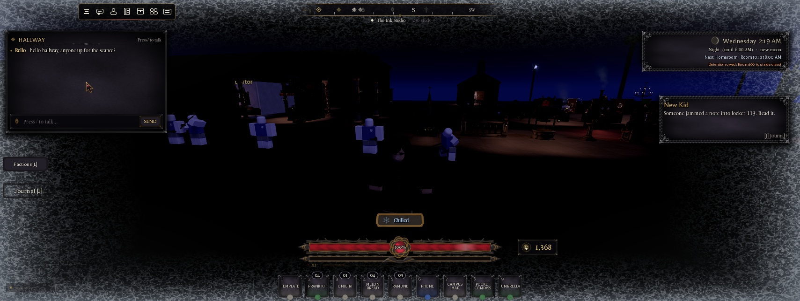

# Changelog: Nightmare Highschool

All notable changes to the NH Combat Test dev place. The newest entries come first.

## [2.14.0] - 2026-11-13: Fist growth: hand gear, race-flavoured finishers, and the Heat meter

Owner: "D (except fighting styles for now)", as designed and approved: concepts 16, 17 and 18 in
`docs/Combat-Audit-and-Concepts.md`. The live scripts are mirrored in `tools/combat-2140/`, with the originals in `pre/`
and `patches.py`. Studio backup: `ServerStorage.NH_Backup.CombatD_pre_20261113`.

### Added
- **Hand gear at the armory (16).** A new Hand gear tab in the armourer's window. You wear one piece at a time, it's
  saved in `PlayerData.Armory.Gear`, and the effects only count with fists out.

  | Gear | Price | Effect |
  | --- | --- | --- |
  | Hand Wraps | ¥250 | You take 10% less guard damage while blocking |
  | Weighted Gloves | ¥500 | +20% guard damage dealt; your swings are 5% slower (client prediction matches) |
  | Brass Knuckles | ¥800 | +15% fist damage, +10% guard damage, contraband |

  - **Contraband:** a hall monitor who sees and recognises you fighting in brass knuckles takes them (they're gone
    from your save) and books a new Contraband violation (3 points) on top of Fighting.
  - **On your hands:** the worn piece is the character attribute `NHGear`, and its model is welded to both hands once
    its mesh is uploaded.
  - **Code:** `ServerStorage.Packages.HandGear`; `Config.Armory.Gear`; `Features.Armory` (the `Gear` remote: Buy,
    Wear, Remove); `Gui.ArmoryUi`; `DamageLogic`; `Combat.M1`; `HallMonitor`; `Config.Discipline`.
- **Race-flavoured 4th hit (17).** The last hit of a fist string carries your race: a tinted burst (a Crimson or Blue
  moon recolours it), a tag on the combo readout, and one small effect. Sub-races use their race. No blood or gore.

  | Race | Tag | Effect |
  | --- | --- | --- |
  | Vampire | SIP | You heal 25% of the damage |
  | Priest | SMITE | +40 guard damage, against the unholy only (vampires, ghouls, werewolves, wraiths, the night's beasts) |
  | Werewolf | MAUL | 35% harder knockback, +0.35 s stagger |
  | Wraith | CHILL | They're slowed for 1.5 s |
  | Ghoul | ROT | Their guard doesn't recover for 3 s |
  | Human | STEADY | +20 guard damage |

  - **Code:** `ServerStorage.Packages.RaceFists`, client `Misc.General."Race Fist"`, and `Features.Posture` for ROT.
- **The Heat meter (18).** A second resource you earn by fighting well.
  - **Filling it:** a landed hit +6, a counter-hit +12, a perfect dodge +10, a parry +20.
  - **Draining:** it cools 5 a second after 6 s without a gain. A full bar holds for 20 s first.
  - **EX skills:** a full bar makes your next Z / X / C skill an EX. That means +30% damage on its hits, an armoured
    wind-up (hits hurt but don't stun or cancel it, 0.6 s), and a gold flare. Using it empties the bar.
  - **The meter:** a small ember brazier on the health bar's right cap, mirroring the hunger reliquary on the left.
    It's 44 px, dims when empty, its coals rise and flicker with sparks as it fills, it breathes when full, and it
    flares when spent. Until the art is uploaded (`Config.HeatArt`) it draws a plain ember disc.
  - **Code:** `ServerStorage.Packages.Heat`, `Gui.HeatMeter`, `Misc.General."Heat EX"`, `ActionManager` (the spend),
    and `DamageLogic` (gains, EX damage, armour).
- **Off switches:** ReplicatedStorage attributes `NHHeatOff` and `NHRaceFistsOff`.

### Tested (NH Combat Test, slot 4 Testy, Human, on Fists, 11 PM, real mouse and keyboard)
- **Heat:** four landed hits took it to 24. A full bar plus Z made ? Kick an EX:
  - **The server:** logged EX, Heat went to 0, and the EX ended with the skill.
  - **The client:** showed the gold flare on Testy and the spend ring on the meter.
  - **The damage:** on a 1000-health dummy the EX did 16.1, which is 12 × 1.3 × 1.035 (Testy's progression bonus).
    The same kick without EX did 12.4.
- **Found and fixed:** a full bar melted below 100 a second or two later, so the EX was refused. A full bar now holds
  for 20 s.
- **Human 4th hit:** STEADY on the readout and +20 guard on the dummy.
- **The other races,** checked by running the effect code with an NPC attacker (no player's race was changed):

  | Race | Result |
  | --- | --- |
  | Vampire | SIP healed 2.5 of a 10 hit |
  | Werewolf | MAUL knockback 60 → 81, stun 1.5 → 1.85 |
  | Wraith | CHILL slowed the target |
  | Ghoul | ROT set the guard-recovery hold |
  | Priest | Nothing on a plain target; against a vampire, SMITE and +40 guard |

- **Gear,** using the Studio test hook:
  - **Weighted gloves:** the swing ran at 1.0925 (1.15 × 0.95), and guard damage on the Blocking dummy was 14 against
    12 without them.
  - **Brass knuckles:** a 3.6 hit (3.0 × 1.15 × 1.035).
  - **Confiscation:** it took them off and out of the save. The armory's Hand gear tab then showed Buy ¥800 again
    for the knuckles and Wear for the gloves.
- **Console:** no new script errors on the server or client.
- **Restored:** `SlotCount` back to 3 and `NHTestNoMenuKeys` cleared. Testy still owns the weighted gloves from the
  test, not worn.

### Not tested
- **The hall monitor's confiscation:** only the confiscation itself was tested, through the test hook. A live monitor
  seeing you fight during school hours would also book violations on the test slot, so that wasn't run.
- **The EX armour:** that a hit during the wind-up doesn't cancel the skill. It needs a second attacker.
- **The gear models and art:** they need the owner's uploads (below).
- **The tab highlight:** the active tab's gold label was added after the last play session.

### For the owner
- **Upload** the art from `art/group-upload-fistgear/` to group 15981569:
  - **Gear:** the three meshes and their textures go in `Config.Armory.Gear[...]`: `Mesh`, `Textures`, and `Offset`
    if it isn't the default.
  - **Icons:** `Icon`.
  - **Heat meter:** Frame, Fill, Glow, Spark and Flare go in `Config.HeatArt`.
- **Save** NH Combat Test.

## [2.13.0] - 2026-11-13: Combat tech: client-predicted swings, lag-compensated hits, and a combat log

Owner: "Let's do Section C" (`docs/Combat-Audit-and-Concepts.md`, concepts 12 to 14). The live scripts are mirrored in
`tools/combat-2130/`, with the originals in `pre/` and `patches.py` (the exact edits). Studio backup:
`ServerStorage.NH_Backup.CombatC_pre_20261113`.

### Added
- **Client-predicted swings (12).** A ground M1 starts on your screen the moment you click, instead of a round trip
  later.
  - **How:** your client plays the swing it expects the server to play and sends its guess with the press. If the
    server plays the same hit, it runs its own copy almost invisibly (weight 0.01) just for the timing: the hit
    frame, end lag and cancels. Your copy is the one everyone sees, and it stops when the server's copy does
    (stunned, feinted, cancelled into an ender).
  - **Wrong guesses:** if the server plays a different hit, yours fades out and the server's plays.
  - **Swings that won't play** (cooldown, busy, buffered for later, the clinch, a running or air swing): the server
    bumps `NHPredictRefused` and your copy is dropped at once. A 1 to 1.5 s timeout covers a lost reply.
  - **When it guesses:** only when the outcome is near certain. That means on the ground, not sprinting, not holding
    block, not attacking, stunned or busy, not in the last hit's cooldown, and not on the 1 s combo-reset edge.
  - **How the client counts the 1 s reset:** each hit is stamped on the synced clock (`NHHitAt`). Any other press
    goes out the old way.
  - **Off switch:** ReplicatedStorage attribute `NHPredictOff`.
  - **Code:** new `InputController.Combat.M1.Predict`; edits to the client `Combat.M1`, `General.Block` (a local
    `NHBlockHeld` flag), `ActionManager` (reads the guess, sends refusals) and `Combat.M1` (weight, refusals,
    `NHHitAt`).
- **Lag-compensated hits (13).** A player's hit also counts where the target was on that player's screen.
  - **The history:** `ServerStorage.Packages.LagComp` keeps 0.6 s of every character's position. Each hitbox also tests
    targets at their position a moment ago.
  - **How far back:** 100 ms for a normal attack (other players' interpolation delay). A predicted swing adds your
    ping. The rewind is capped at 0.3 s.
  - **Scope:** NPC attackers aren't rewound. A hit still counts if it lands now.
  - **Code:** `HitBox:Go` and `GetCast`, plus a `Rewind` field.
  - **Off switch:** `NHLagCompOff`.
- **Combat log (14, Studio only).** `ServerStorage.Packages.CombatLog` traces each exchange:
  - **What it records:** presses (with ping and the client's guess), moves starting or refused, every hitbox
    (current hits and rewound hits), and what DamageLogic made of each hit (lands, blocked, parried, dodged,
    counter-hit, damage and posture).
  - **What it keeps:** only lines involving a player, so the auto-swinging dummies don't flood it.
  - **How to read it:** `NHTestBridge:Invoke("CombatLog", n)`, or set `NHCombatLogPrint` to print live.
  - **Live servers:** it does nothing there.

### Fixed
- **The hitbox's "0.2 s prediction" never ran.** `Local.Predict` checked `typeof(Part) == "BasePart"`, but
  `typeof` returns `"Instance"`, so hits were always judged at the current positions with no compensation. The dead
  code is gone, and lag compensation does the job instead.

### Tested (NH Combat Test, slot 4 Testy on Fists vs the Inf Dummy, 11 PM, real mouse and keyboard)
- **The log:** presses, starts, hitboxes and hits all show. M1.1 lands 0.44 s after the press.
- **Lag compensation, with the hitbox driven directly:**

  | Dummy | Result |
  | --- | --- |
  | In front | Hit by the current overlap |
  | 15 ms after a 10-stud sidestep | Hit through the rewind (100 ms back) |
  | 440 ms after the sidestep | Missed |

- **Prediction, first try:** a 4-hit string matched the server on every hit, and the press during the last hit's
  cooldown wasn't predicted. But on Studio's 20 fps play server, the server's copy reached the client 0.55 s after
  the click, past the first 0.3 s timeout, so the punch was cut off before its hit frame. This led to the refusal
  signal and the longer timeout.
- **Prediction, after the fix:**
  - **Full swings:** predicted swings play in full on the client.
  - **A wrong guess** (the server had reset the string) swapped to the server's hit.
  - **A refusal sent mid-swing** dropped the client's copy 0.54 s in, before the timeout.
  - **The clinch** (F held plus a click) was first wrongly predicted and then refused after 0.17 s. With the local
    block flag it isn't predicted at all, and the Clinch plays clean.
  - **After an M2 cancel,** the next predicted M1 matched and played in full.
- **Console:** no new script errors on the server or client.
- **Restored:** `SlotCount` back to 3, `NHTestNoMenuKeys` cleared, `NHPredictOff` cleared.
- **The crash:** Studio crashed once during testing. Its log shows main-thread hangs that began before the test, after
  24 hours open and 172 play sessions. A plugin had retried `localhost:4455` more than 166,000 times, and the final
  freeze was in the built-in Asset Manager plugin, not the game's scripts.

### Not tested
- **Real latency:** Studio runs at 0 ms ping. The timing is reasoned and the paths are exercised, but how it feels at
  150 ms needs a published server or two-player test (`docs/Two-Player-Test-Plan.md`).
- **Other players' view:** what a second player sees of your predicted swing.
- **Katana:** prediction uses each weapon's own clips, but only fists were tested.

## [2.12.0] - 2026-11-13: Bespoke fist animations for the shove, the body blow and the clinch

Owner: "Actually properly animate the stuff I told you no for before", using "the m1s already in the game as the BASE
LINE ... make sure everything lines up and is smoothly animated into each other". The tools and the clip sources are in
`tools/fist-moves/` (README). The live scripts are mirrored in `tools/fist-moves/studio/`, with the originals in `pre/`
and in `ServerStorage.NH_Backup.FistAnims_pre_20261113`.

### Added
- **Four new R6 clips, built on the owner's fist M1s.**
  - **Shove (after hit 1):** the arms swing back into a crouched gather, the hips launch, then both palms drive out at
    chest and shoulder height and recover into the guard.
  - **Body Blow (after hit 3):** the right hand coils far back with the torso turned away, the hips snap round first,
    and the arm whips across at rib height a frame behind.
  - **Clinch (M1 while blocking):** from the guard it reaches, grabs both shoulders, yanks down and drives the right
    knee into the gut.
  - **Clinch victim:** yanked in, folds over the knee with the arms clutching in, staggers back, and recovers into a
    guard.
- **Seams that line up.** Each clip starts on the exact pose of the swing it cancels (M1.1 at 0.45 s, M1.3 at 0.40 s,
  the Block guard) and ends on the fist idle's first frame.
  - **The limb slides:** the clips copy the owner's Moon-style limb slides (arms pulled in, legs tucked), and the
    soles sit at the idle's height.
  - **Measured in Studio:** every seam joins within 4 mm and 0.2 degrees. The clinch's end is within 6 cm and
    3 degrees, which the next clip's fade covers.
- **New Animation objects (`ReplicatedStorage.Assets.Animations.Weapons.Fist.Moves`).** `Shove`, `BodyBlow`, `Clinch`
  and `ClinchVictim`, empty until the owner publishes the clips.
  - **While empty:** each move plays its old stand-in, so nothing breaks before publishing.
  - **The sources:** `ServerStorage.NH_FistAnims` (KeyframeSequences plus their builder).

### Changed
- **`Combat.Ender`:** plays the bespoke clip at speed 1 with a 0.08 s fade in. The Hit and EndLag timing come from the
  clip's own keyframes.
- **`Combat.Clinch`:** plays the bespoke clip at speed 1 (grab 0.14 s, knee 0.367 s, recovery 0.70 s).
  - **The catch:** the one caught is set 2.9 studs in front, facing you, at their own height. That spacing is how the
    pair was animated. If a wall is in the way they stay where they are.
  - **The victim clip:** they play the clinch-victim clip, and the knee skips its usual hit react so the fold isn't
    cut off.
  - **The tag:** it's tagged like a hit react, so their next hit's react replaces it.
  - **Interrupted:** if you're interrupted before the knee, they're let go.
- **`Combat.M1`:** an ender or clinch clip still settling after its EndLag fades out (0.12 s) under your next swing.
  Before, an Action4 clip would have covered the new M1.

### Tested (NH Combat Test, slot 4 Testy on Fists vs the Inf Dummy, real mouse and keyboard)
- **Setup:** the clips were registered as temporary ids in the play server.
  - **The client:** it plays the server's clip with the full length (0.83 s), so the test shows what players see.
- **Shove:** click then R played M1.1, then the Shove (Action4, 0.83 s), which knocked the dummy about 25 studs.
- **Body Blow:** three clicks then R played M1.1, M1.2, M1.3, then the Body Blow. Frozen on the hit frame, the hook
  lands across the ribs.
- **Clinch:** F held plus a click played the Clinch.
  - **The catch:** the dummy, set 3.4 studs away and 0.6 off-line, was moved to exactly 2.9 straight ahead, facing
    Testy (facing -1.00).
  - **The victim clip:** it played the victim clip, and the knee's push moved the dummy back to about 4.3 studs.
  - **By eye:** frozen on the knee, the dummy is folded over in front of Testy's hands.
- **Fade:** a click after the Shove's EndLag started M1.1 0.73 s in, and the Shove track stopped at that moment.
- **Restored:** `SlotCount` back to 3, `NHTestNoMenuKeys` cleared, and the Moves ids are empty again in the saved
  place.

### Fixed during the work
- **The Shove's arms were too low.** The owner asked for them higher. On the hit frame the palms were at belly height
  (0.7 studs under the shoulders), because the body leans 26 degrees.
  - **The fix:** the shoulders are raised about 45 degrees through the strike, and the arm slide is lifted. The palms
    now reach out at upper-chest and shoulder height.
  - **Checked:** in the stage, by measurement and by eye, with the seams re-checked. That version wasn't play-tested.
    The game code is the same for it.

### Published (the owner)
- **The ids, set in `Fist.Moves`:**

  | Clip | Id |
  | --- | --- |
  | FistShove | 99575689929104 |
  | FistBodyBlow | 115837677569118 |
  | FistClinch | 105787080820844 |
  | FistClinchVictim | 127085112840973 |

- **Checked:**
  - **The clips:** each loads at its length with its Hit / EndLag keyframes. The published Shove has the raised arms.
  - **In play (slot 4):** the Shove, the Body Blow and the Clinch play for the client at full length, and the Inf Dummy
    plays the clinch-victim clip.

### Not done yet (the owner)
- **Save the place:** save NH Combat Test.
- **The Map:** this isn't ported to the Map yet (same as 2.8 to 2.11).

## [2.11.0] - 2026-11-13: Soft lock-on, the delay string, the charged heavy, and wall splats

Owner: "Let's finish up A first then finish up B" (`docs/Combat-Audit-and-Concepts.md`): concept 5, then 7, 10 and 11.
That completes sections A and B. The live scripts are mirrored in `tools/combat-2110/` (`pre/` holds the two the Studio
backup doesn't). The rest are in `ServerStorage.NH_Backup.Combat211_pre_20261113`.

### Added
- **Soft lock-on (5).**
  - **Mouse and keyboard:** middle mouse locks on to the nearest opponent in front, and again lets go. While locked
    you face them between swings, with a small gold diamond over their head. It lets go when they drop, go down, get
    40+ studs away, or you put your fists away.
  - **Gamepad and touch:** every pad button is taken, so these get aim assist instead: each swing turns you to the
    nearest opponent in front within 9 studs. Mouse players keep their own aim.

  (New `InputController.Combat.LockOn` and `LockOn.Core`, `Keybinds` `LockOn`, called from `Combat.M1` / `Combat.M2`.)
- **The delay string (7).** Throw the 4th hit after a pause (0.3 s or more after hit 3). If they've had their guard up
  0.25 s or more, it goes straight through: full damage and the knockback, with DELAY on the readout. A late, reactive
  block still parries (`Combat.M1`, `General.Block`).
- **The charged heavy (10).** Hold M2 and the wind-up holds and charges, 0.4 s a step, up to three.
  - **Each step:** +15% damage, guard damage 35 / 50 / 65, a gold glow and a rising chime.
  - **The third step:** flares and breaks a guard.
  - **A tap:** the same instant heavy as before.
  - **Risk:** you can be counter-hit while charging.
  - **The packet:** `UnPackets.M2` now carries flags (1 aerial, 2 press, 4 let go), like M1 in 2.10.0
    (`Assets.M2.Fist`, client `Misc.General.Charge`).
- **Wall splats (11).** A hard knockback (the 4th hit, the running straight, the shove, the heavy) that drives someone
  into a wall pins them there.
  - **The pin:** a 0.9 s stun, a head snap against the wall, dust and a thud, with WALL SPLAT on your readout.
  - **No gore.**
  - **Code:** `DamageLogic` `Local.WallSplat`, client `Misc.General."Wall Splat"`.

### Tested (NH Combat Test, slot 4 Testy on Fists, 11 PM, real mouse and keyboard where the tools allow)
- **Delay string (Blocking dummy, guard up):**
  - A normal-rhythm 4th hit was blocked (0.5 chip).
  - The 4th thrown 0.8 s after hit 3 went through: 3.1 damage, the knockback, and DELAY on the readout.
- **Charged heavy:**
  - **Tap:** an R tap hit 0.56 s after the press (unchanged).
  - **First build:** holding R 1.5 s reached only step 2 (+50 guard damage). 1.2 / 0.4 is 2.9999... in floating
    point, so step 3 was missed. The step is now counted with a tolerance and again after the loop.
  - **After the fix:** the glow at steps 1 and 2, the flare at step 3, and the release broke the blocker's guard
    (posture 0, stunned and paralyzed about 1.5 s).
- **Wall splat:** with a test wall 6.6 studs behind the Inf Dummy, 1 click then R (the shove) pinned it 1 stud off the
  wall, and the readout said WALL SPLAT.
- **Lock-on (driven through `LockOn.Core`):**
  - **Lock:** it locked on to the Inf Dummy (AutoRotate off, the marker on its head).
  - **Follow:** moving the dummy 90 degrees to the side turned Testy to face it (0 degrees off).
  - **Release:** it put everything back.
  - **Binding:** the middle-mouse binding registered (no "not binded" warning).
- **Console:** no script errors.
- **Restored:** `SlotCount` back to 3 and `NHTestNoMenuKeys` cleared.

### Not tested
- **Real middle-mouse press:** the input tool can't press middle mouse.
- **Aim assist:** on a real gamepad or a phone.
- **Charge cue:** the charge glow and chime by eye and ear.
- **Splat on real walls:** the school's own walls and props (the test used a plain wall).
- **The Map:** not ported.

## [2.10.0] - 2026-11-13: The fist moveset: string enders, the clinch, and riposte

Owner: "Fist moveset 6, 8, 9", concepts 6, 8 and 9 in `docs/Combat-Audit-and-Concepts.md`. The live scripts are mirrored
in `tools/fist-moveset-2100/` (`pre/` holds the two scripts the Studio backup doesn't). The rest are in
`ServerStorage.NH_Backup.FistMoveset_pre_20261113`.

### Added (Fists)
- **String enders.** Press M2 right after a hit of your string lands (within 0.8 s) to finish it with a special instead
  of the plain heavy. It cancels the swing's recovery once its hit has landed, and shares M2's cooldown.
  - **After hit 1, the Shove:** knocks them about 20 studs back.
  - **After hit 2, the Launcher:** the uppercut, into the air combo.
  - **After hit 3, the Body Blow:** a hook to the ribs with the heavy tell. Clean, it doubles them over (1 s stun); into
    a guard it's +35 posture.

  (`ActionManager` `Local.TryEnder`; new `ActionManager.Combat.Ender`.)
- **The Clinch.** M1 while holding block grabs and knees (new `ActionManager.Combat.Clinch`). It has a 3 s cooldown.
  - **What beats what:** it goes through a guard and a parry window, but loses to a swing that's winding up. A dodge
    still slips it.
  - **Caught:** 4 damage and +25 posture (a posture break if that fills it), and they double over.
- **Riposte.** Land a parry and your next M1 within 0.9 s is a riposte: 1.5x damage, a stagger and a heavy hit-stop
  (`DamageLogic.Parry` opens the window, `Combat.M1` spends it).
- **The readout** names the move over your combo count: SHOVE, BODY BLOW, CLINCH, or RIPOSTE in crimson like COUNTER.
- **Supporting changes:**
  - **`DamageLogic`:** a move can ask for its own hit reaction (`React`), name itself (`Tag`), mark itself heavy
    (`Heavy`), and go through a parry window (`IgnoreStates.Parry`, for the grab).
- **Stand-in clips:** until bespoke ones exist, the moves use the existing Fist clips: M1.4 (both arms drive forward)
  for the shove, M1.3 (the hook) for the body blow, and M2 (the leg drives up) for the knee.

### Fixed
- **One click is one swing, for real (2.8.0 follow-up).** 2.8.0 told a new click from a hold-repeat by timing (a gap over
  0.09 s). But the network batches the repeats about 0.1 s apart, so a click could still queue a second swing (seen
  here: 2 clicks, 3 swings).
  - **Now:** the M1 packet carries a flags byte (`UnPackets.M1` is `NumberU8`: 1 = aerial, 2 = a new press), and only a
    flagged press is buffered (`InputController.Combat.M1`, `ActionManager`).
  - **Checked:** 1, 2 and 3 clicks gave exactly 1, 2 and 3 swings afterwards.

### Tested (NH Combat Test, slot 4 Testy on Fists, 11 PM, real mouse and keyboard)
- **Launcher:** 2 clicks then R. M2 arrived 0.05 s after hit 2 landed; Testy played the uppercut and the Inf Dummy
  went up from Y 3.9 to 15.9.
- **Body Blow:** 3 hits then R played the hook, the dummy doubled over (clip 1), and the readout said BODY BLOW.
- **Shove:** 1 click then R played the double push, the dummy took the knockback reaction 20 studs away, and the readout
  said SHOVE.
  - The first version ("hold back + R") swung at nothing: holding S turns the character away. It was changed to "after
    hit 1".
- **Clinch:**
  - Holding F and clicking against the Blocking dummy (guard up): it took 4.1 damage (100 to 95.9) and +25 posture (0 to
    25), and doubled over. The readout said CLINCH.
- **Riposte:**
  - Testy parried the Attacking dummy's swing (the window opened), and the M1 0.45 s later spent it.
  - With the window set directly, the hit showed RIPOSTE.
- **Console:** no script errors.
- **Restored:** `SlotCount` back to 3 and `NHTestNoMenuKeys` cleared.

### Not tested
- **The clinch losing to a swing:** that case wasn't produced in a test.
- **Riposte damage:** the 1.5x wasn't read directly (the dummies have infinite health or regenerate).
- **The moves in motion:** how they look and feel at full speed, by eye.
- **Input devices:** gamepad and touch.
- **The Map:** not ported.

## [2.9.0] - 2026-11-13: Combat feel: counter-hits, hits that react to where they land, heavy tells, and a combo counter

Owner: "Feel set 1-4", concepts 1 to 4 in `docs/Combat-Audit-and-Concepts.md`. The live scripts are mirrored in
`tools/combat-feel-290/`; the scripts as they were before are in `ServerStorage.NH_Backup.FeelSet_pre_20261113`.

### Added
- **Counter-hits.** Hit someone before their own swing reaches its hit frame and it's a counter:
  - **Stun:** 1.5x the usual stun.
  - **Hit-stop:** a longer hold, 0.1 s.
  - **Flash and sound:** a white flash on them (skipped under Reduce Flashing), and the Critical sound pitched up.
  - **Readout:** "COUNTER" over your combo count.

  Each swing marks its own wind-up as it starts (`NHWindupUntil`, set by `Combat.M1`, `Running M1`, `Uppercut` and
  `M2.Fist`). `DamageLogic.TakeAction` reads it.
- **Hits react to where they land.** The four existing hit clips, measured from their keyframes, are now picked by side
  (`DamageLogic`, `Local.HitReact`):
  - **From the front:** a head snap, then a body blow, alternating sides.
  - **From behind:** doubled over forward.
  - **From the right / left:** knocked the other way.

  Before, they just cycled. No new animations were needed.
- **The uppercut has a tell.** It now plays the heavy's critical flash and sound as it winds up, so a defender can read
  the launcher coming.
- **Combo counter:** a gold numeral and a spaced "H I T S" at the right edge while your string lands. It appears from
  the 2nd hit and fades 1.6 s after the last.
- **Damage numbers:** these float over what you hit: gold on heavy hits, crimson on counters. Off by default.
- **Settings:** the counter and the numbers have toggles under Settings > Interface > Combat (`ComboCounter`,
  `DamageNumbers`).

### Tested (NH Combat Test, slot 4 Testy on Fists, at 11 PM so the monitors were off duty)
- **Direction (server, hitting the Inf Dummy from each side):** front gave clips 3 then 1, back 1 then 2, right 3 then
  1, left 4 then 2.
- **Counter (timed into the Attacking dummy's own string):**
  - **Timing:** its swing started 0.24 s after Testy's, so Testy's hit landed in its wind-up.
  - **Stun:** 1.31 s, against 0.87 s for a normal hit on the Inf Dummy.
  - **Client:** the white flash on it, and "COUNTER" on Testy's readout.
  - **The normal hit:** no flash.
- **Combo counter (real clicks):** read "2", then "3", then faded. In the first build it sat behind the quest tracker,
  so it was moved lower; the move was checked by screenshot.
- **Damage numbers:**
  - Turned on through the real Settings menu (the new Combat section fits the Interface tab).
  - Two hits made two "3"s; one was measured on screen above the dummy's head, opaque, in the theme font.
  - Turned back off afterwards.
- **Uppercut:** the Heavy tell played as it started, and its wind-up window was 0.36 s.
- **Console:** no script errors.
- **Restored:** `SlotCount` back to 3 and `NHTestNoMenuKeys` cleared.

### Not tested
- **Hit reactions by eye:** how the directional reactions look in motion.
- **The counter sound:** not heard.
- **Other viewers:** a second player seeing the flash.
- **Input devices:** gamepad and touch.
- **The Map:** not ported (nor is 2.8.0).

## [2.8.1] - 2026-11-13: A record with teeth: Probation and Suspension now change how school treats you

Owner: "Build concept 1" (concept 1 of the Delinquent audit, `docs/Delinquent-System-Audit.md`). Until now the
`DisciplineLevel` and `Suspended` attributes were read by nothing. Details: `docs/Attendance-and-Discipline.md`.

### Added
- **Probation: the monitor knows your face.**
  - A hall monitor recognises a fight (or paint) at 40 studs instead of 25, and books it on the spot instead of coming
    to investigate (`School.HallMonitor.RecognizeRange`).
  - Hall passes are void: "The Office voided your pass while you're on Probation." No punch is used
    (`Features.Kit.ShowPass`).
- **Suspension: stay off campus during class.**
  - During a class period, a monitor that sees a suspended student inside the school chases them for Trespassing
    (+3, held over the suspension as in 2.7.3). Leaving campus ends the chase: "And stay out."
  - "Campus" means any `Config.Regions` place of Kind `School`, or `workspace.School`'s rooms and halls. In NH Combat
    Test the region boxes sit above the greybox school.
  - The 40-stud recognition applies too.
  - The HUD reads "Suspended: stay off campus (Bruno has work at the Back Lot)". The level toast says the same.
- **Bruno's work for suspended students.** Two daily quests, gated by a new `Requires.Suspended`
  (`Quests.CanStart`). They skip the clique dress code: Bruno takes any suspended kid.
  - **Muscle for Hire:** win a scuffle or rumble for the Delinquents.
  - **Day Off:** prank the Ordinary's Commons. That's on campus, so doing it in class time risks Trespassing.
  - Each pays ¥25 and +8 Delinquents.
- **Owed detentions are capped at 3** (`Config.Discipline.Record.MaxDetentionsOwed`). An admin can still add more, and
  existing higher counts are kept.
- **New config:** `Config.Discipline.Record` (`ProbationRecognizeRange`, `NoPassLevels`, `MaxDetentionsOwed`).

### Tested (Play, slot 4 "Testy"; data and hotbar restored afterwards)
- **Cap.** Climbing into Detention owing 1 gives 2, owing 2 gives 3, owing 3 stays 3, and Testy's existing 7 stays 7.
- **Hall pass.** On Probation in class, showing it gave the void toast; punches stayed 2 and no pass timer was set.
- **Recognition.**
  - On Probation, a hit seen from 31 studs was booked at once (+4 Fighting).
  - At Warning, a hit from 29 studs only sent the monitor to investigate (a chase, no points).
- **Bruno's jobs.** At Warning, both are `Locked`. Once suspended, both are `Ok`.
  - First run: `DressCode`. That's why they now skip the dress code.
- **Trespassing.**
  - Suspended in the hallway during class: spotted for Trespassing in 0.15 s. Leaving campus ended the chase, 0
    points.
  - Next period, staying put: caught, Trespassing by the Hall Monitor (16 → 19), `HeldPoints` 3.
  - First run: no chase, because the region boxes don't cover NH Combat Test's greybox. The campus check now
    includes the greybox rooms and halls.
- **HUD (in class while suspended):** "History · Room 105 · Suspended: stay off campus (Bruno has work at the Back Lot)",
  waypoint off.

### Not tested
- Two players.
- Starting and finishing Bruno's two jobs end to end. Only the start check was run; they use the existing `Scuffle` and
  `Prank` objectives.
- The Map place: not ported. Its region boxes should cover its real building.

Studio backups are in `ServerStorage.NH_Backup.*_RecordTeeth_pre`: ConfigDiscipline, Discipline, HallMonitor, Kit,
Quests, ConfigQuests and ClockHud. NH Combat Test is saved (version 1068).

## [2.8.0] - 2026-11-13: Combat audit: fists that flow, contact you can feel, and parries that can't be mashed

Owner: "Completely audit and analyze the combat system, especially for fists, and bugfix it and enhance it for a
smoother gameplay. Then give me concepts on how we can enhance and expand on what we have already." The full audit, the
test record and 22 concepts are in `docs/Combat-Audit-and-Concepts.md`. The live scripts are mirrored in
`tools/combat-audit-280/`; the scripts as they were before are in `ServerStorage.NH_Backup.CombatAudit_pre_20261113`.

### Fixed
- **Fists stuck on each swing.** A swing's recovery was read in clip time, but fists play at 1.15x, so every swing held
  you about 14% past its own end (0.52 s instead of 0.45 s on the first). `Combat.M1` now converts it to real seconds.
  Katana (1.3x) and Claws (1.2x) speed up the same way.
- **Clicks were dropped.** A click made while a swing was recovering was thrown away, so tapping in rhythm lost hits.
  Now the server remembers a fresh click from the last 0.5 s of a swing and starts the next swing the moment the current
  one ends (`ActionManager`, players only). One click is still one swing: the client's 0.05 s hold-repeats aren't
  buffered.
- **The parry tap flashed the guard.** After a quick parry tap, the block thread woke up 0.25 s later and played the
  guard pose and Slow over whatever you did next. It now checks it still owns the block, and letting go stops the parry
  pose (`General.Block`).
- **Parry could be mashed.** A 0.1 s block cooldown let you reopen a 0.25 s parry window about every 0.35 s, so you were
  parrying roughly 70% of the time. A window that catches nothing now locks the next one out for 0.5 s; you still guard
  at once. A parry that lands lifts the lock (`DamageLogic.Parry`).
- **Combo ender versus cooldown.** The end-of-combo cooldown is set before the 4th swing ends, so a buffered click can't
  start a 5th hit.
- **Katana combo order.** The four swings came from `GetChildren()`, which has no order; they're sorted 1-4 now.
- **Running M1:** an error path called `HitBox:Disconnect`, which doesn't exist.

### Added
- **Hit-stop:** on contact the swing and the hit-react hold for 0.05 s, or 0.1 s on a heavy hit (combo ender, running
  straight, downslam, a downing hit). This follows the house style's 3 and 6 frames. Walking and idle aren't paused
  (`StateController.Misc.General.Damage Type`; `DamageLogic` now sends `Attacker` and `Heavy`).
- **A camera kick** for the attacker and the victim on each hit, scaled by the Camera Shake setting.

### Tested (NH Combat Test, slot 4 Testy on Fists, Inf Dummy, real mouse and keyboard)
- **Clicks:** 1, 2 and 3 clicks gave 1, 2 and 3 swings, back to back. A 2.2 s hold gave the full string and then the 1 s
  cooldown.
- **10 taps 0.3 s apart:** swings came 0.48, 0.36 and 0.43 s apart, each starting the moment the last one's corrected
  recovery ended.
- **Hit-stop:** both swing tracks held 0.07 s on contact and resumed.
- **Parry tap then a click:** the parry pose stopped on release; no guard pose or Slow at 0.25 s.
- **Mashing F:** the first press parried, the next two only guarded, and the fourth (0.75 s later) parried again.
- **Console:** no script errors.
- **Restored:** `SlotCount` back to 3 and `NHTestNoMenuKeys` cleared. Testy is left on Fists.

### Not tested
- **Input devices:** gamepad and touch (same remotes).
- **A second player:** two players, and the camera kick by eye.
- **The AI tiers:** play against the tiers. Delinquents' fist combos are about 14% faster too; the stunlock guard still
  caps them.
- **Discipline:** checked afterwards: the tests ran during After School, but Testy picked up no Fighting violations
  (the Delinquent session compared Testy's record).
- **The Map:** not ported.

### Found, left for the owner
- **Heavy damage:** every weapon's heavy (M2) does 1.3x a light hit, and the config's `M2Damage` is never read.
- **E for fists:** you need E to raise your fists, and any ProximityPrompt on screen takes E (in the test, a quest
  prompt 7 studs away did).
- **Uppercut timing:** its recovery has the same clip-time issue, left because the AI timings were tuned to it.

## [2.7.3] - 2026-11-13: Delinquent system audit: seven fixes to attendance, discipline, the hall monitor and the Delinquents

Owner: "Look through everything on the game and everything you've learned." This is a full audit of the street crews,
the Delinquents clique and the discipline ladder. Details, design questions and expansion concepts are in
`docs/Delinquent-System-Audit.md`.

### Fixed
- **Booked Absent from the character creator.**
  - Before: after picking a slot you're still in the menu, but `School.Attendance` already tracked the class, so a
    period spent in the creator was booked Absent with +3 points.
  - Now: nothing is tracked while `InMainMenu` is true, and "first seen" waits for Enter. Entering mid-class counts
    as a late join.
- **A suspended student was sent to class.** `Gui.ClockHud` showed "NOT IN CLASS" in red with a room waypoint.
  - Now it reads "Suspended: stay out of class today" in orange, with no marker.
- **Suspension was a free pass.** Violations during a suspension were wiped when it ended.
  - `School.Discipline` now holds them in `Discipline.HeldPoints` and adds them back on top of the 8, with a toast.
    Enough of them suspends you again.
  - `PlayerData` documents the new optional field.
- **A hall monitor on its way to break up a scuffle no longer turns to chase someone it sees hit.** Turning away used
  to end the scuffle as "Monitor" before it arrived. Changed in `School.HallMonitor` `OnDamage` and `CheckWitness`.
- **Guard Duty (Bruno's daily job) waits for you.** The Ordinary prank used to come 30 s after the job started, wherever
  you were, which spent the job's one sure prank. In `Social.CliquePranks.GuardDuty` it now comes once you're within
  80 studs of the Back Lot (up to 40 min).
- **No standing for downs after a scuffle or rumble has ended** (`Social.CliqueFights.OnDowned`, same check as `OnHit`).
- **The Delinquents no longer send backup against a street-crew Delinquent.** `CliqueFights.Backup` now reads the
  attacker's clique from its tag or `Config.Cliques.Npcs` by name.

### Tested (Play, slot 4 "Testy"; data restored afterwards)
- **Creator.**
  - Before the fix: in the creator at 8:21, the server set `ClassRoom = R102`, opened the Period 1 record, and at
    9:01 booked Absent (6 → 9 points).
  - After: in the creator during Period 1 there was no `ClassRoom` and no record, and no Absent at the bell.
  - Entering at 9:38 started the record at 9:38, and it finalized as **Excused**.
- **Suspended HUD.**
  - Before: "English · Room 104 · NOT IN CLASS" plus the waypoint.
  - After: "English · Room 104 · Suspended: stay out of class today" in orange, waypoint off.
- **Suspension carry-over.**
  - Before: 16 points plus three Fightings (28), then next day 8.
  - After: `HeldPoints` 12, then next day 8 + 12 = 20, suspended again.
  - A day with no violations gives 8 and Probation.
  - Fighting once while suspended gives 12 next day and the toast "What you did while suspended still counts (+4
    points)".
- **Monitor.** A scuffle at the Commons; Testy hit a fighter 30 studs from the responding monitor with a clear line of
  sight. The monitor stayed in `Respond` with no chase target.
- **Guard Duty.** With Testy at the school spawn, no prank came in 52 s. At the Back Lot, the Ordinary prankster
  spawned 13.7 s later.
- **Late downs.**
  - Live scuffle: a down paid the Ordinary +8 (+6 help, +2 rival share).
  - 0.6 s after the scuffle ended: +2 only.
- **Backup.** A street-crew Delinquent hit Testy as a Delinquents member: no Delinquents backup. The Pack (Testy holds
  its reward) still sent backup.

### Found, not changed (owner's call)
See the audit doc, findings A-J:
- Fighting violations during rumbles and scuffles the game asks for.
- The street crews are mapped to the Delinquents but never tagged. Tested: downing one changes no standing, unlike
  what `Cliques.md` says.
- Delinquents members are jumped at the Commons during class.
- A showdown win can lower standing, and a third party can win it for you.
- Commons scuffles mostly end as "Monitor".
- An uncapped crew farm.
- Owed detentions pile up.
- Standing is written outside `UpdateState`.

### Not tested
- Two players.
- The Map place: it loads slot 1. None of these fixes is ported to the Map yet.
- A real rumble with a monitor watching.

### Test leftovers
Testy's open report-card week (2514) keeps the test's extra entries: one Mathematics absence and +5 violations. The
test bridge can't edit it. Attendance, discipline and clique standing were restored.

Studio backups are in `ServerStorage.NH_Backup.*_DelinqAudit_pre`: Attendance, Discipline, ClockHud, PlayerData,
HallMonitor, CliqueFights and CliquePranks. NH Combat Test is saved (version 1061).

## [2.7.2] - 2026-11-13: Racial grips go live: published clips, sounds and art, and ported to the Map

Owner: "Published and uploaded. And yes port everything to the map place." Details: `docs/Racial-Grips.md`.

### Changed
- **The grips use their published assets.** All are group-owned:
  - 11 clips: each race's attacker and victim. The Ghoul attacker keeps the owner's Eat Body.
  - 15 sounds and 15 textures.
- **Ids are wired into `Config.RaceGrips`:** `Gripper` / `Victim`, `Sounds` and `Textures`.
  - Live servers now play both clips with the weld, instead of the old single-clip fallback.
  - The grip sounds and the custom effect art are on.
- **Ported to the Map place.** The diff from the NH Combat Test pre-grip backups was applied to the Map's identical
  scripts: `Features.Downed`, `ActionManager.Misc.RaceAction`, `Features.RaceAction`, `World.RaceActionFx` and
  `Gui.TouchControls`. `Config.RaceGrips` and the `RaceGripFx` client module were added.
  - The Map's backups are in `ServerStorage.NH_Backup.RacialGrips_port_pre`.

### Tested
- **Published ids (NH Combat Test, Edit):** every clip id loads.
  - The 10 new clips match the 2.7.1 build exactly (keyframe count and length).
  - All 37 sound and texture ids loaded, including the existing sigils and tier-up art.
- **Map (Edit):** all 7 grip scripts match NH Combat Test's checksums. The grips' dependencies are in place:
  `Controllers.Fx` and its API, `Lineage`, and `workspace.Live` and the `Ragdoll` group at run time.
  - The optional `NHEvolveFX` bone spikes and gilded cross are not in the Map, so it uses the built-in fallback
    parts.
- **Map (Play):** the game booted with no grip errors.

### Not tested
- **No grip was played in the Map.** It skips the slot menu and loads slot 1, so it can't be tested on slot 4
  "Testy". Its code is byte-identical to the NH Combat Test scripts tested in 2.6.0-2.7.1.
- **The published clips have not been played in a live server.**
- **Both places need a save:** NH Combat Test and the Map.

## [2.7.1] - 2026-11-13: Racial grips: heads look at what they are doing

Owner: "Make the head movements actually follow the animation and look natural for what they are trying to do. The
werewolf eating anim has the head up instead of down on the victim." Details: `docs/Racial-Grips.md`.

### Changed
- **Heads aim at their targets.** A neck key can now aim the face at a point on the other body: the face, the throat,
  the chest, the neck, or the soul streak. The generator solves it every frame from wherever the body is, within
  natural neck limits (80 deg turn, 75 deg down, 60 deg up), with a small expressive tilt on top (a cocked head, a
  snarl, a bow). The old fixed neck angles ignored the body's lean, so heads stared past the victim.
- **Werewolf:** it mauls with its head down in the body. Before, its face was level to only 21-42 deg down, missing
  the victim by 57-81 deg; now it points 47-62 deg down, within 8-25 deg of the throat and chest.
  - The snarl locks onto the face.
  - Its eyes follow each raking claw, and it snaps down at the throat between swipes.
  - It shakes the victim by the neck on the haul.
  - The howl still looks up.
- **Attackers:**
  - Human: watches the face and throat, then the heart through the stake.
  - Priest: keeps its eyes on the possessed face, goes to the chest for the strike, then bows over the body.
  - Vampire: creeps in eyeing the face and locks on the neck.
  - Wraith: follows the soul up to its palm.
- **Victims:**
  - They watch their attacker before and between the impact jolts.
  - The Human's victim watches the stake arm it is fighting.
  - The possessed body glares up at the priest between spasms.
- **Kept as they were:** the impact whips, the possessed thrashing, the bite pose, the wraith victim's head falling
  back, and the howl and soul-rip looking up.

### Tested (NH Combat Test)
- **Generator:** head aim was measured per beat on every grip, attacker and victim, as above. All 11 sequences were
  rebuilt and installed in `ServerStorage.NH_GripAnims`. animpro passes on every clip.
  - The Werewolf attacker now waives groundContact and rootDrift: it is on all fours and the pounce travels.
- **Play on slot 4 "Testy", Werewolf through the real N key on a Human dummy:** the client measured the same head
  aim as the generator:

  | Beat | Face pitch | Miss from the chest |
  |---|---|---|
  | Maul | 47-62 deg down | 8-23 deg |
  | Haul | on the throat | 41-48 deg |
  | Howl | 74 deg up | - |

  - The victim died at the end. Testy is back to Human / Human, and the slot flags are restored.
- **Not played:** the other five grips' new heads were checked in the generator only.
- **Still to do:** the KeyframeSequences changed again and need publishing, and NH Combat Test needs a save.

## [2.7.0] - 2026-11-13: Inventory QOL batch 7: move pouch slots, and Day / Fight / Night loadouts

Owner: "Yes, batch 7" (concepts 2 and 6 in `docs/Inventory-QOL-Concepts.md`). The live scripts are mirrored in
`tools/inventory-qol-batch7/`. Studio backup: `ServerStorage.NH_Backup.InventoryQOL7_pre_20261113`, which holds the
four scripts as they were before.

### Added
- **Move pouch slots.** In the Locker, drag a pouch slot onto another to move it. With a gamepad or touch, pick a pinned
  snack and press the `<` `>` buttons beside the pouch. The card says which slot it's in. The server keeps the order
  (`Inventory.MovePin`, remote `NHInventory.MovePin`).
- **Loadouts.** The Day, Fight and Night chips left of the pouch are three saved pouches. Switching keeps the one you
  had and brings the other back, empty pins included, so "Restock my pins" refills them. A loadout you've never used
  starts as a copy of your pouch. Saved as `PlayerData.Inventory.Loadouts = { Active, Sets }` (`Inventory.Loadout`,
  remote `NHInventory.Loadout`).

### Changed
- **Hotbar order.** Your pouch snacks now lead the hotbar in pouch order, so keys 1-4 are always pouch slots 1-4 (each
  snack tool carries `NHPinIndex`; `Gui.KitHud` sorts by it). Before, a re-pinned snack went to the end of the bar, behind
  the kit items. The first test of this batch showed loadout switches doing exactly that, which is why this changed.
  Other tools (the kit items, `Template`) keep their order after the snacks.

### Tested (NH Combat Test, slot 4 Testy, entered through the real slot remotes)
- **Moving through the remote:** moving Ramune from pouch slot 4 to slot 1 reordered the pouch and the hotbar. A snack
  that isn't pinned, and a NaN slot number, were refused with a reason.
- **Loadouts through the remote:**
  - Fight started as a copy of Day. Unpinning two snacks and pinning Miso Soup and Hot Cocoa changed only Fight.
  - Switching to Day brought back Ramune, Prank Kit, Onigiri and Melon Bread; switching to Fight brought back its own set.
  - Night started as a copy. "Night" again said it was already on, and "Brunch" was refused.
- **Saving:** after stopping and restarting Play, Testy came back on Day with the same pin order, and keys 1-4 were the pouch.
- **In the Locker, with the real mouse:**
  - Clicking the Fight chip switched the loadout, and hotbar 1-4 became the Fight set.
  - Dragging pouch slot 1 onto slot 3 dimmed the dragged slot, put a gold edge on the target, and moved Ramune to slot
    3, with the hotbar following. No drag marks were left behind.
  - Clicking `>` moved it on to slot 4.
- **Console:** no script errors.
- **Restored:** `SlotCount` back to 3 and the `NHTestNoMenuKeys` attribute cleared.

### Not tested
- **Gamepad and touch:** a real gamepad on the chips and the `<` `>` buttons, and a touch drag.
- **The Map:** not ported (nor are batches 5 and 6).

### Owner's call
- **Switching outside the Locker:** the concept also had "hold the hotbar's first key" to switch loadouts. It isn't
  built, because holding 1 already equips slot 1. Name a key if you want one.

## [2.6.2] - 2026-11-13: Racial grips reworked: scarier, smoother, and kneels taken from the game's crouch

Owner, on the 2.6.0 grips: "I like them, but make the animations look more menacing, scary, and smoother. Also make
sure the legs don't look weird during the animation." Then, with reference shots and a "Kneel Example" model: "Kneels
should look like this", "Just use the crouching > get up animation as reference that we already have in the game",
and "Don't be afraid to use other animations we already have". Details: `docs/Racial-Grips.md`.

### Changed
- **Every kneel is now the game's own crouch** (Crouch, rbxassetid://139672322709288, the 171-key "Crouch idle"),
  copied pose for pose for the Human, Priest and Vampire grips. The torso drops about a stud and leans in, the front
  shin stands upright a stud ahead, and the back leg slants back and out with its knee resting on the floor. As in the
  crouch, the legs slide up into the torso to fold the knee (a Pose translation), and the HRP stays at standing height.
  The legs stay planted on the floor while the body leans, turns and strikes over them.
  - The old kneels pivoted rigid legs at the hip under a torso pitched up to 57 deg and read as a lunge or a split.
- **Menace:**
  - Slow creeping starts with the head cocked and hands curled like claws.
  - Heavier leans over the victim.
  - The stake and the palm strike drive the hips down into the hit.
  - The Werewolf snarls with its claws out before the pounce and howls from a planted stance.
  - The Wraith dives with its legs trailing back.
  - The Priest stays over the emptied body, palm down, head bowed.
- **Smoother:**
  - Every clip is spline-interpolated and smoothed after the contacts are solved.
  - Fixed: a velocity spike in the Ghoul victim's overhead claw, and a 179 deg twist flip in a reach.
  - Fewer, longer heel drums on the possessed body.
- **Legs never look wrong:**
  - Nothing passes through the floor any more; victim limbs used to dip up to 1.4 studs under it. The only exception is
    the crouch's back knee, 0.41 down, exactly as the game's crouch plays.
  - Arching victims keep their heels planted, so their legs no longer hang.
  - Stand-to-kneel transitions take a step.
- **Victims fight harder:**
  - The Human's victim strains its chest up off the floor, twisting toward the stake arm.
  - The possessed body no longer lies flat while it grabs the priest's wrist.

### Tested (NH Combat Test: Edit, then Play on slot 4 "Testy")
- All 11 KeyframeSequences rebuilt in `ServerStorage.NH_GripAnims`. The Studio Builder already applies a position on
  any part.
- **Crouch match:**
  - A rig posed from GripHuman's 1.3 s keyframe stood next to one posed from the game's Crouch. Both lowest points
    were 0.41 under the floor top.
  - The Vampire bite and the Priest exorcism, posed from the installed clips with their victims at the grip offsets,
    looked right in screenshots.
  - The legs' Pose positions match the crouch asset's (0.84, 0.75, 0.04) and (-0.57, 1.18, 0.32).
- **Generator checks:** animpro passes on both bodies of every grip.
  - groundContact is waived on the three crouching attackers because animpro can't see the leg slide.
  - Hand contact, worst frame: attackers 0.25-0.38 studs, victims 0.00-0.31. The Wraith's palm floats over the chest
    by design.
  - No part under the floor beyond the crouch knee.
- **Play on slot 4 "Testy", through the real N key:** Human (on a Vampire dummy), Priest (on a Vampire dummy) and
  Vampire (on a Human dummy). The dummies were downed with `NHTestBridge`.
  - Both clips played every time, and each victim died and was removed at the end.
  - Sampled on the client mid-grip, the player's torso dropped 0.93-1.13. It sank to 1.31 on the Priest's palm strike.
  - The lowest point was always the back knee, 0.40-0.42 into the real floor. The HRP stayed at standing height.
  - The hips carried the slide; for example, the Human's Right Hip was (0.59, 1.37, 0.12) at 1.3 s, the pack's value.
  - The Vampire rose to standing by 2.9 s, with no slide left.
  - The client played its own registered copies of the clips (the test mirror), because Studio's temporary ids don't
    load on the client.
- **Not tested:**
  - The Werewolf, Wraith and Ghoul-victim clips in Play.
  - A side-on screenshot of the player mid-grip: the grip camera held the view behind the player.
- **Still to do:** the KeyframeSequences need publishing again, and NH Combat Test needs a save. Testy's race is back to
  Human / Human, the slot flags are restored, and the Map place only held a temporary preview stage, now removed.

## [2.6.1] - 2026-11-13: Students stop hopping in the hallway crowd

Found while testing 2.3.0: in the Before School and Passing crowds, every scheduled student jumped about 8 times a
minute, and some landed on lockers. It predates 2.3.0 (115 jumps in 75 s before it, 100 after). `Services.AI.Nav` (the
same file in both places) and `Features.Schedules` (Combat Test). Source and the exact edits: `tools/nav-jumps-261/`.

### Fixed
- **The real trigger: the path smoother.** It skips ahead to a further waypoint along a clear line. The "stuck" check
  still compared against the best distance to the old, nearer waypoint, so 1.1 s later a student walking freely down a
  straight hall counted as stuck and hopped. Progress is now measured afresh whenever the smoother skips ahead. This was
  106 of the 144 jumps logged in one 75 s run.
- **Blocked on the flat, they sidestep.** Being really stuck used to jump first, onto whatever was in the way: another
  student, a locker, a sofa, a pillar's plinth. Now it jumps only where the path itself goes up (the waypoint ahead is
  higher than the feet) and a real step is at the feet: something whose top, just past its front edge, is 0.3 to 1.8
  studs up, with 4 studs of room above it. A desk, a locker or a wall is taller than that, so it never counts, and
  other students and players are never in those rays. Otherwise it slides along whatever is in the way.
- **Jump waypoints on flat floor are walked.** Waypoints sit about 0.9 studs above the floor (1.00 over the Map's
  planks at 0.05), so the old ledge check (a Jump waypoint "over 0.8 studs above the feet") read every flat floor as a
  ledge. The rise is now measured to the ground under the waypoint. A Jump waypoint is jumped only when the ground
  there, or at the next waypoint, is over 0.8 studs up, or 0.3 to 0.8 with a real step at the feet. The planner's
  own ledges are still jumped, which is how the Map's students get onto the bowed entrance flight (a jump onto its
  side).
- **Class students don't climb onto desks.** A class student walked to the floor 2.5 studs behind their chair.
  Rows are 5 studs apart, so in the back rows that point was the top of the desk behind (6 of R103's 9 seats), and the
  planner jumped them onto it. When that point isn't at the chair's floor, they now walk to the aisle beside the chair
  (`Features.Schedules`, `Local.Class`). They sit the same way as before.

### Tested (NH Combat Test and the Map, server play-tests, no save slot loaded)
- **The same 75 s test** (`SchedulePlan("BeforeSchool", "Before School", 8)`, 14 students): **0 jumps**, from 85 and
  131 in two runs before the fix. All 14 students reached their spots (`ok`).
- **Passing, then class:** 0 jumps in 25 s of Passing (14 students), then 0 in the 60 s walk to R103. All 6 sat in
  their chairs, through the room's door. Before the desk fix, the same walk had 3 to 5 jumps by the desks.
- **The Map's entrance steps:** all 6 students went from the yard (Y -8) up the front flight
  (`EntranceFlightBowed`), through the entrance doors and to their spots in the halls (Y 0), all `ok`. That was 6
  jumps, one per student at the foot of the flight, and none in the halls or the yard. Going back out: 0 jumps.
- **Logged before fixing:** a Studio-only counter on each `Hum.Jump` branch (since removed) split the 144 jump requests
  into the smoother (106), real crowd blocks (22) and Jump waypoints (16).
- **Not tried:** a player walking into students (the nudges' `Shuffle` code is unchanged), a full in-game day, and
  a second player.
- **Backups:** `ServerStorage.NH_Backup.NavJump_pre` (`Nav` in both places, `Schedules` in Combat Test).
- **Both places need a save** (File > Save to Roblox); nothing was published.

## [2.6.0] - 2026-11-13: Racial grips: every race's own finisher, victims that fight, new effects and sounds

Owner: "/design the racial grip animations that dont have any. And make animations for the victims of the racial
grips." Designs approved by the owner; the victims "look like they are getting eaten alive or exorcized (priest)";
"unique, on theme, and HIGHEST quality vfx", custom sounds and drawn VFX art. No blood or gore anywhere. Details,
screenshots and owner steps: `docs/Racial-Grips.md`.

### Added
- **Six racial grips on N, each a paired animation** (gripper + victim, R6, authored together by the new generator in
  `tools/racial-grips`): Vampire **The Kiss** (a bite from behind, no blood), Ghoul **Eat Body** (the owner's clip with a
  new victim), Werewolf **Maul** (its own clip; it used to share Eat Body), Wraith **Soul Siphon**, Priest **Exorcism**
  and Human **Hunter's Stake** (Humans used to share Exorcise, which refused mortal bodies).
- **Victims fight back:** eaten-alive struggles (shoving, kicking, crawling away, dragged back, weakening) and a
  possessed body that arches, drums its heels and grabs the priest's wrist before the final strike.
- **The victim is held against the gripper** for the whole clip (`Features.Downed`: a `GripWeld` at the clip's
  offset), keeps its last frame through the death, and is set down if the grip is interrupted.
- **New VFX per race** (`Controllers.World.RaceActionFx.RaceGripFx`): bat storm and life thread, grave cracks and a bone
  cage, claw streaks and a moonrise howl, a soul drawn out of the body, a rune seal, cross and demon torn out, a stake and
  ash. Sub-races get a richer version; settings for shake, flashing and effects quality are honoured.
- **Custom art and sound:** 15 textures (`art/vfx/grips`) and 15 synthesized cues (`art/sfx/racial-grips`), waiting for
  the owner's upload.
- `ReplicatedStorage.Config.RaceGrips`: kinds, clips, offsets, beats, colours and asset ids.

### Changed
- Touch race button: Human **STAKE**, Werewolf **MAUL**.
- Werewolf Maul and Human Stake heal and feed like the others (Maul as Eat Body; Stake heals 20%).

### Fixed
- **No more blood colours** in the old race-action effects (Eat Body's red "gore bursts" and Blood Drain's red
  droplets are now grave dust and pale rose motes).

### Owner steps
- Publish the 11 KeyframeSequences in `ServerStorage.NH_GripAnims` and upload `art/sfx/racial-grips` and
  `art/vfx/grips` under the group, then send the ids. Until then Studio previews them and live servers keep the old
  single clips.

### Notes
- Play-tested on slot 4 Testy against downed dummies, all six races. The client view of the unpublished clips used a
  test-only mirror (temporary Studio ids don't replicate). Not run: a real player victim, an interrupted grip, sub-race
  extras, sounds and custom textures in game. Not ported to the Map place.

## [2.5.0] - 2026-11-13: Fists first, and the armory

Owner: "I want all students to start off with the "Fist" Class then can buy a katana from the armory shop keeper."
The owner's decisions: existing saves go to Fist ("Everyone to Fist": a katana was never sold, every save got one by
default or picked it free at the class locker); the katana costs ¥1,000; Claws are locked for now; a small placeholder
armory in each place (in the Map, by the Locker Room Placeholder). Details and screenshots: `docs/Armory.md`.

### Changed (NH Combat Test and the Map)
- **Every student starts on Fist.** `PlayerData.Weapon` defaults to `Fist`, which has had its full moveset since 1.6.
  - **Saves:** `Config.Armory.Migrate` runs on every profile load. Once per save (`Armory.V = 1`) it sets Fist and
    clears what's owned. After that, a class you don't own goes back to Fist.
  - NPCs and dummies keep their Katana default (`EntityLoader`).
- **The class locker only offers classes you own.**
  - A katana you haven't bought: "Sold at the armory for ¥1000." and **At the armory**.
  - Claws: "Locked for now." and **Locked**.
  - The server refuses picking either.
- **Admins:** Cmdr `adjustWeapon` also grants the class, so it survives the next load (NH Combat Test; the Map has no
  Cmdr).

### Added
- **The armourer** (`Features.Armory`, `Gui.ArmoryUi`, `Config.Armory`). An NPC stands on any part tagged
  `NHArmoryKeeper`. "Browse" opens the **Iron Vigil Armoury** window, built from the UI kit like the kit counters:
  - Fists: free, "Your class".
  - Katana: **Buy ¥1000**.
  - Claws: **Locked**.
  - **Buying** is checked by the server: the class must be on sale and not owned, you must be within 16 studs of the
    armourer or the counter (tag `NHArmoryShop`), and you need the Yen. It charges the Yen and saves the class in
    `PlayerData.Armory.Owned`. You then switch at a class locker.
  - The window closes when you walk away or use another prompt.
- **A placeholder armory** in each place (`tools/armory-2xx/build_placeholder.luau`). It's a 22 by 14 open booth with
  the batch-46 counter, katana stand, armour stand, shield wall and hanging sign, the armourer, and a class locker.
  - NH Combat Test: (72, 0.9, -8), south of the school.
  - Map: (-838, -7.96, -101), east of the Locker Room Placeholder, tagged `NHCore`.
- **The Map gets the class locker scripts** (`Features.ClassLocker`, `Gui.ClassLocker`); it had none. The Map's
  armourer is a plain R6 body, because its `AI.Rig` is a stub.
- Studio test hook `ServerStorage.NHArmoryTest` (`State`, `Yen`), Studio only.

### Verified (Studio Play)
- **NH Combat Test, slot 4 "Testy"** (entered through the `NHSlots` remotes):
  - **The migration:** Testy loaded on Fist with `V = 1` and nothing owned (¥1,087).
  - **Fighting with Fist:** the HUD showed the Fist skills. A four-hit combo on a training dummy landed 3.1 each
    (100 → 87.6).
  - **Buying:** the armourer's prompt opened the window, and clicking **Buy ¥1000** took Testy from ¥1,087 to ¥87,
    with Katana owned.
  - **Switching:** E at the booth's class locker opened it and closed the armoury. "Choose" with the fists out answered
    "Put your weapon away first (E)." After putting them away, the class became Katana and the katana went on the back.
  - **Rejoin:** after Stop and a new Play, slot 4 loaded with Katana current and owned, ¥87, the katana on the back.
    Drawn with E, the katana hit the dummy for 4.1 each.
  - **Put back:** Testy was refunded the ¥1,000 (¥1,087) and keeps the katana. `SlotCount` is back to 3 and
    `NHTestNoMenuKeys` is cleared.
- **The Map** (it saves nothing):
  - A new student loaded on Fist (`V = 1`).
  - Refused through the remotes: buying the katana with no Yen ("Not enough Yen. The Katana costs ¥1000."), buying
    Claws or Fist, a table as the class, picking Katana before buying it ("Buy it at the armory first."), and picking
    Claws ("That class is locked for now.").
  - After a test ¥1,000, the **Buy** button bought it, "Choose" at the class locker switched to Katana, E drew it, and
    it swung.
- **The same source:** `Config.Armory`, `Features.Armory` and `Gui.ArmoryUi` are byte-identical in both places and
  the repo.

### Not verified
- A second player watching the armourer and the purchase (needs a two-player server).
- In the booth, the armourer's and the locker's prompts both use E, and Roblox shows one at a time: you face the one
  you want. This was seen in the test but not changed.
- The Map's armourer's look is Roblox's default R6 body, dressed by `UI.Appearance`. It wasn't compared to the
  students around it.

## [2.4.0] - 2026-11-13: Inventory QOL batch 6: a replace-buff check, "new" dots, the trophy case

Owner: "Continue with the inventory ideas", and while asleep, "I approve everything you are doing". This batch is
concepts 8, 14 and 29 in `docs/Inventory-QOL-Concepts.md`, the ones that need none of the owner's open decisions.
Search (12) is held back until the owner sees a Locker layout with room for it. The live scripts are mirrored in
`tools/inventory-qol-batch6/`; the scripts as they were before are `tools/inventory-qol-batch5/`.

### Added
- **"Replace your buff?"** Drinking a different buff while yours has more than a minute left asks first. For example,
  "Replace Canned Coffee (4:56 left)? Use again to swap." Using it again within 3 s swaps it. The check is in
  `Inventory.Use`, which the hotbar, the Locker and the snack wheel all go through.
- **"New" dots.** A gold dot marks snacks and trophies you haven't looked at in the Locker. Picking one clears it, and it
  stays cleared (`PlayerData.Inventory.Seen`, remote `NHInventory.Seen`, which saves quietly, so the Locker isn't
  rebuilt). The first time, everything you already carry counts as seen, so only new things get a dot.
- **The trophy case.** Under the Trophies chip, the trophies you haven't found show as dark silhouettes with a "?". Their
  card reads "Not found yet · a rare drop from the <beast>".

### Tested (NH Combat Test, slot 4 Testy, entered through the real slot remotes)
- **Seeding:** "seen" was filled with all 9 items Testy already carried.
- **Replacing a buff:** Canned Coffee, then Green Tea, said "Replace Canned Coffee (4:56 left)? Use again to swap." and kept
  the coffee buff. A second use swapped it to Green Tea.
- **New dots:** a newly bought Hot Cocoa showed the gold dot in the Locker. Clicking it marked it seen on the server.
- **The trophy case:** the Trophies chip showed all 5 trophies. The Stalker's Finger-Bone, which Testy hasn't found, was a
  silhouette, and its card read "Not found yet · a rare drop from the Night Stalker".
- **Restored:** `SlotCount` back to 3 and the `NHTestNoMenuKeys` attribute cleared.

### Not tested
- **The snack wheel's toast** for the replace check: it was tried through the remote, not the wheel.
- **Rejoining:** whether the dots stay cleared after a rejoin. They're saved in the profile, but a rejoin wasn't tried.
- **The Map:** not ported yet.

## [2.3.0] - 2026-11-13: Students built by their clique and personality

Owner: "I want the NPC's to have random heights, etc. based on their respective cliques and personalities." Each student
gets a height, a body type, a posture and a pace from their clique and personality. The roll is seeded, so they're the
same every time they spawn. Doc: `docs/NPC-Builds.md`. Source and the exact edits: `tools/npc-builds-230/`. Both places.

### Added
- **`ReplicatedStorage.Config.NpcBuilds`** (new, identical in both places): a range per clique.
  - **Heights:**
    - the Athletes run tallest (5'10" to 6'9") and the Pack is rangy (5'8" to 6'10");
    - the Court stands 5'5" to 6'5";
    - the Ink Club and the Ordinary are the slightest (4'11" to 5'10");
    - girls are 0.03 shorter.
    - Every height stays inside 4'11" to 7'0".
  - **Body types:** the trained bodies by weight (Athletes mostly Athletic/Muscular, the Pack Lean or Athletic, the
    Delinquents some Stocky/Heavy, the Ink Club mostly Lean), in the student's own gender.
  - **Personality:** bravery and sociability, rolled in the clique's range: the Pack, Athletes and Delinquents are brave,
    the Ordinary mostly timid.
  - **Posture:** the upper body leans from the hips, -5 to +7 degrees. A Timid student hunches with their head down; a
    Brave one, and the Court, stands tall with the chin up.
  - **Pace:** Timid walk 10% slower, Brave 10% faster, the Court is unhurried. Taller legs stride further.
  - **Idle:** a lively or a subdued idle by sociability.
- **Who gets a build:**
  - **Class students** (`Features.Schedules`): everything.
  - **Ambient students** (`Features.AmbientNpcs`): height, body and personality, by their named clique.
  - **The Map's students** (`Features.MapStudents`): everything, with the same clique and build as Combat Test's
    student of the same number.

### Changed
- **Bravery and sociability:** students' bravery, sociability and stroll speed come from their build. Before, they were
  `math.random` on every server.
- **`UI.Appearance`:** the NPC height block uses the build's height (`NHHeightWant`), and a new wrapper takes the
  posture off while a look is rebuilt.
- **The Map:** `UI.Appearance`'s `NPC_HEIGHT` includes `NHStudents`, so the Map's students have heights (they had none).

### Fixed
- **`S.Up`** (the root's height over the feet: Nav, standing up from a seat, the nudges) is measured after the body is
  scaled. It was measured on the unscaled rig, 0.3 to 0.75 studs short. In Combat Test and on the Map.
- **The walk and run clips** are slowed for longer legs, so a tall student's feet don't slide.

### Tested (NH Combat Test, slot 4 "Testy", entered through the real slot remotes; the Map)
- **The lineup:** 40 students, 5 per clique (the shortest to the tallest of 80 rolls), through the real look path. Four
  pictures are in the doc.
- **Class:** the six class students walked through the doors into R102 and sat straight, hips 0.05 to 0.06 studs over
  the cushion.
- **Lunch:** all 14 walked there with their posture and ate standing straight.
- **Nudges:** a postured Vigil student made way for Testy, played `Nudge_Left` and `Nudge_Right`, and kept their posture.
- **Posture:** the legs and feet don't move (0.0000 studs).
- **Hair:** measured in Blender with all 35 barber hairs:
  - the whole upper body leaning keeps every hair clear of the legs;
  - a head tilted on its own would push long hairs into the back (0.02 studs at 2 degrees), so the head never tilts
    on its own.
- **The Map:** all 6 students got their clique's build and walked between the yard and the halls.
- **Consoles:** only the places' existing asset messages.
- **Students jumping in a crowd:** not new. Nav's stuck-jump fired 100 times in 75 s with 2.3.0 and 115 before (14
  students, Before School). On the Map, 27 with 2.3.0 against 35 before.
- **Not tried:** a second player watching; ambient students' reps at their new body types; a full in-game day.
- **Backups:** `ServerStorage.NH_Backup.NpcBuilds_pre220` (Combat Test);
  `ServerStorage.NHCore.Backups.Appearance_pre230` and `MapStudents_pre230` (the Map).

## [2.2.0] - 2026-11-13: The taste book, and feeding students

Owner: "Continue with the inventory ideas", then "Yes, build it" to the batch 5 design (concepts 28 and 25 in
`docs/Inventory-QOL-Concepts.md`). The feeding-standing question went unanswered, so it uses the recommendation: a line
plus +2 standing for a loved food, once a day per clique. The live scripts are mirrored in `tools/inventory-qol-batch5/`
(`patches.py` lists every edit). Backups are in `ServerStorage.NH_Backup.InventoryQOL5_pre_20261112`. Built in NH
Combat Test; the Map isn't done yet.

### Added
- **The taste book.**
  - **Marking:** the first time you eat or drink something, it's ticked off (saved as `PlayerData.Inventory.Tasted`).
  - **What counts:** all 53 foods and drinks: the stand's, the daily specials and the lunch meals (`Items.Tasteable`).
    Prank kits and trophies don't count.
  - **Milestones:** at 10, 25 and all of them you get a title ("Snacker", "Refectory Regular", "Iron Stomach") and +1 max
    health for good. The bonus appears as its own source, "TasteBook", in your stats (`Inventory.TasteEffects`, added
    by `Progression`).
  - **In the Locker:** a new **Tastes** tab shows every snack. Untasted ones are dark silhouettes with a "?"; tasted ones
    are in colour with a gilt tick. The card shows "Tasted / Not tasted yet · 10 / 53 · next: …".
- **Feeding students.**
  - **Offering:** hold a food or drink from your hotbar near a student, and an "Offer <snack>" prompt (E, or X on a
    gamepad) appears on the nearest one (`Controllers.World.SnackOffer`, new).
  - **How they react:** they turn to you and answer in their clique's voice (a new "Fed" moment in every
    `Config.CliqueTalk` module):
    - **Loved:** a food their clique loves (`Items.CliqueFood`, five per clique: the Athletes love the Yakisoba Bun,
      the Choir the Moon Cake, the Pack the Nikuman).
    - **Liked:** any other snack.
    - **Refuse:** they won't take it if they're Hostile toward you, or Wary unless it's a food they love.
  - **What it costs and gives:** the snack is used up only if they take it, and they eat it.
  - **Standing:** a loved food is worth +2 standing with their clique, once a day per clique (`Inventory.Feed`,
    `StudentBrain.Fed`, remote `NHInventory.Feed`).

### Tested (NH Combat Test, slot 4 Testy, entered through the real slot remotes)
- **The taste book:**
  - Bought and ate 10 new snacks: the count went 0 to 10, and max health went 105 to 106 at the first milestone.
  - The Tastes tab showed the silhouettes, the ticks and "10 / 53 · next: Refectory Regular at 25".
- **Offering:** with Ramune, then Melon Bread, in hand, the "Offer Ramune" and "Offer Melon Bread" prompts appeared on
  the nearest student.
- **A refusal:** an Ink student (Testy is Wary with the Ink) turned it down ("I'm good. Mid-sketch."), and the snack wasn't
  used.
- **A loved food:**
  - An Ordinary student said "Melon Bread? You just made my day.", the Melon Bread went 4 to 3, and Ordinary standing
    went 0 to 2.
  - A second loved snack the same day said the thanks already counted, and standing didn't change.
- **The console:** no errors from any of the changed scripts.

### Not tested
- **The title list:** that "Snacker" appears in the title list. It's awarded through `Reputation.AwardTitle`, but the test
  tools can't read the game's copy of the title list.
- **Later milestones:** 25 and all.
- **The Liked reaction:** a student taking a snack their clique doesn't love.
- **The Map:** not ported yet (its students run on `MapStudents`, not `StudentBrain`).

## [2.1.3] - 2026-11-12: No box hairs, skin by race, a working colour wheel and options, faster loading

Owner: "Delete the box hairstyles that the ai automatically made, and also remove claude off of the credits section. Also
fix the color wheel, options, and speed up data loading time." On the hair colour: "Yes turn it on, but people should only
be able to choose certain skin tones, especially dependant on their race. Make sure the main menu, etc. shows it in real
time." Wraith skin: the owner picked a Wraith shadow palette. Details and screenshots: `docs/Hair-Skin-Options-Loading.md`.

### Removed (NH Combat Test and the Map)
- **The box hairstyles** Neat Crop, Fringe, Long and Bun: hairs built out of blocks by `UI.Appearance`'s `hair()`. The
  builder is gone, and `Appearance.HairStyles` is `{ "None" }`. The Wardrobe's Hairstyle row is one "None (bald)"
  button above the barber's book (35 real hairs, unchanged).
  - **Saves aren't touched.** A look that wore a box hair (or never set a hair: the old default was Fringe) is read
    with a real hair (`Appearance.BoxHairFallback`, in `Sanitize`):
    - Neat Crop → Short Crop.
    - Fringe → Emo Fringe (male) / Layered Fringe (female).
    - Long → Long Messy / Super Long Straight.
    - Bun → Man Bun / Side Bun.
  - The next save writes `Hair = "None"` with that hair's id. A chosen "None" stays bald, and "use my Roblox outfit"
    keeps the avatar's own hair. The old names stay in `LEGACY_ORDER`, so old number saves still read.
  - New students start with a real hair.
  - NPC looks already used real hairs.
- **Claude from the credits** (`Config.MainMenu.Credits`): "Game" and "Map" are left.

### Changed
- **Skin is limited to your race's tones** (owner).
  - Vampire and Ghoul keep their palettes. Wraith gets a new shadow palette in `Lineage`: black, charcoals, ash greys and
    a pale grey (Rello's black skin stays).
  - Every other race (Human, Priest, Werewolf) picks from 12 natural tones (`Appearance.NaturalSkins`, which include
    the six old presets).
  - The skin colour wheel is gone; the Look tab shows the tones as swatches.
  - Enforced in two places. The server's Set handler snaps a sent colour to the nearest allowed tone
    (`Appearance.AllowedSkin`). `ApplyTo` does the same when drawing, so the menu's slot students, the creator and the
    character all show the allowed tone live, and old saves with odd colours show the nearest tone.
  - The swatches follow your race when it changes.
- **Picking a hair colour turns "Recolour catalog hair" on** (owner). Every hair is a catalogue hair now, and with
  Recolour off (the default) the hair colour swatches and wheel did nothing visible.

### Fixed
- **The colour wheel gave near-black colours from a dark start.** Picking red on the black hair preset gave `#180303`,
  because the wheel only lifted brightness below 5% and that preset is 9%. It now lifts anything under 30% to 85%
  (`Components.ColorPicker`). After: `#D94645`.
- **Options: settings changed from the main menu were thrown away.** Before a slot loads, the server has no profile to
  save to, and `Settings.Load` then replaced them with the slot's saved settings. They're now kept, the panel says
  "Kept: saves when you pick a slot", and they're saved into the slot when it loads (`UI.Settings`).
- **Options: Show HUD, Show Clock and Screen Vignette came back on after the main menu.** The menu hides every screen,
  then put back the state from before it, which was older than the saved settings. `MainMenu.HideHud(false)` now
  re-applies those three settings.

### Faster loading (Studio Play, slot 4)
| Step | Before | After |
|---|---|---|
| Loading screen | 21.5 to 27 s (preloaded 953 assets) | 13.5 to 14.5 s (85 menu assets; the other ~900 finish in the background about 10 s later) |
| Slot list, when the menu asks | 1.04 s (4 reads, one after another) | 0.07 s (read at join, side by side) |
| Look after spawning (any spawn) | 6.1 s | 1.4 to 1.6 s |
| Look after Enter School | 7.70 s | 2.23 s |
- **The look waited 6 s on every spawn.** `Appearance.onCharacter` waited for `HasAppearanceLoaded`, which never turns
  true with the StarterCharacter. It now waits for the avatar's own pieces to settle, 1.5 s at most. `guardLate`
  already handles anything that arrives later; no doubled shirts were seen.
- **The slot list** (`Services.Player.Slots`):
  - It reads the slots side by side.
  - It's read when you join, behind the loading screen, and kept for 60 s until you pick a slot.
  - A second ask waits for the read already running.
- **The loading screen** (`ReplicatedFirst.NHLoadingScreen`):
  - It holds only for what the menu shows first: the menu scene, the interface, the sky and the menu textures.
  - The school, ReplicatedStorage, materials and sounds preload in the background, two batches at a time.
  - New player attributes: `NHLoadStats` (now with the preload time) and `NHLoadRest`.
  - The 6 s title-card minimum is unchanged.
- Choosing a slot is mostly ProfileService's `LoadProfileAsync` (about 1.1 s in Studio). It is unchanged, along with
  every save rule.

### Map
- Ported:
  - `Components`, `Settings`, `SettingsMenu`, `Lineage` and `Config.MainMenu` are byte-identical to NH Combat Test.
  - `UI.Appearance` and the Wardrobe got the same edits on top of their Map lines (`NHAnywhereWardrobe` ×2, the
    Bloodline tab).
- The Map has no main menu, slot service or loading screen.
- Backups: CT `ServerStorage.NH_Backup.*_pre213`; Map `ServerStorage.NHCore.Backups.*_pre213`.

### Tested
- NH Combat Test, Studio Play, slot 4 (Testy). `SlotCount = 4` and `NHTestNoMenuKeys` for the test; both put back.
- **Hairs:**
  - `Sanitize` on every case: each box name, legacy numbers 1/3/5, female bodies, a chosen "None", a catalogue hair,
    avatar mode, `{}` and nil.
  - Live: a look sent through the real Set remote with "Bun" and no hair id came back wearing Side Bun.
  - The Hair tab shows only "None (bald)" and the barber's book.
- **Skin:**
  - Testy's saved magenta showed as the nearest natural tone.
  - Clicking a tone recoloured the character at once.
  - In the slot picker, Rello (Wraith) stayed `#000000`, Raiyon (Vampire) is unchanged, and Ren (Werewolf, Nightborn)
    moved a shade.
- **Colour wheel:** black preset, then drag to red gave `#D94645`; Recolour turned On and the hair went red.
- **Options:**
  - Show Clock turned off in the main menu before picking a slot.
  - It was still off after the slot loaded, after Enter School, and after a full rejoin.
  - Show HUD stayed on. Turning the clock back on in school saved.
- **Credits:** the panel shows Game and Map.
- **The Map:** in Play, the skin swatches, the hair row and the hair colour wheel all work, and the look came 1.44 s
  after spawning.
- No script errors in either place.
- Testy was put back: skin `#D8B492`, Super Long Straight hair, no tint, clock on.
- **Not tested:**
  - A real Wraith or Vampire in the Wardrobe (Testy is Human); their palettes were seen only on the slot picker's
    copies.
  - Touch and controller input on the colour wheel.
  - Live-server load times; Studio's DataStore and asset cache differ from a live server.

## [2.1.2] - 2026-11-12: The pad keeps its combat buttons while you're chilled

### Fixed (NH Combat Test and the Map)
- **On a controller, every combat button stopped working while you were chilled.**
  - **The cause:** `Controllers.Gui.GamepadControls` `Local.OpenMenu` counts any visible child of an enabled gui that is
    at least 400 design px tall or 60% of the screen as an open menu, unless the gui is in its `SKIP` table. The frost
    edges (`NHKitEdges.FrostEdge`, drawn by `Controllers.World.KitFx` while the character has `NHChilled`) are full
    screen and weren't skipped. So `NHPadMenu` was set, and `Bind.Keybinds` ignored the pad. Seen in Studio Play:
    `NHChilled` and `NHPadMenu` both set, with no menu open.
  - **The same trap, found in the check:**
    - The wounded ink edges (`NHKitEdges.InkEdge`).
    - The arrival seal (`NHArrival.Seal`), which grows past the screen for about 2 s after you enter school.
    - The Settings vignette (`Vingette`): with it on, the pad lost combat for the whole session.
  - **The fix, two guards:**
    - `SKIP` now names `NHKitEdges`, `NHArrival` and `Vingette`.
    - A big panel only counts as a menu if it holds a button or a text box (`Local.Interactive`), so a future screen
      effect can't trip it. The emote menu, the quick menu and the study group drawer are exempt, as before.
  - Backups: CT `ServerStorage.NH_Backup.GamepadControls_pre212`, Map `ServerStorage.NHCore.Backups.GamepadControls_pre212`.
    The two scripts are identical. See `docs/Console-Controls.md`.

### Tested
- NH Combat Test, Studio Play, slot 4 (Testy). `SlotCount = 4` and `NHTestNoMenuKeys` for the test, both put back.
- **Entering school:** the arrival seal showed; `NHPadMenu` stayed nil.
- **Chilled, with the vignette on, for 6 s:** the frost showed; `NHPadMenu` stayed nil the whole time.
- **Real menus still count, while chilled:**
  - View opened the quick menu: `NHPadMenu` set.
  - Settings from the quick menu: `NHPadMenu` set (a big panel, through the new button check).
  - B closed it: `NHPadMenu` cleared, with the frost still showing.
- No script errors.
- Not tested: the ink edge on screen (the server cleared the `NHWounded` set for the test); it's in the same skipped gui.

## [2.1.1] - 2026-11-12: Talking faces under load, and the edge cases

Owner: "Continue." (the follow-ups to 2.0.0: many students talking at once, and the faces 2.0.0 left untested).

### Changed (NH Combat Test and the Map)
- **At most 10 talking faces animate at once**, the nearest to the camera (`FaceTalk.MAX_FACES`); the rest run out their
  lines unseen, as faces out of range already did.
- **A new mouth shape only changes the image and its band.** Each layer's place on the strip is set once, when it's
  made: about half the work of a shape change.

### Tested (NH Combat Test, Studio Play, slot 4 "Testy"; `SlotCount` 4 then back to 3, `NHTestNoMenuKeys` set then cleared)
- **Setup:** the 14 school students were put in the hallway with the test bridge (`SetTime` 09:55, `SchedulePlan`
  Passing). All 14 were in view, each saying a new line every 2.5 s for 10 s.
- **Faces:** up to 10 talked at once before the cap and 8 after it. No talk layer was left afterwards.
- **Frame times** didn't change with talking: 118 ms baseline vs 110 ms talking, then 46 ms vs 37 ms. Studio was
  unfocused, so these are coarse, but there were no spikes.
- **The work itself:** one shape change on all 14 faces in the same frame (168 strips) took 2.1 ms before the change.
  The per-frame bookkeeping for all 14 takes 0.04 ms.
- **Sewn Shut and Frozen Seam:** the mouth stays shut while the eyes narrow and the brows move.
- **A vampire form mouth:** it keeps its mouth and eyes; only the brows move. (The race and form mouth images were put
  on Testy's face on the client for the test.)
- **The Map, Studio Play** (`NHTestNoMenuKeys` set, then cleared), with 2.1.0's new chat in: a face talked a line
  and was left clean, with no errors or warnings from FaceTalk, the chat or the controllers.

### Not tested
- A real chat message (no chat typing). The Map's students (none spawned).

## [2.1.0] - 2026-11-12: A new chat, and no keys while you type

Owner: "completely change the chat ui and fix it so it doesn't activate any UI or anything while typing", then, on the
mockup: "Yes, build it".

### Added (NH Combat Test and the Map)
- **The NH chat window** (`Controllers.Gui.Chat`) replaces Roblox's chat window and input bar.
  - **Look:** the UI kit's thin iron frame on slate, titled "HALLWAY" in the title font, top left under the top bar.
    - Each line starts with a small diamond in the speaker's ink.
    - You are candle gold. Other players each get one of seven inks (chalk, rose, ink blue, ink green, violet, amber,
      verdigris), the same one every time.
    - Whispers say "whispers:" or "to Name:". System lines are italic and dim.
  - **The bar:** a quill, a gold rim while you type, and a SEND button.
    - The header shows the letter count out of 200 while you type (gold from 170, red at 200).
  - **Keys:** / opens the bar, Enter sends, Esc leaves the bar and keeps your draft. Up and Down bring back what you
    sent before (the last 30).
  - **Touch:** "Tap to talk...".
  - **Long notes** wrap, and the bar grows up to two more lines.
  - **Quiet:** after 10 seconds with no message, mouse or typing, the window fades to a faint log. A new message, the
    mouse or / brings it back.
  - **Hidden:** in the main menu and the cinematic view. The top bar's Chat button shows and hides it.
  - **Sending:** messages still go through TextChatService (`TextChannel:SendAsync`, shown from
    `TextChatService.MessageReceived`), so filtering, the talking faces and the top bar's unread pip work as before. If
    a note doesn't send, it says why (too fast, too long, the filter).
- **Player bubbles** look like the students' (`NpcLook`): a dark ink body, a gold rim and bone Garamond.
- **No game keys while typing.** `ReplicatedStorage.Packages.Bind.Typing` answers "is the player typing?" for every key.
  - It counts any text box with focus, and Roblox's own chat bar (`ChatInputBarConfiguration.IsFocused`), which
    `UserInputService:GetFocusedTextBox()` can't see.
  - `Bind.Keybinds` checks it first, so every combat key (E equip, F, Q, R, mouse) does nothing while you type. Key
    releases still go through, so a key held down when you start typing lets go.

### Changed
- **Every panel and action key asks `Typing.Active()`** instead of `GetFocusedTextBox()` (19 controllers in NH Combat
  Test, 13 in the Map). That covers M (Report Card), Tab, ` (Locker), U, Y (Phone), \ (Cinematic), T, N, H, G (snack
  wheel), L, J, P, the hotbar 1-9 and the sports keys.
  - The likely cause of the bug: the M, Tab, `, U, Y and \ keys only asked `GetFocusedTextBox()`, which doesn't see
    Roblox's chat bar. (Not reproduced: the test rule is no chat typing.)
  - The evolution cutscene's "Space skips" listener now ignores a typed space.
- **`Gui.TopBar`:** the Chat button shows and hides the NH window. Roblox's chat stays off.
- **Backups:** NH Combat Test `ServerStorage.NH_Backup.*_pre210`. The Map: `ServerStorage.NHCore.Backups.*_pre210`.
- **Source:** `tools/chat-210/`.

### Tested
- **NH Combat Test, Studio Play, slot 4 "Testy"** (`SlotCount` 4 then back to 3, `NHTestNoMenuKeys` set then cleared;
  no chat typing: text boxes were focused from code and keys sent with Studio's key tool):
  - **Typing guard, plain text box:** 25 keys typed with focus reached the game as "processed", and nothing opened or
    fired: no panel, no equip, no action. These included M, J, L, P, `, U, Y, G, E, K, 1-3, T, N, H, ".", "\", Q, F, R,
    V, B, Space and Tab. With nothing focused, M opened the Report Card.
  - **ContextActionService binds** don't fire while a text box has focus, and do once it lets go. So the skateboard,
    training and sports binds needed nothing.
  - **The chat:** / focused the bar with no stray slash, and the same 25 keys did nothing.
    - A note sent with the bar's own Enter path went through TextChatService, showed as "Rello", and Testy's face
      talked it (FaceTalk's mouth layers showed). That covers 2.0.0's untested chat hookup.
    - The Chat button hid it and showed it again. Roblox's window stayed off. It was hidden in the main menu.
    - It sits clear of the HUD.
  - **Console:** no errors from the new scripts.
- **The Map, Studio Play** (no save slots; `NHTestNoMenuKeys` set then cleared):
  - **Typing guard:** 24 keys with a text box focused did nothing; M unfocused opened the Report Card.
  - **The chat:** the same checks passed: /, the 23 keys, sending, the Chat button.
    - "<b>there</b> & you" showed as typed (TextChatService escapes it).
    - The log stays on the newest line, it faded after 10 seconds, and the bubble shows the dark body and gold rim.
- **Fixed during the test:**
  - Roblox puts a coloured "Name:" in front of each message; the window now shows the plain name in its own ink.
  - A bottom-aligned log scrolled the newest line out of view; it's top-aligned now.
  - The kit's frame image left the bubble without a body; the bubble now tints the place's own rim image. The Map's
    bubble settings had no image, so it gets NH Combat Test's.

### Not tested
- **Your own bubble over your head** after a sent message didn't show in Studio solo, even with Roblox's chat switched
  back on. A bubble from `TextChatService:DisplayBubble` shows with the new look, so this isn't the new chat.
- Real typing in the chat bar (the rule is no chat typing); another player's messages and whispers; a phone or a
  controller.
- Gamepad typing.
- The owner needs to save both places.

## [2.0.0] - 2026-11-12: Faces that talk

Owner: "I want you also to so create some talking facial expressions so the faces are super animated and talk when
they type or speak", then, on the mockup: "Make the mouth movements more exaggerated", and "Yes, build it".

### Added (NH Combat Test and the Map)
- **Faces talk.**
  - A player who sends a chat message: their face talks it (TextChatService).
  - A student who says a line: their face talks it, starting with the bubble and the voice (the same `NHSay` /
    `NHSayAt` signal `Controllers.World.NpcLook` uses).
- **Mouth shapes, from the words, letter by letter** (about 14 a second):
  - A / I wide open, E stretched wide, O big and round, U / W a tight pucker.
  - M B P press the lips in, F V put the teeth on the lip, L and TH show the tongue.
  - Other consonants show the teeth together.
  - Spaces and commas close the mouth; . ! ? close it a little longer; "..." holds it shut.
  - Between lines the face's own mouth is back.
  - They're drawn bigger and bolder than the everyday mouths: the jaw drops further and the mouth is up to 35%
    larger, as the owner asked on the mockup.
- **Six expressions**, each with its own set of mouths, brow move and eye squint:
  - Neutral.
  - Happy: a wider smile, lifted brows, a soft squint.
  - Angry: down-turned, brows pulled down in the middle, narrowed eyes.
  - Surprised: bigger openings, raised brows.
  - Worried: a wobbly down-turn, brows raised in the middle.
  - Smug: lopsided, one brow up, half-closed eyes.
  - "!" and "?" lift the brows at the end of a line. Blinks carry on (`EyeBlink`).
- **Which expression:**
  - **A student:** the line's attitude.
    - A line-matrix line in NH Combat Test: Hostile gives angry, Wary gives worried, Respected or Friendly gives happy.
    - Otherwise their mood (Friendly is happy; Scared, Uneasy, Shy and Wary are worried), otherwise the words.
  - **A player:** the words.
    - ":)", "lol", "thanks", "hey" or "!" give happy; ":(", "sorry" or "help" give worried.
    - ";)", "told you" or "obviously" give smug; "?!", "what?", "wait" or "wow" give surprised.
    - Shouting in capitals or "shut up" gives angry; trailing off with "..." gives worried.
- **Left alone:**
  - A sewn or stitched race mouth (Sewn Shut, Frozen Seam) stays shut while the rest of the face still moves.
  - A transformed face keeps its form's mouth and eyes.
  - A face with no mouth stays mouthless.
- **Cheap:** only faces within 70 studs of the camera and in front of it animate. Images change only when the
  shape changes, at most 30 times a second.

### How it's built
- **The art:** `tools/face-talk/build.py` draws every expression x mouth shape x lips (plain and fuller) with the
  house mouth renderer (`gen_face.py`'s open x width grid, cel shading and material bake).
  - 106 mouths and 16 squint lids (8 eye shapes x 2 levels, each clipped to its own eye).
  - Packed as bands into 20 uploaded images: 18 for mouths, 2 for lids.
  - `ReplicatedStorage.UI.FaceTalkArt` lists them.
- **On the face** (`Controllers.Character.FaceTalk`, client), per face strip:
  - `NHTalkMouth` replaces the face's `NHMouth` while a shape shows.
  - `NHTalkLid` sits over the eyes, tinted to the skin.
  - `NHTalkBrow` is a copy of the brows, each strip's slice moved to a curve and turned to its slope, so the brow
    bends smoothly.
  - All of them are removed when the line ends, or the moment the face is rebuilt.
  - The face-over-accessories fix (1.99.0) is untouched: the layers sit in the same strips.
- **Every atlas is loaded on joining** (a failed fetch is tried again, up to three times) and drawn once (1 px,
  invisible): an atlas's first draw on a face was blank for a moment.
- **NH Combat Test's `StudentBrain`:** `bubble()` sets `NHSayMood` from a line-matrix line's attitude.
  - The Map's `MapStudents` is unchanged: the Map has no line matrix yet, so its students go by mood and words.

### Tested
- **The Map, Studio Play** (`NHTestNoMenuKeys` set, then cleared):
  - **Lines:** a player's face talked angry, surprised, happy, worried and smug lines, through `NHTestSay`, a
    Studio-only hook that runs the same code a chat message does.
    - "Get out of my way!" ran CONS, E, rest, UW, CONS, rest, O, FV, rest, MBP, E, rest, UW, AI, E, rest, then the
      face's own mouth.
  - **Expressions:** the brows turned and the angry squint lid showed. Screenshots show each expression's mouth,
    brows and eyes.
  - **The first line of a fresh session** shows its mouth from the first frame (it was blank before the warm-up).
  - **Afterwards:** no talk layer left, and no original left hidden.
- **NH Combat Test, Studio Play, slot 4 "Testy"** (`SlotCount` 4 then back to 3, `NHTestNoMenuKeys` set then cleared):
  - **Testy:** Testy's face talked a line and was left clean.
  - **A student:** given a line the way `bubble()` says a line-matrix line (`NHSayMood` Hostile), the student talked it
    with the angry face: the mouth followed the words, the lid narrowed, the brows turned 2.8 degrees.
  - **Expression rules:** checked on 10 lines (for example "this is the library" is neutral, "GET OUT OF MY WAY" angry,
    "told you so ;)" smug).
  - **Console:** no errors from the new scripts.

### Not tested
- A real chat message (the test rule is no chat typing): the `TextChatService.MessageReceived` hookup itself.
- Another player watching your face talk; many students talking at once (the cost).
- The sewn and stitched mouths and a transformed face while talking.
- The Map's students (none were spawned during the test).
- Voice chat (only typed chat drives it).
- The owner needs to save both places.

## [1.99.0] - 2026-11-12: Clean eyes, faces stay under masks, masks sit on the eyes

Owner: "Fix the little slit visual glitch on the eyes, and make sure faces don't show over accessories. And fix the
placement of some of the accessories. Then port it to "Map" place when you're done"

### Fixed (NH Combat Test and the Map)
- **The slit across the eyes and brows.**
  - The face is drawn as 12 flat strips round the head (`UI.Appearance`, `Head.NHFacePlate`).
  - Roblox draws a light, half-see-through fringe along the edge of every SurfaceGui canvas. The strips' canvases ended
    exactly where the art did, so each joint drew a thin vertical line through the eyes and brows. 1024 / 12 = 85.33
    also put the joints between texels.
  - Now each strip draws its slice of the art on whole texels, inside a canvas 3 transparent texels wider on each side
    (`FACE_MARGIN`). The fringe falls on nothing. The art reaches 1 texel into the next strip's slice (`FACE_OVERLAP`),
    so no hairline opens.
  - Overlapping the art instead (tried first) left either the light lines or dark ticks where strokes drew twice.
- **Faces showing through see-through accessories** (the mourning and fascinator veils, the lace mask).
  - Roblox draws the face's SurfaceGuis and alpha-blended pieces in one pass, sorted by each part's distance. A thin
    strip on the skin sorted nearer than the veil in front of it, so the face was drawn over the veil.
  - Each strip is now as deep as the head, with the face still drawn on its front at the skin. It sorts from the
    head's middle, so anything worn in front of the face is drawn over it.
  - Opaque pieces were never affected (the depth test hides the face).
  - `FACE_VERSION` 7: an older face plate is rebuilt.
- **Masks sat above the eyes.** Two causes, both fixed:
  - **Built too high.** The masks' eye holes were built 0.10 to 0.11 studs above the head's centre. The painted eyes
    sit at the centre (the eye art is centred at 0.49 of its height). So the irises showed at the bottom edge of the
    holes, or not at all.
    - Moved down: the lace, bone and gilt half-masks 0.10, fox 0.11, wolf 0.095, moth 0.10, black silk domino 0.10.
    - Not moved: the wax saint mask (a full mask with its own closed-eye slits; moving it down touched the heavy body's
      chest), and the grille, kintsugi and night-watch masks (no eye holes).
  - **The hair fit dragged them down.** A head piece worn with a hair's fit (scale k) was scaled about the headband,
    0.43 studs above the head's centre. That is right for hats, but it slid a mask down the face: 0.06 studs at the
    default fit, k 1.11. That default fit is what any hair without a measured fit gets.
    - Masks now carry `NHHairScale = "Radial"`. `UI.AccessoryWear` scales them out round the head's vertical axis only
      (across and front to back), which is how `acc_hairfit.py` always measured masks. The eye holes stay on the eyes
      with any hair. Hats and veils are unchanged.
- **The masks' hair fits, measured again** at the new height and the new scaling.
  - 152 measured mask-and-hair fits, up from 134.
  - 12 mask-and-hair pairs the clearance check found crossing were added to `hair_overrides.json`. Those hairs wear the
    mask at its default fit, untucked (as 1.88 allows), and the Wardrobe says "(hair won't tuck)".
  - Pairs that lost their measured fit: fox with Low Ponytail, Natural Trim Pony, Straight Bob and Messy Middle Part;
    domino and gilt with Half Up Half Down Locs; kintsugi with Short Mid Part; moth with Spiky Anime Hair; night-watch
    with Short.
  - The bone mask's old tuck for Half Up Half Down Locs is gone: that hair now fits the mask directly.

### Tools (art/characters/accessories)
- `acc_check.py`: `at_hair_fit` wears masks radially in the hair check, as the game now does.
- `acc_hairtuck.py`: the same, for the tuck solver.
- `acc_assemble.py`: writes `NHHairScale = "Radial"` on the masks (`acc_hairfit.MASKS`), so rebuilding a template keeps it.
- The moved masks' blends and layouts are in `E:/NH-Work/acc` (old ones in `E:/NH-Work/acc/pre199_masks`).
- **Rebuilding a mask from its builder would put it back at the old height.** The builders are
  `nh_kitc_masks_a.py` / `nh_kitc_masks_b.py`, and the batch that built the lace, bone and gilt masks. Move it down
  again as above (`tools/mask-fit-199/shift.py`).

### The Map place
- Got all of it: `UI.Appearance` (the face fix, merged into the Map's own version), `UI.AccessoryWear`, and the 9 mask
  templates.
- Backups: `ServerStorage.NHCore.Backups.*_pre199`.
- The keep-out list is unchanged.

### Tested
- **Offline:** `acc_check.py --hair` on all 9 mask items: **0 fails**.
  - Bodies: no clipping on any of the 12 body types (gaps 0.008 to 0.015 studs).
  - No hair crosses a mask at its fit; no pair of pieces intersects.
  - Before the fix it also passed, but it scaled masks the way the game did then, so its pass didn't show the eyes
    were off.
- **NH Combat Test, Studio Play, slot 4 "Testy"** (`SlotCount` 4 then back to 3, `NHTestNoMenuKeys` set then cleared;
  looks changed through the real wardrobe remote at the wardrobe station):
  - **Seams:** close-ups straight on show clean eyes and brows, with no lines.
  - **See-through pieces:** the lace mask and the mourning and fascinator veils are drawn over the face.
  - **Masks:** all 11 were worn on Testy's hair (Super Long Straight, which wears most masks at the default fit).
    - Lace, bone, gilt, fox, wolf, moth and domino show the eyes centred in their holes.
    - Kintsugi and wax cover the eyes by design, and the grille sits below them.
    - Before the fix, the fox, moth and domino holes showed bare skin.
  - **Testy's look:** back to no accessories, every other field unchanged.
  - **Console:** no script errors.
- **The Map, Studio Play** (no save slots; `NHTestNoMenuKeys` set then cleared):
  - Face plate version 7, and a close-up shows no seams.
  - The lace, fox, wolf, moth, domino and gilt masks sit on the eyes, and the lace is drawn over the face.
  - **Console:** no script errors.

### Not tested
- A second player seeing these.
- Every hair in game: the offline check covers all 35.
- The 11 body types in game: offline only.
- The Wardrobe's "(hair won't tuck)" label on the newly listed hairs.
- The owner needs to save both places.

## [1.98.0] - 2026-11-12: Show or hide your weapon, and the Map place catches up

Owner: "Add an option to show your weapon or hide it, also port all the newest additions to "Map" place, BUT respect
what I wanted to keep out of it for now."

### Added (NH Combat Test and the Map)
- **Settings > Interface > Character > "Show Weapon When Put Away"** (on by default; `UI.Settings` key `ShowWeapon`,
  saved with your other settings).
  - Off hides the weapon on your back while it's put away (the stowed copy in `Character.Accessory.Weapons`), for
    every player who sees you. The weapon in your hand while it's out always shows.
  - The server copies the setting to the player attribute `NHShowWeapon` when it's saved and whenever a profile loads
    (joining, a slot switch).
  - Every client's `Controllers.World.WeaponVisibility` hides the stowed copy with `LocalTransparencyModifier`. It
    never changes a part's own Transparency, so invisibility and other effects keep working. The stowed weapon's
    trails and particles are switched off while it's hidden and put back as they were.

### Ported to the Map place (Combat Test's version each time, merged three ways with the Map's own changes)
- **Accessories:**
  - Kit C: the coats (C1, including `Controllers.Character.BodyFollow`, so skirts and capes ride the limbs), the masks
    (C2) and the bags (C8). `ReplicatedStorage.NHAccessories` now holds 77 templates.
  - Any hair can wear any accessory (1.88.0).
  - The five staff capes' models (`NHCapes`), which the Map's wardrobe already listed.
  - The v2 hair rigs (`NHHairCatalog`).
- **Inventory:**
  - The 1.90.1 audit and QOL batches 1 to 3 (`Features.Inventory`, `Gui.Locker`, `Gui.KitUi`, `Gui.KitHud`, `Gui.GamepadControls`).
  - The snack wheel (`Gui.SnackWheel`, hold G) with Best food, and the snack models (`ReplicatedStorage.NHSnacks`).
  - The kit updates (`Features.Kit`, `Config.Items`, `ReplicatedStorage.NHKit`).
- **Contact feel (1.97.0) on the Map's own students:**
  - `Features.ContactFeel` points at `Features.MapStudents`;
  - `MapStudents` gets `Contact` and marks its students `NHBrain`;
  - `MapStudents.Nudges` takes the shared contact-feel `Nudges` file;
  - `Controllers.World.ContactFeel` as is.
- **The 1.97.1 equip fix** (`StateController.Misc.Equip`, `Character.AnimationController`).
- **Kept as the Map's own:** lockers only in the locker room, the K wardrobe anywhere, the Bloodline tab and the no-save `Player.Data`.
- **Backups:** `ServerStorage.NHCore.Backups.*_pre197` and `*_pre198` (scripts), plus `NHAccessories_pre197`,
  `NHHairCatalog_pre197` and `NHKit_pre197` (the old folders).

### Kept out of the Map, as the owner asked
- **No saving:** save slots, the main menu and Back to Menu.
- **No real Robux:** purchases and the Spin Shop.
- **No live-game infrastructure:** Cmdr, the anti-teleport and kill trackers, the test bridge.
- **Combat and loot need a check-in first:** beasts, wolves, delinquents, gear chests and the notice board.
- **Lockers:** only in the locker room.

### Not ported yet (they need something the Map doesn't have)
- **The concession stand and the lunch trays** (1.90.0, 1.95.0): they need the stand (`NHConcessionSpot`, `Features.NpcLooks`), which waits for the builder.
  - Inventory's calls to them are guarded, and the stand's tabs in the Locker stay unused until then.
- **Clique talk and dress codes** (1.94.0): they need the Map's cliques and standing first (as 1.94.0 says).
- **Combat Test's school-day students** (`Features.Schedules` with `StudentBrain`): the Map keeps its own `MapStudents`.

### Tested
- **Map, Studio Play** (no save slots there; `NHTestNoMenuKeys` set then cleared):
  - **The weapon option** (the real settings remote):
    - Off hid the stowed katana (6 of 6 parts) and On showed it again.
    - E drew it, and it showed in the hand (0 of 5 parts hidden).
    - E put it away, and the new stowed copy was hidden at once.
  - **Kit C:**
    - The Inverness coat and the fox mask were worn.
    - Walking, the coat's follow bones turned with the limbs: legs 51 degrees, arms about 30.
    - With a violin case and a Gladstone bag too, the coat was left off by the Coat-vs-Back clash rule, as designed.
  - **The snack wheel:**
    - Holding a real G opened it (24 elements, 21 art pieces); letting go closed it.
    - Best food at full health said "You're not hurt."
  - **Contact feel:**
    - Walking into a student stopped the player 2.2 studs off them.
    - The student reacted (`reacting: Contact`) and played Nudge_Right.
  - **The equip fix:** E while walking dropped WalkSpeed to 0 for one frame and put back 14.40.
  - **Console:** no errors from the game's scripts. The only messages were a DataStore notice from Studio and one
    from a test probe of mine.
- **NH Combat Test, Studio Play, slot 4 "Testy"** (`SlotCount` 4 then back to 3, `NHTestNoMenuKeys` set then cleared,
  no chat typing):
  - Off was saved to Testy's profile and hid the stowed katana; On showed it again.
  - After a fresh join on slot 4, the saved Off came back (`NHShowWeapon=false`) and the katana was hidden.
  - Testy's setting is back on, and the rest of their settings are unchanged.
  - No script errors.

### Not tested
- A second player seeing someone else's hidden weapon (the attribute replicates, and the same code runs for every
  player, but there was only one player).
- Clicking the new toggle in the Settings menu (it was set through the settings remote the menu uses).
- Kit C masks and bags beyond the fox mask, Gladstone bag and violin case; the snack wheel with snacks in hand on the
  Map (there's nowhere to buy them yet).
- The owner needs to save both places.

## [1.97.1] - 2026-11-12: Equipping while walking no longer freezes you

### Fixed
- **Pressing E (equip) while walking could leave you frozen until you pressed sprint.**
  - **The cause:** `Controllers.StateController.Misc.Equip` and `Controllers.Character.AnimationController` both
    re-kick the walk animation by setting WalkSpeed to 0 for a frame and putting back the speed they read. When both
    ran in the same frame, the second read the first's 0 and put 0 back.
  - **The fix:** they now share one kick through the humanoid attribute `NHKickSpeed`. Only the first kick zeroes the
    speed, and the speed is restored only if it is still 0, so a new speed set by the game in that frame is kept.
  - The edits are recorded in `tools/equip-speed-fix/patches.json`.

### Tested
- Play test on slot 4 (Testy).
- **Walking, E four times:** each press zeroed WalkSpeed once and restored 14.40.
- **Sprinting, E three times:** every press restored the current speed, ending on the server's 12.
- No script errors.

## [1.97.0] - 2026-11-12: Bumping into students has weight

Owner: "I want the NPC's to actually FEEL like im touching them, especially when I bump into them. I want it to have
some weight to it." See `docs/Contact-Feel.md`. Live scripts are mirrored in `tools/contact-feel/`, `tools/ct-npc-1862/`
and `tools/npc-nudges/`.

### Added
- **Students take up space.** You can't walk through a student any more: you stop where shoulders meet and slide round
  them (`Controllers.World.ContactFeel`, client). Students are still physics ghosts, so they can't be shoved through
  walls or block doors. Pinned for 0.4 s, you're let through.
- **Bumps have weight:**
  - **Walking into someone (brush):** you lose a third of your speed for a quarter second, the camera jolts lightly,
    there's a soft thud, and your shoulder twists away.
  - **Sprinting into someone (hard):** you nearly stop for a third of a second and rock back half a step, with a
    sharper camera bump, a heavier thud and a short lean back.
  - The camera jolt follows the Camera Shake setting; the lean is skipped under Reduce Motion.
- **Students react to how hard you hit them.** The client reports each impact (`ReplicatedStorage.NHContact.Impact`);
  the server (`Features.ContactFeel`) checks it and calls `StudentBrain.Contact`, so students react even when they
  didn't see you coming. A real hit shoves them further the faster you were going (up to 1.5x, room check kept).

### Changed
- The bump line ("Watch it!", or "No running in the halls!" for a sprint) now lands the moment you touch, not as you
  approach (`Nudges.OnContact`).

### Fixed (during review)
- Your speed now always comes back after a bump slow, even when equipping a tool at that exact moment.
- A student despawned mid-nudge can no longer stop reacting for the rest of the server.
- Sliding along a wall or the fountain rim no longer jitters or climbs the rim.
- The server's reach check uses its own speed (capped by the server's WalkSpeed) and the player's ping, not a speed the
  client could fake.

### Tested
- Play test on slot 4 (Testy), with numbers in `tools/contact-feel/PLAYTEST.md`:
  - **Solid contact:** held at 2.2 studs and slid round in 0.15 to 0.35 s.
  - **Brush:** WalkSpeed 14.4 to 9.36 for 0.25 s, restored exactly.
  - **Sprint hit:** 25.4 to 2.0 for 0.3 s, then a rock back.
  - **Reactions and lines:** within a few ms of contact.
  - **Other cases:** seated students stay solid, a pinned player is let through, the fountain rim is smooth, and Equip
    at the end of a slow restores speed.
- Not tested:
  - the sounds and camera feel, by ear or eye;
  - the full-speed shove carry;
  - a transformed or downed player;
  - a despawn mid-nudge;
  - a second player.
- The Map isn't ported.
- A separate, pre-existing bug was found: pressing E while walking can leave your WalkSpeed at 0, because Equip and
  AnimationController each zero and restore it.

## [1.96.0] - 2026-11-12: The snack wheel (the Bell Wheel) and Best food

Owner: batch 4 (concepts 4 and 7 in `docs/Inventory-QOL-Concepts.md`). On the key: "What about holding G?" On the look:
"I want the wheel to have a completely original look, cool, on theme, and animated, with cool markers for each item",
"Make the item box areas bigger", "And make it cooler and higher quality". The live scripts are mirrored in
`tools/inventory-qol-196/`. The art is `art/ui/hud/make_snack_wheel.py`; the 16 pieces are uploaded under the group.

### Added
- **The snack wheel** (`Controllers.Gui.SnackWheel`, new):
  - **Opening it:**
    - Hold G (0.3 s), or hold D-pad Right on a gamepad.
    - A tap of G still introduces you; the wheel never opens while an "Introduce yourself" prompt is on screen.
    - It doesn't open in sports matches or drills, dialogues, lessons, the main menu, while dead or down, or while
      typing.
    - Q (Dodge) and LB (Feint) were taken.
  - **The ring:** up to 12 of the snacks you carry, favourites first, then your pins.
  - **Using it:** aim with the mouse or the right stick and let go to eat or drink. Right click or B cancels.
- **Best food** (`Inventory.UseBest`, remote `NHInventory.UseBest`). Let go in the wheel's middle:
  - it eats the cheapest food you carry that covers the health you're missing (heals count half while combat-tagged);
  - if nothing covers it, it eats your biggest heal;
  - at full health it says "You're not hurt.".
- **The Bell Wheel look** (baked PBR, `make_snack_wheel.py`, 2x supersampled):
  - **The ring:** a hammered iron ring with forged cusps, gilt beads and twelve gilt moon phases, and a brass band
    engraved with a rose vine.
  - **The rune band:** a band of inlaid runes that turns.
  - **The rose window:** stained glass lit from behind.
  - **The hub:** a brass hub lettered NIGHTMARE HIGH · REFECTORY · BEST FOOD, with a silver cloche.
  - **The clock hand:** blued steel, with gilt filigree and a crescent tip.
  - **The sockets:** big brass rose sockets with garnets and a finial, one per snack. Each holds the snack in 3D, a
    ring in its rarity colour, a count pill, and its cooldown draining from the top.
- **The animation** (one render loop, nothing tweened):
  - **Opening:** the wheel springs up and the sockets fan out from the hub one by one.
  - **Always moving:**
    - a candle halo flickers;
    - light shafts turn through the window;
    - the rune band turns;
    - the runes and moons breathe;
    - embers drift off the rim.
  - **Aiming:** the clock hand swings to what you aim at. That socket lifts, turns gilt and glows, with a gilt rune
    ring spinning behind it. Aim at the hub and it glows instead.
  - **Letting go:** the snack drops into the hub and the wheel folds shut.
  - **The caption:** under the wheel, on the kit's ink plate.
  - **Preloading:** the art loads when the game starts.
- **`State.BuffReady`:** the drink cooldown, sent to the client for the wheel.

### Tested (NH Combat Test, slot 4 Testy, entered through the real slot remotes)
- **Opening:**
  - Holding G for real opened the wheel; holding D-pad Right opened it too.
  - A right click cancelled it without using anything.
- **Best food:**
  - With 45 health missing it ate the Melon Bread (+30, the biggest heal: nothing covered 45).
  - At full health: "You're not hurt."
- **Picking:**
  - Ramune drank it (4 to 3, the Ramune buff).
  - Mid-fold the socket was flying into the hub; the wheel then closed and the toast said "Ramune".
  - The food sockets showed the cooldown draining with the seconds left.
- **The art:**
  - All 16 ids were Completed before they were used, and all loaded in Play.
  - A screenshot shows the full wheel with the Prank Kit picked: the hand on it, its sigil spinning and its caption.
- **The console:** no errors.
- Testy's slot count and the test key attribute are restored.

### Not tested
- **Real analogue aiming:** with a mouse or a stick (picks were set through the test hook).
- **Introduce prompt:** the wheel staying shut while an Introduce prompt shows (needs a second player).
- **Phones and touch:** they have no way to open the wheel yet.
- **Busy rings:** a wheel with all 12 sockets (the sockets shrink to fit).

## [1.95.0] - 2026-11-12: Lunch trays you eat down to the crumbs, and somewhere to take them back

The owner asked for a tray return rack (they chose both a trolley and a wall hatch), then for "different variants of the
lunch trays, as the player progressively eats and finishes the food", the empty tray carried until it's returned.
Props batches 55 and 56; `Services.Features.Tray` and `Config.Tray` (`tools/tray/`).

### Added
- **The tray trolley** (`TrayTrolley`, batch 55): black wrought iron on brass castors, two columns of five slide-in runners
  for the 1.5x trays, pointed-arch grilles with a quatrefoil on the sides, an oak top with a brass edge, gilt finials, a
  push bar and a "RETURN TRAYS" plaque. A returned tray slides into the next empty rail and stays two minutes
  (`Config.Tray.Rack.Keep`); when all ten are full the oldest makes way.
- **The return hatch** (`TrayReturnHatch`, batch 55): a dark stone wall unit 6.7 x 3.3 x 8.5, a pointed arch with an iron
  sunburst, a "TRAY RETURN" plaque, fluted pilasters, a cornice with finials and a service bell. Two trays fit on its
  slate sill; each rolls along the brass roller conveyor, under the leather curtain, and is gone (2.2 s, `Rack.Roll`).
- **Any rack can have slots:** `Features.Tray` reads `Slot1`, `Slot2`, ... attachments (a tray's bottom centre, its long
  side along X) on a part tagged `NHTrayReturn`, and a `SlotNInto` beside a slot makes it a conveyor.
- **Eaten stages** (batch 56): every lunch tray has three more, partly eaten, mostly eaten and empty: food taken bite by
  bite, broth, curry and stew levels dropping in their bowls, sauce smeared where it was scooped, crumbs and grains left
  behind, and at the end the dirty dishes (a fish skeleton, a clean drumstick bone, a squeezed lemon, miso dregs, the
  cutlery laid down, a crumpled napkin). No gore. In `ReplicatedStorage.NHSnacks.<Id>.Stages`, and for the builder in
  `ServerStorage.NHProps.ConcessionStages` (`<Id>_<2|3|4>`).
- **Eating shows it:** the stage changes on a bite a third and two thirds of the way through the meal (about 3 s and 8 s
  into a 12 s Katsu Curry) and the tray is empty at the end.
- **The empty tray stays in your hands** (the meal's tool goes back in the backpack, "All done: take your tray to the
  return hatch or a tray trolley") until you return it. Taking out any other item, or putting the meal away mid-meal,
  sets it down on the table in front of you (else the floor), cleared after a minute (`Config.Tray.LeftTray`).
- **Staged in NH Combat Test:** the hatch against the gym's south wall facing the lunch tables, the trolley at their
  west end, and `Concessions.LunchStages`: a table per meal, full to empty.

### Changed
- Once eating starts, the tray in your hands is the server's own copy (the tool's handle hides): the Locker takes the
  meal 1.1 s in, and when it was your last one the inventory takes the handle away, which used to take the tray with it.
- A returned or set-down tray keeps its own pieces welded on (the Katsu Curry's water glass, an eaten stage); before,
  the glass of a returned tray was left floating where it had been carried.
- Spilling a tray you were eating (or had eaten) doesn't take another meal from the Locker.

### Tested (slot 4 "Testy", NH Combat Test, Studio Play)
- **Returns:** two at the trolley (Slot1, then Slot2, each 0.000 off its attachment) and one at the hatch (rolled from
  the sill to behind the curtain in 2.2 s, gone at 2.7 s); the meal was put away, not lost.
- **Eating, standing:** stages at 3.7 s, 8.3 s and 12.4 s (sampled every 0.5 s), the tool put away at the end, the
  empty tray held in both hands; returned at the trolley with its stage and glass on.
- **Set down:** the empty tray at a lunch table when the Onigiri was taken out (0.005 above the table top), and a partly
  eaten one on the floor when the meal was put away mid-meal (the eating clip stopped).
- **The last meal:** the inventory unequipped the emptied tool at 1.5 s; the tray stayed in hand, went through all three
  stages, and was returned at the hatch (it rolled in with its stage).
- Testy's Locker was put back exactly (items and pins). `SlotCount` 4 and `NHTestNoMenuKeys` were set for the tests and
  restored.
- **Not tested:** eating seated with the stages, running and jumping with a tray, NPC students eating (no lunch period
  yet), a spill mid-meal, the Map place.

## [1.94.0] - 2026-11-12: Students talk like their clique, notice your clothes, and keep dress codes

Owner: "Combat Test first", students "talk about what you wear, and hangouts have dress codes", and under a dress code
"members won't deal with you, but you can still walk in" (concepts 1 and 2 in `docs/Gameplay-and-NPC-Concepts.md`).
Design: `docs/superpowers/specs/2026-11-12-line-matrix-outfits-design.md`. How to add lines, taste and cliques:
`docs/Line-Matrix.md`. The live scripts are mirrored in `tools/line-matrix/` (the edits to existing scripts are in
`patches/*.json`).

### Added
- **Students talk like their clique, and like how they feel about you.** What a student says now depends on three
  things: their clique, their attitude to you (Hostile, Wary, Neutral, Friendly or Respected) and the moment.
  - **The moments:** greetings, brushing past, crowding, a shove, watching a fight, running from one, you in a beast
    form, night, a full moon, your race, you hurt, your outfit, and a dress-code turn-away.
  - **The lines:** 8 cliques plus a set for students with no clique. 9 modules, 945 cells and 2289 lines, all 60
    characters or fewer.
  - **Attitude:** your standing with their clique. A member is at least Friendly. A student who saw you fight in the
    last 5 minutes is one step cooler (this beats having met before). One who has met you 4 times or more is one step
    warmer, never above Friendly.
  - **Strong feelings always show.** Hostile, Wary and Respected students always greet in their clique's voice. Neutral
    and Friendly ones do 60% of the time. After dark, 40% of those greetings are night or full-moon lines in the same
    attitude, so the night still shows at the extremes.
  - **Race remarks are kind to friends:** digs at a race only come from Hostile or Wary students. Beast-form lines
    don't name a form.
  - Nobody goes silent: any missing line falls back to the old pools. A missing or broken `Talk` or `Config.CliqueTalk`
    module is caught too: the students just use the old pools.
  - **The fine print:** on a full-moon night, 60% of the ordinary night greetings are full-moon lines (the rest are
    night lines; the night lines at the extremes are always full-moon ones), and a new-moon night keeps the old pool.
    A student who only hears a fight uses the old "heard a fight" lines half the time. If every line in a clique's
    cell needs something it doesn't have (a name, a piece), the student uses the old pool, not the no-clique lines.
- **Students notice your clothes.** What you wear is recorded on your character (`NHWear`, set by the server only).
  - Each clique has a taste: pieces it likes and pieces it mocks. A clique never likes what its rival likes.
  - A student remarks on your full clique look, on a rival's look (a top only the rival wears: shared tops such as the
    black blazer, Court and Choir, don't count), or on a piece they like or mock. This happens 35%
    of the time, at most once every 10 minutes per student. Students with no clique remark on an accessory 15% of the
    time.
- **Hangouts keep dress codes.** A clique's in-person deals go to players who wear one of its tops, are Friendly or
  better with it, or are members.
  - **Leader quests:** a Neutral player who isn't dressed gets a "come back in our colours" line from the leader. Once
    dressed, the quest is offered. The leader's "!" marker stays so you know to talk to them. Dares (by phone) and jobs
    (members only) aren't affected.
  - **Night Study** at the Archive is refused with a Vigil line (in a "Not dressed for the Archive" notification) until
    you wear a Vigil top, are liked, or are a member. Night Study has no standing gate of its own, so a Hostile player
    in a Vigil top gets in (flagged for the owner).
  - **Walking in:** if you walk into a hangout out of its colours, the nearest member within 30 studs says so, once a
    visit and at most once every 2 minutes. You can still walk in.
  - Players who wear their Roblox avatar (`UseAvatar`) have no top on record, so only standing or membership passes for
    them. Any future quest with a clique standing requirement is dress-gated too.

### Changed
- **`Config.Cliques`:** each clique has a `Taste`; new helpers `ParseWear`, `WearsTop` and `WearsBottoms`; two new keys
  that only the outfit check and dress code read: `Look.FemaleMatchTops` (the girls' school tops) and
  `Look.FemaleMatchBottoms` (Athletes cheer skirt, Delinquents long skirt, Pack forest tartan). The NPC dressers still
  read `FemaleTops` and `FemaleBottoms`, which are unchanged, so no NPC wears anything new.
- **`StudentBrain`:** the greeting, brush, crowd, shove, fight and flee calls go through the matrix (`StudentBrain.Talk`),
  each with today's pool as the fallback. Mutters are unchanged.
- **`UI.Appearance` (`ApplyTo`):** writes `NHWear`. **`Quests.CanStart`:** a new "DressCode" reason.
  **`Social.Dialogue`, `Social.Cliques` (`Dressed`), `Social.Hangouts`:** the dress code.

### Fixed while testing
- **Walking in never fired.** The hangout boxes in `workspace.Regions` float 11 to 16 studs above the floor, so a
  player on the floor was never inside one. Hangouts are now matched by the box's footprint with a band from 20 studs
  below it to 6 above. The boxes themselves weren't moved, because turf fights and `Features.Regions` use them.
- **A Hostile student said "Hi."** The clique greeting ran 60% of the time, so a plain daily hello came between the
  clique lines. Hostile, Wary and Respected students now always use the matrix.
- **NPC girls' clothes changed.** The first version put the girls' tops in `Look.FemaleTops`, which the NPC dressers
  also read, so clique girls started wearing them (cheer uniforms with joggers). The key is now `Look.FemaleMatchTops`.
- **Review rounds on the lines:** race digs aimed at friendly players, flirty or possessive phrasing, skin-colour
  digs, home-invite, overnight and walk-you-home lines, off-platform lines, beast-form lines that named one form, and
  weapon-implying phrasing were rewritten. Placeholder lines are in double
  quotes, because a backtick string turned `{Name}` into "nil".

### Tested (NH Combat Test, slot 4 Testy, entered through the real slot remotes)
- **Edit-mode tests** (`tools/line-matrix/tests/`): coverage `PASS: 945 cells, 2289 lines`, plus the attitude, outfit
  verdict and `NHWear` tests.
- **Outfits:** the Athletes look got an Athletes full-look line from an Athletes student and a rival-look line from an
  Ink student, and the Ink look the reverse. A chained grimoire was mocked by an Athlete.
- **Attitude:** at standing -50, -20, 0, 30 and 70 the Athletes greeted as Hostile, Wary, Neutral, Friendly and
  Respected.
- **Dress codes:**
  - Night Study was refused undressed with a Vigil line, and started in a vigil vest.
  - The Vigil leader sent an undressed Neutral player to a dress-code line, and offered the quest once dressed.
  - Walking into the gym out of colours, at floor level, got one line from the nearest Athlete. No second line on a
    quick re-entry was checked before the floor-level fix only, with the player raised into the hangout box.
- **Nudges:** brushing past and shoving Ordinary students, and crowding Ordinary, Vigil and Court students, used their
  clique's lines.
- **No regressions:** a student with no clique still greeted and fell back to Generic for crowding.
- **The console:** no `[StudentBrain]` or `[CliqueTalk]` warnings.

### Not tested
- **In play:** the `Transformed`, `Hurt`, `Night` and `FullMoon` greetings; race lines for any race but Human; `Flee`
  and `FightSeen` with the test player as the fighter; re-entry at floor level after the hangout fix; a pure Hostile
  greeting after the strong-attitude fix (Wary was seen). The Edit-mode tests cover their pools.
- **Mutters from a student with no clique.** The one test student was stuck on a path. Mutter is unchanged.
- **A second player,** and the real Wardrobe screen (looks were applied through the same server code).

### Not done
- **The Map is not ported yet.** It needs Map cliques and standing first.
- **Follow-up: `Features.Regions.Inside` has the same floating-box blind spot** as the one fixed for the walk-in line,
  so a player on the floor of a Combat Test hangout isn't "inside" its box there. It is out of scope here.

## [1.93.0] - 2026-11-12: Inventory QOL batch 3: sort and filter, favourites, drop how many with Undo

Owner: "Yes, batch 3" (concepts 11, 13 and 15 in `docs/Inventory-QOL-Concepts.md`). The live scripts are mirrored in
`tools/inventory-qol-193/` (`patches.py` lists every edit). Each patched line is marked `(inventory QOL 1.93)`. Backups
are in `ServerStorage.NH_Backup.InventoryQOL3_pre_20261112`.

### Added
- **Sort and filter in the Locker.** A bar under the tabs:
  - **Sort:** Kind, Rarity, Most owned, or A-Z.
  - **Filter chips:** Heals, Buffs, Lunch, Specials, Trophies, and ★ (favourites only).
  - The choice is kept while the game runs.
- **Favourites:**
  - A ★ button on the item card (snacks, lunch, trophies and gear). Starred items show a gold ★ on their slot and come
    first in the Locker, and at the stand (after today's special).
  - Up to 12, saved with your inventory (`PlayerData.Inventory.Fav`, checked by `Items.Sanitize`).
  - The server only accepts real item or gear ids (`NHInventory.Fav`).
- **Dropping:**
  - One goes at once. More than one asks "Drop how many?" with 1, 5, All and Cancel; this replaces the old double-click
    "Sure?".
  - After a drop, a bar says "Dropped 5 Onigiri." with an Undo button counting down from 5.
  - The server keeps the last drop for 5 s (`NHInventory.Undo`). Later, it says "Too late to undo.".

### Fixed while testing
- The new Undo and Fav remotes were first wired before the rate limiter existed, which stopped the whole inventory
  service from starting. It was caught in the first play test and fixed before anything was committed.

### Tested (NH Combat Test, slot 4 Testy, entered through the real slot remotes)
- **Favourites:**
  - Starring Ramune and the Ember Tooth saved both; a made-up id is refused ("Unknown item.").
  - Both showed a ★ and came first in the grid.
  - At the stand, Ramune came right after today's special.
- **Filter and sort:**
  - The Trophies filter left exactly Testy's 4 trophies.
  - "Most owned" put the favourites first, then 7, 6, 5, 4, 3, 2...
- **Dropping:**
  - Drop on a stack of 7 asked "Drop how many? You carry 7." with 1, 5, All (7) and Cancel. Picking 5 dropped 5 and
    showed "Dropped 5 Onigiri." with "Undo (4)".
  - Dropping the last Onigiri and clicking Undo in the Locker brought it back and hid the bar.
  - Undo after 6 s says "Too late to undo."
- **The console:** no script errors after the fix.
- Testy's slot count and the test key attribute are restored.

### Not tested
- **The toolbar's final widths:** the Sort button was widened to 170 after the test and not seen again on screen.
- **Gear favourites:** starring a piece of gear wasn't tried.
- **Gamepad and phone:** neither was tried.

## [1.92.0] - 2026-11-12: Inventory QOL batch 2: the stand gets tabs, a quantity picker, Restock my pins and lunch

Owner: "Yes, batch 2" (concepts 18 to 22 in `docs/Inventory-QOL-Concepts.md`). The live scripts are mirrored in
`tools/inventory-qol-192/` (`patches.py` lists every edit). Each patched line is marked `(inventory QOL 1.92)`. Backups
are in `ServerStorage.NH_Backup.InventoryQOL2_pre_20261112`.

### Added
- **Tabs at the stand:** All, Hot food, Snacks, Sweets, Drinks and Lunch (`Items.StandTabs`, `Items.Category`,
  `Items.CategoryOf`). Today's special comes first.
- **A quantity picker on every item:** −, +, and Max (as many as you can afford and carry). The Buy button shows the
  total ("Buy 3 ¥69").
- **What you can't buy is clear:**
  - an item you can't afford is dimmed;
  - one you carry 20 of reads "Full (20)";
  - one off sale reads "Not now".
- **"Restock my pins ¥N":** buys each pinned item up to 5, showing the total first.
  - Prank kits and daily specials are left out, since they have daily limits.
  - It's done on the server (`NHInventory.Restock`, `Inventory.Restock`): the stand, your Yen and the limits are checked
    there.
  - It says what it bought: "Restocked 3 Prank Kit, 3 Melon Bread, 5 Ramune (¥310)."
- **Lunch from the timetable.** The lunch meals are sold during the school day's Lunch period, 11:25 to 12:00
  (`Items.LunchInfo`). Before, nothing ever set `NHLunchOpen`, so they could never be bought.
  - The stand shows "Lunch opens in 1 h 28 min" or "Lunch is on · 2:28 left".
  - The meals appear under All while lunch is on.
  - `NHLunchOpen` still forces lunch open.

### Changed
- **The stand's menu is built once per tab** and updated in place. It used to rebuild every cell and its 3D view on
  every inventory change.
- **The menu is a little larger** (960 x 640) to fit the tabs and the picker.

### Tested (NH Combat Test, slot 4 Testy, entered through the real slot remotes)
- The stand opened with all six tabs, today's special (Mystery Meat Loaf) first, and the restock total.
- **Picker:** + twice made "Buy 3 ¥69". Buy said "Bought 3 Onigiri.", took ¥69, and the picker went back to 1.
- **Restock:**
  - It bought 3 Prank Kit, 3 Melon Bread and 5 Ramune for ¥310. That was before the fix that leaves limited items out;
    the prank kit then hit its daily limit.
  - After the fix: "Pins stocked" (greyed), and the remote says "Your pins are already stocked."
- **Lunch:**
  - At 11:30 the stand said "Lunch is on · 2:28 left", the lunch meals appeared under All, and a Miso Soup sold.
  - At 5:43 PM it said "Lunch opens in 1 h 28 min".
- **The console:** no script errors.
- Testy's slot count and the test key attribute are restored.

### Not tested
- **Dimming:** "can't afford" and "Full (20)" weren't seen; Testy had enough Yen and no full stacks.
- **Off sale:** "Not now" on a shut lunch meal wasn't seen.
- **Gamepad and phone** at the stand.

### Test note
- **Prompts in Studio tests:** if a Studio test tool leaves the camera Scriptable, no ProximityPrompt shows, the stand's
  included. This is a Studio test pitfall, not a game bug. Setting the camera back to Custom fixes it.

## [1.91.1] - 2026-11-12: NH Combat Test: the lunch tray clips are published

The owner published the eight tray clips from `ServerStorage.NHTrayAnims` under the group. Their ids are now in
`Config.Tray.Anims` (`tools/tray/Config.Tray.luau`), so live servers play the eating, sitting, queue, spill, return and
grimace clips too, not only the hold.
- `EatStand` 137993046372635, `EatSit` 128651307411808, `SitDown` 76779786863920, `StandUp` 101237220265587,
  `QueueIdle` 106349864053721, `Spill` 96358550026771, `Return` 119806409148779, `Grimace` 88611619309024.
- **Checked against the local clips:** each id has the same keyframe count, length and loop setting as its
  KeyframeSequence (so no two names are swapped). The place and the clips are both owned by the group.
- **Checked in play:** all eight load and play on a throwaway R6 rig on the server (lengths 0.6 s to 5.0 s). No player
  slot was used and the tray play-test was not repeated with the published ids.

## [1.91.0] - 2026-11-12: Inventory QOL batch 1: empty pins you can see, cooldown shades, the buff chip, no silent refusals

Owner: "Start with batch 1" (concepts 1, 5, 9 and 30 in `docs/Inventory-QOL-Concepts.md`). The live scripts are
mirrored in `tools/inventory-qol-191/` (`patches.py` lists every edit). Each patched line is marked
`(inventory QOL 1.91)`. Backups are in `ServerStorage.NH_Backup.InventoryQOL1_pre_20261112`.

### Added
- **Empty pins show what they're waiting for.**
  - A pinned snack you've run out of stays on the hotbar, greyed with "00" and "Restock", with nothing in your hand.
  - In the Locker's pouch, it shows the snack greyed with "Restock / click to unpin".
  - Buying more brings it straight back into the hand, in the same slot.
  - On the server, the tool keeps its place (`NHEmpty`, no Handle) instead of being destroyed. The handle code moved
    into `Inventory.AddHandle`.
- **Cooldown shades on the hotbar.**
  - **Food:** after eating, every food slot drains a dark shade with the seconds left of the shared "full" wait.
  - **Drinks:** they show the same for their one-sip wait.
  - **How:** snack tools carry `NHReadyAt` (server time) and `NHCooldown`.
- **The snack buff chip.** Above the hotbar: the buff's name, what it gives you (your race's twist included, for the
  daily specials) and the time left, for example "Ramune · +0.6% guard · 2:55". It pulses red in the last 15 s.
- **No silent refusals.** Using a snack while you're still eating says "Still eating.". Using an empty pin says "None
  left. Restock at the stand.".

### Tested (NH Combat Test, slot 4 Testy, entered through the real slot remotes)
- **Empty pins:**
  - Bought a Melon Bread and a Ramune, then ate and drank them. Both stayed on the hotbar as greyed "Restock" slots
    with no handle.
  - The pouch showed both greyed with "Restock / click to unpin".
  - Buying 2 Melon Bread brought the handle back. Equipped, it was in the hand, and the pouch slot was no longer
    greyed.
- **Messages:** an onigiri during the eat said "Still eating.", and the empty Melon Bread said "None left. Restock at the
  stand.".
- **Cooldowns:**
  - The Onigiri, Melon Bread and Ramune tools carried their ready times (food about 13 s, drink about 4 s).
  - The Onigiri slot drained with "6" left on screen.
- **The buff chip:** read "Ramune · +0.6% guard · 2:55" on screen.
- **The console:** no script errors.
- Testy's slot count and the test key attribute are restored.

### Not tested
- **The buff chip's red pulse** in the last 15 s.
- **Kit item cooldowns** (thermos, tin) on the hotbar: kit items don't carry `NHReadyAt` yet.
- **Phones** (touch): not checked.

### Seen while testing (not changed)
- **A stray tool:** an empty Tool named `Template` sits in Combat Test's `StarterPack`, so every player gets a blank
  "Template" in hotbar slot 1.

## [1.90.1] - 2026-11-12: Inventory audit: 17 fixes across the Locker, hotbar, snacks and everyday kit

Owner: "Completely make sure the inventory system works." I read through every inventory script (the Locker, the hotbar,
`Features.Inventory`, `Config.Items`, `Features.Kit`), fixed what was broken, and play-tested on slot 4. The live scripts
are mirrored in `tools/inventory-audit-190/` (`patches.py` lists every edit). Each patched line is marked
`(inventory audit 1.90)`. Backups are in `ServerStorage.NH_Backup.InventoryAudit_pre_20261112`.

### Fixed
- **Empty pins blocked the pouch.** Finishing or dropping your last pinned snack left an empty pin that still counted
  toward the 4. "To pouch" then said "Unpin one first", new purchases stopped going to the hotbar, and the empty slot
  couldn't be cleared.
  - An empty pin still keeps its slot for the restock, but gives way when you pin or buy something else.
  - Clicking an empty pouch slot clears it.
  - You can't pin something you don't have.
  - Old saves can't keep a pinned trophy.
- **Silent clicks.** A Use, Pin or Drop click inside the 0.15 s limit now says "One moment...". A refused Drop or Pin
  shows its reason under the item.
- **The Locker:**
  - It opens at once and fills in after the round trip; a quick second press now closes it.
  - Dying, or going to the main menu, closes it properly. The preview's clone and its pose loop go with it, so it no longer
    reopens to a frozen body.
  - It won't open while you're dead.
  - It fits a phone screen. The Pouch panel used to be pushed off the bottom.
  - After an action, the gamepad cursor stays on the button you were on, or in the grid, instead of jumping to the
    top-left.
  - When a stack runs out, the selection stays where it was.
  - The tooltip says Food, Buff, Prank kit or Trophy. It used to call every buff and the prank kit a "Drink".
  - Each tab has its own empty message, and "Loading your locker..." shows before your record arrives.
- **Gamepad B on the stand menu** closes the stand. It used to toggle the Locker instead.
- **The hall pass** won't spend a punch during a chase for fighting or paint. It says "A pass won't get you out of this."
  The hall monitor now tags why it's chasing (`MonitorReason`).
- **Flask coffee** no longer replaces a snack buff you paid for. It gives its buff only when you have none, or when yours
  ran out.
- **The book's "due back in N days"** now shows when you use it from the hotbar.
- **The `Use` kit remote** only accepts pocket items (the hand warmer). Everything else has to be used from the hand.
- **Keys of a player who left** go with them. Handing in keys whose owner is gone says so, instead of "they had a new set
  cut".
- **The snack tin** plays its own clip only. It used to play the eating clip on top.
- **The lantern and warmer fuel burn** no longer re-sanitizes the whole inventory and sends it to the client every
  second; it updates the kit in the profile only (ProfileService still saves it).
- **Indoors check:** an invisible, non-collidable part overhead no longer counts as a roof for the Chill.

### Tested (NH Combat Test, slot 4 Testy, entered through the real slot remotes)
- **Pins:**
  - Testy's save already had an empty Garlic Bread pin. With the pouch full, granting Ramune replaced it.
  - Pinning a Night Bento you don't have says "You don't have any."; pinning a trophy is refused.
  - Drinking the last Ramune left an empty pouch slot, and clicking it in the Locker cleared the pin.
- **Using and buying:**
  - An onigiri heals +15; a second use at once is refused, and later it says "still full".
  - Buying 2 onigiri at the stand cost ¥50; buying from 115 studs away is refused.
  - Drop through the Locker (Drop, then Sure?) removes 1, and the selection moves to the next item.
  - Two Pin calls back to back: the second says "One moment...".
- **The Locker:**
  - It opens, and a close followed by a quick double press ends closed.
  - Dying with it open closes it, and the snack tools come back after respawn.
  - The Prank Kit tooltip reads "UNCOMMON · PRANK KIT".
- **Gamepad B** with the stand menu open closes the stand, and the Locker stays shut.
- **Kit:**
  - Remote `Use` on the thermos is refused.
  - A coffee sip keeps a paid Canned Coffee buff, and gives Flask Coffee once that buff has expired.
  - In class, the pass is refused during a Fighting chase and works during a Truancy chase.
- **The console:** no script errors.
- Testy's slot count and the test key attribute are restored. Testy keeps the test's purchases.

### Not tested
- **The phone layout:** checked from the code only; it wasn't seen on a phone.
- **Real gamepad navigation:** the cursor fix wasn't tried with a gamepad.
- **Keys:** returning keys whose owner left needs two players.
- **Snack tin clip:** its single clip wasn't watched.
- **Pressing the Locker key while dead:** the respawn was too quick to try.

### Still open
- **The stand menu** never lists the lunch meals (`Items.Lunch`), even when lunch is open, so they can't be bought. I left
  this to the concession session that is still working in `Gui.Locker`.
- **The stand menu** rebuilds all ~40 cells, each with a 3D view, on every inventory change.

## [1.90.0] - 2026-11-12: The concession kit, packaging per brand and the lunch meals

Owner: "Model a complete consumable kit for the concession stand ... a BUNCH of items", then "Make the designs more DETAILED
and higher quality. And make their packaging wayyy cooler" (one look per brand) and "add lunch meals for when we add a lunch
period". Props batch 54: 68 items in ten 2048 bakes (`docs/School-Props.md`).

### Added
- **Every item the stand sells, modelled:** the 14 snacks already sold and 26 new ones (hot food, snacks, candy, sweets,
  drinks). Cans with rims and pull tabs, glass bottles with their drink (the Ramune's marble), crimped snack bags, lidded
  cups, gable-top cartons, and displaced, textured food.
- **Packaging, one brand at a time** (the ConcessionPrint atlas, SVG with foil and emboss): Moonwell Ramune, Black Vigil
  coffee, Red Lantern, Black Cat Cola, Grave Crisps (a holo skeleton), Bat Gummies, the Nightmare High Dairy ghost cow,
  Midnight Ramen, Okada's own cups and more. All invented; nothing gory.
- **26 new snacks for sale** in `Config.Items` (40 on sale), priced and balanced like the old ones
  (`docs/Inventory-and-Study-Groups.md`).
- **Lunch meals** (`Items.Lunch`): five Japanese set meals, four gothic house meals on refectory trays, and five extras.
  They save, but are not sold until a lunch period sets `ReplicatedStorage`'s `NHLunchOpen`.
- **Hand props:** the hotbar and the Locker show the modelled item (`ReplicatedStorage.NHSnacks`), held upright with its
  front out; a lunch tray is carried flat.
- **The stand dressed:** counterware, litter and stock (cup and lid stacks, a napkin dispenser, candy jars, a bottle
  crate, a can tray), staged at the showcase stand with a catalogue of every item (`workspace.NHPropsShowcase.Concessions`).
- **Test hook:** `NHTestBridge` `GrantItem` (Studio only).
- **Lunch tray animations** (owner: "make a hold and eat animation like that ... 3 animations", plus the extras they
  approved): carried in both hands while walking or running, eating standing (one hand holds, one eats), eating sitting
  at a desk or table, a queue idle, spilling when hit or knocked down (one meal lost), returning it at a tray rack, and a
  sniff-and-grimace before the mystery meat loaf (`Features.Tray`, `World.TrayFx`, `Config.Tray`).

### Changed
- The stand's menu board lists eight items and "+ N more at the counter" (it would overflow at 40).
- The lunch trays are 1.5x in the game (owner: "Make the tray bigger").

### Tested (NH Combat Test, slot 4 Testy)
- Every template, the counter stock, the catalogue and the lunch tables checked by screenshot.
- Ramune, Takoyaki Boat, Green Tea and Katsu Curry on the hotbar, held, eaten and drunk (heal and buff work), shown in the
  Locker. Testy's Locker restored afterwards.
- Trays: carried while walking, the queue idle, eating standing and at a classroom desk, standing back up, a spill from
  a hit (the last meal lost), a return at a tagged rack, the meat loaf grimace. Testy's items were restored; two empty
  pins (Melon Bread, Canned Coffee: none owned) can't be re-pinned and were left off.
- **Not tested:** buying at the stand, the stand's buy menu with all 40, the other 50 items in the hand, running and
  jumping with a tray, published clip ids (Studio plays them from `ServerStorage.NHTrayAnims`), students using trays,
  the Map place.

## [1.89.1] - 2026-11-12: Kit C bags in the game

Owner: "Imported, go on". The six C8 templates are in `ReplicatedStorage.NHAccessories` (77 templates in all).

### Added
- **Kit C C8 templates** from the owner's import (`tools/accessories/assemble_kitc8.luau`). Image ids were read by
  name, all 24 Completed.

### Fixed
- **The birdcage purse didn't swing.** AccessorySway skipped any piece with an idle. Now a piece with both an idle and
  a sway profile swings on its chain, and AccessoryFx keeps the idle's own bones (the moth's wings). No other piece has
  both, so nothing else changes.
- `acc_assemble.py`: a piece's bone count and its idle bones' JSON shared the key `Bones`. The count is now
  `BoneCount`, so the bone check works on idle pieces.

### Tested (NH Combat Test, slot 4 Testy)
- **All six worn through `ApplyTo`.** Walking, measured on the client:
  - the bat wings sway up to 11.6°;
  - the Gladstone bag swings up to 15.4°, the birdcage up to 16.5°;
  - the moth opens its wings up to 32° now and then, on the swinging cage.
- The Gladstone bag hides while a weapon is drawn and comes back after.
- No sway or Fx errors. Testy's look restored exactly. SlotCount and `NHTestNoMenuKeys` restored.
- **Not tested:** Wardrobe and Store clicks for C8, a second player. No in-game screenshots (night, frost).

## [1.89.0] - 2026-11-12: Kit C bags built (waiting for the import)

Owner: "And yes start C8." Kit C's C8, six bags (`docs/Accessories.md`), all 2048 PBR bakes, checked with every Kit A,
B and C piece, the katana, the capes and every rigged hair.

### Added
- **Three backpacks**, their straps wrapping the torso (the owner's backpack rule, `wrap_straps`): shoulder straps
  over the shoulders to the armpits and up the back, a horizontal chest strap with a buckle, tabs to the pack.
  - **Coffin backpack**, 850: black lacquer, a crimson velvet lid panel, brass beading, the school's crescent.
  - **Bat-wing backpack**, 800: a leather bat whose wings sway back as you run.
  - **Violin case**, 900: shaped, black leather, crimson piping, brass caps and latches.
- **Scroll tube**, 450: tan leather and brass, slung over the left shoulder to the right hip.
- **Held (right hand, hidden while a weapon is drawn):**
  - **Alchemist's Gladstone bag**, 650: oxblood leather, a brass frame, an alchemist's sigil.
  - **Birdcage purse**, 600 (female): a brass cage with a paper moth that opens and closes its wings.
- `Config.Accessories`: 92 items, 189 exclusive pairs. The C8 items stay hidden until the import. Installed in NH
  Combat Test.
- **New conflict pairs.** The strapped backpacks can't be worn with:
  - the lapel pins, the Shoulders pieces, the moonstone torc, the scythe pendant and the knitted scarves;
  - the potion belt (the bat-wing and the violin case);
  - the school tie (the bat-wing).

### Tested (offline)
- `acc_check --capes --hair`: 0 fails for the six items (12 bodies, the stride, sway limits, the katana, every pair).
- `acc_tuckcheck`: 0 fails. Where a C8 bag and a Kit A piece crossed over the same hair, the bag gave up its tuck. The
  Kit A pieces' hair data still matches the game (dry run, 0 differences).

### Not done
- The owner's import of `art/group-upload-accessories/kitc8/` (6 FBX, 24 maps), then assembly and a slot 4 play test.

## [1.88.0] - 2026-11-12: Any hair can wear any accessory

Owner: "Let players wear clothing their hair doesnt tuck, etc. for. It just wont have the new look for it."

### Changed
- **Hair no longer rules a piece out.** A hair that a piece has no measured fit for, or whose tuck the hair's rig can't
  take, still wears it (`UI.AccessoryWear`):
  - head pieces sit at their default fit;
  - the hair isn't tucked round the piece, so they may overlap.
- **The server** (`UI.Appearance`) no longer refuses such a piece, and a hair change at the barber or in the creator
  takes nothing off.
- **The Wardrobe** lists such pieces as "(hair won't tuck)" instead of "(not with this hair)". Picking one wears it and
  says "this hair won't tuck round it, so they may overlap".
- Conflict pairs (pieces that pass through each other) are unchanged.
- Patch: `tools/accessories/install/patch_hair_open.luau`; backups in `NH_Backup.HairOpen_pre`.

### Tested (NH Combat Test, slot 4 Testy, whose long hair has no fit for most pieces)
- **Worn through `ApplyTo`:** the frock coat (6 pieces), the domino and the Prefect sash. The domino sat at its default
  fit (scale 1.06) and no tuck was set.
- **Server save:** a look sent at the wardrobe station with the coat and the domino was saved with both. Before this
  change, the server would have refused both.
- **Wardrobe by real clicks:** the Accessories tab listed 40 pieces "(hair won't tuck)". A click wore one (the Choir
  Collar) with the note, and the server saved it.
- Testy's saved look was restored exactly afterwards. No errors from the Wardrobe, `Appearance` or `AccessoryWear`.
- **Not tested:** a hair change at the barber, a second player, the Map place.

## [1.87.1] - 2026-11-12: Kit C coats and masks in the game

Owner: "Imported, go on". The 19 Kit C templates are in `ReplicatedStorage.NHAccessories` (71 templates in all) and
all 19 Kit C items now count as ready, so the Wardrobe and School Store list them (not clicked in this test).

### Added
- **Kit C C1 and C2 templates** from the owner's import (`tools/accessories/assemble_kitc_a..e.luau`). Image ids were
  read by name from the group's creations, all 70 Completed.
- **Skirt bones rebuilt:** the importer left the bones on a separate part again, so the 11 rigged pieces were rebuilt
  from the builder's blends (`rebuild_bones_kitc.luau`).

### Changed
- **Kit A hair refusals:** the 9 Kit A hair x item pairs from 1.87.0 now apply in the game
  (`refresh_hair_kita_drops.luau`). A dry run showed only those 9 fits and their tucks changing.

### Tested (NH Combat Test, slot 4 Testy)
- **All 11 coats and 8 masks** worn through `ApplyTo`, each with a hair it fits, none dropped; in-game hair counts match
  the doc.
- **BodyFollow in Play:** walking (legs to 53°, arms to 38°), every skirt bone and the Inverness cape's arm bones sat
  exactly where their limb carried them (0.0000 studs, every frame). The smoking jacket's tails swing.
- Screenshots of the frock coat with the kintsugi mask (front, side, back) and the spencer with the wax mask.
- No console errors from accessories. Testy's saved look unchanged. SlotCount and `NHTestNoMenuKeys` restored.
- **Not tested:** Wardrobe and Store clicks for Kit C, a second player, the Map place.

## [1.87.0] - 2026-11-12: Kit C coats and masks built (waiting for the import)

Kit C, "The Night School Wardrobe" (`docs/Accessories.md`), C1 and C2. Owner: "Approve, start C1+C2", then "Make the
jackets cover the torso (In their respective designs)" and "Same with the arms". 19 items, all 2048 PBR bakes, checked
with every Kit A and B piece, the katana, the five admin capes and every rigged hair.

### Added
- **C1, 11 coats and jackets** (Slot `Coat`): the Scholar's frock coat, Inverness cape-coat, Chesterfield overcoat
  (male), academy cadet coat, lamplighter's coat, velvet smoking jacket, oilskin rain cloak, Crimson Spencer (female),
  Nightmare varsity jacket, waxed hunting jacket and cable-knit cardigan coat, 750-1150 Yen.
  - Each brings its own shirt, waistcoat or jumper and neckwear, so they can't be worn with the Neck and Collar slots.
  - Sleeves to the mid forearm (the katana leaves no room lower), hip corners as their own per-body pieces, and
    skirts that ride the legs (`Controllers.Character.BodyFollow`).
  - They fit 6-9 of the 35 hairs each.
- **C2, 8 masks** (Slot `Face`): kintsugi porcelain, beaked night-watch, fox, wolf, iron grille, wax saint, moth and
  black silk domino, 300-750 Yen. Drawn inside the brow line for hair: 8-12 of 35 hairs each.
- `Config.Accessories` now holds 86 items and 168 exclusive pairs (Kit C's items stay hidden until their templates are
  imported). Installed in NH Combat Test.

### Fixed
- `acc_tuckmerge.py` skipped a tuck check's drop when the item had never needed a tuck for that hair. Five long or
  thick hairs crossed the coat shells on some body and would have been allowed. The fix also refuses 9 Kit A hair x
  item pairs the game still allows (ruff, choir collar, pendants, torc, scarves; listed in the doc). Those reach the
  game at the next assembly.

### Not done
- The owner's import of `art/group-upload-accessories/kitc/` (19 FBX, 70 maps), then assembly and a slot 4 play test
  (BodyFollow and the skirts have not been seen in Play).
- C3-C9 (next: C8 bags, C9 extras, C5 hands and feet).

## [1.86.7] - 2026-11-11: Nudges: the Map play-test, and posts and railings

Owner: "Yes, test the Map". This plays the 1.86.6 nudges on the Map (`MapStudents.Nudges`), with the clock forced to
Break through the existing test switch `workspace.NHStudentsPlan`.

### Fixed (both places, the same file)
- **The shove's room check missed posts.** A sprint into a student 2.5 studs from the entrance stairs' newels
  (`Entrances.Bowed.EntranceFlightBowed_Newels`, one mesh of separate posts) found room 7.0 and folded the head into
  a post. The centre rays had passed between the posts.
  - The room check now also sweeps a 4 × 3.5 stud box along the push (`workspace:Blockcast`). That is the body's
    width with the arms out front.
  - At the same spot it now finds room 2.2 and twists, with no overlap at any point.

### Tested (Map, Studio play)
- **Brushes:** four walk-pasts, two on each shoulder. Each picked the touched side (`Nudge_Right` / `Nudge_Left`)
  and slid 0.35–0.45 studs away from the passer.
- **Crowding:** `Nudge_Left`, then "I'll just... move." and the student went to another spot (the Map's restless
  behaviour).
- **Open-ground sprint from behind:** three shoves out of three (speed 26), carried 2.7–3.0 studs.
- **Near walls:**
  - A solid wall 6 studs ahead: a shove carried 2.75 studs, no overlap.
  - The newels 2.5 ahead: the twist, no overlap.
  - Two runs where the moved student turned to face the runner gave the twist (head-on, correctly).
- No errors from MapStudents or Nudges.
- **Not re-run in NH Combat Test** after the box sweep. The file is byte-identical, and the sweep can only find less
  room, never more.
- **The Map play-test** loaded the Map's own slot 1 (no slot menu). Studio can't use the Map's DataStores, so
  nothing was saved.

## [1.86.6] - 2026-11-11: Nudges: walls, rams and the open checks

Owner: "Continue nudges". This works through the checks still open from 1.86.3 to 1.86.5. `Nudges` is the same file
in NH Combat Test (`StudentBrain.Nudges`), on the Map (`MapStudents.Nudges`) and in `tools/npc-nudges/Nudges.luau`.

### Fixed
- **The shove folded into walls.** The fold puts the head 2.4 studs ahead of the root, measured on the clip at
  frame 6. The carry only checked the root's path, so near a wall the head went in.
  - The shove now looks for room ahead at waist, chest and head height.
  - The carry is cut to fit (`FOLD_REACH` = 3 studs, which covers the hair).
  - With less than 3.4 studs of room, the student twists instead of folding.
- **A ram that stopped dead read as a brush.** At sprint speed you can reach the student before they notice you, so
  at contact your speed was 0.
  - Each player's top speed and direction are now remembered for 0.6 s (`RAM_MEMORY`), so a ram that ends in a stop
    still shoves, in the direction you were running.
  - When you overlap the student, "from behind" is judged from that direction, not from your positions.

### Added
- Studio-only test attributes on the student: `NHNudge` (what played, and which side) and `NHNudgeWhy` (the speed,
  push direction, behind check and room at contact). Live servers don't set them.

### Tested (NH Combat Test, slot 4 "Testy", SlotCount 4 then back to 3, NHTestNoMenuKeys set then cleared)
- **Right-shoulder brush:** `Nudge_Right` played and the student slid away from the passer. The left side mirrored
  it. An earlier apparent mismatch was the student turning toward the player before contact; the choice is made
  from their facing at contact.
- **Crowding** (standing on a student's left): `Nudge_Left`, a line ("You new here?"), then they backed off to
  4.4 studs and faced the player.
- **Shove near walls:**
  - 8 studs of room: a full 3-stud carry, head 2.4 studs from the wall.
  - 4.5 studs: the carry was cut to 1.4, head 0.51 from the wall.
  - 2.5 studs: the twist instead, nothing touching the wall.
  - A sprint at a student who had turned to face the runner gave a twist (head-on, correctly).
- No errors from the nudges or the brain.
- **Not re-tested on the Map** after these changes (the file is byte-identical), and not tried with a second player.

## [1.86.5] - 2026-11-11: Map place: the students get the nudges too

Owner: "Port it to Map Place". The nudges from 1.86.3 and 1.86.4 now run on the Map's own students (`MapStudents`).
Nothing else on the Map changed.

### Added (Map)
- **`Services.Features.MapStudents.Nudges`**, tagged NHCore. It is byte-for-byte the same file as NH Combat Test's
  `StudentBrain.Nudges` (`tools/npc-nudges/Nudges.luau`) and uses the same published group clips.
- **`MapStudents`:** `React.MakeWay` and `React.Space` call `Nudges.Handle` first. When it handles the bump, the old
  step aside is skipped, and Space still marks the student restless, so they find another spot afterwards.

### Changed (both places)
- `Nudges` reads a student's standing height from `S.Up` (Combat Test) or `S.Agent.Up` (the Map). This height is
  used for the floor check before a slide.

### Tested (Map, Studio play)
- The three clips load on the Map's `NHCore.NpcRig`.
- A walk-past brush played `Nudge_Left` from its published id at 2.8 studs, and the student slid aside.
- A sprint from behind at 26 studs/s played `Shove_Forward` at 1.5 studs.
- No errors from MapStudents or Nudges. The repo copies are checksum-identical to both places.
- **The Map has no slot menu.** It loads its own slot 1, a fresh Level 1 profile in the Map's separate universe.
  Studio can't use its DataStores, so nothing was read or saved.
- **A known limit:** one sprint from 16 studs away went past before the student noticed (Senses ticks every 0.2 s).
  The repeat from 18 studs shoved. A very fast pass can occasionally miss.

## [1.86.4] - 2026-11-11: NH Combat Test: the nudge clips are published

The owner published the three clips from `ServerStorage.NHNudges`. Their ids are now in `IDS` in
`Services.AI.StudentBrain.Nudges`, so live servers play the nudges too.
- `Nudge_Left` 130323933959810, `Nudge_Right` 75884392039987, `Shove_Forward` 102977211838873.
- **Checked against the local clips:** each has the same keys, length (0.7 s / 0.7 s / 1.8 s) and priority, and the
  joint poses differ by 0.0000. All three load on the student rig in Edit and on the server in play.
- **Play-test** (slot 4 "Testy", SlotCount 4 then back to 3, NHTestNoMenuKeys set then cleared):
  - A walk-past brush played `Nudge_Left` from its published id at 2.5 studs, and again at 2.7.
  - A sprint from behind played `Shove_Forward` from its published id.
  - No errors from these ids.
  - **Not tried:** a brush on the right shoulder in play. `Nudge_Right` loads on the server, and the left/right
    choice is the same code.

## [1.86.3] - 2026-11-11: NH Combat Test: students react when you bump into them

Owner: "3 Nudge type animations for the NPC's. 1 for each side that gets bumped and 1 for a HUGE bump forward. Make it
very fluid and natural looking", modelled on crowd footage the owner picked, and built after the NPC brain (1.86.2).
The design is the canvas "NPC Nudge Animations".

### Added (NH Combat Test)
- **Three R6 clips in `ServerStorage.NHNudges`** (KeyframeSequences, built by `tools/npc-nudges/build_nudges.luau`):
  - **`Nudge_Left` / `Nudge_Right`** (0.7 s, Action). A brush on one shoulder:
    - the torso twists away and the bumped shoulder rolls back;
    - the far arm swings forward and the head tilts with the hit.
    - It snaps in within 5 frames and eases out over half a second.
    - The hips aren't keyed, so the walk or idle keeps the legs moving underneath.
  - **`Shove_Forward`** (1.8 s, Action2). A hard shove from behind: arch on impact, fold 38° with the head down, two
    low stagger steps with the hands near the knees, then rise and look back. The builder plants the lowest foot on
    the floor at every key, so the fold never sinks the feet.
- **`Services.AI.StudentBrain.Nudges`**, set as `Brain.OnBump`.
  - **When:** "make way" fires about a second early, so it waits for the real brush, the player within 3 studs.
    Nothing plays if the player veers off.
  - **Side nudge:** plays the side that was touched and slides the student 0.45 studs away over 0.25 s. The head
    follows the passer through NpcLook.
  - **Shove:** a player at 20+ studs/s (sprinting or dashing) hitting from behind or beside. It plays the shove,
    stops the walk and carries the student about 3 studs along the push. The carry stops short of walls and ledges.
  - **Variety:** each play varies speed (0.9 to 1.15) and weight (0.7 to 1.0). A student can't be nudged again for 1.5 s.
  - **Crowding:** someone standing on top of a student gets a nudge, and then the student backs off as before.
- **Until the clips are published,** Studio plays the local KeyframeSequences. Live servers keep the old step aside.
  To publish: right-click each KeyframeSequence in `ServerStorage.NHNudges`, then Save to Roblox under the group.
  Put the ids in `IDS` at the top of `StudentBrain.Nudges`.

### Tested (slot 4 "Testy", SlotCount 4 then back to 3, NHTestNoMenuKeys set then cleared)
- A walk-past 1.6 studs to a standing student's left: `Nudge` played at 1.7 studs (weight 0.77, speed 1.02), and the
  student slid 0.45 studs to their right.
- A sprint from behind at 26 studs/s into a walking student: `Shove_Forward` played at 2 studs (Action2), and the
  student was carried about 2.6 studs. No script errors.
- Edit-mode contact sheets of all three clips: the twist directions, the mirror, and the shove's feet on the floor.
- **Not tried:** a second player, crowding (standing on a student), and the carry stopping at a wall.

## [1.86.2] - 2026-11-11: NH Combat Test: the students get the Map's NPC brain

Owner (through the NH Combat Test session): bring the new NPC system from the Map place into NH Combat Test now
("Bringing the new NPC brain to NH Combat Test" had been "not yet"). The Map was not edited.

### Changed (NH Combat Test)
- **Combat Test's 14 students keep their routines.** `Features.Schedules` still decides where they go: classes and
  chairs, benches, clique hangouts, lunch, clubs, home. Their looks keep the clique and gender dress code and the hair.
  How they walk, notice, react and talk now comes from the Map's NPC system (1.78.0 to 1.78.6):
  - **`Services.AI.Nav`** walks them: through doors (opened as they reach them), up steps, smoothed corners,
    steering round people, re-planning when stuck. This replaces the old single-path walker.
  - **`Services.AI.Senses`**: sight (a view cone with real line of sight), hearing (fights, doors), and reading
    players (fighting, transformed, downed, coming at them, crowding, staring, following).
  - **`Services.AI.StudentBrain`** (new, built from the Map's `MapStudents`, with its `Lines`):
    - the reactions: back away from danger (then the routine starts again), watch fights, make way, step back;
    - the glances, hellos and memory of each player (a clique that respects or hates you says so);
    - two-student conversations, mutters (a clique's own lines too) and fidgets (phone, stretch, looking around);
    - leaning **only against a real wall**, never a door (1.78.6).
    - A seated student only turns their head for anything but danger. In class there are no chats, and mutters are rare.
  - **`Controllers.World.NpcLook`** and **`Config.NpcVoice`**: head turns, speech bubbles and the four voice sets,
    heard from where you stand (1.78.5). NpcLook now follows `workspace.NHSchedule` as well as the Map's `NHStudents`.
  - **`Controllers.World.Chatter`** leaves brain students (`NHBrain`) to their own voiced lines. Teachers, coaches,
    the hall monitor, delinquents and other NPCs keep Chatter's bubbles.
- `Schedules` also: a run clip for backing away; every job remembered, so the brain can start it again after a scare.
- Backups: `ServerStorage.NH_Backup.Schedules_pre1862`, `Chatter_pre1862`.

### For the nudge animations (next session)
- **The hook:** `Services.AI.StudentBrain`, `Brain.OnBump` (nil until set), called from `React.MakeWay` (someone
  walking straight at the student) and `React.Space` (someone standing on top of them).
  - Set it to `function(S, Rec, Kind) -> handled`. Return true to skip the default step aside.
  - `Rec` is the Senses record: `Player`, `Root`, `Pos`, `Speed`, `Dist`.
- **How the brain moves a student:** the Nav agent `S.Agent`. The root is server-owned (`SetNetworkOwner(nil)`).
  - `S.Agent:Shuffle(Dir, Seconds, Speed)` walks with `Humanoid:Move` at `Speed` studs/s for `Seconds`; it won't
    step off a ledge or into a wall, and it cancels any GoTo in progress.
  - `S.Agent:GoTo(Goal, { Speed, Arrive, ShouldStop })` paths somewhere.
  - `S.Agent:Face(Pos)` turns the student; `S.Agent:Stop()` stops.
  - The fidget "shift" eases `S.Root.CFrame` by lerping, for a precise small move.
  - So a 0.45-stud step aside is a Shuffle (for example 0.09 s at 5 studs/s) or a short root lerp, and a ~3-stud shove carry is `Shuffle(Dir, 0.3, 10)`.
  - `S.Seated` students are anchored: leave them out.

### Verified (NH Combat Test, Studio Play, slot 4 "Testy"; `SlotCount` 4 then back to 3, `NHTestNoMenuKeys` set then cleared, no chat typing)
- All 8 scripts installed through a private buffer, checksums matched, all parse.
- **Passing time** (TestBridge `SchedulePlan`), 120 s:
  - all 14 students spawned with the brain and all 14 walked;
  - students sat on hall benches;
  - 144 lean samples, every one against a wall (0 in the open);
  - lines said, including a two-student conversation and lines about a fight heard nearby.
- **On the client** (the player among 9 students), 50 s:
  - 99 voice syllables played, from 12 voice emitters;
  - 21 speech bubbles;
  - all 14 heads turned (up to 38 degrees).
- **Class (Period 4):** the 6 class students all walked to chairs and sat.
- **Combat Test's other NPCs are untouched:** the combat dummies (Inf Dummy, Parry, Blocking, Attacking,
  PostureBreak, ParryTrade), the delinquents, the wolves, the beasts and the named NPCs were all in `workspace.Live`.
- **Console:** no script errors. 9 sounds Combat Test isn't permitted to use logged errors as before (none are NPC voices).
- **Seen:** about one walk in 7 seconds (across 14 students) goes to a hallway point nobody can reach. Nav says so
  at once and the student picks somewhere else; the old walker gave up on those points too.

### Not verified
- Hearing the voices (the test tools can't hear); a real fight next to the students (the fight reactions came
  from fights heard during the test); lunch, clubs and the clique hangouts by eye; a second player.
- The owner needs to save NH Combat Test.

## [1.86.1] - 2026-11-11: Map place: training, the 3D accessories, the everyday kit and the builder's new prop kits

Owner (through the NH Combat Test session): "port the training system and all the new items from NH Combat Test to the
Map place, starting now". Every script was diffed against the Map's copy first; the Map's own changes were kept.

### Ported (Map place, all tagged `NHCore`; the replaced scripts are backed up as `ServerStorage.NHCore.Backups.*_pre186`)
- **Training (1.81.0 and the 1.85.2 audit):**
  - `Config.Training` (the 27 PBR HUD art ids, the animation ids, the sit-up rep 88010144797396);
  - `Features.Training` and `Gui.Training`;
  - the `UI.Appearance` areas (Areas, AreaBodies, SetArea, the look guard);
  - the `PlayerData.Training` default, `SetTraining` in `Functions.UpdateState`;
  - the stat bonuses (`Config.Progression.Training`, `Player.Progression`, `CombatSpeed`'s sprint line).
- **The four stations** are templates in `ServerStorage.NHProps` (`Station_PushUp`, `Station_PullUp`, `Station_SitUp`,
  `Station_Squat`, NHBuildKit `Training`, tag `NHTrainStation`). They are **not placed**: the Map's map is the builder's.
  - New for the Map: each station carries `FloorFromSpot` / `GripFromSpot`, and `Features.Training` works out the
    world heights `FloorY` / `GripY` from its Spot when the game starts, so a station works wherever it's put.
- **3D accessories, Kit A and Kit B (1.86.0):**
  - `ReplicatedStorage.NHAccessories` (52 templates, bones included), `Config.Accessories` (55 Kit A, 12 Kit B);
  - `UI.AccessoryWear`, `Features.Accessories` (School Store `Buy` / `Info`), `Character.AccessoryFx` and `AccessorySway`;
  - the hair tuck in `HairSway`, the regalia flare in `Features.Fx`;
  - `Gui.Wardrobe`'s Accessories and Admin tabs, merged with the Map's Bloodline tab and K-anywhere.
  - Kit C and `BodyFollow` were left out (paused).
  - The Map's no-save `Player.Data` now also unlocks every accessory except the staff regalia, like the uniforms and capes.
- **The everyday kit (QOL, 1.80):** `Config.Kit`, `Config.KitHolds`, `Features.Kit`, `Gui.KitUi`, `World.KitFx`,
  `ReplicatedStorage.NHKit`, the kit patches in `Config.Items`, `Inventory`, `Posture`, `CombatSpeed` and
  `Player.Progression`, and the Locker's Kit tab (merged with the Map's locker-room-only rule).
- **Prop kit templates for the builder** in `ServerStorage.NHProps` (templates only, nothing placed):
  - batch 45 Interiors (30), batch 46 Armory (15) and SpellShop (14), batch 47 WitchHut (26);
  - batch 50 Signs (12) and the `SignKit` module;
  - batch 51 Gates (26) and batch 53 Secret (26).
  - The door rigs (NHDoor attributes, DoorLeaf, the prompts) and the tags (NHBoard 48, NHLooseBar 6, NHPortcullis,
    NHGateChain, NHCandle 18, NHSign 11, NHDoor 23) match NH Combat Test's exactly.
- **The 1.84.0 icon set** (`UI.Theme`, `UI.Components`, `Gui.Moments`, `Gui.Phone`, `World.GetUp`, the moon banners)
  and **the regalia crow tint** (`World.TpFlock`). The Thornrose HUD (`Gui.KitHud`) was already the same in the Map.

### Kept as the Map's own
`Player.Data` and `Player.Identity` (the no-save stand-ins), `Features.Doors` (the leaf check), `Gui.TopBar`,
`Gui.Evolution`, `Player.Height` and `Config.Shop` (CT's Height spins aren't part of this port).

### Left out, and why
- `Features.WardrobeStations`, `World.LockerDoors`: not on the list (the Map's wardrobe opens anywhere).
- The kit's hooks into the hall monitor, homes and sports: those services aren't in the Map (the kit's calls to them are guarded).
- The v2 hair rigs (1.85.1) and the admin capes (1.76.0): not on the list. The hair tuck only works fully with v2 hairs.
- `Studio.TestBridge`: NH Combat Test's test tool. The play-test used a temporary bridge script, removed afterwards.

### Verified (Map place, one combined play-test)
The Map has no save slots (its `Player.Data` keeps nothing), so the slot-4 rules and the SlotCount edit don't apply there.
`NHTestNoMenuKeys` was set during the test and cleared after.
- **Every script installed** through a private chunked buffer; all 36 checksums matched NH Combat Test's (or the merge)
  and every one parses. All 7 prop kits, the stations, NHAccessories and NHKit arrived with matching instance fingerprints.
- **Training, one set per area** at temporary stations (removed after):
  - a real E sat the student down (anchored at the Spot), and the HUD opened (93 elements);
  - each set ran through the real `Begin` / `Submit` remotes and was scored by the server (14 rings, tier I, 99 XP);
  - each area stepped up live, with level 4 set just short of step I first:
    - Arms (push-ups): the arm meshes appeared, `Areas` = standard|athletic|standard;
    - Torso (sit-ups): the torso mesh appeared, the body followed it (Body = athletic);
    - Legs (squats): both leg meshes appeared, `Areas` = athletic|athletic|athletic;
  - the stat bonuses applied: damage x1.08, posture gain x0.985, sprint x1.015;
  - Leave stood the student up.
- **Accessories**, sent through the real appearance remote:
  - Kit A: tricorn, school tie, satchel, pocket watch, Court pin and Hunter's bracers were worn (welded, bones on the
    rigged pieces); the ghoul lantern was dropped by the satchel-vs-hip clash rule.
  - Kit B with Kit A: crown, sigil halo, signet, staff, shadow trail and the steel gorget were worn; the Head sash was
    dropped by the gorget-vs-sash rule; the halo set `NHRegaliaTint` (crimson), which the crow teleport reads.
- **A gate and a secret door** (templates placed for the test, removed after): a real E opened GatePedestrian (the
  leaf swung 95 degrees on the client) and BookcaseSecretDoor (84 degrees); both closed again by themselves.
- **Console:** no errors or warnings from the ported code on the server or the client.

### Not verified
- The art and meshes by eye (no screenshot tool this session); a Wardrobe click or a School Store purchase; a kit item
  in use; the step-up banner on screen; a second player; the stations placed by the builder.
- The owner needs to save the Map place.

## [1.86.0] - 2026-11-11: 3D accessories batches 2-8 and Kit B in the game; the satchel and Head sash fixes

The owner imported `art/group-upload-accessories/batch1-fix`, `batch2` to `batch7` and `kitb` (44 FBX, 184 images) and
asked for one assembly pass and one combined play-test instead of one per batch. Kit A is now complete in the game
(28 designs) and so is Kit B, "The Headmaster's Circle" (11, staff only). `docs/Accessories.md#batches`.

### Added
- **44 item templates** in `ReplicatedStorage.NHAccessories` (52 with batch 1, 69 pieces checked): every image id read
  by name from the group's creations (184 of 184, every thumbnail Completed first), one assembly pass
  (`tools/accessories/assemble_imported2a..d.luau`). The rebuilt satchel and Head Student's sash replace the hidden
  ones (old Sashes template backed up to `ServerStorage.NH_Backup.Accessories_pre`).
- `art/characters/accessories/acc_rebuild_bones.py`: rebuilds a template piece's bones in Studio from the builder's
  `.blend` at the exact bind pose.

### Fixed
- **Rigged pieces of several-piece imports lost their bones** (both coats' tails, the two scarves, the ledger, the
  mantle's crows): Roblox's importer puts their bones on a separate part of the imported model, and the assembly kept
  only the named MeshParts. The meshes kept their skin weights, so the bones were rebuilt from the builds' rigs
  (the convention fitted on three imported rigs to 0.0000018 studs) and all 8 pieces are skinned again. The assembly
  now reports a rigged piece that arrives without its bones, and removes the import's own Motor6Ds (16 were left).
- **The assembly script was too big to send** (144 KB, mostly per-hair fits): a hair whose fit equals the default is
  left out of `NHHairFit` (`UI.AccessoryWear.HairFit` already falls back to `*`), and the pass runs in four parts.

### Verified (Studio Play, slot 4 "Testy", one combined test; looks applied with `Appearance.ApplyTo`, not saved)
- **Every piece in its template**: size as built, upright, all maps set, bones where rigged (`verify_imported2`).
- **Six outfits across every batch and Kit B**, all kept pieces worn: tricorn, bone mask, gorget, satchel (the
  1.79 fix), bracers, pocket watch, signet, crest pin; hood, opera clasp, crossbow, ghoul lantern, gauntlets, crook
  umbrella, orbiting sigils, potion belt; the long coat with a tucked hair; the regalia set; the greatcoat with the
  sigil halo, gorget, crown, signet and candle lantern; the Head sash (the 1.79 fix) over the school tie. The clash rules
  and the hair refusals dropped exactly what they should.
- **Moving parts on the client**: the coat tails swung up to 12.5 degrees walking by real held keys (38.6 studs, 14.4
  speed); the hair tuck held; the crows' idle moved their bones up to 55 degrees; the ledger's pages turned (bones to
  142 degrees); the sigils and keys orbit; the staff, keys, crows and crown pulse (emissive 1.2 to 2.9); the shadow
  trail's 3 emitters ran only while walking; the sigil halo flared (2.2 to 7.2) on a staff teleport stamp; the
  regalia colour came from the halo (crimson) or the keys (ember); the lanterns' lights flicker.
- **Console**: nothing from the accessory code (client or server).
- **Noted**: Studio ran at about 16 fps during the test (three Blender jobs on the machine); `AccessoryFx` caps a
  frame's step at 1/15 s, so the keys turned at about a third of their 3 rpm there.
- **Not tested**: a Wardrobe purchase or Store click for the new items, a second player watching, combat
  animations, the Map place.

## [1.85.2] - 2026-11-11: Training audit and bug fixes; the real sit-up rep

The owner: "Completely audit and bugfix the training system. Also add the actual situp anim in not just the idle.
Situp ANIM: 88010144797396". Every training script, the Appearance / save / stat patches and the stations were read
line by line; what was found and fixed is below (`docs/Training.md#audit-1852`). Backups:
`ServerStorage.NH_Backup.Training_audit_pre` (the three modules and the stations).

### Changed
- **Sit-ups**: the owner's rep 88010144797396 plays once per rep; 132757288791974 is the held rest pose between reps
  (`IdleHold`), replacing the old trick of pausing one looping rep.
- **Reps fit the real time to the next ring** (jitter and burnout gaps), so each rep finishes and settles to the pose.

### Fixed
- **Station prompts didn't show up close**: the prompt sat on the floor Spot, off-screen when you stood near (the
  pull-up's never showed from in front of the bar). Each prompt is now at chest height (`Spot.PromptAt`).
- **Attacking from the mat**: a seated student now carries the `InActivity` state (as lessons do), so the combat,
  grip and interaction systems leave them out; a hit (combat tag) stands them up to fight; you can't sit down while
  busy, in a seat, on a board, in wolf form, mid tier-up or in the menu.
- **Leaving without dying** (back to the menu, a slot switch, a reload) left the station locked: it now frees on
  CharacterRemoving. The body is handed back to the player's client on standing (network owner).
- **A HOLD never let go kept the set open forever**: it now ends with the plan.
- **Presses during the 3-2-1** counted as strays (combo break, stamina).
- **Gamepad**: A pressed the selected button and the main button together (tutorial pages skipped); B didn't leave
  (the menu's back binding won). Both fixed (no GUI selection; the bindings at 3100).
- **Animation tracks leaked**: every visit loaded new ones; they're destroyed on leaving.
- **HUD left over** after a set cut short (HOLD bar, count, stamina, dim, combo): reset on every start and leave.
- **Layout**: the set plate sat under the compass strip; the combo sat on the bar's end; the NEW BEST stamp hid the
  streak; the step-up banner covered the Yen; the hint covered the health bar (now only the first sets of a visit);
  a smaller gauge on very wide, short windows; cards fit small screens; the art is fetched up front (the plate showed late).
- **Studio test grants wrote personal bests** (a 6000 push-up best on Testy); they no longer do.
- **Stand-ins never use the rarity Seal.**

### Verified (Studio Play, slot 4 "Testy", real keys and pad buttons)
- The real PBR HUD art in game (all 27 load); the new sit-up rep; a live Arms step-up from a real push-up set (5 Perfect,
  banner, flex, Toned arms only) and it saved across a rejoin; the UTC day rollover (Fresh back, streak 1 -> 2 days,
  +4%); refused: Begin while not seated, a second Begin, a replayed Submit, a Submit after dying; death, pad B and a
  combat tag all free the station, unanchor and tear the HUD down; the pull-up prompt from up close; Reduce Motion
  (no trail); phone-size and touch layout. Test settings put back (`SlotCount = 3`, `NHTestNoMenuKeys` cleared).

### Not verified
- A second player watching, burnout / stamina / HOLD by real keys, a real touch screen, an old save without Training
  in Play (Reconcile + Sanitize code-reviewed), being hit by a real attacker while seated (the tag was set directly).

## [1.85.1] - 2026-11-11: the v2 hairs are in; hair tuck seen in game

### Changed
- **The 35 catalog hairs are v2 rigs** (the owner's import of `art/group-upload-hair-v2/`, then
  `tools/hair-rig/swap_v2.luau`): each Handle swapped, checked against its old self (size, texture, position,
  HairAttachment, every shared bone where it was), `NHHairRig = 2`. Backup `ServerStorage.NH_Backup.Hair_v1`; the
  importer's pose records moved to `NH_Backup.Hair_v2_import_leftovers`.
  - Import 3D read the FBX in centimetres (100x): the swap scales such a mesh and its bones back.
  - Super Messy Long Hair's catalog rig differed from its source (16 bones, Lock5_3; the source 17 with Lock3_3 and
    Lock4_3, the same mesh): it takes the source rig its tucks were solved for.
- **Batch 1's templates** carry the new hair fits and tucks (`tools/accessories/refresh_hair_batch1.luau`, written by
  `acc_refresh_hair.py`; old fits kept in `NH_Backup.Accessories_pre3.HairFit_pre_tuck`). The satchel and the Head
  Student's sash wait for the `batch1-fix` import.

### Fixed
- `UI.AccessoryWear` decides whether a look's hair can take a tuck from the hair catalog: `UI.Appearance.ApplyTo` wears
  the accessories before it puts the new hair on, so the tucked pieces were left off. It poses the hair again once the
  look is on (previews).

### Verified (NH Combat Test, Studio Play, slot 4 "Testy")
- The straight bob (v2) with the falling ruff, applied through `UI.Appearance.ApplyTo` on the server (not saved): the
  ruff was worn, the character carried the 7-bone tuck, and on the client every tucked bone matched it exactly (0.0000)
  and held still while an untucked lock swayed. Screenshots from behind and the side: the bob lies over the ruff, the
  frill shows in front, nothing passes through.
- No errors from the new code. (An unrelated "no asset content" message for rbxassetid://101121777337720 appeared;
  no part of the hair or accessory code refers to it.)

## [1.85.0] - 2026-11-11: hair that goes over, under and round accessories (hair tuck, v2 hair rigs)

Owner: "For the coats and any other accessories, position the hair so that it wraps around them or under them, etc. so
it doesn't look like anything is clipping into each other and looks very natural and cool." Record: `docs/Accessories.md`
(Hair tuck), `docs/Clothing-and-Faces.md` (Living hair).

### Added
- **v2 hair rigs** (`tools/hair-rig/nh_hair_autorig.py`): the 35 catalog hairs re-skinned so each lock carries its
  strands (they were almost all on the root bone: 8,185 of 8,292 vertices on the long messy hair). Same bones, same
  rest shape (checked on all 35). Staged in `art/group-upload-hair-v2/`; `tools/hair-rig/swap_v2.luau` swaps them into
  `NHHairCatalog` after the import (backup `ServerStorage.NH_Backup.Hair_v1`) and marks them `NHHairRig = 2`.
- **Hair tuck** (`art/characters/accessories/acc_hairtuck.py`): for every hair an item refused, the gentlest bend of
  each lock that clears it, on the standard body and the shallowest and deepest body fits, kept only if nothing crosses,
  no strand sinks into the head or body, the cards keep their shape, the head stays covered, and no other item the hair
  can wear with it is crossed. **148 hair x item pairs are worn tucked; 31 items gained hairs**, e.g. the ruff 22 -> 29,
  the Seal of Office 9 -> 16, the choir collar 25 -> 30, the torc 10 -> 14, the bandolier 17 -> 21, the pauldrons, pocket
  watch and three pins all 35. The coats only 4 -> 5.
- `acc_tuckcheck.py`: every hair against every item it can wear, alone and in pairs with the tucks merged, on three
  body fits: **0 fails**; `acc_check.py --capes --hair` (head pieces checked against the tucked hair): **0 fails**.

### Changed
- `UI.AccessoryWear`: merges the worn items' `NHHairTuck` into the character's, poses previews, and only tucks a v2 rig
  (a piece that needs a tuck isn't worn or offered on an older rig, so nothing changes until the hairs are imported).
- `Controllers.Character.HairSway`: eases the tuck in; a tucked lock holds still, the others sway as before.
- Four items refuse hairs they crossed on some body type's depth fit (the old fit was measured on the standard body):
  fascinator 24 -> 23, opera clasp 32 -> 31, torn fur 12 -> 10, crow mantle 6 -> 4.

### Verified (NH Combat Test, Studio Play, slot 4 "Testy")
- A tuck set on the character turned the bones to the stored angles on the client (20.0 and 17.2 degrees for 20.1 and
  17.2) and eased back out in about a second; the server merged a worn item's tuck, refused the item on a v1 rig
  (`FitsHair` false), and left other hairs alone. No errors from the new code.

### Not done
- The owner's import of `art/group-upload-hair-v2/` (35 FBX), then `swap_v2.luau`; the accessory batch imports (their
  templates carry the tucks through `acc_assemble.py`). The tucked look in Roblox hasn't been seen yet.
- Hats and masks gain little (the crown and fringe stay on the root bone); moving pieces (crows, ledger, keys, sigils,
  halos) aren't tucked. The Map place.

## [1.84.1] - 2026-11-11: Staff flocks take the colour of your regalia

Owner: "Yes, tint them". The accessories kit session asked for this: the staff teleport flocks should match the admin regalia (Kit B) the staff member wears.

### Changed (NH Combat Test)
- **`Controllers.World.TpFlock`:** while the mover wears admin regalia, their crows' or bats' eye glints, the smoke and the crimson motes take that piece's colour.
  - **Where the colour comes from:** the character attribute `NHRegaliaTint`, set on the server by `UI.AccessoryWear`.
  - **The two colours:** Ember (1, 0.34, 0.07) or Crimson (0.92, 0.06, 0.12).
  - **Without regalia:** nothing changes. The bats' sigil stays crimson either way.
  - **How it carries through:** the tint follows the flock's delayed steps (the arrival, the peel-away). Pooled birds go back to their own glint.
  - **Not tinted:** the bring-escort swirl, because its event doesn't carry the staff member's character.
- **The accessories session's `NHAdminFlare` stamp in `Features.Fx.VeilMove`:** read and left as it is. It only stamps a time on the staff member's character.

### Verified (Studio Play)
**[PT]** Each case used a stand-in with the attribute set, and checked every bird's `EmissiveTint`:
- crows with Ember: 255,87,18 on all 56
- bats with Crimson: 235,15,31 on all 87
- bats with Ember: 255,87,18 on all 88
- crows with no regalia afterwards: back to 200,40,60 on all 56

No warnings.

**Not seen on screen:** the regalia models need the owner's import first (`art/group-upload-accessories/kitb/`).

**Map place:** its `TpFlock` is now behind (1.75.1's copy). Copy NH Combat Test's file to bring it over. It doesn't need the Map to have regalia: without the attribute it behaves as before.

## [1.84.0] - 2026-11-11: the icon set (the wax seal stops being the icon for everything)

Owner: "I'm tired of using this icon for everything. Create unique icons for everything that uses this icon, other than
what it was used for." The icon was the UI kit's wax seal (`Theme.Images.Seal`, 130174890638243). It keeps its own job,
the rarity gem on item slots; every other use has its own icon now (`docs/Icon-Set.md`).

### Added
- **47 original icons** in the UI's PBR look (Blender Cycles: brass, gilt, black iron, ink and crimson enamel, parchment,
  wax, bone, moon chalk): five notification kinds; the level-up, purchase, evolved, four quest, four moon and record
  banners; four NPC quest markers; the arrival crest, get-up dial, discovery flag, waypoint pin and duel-ring marker;
  15 sports touch buttons (one per move, by sport colour); the grade seal, yen coin and memory card back; the Hex Slash
  pocket watch and altar; the Crypt Crush rune. `art/ui/hud/make_seal_icons.py`, `blender_seal_icons_render.py`,
  `finish_seal_icons.py`; upload folder `art/group-upload-icons/` (uploaded under the group, ids read back by name).
- `Theme.Images.Icon*` (47 keys), `Theme.Baked` (full-colour icons, shown untinted), `Components.ToastIcons`.

### Changed (backups in `ServerStorage.NH_Backup.SealIcons_20261111`)
- `UI.Components` Toast, `Gui.Moments` (+ FullMoon, MoonPhases, SchoolFx callers), `World.QuestSeals`, `World.Arrival`,
  `World.GetUp`, `World.Regions`, `World.Waypoint`, `Gui.Compass`, `Gui.Sports` / `Soccer` / `Football`, `Gui.Phone`,
  `Gui.Activities` + `MemoryMatch`, `Gui.PhoneGames.Hex`, `Gui.PhoneGames.Crypt`.
- Left alone: the rarity gem, `Gui.Training` (its own icons are being drawn), the Map place (shares 7 of these uses).

### Tested
- Play on slot 4 "Testy": all 47 load in game; toasts, the level-up banner, the report card seal and coin, the Hex Slash
  altar and the NPC markers checked live (screenshots in `docs/img/icon-set-*`). Not seen live yet: arrival, discovery,
  the other banners, sports buttons (touch only), get-up, duel ring, card backs, the watch relic, the rune.

## [1.83.0] - 2026-11-11: 3D accessories, batches 2-8 built (both kits complete, waiting for the import)

The rest of Kit A and all of Kit B, "The Headmaster's Circle" (`docs/Accessories.md`). Owner: "complete all of the
batches for this. I approve all of them as long as they follow the standards". 49 more items, all 2048 PBR bakes at 64
samples on the GPU, checked together with batch 1, the katana, the five admin capes and every rigged hair: 0 fails.

### Added
- **Kit A 7-28** (batches 2-7): hats (tricorn, top hat, bowler, veiled mourning toque, fascinator, witch hat, hunter's
  wide-brim), three masquerade half-masks, the race-flavoured pieces (opera clasp, bat signet, moonstone torc, wolf-fang
  necklace, torn fur, ghoul's hook lantern, grave-moss shawl, tattered hood, scythe pendant; cosmetic only), the hunter
  and armory set (bandolier, pauldrons, gorget, bracers, gauntlets, back crossbow), magic (rune halo, orbiting sigils, a
  crow familiar, caged crystal pendant, potion belt), civilian (pocket watch, crook umbrella, lace parasol, candle
  lantern, two knitted scarves) and the Delinquent's Long Coat (shell, sleeves and rigged coattails).
- **Kit B, staff only, never sold** (`Admin = true`, the Wardrobe's Admin tab): the Headmaster's Greatcoat, a mantle with
  two ember-eyed crows that look about and blink, a thorned brass crown, a raven-skull pauldron, three orbiting iron
  keys, a shadow trail (smoke and feathers while walking), a floating chained ledger whose pages turn, a crimson sigil
  halo, the seal of office, the signet, the staff of office and the observer half-mask.
- **Regalia colour:** a character wearing regalia carries `NHRegaliaTint` (ember or crimson, from the most visible piece)
  for the staff teleport flock to match. **The halo's flare:** a staff teleport (as the flock, or moving a student)
  stamps `NHAdminFlare` and the sigil halo flares.
- `Config.Accessories` now holds all 67 items and 120 exclusive pairs (each measured). An item stays hidden until its
  template is in `ReplicatedStorage.NHAccessories`.

### Changed
- `Controllers.Character.AccessoryFx`: every accessory emitter stops with Reduce Motion (not only the trail's).
- `acc_assemble.py` builds emitter lists (colour, size and transparency curves), hidden anchors and glow pulses.

### Not done
- The owner's import of `art/group-upload-accessories/batch2/` to `batch7/` and `kitb/`; then each batch is assembled
  and play-tested on slot 4. Nothing of batches 2-8 is visible in the game until then.
- **Owner decision:** the coat shells fit 4 of 35 hairs (see the doc).
- The teleport flock reading `NHRegaliaTint`; the Map place.

## [1.82.0] - 2026-11-11: the misc signs kit (props batch 50)

Blank sign bases and a set of icons the builder mixes and matches (`docs/Signs-Kit.md`, `docs/School-Props.md` Batch 50).
Owner: "add a misc. kit too for class signs, bathroom signs (genders), etc. with their individual icons for builder
customization", then "Add some ceiling signs for the wings of the building. Make it customizable so I don't have to keep
asking you to make more".

### Added
- **Eleven sign bases** (NHBuildKit `Signs`, 2048 PBR bakes, brass, black iron, limestone, gilt): BrassPlaque, EnamelPlate,
  LintelTablet, Roundel, CorridorSign (ceiling), BracketSign, ArrowBoard and ArrowBoardLeft, FloorStand, ExitLantern (lit
  glass) and WingDirectory (ceiling, a header and up to five rows). Each has a blank enamel Field the icon and words sit on.
- **59 icons** in the game's style, one per class, room and rule (Homeroom to Detention, the electives, Library, Chapel,
  Infirmary, Boys, Girls, Restroom, Accessible, arrows, Way Out, Quiet Please, No Running, No Magic, Keep Out, Curfew,
  Wet Floor...), uploaded under the group as separate images and tinted gilt, ink, bone or silver on the sign.
- **SignKit** (`ServerStorage.NHProps.SignKit`): one `Preset` attribute fills a sign (79 presets, from `Config.Classes` and
  the place list), or set `Icon`, `Icon2`, `IconRotation`, `Title`, `Subtitle`, `Field` (enamel colour or any Color3),
  `Ink`, `Font` and, on a WingDirectory, `Row1`..`Row5` ("Library >", "< Chapel", "^ Infirmary"), then run
  `require(game.ServerStorage.NHProps.SignKit).Apply()`. The faces are saved in the sign; nothing runs in game.
- **Showcase** `workspace.NHPropsShowcase.Signs` (south of the Witch Hut): every base, the six class doors, the restrooms,
  a plaque for every preset, the arrows and floor numbers, the wing directories and an icon board with every icon's name.

## [1.81.0] - 2026-11-11: Training, phase 1 (arms, torso and legs, shown live)

Four gym stations where students train one area at a time; when a set steps an area up, only that area's meshes change,
live (`docs/Training.md`, `docs/Training-Design-Note.md`). Owner: "Make sure the minigames are fun, easy to understand,
and great for player retention (ON THEMED OFC)", "the UI/icons ... all original and on theme", "the highest quality with
PBR textures", "Make sure its animated and cool looking".

### Added
- **Stations** (`workspace.NHTraining`, tag `NHTrainStation`, a Train prompt each): pull-ups at the gym kit's WallBars
  with an iron chin-up bar, push-ups and sit-ups on crimson leather mats, squats on an oak platform; the owner's idle /
  rep animations (squats' new pair included), a visible load from tier II (vest, weighted belt, sandbag, fitted per body).
- **The minigame**: one button; a ring shrinks onto a brass gauge's mark: Perfect / Great / Good, a combo (+2% a step to
  +50%), cracked feint rings, leather-bound HOLD rings (2x), burnout and tier IV stamina sets; five tiers by area level
  (windows ±70 to ±38 ms Perfect, faster rings, feints, holds, burnout, guttering candles); sets of about 20-25 s; a
  three-card first-time tutorial; keyboard, gamepad and touch prompts.
- **Retention**: Fresh (the first set of each area each day x2), a training streak (+2% a day to +20%; 60 / 150 / 300 /
  500 Yen at days 3, 7, 14, 30), personal bests per station with a NEW BEST stamp, soreness (rotate areas), "next change
  in ~N reps", +1 Athletes standing a set (8 a day), a 700 XP daily cap per area; no paid boosts.
- **The step-up moment**: a banner reveal, the flex, an ember and chalk burst and the bell, seen by everyone within 80 studs.
- **Per-area bodies**: `Appearance.SetArea` (server-only), look field `Areas` ("torso|arms|legs"); saved builds seed the
  three areas. **Stat bonuses** in `Config.Progression.Training`: Arms +0.4% damage, Torso +1 health and -0.3% posture
  gain, Legs +0.3% sprint (new `SprintSpeed` effect, `NH_SprintMult`) per level.
- **Saving and anti-cheat**: `PlayerData.Training` (`SetTraining`); the server rolls the seed and scores the press times
  itself, refusing future, too-fast, out-of-order and machine-perfect presses.
- **Art** (27 pieces, Blender Cycles PBR: brass, gilt, black iron, ink and crimson enamel, leather, ivory, wax, chalk, oak,
  glass): the gauge, needle, three rings, mark glow, four rep marks, three area crests, four station medallions, streak /
  best / Fresh badges, soreness, the HOLD gear, the set plate, key cap and bar frame (9-slice), molten brass fill and a
  16-frame flame flipbook (`art/ui/hud/make_training_pbr.py`, `blender_training_render.py`, `finish_training_ui.py`);
  upload folder `art/group-upload-training`.
- **Animation**: the ring trail and needle sweep, the stamp squash with sparks and chalk, the combo flame heating and
  shaking, the grinding gear, the molten pour, shine sweeps, the streak candle; Reduce Motion keeps fades only.

### Changed (backups in `ServerStorage.NH_Backup.Training_pre`)
- `UI.Appearance` (Areas, AreaBodies, ApplyTo per area, the look guard keeps Areas, SetBuild clears them, SetArea),
  `PlayerData`, `Functions.UpdateState`, `Config.Progression`, `Player.Progression` (Effects, NH_SprintMult),
  `Features.CombatSpeed` (sprint multiplier), `Studio.TestBridge` (`Training` command).

### Verified (Studio Play, slot 4 "Testy")
- All four stations by real E; sets by real Space and pad A (rated by the server); the windows; live arm, torso and
  legs step-ups (only that area's meshes changed); saving across a rejoin (levels, path, soreness, Toned arms, best);
  four forged results refused; the daily cap, Fresh, soreness and streak; the Athletes standing; the banner and flex;
  gamepad and touch prompt layouts. Test settings put back (`SlotCount = 3`, `NHTestNoMenuKeys` cleared).

### Not verified
- The PBR art in game (waits for the owner's import; stand-ins show), a second player watching, burnout and stamina
  sets and a real-key HOLD in play, Reduce Motion, a real touch screen, pad B to leave after its priority fix, the Map place.

## [1.80.1] - 2026-11-11: The everyday kit's real models, maps, art and animations

The owner imported the 12 FBX, bulk-imported the maps and HUD art and published the 12 use clips.

### Changed
- **Real models:** `ReplicatedStorage.NHKit.Models` is built from the imports (all 18 MeshParts match the Blender layout in
  size and orientation; the imports are kept in `ServerStorage.NHKitImports`), with 2048 PBR SurfaceAppearances (47 maps,
  all moderated Completed before they went on), Glass and Neon pieces. The ids are in `art/characters/qol/qol_ids.json`.
- **The HUD art** ids are in `Config.Kit.Art` (22 of 23): the brass compass bezel, needle and crystal, the plates and chips
  with their icons, the timetable card, the map sheet, tiles and marks, the ink edge.
- **The use clips** play (`Config.Kit.Anims`): the map unfold, compass flip and umbrella open as you take them out, the
  rest when used, and the key turn at your dorm door. The eating clip now plays only where an item has no clip of its own.
- The lantern's brass and glass no longer shade its own flame; the compass dial sits above the Yen plate; a redrawn,
  fainter frost edge (`KitFrostEdge`, to re-upload).

### Verified (Studio)
- In Play on slot 4: the real lantern in hand with its maps, lit, its clip playing; the brass chip plates and icons and the
  compass bezel and needle drawn from the uploaded art; every model's maps loaded (an Edit lineup of all 12).

### Added later the same day
- `KitCompassFace` (111693582059740; Roblox's filter hashes its name, which is why it couldn't be found by name) and the
  redrawn `KitFrostEdge` (104559232486608), both moderated Completed. Seen in Play: the full brass compass (bezel, the
  dial card turning to north, the needle to the target, the crystal) and the frosted-glass edge.

## [1.80.0] - 2026-11-11: The everyday-carry kit (QOL items)

Twelve held items, each with one small job, and four new systems the owner approved with them (`docs/QOL-Kit.md`).
Owner: "Approve as proposed" (all twelve effects, Night Chill, Wounded, Rain nights, lost keys); "Make a completely better
compass UI, map UI, etc. Anytime you make new UI make it from scratch at the same standard as the other UI or icons".

### Added
- **The items** (2048 PBR bakes, held in the R6 hand, fitted to all 12 body types and scaled with height):
  - Getting around: the hand lantern (light and oil), the folding campus map (map screen, waypoint pin), the pocket compass
    (dial and needle to your pin, quest, next class or dorm), the umbrella (keeps rain off, 28 studs/s fall cap, shuts in a fight).
  - School life: the timetable card (Now / Next), the dorm keys (worn; your room needs them), the hall pass (3 punches,
    60 s of peace from the hall monitor, no attendance), the library card and books (+3% class EXP, +10% on the subject).
  - Comfort: the thermos (tea or coffee: −30 posture, +35 match stamina), the snack tin (out-of-combat biscuits), the
    first-aid pouch (bandages, clears Wounded), the hand warmer (keeps the Chill off from your pocket).
- **Counters:** MORROW & VANE, THE WICK & KETTLE, the Office and the Archive desk (anything tagged `NHKitShop`; stand-ins
  in NH Combat Test). Starter kit at enrolment: the map, the timetable card and the dorm keys.
- **Night Chill** (outdoors 21:00-06:00: slower guard recovery, no out-of-combat regen), **Wounded** (below 25%: ink edges, a
  heartbeat, −10% walk speed), **Rain nights** (1 in 4), **lost keys** (10% when another student downs you).
- **The Locker's Kit tab**, and the kit HUD art (`art/ui/hud/make_kit_ui.py`: the brass compass, plates, card, map sheet,
  icons, frost and ink edges), to upload.
- 12 use clips (KeyframeSequences in `ServerStorage.NHKitAnims`) for the owner to publish.

### Changed
- `Config.Items` (the kit's save, the flask coffee buff), `Features.Inventory` (SetKit, GiveBuff, KitEat), `Player.Progression`,
  `Features.Posture`, `Features.CombatSpeed`, `School.HallMonitor`, `Features.Homes`, the three sports, `Gui.Locker`:
  each patch marked `(kit 1.79)`.

### Verified (Studio Play, slot 4 "Testy")
- Starter kit, saving, the Kit tab, buying and every refusal at the counters, fake remote calls refused, the map and pin,
  the compass to the pin, the lantern and its oil, thermos, biscuits, bandages and Wounded, the pass ending a chase in
  class with no attendance, the library loan, effect and fine, the umbrella's fall cap (28.0) and shutting in a fight,
  the Chill (on outdoors, off under a roof), rain and soaking, lost keys and the locked dorm door. 0 clearance fails in
  144 item × body checks. Test settings put back (`SlotCount = 3`, `NHTestNoMenuKeys` cleared).

### Not verified
- Returning keys between two players, the late-pass refusal, the real meshes, maps and HUD art in game (they wait for the
  owner's upload; stand-ins show until then), the use clips (not published), the thermos stamina in a live match.

## [1.79.0] - 2026-11-11: 3D accessories, batch 1 (uniform and school)

The first batch of Kit A, the player accessories (`docs/Accessories.md`): 10 designs, 18 store items, cosmetic only.
Owner: "Make them all. I like it.", "Make sure nothing clips or overlaps or hovers", "Approve batch 1".

### Added
- **The pieces** (2048 PBR bakes, rigged where they swing): eight clique crest pins (members only), the Prefect's and
  Head Student's sashes with medals, the school tie and velvet bow tie (they flutter), the leather satchel and the
  messenger bag, the book strap, the Ink Club's chained grimoire (a faint violet glow), the choir collar and the
  falling ruff. Templates in `ReplicatedStorage.NHAccessories` (`tools/accessories/assemble_batch1.luau`).
- **Wearing** (`UI.AccessoryWear`, look field `Acc`): each piece welded to its R6 part, deepened for each body type
  (all 12), fitted per hair (a hair a piece would pass through can't wear it), and moved by Height v2's stretch.
- **Swing** (`Controllers.Character.AccessorySway`): ties flutter flat on the chest, bags, books and the grimoire swing
  fore and aft, never toward the body.
- **The Wardrobe's Accessories tab** (a row per slot) and a staff-only **Admin** tab for Kit B; a cape takes off the
  pieces it would pass through, and a piece takes off a clashing cape.
- **The School Store's Accessories tab**: try a piece on the preview, buy it for Yen (`Services.Features.Accessories`,
  saved in `Identity.Accessories`); the old stat-gear tab is now **Gear**.
- `Controllers.Character.AccessoryFx` for the later batches (orbits, a familiar's idle, flicker, glow pulses).

### Fixed after the play-test
- The sheathed katana hangs at the left hip and went through the satchel; the new katana check also found it crossing
  the Head Student's sash on the deep bodies. Both were rebuilt (the satchel on the right hip, the sash over the left
  shoulder) and wait for the owner's import (`art/group-upload-accessories/batch1-fix/`); the game hides those two
  until then. The satchel now can't be worn with held or hip pieces (they hang on the right too).
- The book strap hides while a weapon is drawn (the katana's grip is in that hand).
- A hair change at the barber kept a piece the new hair passes through in the saved look: the server and the Wardrobe
  now take it off (and say so).
- "Took off ..." messages stay up; the store's header no longer says "Uniform tops" over the accessories; store cards
  show each piece in 3D.

### Verified (NH Combat Test, slot 4 "Testy", Female body)
- Real clicks: the Wardrobe tab, six pieces worn and saved, the sash taking off the satchel and pin; a Pack pin bought
  at the store (Yen 718 to 538). The Female, Plus and Petite depth fits measured on the server character, exactly the
  fit table. Real held keys: walk, turn, strafe, sprint and a jump, swings 1 to 20 degrees (inside the checked limits).
  The store remote refused a far purchase, another clique's pin, a second buy and a bad id; with `NHStaff` 0 the
  Admin tab was hidden. No new console errors.
- Offline: `acc_check.py` 0 fails (12 bodies, motion, sway limits, pairs, the admin capes, the katana).
- **Not yet:** a play-test of the post-test fixes, a second player, combat animations, the Map place.

## [1.78.6] - 2026-11-10: Map place: NPCs lean only against a wall

Owner: "For NPCs, they should only have this pose when they are leaning on a wall".

### Changed (Map place, `Services.Features.MapStudents`)
- **Before:** a student at a spot without a partner had a 30% chance to play the lean pose wherever they stood, so they often leaned on nothing.
- **Now** (a 40% chance per spot, partners still never lean), the student first looks for a wall:
  - 12 directions, rays at waist and shoulder height; both must hit something solid, visible and upright (not a bench, a step or a slope);
  - never a door (any part of a model tagged `NHDoor`), since it could open behind them;
  - a wall within 4 studs: they turn their back to it and step back to about a stud off it;
  - none within 4 but one within 9: they walk over to it first;
  - a last check that the wall is right behind them, then the lean. No wall: no lean, they just stand.

### Verified (Map place, local play-tests, Class plan, lean samples every 0.5 s)
- **First version (4 studs only, doors allowed):** 80 s, 47 lean samples, all against a wall, 0 in the open. The one student who leaned was against an iron sliding door, which is why doors were then ruled out.
- **Doors ruled out, 4 studs only:** 120 s, nobody leaned (most spots have no wall that close).
- **Final (walk up to 9 studs):** 120 s, 32 lean samples, all against a wall (a brick wall 1.1 studs behind the student), 0 in the open, 0 against a door.
- No script errors. MapStudents installed as 41392:cbf2b778 (checksum matched, parses).
- **Not tried:** leaning in the yard (no yard students leaned in the tests); how often it looks right by eye (only one student leaned per run).

## [1.78.5] - 2026-11-10: Map place: NPC voices heard from where you stand

Owner: "Good, now make them have a more accurate proximity".

### Changed (Map place, `Controllers.World.NpcLook`)
- **Heard from your character, not the camera.** Roblox hears 3D sound from the camera, which in third person sits 10 to 20 studs from your character, so voices used the camera's distance and direction.
  - Now each speaker's voice plays from an emitter (an Attachment in Terrain) kept at camera + (their head - your head) every frame while they talk, plus 0.4 s for the last syllable to ring out.
  - So the distance and the left / right direction match where your character stands.
- **A voice's falloff:**
  - full within 4 studs, then 1/distance (InverseTapered), gone at 45 studs;
  - a soft fade over the last 10 studs, so a voice never cuts out.
- **Walls:**
  - a wall or closed door between your head and theirs makes the voice about a third as loud and muffled (an EqualizerSoundEffect: mids -9 dB, highs -24 dB);
  - glass and see-through parts only soften it (x0.75);
  - invisible triggers and zones don't count;
  - an open door's leaves stop blocking (they stop colliding when open).
- **Facing:** someone with their back to you is about 2 dB quieter.
- **Who gets to talk:** the "two voices at once, nearest first" rule now measures from your character too.

### Verified (Map place, local play-test, a student made to say a line on cue)

| Where the player stood | Distance from the speaker | Camera's distance | Volume | Muffled |
|---|---|---|---|---|
| In front of them | 8 studs | 6.8 | 0.34 (full) | no |
| Behind them (their back to you) | 8 studs | 20.5 | 0.26 | no |
| In the open | 38 studs | 50.3 | 0.18 (the edge fade) | no |
| Inside the building, the front wall between | 39 studs | 31.1 | 0.07 | every syllable |

- The emitter was never more than 0.04 studs from where it should be.
- **The old way would have been wrong:**
  - at 38 studs in the open, the camera was 50 studs away, so the voice would have been silent;
  - behind the wall, the camera was closer than the player (31 vs 39), so it would have been louder.
- No script errors.
- **Not tried:**
  - hearing it (the test tools can't hear);
  - walking through an opening door mid-line;
  - two speakers on either side for stereo.

## [1.78.4] - 2026-11-10: Map place: the NPC voices are live

Owner: "Uploaded them" (the 40 voice syllables of 1.78.3, bulk-imported into group 15981569).

### Changed (Map place)
- **`ReplicatedStorage.Config.NpcVoice`** now holds all 40 group-owned ids, read by name (`NHVoice_<Set>_<Syllable>`) through Studio's group inventory search:

| Set | A | E | I | O | U | Uh | Ma | Ta | Ka | Hum |
|---|---|---|---|---|---|---|---|---|---|---|
| Boy | 131237050054388 | 87156408598215 | 129096454031327 | 108395011977391 | 74143210374563 | 132570907808433 | 129282736773827 | 98047340140837 | 92277825825270 | 134852160933803 |
| Girl | 138979039040625 | 121091546292616 | 95405231909329 | 130419765906549 | 111169301964485 | 79879312675855 | 134093241527408 | 122140835776857 | 76151155915516 | 72782138333941 |
| Enemy | 134094803287659 | 131175326649533 | 110709477106133 | 119565651952716 | 96299871731410 | 101751178788255 | 90165448712894 | 90731378544651 | 100704094834774 | 126225310010798 |
| Authority | 133090988385590 | 73550303135302 | 70492928392856 | 133290063699722 | 130706352610429 | 108645578518299 | 109670224144005 | 103940842004450 | 132233328121342 | 127094415133369 |

- **`Controllers.World.NpcLook`** preloads all 40 when a player joins, so the first line of a session is voiced too.

### Verified (Map place)
- **In Studio:** all 40 loaded (0.12 to 0.34 s, the files' own lengths).
- **In a play-test**, a front-yard pair (a boy and a girl) talked through three conversations:
  - 23 syllables, all their own voices (no fallback tick), each from the student's own set (Boy / Girl);
  - one syllable played before its sound had loaded, which is why the preload was added.
- **On the next run**, the client had all 40 fetched 4 s after joining.
- No script errors.
- **Not tried:**
  - hearing them (the test tools can't hear: your ears decide);
  - Enemy and Authority NPCs in game (none in the Map yet).

## [1.78.3] - 2026-11-10: NPC voices: four human-like voice sets, and calmer pacing (upload pending)

Owner: "Make some custom sound effects for the voice blips", then "Make it sound more human like, and make variants for boys, girls, enemies, and authority npc's" and "make sure it isn't annoying".

### Added
- **`art/audio/npc-voice/make_npc_voice.py`, a small formant speech synthesizer:**
  - the voice source: a glottal pulse with jitter, shimmer and breath that puffs with each vocal cycle, a spectral tilt, and mild vocal fry for rough voices;
  - five formants in cascade shape the vowel, gliding in from the consonant (t, k, m) the way a tongue moves;
  - each take has a small rise and fall in pitch.
- **Four voice sets of 10 syllables each** (ah, eh, ee, oh, oo, uh, ma, teh, koh, and an "mm..." hum), 40 WAVs in `art/audio/npc-voice/out`, with previews beside them:
  - **Boy:** 150 Hz, a teen tract.
  - **Girl:** 230 Hz, shorter tract, breathier.
  - **Enemy:** 112 Hz, some gravel and a firmer edge.
  - **Authority:** 102 Hz, a longer tract, steady and clear, speaking a little slower.
- **Not annoying, by design:**
  - soft attacks and releases (no clicks);
  - nothing above about 4.2 kHz (no hiss or shrillness), and consonants kept softer than their vowels;
  - every syllable levelled to the same loudness (within 2 dB, peaks under -4 dB).
- **`ReplicatedStorage.Config.NpcVoice`** (Map, tagged NHCore): the ids per set (empty until uploaded; empty ids fall back to the old tick) and the pacing.
- **`Controllers.World.NpcLook`** (Map):
  - each NPC's set comes from its `NHVoiceSet` attribute;
  - each syllable follows the line's letters;
  - at most 10 syllables per line, at most 2 NPCs voicing at once (the nearest take over), quiet (0.34) and silent past 45 studs;
  - Authority speaks 15% slower;
  - a player attribute `NHNpcVoices = false` mutes them (ready for a Settings toggle).
- **`Features.MapStudents`** (Map): female-bodied students use the Girl set and the rest the Boy set, each with a personal pitch of +-8%.

### Verified
- **The files** (by analysis, not by ear):
  - pitches came out at 150 / 231 / 113 / 103 Hz as designed;
  - no energy above 4 kHz in any syllable;
  - loudness within 2 dB across all 40.
  - Fixed on the way: the t burst had been louder than its vowel (hissy), and the m murmur had drowned its vowel.
- **In the Map** (still the fallback tick, until the upload):
  - students got Girl / Boy sets with pitches 0.92 to 1.08;
  - "Did you see the timetable change?" played 8 syllables (under the cap);
  - students more than 45 studs away stayed silent, and never more than one voiced at a time here.
  - No script errors.
- **Not yet:**
  - uploading the 40 files to the group and putting their ids in `Config.NpcVoice`;
  - hearing them in game;
  - two near students speaking over each other (the "nearest takes over" rule);
  - Enemy and Authority NPCs (the Map has none yet; the sets are ready for them).

## [1.78.2] - 2026-11-10: Map place: the students have voices and fidget

Owner: "Yes, do those" (voice blips and idle fidgets, the first two of `docs/NPC-Immersion-Ideas.md`).

### Added (Map place)
- **Voice blips** (`Controllers.World.NpcLook`):
  - every line is heard as a short burble, one voice per student: `NHVoice`, set by the server (0.8 to 1.1 on the male body, 1.15 to 1.45 on the female);
  - one syllable per few letters, with small pitch wobbles; the last two rise on a question, and it's louder for "!";
  - pauses at commas, dashes and "..."; a hesitant hum for "...".
  - The sound is Roblox's built-in `rbxasset://sounds/volume_slider.ogg` (it ships with every client), cut to its first 0.1 s for a crisp tick. It plays in 3D from the head (heard up to 55 studs) on the game's effects volume (`NH_Master.NH_Effects`, the Settings slider).
  - A real blip sound could be uploaded to the group later and swapped in (`BLIP`).
- **Fidgets** (`Features.MapStudents`): every 6 to 14 s, with a player within 60 studs, a waiting student does one of these:
  - **Check their phone:** a real phone Tool, built like a player's (`ServerStorage.NHPhoneModel`, the same grip and arm pose as `Features.Phone`), so everyone sees it. Their eyes go to the screen, and sometimes a phone line ("Five missed calls from Mom.", "Group chat's on fire."). Less often when they're with a friend.
  - **Stretch:** both arms up, on each client. More in the morning and at night, sometimes with a yawn ("*yawns*", "Need. Sleep.").
  - **Glance up** at the clock tower and windows.
  - **Look over their shoulder:** more at night, sometimes with a night mutter.
  - **Shift their weight:** a small turn.
  Fidgets stop for anything urgent and never happen mid-conversation.
- **Conversations:** a new line clears the other student's older bubble, so a pair's lines never sit on top of each other.
- New lines: `Lines.Phone` (10) and `Lines.Yawn` (5).

### Verified (Map place, local play-test)
- **Six voices:** pitches between 0.81 and 1.35.
- **Blips:** 68 in 40 s near two pairs, every one cut to 0.1 s, on the effects sound group, all loaded.
- **Fidgets:** in 50 s, all five kinds happened between conversations.
- **Phone:** it equipped (RightGrip made, shoulder posed), and a student on it said "Five missed calls from Mom.".
- **No overlapping bubbles:** 160 samples over 40 s, never two bubbles side by side.
- No script errors.
- **Not tried:**
  - listening to the blips: the test tools can't hear, so how they sound needs your ears;
  - a clean screenshot of the phone in hand (night, then the player's body in the way);
  - Reduce Motion (it skips the stretch).

## [1.78.1] - 2026-11-10: Map place: the students talk a lot more

Owner: "Give the NPC's a lot more voicelines, more variety, etc. I want them to feel as alive as possible. Then give me concepts on how I can make them feel more immersive". The concepts are in `docs/NPC-Immersion-Ideas.md`.

### Added (Map place)
- **`Features.MapStudents.Lines`** (new, tagged NHCore): about 370 lines (there were 18):
  - **Reactions:** fleeing (brave and timid versions, and night versions), monsters (and full-moon versions), a student out cold, watching a fight (cheering or worried, by bravery), relief once it's over, making way, someone sprinting past, too close (chatty and shy), being stared at, being followed (and followed again), hearing a door or a fight.
  - **Greetings** that fit the moment:
    - the time of day (morning, day, evening, night) and the moon (full, new);
    - memory: "Oh, it's you." the second time, "Are we friends now?" after four meetings;
    - "You're the one who started that fight..." for 5 minutes after they saw you fight;
    - now and then a comment on your race ("Nice ears.", "You walk really quietly.").
  - **Muttering alone** for each part of the day, for the night and the full moon, and on Mondays, Fridays and weekends.
  - **About 50 little conversations** for two students standing together, taking turns: homework, teachers, food, the game's people (Pip, Dex, Rhys, Wren, Sable, Coach Varga, the Vigil, the Crimson Court, Bruno's Ring), rumours (the vanished student, the moving oaks, the room that isn't on the map, Night FM turning itself on), night-only and full-moon-only ones. Some only fit certain parts of the day.
- **No repeats:** a student never repeats one of their last 12 lines or 8 conversations, and avoids a line anyone said in the last 40 s.
- **`{Day}` and `{Period}`** in a line become the day's name and the part of the day.
- **They talk when someone can hear:** conversations and mutters start only with a player within 60 studs (as far as the bubbles show). A pair talks every 12 to 28 s, and a student alone mutters now and then.
- **Bubbles:** each one stays up for its line's length (`NHSayFor`, 2.4 to 6 s). The speaker's head nods a little while they talk, and the listener looks at them (`Controllers.World.NpcLook`).
- No gore in any line (the owner's account was warned once over blood).

### Verified (Map place, local play-test)
- **Conversations:** a pair in the front yard had three different ones in 75 s, taking turns with bubble times by length. For example: "Did you text me?" / "No." / "Then who keeps texting me from your number?" (4.4 s). Screenshot of a bubble in the game's style.
- **Greeting by time and memory:** at night, staring at a chatty student got "You shouldn't be out here at night.". Coming back a minute later got "Oh, it's you.".
- **A fight close by at night:** a timid student said "It's too dark for this." and backed off, and another said "Should we stop them?". Once it ended: "Every single week." and "Note to self: walk the long way.".
- **Fixed while testing:** backtick strings treat `{...}` as code, so the placeholder lines now use plain quotes.
- No script errors.
- **Not tried:**
  - the race comments, the full-moon lines, day-specific mutters, being followed, and doors at night;
  - the talking distance raised from 45 to 60 studs after the test (a one-number change).

## [1.78.0] - 2026-11-10: Map place: school students with new pathfinding and awareness

Owner: "Start putting a few school NPC's in the Map place, but COMPLETELY upgrade their pathfinding & awareness". Full write-up: `docs/Map-Students.md`. Sources: `tools/map-students/`.

### Added (Map place, tagged NHCore)
- **Six background students** (`Services.Features.MapStudents`) who live by the school clock:
  - they come in through the front gate before school and hang out in the yard in talking pairs;
  - they wait in the ground-floor halls at class time, and go home after school and in the evening.
  - Each has a personality (bravery, sociability, pace) and a look rolled from school clothes.
  - Body: NH Combat Test's NPC rig, as `ServerStorage.NHCore.NpcRig`.
- **Spots** in `workspace["School NPC Spots"]`: a gate spot, 8 yard spots (four pairs) and 7 hall spots, each checked for floor, room and a path from the gate. The builder can move or add them (tag `NHNpcSpot`, attribute `Kind`). The courtyard has none: its only route is a drop out of a second-floor window.
- **`Services.AI.Nav`, the new pathfinding:**
  - it goes through doors (each leaf gets a passable PathfindingModifier while the game runs, and students open doors with `Features.Doors.Toggle`, swinging them away);
  - it climbs steps (jump links), and refuses drops over 5 studs;
  - it smooths paths along clear, floored lines;
  - it avoids others by predicting where they'll be (sideways only; ignoring other students in doorways and on steps);
  - it recovers in stages (hop, sidestep, back off and re-plan), with real-block checks and per-student memory of unreachable goals;
  - it plans with a queue and a time limit, and matches walk and run speeds to the clips.
- **`Services.AI.Senses`, the new awareness:**
  - sight: a view cone with focus and peripheral, real line of sight (glass lets it through), shorter at night and against `NH_Stealth`, awareness that builds and fades;
  - hearing: fights, screams, doors, sprinting, muffled by walls;
  - reading players: fighting, transformed, downed, coming at me, too close, staring, following.
- **Reactions:** back away from danger, watch a fight, make way, step back from someone too close, look back or say hello when stared at, glance back when followed, and turn their heads toward whatever they notice.
- **`Controllers.World.NpcLook`** (client): smooth, clamped head turns (75° to the sides, 35° up or down) and speech bubbles in the game's style.

### Verified (Map place, local play-test)
- **Walking, all six:** in through the gate, up the front steps, through the entrance doors (they opened them), along the halls to all seven hall spots (both ends), and back out to the yard pairs.
- **Pairs:** facing each other 1.00 / 1.00.
- **Staring:** the student looked at the player's head within 0.5 s and said "Evening.".
- **Head turn:** to a player 50° to the side, the head turned 50° and the body stayed. At 81° (outside the view) nobody noticed.
- **Too close:** after 1.3 s the student stepped back 3 studs, then moved to another spot.
- **Fight** (the player's combat tag, 8 studs away): "Whoa!", ran at 14.5 studs/s to 31 studs, then watched. A student about 31 studs away with a view of it watched. One out of sight stayed calm.
- **Monster** (Transformation, 9 studs): "What IS that?", backed off.
- **Make way:** walking straight at a student, it stepped 4 studs aside with the player about 6 studs away.
- **Server:** 60 fps held (16.7 ms frames, worst 18 ms). No script errors.
- **Fixed while testing:**
  - `Path.Blocked` firing constantly (swinging doors, the oaks) made students give up: it now only counts when the way really is shut.
  - The path smoother's long hall cuts were mistaken for being lost.
  - Students shoved each other out of doorways.
  - A student walked back next to the player it had just stepped away from.
  - The planner routed out of a second-floor window into the courtyard.
  - The head turned the wrong way.
- **Not tried:**
  - being followed;
  - a real fight's hit sounds (tested with the combat tag);
  - locked doors;
  - two players;
  - a whole in-game day;
  - night vision.

## [1.77.1] - 2026-11-10: Map place: the Thornrose health bar and the posture rail

Owner: "Sync the new posture bar and health stuff" (NH Combat Test 1.74.0, the posture rail, and 1.77.0, Thornrose).

### Changed (Map place, NH Combat Test's files byte for byte)
- **`Controllers.Gui.KitHud`:** the Thornrose health bar (the iron briar, velvet fill, iron rose and glass heart, all animated), with the matching briar posture rail under it. The old upright posture meter is gone.
- **`Controllers.Gui.Progress`:** the EXP strip sits under the rail.
- **Checked:** these two were the only health-HUD files that differed between the places. Every other difference is one of the Map's own adapters, or clothing and shop changes.
- The old copies are in `ServerStorage.NHCore.Backups` (`KitHud_preThornrose`, `Progress_preThornrose`).

### Verified (Map place, local play-test)
- **Art:** the Thornrose frame, velvet, rose, glass and the briar rail loaded. The rail's fill and crack images load once posture shows.
- **A 40% hit** (server `TakeDamage`):
  - the fill eased 1.00 → 0.75 → 0.60, and the ghost followed about 0.3 s later (0.85 → 0.62);
  - out-of-combat regeneration then healed it with the gold sheen.
- **Posture 86%** (the `Posture` attribute set on the server): brass filled out from the rose and the end buds glowed (screenshot).
- **Guard break** (86% → 0): "GUARD | BROKEN" showed and 14 glass shards spawned.
- **Vampire** (`Transformation` set for 2 s): the fill turned `54061e` and the heart `ff2448`, then went back to `961622` / `c8283c`.
- No errors from the HUD.
- **Not tried:**
  - Real blocked hits: the Map's sparring partner can't spawn (see 1.72.1).
  - Phones, tablets and gamepad.
  - Reduce Motion / Reduce Flashing.
  - Low-health heartbeat, downed ash, and the Wolf, Ghoul and Wraith colours.

## [1.77.0] - 2026-11-10: Thornrose, the new health bar, with a matching posture rail

Owner: "completely revamp the current health bar with a completely new and cooler and on theme design", then "I like option C, just make the posture bar match it and make sure its all animated". Three all-new concepts were mocked up (Vigil, Reliquary, Thornrose: `docs/img/health-thornrose-options.jpg`), and the owner picked **Thornrose**. Full write-up: `docs/UI-Kit.md` (Health bar: Thornrose).

### Changed (NH Combat Test, visuals only)
- **The health bar (`Controllers.Gui.KitHud`, `Local.SkinThorn`) is a briar of black iron:**
  - two twisted vines with brass-tipped thorns along the bar;
  - closed rosebud ends;
  - crimson velvet for the fill;
  - an iron rose with brass-edged petals holding the % in a glass heart.
  - The 1.13.0 iron frame is the fallback if the art ids are missing.
- **Animated:**
  - **Hit:** the fill eases down while the ghost lags. A hot nick flashes at the cut, the thorns flare red, and the rose shudders and springs back.
  - **Heal:** the fill eases up with a gold sheen.
  - **Idle:** a soft sheen drifts along the velvet every 6 to 9 s, and the glass heart breathes.
  - **Low health (under 25%):** the heart beats lub-dub, faster under 10%.
  - **Transformation:** a 0.5 s crossfade to the form's colours (from the character's `Transformation` attribute), and the rose turns one petal.
  - **Downed:** ash colours.
- **Form colours:** Human blood crimson, Vampire near-black wine with a hot crimson heart, Wolf amber, Ghoul bone green, Wraith pale blue.
- **Reduce Motion:** no shudder, turn, sheens, breathing or swell; colours still change. **Reduce Flashing:** no nick or flare, and a softer beat.
- **The posture rail matches:** the same briar as a twisted-iron band with small thorns and rosebud ends (the warning glows moved onto them), with an iron leaf cradle under the rose. Its brass-to-ember fill, cracks, pulse and GUARD | BROKEN shatter are unchanged.
- **Layout:**
  - The bar sits 2 px higher (`BAR_Y` 2) and the rail stays put, so the lowest thorns clear it.
  - On phones the Yen plate and its +/- chip sit 12 px higher, clear of the top thorns.
- **New art** (`art/ui/hud/make_health_thornrose.py`; group 15981569):
  - ThornFrame 70708896284357
  - ThornVelvet 137656357969028
  - ThornRose 123909178669597
  - ThornGlass 88578355333318
  - PostureBriar 90765816898791
- Concept sheets: `art/ui/hud/make_health_v4_concepts.py`. An earlier draft round, `make_health_v3_concepts.py`, wasn't shown to the owner as options.
- Backups: `ServerStorage.NH_Backup.Thornrose_pre` (KitHud).

### Verified (NH Combat Test, Play, slot 4 "Testy")
- **Art:** every piece loaded (`IsLoaded`). Screenshots of full, after a hit, low, Vampire, Wraith and posture 86%: `docs/img/health-thornrose-states.jpg`.
- **A 20% hit** (the game's `Downed.ApplyDamage`, through the test bridge):
  - the fill eased over several frames (1.00 → 0.93 → 0.89 → 0.85 → 0.80) instead of snapping;
  - the nick flashed and the thorns flared (0.5);
  - the rose shuddered 9 degrees and sprang back.
- **Healing (80 → 95%):** the fill eased up with a gold sheen and no hit flash.
- **Idle:** a drifting sheen happened unprompted, and the heart's glow breathed between 0.78 and 0.88.
- **Low health (18%):** the rose swelled to 1.07x and the heart glowed to 0.25 on each beat.
- **Vampire and Wraith** (the `Transformation` attribute set for the test, then cleared):
  - the fill and glass changed colour (`760818` / `dc2234`, then pale blue), and the rose turned 51.4 degrees each time;
  - clearing it brought back `961622` / `c8283c`.
  - The darker Vampire colours were then checked on screen.
- **Posture:** real blocked hits from the "Attacking" dummy took it to 86% on the briar rail, showing the cracks and the glowing buds.
- **Reduce Motion + Reduce Flashing** (set on that client only, then put back): a hit, a heal and low health showed no nick, flare, shudder, swell or sheen, and the beat glow stayed at 0.70 or fainter.
- **Phone (667x375, 844x390) and tablet (1024x768) previews:**
  - the rail matched the bar's left edge and width to 0.00 px;
  - the Yen plate cleared the thorns by 7 px on phones;
  - the lowest thorns cleared the rail;
  - the EXP strip cleared the hotbar by 5 px on phones and 2.6 px on tablet.
- No errors from the HUD in the console. Test settings put back: `SlotCount = 3`, and `NHTestNoMenuKeys`, `NHTouchTest` and `NHPhonePreview` cleared.

### Not verified
- **Real phones and tablets:** only Studio's previews were used.
- **Gamepad:** not checked.
- **Other states:** Wolf and Ghoul colours weren't seen in game (they use the same code path). Downed ash wasn't seen in game.
- **A guard break on the briar rail:** the shatter code is unchanged from 1.74.0.

### Map place
Not changed. Its `Gui.KitHud` needs re-copying for Thornrose and the posture rail; the "Port hair, eyes and their UI to the Map place" session does those.

## [1.76.0] - 2026-11-10: Admin capes: five 3D PBR capes for the admin kit

Owner: higher-quality admin outfits, "better shaping, texturing, etc. with PBR textures". Classic Shirt and Pants templates can only carry one colour image, so the admin kit gets real shape and real PBR from five rigged 3D capes, worn through the cape system. The list was approved ("Yes, build all 5"). Full write-up: `docs/Admin-Capes.md`.

### Added (NH Combat Test)
- **Five staff-only capes**, one for each admin outfit:
  - **Night Warden's Mantle:** a shoulder cape to mid-back in charcoal wool twill, a brass-edged standing collar, crimson silk lining, crimson piping, a brass key over a crimson crescent on the back, a chain clasp with the Warden's key.
  - **Reaper's Tattered Shroud:** a cloak to the calf in weathered black-grey linen, the hood down on the back, a cowl, a torn sawtooth hem with ash dust and loose threads, mends stitched in crimson, a silver crescent brooch.
  - **Duelist's Shoulder Cape:** crimson velvet over the left shoulder, a gold-embroidered vine border, black satin lining, a brass ring brooch and a gold cord across the chest.
  - **Council Captain's Greatcape:** long crimson wool, black velvet lining, brass epaulettes with bullion fringe, a turn-down collar, brass chevron braid, the Council crest (crossed keys, a crescent, CONCILIUM) in gold on the back.
  - **Midnight Lord's High-Collar Cape:** knee length with a bat-wing hem, black velvet with a damask of bats and crescents, crimson satin lining, a tall quilted collar piped in silver, a silver chain clasp with a crimson gem.
- **How they're made** (`art/characters/capes/`): headless Blender builds the cloth as a real shell with lining and folds, a rig CapeSway already knows (Root > hinges > chains, 14 to 26 bones), 5.4k to 10.8k tris; 2048 colour, normal, roughness and metalness maps painted in studs per material (wool, velvet, satin, linen, brass, silver, gold thread) with baked AO. No blood.
- **Staff-only:** `UI.Appearance.Capes` entries carry `Admin = true`. The Wardrobe's Cape row shows them only to staff and now wraps three to a line; the server's look check turns an admin cape from anyone else into no cape, in Studio too; `WearCape` skips them on a player who isn't staff. Not sold in the Spin Shop.
- **Templates:** `ReplicatedStorage.NHCapes` (`NH_TorsoFit`, `NHAdminCape`), built by `tools/capes/assemble_admin_capes.luau` from the owner's group import.

### Verified (Studio Play, slot 4 "Testy")
**[PT-real]**
- All five worn by real clicks in the creator's Wardrobe as staff, each at its fit on the torso and saved.
- Not staff: the row hid them, and the server saved a forced admin cape as no cape.
- Sway on the female body: 1.4 degrees at rest, 16.6 walking, 8.0 after a jump. On the male body: 15.5 walking.
- All five textured in Studio over their outfits and in Play; nothing new in the console. Testy was put back to the Vamp Cape.

**Not tried:** another player watching, the other body types, running and combat with a cape on, the Map place. On the Standard body an arm's top corner can poke through the shoulder roll when it swings, as with the other capes.

## [1.75.2] - 2026-11-10: Map place: change your character live

Owner: "make it so changing your character works live in the Map place. Like for gender, eyes, skin color, etc."

### Fixed (Map place only)
- **The K wardrobe now changes everything live:** gender (Standard / Female), skin, eyes, brows, mouth, marks and the rest.
  - **What was wrong:** the server only lets these change in the main menu's character creator. After your first look it quietly put them back, and only outfit and hair went through. The Map has no main menu, so the rest snapped back.
  - **The fix:** with the Map's `NHAnywhereWardrobe` flag set, that guard is skipped (`UI.Appearance`, `Appearance.StartServer`'s Set handler: one Map-only line). Body builds still come only from training or the desk.
  - **Unchanged:** NH Combat Test and the real game keep the creator rule.
  - **When `UI.Appearance` is copied again:** the Map line has to be re-added (`docs/Map-Core-Preview.md`). Backup: `ServerStorage.NHCore.Backups.Appearance_preLiveLook`.

### Verified (Map, Studio Play)
**[PT]**
- **Before the fix:** a second look change (skin 5, female body) was reverted. The head stayed #D8B492 and no female meshes appeared.
- **After the fix:**
  - **Through the wardrobe remote:** female body (5 meshes) with skin #5E402E, then male again; the iris went from brown (150,98,62) to blue (124,172,214).
  - **In the real wardrobe UI:** clicking Female and the fifth skin swatch changed the character in the world at once.
- **Not tried:** a second player watching, and a live Map server. The server applies the look to the character, which replicates as before.

## [1.75.1] - 2026-11-10: Map place: the staff teleport flocks

The owner approved the Map sync of 1.75.0 ("Yes, send it"). The admin-teleport session asked the Map-port session to do it, using the checklist `tp-vfx-map-sync.md`.

### Added (Map place, NH Combat Test's files byte for byte, tagged NHCore)
- **`Config.AdminTp`**, **`ReplicatedStorage.NHTpFx`** (the Crow and Bat rigs, copied as they are: 26 parts, the same group-owned meshes and maps) and **`Controllers.World.TpFlock`**.

### Changed (Map place)
- **`Features.Fx` and `Features.Admin`** are now NH Combat Test's files.
  - Before copying, I checked that the Map's copies were NH Combat Test's from before 1.75.0. The only differences were the flock changes in the checklist (`TpStyle`, `fireEnds`, `VeilMove` options, the `PlayerRemoving` cleanup, and the desk's Bring / Go to / Teleport to / Go to region / Bring all options).
  - Admin also brings one change from another session: each player gets an `NHStaff` attribute with their staff level.
  - The old copies are in `ServerStorage.NHCore.Backups` (`Fx_preTpFlock`, `Admin_preTpFlock`).
- **Cmdr's `teleportServer` edit doesn't apply:** the Map has no Cmdr.

### Verified (Map place, local play-test, the admin desk's Teleport to)
- **The owner** (WhosRello, 37484441) travelled as bats: the controller made its bat pool (60 bats in `Workspace.NHFx.TpFlock`), and the character moved 60 studs.
- **With `NHTestTpStyle = "Crow"`:** the crow pool (56 crows). Sampled during a 40-stud teleport:
  - 28 crows gathered at the start and 28 at the landing spot (0.3 to 0.75 s).
  - They scattered and were gone by 1.2 s.
- **With `NHTestNotAdmin`:** no birds showed, and the plain veil moved the student 40 studs.
- No script errors.
- **Not tried:**
  - Any screenshot with the birds in it: they pass too fast for Studio's capture.
  - Bring and Go to with two players (the escort swirl).
  - The quick puff (clicking again within 2 s).
  - The sounds.

## [1.75.0] - 2026-11-10: Staff teleport flocks: admin crows, the owner's bats

Owner: "make it so Admins get a special TP VFX when we TP to people. Make them cool crows like Itachi. You can model the VFX to the highest quality." Then: "And make a special TP vfx for ONLY me where it's REALLYYYYY cool bats, etc." The design (`docs/img/tp-vfx-mockups.png`) was approved. It's the game's own design and copies no anime art. Full write-up: `docs/Admin-Teleport-VFX.md`.

### Added (NH Combat Test)
- **Admins travel as crows.**
  - **Leaving:** the body breaks into 28 crows that burst up and scatter, with loose feathers and an ink wisp.
  - **Arriving:** crows spiral in and fold back into the body as it fades in. Each crow's eyes have a faint crimson glint.
- **The owner (WhosRello) travels as bats.**
  - **Leaving:** a crimson sigil flares and turns underfoot (rings of runic ticks, six bats round a crescent moon, crimson light and mist), and 44 bats tear you away in a rising vortex.
  - **Arriving:** the sigil flares where you land, bats stoop from high above into you, then a crimson ring goes out and a few peel away. No blood: crimson is only light, mist and eyes.
- **Which moves:** your own moves (desk Go to, Go to a place, Ctrl + click teleport, Cmdr `to` / `teleport`).
  - A student you bring (Bring, Bring all, a sent Go to a place, Cmdr `bring`) keeps the violet veil and lands inside a small swirl of your birds.
  - A second click-teleport within 2 s plays only a puff at each end.
  - While invisible you move silently.
  - Every other move (duel ring, homes, non-staff) is unchanged.
- **Who sees it:** players within 150 studs of either end, plus the mover. On your own screen a 0.14 s ink veil covers the camera cut.
- **Sound** (Pro Sound Effects): a flock wing burst and a raven craw; bursts of bat wings and a deep swish.
- **Settings:** Reduce Motion gives about 10 crows or 12 bats that rise or glide straight, with no vortex or swirl and a still sigil. Effects quality Low halves the birds.
- **The birds**, modelled in headless Blender (`art/vfx/crow/nh_crow.py`, `nh_bat.py`):
  - **NHCrow:** 1,612 tris, 11 bones. One loft from tail to beak, cambered covert wings with fingered primaries, a fanned tail.
  - **NHBat:** 1,036 tris, 9 bones. Cupped ears, fangs, membranes between four fingers scalloped between the tips.
  - **Maps:** each has 2048 colour, normal, roughness and emissive maps, painted per pixel from a baked feather coordinate (contour scallops, coverts, barbed vanes; fur and wrinkled membranes).
  - **Wingbeat:** the client beats the wings through `Bone.Transform`, so nothing is published.
  - **Sprites:** a feather and the sigil (`make_tp_sprites.py`).
- **Code:**
  - `Config.AdminTp` (new)
  - `Features.Fx`: `TpStyle`, and `VeilMove(P, CFrame, Opts)` with `Admin`, `Quick` and `By`
  - `Features.Admin`: Bring, Go to, Go to a place, Bring all and click teleport pass their options
  - `Packages.Cmdr.BuiltInCommands.Admin.teleportServer` goes through `VeilMove`
  - `Controllers.World.TpFlock` (new)
  - the templates `ReplicatedStorage.NHTpFx.Crow` and `.Bat`
- **Safety:** the server alone decides who gets a flock, and the remote stays server → client only.
  - Studio-only test switches: `NHTestNotAdmin` (to test as a student) and `NHTestTpStyle` (to force crows or bats).

### Verified (Studio Play, slot 4)
**[PT]**
- **Through the real desk remote:** owner bats (0.67 s), the quick puff (0.23 s), forced crows (56 birds), and the escort (8).
- **Gates:** as a student, only the veil. Invisible, no events. A client firing the flock itself got nothing.
- **Cmdr:** its teleport played crows.
- **Reduce Motion:** about 20 birds.
- **On screen:** a slowed copy caught the crows' burst and swirl, both sigils and the bat vortex (`docs/img/tp-*.jpg`).
- **The FBX re-import:** the first import carried the bake data as rainbow vertex colours. The FBX was re-exported without them and re-imported. All birds launch with their wings beating, and there were no errors.

**Not tried:** a second real player watching, desk Go to and Bring between two players, hearing the sounds, a live server, and a true non-staff student (Studio makes everyone staff).

### Notes
- **Cmdr:** its BeforeRun hook only allows the `Config.Cmdr` lists, which don't include WhosRello, so the owner can't use Cmdr teleports in a live server. The F3 desk works.
- **Map place:** not synced. It needs `Config.AdminTp`, the Fx / Admin / Cmdr edits, `Controllers.World.TpFlock` and `ReplicatedStorage.NHTpFx`.

## [1.74.0] - 2026-11-10: The posture bar becomes a forged rail under the health bar

Owner: "redesign the posture bar to something cool that fits the theme and lines up with the health bar". Three options were mocked up beside the real health bar art (`docs/img/posture-rail-options.jpg`). The owner picked **A, Twin Rail**. Full write-up: `docs/UI-Kit.md` (Posture rail).

### Changed (NH Combat Test, visuals only)
- **`Controllers.Gui.KitHud`:** the thin vertical posture meter left of the health bar is gone. A slim forged rail now hangs under the bar:
  - **Fit:** the same 600 px width and left edge, the same iron and brass, and pointed ends like the bar's. The health orb rests in a brass saddle at its centre.
  - **Filling:** posture spreads outward from the orb in molten brass that warms to ember. Cracks spread through it at 40%, 65% and 85%.
  - **Warning:** from 80% the end gems pulse ember.
  - **Guard break:** the fill shatters off in glass shards with a short glow, and the rail reads **GUARD | BROKEN** while the Daze lasts.
  - **Motion:** a gain eases in over 0.16 s. Recovery drains smoothly, following the server's 0.2 s ticks.
  - **Settings:** Reduce Motion drops the shards, the pulse (a steady glow instead) and the word punch. Reduce Flashing drops the flashes.
  - **Logic:** posture rules are unchanged. The rail only reads the server's `Posture` attribute. The break is detected from the combat's `Daze` effect or a drop from 60%+ to 0.
- **Layout:**
  - The health bar sits 6 px higher in the HUD (`BAR_Y` 4), and the rail lives in `Bottom`, so it scales and moves with the bar on touch screens.
  - Touch fitting reaches 316 px left of centre (it was 380 for the old meter's label).
- **`Controllers.Gui.Progress`:** the EXP strip sits under the rail (under the health bar if there's no rail).
- **New art** (`art/ui/hud/make_posture_pbr.py`, the health bar's PBR shader), group 15981569:
  - PostureFrame 84993448249120
  - PostureFill 112325315351154
  - PostureCracks2 120358598105240
  - PostureShards 122486978293271
  - The first PostureCracks upload (112832035316995) is unused: its lines were too thin to read at 10 px.
- Backups: `ServerStorage.NH_Backup.PostureBar_pre` (KitHud, Progress).

### Verified (NH Combat Test, Play, slot 4 "Testy")
- **Real blocked hits** (the player blocking, the "Attacking" dummy swinging through the real `DamageLogic`):
  - Posture went 14 → 29 → 43 → 58 → 72 → 86%, then broke on the next hit.
  - The cracks appeared at 40% and 85%. The end gems pulsed at 86% (transparency cycling 0.05 to 0.85).
  - The break showed 14 shards, the glow and GUARD | BROKEN. It cleared when the Daze ended (1.5 s), and the rail recovered to empty.
  - Drain while blocking ran at 6/s, and the cracks faded below 40%.
- **Screenshots** of 58%, 86%, the break and recovery: `docs/img/posture-rail-states.jpg`.
  - For the break screenshot, a stand-in Daze added on the client held the words on screen longer.
  - The break itself came from real hits.
- **Reduce Motion + Reduce Flashing** (set on that client only, then put back): a real break showed no shards, no glow and no punch, and the gems held a steady glow.
- **Alignment and spacing:** the rail's left edge and width matched the health bar to 0.00 px at 1425x683 and 1709x683, and in the phone (667x375, 844x390) and tablet (1024x768) previews.
  - After the 6 px lift, the EXP strip clears the hotbar by 5 px on phones and 2.6 px on tablet. Before the lift it overlapped by 4 to 8 px.
- No errors from the HUD in the console.
- **Test settings** were put back: `SlotCount = 3`, and `NHTestNoMenuKeys`, `NHTouchTest` and `NHPhonePreview` cleared.

### Not verified
- **Real devices:** only Studio's phone and tablet previews were used, which lay the screens out for that size inside the Studio window.
- **Gamepad:** not checked.
- **Instant breaks** (`InstantPostureBreak` from low posture): they should trigger through the Daze hook, but none was tried.
- **Shards in motion:** they only show for about 0.9 s, so they were counted (14) but not caught in a screenshot.

### Map place
Not changed. Its `Gui.KitHud` is the old one and needs re-copying for the rail; the "Port hair, eyes and their UI to the Map place" session does those. Its `Gui.Progress` already has the rail-aware strip placement, and falls back to the health bar without a rail.

## [1.73.0] - 2026-11-10: Gender clothing kits (schoolgirl, civilian, admin)

Owner: "make a kit of school girl outfits and another kit for more civilian clothing. Remember to fix the edges so no black marks, etc. on them. (I want this because the clothing needs to be separate by gender)". Then an admin kit ("cool cloaks, jackets, etc. Use cool anime fits as references but IN OUR STYLE"), then "Make the admin clothing higher quality, better shaping, texturing, etc. with PBR textures". Full record: `docs/Gender-Clothing-Kits.md`.

### Added (NH Combat Test)
- **62 classic templates** under the group (15981569), from `art/clothing/tools/kit_school_f.py`, `kit_civilian.py` and `kit_admin2.py`:
  - **Schoolgirl kit:** 12 tops and 10 bottoms (Female).
  - **Civilian kit:** 6 tops and 6 bottoms per gender.
  - **Admin kit:** 8 outfits, staff only. They're anime-inspired archetypes in the school's crimson, black and brass, all original.
- **PBR-baked admin textures** (`pbr_cloth.py`). Roblox has no PBR maps for Shirt and Pants, so every pixel gets a material (wool twill, velvet, satin, leather, brass, silver, embroidery), with its own height, roughness and metalness. Each face is then lit separately, with folds, raised seams and domed hardware.
- **Gender separation** in `UI.Appearance`:
  - `GenderOf`, `ClothingAllows`, `OwnsTop`, `Counterparts`, `DressForGender` and `RandomPiece`.
  - The Wardrobe, the School Store (server and client) and the server's look check show or allow only your gender's pieces, plus Unisex ones.
  - Switching gender swaps each piece for its counterpart.
  - Owning one version of a school top counts for both.
- **Girls' versions** of the starter uniforms and of every clique's signature look. `Config.Cliques` has `FemaleTop` / `FemaleBottoms`, and `Social.Cliques` grants the top.
- **Staff-only clothing:** `Features.Admin` sets the player attribute `NHStaff`, and `Admin = true` pieces are worn only by staff.
- **NPCs:** random looks now pick clothes by gender and never use the admin kit.

### Fixed
- **Clean edges on every kit template** (no black marks), on top of the 1.37.0 seam bleed:
  - Pleat folds, knit ribs, boning and tartan stripes are laid out per face, so none lands on a corner.
  - The front-hip slivers left by the jeans template are gone.
  - The upper torso of the pants is see-through.

### Unisex (the owner's choice)
Gym / PE Shirt, Varsity Jacket, Blood Moon Hoodie, "The Hollow" Band Tee, Striped Joggers, and the Dark Indigo, Black and Ripped Jeans.

### Verified (slot 4 "Testy", real E presses and clicks)
- **Wardrobe, male and female:** each lists only its own gender's pieces plus Unisex ones. The admin kit shows for staff and is hidden when `NHStaff` is 0.
- **Gender switch:** swaps the outfit to its counterparts both ways (Crest Blazer and Charcoal Pleats, Black Blazer and Uniform Trousers).
- **Ownership:** owning the Black Blazer also gives the Crest Blazer.
- **School Store:** the female catalogue holds only female and Unisex school tops, with no admin pieces.
- **Bodies and walking:** pieces were worn on the Standard, Female and Curvy bodies, and the Walk track played. The close-up showed no dark lines at the corners.

### Not verified
- **Not sent live:** a forged look request.
- **Not run on a live server:** the non-staff lock (Studio makes everyone owner).
- **Not checked:** most of the 62 pieces in game (all passed the edge audit), the female clique looks, the Enrollment female starter pick, and transformation versions of the new pieces (they fall back to the old form outfits).
- **The Map place** isn't synced yet.

## [1.72.1] - 2026-11-10: Map place: progression, the phone, race actions and tier-up

Owner: "Yes, port all three" (Group A items 5, 7 and 8 in `docs/Map-Core-Preview.md`).

### Added (Map place, NH Combat Test's files byte for byte unless noted, tagged NHCore)
- **Progression and the Student Record** (`Player.Progression`, `Gui.Progress`, `Gui.StatsPanel`):
  - Level, EXP and stat points; Might, Grit and Wits; abilities and the record. M or the top bar's Record button, which is back.
  - Stats now count in fights in the Map: damage, guard, max health, and regeneration out of combat.
  - It lasts for the session (the Data stand-in).
- **The phone** (`Features.Phone`, `Gui.Phone`, `Character.PhoneHold`, and its model `ServerStorage.NHPhoneModel`) and **the phone games** (`Features.PhoneGames`, `Gui.PhoneGames` with Wisp Flight, Hex Slash and Crypt Crush):
  - Y, or the phone in hotbar slot 1.
  - Yen sending works between players, but everyone's Yen is 0 in the Map unless the admin desk gives some.
- **Race actions** (`Features.RaceAction`, `World.RaceActionFx`): the N key's race action on a downed body (heal, hunger, effects).
- **Tier-up** (`Player.Evolution`, `Gui.Evolution`): hunger and the tier-up cutscene.
  - **One Map adapter in `Gui.Evolution`:** the "T  Turn them" bite hint stays hidden while the Map has no `Services.Player.Turning`. Without Turning, the hint would show but T would do nothing.
- **What can't happen in the Map yet:**
  - A tier-up of its own. A full hunger bar opens that tier's rite, and rites are quests, which the Map doesn't have. The admin desk's Set Tier works.
  - EXP from classes, quests, duels, factions and the hall monitor. Those systems aren't in the Map; Progression prints a "missing" line for each at start and skips them.

### Verified (Map place, local play-test, real keys and clicks)
- **Progression:**
  - On join: Level 1, 0 / 100 EXP, and the top bar's Record button showed.
  - The real M key opened the Record (report card, Might / Grit / Wits, abilities, the record).
  - The admin desk's Give EXP 250 gave 270 with the +8% trait bonus: level 3, 25 / 214, 6 points. The open Record updated by itself.
  - A real click on Grit's +1 spent a point: Grit 1, max health 100 -> 102.
- **Phone:**
  - It was in hotbar slot 1. The real Y key opened it with its 11 apps and the dock, and the character held it up.
  - A click on Wisp Flight opened the game (your best, the building's board). Play ran a round to "The flame gutters" (score 0). Y closed the phone.
- **Tier-up:**
  - The admin desk set the race to Ghoul, then Set Tier 2: "Tier II, Grave-eater", the Record showed Ghoul tier 2.
  - The tier-up cutscene (sent the way the server sends it) played: letterbox, the Ghoul's green effects, "Tier II  ·  Ghoul", the Skip button. It ended and gave the camera back.
- **Race action:** the real N key with nobody downed nearby did nothing, with no error.
- No script errors from the new scripts.
- **Not tried:**
  - A race action on a downed body. The admin desk's Spawn Sparring partner fails in the Map ("EntityLoader:53: attempt to index nil with 'RootPart'"). The Map's `Services.AI.AI.Rig` has only its Animate script, while NH Combat Test's has the whole body (67 parts). That's an old gap from the first core copy, not from this port.
  - A tier-up through the server's own path.
  - Sending Yen, phone texts and Night FM between two players.
  - Hex Slash and Crypt Crush.

## [1.72.0] - 2026-11-10: Map place: Group A first batch, and lockers only in the locker room

Owner: "Start Group A, but for the locker prompt, etc. Put it in this area and folder: "Locker Room Placeholder". Because I want students to be able to interact with the lockers ONLY in the locker room, and the builder hasnt made it yet."

This is items 1, 2, 3, 4 and 6 of Group A (`docs/Map-Core-Preview.md`). Items 5 (progression), 7 (the phone) and 8 (race actions and tier-up) wait for the owner's OK, because they touch combat or money.

### Added (Map place, NH Combat Test's files byte for byte unless noted, tagged NHCore)
- **Touch and gamepad controls** (`Gui.TouchControls`, `Gui.GamepadControls`).
- **Study groups** (`Features.Party`, `Gui.StudyGroup`): U or the top bar's Study Group button. The button is back on the top bar.
- **Strangers** (`Social.Strangers`, in a new `Services.Social` folder, and `Gui.Strangers`): you only see a student's name once they've introduced themselves (G).
- **Skateboards** (`Features.Skateboard`, `World.Skateboard`, `World.SkateboardPose`) and their models, sounds and effects (`ReplicatedStorage.NHSkate`, 250 parts). B gets on your board and B again steps off. Every student has the Moonlit board; the rest cost Yen, and the Map's Yen is 0.
- **Inventory and the locker screen** (`Features.Inventory`, `Gui.Locker`): gear, snacks, the pouch and boards.
  - `Config.Items` and `Config.Cliques` are now NH Combat Test's (the Map's copies were older). The old ones are in `ServerStorage.NHCore.Backups` (`*_preGroupA`).

### The locker room (Map only)
- Your locker opens **only in the locker room.** For now that's the builder's `workspace["Locker Room Placeholder"]`; I didn't touch its Part. I added:
  - **"Locker Room Stand-in":** six copies of the builder's own `Locker` (the hallway model), a copy of the gym's `LockerBench` and an invisible wall so you can't walk into the lockers.
    - The copies carry the tag `NHLockerRoomLocker` instead of the hallway tag `NHLockerProp`.
    - The 451 hallway lockers are unchanged and don't open your locker.
  - **`LockerRoomZone`:** an invisible box (30 x 14 x 24 studs, tagged `NHLockerRoomZone`) that marks the room.
- **`ServerScriptService.NHLockerRoom`** (new):
  - While the game runs, it puts an "Open Locker" E prompt (in the game's prompt style) on the door of every `NHLockerRoomLocker`.
  - Outside the room, it sends the game's toast: "Your locker is in the locker room."
- **`Gui.Locker`'s Map adapter:**
  - The `` ` `` key, the top bar's Locker button, the gamepad menu and the prompt only open the locker inside the zone.
  - It closes by itself when you leave.
  - This check runs on the client. The server's inventory remotes don't check where you are, so a snack pinned to the hotbar still works anywhere.
- **When the builder makes the real room:** tag its lockers `NHLockerRoomLocker`, move and resize `LockerRoomZone` to fit it, and delete the Stand-in.

### How it was copied
- Through files on this PC instead of the chat: a small helper calls Studio's MCP with the code read from a file.
- Each copy was checked by length and checksum against NH Combat Test.

### Verified (Map place, local play-test, real keys and clicks)
- **Away from the room** (the spawn, then a spot 20 studs outside the zone):
  - The real `` ` `` key and a click on the top bar's Locker button kept the locker closed.
  - The toast "Your locker is in the locker room." showed.
- **In the room:**
  - Facing a locker, the "Open Locker" prompt showed in the game's style, and the real E key opened the locker: character, Katana slot, every gear item, the Gear Scale and the pouch.
  - A click on the Boards tab showed Moonlit "Riding" and the priced boards.
  - Moved out of the zone, the open locker closed by itself within a second.
  - Walking back in with the real W key, then pressing `` ` ``, opened it. `` ` `` again closed it.
- **Skateboards:**
  - The real B key put the Moonlit board under the character.
  - Riding into the bench threw the character off (the crash ragdoll), and they got back up.
  - In the open, holding W rode 70 studs in 2 s (speed 35). B again stepped off and put the board away.
- **Study group:** a click on the top bar's Study Group button opened the drawer ("Invite a classmate: Nobody else is free right now"), and the real U key closed it.
- No script errors. The only console warnings were two asset-permission ones that were there before.
- **Not tried:**
  - Two players: invites, the group EXP share, introducing yourself, names showing once introduced.
  - Touch or a controller (both loaded without errors).
  - Using, pinning or dropping a snack (the Map's students start with none).
  - Buying or equipping another board (Yen is 0).
- After the test I moved the stand-in bench to the end of the row, so it no longer covers four of the locker doors. The lockers, prompts and zone didn't change.

## [1.71.3] - 2026-11-10: Map place: the health bar, hotbar, clock and timetable

Owner: "Before medium priority, let's throw the health bar, hotbar, and timetable in".

### Added (Map place, NH Combat Test's files byte for byte, tagged NHCore)
- **`Controllers.Gui.KitHud`**, the in-play HUD along the bottom: the health bar with its % orb, the hotbar for your Backpack tools (click, tap or 1-9), the Yen plate, the posture meter and the DOWNED alert. It replaces Roblox's own health bar and backpack.
- **`Controllers.Gui.ClockHud`**, the top-right panel: the day and time, the current period and what's next, and the moon phase.
  - It's also what the timetable opens from.
  - `Gui.Moments`' school bell (1.69.2) now flashes its rim.
- **`Controllers.Gui.Timetable`:** click the clock to see the whole school day (every segment, class subjects and rooms, where you are now), and click it again or X to close.
- Everything they use was already in the Map and identical to NH Combat Test's: `Config.Combat`, `Config.Classes`, `Config.SchoolSchedule`, `Config.Activities`, `Functions.SchoolTime`, the StateController and the school clock.
- **What stays empty in the Map:** attendance, detention and class-in-room lines, because the Map has no school systems yet. Yen is always 0 (the Data stand-in).

### Verified (Map place, local play-test, real keys and clicks)
- **On spawn:**
  - The HUD showed the health orb at 100%, the Yen plate (0), hotbar slots 1 to 6 and the posture meter.
  - Roblox's own health bar and backpack were off.
  - The clock read "Monday 3:13 AM, Night (until 6:00 AM), waxing moon, Next: Homeroom, Room 101 at 8:00 AM".
- **Health:** 37 damage on the server took the orb to 63%.
- **Hotbar:** a test tool in the Backpack appeared in slot 1. The real 1 key equipped it, and 1 again put it away.
- **Timetable:** a real click on the clock opened it, showing "Now: Night, until 6:00 AM" and "Next class: Homeroom in Room 101", then the day from Before School through Periods 1 to 4 (with subjects and rooms) to Night. A second click closed it.
- No errors.
- **Not tried:** the DOWNED alert, posture filling in a fight, Yen changing (there's no economy in the Map), touch or gamepad, and a class period going by with the timetable open.

## [1.71.2] - 2026-11-10: Map place: the Settings menu and the top bar

Owner: "Yes, port Settings". It's item 4 on the Map's low-priority list (`docs/Map-Core-Preview.md`).

### Added (Map place, tagged NHCore)
- **The Settings menu** (`Controllers.Gui.SettingsMenu`) and **`ServerScriptService.NHSettings`**, NH Combat Test's byte for byte.
  - Tabs: Controls (rebind keys), Audio, Camera (FOV, camera shake, Reduce Motion, Reduce Flashing), Interface and Graphics.
  - It opens from the top bar's Menu button.
  - The server keeps each change through the Data stand-in's `SetSettings` (the shared `Functions.UpdateState`), so in the Map settings last for the session only.
  - The Map's FOV, Fx, Cursor and DayCycle scripts already read these settings.
- **The top bar** (`Controllers.Gui.TopBar`): the game's slim plate in the top-left corner, in place of Roblox's top bar.
  - Its buttons: Menu, Chat, Students (Roblox's player list until the Students screen is ported) and Cinematic.
  - **One Map adapter:** the Record, Locker and Study Group buttons are hidden while the Map doesn't have those screens (`Gui.Progress`, `Gui.Locker`, `Gui.StudyGroup`), and the row closes up. Each comes back by itself when its screen is ported. NH Combat Test's top bar didn't hide them (its buttons do nothing when the screen is missing).

### Verified (Map place, local play-test, real clicks and keys)
- **The top bar:** it showed Menu, Chat, Students and Cinematic, with Record, Locker and Study Group hidden. Roblox's top bar was off.
- **Menu:** a click opened Settings on the Controls tab, with every key listed.
- **Camera tab:**
  - A click on the FOV slider moved it to 94 degrees, and the camera's FOV became 94 straight away.
  - Reduce Motion on set `NHReducedMotion`, which the hair sway and other effects read.
  - The change reached the server (all 15 values, FOV 94, through `NHSettings.Save`). The session copy itself couldn't be read from the test tools, which load their own copy of the Data module.
- **Cinematic:** the top bar's Cinematic button hid every HUD (the top bar too) and showed the bars, and the real `\` key brought them back.
- No errors.
- **Not tried:** rebinding a key, the Audio, Interface and Graphics tabs, the Chat and Students buttons, and touch or gamepad.

## [1.71.1] - 2026-11-10: Map place: prompts, emotes, context animations, the creaking oaks

Owner: "let's start porting some more things over to the map place (low > high priority)". The list, lowest priority first, is in `docs/Map-Core-Preview.md` (What the Map still lacks). This is its first batch: four client-only pieces that save nothing and touch no combat or money.

### Added (Map place, NH Combat Test's files byte for byte, tagged NHCore)
- **`Controllers.Gui.PromptUi`:** the game's engraved prompt (a key cap that fills with candle-gold) instead of Roblox's default popup. In the Map only doors have prompts.
- **`Controllers.Character.Emotes`:** the emote menu on `.` (Default Dance, Floss, Fresh) and `/e dance`, `/e floss`, `/e fresh` in chat. An emote stops when you move, jump or get hit.
- **`Controllers.Character.ContextAnims`:** small animations on your own character, such as the "OW" kneel as you transform.
- **`Controllers.World.SpookyTree`:** the dead oaks (tagged `NHSpookyTree`; the builder has placed two) creak, sway and reach toward a nearby student.
- Everything they use (`UI.Components`, `UI.Theme`) was already in the Map and identical. Their animations load there.

### Verified (Map place, local play-test, real keys and clicks)
- **SpookyTree:** both oaks' 43 bones moved, swinging 10 to 12 degrees over 2 s.
- **PromptUi:** next to a classroom door, the prompt was `Style = Custom` with the game's `NHPrompt` billboard on the door, and the real E key opened the door.
- **Emotes:** the real `.` key opened the menu with its three emotes. A click on Floss played it (the animation loaded, 1.6 s long), and moving stopped it.
- **ContextAnims:** after Werewolf and Tier II on the admin desk, the real T key transformed the character and played the transform kneel.
- No errors.
- **Not tried:** the chat commands (test players don't type in chat), Steal and search (needs quest prompts, which the Map doesn't have), and a second player seeing the trees and emotes.

## [1.71.0] - 2026-11-10: Hair swings without stretching

Owner: "Fix the rigging and animation on the hair. I don't want the weird stretch thing with them." Their screenshot showed long dark hair, mid-dash, splayed into stretched flaps behind and to the side. Record: `docs/Clothing-and-Faces.md` (Living hair).

### Fixed (NH Combat Test and the Map place; `Controllers.Character.HairSway`, byte-identical in both)
- **Why the hair stretched:** the rigs were fine (4 to 6 bones a strand, 0.29 to 0.53 studs a link). The cause was the sway code:
  - **The bends added up down each strand.** Each bone's weight grew with its depth ((depth - 1) x 0.16), and every bone also inherits its parent's bend, so a 6-deep strand's tip bent 2.4 times the target, and its last joint 0.8 times it on its own. A sharp bend at one joint pinches and smears a skinned mesh.
  - **The swing used fixed head axes** (a pitch about the head's right axis, a roll about its forward axis). A strand lying along one of those axes, like a ponytail or long hair running back over the skull, was spun around its own length. A twisted skinned strand looks stretched.
  - **Nothing stopped spikes:** the spring was under-damped, its value wasn't capped, and a frame hitch, dash or teleport fed straight in.
- **The new sway:**
  - Every bone bends its strand toward one drag direction (behind the motion, outward on a turn, up when falling, the wind), about an axis at right angles to the strand. It bends, never twists.
  - The bend is shared down each chain (the shares add up to 1). A strand's tip bends at most 50 degrees at full drag, and no joint more than 15.
  - The frame time is clamped, a jump of more than 6 studs in one frame (a dash or teleport) is ignored, speeds are capped, and the spring is nearly critically damped.
  - Roots on the scalp still never move, and Reduce Motion still halves it and drops the wind.
- Backups of the old script: NH Combat Test `ServerStorage.NH_Backup.HairSway_preStretchFix`, Map `ServerStorage.NHCore.Backups.HairSway_preStretchFix`.

### Verified (real keys; NH Combat Test on slot 4 "Testy", and the Map place)
- A probe measured, every frame, the biggest single-joint bend and the biggest whole-strand bend (each bone against its rest pose).
- **Before the fix** (Map, Super Long Straight): joint 20 degrees and strand 39 sprinting, 25 and 47 landing a jump, 17 and 33 strafing.
- **After the fix, NH Combat Test, slot 4** (the test hairs were put on the character only, so Testy's save wasn't changed):
  - **Super Long Straight:** sprinting at 30 studs/s gave joint 14.7 and strand 30.6. A dash peaking at 84 studs/s gave 12.8 and 27, with no spike. A jump gave a strand of 5.6, strafing and turning 19, and it was under 1 degree at rest.
  - **Side Ponytail:** a dash at 76 studs/s gave joint 15.0 (the cap) and strand 32.6. A lit mid-dash shot showed the ponytail lying neatly down the back, with no flaps.
  - **Sweetheart Pigtails:** a dash at 86 studs/s gave 14.4 and 28.3, and 3 degrees at rest.
- **Map place:** the same, with Super Long Straight. Sprint and dash at 87 studs/s gave at most 14.5 and 30. A 40-stud server teleport gave no change (it's ignored), and a jump gave a strand of 6. A mid-dash shot from behind showed the hair neat on the head.
- Twist (rotation about a strand's own length) measured at about zero on every strand bone.
- No HairSway warnings in either place.
- **Not tried:** a second player watching someone else's hair, Reduce Motion, mouse-look turning (strafe turns were tested), and every one of the 35 styles (three long ones were measured).

## [1.70.1] - 2026-11-10: Height v2 in the Map place

Owner: "Sync" (NH Combat Test's 1.70.0 height shapes, into the Map place). Record: `docs/Map-Core-Preview.md` (the system: `docs/Height.md`).

### Changed (Map place)
- **Heights in the Map now stretch the body like the full game:** thickness and the head grow with the square root of the height, and the legs, arms and torso stretch to make up the rest (legs most). Average is still a standard R6 body.
- **The files:**
  - `Config.Heights`, `Managers.EntityLoader` and `Controllers.Character.Vault` are NH Combat Test's live files, byte for byte. The Map's copies were identical to NH Combat Test's before 1.70.0, including the loader's 1.63 `NHDescribed` edit.
  - `UI.Appearance` is NH Combat Test's live file plus the Map's `NHAnywhereWardrobe` line (byte for byte against that). Its look wrapper takes the stretch off while a look is built.
  - The Map's own `Services.Player.Height` (session-only heights) got the same `Apply` change: `ScaleKeep(C, Normal * W)`, then `Heights.SetStretch(C, Kt, Kl, Ka)`.
  - The main menu isn't in the Map, so its preview change wasn't needed.
- The Map's previous copies are in `ServerStorage.NHCore.Backups.HeightV2_pre`.

### Verified (Map place, local play-test, through the admin desk with real clicks)
- **7'0" (Tallest):**
  - Body: torso 2.21 x 2.41, legs 2.61, arms 2.51, head x1.10. These are NH Combat Test's numbers.
  - Movement: walk speed 14.4 kept. A real W and Left Shift walked, then sprinted at 25 (the Sprint track).
  - Combat: a real E and clicks played Katana Equip, M1.1 and M1.2, with the handle 0.35 studs from the hand.
  - Looks: picking "Wolfcut Ponytail" in the Wardrobe rebuilt the look, and the stretch survived (1.090 / 1.182 / 1.136), with the hair on the head.
- **4'11" (Human Shortest; the Werewolf's Shortest is 5'6"):**
  - Body: torso 1.85 x 1.74, legs 1.62, arms 1.68, head x0.93. These are NH Combat Test's numbers.
  - Movement: walk speed 14.4 kept. Walk then Sprint covered 39.9 studs.
  - Combat: M1.1 and M1.2, with the handle 0.08 studs from the hand.
  - A shot showed the hair, clothing and katana.
- No errors from the changed scripts.
- **Not tried:** vaulting, sitting (the Map's seats), capes and body types at the ends, transformed forms, and a second player.

## [1.70.0] - 2026-11-10: Height shapes the body, not just its size

Owner: "For the height system, I think it should slightly increase your arm size, etc. but make ur arms, torso, and legs a little longer too", then "Make the legs grow a bit more than the torso". The owner approved the in-game comparison. Record: `docs/Height.md`.

### Changed (NH Combat Test)
- **A height now stretches the torso, legs and arms instead of scaling the whole body evenly.**
  - Thickness and the head grow with the square root of the height, and the torso, legs and arms make up the rest: the legs most, then the arms, then the torso.
  - At 7'0": legs +31%, arms +25%, torso +20%, thickness and head +10% (it was +22% everything).
  - At 4'11": legs -19%, arms -16%, torso -13%, thickness and head -7%.
  - **The overall height and inches are unchanged**, and Average is still a standard R6 body.
- **The code:** new functions in `Config.Heights`: `Proportions`, `StretchOf` and `SetStretch`. `SetStretch` moves every joint, attachment and weld on the stretched parts, so hips, shoulders, weapons, capes and gear follow.
- **Callers:**
  - `Services.Player.Height` applies it;
  - `UI.Appearance` (looks) and `EntityLoader.SetWeapon` take the stretch off while they build, then put it back;
  - the main-menu students and NPC students use the same shapes;
  - the vault measures the stretch.
- **The tallest torso is narrower than before** (2.21 studs instead of 2.44), so doorways are easier.

### Verified (NH Combat Test, slot 4 "Testy", Play, at 7'0" and 4'11")
- **Movement:** real-key walking, sprinting at speed 25, and walk speed kept.
- **Combat:** a real E and a real-click katana M1, with the handle in the hand.
- **Looks:** clothing and hair, and the Vamp Cape put on at the Wardrobe with a real click (the stretch survived the rebuild).
- **Sitting:** seated on a class chair at both ends.
- **NPCs and console:** NPC students get the same shapes, and the console showed nothing new.
- **CharacterMeshes:** a body-type mesh stretched with its part (tested before the build).

### Not yet
- **Not tried:**
  - the main-menu slot pedestals and the creator preview at a height;
  - vaulting;
  - a second player;
  - every body type, race and form at the ends.
- **The Map place** still uses the even scale. It has its own `Services.Player.Height` and needs a sync.

## [1.69.2] - 2026-11-10: Moon banners in the Map place

Owner: "Yes, port Moments". Record: `docs/Map-Core-Preview.md`.

### Fixed (Map place)
- **The moon banners never showed in the Map.** Its `World.FullMoon` and `World.MoonPhases` (in the add-on since 1.54) hand their banners to `Controllers.Gui.Moments`, which was never brought over. So they waited for it forever, and the console showed "Infinite yield possible on ... WaitForChild("Moments")". `Controllers.Gui.Moments` is now copied from NH Combat Test, byte for byte (tagged NHCore). Everything it uses (`UI.Components`, `Controllers.Fx`, `Config.Classes`, `Functions.SchoolTime`) was already in the Map and identical.
- **It also brings** the full game's other Moment banners that the Map can trigger: the school bell and period card when the clock changes period, and the "roll call" fade when you respawn after a death. Quest, clue, level-up and purchase banners only fire from systems the Map doesn't have.

### Verified (Map place, local play-test)
- With the full-moon preview on (`NHMoonPreview`): the banner "Nightfall: The moon is full", the moon swelling and the moon grade.
- With the phase preview (`NHMoonPhasePreview`): "The new moon rises" with its darker grade, then "A crimson moon: The Vampires' night" with its grade.
- The clock changing period showed the bell card "The gates open: Before School".
- The "Infinite yield ... Moments" warning is gone, and there were no errors.
- **Not tried:** a natural full-moon night on the clock (the preview switches use the same code), the blue moon, and the respawn fade.

## [1.69.1] - 2026-11-10: Body types in the Map place

Owner: "Do it" (sync NH Combat Test's 1.69.0 body types into the Map place). Record: `docs/Map-Core-Preview.md` (the bodies themselves: `docs/Body-Types.md`).

### Changed (Map place)
- **All twelve bodies are in the Map:** Standard and Female, plus Lean, Athletic, Muscular, Stocky, Heavy, Petite, Toned, Curvy, Strong and Plus. A build comes only from the admin desk (no training system in the Map yet), as in the full game.
- **The four scripts 1.69.0 changed that the Map has:**
  - `UI.Appearance` is NH Combat Test's live file plus the Map's one `NHAnywhereWardrobe` line (byte for byte against that). It brings the bodies, `BodyGender` / `IsFemale` / `BodyBuild` / `BodyFor`, the server build guard and `SetBuild`.
  - `Services.Features.Admin` and `Controllers.Gui.AdminPanel` are NH Combat Test's live files, byte for byte (the Map's copies were identical to NH Combat Test's before 1.69.0). The desk's Student tab has the Build row.
  - `Controllers.Gui.Wardrobe` got NH Combat Test's Body row (Standard / Female, the build carries over) and the `IsFemale` hair order. A line diff against NH Combat Test's live file shows only the Map's own adapters (the Bloodline tab, K anywhere).
- The other five scripts 1.69.0 changed (NpcLooks, AmbientNpcs, Schedules, Enrollment, CliqueShowdowns) aren't in the Map, and no other Map script tested `Body == 2`. Nothing else was needed: the meshes are group assets, and `SetBuild` saves through the same `Data.UpdateState` path as every look change, which the Map's in-memory stand-in already handles.
- The Map's previous copies are in `ServerStorage.NHCore.Backups.BodyTypes_pre`.

### Verified (Map place, local play-test)
- **The desk:** the real F3 key, a click on the student, then real clicks on every Build button. The server character got the right five meshes each time:
  - Male: Conditioned II gave Muscular, Skinny Lean, Conditioned I Athletic, Heavy I Stocky, Heavy II Heavy. Average went back to Standard with no meshes.
  - Female: Conditioned I gave Toned, Skinny Petite, Heavy I Curvy, Conditioned II Strong.
  - The desk answered "WhosRello is now Muscular", and each click is in the server log as `[Admin] SetBuild`.
- **The Wardrobe (K):** the Body row showed only Standard / Female. Clicking Female as a trained Heavy II gave **Plus**: the build carried over through the server guard.
- **On the Strong body:** a lit three-quarter shot showed the hoodie and jeans mapped, with the katana. A real W walked 15.6 studs on the Walk track. A real E drew the katana, and real clicks played Katana M1.1 and M1.2. The five meshes stayed on throughout.
- **A second check on a male build** (re-run after the main session asked for it again): the desk's Conditioned II gave Muscular. A real click on the Barber's book's "Messy Layers" in the Wardrobe kept the Muscular body (the build guard held) and put the hair on. A lit shot showed the hoodie, jeans, skin-coloured hands and hair. A real W walked 13.5 studs (Walk, then Idle), and a real E and clicks played Katana Equip, M1.1 and M1.2, with the meshes and hair still on.
- **No saved-data field was needed:** a build is stored as the body index inside the saved look (`Appearance.Body`). The only `PlayerData` difference between the two places is `Housing` (homes, 1.64), which has nothing to do with bodies.
- No errors from the changed scripts.
- **Not tried:** Petite, Toned, Curvy and Plus up close (their meshes were checked, not shots), walking and M1 on the other bodies, capes and transformation outfits on them, and a second player.
- **Seen, not changed:** after the desk changes a build, the open Wardrobe doesn't show the "Build: ..." note until the look is loaded again, because it keeps the look it read on spawn. NH Combat Test's Wardrobe works the same way.

## [1.69.0] - 2026-11-10: Body types, earned through training

Owner: "model some more body types for both genders ... different shapes, muscles, etc. Make them all respective to their current models", "Only through training (or the admin menu)". The owner reviewed three rounds of renders: "more detailed & exaggerated", then "no overlap in the legs", "no shoulder pads", "less cartoony". Record: `docs/Body-Types.md`.

### Added (NH Combat Test)
- **Ten body types**, each a variant of that gender's current body. They keep the same head, height, joints and animations, and widths inside the R6 boxes.
  - **Male:** Lean (skinny), Athletic and Muscular (conditioned), Stocky and Heavy (heavy).
  - **Female:** Petite, Toned and Strong, Curvy and Plus.
  - **Detail:** muscle definition, collarbones, spines, bellies with back rolls, and hips that meet the legs like standard R6.
- **Builds:** every body has a `Gender`, a `Build` (Average, Skinny, Conditioned or Heavy) and a `Step`. `Appearance.SetBuild(player, build, step)` is the server call for the coming training system: it keeps the gender, saves and re-applies the look.
- **Admin desk (F3):** a Build row (Average, Skinny, Conditioned I and II, Heavy I and II).

### Changed
- **Creator Body is Standard / Female only.** A trained build carries over when you switch gender. The server enforces this, so a client can't pick a build.
- **Every `Body == 2` "female" check now uses `Appearance.IsFemale`**, so the new female bodies count as female:
  - Wardrobe hair order, NpcLooks, AmbientNpcs and Schedules;
  - Enrollment;
  - CliqueShowdowns' Queen title;
  - dressPick and FormOutfit.

### Verified (NH Combat Test, slot 4 "Testy", Play)
- **All ten bodies:** the right meshes on the server, clothing with skin and hair, walking (real keys for the male bodies), and a real-click M1 (all but Toned).
- **All 50 imported meshes** read back with `EditableMesh` (size, centring, facing, inner sides).
- **Saving and the creator:** the build survived a Studio restart, and the creator showed only Standard / Female with the trained build named.
- **The server guard:** a forged look asking for an untrained build was turned into the saved build in the new gender.
- **Console:** no new messages.

### Not yet
- **Not tried:**
  - real clicks on the creator's gender buttons with a trained body;
  - Toned's M1;
  - an unknown build name (the rate limit answered first);
  - NPC body types;
  - a second player;
  - the viewport previews;
  - every outfit, form and cape on every body;
  - M2, blocking and taking hits.
- **A grey flash on first load:** a new body can show grey for about 5 seconds while Roblox builds its clothing texture.
- **The Map place** doesn't have the body types yet.

## [1.68.2] - 2026-11-10: The female body in the Map place

Owner: "Throw the new female body in "Map" place". Record: `docs/Map-Core-Preview.md` (the body itself: `docs/Female-Body.md`).

### Changed (Map place)
- **The Map's Female body is now the full v2 body** (five R6 CharacterMeshes: torso, arms, legs), the same as NH Combat Test's 1.68.1. It used to be the old single Female torso (48112070) on standard limbs.
- **How:** the Map's `ReplicatedStorage.UI.Appearance` got NH Combat Test's two changed blocks, `Bodies.female` (with `Meshes`) and the body-shape section of `ApplyTo`. A line-by-line diff showed those were the only changes since the Map's copy. The result is NH Combat Test's live file plus the Map's one extra line (`NHAnywhereWardrobe` in `AtTag`), checked byte for byte against that.
- The meshes are group asset ids, so nothing else needed copying. The Map's copy from before is kept in `ServerStorage.NHCore.Backups.Appearance_pre_FemaleBody`.

### Verified (Map place, local play-test)
- The real K key and a real click on Look > Body: **Female** gave the server character all five v2 `NHBodyMesh` meshes (Torso 107771235632658, the arms, Right Leg 111053847385892, Left Leg 87713593848889), with a shirt, pants and skin colours.
- **The Map's heights:** the character had rolled 0.87 scale, and the meshes scale with the parts. The front view showed the waist, the tapered arms and the legs meeting at the hips, and the Wardrobe's preview showed the same shape.
- During the test the owner took over the character. They put on a vest, blouse and fishnets and "Super Long Straight" hair, and walked. All of it showed on the new body (clothing mapped, skin on the hands, hair on the head), and the Walk track played.
- **The owner checked it themselves** in the same play-test: "I checked everything. It looks good."
- **Not tried by Claude:** an M1 (the owner was driving the character), M2, blocking, capes on the new torso, the transformation outfits, and a second player.

## [1.68.1] - 2026-11-10: Female body v2: the legs meet, a fuller bust

Owner: "The legs should still connect like these kind of. I don't like how much of a gap there is in it. And make the bust a little more noticeable". Record: `docs/Female-Body.md`.

### Changed (NH Combat Test)
- **The legs meet like standard R6.** Each leg's inner edges are now near-square (radius 0.02, was 0.09), so the two legs touch with only a fine seam instead of a wide V-groove. The outer taper is the same.
- **A fuller bust:** 0.105 studs of projection (was 0.06), with a clearer underside. The torso is 1.08 studs deep at the bust. The seat got slightly fuller so the front and back depths match.
- **New mesh ids** for the torso (107771235632658) and the legs (Right 111053847385892, Left 87713593848889). The arms are unchanged.

### Verified (NH Combat Test, slot 4, Play)
- The v2 meshes were on the server character. Each import was read back with `EditableMesh`: its size, which way is the front, the flat inner faces and the UVs.
- **Shots:** a front shot, a close-up of the leg seam, and a side profile with the bust.
- **Animations and console:** the Walk track and a real E plus click M1 played, with no new console messages.
- **NPCs:** female NPC students (Vesper Crane, Sable Vey, Coach Mallory, Wren Ashby) have the five meshes.
- **The idle stance** stands every character with its feet slightly apart, standard bodies too (NPC legs at +0.51 / -0.585 at 0.9 scale). So at idle the Female legs touch at the hips and open toward the feet, the same as everyone's.

## [1.68.0] - 2026-11-10: A full feminine R6 body

Task: a Female body type that keeps the old Female torso but adds more feminine features. Owner: "MAKE THEM STILL RESEMBLE NORMAL R6 CHARACTER PROPORTIONS THOUGH." The owner approved the Blender design before it was built. Record: `docs/Female-Body.md`.

### Changed (NH Combat Test)
- **The Female body is now a whole body**, not one torso mesh: five R6 CharacterMeshes (torso, both arms, both legs), modelled in Blender and imported under the group. Every mesh stays inside its R6 part box, and the head, part sizes, joints and animations are unchanged.
  - **Torso:** the old hourglass, smoothed. The waist curves in to 1.58 studs (the old torso pinched to 1.40 in a sharp V). The shoulders and hips stay at the full 2 studs, the top edge rolls over softly, and there's a soft bust and seat inside the 1-stud depth.
  - **Arms:** full width at the shoulder, flush with the torso, tapering on the outer side to 0.85 studs at the wrist, with rounded tops.
  - **Legs:** full width at the hip, tapering to 0.88 studs at the ankle, with the inner sides still meeting in the middle.
- **It's the same Female choice:** the same saved id `female` and the same index, so every save, NPC look and `Body == 2` check picks it up. `UI.Appearance.Bodies.female` has a `Meshes` table, and `ApplyTo` adds one `NHBodyMesh` per part, replacing any package mesh on those parts.
- **Clothing, skin colour, hair, faces, capes and weapons** use the same parts as before. The UVs index Roblox's R6 CharacterMesh clothing atlas (1024 x 512), measured from Roblox's own package meshes and written down in `art/characters/female/atlas.py`.

### Verified (NH Combat Test, slot 4 "Testy", Play)
- **Customisation:** real clicks through PLAY, then Slot IV, then the creator's Look tab, then Body: Female. It showed "Saved to your profile". The server character had all five meshes on standard-size parts, and got them again after Enter School.
- **Clothing:** front, back and side shots.
  - Blazer: lapels, tie and crest on the front, cuffs at the wrists.
  - Jeans: back pockets on the back, shoes at the feet.
  - Pleated Tartan Skirt, picked at the locker-room Wardrobe with a real click.
  - Skin colour on the hands.
- **Animations:** the Walk track. A real E equipped the katana, and real clicks played the M1 swing.
- **Hair, eyes and console:** hair and eyes still show. There were no new console messages.
- Each imported mesh was read back with `EditableMesh`: its size, which way is the front, the flat inner side of each limb, and the UVs.

### Not yet
- **Not tried:**
  - NPC students in a Female look (they use the same code).
  - A second player watching.
  - The viewport previews.
  - The other female outfits and the Countess and Banshee forms.
  - Capes on the new torso.
  - M2, aerials, blocking and being hit.
  - A real Roblox package avatar in "Use my Roblox outfit" mode.
- **The Map place still has the old torso-only Female body.** The hair, eyes and UI port session was told about the change.
- **Testy:** slot 4 was left on Female with the tartan skirt (it was Standard with Uniform Trousers).

## [1.67.1] - 2026-11-10: Capes sway in the Map place

Owner: "Yes, port CapeSway". Record: `docs/Map-Core-Preview.md`.

### Added (Map place, tagged NHCore)
- **Capes move like cloth.** `Controllers.Character.CapeSway`, the same as NH Combat Test's (byte for byte, checksums equal). The Map's three capes (`ReplicatedStorage.NHCapes`: Vamp, Rogue and Fur) were already identical to NH Combat Test's, with the same meshes and bone rigs, but they hung still. Now a cape swings back when you run, lags against turns, flutters in the air and breathes gently at rest. Reduce Motion halves this.

### Verified (Map place, local play-test)
- The real K key, a click on the Outfit tab, a mouse-wheel scroll and a click on **Vamp Cape** put on the 17-bone cape.
- At rest the cape breathed 0.1 to 1.5 degrees. Walking with W at 14 studs/s swung it to 18.7 degrees, and it settled within about a second of stopping. A jump (Space) fluttered it to 7.8 degrees on landing.
- No warnings from CapeSway, HairSway or EyeBlink (checked the full log).
- **Not tried:** a long sprint (the walk hit an obstacle after 10 studs), the Rogue and Fur capes, turning on the spot, Reduce Motion, and a second player watching.

## [1.67.0] - 2026-11-10: Living hair, blinking eyes, and "Open" only on doors in the Map place

Task: port the hair rigging and its animation, the eyes and their animation, and the UI for both from NH Combat Test to the Map place, and make the "E to open" prompt show only on doors. Record: `docs/Map-Core-Preview.md`.

### Added (Map place, tagged NHCore)
- **Hair that moves.** `Controllers.Character.HairSway`, the same as NH Combat Test's (byte for byte, checksums equal). The barber's 35 rigged hairs (1,133 bones) have been in the Map since 1.58, identical to NH Combat Test's, but nothing animated them. Now the hanging strands sway when you move, turn and fall, and in the wind, while the roots stay put.
- **Eyes that blink.** `Controllers.Character.EyeBlink`, the same as NH Combat Test's (byte for byte). Painted eyes blink every 2.5 to 6 s (sometimes twice), with lids drawn for each eye shape and tinted to the skin, and they squint while you're combat-tagged. The lid art was already in the Map's `UI.EyeArt`.
- **Nothing else to copy for the UI.** The Map's Wardrobe (K) Face and Hair tabs (eye shape, eye set, colour, brows, mouth, marks; built styles, the Barber's book, catalog hair, hair colour) and `UI.Appearance` were already NH Combat Test's current code. A line-by-line diff showed only the Map's own adapters (the Bloodline tab, and K opening it anywhere).
- NH Combat Test has no eye-movement (look-around) system, so there was none to bring.

### Fixed (Map place)
- **"Open" showed on archways.** 33 of the builder's archways and window frames are built from the Headmaster door's frame, with the door leaf removed but still tagged `NHDoor`, so each one got an "Open Door" prompt with nothing to open. `Services.Features.Doors` in the Map now gives a door-kit model a prompt only if it has a door leaf. The builder's models weren't changed. All 86 real doors keep their prompt.

### Verified (Map place, local play-test)
- **Doors:** the server made 86 prompts, all on doors with a leaf; none on the 33 leafless frames; no other prompt anywhere in the workspace. Walking up to a classroom door showed "Open Door", and the real E key opened it (the prompt then read "Close"). Walking 18 studs straight through a leafless archway showed no prompt.
- **Eyes:** 3 blinks in 10 s (each shut 0.12 to 0.15 s, the "sharp" lids tinted to the skin). A 6 s combat tag gave a squint for the 5 samples inside it, and open eyes after.
- **Hair:** the real K key opened the Wardrobe, a real click on the Hair tab and then Barber's book "Wolfcut Ponytail" put on the 40-bone hair. At rest the strands drifted 1 to 3 degrees in the wind; walking with W at 12 studs/s swung them to 11 to 14 degrees; they settled back within a second of stopping.
- No errors from HairSway, EyeBlink or Doors.
- **Not tried:** a second player watching (both controllers animate every nearby player, as in NH Combat Test), sprinting and falling hair, an unrigged catalog hair, Reduce Motion, and night-sight eyes blinking.

## [1.66.0] - 2026-11-08: Prank desks

Owner: "For the carvings on the desk, add variations for the cliques and factions for when they do pranks", then "yes wire the prank desk swap in".

### Added
- **A prank that lands also tags a classroom desk.** When a clique pranks a rival's hangout (an NPC prank or yours), one of the classroom desks (`workspace.School.NHProps` StudentDesk) is swapped for that clique's prank desk: `ServerStorage.NHProps.StudentDeskPrank<Clique>`, carved and marker-painted in its colour with one of its slogans (the art is in the detention kit, props batch 37).
  - Your own prank uses the clique you stand highest with, from Hanger-on (60) up. Without one, it uses a carved or graffiti desk (`StudentDeskCarved`, `StudentDeskGraffiti`).
  - The real desk only turns see-through and keeps its collision. The tag is a non-colliding copy at the same pivot.
  - **Scrub desk:** hold **F** (Y on a gamepad) for 3 s. It's F because every desk's chair has Sit on E, and the nearest E prompt wins.
  - The janitor clears every tagged desk at 6 AM with the hangout messes (`CleanAll`).
  - At most 6 tagged desks at once.
- `CliquePranks.TagDesk(By?, Player?)`, and `State().Desks`. The patch is `tools/races-map/prank_desks.luau`.
- **Until the detention kit is imported** there are no prank desk templates, and the swap does nothing.

### Verified (NH Combat Test, Play, with temporary stand-in desks)
- A Court tag landed exactly on the real desk's pivot. The real desk went see-through, and the tag didn't collide.
- The cap held at 6, and a clique with no template was skipped.
- A student with no clique got the graffiti desk 5 of 5 times when only it existed.
- `CleanAll` restored all 48 desks, and with no templates nothing happened.
- A real 3 s hold on F scrubbed the desk back.
- **Not tried:** a full NPC prank ending in a desk tag (the hook is one call after the mess is made).

## [1.65.1] - 2026-11-08: The wolf form in the Map place

Owner: "I want the builder to be able to test the wolf form for werewolves in the map place".

### Fixed (Map place)
- **T did nothing in the Map.** The add-on (1.54) brought the server side of transforming and the owner's rigged wolf, but not the client controller that sends T, so nobody could change. `Controllers.Character.Transformation` is now copied from NH Combat Test, byte for byte (the checksums match). As the wolf, a click bites and R jump-bites.
- **How the builder tests it:** F3 > Self > My race **Werewolf** (or Bloodmoon or Alpha) > My tier **Tier II** or **Tier III**, then press **T**. The form lasts 60 s, then there's a 30 s cooldown. Tier I only gets the claw stance and the eyes.
  - In Studio play-tests, Team Create included, everyone can use the desk.
  - On a live Map server, only the group's rank 254+ can.

### Verified (Map place, local play-test)
- Became a Tier II Alpha through the desk's remote, then sent Transform (the same packet T sends). `WolfForm` came on, the body hid, and the 60-part wolf was welded in with its Howl.
- **Movement:** walking 17.5 studs played Walk, and stopping went back to Idle.
- **Attacks:** the bite played Bite1, and the jump-bite played JumpBite and lunged 16 studs.
- **Changing back:** T again restored the body.
- A transform during the cooldown was refused, as designed.
- **Not tried:** the physical T key itself (test keys don't reach the game; the controller is identical to NH Combat Test's, where T is in use), and biting another player.

## [1.65.0] - 2026-11-08: Races, gender and faces in the Map place, and race and tier on the admin desk

Owner: "Now transfer the race, gender, and face system over to the "Map" place. Also add a command in the admin panel for setting you or others a race", then "And a setting in the admin panel to force tiers on yourself or others". Record: `docs/Map-Core-Preview.md`.

### Added (Map place, tagged NHCore)
- **Races.** `ServerScriptService.NHLineage` starts `ReplicatedStorage.Lineage`, so every player rolls a race, a variant and two traits when they join, with the full game's odds. Like everything in the Map, it's kept for the session only.
- **Race looks:** `ServerStorage.NHRaceCosmetics`, `Services.Player.RaceCosmetics` and `Controllers.Character.TailSway` bring the ears, tails, fur colours, grave wear, cold wisps and frost.
- **Night sight** (H for Vampires, Werewolves, Ghouls and Wraiths): `Services.Features.NightSight` and `Controllers.Character.NightSight`.
- **A Bloodline tab in the wardrobe (K):** the full game's Bloodline tab (`Controllers.Gui.Bloodline`) shows race, variant, tier, the race and variant spins (free in Studio), the passive, race looks and traits. The Map has no creator or Student Record, so it lives in the wardrobe.
- **Gender and faces:** the wardrobe already had the body choice (male or female) and every face option, and NH Combat Test hasn't changed them since. With a race now set, race skin palettes and race mouths and marks switch on as in the full game.
- The pieces were copied from NH Combat Test (serialized, moved as text, unpacked). Every script matches NH Combat Test's checksum. `ServerStorage.NHCore.README` lists them, and the removal command takes them.

### Added (both places)
- **Race on the admin desk (F3):** the Student tab has **Race**, with every race and variant (the base race in gold), and **Tier** (I, II, III). The Self tab has **My race** and **My tier**. The commands are `SetRace` and `SetTier`, through `Lineage.AdminSetRace` and `Lineage.AdminSetTier`.
  - A new race keeps the tier but clears hunger and race looks, like a race spin.
  - Bad picks are refused.
  - NH Combat Test saves the change, and the Map keeps it for the session.
- The student list shows each student's variant and tier ("Royal Vamp III").

### Not in the Map
- **Race passives:** the Map has no stats system (`Player.Progression`).
- **Hunger, rites, evolution cutscenes and the bite:** these need quests. The Bloodline tab still shows the hunger bar and the rite note.

### Verified
- **Map place (local play-test):**
  - The player rolled a Werewolf on join, with ears, tail and fur, and the height re-scaled to the Werewolf range.
  - Through the real admin remote:
    - Royal Vamp brought vampire ears and Tier III gave Elder. Tier 9 and "Dragon" were refused.
    - Night sight worked as a Vampire and switched off on becoming a Pope.
    - Hollow King at Tier II brought the wraith wisps.
  - Real clicks:
    - The wardrobe's Bloodline tab drew 26 rows with no cut-off text, and Spin race rolled a Priest at Tier I.
    - On the desk's Self tab, Ghast and then Tier II applied.
  - Both new desk tabs drew with every button's text fitting. There were no script errors.
- **NH Combat Test (slot 2):**
  - Through the real remote, Tier III raised an Alpha's max health from 119 to 132, Ghast at Tier III had 106, and Superhuman applied.
  - The student list showed "Superhuman", Tier 3.
  - Slot 2's race data was snapshotted first and restored exactly (Alpha, Tier I, hunger 110, its looks), with max health back to 119.
- **Not tried:** two people in the Map at once, and the F3 key itself (the desk was opened through its attribute).

## [1.64.1] - 2026-11-08: The real dorm room

Owner: "Imported, build the real room". The dorm room art kit (props batch 34) replaces the plain-part stand-in.

### Added
- **The dorm room, built from the kit.** `ServerStorage.NHHomes.Dorm` is now a 20 by 10 stud room, two kit tiles wide: slate floor, sooty plaster walls over a crimson enamel wainscot, a cornice ceiling, a lancet window at the back, and a classroom door in the front wall (its door behaviour stripped: the `Exit` prompt is the way out). The bed has its head against the back wall, under the trophy shelf, with the certificates on the wall beside it. The desk, lamp and chair sit under the window, the fern stands below the bookshelf, the wardrobe is on the right wall, the rug is in the middle and the pendant light hangs from the centre. Every grade piece keeps its stand-in name and states, so the Homes code is unchanged.
- **The kit's 35 templates** in `ServerStorage.NHProps` (attribute `NHBuildKit = "Dorm"`), at 1:1 with their maps, for the builder. All 142 maps were read back from the group by name, with no duplicates.
- The room build is `tools/homes/build_dorm_room.luau`, and the template setup is `tools/homes/dorm_kit_templates.luau`. The old stand-in is kept in `ServerStorage.NH_Backup.NHHomes_DormStandIn`.

### Fixed
- **Trophies no longer float when the shelf is hidden.** Trophies are rebuilt each time you walk in. In Lived-in, Slipping and A wreck, where the trophy shelf is hidden, they used to appear in mid-air. Now they start hidden and come back with the shelf. The spots are part of the shelf's model.
- The `HomeInfo` test command counts tagged models, not just tagged parts.

### Verified
- **Slot 2 [PT]:** HomeEnter put the player on the room's floor, 1.5 studs from the door, facing into the room. The door had Leave and Send guests out, and Leave brought them back to where they came in.
- All five states showed exactly their pieces (checked per model), with the light at 1.84, 1.60, 1.44, 0.88 and 0.74, and A wreck flickering.
- With four trophies faked through a Play-only script (nothing was saved), they sat on the shelf top (gap 0.00), hid with the shelf in Lived-in, stayed hidden when walking back in, and came back in Spotless.
- Slot 2's discipline is still 0 points.
- **Not yet tested:** the invite and Visit between two players, and Send guests out with a guest inside.

## [1.64.0] - 2026-11-06: Dorm rooms, and Mom & Dad

Owner: "me and the builder want a mechanic in the game where the players have a starting dorm room and can later purchase a place off campus (once we do that later). And I want the interiors to change automatically depending on the student's grades. And when a student is doing bad in school they'll receive a text from their parents saying they're cutting them off from allowance, etc." Phase 1 of `docs/superpowers/specs/2026-11-06-homes-interiors-design.md`; the full write-up is `docs/Homes.md`.

### Added
- **A private dorm room for every student.** Hallway doors tagged `NHHomeDoor` say "Enter your room"; walking in takes you to your own copy of the room, built from a template far below the map, so one hallway serves the whole server. Inside, the door says **Leave** (back to the hallway), and for the owner **Send guests out**. Your room is removed when you leave the server.
- **The room follows your grades.** Five states from your latest report card: Spotless (A+/A), Tidy (B, and before your first card), Lived-in (C), Slipping (D) and A wreck (F). Made or unmade bed, a full, sparse or empty shelf, a healthy, wilting or dead plant, framed certificates, a jacket on the chair, papers, clothes, pizza boxes, overdue notices, cans, and the light from warm and bright to dim and flickering. A new card changes the room at once.
- **The trophy shelf** shows up to four of your beast trophies (Spotless and Tidy).
- **Mom & Dad** text right after the Office's report-card text: proud with **+¥20** on an A, pleased on a B, disappointed on a C, a warning on a D, and on an F or a second D in a row they **cut off your allowance** (the attendance bonus too) until a card of C or better brings it back.
- **Visitors:** "Invite to my room" on a classmate's card in the phone's Classmates app sends them a text with **Visit** and **Maybe later**, good for 10 minutes.
- **A stand-in dorm wing** in NH Combat Test (`workspace.NHDormWing`, rooms 101 to 103) and a **plain-part stand-in room** (`ServerStorage.NHHomes.Dorm`) with the same structure the real template will have. The dorm room art kit (props batch 34) is in progress and will replace it. The builder makes the real dorm wing in the Map place.
- Saved as `PlayerData.Housing` (what you own, cut off or not, D cards in a row) through ProfileService.
- Test commands: `HomeInfo`, `HomeEnter`, `HomeLeave`, `HomeState`, `HomeCard`, `HomeTrophy`, `HomeInvite`, `ReportDeliver`.

### Changed
- `School.ReportCards` asks Homes for the A bonus and the cut-off before paying the allowance, then sends Mom & Dad's text.
- Phone texts can carry an invite (a Visit button, like a dare's Accept).

### Verified
- **Slot 4:** a real E press on the hallway door went into the private room, and a real E press on Leave came back out in front of door 102.
- All five states showed the right pieces, with the light scaled and A wreck flickering.
- A run of cards (A, D, D, C, F, F, B): paid ¥80 (Top), ¥0 (Warn), ¥0 (CutOff), ¥20 (Restored), ¥0 (CutOff), ¥0 (StillCut), ¥40 (Restored), the room following each card, and every one of Mom & Dad's texts in the phone in order.
- **The real Monday hand-out** (`ReportDeliver`): a C card paid its allowance, Mom & Dad's "Fair" text came right after the Office's, and the room turned Lived-in.
- The trophy shelf showed four trophies in order, redrawn as new ones were granted.
- **Not yet tested:** the invite and Visit between two players, and Send guests out (both need a second player).

## [1.63.2] - 2026-11-06: Heights more noticeable

Owner: "Make the heights a little more noticeable from normal R6. Especially the tallest heights."

### Changed
- **Wider ranges, mostly upward.** Each race now has a shortest, a middle and a tallest height: Human and Priest 4'11" / 5'9" / 7'0", Vampire and Wraith 5'2" / 5'10" / 7'0", Werewolf 5'6" / 6'1" / 7'0", Ghoul 4'9" / 5'6" / 6'7". Before, the tallest anyone got was 6'5" (a Werewolf).
- **A curve, not a straight line:** Average stays close to a normal R6 (Human Average 5'7" to 5'11"), and each rarer band steps further out: Tall to 6'4", Very Tall to 6'9", Towering to 7'0", Giant 7'0". The bands, rarities and odds are unchanged, and saves keep their place, so every student's height moves with the new ranges.
- **A 7'0" ceiling** (1.22 times a normal R6) for every race: a body's torso is 2 studs wide times its scale, and the door kit's classroom doorway is 2.49 studs wide. Werewolves are still the tallest race through their higher middle. (A first try gave Werewolves 7'7", which would be too wide for those doors.)
- The vault's size limit was raised to fit the tallest bodies.
- Applies in NH Combat Test and the Map place.

### Verified
- **Map place:** Shortest 4'11" stood 4.52 studs, Average 5.27 (the Map's R6 rig 5.29), Tallest 7'0" 6.42, with walk speed unchanged.
- **Doors:** the owner walked the doors himself at the new heights and they work.

## [1.63.1] - 2026-11-06: Average height is a normal R6

Owner (with a screenshot of the standard R6 rig in the Map place): "Normal height should be the height of a normal r6 character like the one that's in "Map" place. Then make the height go up and down based on that."

### Changed
- **Average (5'9") is now a standard R6 body:** model scale 1.0, the 2-stud torso of a plain Roblox R6 rig. Before, it was the game's own build size (0.9), about 10% smaller. Every height still goes up and down from Average with the same ranges and odds. A student's model scale is `Heights.Normal` (1.0) × their height. This applies in NH Combat Test and the Map place, to players and NPC students.
- Looks, capes and weapons are still built at 0.9 (`Heights.Base`, the size they're designed for), then the height applies.

### Verified
- **Map place:** Average stood 5.29 studs, exactly the Map's `Workspace.Rig`, with the same 2 × 2 × 1 torso, side by side. Shortest (Human) was 4.86 and Tallest 5.67, with walk speed unchanged.
- **NH Combat Test (slot 4):** a 5'9" student at scale 1.007 with a 2-stud torso; NPC students between 0.92 and 1.06; a look re-applied at the new size kept the hair at exactly the same offsets.

## [1.63.0] - 2026-11-06: The admin panel and heights in the Map place

Owner: "make sure to throw the admin panel in "Map" place as well as the height system". (The owner also asked to wire the newly imported developer products, then said to leave that for now: none of the group's three experiences, NH Combat Test, Map or the main game, had any developer products yet.)

### Added (Map place, tagged NHCore)
- **The admin panel** (F3, the Headmaster's Desk): `Services.Features.Admin` and `Controllers.Gui.AdminPanel`, the same as NH Combat Test's. In Studio, including Team Create play-tests, everyone is staff; on a live server it's the group's high ranks. Commands for systems the Map doesn't have answer with a message instead of erroring.
- **Heights:** `Config.Heights` and a Map version of `Services.Player.Height`. Every player rolls a height when they join, with the full game's odds, kept for the session (the Map doesn't save).
- **Updated for heights:** the Map's `UI.Appearance` (looks built at the base size), `Managers.EntityLoader` (the `NHDescribed` flag, weapons built at the base size) and `Character.Vault` (heights scale). Their earlier copies were identical to NH Combat Test's apart from these edits, and backups were kept.

### Added (both places)
- **Admin height commands:** the Student tab has Spin height (a free re-roll), Shortest, Average and Tallest, in the student's race range, and the Self tab has Spin my height. The student list shows each student's height. In NH Combat Test these save like a normal spin.

### Changed
- The height roll moved into `Config.Heights.Roll`, so the full game and the Map place share it. `Identity` uses it and gained `SetHeightP` for the admin.

### Verified
- **NH Combat Test:** 20,000 rolls of the shared roll: Common 39.5%, Uncommon 29.9%, Rare 20.0%, Epic 8.6%, Legendary 2.1%, the longest run without Epic or better 30, no band repeats. Through the real admin remote on slot 4: Shortest 5'3", Tallest 6'3", Average 5'9", a spin, and a bad pick refused, with walk speed 14.4 throughout; the student list showed the height.
- **Map place (local play-test):** a 5'10" Average roll on join with the body scaled to match; F3's desk opened with the Height section; real clicks selected the student and set Tallest (6'3" Giant), then Spin height (5'10"); a look re-applied on the tall body kept the hair exactly in place; Heal, Announce, God on and off, Clear enemies and the inspector worked, and Spawn beast and Teleport answered with messages; no console errors.
- **Not tried:** two people in the Map at once, a Team Create play-test with the builder, and the desk opened with the F3 key itself (it was opened through its attribute).

## [1.62.0] - 2026-11-06: Height spins

Owner: "create a good height system for the game that works with everything we currently have. (Concept first)", then on the concept "I like it. Make the height system a spin system within those ranges.", then "Yes, build it". Design: `docs/superpowers/specs/2026-11-06-height-spin-design.md`. Full page: `docs/Height.md`.

### Added
- **Every student has a height, rolled by the server, never chosen.** A roll picks your place in your race's range. Where it lands is the rarity: Average is Common (40%), and both ends are rare, from Short / Tall (Uncommon, 15% each) to Pint-Sized / Giant (Legendary, 1% each). It's cosmetic only.
- **Ranges by race** (today's body is 5'9"): Human and Priest 5'3" to 6'3", Vampire 5'6" to 6'4", Werewolf 5'9" to 6'5", Ghoul 5'2" to 6'0", Wraith 5'6" to 6'4". A race spin keeps your place in the range.
- **Spins:** a new student gets a free first roll plus 2 height spins. A save from before heights gets a free first roll the next time it loads, and the creator plays the reveal on the register. Pity: Epic or better after 30 spins in a row without one. Free in Studio.
- **Spin Shop:** Height3 and Height10 (3 / 10 spins, price hints R$ 49 / 149). They're placeholders (`ProductId = 0`) until the owner creates them.
- **Name & Clan tab:** a Height reel under the clan, with its rarity, "1 in N", a Spin height button, your race's range, the pity bar and the height odds. When it lands the camera pulls back to show your whole body.
- **Slot cards** show the height in its rarity's colour, and each card's student stands at their height.
- **NPC students** (class and ambient) get fixed heights from their name and look, so the school doesn't look cloned.

### How it works
- `Services.Player.Height` scales the whole R6 body evenly (`Model:ScaleTo`). It runs once the entity loader has rebuilt the body (the new `NHDescribed` flag), after each spin, and when the race changes. `ScaleTo` also raised walk speed (14.4 to 16.1 at the tallest), so speed and jump are put back straight after: a tall student is never faster.
- Looks and weapons are built at the base size: `Appearance.ApplyTo` and `EntityLoader.SetWeapon` return the body to today's size while they build, then restore the height, so hair, marks, capes and a weapon swapped mid-game always fit.
- The vault's knee, waist and head heights now scale with the body. Race cosmetics, 3D gear and seating were already size-aware. Combat hitboxes are fixed boxes from the attacker's root, so reach doesn't change.
- Saved as `PlayerData.Identity.Height = { P, Band, Spins, Pity, Seen }` through ProfileService only.

### Verified (Play, slot 4 "Testy")
- **Before building:** scaled to the tallest and the shortest, the face strips, uniform, hair and held item stayed right, and the feet stayed on the floor while walking (0.75 to 0.86, floor 0.80).
- **Old save:** slot 4 (from before heights) rolled on load: Average 5'9", 2 spins, unseen.
- **Odds over 20,000 rolls:** Common 39.4%, Uncommon 30.0%, Rare 20.4%, Epic 8.1%, Legendary 2.2%. Every place landed inside its band, the longest run without Epic or better was exactly 30, and no non-Average band came up twice in a row.
- **Spins:** six spins through the real remote each resized the body within a second, and walk speed stayed at 14.4.
- **Looks:** re-applying the saved look on a 6'0" body kept the hair at exactly the same offsets and sizes.
- **Shop:** Height3 and Height10 added 13 spins; the same receipt again added nothing.
- **Real clicks in the menu:** the card read "Human · 6'0"", then "Human · 6'2"" in Epic purple; the Name & Clan reel spun and landed (5'8", then 5'4"); the camera pulled back about 2 s after landing and came back; the Spin Shop group showed. With the height marked unseen, opening the student switched to Name & Clan and played the reveal to 6'2" Towering, then saved it as seen.
- **In school:** seated in a classroom chair at 5'4" and at 6'2", hips on the cushion.
- **NPCs:** 26 NPC students from 5'4" to 6'2" (after a fix: all the class students are named "Student" and first came out the same height).
- **Not tried:** carrying a downed student and the ghoul's grab between different heights, football / soccer catching and kicking, skateboards, a vault in motion, held items in the hand by eye, a race spin moving the height, seated NPCs by eye, and two players at once.

## [1.61.0] - 2026-11-06: The Crypt Bat

The fifth beast of six (design: `docs/superpowers/specs/2026-11-05-beasts-design.md`; the owner pre-approved the beasts' designs). Full page: `docs/Beasts.md`.

### Added
- **The Crypt Bat** (`ServerStorage.NHBeasts.CryptBat`):
  - **Look:** an AI-generated bat with red eyes, fangs, tall ears, a ribbed belly and dark crimson, torn wings, picked from three tries. A faint red light glows at its eyes and a dark crimson streak trails off each wingtip.
  - **Rig:** the generator left the wings inside the body mesh, so Studio's segment tool cut it into a body and two wings, on its own Motor6D rig (`RootJoint`, `RShoulder`, `LShoulder`).
  - **Flight:** it hovers about chest-high, flying on its Humanoid's HipHeight (5 studs), so it moves like any other beast.
  - **Clips:** 11 hand-keyed ones built around the wingbeat: hover, fly and fast-fly, a rear-and-rake, a twisting snap, the dive, the screech, two stuns, a guard break where it drops out of the air and flutters back up, and a death where it falls onto its back, wings spread. They're KeyframeSequences in `ServerStorage.NHBeasts.Clips.CryptBat`, waiting for the owner to publish.
- **Its fight:** a pattern of Rake (5), Rake 2 (6), **Dive**, Rake (5) and **Screech**. Both specials show the Kanji first and leave an opening after.
  - **Dive:** a swoop down through where you stood, carrying on past you, for 10. It's the Hellhound's Leap with new options: `Arc` (negative dives instead of bounding), `Dur` and `Through`.
  - **Screech:** a shriek with the game's blunt block-hit shockwave, tinted pale violet. Everyone within 40° in front of it, out to 14 studs, takes 3 and a 1 s Stun.
- **Stats:** Health 50, a 1.0 s stun guard, 2 at night (they take turns).
- **Reward:** 60 Combat EXP, ¥24, and a 15% chance of the **Crypt Bat's Wing-Claw** trophy (a dark fang model in the Locker).
- **Placeholder lair:** `workspace.NHBeastLairs.CryptBatLair` on open ground at (-100, -420); the bell tower isn't in this map yet.

### Fixed (every beast)
- **A dead flyer fell through the floor.** A dead Humanoid stops holding its HipHeight, so the bat's body dropped with its death clip on top, to y -2.3. Now a beast's root is pinned at standing height when it dies, and the clip does the falling.
- **A student could be flung across the map.** During testing the player was thrown at about 24,000 studs/s after a fight with two bats. The likely cause was a beast's solid body being moved by script through them. A beast now isn't solid while a leap or dive carries it, and once it's dead.

### Verified (Play, slot 4 "Testy")
- **Night:** both lair bats hovered at the right height (5.9, the floor at 0.8).
- **The fight:** the pattern ran in order with the two bats taking turns: rake 5, rake 6, dive 10, screech 3 with the player in the Stun state for about a second (walk speed 5), and the shockwave appeared.
- **Fighting back:** punches landed and stunned them (Stun1, Stun2). Two bats died in about 30 s and paid ¥48.
- **Death:** after the fix the dead bat lay on its back on the floor (body at 1.75), its clip held.
- **No fling:** after the fix, chasing and fighting two bats through a dive and both kills, the player's top speed was 11.6 (running).
- **Admin:** the spawn worked through the admin remote.
- **Not tried in play:** the Wing-Claw drop (15%), and the Hellhound's pounce since the leap change (it now turns its collision off in the air, as the bat's dive does).

## [1.60.0] - 2026-11-06: The Bone Spider

The fourth beast of six (design: `docs/superpowers/specs/2026-11-05-beasts-design.md`; the owner pre-approved the beasts' designs). Full page: `docs/Beasts.md`.

### Added
- **The Bone Spider** (`ServerStorage.NHBeasts.BoneSpider`):
  - **Look:** a skull for a body, a ribcage for an abdomen, and eight jointed bone legs, with a red light burning in the skull. The pieces were generated one at a time (asking for "a spider" made whole spiders).
  - **Rig:** it isn't humanoid, so instead of the R15 auto-rig it has its own Motor6D rig: `RootJoint`, `Pedicel` (the abdomen), and a hip and a knee for each leg.
  - **Clips:** 12 hand-keyed ones: an alternating four-legs-at-a-time walk and run, a rear-up fang strike, a twisting side snap, the spit, two stuns, a guard break where its legs buckle, hanging, dropping, and a death where it rolls onto its back and curls its legs up. They're KeyframeSequences in `ServerStorage.NHBeasts.Clips.BoneSpider`, waiting for the owner to publish.
- **Hanging (Ambush `From = Above`):** it waits head down on a silk thread 13 studs over its lair (lower under a ceiling). A student within 9 studs of the spot below gets the Kanji on the floor and the thread trembles; then it drops, turns to land on its feet facing them, and hits anyone within 5 studs for 7, throwing them clear. Alone for 12 s, it walks back and climbs its thread again. This stands in for the design's wall climbing, which a Humanoid can't do.
- **Its fight:** a pattern of Fang (6), Fang 2 (8), Fang (6) and **WebSpit**. WebSpit is a special, so the Kanji shows first. It spits a glob of silk at where you stood when the Kanji ended: a hit does 4 and the game's Slow state (walk speed 5, no jumping) for 2.5 s with silk clinging to you, and a miss leaves a fading splat. Then it stands open.
- **Stats:** Health 65, a 1.2 s stun guard, 2 at night.
- **Reward:** 70 Combat EXP, ¥28, and a 15% chance of the **Bone Spider's Fang** trophy (the fang model in the Locker).
- **Placeholder lair:** `workspace.NHBeastLairs.BoneSpiderLair` on open ground at (-220, 60).

### Fixed (every beast)
- **A move in flight when a beast died still played and could still hit.** A spider killed during its wind-up started Attack1 at -4 HP. Now nothing plays over the Death clip and a dead beast's hits don't land.
- **The body stood back up when the Death clip ended.** The clip now holds its last frame until the body fades.

### Verified (Play, slot 4 "Testy")
- **Night:** both lair spiders hung on their threads at 13 studs.
- **The drop:** the Kanji and tremble for 0.8 s, then the drop, landing upright, hit for 7; with nobody left it climbed back up.
- **The fight:** the pattern ran in order: fang 6, fang 2 8, WebSpit 4 with walk speed 5 for 2.5 s.
- **Fighting back:** punches landed and stunned it (Stun1, Stun2), and it struck back between combos.
- **Kill and reward:** it died in 15 s of punching and paid ¥28. After the fix it stayed on its back (the clip held at 2.1 s) with nothing else playing and no damage to the player.
- **Admin:** the spawn worked through the admin remote.
- **Not tried in play:** the Fang drop itself (it rolls at 15%; the item resolves in `Config.Items` and the reward path is the other beasts'), and two students at once.

## [1.59.1] - 2026-11-06: Map place: the doors open

Owner (with a screenshot of the two arched double doors under the awning): "Make it so these doors are openable". NH Combat Test is unchanged.

### Added (Map place, tagged NHCore)
- **The game's door system** (`Services.Features.Doors`, `Controllers.World.Doors`, the same fixed versions NH Combat Test runs). Every door-kit door in the Map was already tagged `NHDoor` and set up (prompt point, leaves, doorway size), so they work as they do in the game: walk up, press E to Open or Close, the leaves swing away from you, and the door shuts by itself after 7 seconds once the doorway is clear. Open leaves stop blocking.
- The builder's doors weren't changed: the prompts and open state exist only while the game runs.

### Verified (Map place play-test)
- Both Gothic double doors: the prompt reads Open, the leaves swing 90 degrees, the prompt reads Close; one closed by itself after its delay once I stepped away; open leaves don't collide; no errors. The other door-kit pieces (classroom, headmaster, bookcase, iron gate, sliding iron door, cellar hatch) use the same system but weren't each opened.

## [1.59.0] - 2026-11-06: The Night Stalker

The third beast of six (design: `docs/superpowers/specs/2026-11-05-beasts-design.md`; the owner pre-approved the beasts' designs). The owner rejected the first look, a pale grinning mannequin: "Nah make it cooler and higher quality". Full page: `docs/Beasts.md`.

### Added
- **The Night Stalker** (`ServerStorage.NHBeasts.NightStalker`):
  - **Look:** an AI-generated lean, muscular dark creature with long clawed arms and an eyeless grinning head, in a ragged loincloth. It was picked from nine tries; the others came out as skeletons, mannequins, robes or squat brutes.
  - **Rig:** scaled to 9 studs and auto-rigged as an R15 body.
  - **Effects:** shadow wisps curl off its shoulders and forearms, a cold pale light comes from its head, and a faint bluish mist sits at its feet.
  - **Clips:** 10 hand-keyed ones for a tall, deliberate, wrong-moving thing: the head cocked hard to one side, long arms hanging, a head that rolls and snaps in its idle. They're KeyframeSequences in `ServerStorage.NHBeasts.Clips.NightStalker`, waiting for the owner to publish.
- **Freeze:** it can't move while a student is looking at it. Within 32° of the centre of their view and 70 studs, in clear sight, it stops dead, its clip paused mid-stride. Turn your back and it closes in.
  - Where students look comes from `Controllers.World.BeastGaze` through `ReplicatedStorage.NHBeastGaze`. It only sends while a freezing beast is near, and it's checked against the character's position.
- **Its fight:** a pattern of a long Sweep (9), an overhead Chop (11) and **Reach** (13). Reach is a special, so the Kanji shows first, and it's a lunge that spears one arm 11 studs out, followed by an opening.
- **Stats:** Health 130, a 1.8 s stun guard, 1 at night.
- **Reward:** 120 Combat EXP, ¥45, and a 15% chance of the **Stalker's Finger-Bone** trophy (a bone model in the Locker).
- **Placeholder lair:** `workspace.NHBeastLairs.NightStalkerLair` on open ground at (300, 200).

### Verified (Play, slot 4 "Testy")
- **Freeze:** with the camera on it, it stayed frozen for 7 s, 0 studs moved, with its Run clip at speed 0. Looking away, it closed in within a second.
- **The fight:** the sweep hit for 9, the chop for 11 and the Reach for 13.
- **Fighting back:** punches landed (6 hits in 5 s).
- **Kill and reward:** a kill paid ¥45.
- **Admin:** the spawn worked through the admin remote.
- **Not tried in play:** two students watching it (one looking keeps it frozen for everyone), the night lair spawn, the Finger-Bone drop, and its Death clip seen on screen.

## [1.58.0] - 2026-11-06: Map place: shift lock fixed, character customization

Owner: "fix the shift locking in the "Map" place. And make it so we can customize their character in the "Map" place (for now until everything is finished on our end)". Record: `docs/Map-Core-Preview.md`. NH Combat Test is unchanged.

### Fixed (Map place)
- **Shift lock:** Shift (sprint) also toggled shift lock, the camera had no over-the-shoulder offset, and the game's reticle didn't line up. The Map, a new place, runs Roblox's newer player scripts: the engine made its own PlayerModule (`StarterPlayer.PlayerModule`) next to the game's classic one, so two cameras fought. Now the classic PlayerModule (as NH Combat Test runs it) is the only one:
  - `Workspace.PlayerScriptsUseInputActionSystem` off (the owner unticked it: plugins can't);
  - `StarterPlayer.CreateDefaultPlayerModule` false;
  - `StarterPlayer.EnableMouseLockOption` back on (it had been switched off, which disables shift lock entirely).

### Added (Map place, tagged NHCore)
- **Character customization:** the Wardrobe (Look, Face, Hair, Outfit, capes and accessories) with the game's painted faces, hair catalog, capes and gear. **K opens it anywhere** in the Map (it has no wardrobe stations), and the server accepts changes anywhere there (a Map-only switch, `NHAnywhereWardrobe`).
- **Everything unlocked** for the preview (owner's choice): every school top, cape and accessory, and enrolled. **Nothing is saved**: a look lasts until you leave.
- Pieces: `UI.Appearance` (Map version), `UI.EyeArt`, `UI.FormVariants`, `NHCapes`, `NHHairCatalog`, `NHGear`, the `NHAppearance` server script, `Features.Gear`, a small `Player.Identity` stand-in (what you own), and `Gui.Wardrobe` (Map version).

### Verified (Map place play-test)
- Shift doesn't lock; Left Alt does, with the game's reticle, and the character sits 1.75 studs to the side (over the shoulder).
- The character has the game's look (painted face, uniform) instead of a blank head; K opens the wardrobe; a school top (Black Blazer), a cape and an accessory (Common Hood) apply away from any station; no errors on either side.
- Not tried: every wardrobe option one by one, and two people in the place.

## [1.57.0] - 2026-11-06: The Grave Ghoul

The second beast of six (design: `docs/superpowers/specs/2026-11-05-beasts-design.md`). The owner pre-approved the beasts' designs ("I approve all designs you come up with for the beasts"). Full page: `docs/Beasts.md`.

### Added
- **The Grave Ghoul** (`ServerStorage.NHBeasts.GraveGhoul`):
  - **Look:** an AI-generated grey-hided ghoul (pointed ears, a grin of teeth, long claws, clawed feet, a burial rag), picked from five tries. The others came out as skeletons or a robed man in one white sneaker. Auto-rigged as an R15 body.
  - **Effects:** a faint grave mist at its feet and a dim glow in its eyes.
  - **Clips:** 11 hand-keyed ones for a hunched, twitchy crawler (Idle, Walk, Run, two claw rakes, two stuns, GuardBroken, a collapsing Death, **Emerge** and **Grab**). They're built as KeyframeSequences in `ServerStorage.NHBeasts.Clips.GraveGhoul`, waiting for the owner to publish.
- **Ambush (Emerge):** it waits buried under its grave.
  - A student within 16 studs gets churning dirt and the Kanji over the grave, then it bursts up.
  - The burst hits anyone within 6 studs for 8 and throws them clear.
  - With nobody about, it walks home and digs back in.
- **Grab:** a special, so the Kanji shows first.
  - It lunges with both claws. Caught, you're held stunned for 1 s, then slammed for 14.
  - **A friend's hit on it breaks the hold.**
  - A miss leaves it stumbling, a 2.4 s opening.
- **Its fight:** a pattern of swipe, swipe, swipe, grab. Health 110, a 1.5 s stun guard, 2 at night.
- **Reward:** 90 Combat EXP, ¥35, and a 15% chance of the **Grave-Dirt Locket** trophy (a locket model in the Locker).
- **Placeholder lair:** `workspace.NHBeastLairs.GraveGhoulLair` on open ground at (-200, -200). This map has no graveyard, so the builder can tag real graves `NHBeastLair` with `Beast = GraveGhoul`.
- **The Beasts system:**
  - new move kinds (`Grab`, and `Ambush` with `Emerge`);
  - unpublished clips play from their KeyframeSequences in Studio, and a beast whose clips aren't published yet stays out of live servers.

### Changed / fixed
- **Placement:** beasts are placed by their root part (a model's pivot isn't always its root). A ghoul started 3.5 studs in the air before.
- **Falling:** beasts never tip over or ragdoll. They only hop or pounce onto floor, never off an edge, and one that falls off the world is put back at its lair. In a test the Hellhound hopped back off the baseplate's edge.
- **Burial:** a buried ghoul's torso and head pass through the ground while it's buried, rising or sinking. They're their own physical pieces on an R15 rig, and they had been trapped under the floor, dragging it down.
- **Admin:** the Spawns buttons show each beast's name ("Beast: Grave Ghoul"), and so does the spawn message.

### Verified (Play, slot 4 "Testy")
- **Spawning:** it spawned fully buried, and every clip played on the client from its KeyframeSequence.
- **Emerge:** a student 9 to 10 studs away woke it and wasn't hit. A student on the grave took 8 and was thrown 10 studs. It rose to its full height and stood.
- **The fight:** the pattern ran twice, and swipes hit for 7 and 9.
- **Grab:** caught, it held for 1 s and slammed for 14. A sidestep dodged it, with no damage and a long stumble. A friend's hit broke the hold, with no damage.
- **The Kanji:** it showed only before the emerge (above the grave) and before each grab.
- **Fighting back:** with a weapon out, punches landed (8 hits in 6 s).
- **Kill and reward:** the Death clip played, the body faded, and Testy got ¥35.
- **Re-burying:** it dug back in when led away.
- **Admin:** the spawn worked through the admin remote.
- **The Hellhound after these changes:** it still stands, fights and lands hits.
- **Not tried in play:** two ghouls at once, the night lair spawn and respawn timer, the morning despawn, the Grave-Dirt Locket drop, and two students (the hold break was simulated with a direct hit).

## [1.56.0] - 2026-11-05: The Hellhound, and the shared Beasts system

Owner: "make a kit for rigged and animated beasts for the game", the first of six (design: `docs/superpowers/specs/2026-11-05-beasts-design.md`). Its look followed the owner's notes: "match the quality of the wolf", "more fire aspects", "I don't want any outline on it", "Take the fire completely off the head too", "Make the eyes still glow with flame", "1 horn in the middle of it's head". Its warning followed "Use the Kanji VFX in the game", "for all special attacks", and "Normal attacks shouldn't have a kanji". Its fight followed "The pattern idea was right" and "Just make it winnable against". Full page: `docs/Beasts.md`.

### Added
- **The Hellhound** (`ServerStorage.NHBeasts.Hellhound`), a mini-boss:
  - **Look:** the owner's wolf rig scaled up 1.35x and charred black, with one horn on the forehead and nine bone spikes down the spine.
  - **Fire:** the game's own burning-status flame on a continuous mane down the back, the tail and the paws, plus smoke, embers, a body glow and burning eyes. There's no other fire on the head and no outline.
  - **Animation:** the horn and spikes are held to the head and spine bones, so they move with every clip.
  - **Clips:** the wolf's 12, renamed for the Beasts system (`Attack1`, `Attack2`, `Pounce`, `Howl`, `JumpBack`, the stuns, `GuardBroken`, `Death`).
  - **Fire breath:** built in, aimed out of the snout, about 14 studs of flame.
- **The Beasts system** (`Services.Features.Beasts`, `ReplicatedStorage.Config.Beasts`): every beast runs from its config. The wolves are untouched.
  - **Pattern:** a fixed, learnable loop. The Hellhound's is bite, bite, **fire breath**, bite, hop back, **pounce**.
  - **The Kanji:** only special attacks show the game's critical Kanji first, bigger and with the critical glow and ring (`StateController.Indicators.BeastTell`). Normal attacks have none.
  - **Made to be won:**
    - every bite can be stepped away from;
    - the breath's aim and the pounce's direction lock when the Kanji shows;
    - after the breath it stands still about 2 s, and after the pounce it pants about 4 s;
    - it howls once when it spots you;
    - for 2 s after a stun, hits can't stun it again or call off its attack, so mashing can't stun-lock it (a posture break always works);
    - it gives up past its leash;
    - it downs you, never kills you;
    - only one beast attacks you at a time.
  - **Stats:** Health 180 (a wolf is 70).
  - **Spawning:** at night from parts tagged `NHBeastLair` (attribute `Beast`), gone by morning, back 4 minutes after a kill. A placeholder lair is in the boiler yard (`workspace.NHBeastLairs`), and the Hellhound stays in the yard unless it's chasing you.
  - **Rewards:** 160 Combat EXP and ¥60, plus a 15% chance of the **Ember Tooth** trophy.
- **Trophies:** a new Locker item kind (`Kind = Trophy`, `Config.Items.Trophies`), shown under All with a fang model and a Drop-only card. Trophies are never sold, pinned or used, and they save like other items.
- **Admin panel:** a "Beast: Hellhound" button on the Spawns tab. It spawns one 22 studs in front of you, facing you, at any time of day, and it stays until killed or cleared. "Clear all enemies" removes beasts too, and the Spawns line counts them.

### Changed
- `Features.Inventory`: a trophy is never auto-pinned, can't be pinned, used or bought, and Buy refuses items with no price. `Gui.Locker`: the trophy kind, the fang prop, and a strict sort order across item kinds.

### Verified (Play, slot 4 "Testy")
- **Spawning:** at 22:00 it spawned at the lair.
- **The fight, standing still:**
  - the pattern ran in order twice;
  - every attack landed (bites 8 and 10, the full breath 7 x 3, the pounce 14);
  - the Kanji showed exactly before each breath and pounce, five times, and never before a bite.
- **Dodging:** stepping back dodged every bite, and sidestepping the breath after it started cost one tick.
- **Fighting back:** with a weapon out, punches landed and stunned it. Mashing for 16 s took it from 180 to 107 while it still got five attacks off.
- **Kill and reward:** the Death clip played and the body faded. Testy got ¥60 and levelled 5 to 6. A forced trophy drop landed in the Locker, and Use, Pin and Buy were refused with their messages.
- **Admin:** the spawn worked through the real admin remote.
- **Not tried in play:** the pounce dodged on its Kanji, two students at once, the lair respawn timer, the morning despawn, and the admin panel's button clicked by hand (its server command and lists were tested).

## [1.55.0] - 2026-11-05: The audit's remaining fixes

Owner: "Yes, fix them". Full list: `docs/Bug-Audit-2026-11-05.md`, round 2 (125 fixes across 90 scripts).

### Changed (owner's choices)
- **Grabs** (Body Slam, Bear Hug, Ripper's Waltz) can't catch someone dodging, parrying, or protected in a duel.
- **An interrupted heavy (M2) still goes on cooldown.**
- **The chain-slide bonus works** (one chained slide after a slide-jump gets its +10).
- **Duels and lessons are protected:** only your duel opponent can hurt you in a duel; nobody can hurt a student in a class minigame.
- **Word Scramble:** 6 wrong guesses skip the word. **Phone arcade:** scores count at most a maximum run length.
- **No Abandon** on rite or showdown quests. **Clan pity** lands on spin 41, as the shop text says.
- **Removed:** the unused `ServerStorage.NHWolf.Wolf_Original` (backed up outside the repo history, in `backups/`).

### Fixed (the rest of the audit's findings)
- **Combat:** stun can't be cut short by an overlapping state; timed tags remove only themselves; missing animation markers no longer make endless states; a feinted M1 cleans up; flash step hides the face too; the double critical indicator; hit effects for damage types without their own; the transformation cooldown survives respawn; crouch and evolution restore the right speed; slide needs a sprint; cinematic and cursor agree; animation packs swap cleanly.
- **School and social:** Seance presses aren't dropped; the bell can't lose a lesson's grade; errands after the bell don't pay; hall monitors see past students and finish responding; superlatives keep the last minute of a week; stealth zones without routes stop rescanning; wall marks expire; prank spots are reserved; a Foe challenge keeps its path; dialogue errors close the talk; sitting is refused while busy; Sable's idle after standing.
- **Phone, UI and core:** the wallet badge is right after 15 rows and after a rejoin; texts are matched by id; device settings stay device defaults; server-browser rows clear old fields; hair lookups have a server budget; the top bar fades on touch; clan perks refresh after a spin; Robux receipts are confirmed only once saved; the main menu's startup error path, slot-list retry, hero and avatar waits; the evolution cutscene's error path; Back to Menu re-enables after a failed teleport; spin reels can't stick.
- **World and sports:** vending and bookshelf prompts come back after streaming; skateboard crashes use the server's speed, trails survive the board's removal, recovery leaves downed riders alone; the admin panel's pins, Heal me, refresh and Invisible; the locker view yields to newer camera shots; mirror and ward effects restore; region boxes by RegionId; open doors stop blocking NPCs; Lost & Found drops when you go down; wardrobe reach matches the server; skateboard pose and race-action effects; basketball (no snatching a shot off the hand, sport keys) and football (jukes, shrugs, out-of-bounds fumbles).
- **Map place:** the 37 changed core scripts copied in, so it runs the same code.

### Verified (Studio)
- Every module loads; no new console errors on server or client; all three sports, fortune, Lost & Found, the board, substitutes, report cards, quests and a clique scuffle run; sprint, slide, dash, equip, M1, M2, block and jump/land with real keys. Every installed script checksummed against its local copy (one shared-buffer casualty, Doors, reinstalled).
- Not tried in play: most single fixes on their own (duels, grabs, the phone badge and texts, admin panel, skateboards, purchases, menu error paths).

## [1.54.0] - 2026-11-05: The core game in the Map place

Owner: "let's transfer the core game (movement, cinematic mode, etc.) into the "Map" place first so me and the builder can preview how the game's gonna FEEL with the map". Full record: `docs/Map-Core-Preview.md`.

### Added (Map place, placeId 111107083446202; NH Combat Test is unchanged)
- **The core game as an add-on**, every top-level piece tagged `NHCore` and listed in `ServerStorage.NHCore.README`:
  - **Movement:** sprint and fast sprint, dash, slide, crouch, vault, shift lock on Left Alt, the custom R6 character and its animations (with the new jump and landing).
  - **Cinematic mode and the camera:** the `\` cinematic view, the game's camera, cursor and shift-lock reticle.
  - **Day/night and ambience:** the school clock, the day cycle's grades, moon phases, ambient sounds and the soundscape.
  - **Combat:** M1/M2, block, weapons, posture, combat tag, downed, the wolf form.
- **No saving:** the Map place's `Player.Data` is an in-memory stand-in with the same API (no ProfileService, no DataStore).
- **Roblox's standard PlayerModule** (owner approved): the Map place uses Roblox's newer built-in controls, which put shift lock on Shift (sprint) and have nothing for the game's camera hooks.
- **Applied only while playing** (by the `NHCoreMap` bootstrap, never saved): gravity 210, jump-power mode, the character, the vignette, the runtime folders.
- Owner's choices: movement, cinematic and camera, day/night and ambience, and combat; no training dummies.

### Not touched
- Nothing the builder made; no Workspace, Lighting or StarterPlayer property in Edit (checked after the transfer).

### Verified (Map place play-test, real keys and mouse)
- Spawns on the game's rig, gravity 210, clock running, no errors; walk, sprint to fast sprint (40.5 at 2.2 s), slide, dash, jump/fall/land; shift lock on Left Alt with the reticle; cinematic hides and restores the HUD; equip, three M1s and an M2 swing with hitboxes; at 23:00 the night grade and moon apply.
- Not tried: fighting another player, the wolf form, the downed state, two people in the place at once.

### How to remove
- The one-line command in `docs/Map-Core-Preview.md` (and in the README in the place) deletes everything tagged `NHCore`.

## [1.53.0] - 2026-11-05: The full bug audit; jump and landing animations

Owner: "let's completely audit and bugfix the "NH Combat Test" game for ALL BUGS." Full record: `docs/Bug-Audit-2026-11-05.md`.

### How
- Play-tests on slot 4 (Testy) with a fast-forwarded school day and the test bridge's hooks for every system; console read on server and client.
- Every first-party script (376 plus 23 first-party packages) read line by line by system, plus a scan for locals used before they're declared, plus a scan of 146,216 instances for failing assets.
- Fixes in small tested batches. Every replaced script is backed up in `ServerStorage.NH_Backup.Audit_pre`; every changed line is marked `-- (audit)`.

### Fixed (45; the biggest)
- **Students never stood up** from class chairs or benches, so the whole schedule froze after the first class (`Schedules`: `ChairBy` used before it was declared, a nil global).
- **Broken modules vanished silently:** the module loader now warns with the path and the error.
- **Combat actions overlapped:** a Sprint/Block/Equip thread that outlived its release cleared the next action's state. A grabber leaving mid-grab no longer leaves the victim anchored.
- **No animations after entering school** straight after picking a slot (a race in the animation controller).
- **A stunned sprinter kept running at 40.5**, and the speed lines could stay on.
- **`Downed` read from the wrong place** (it's on the Humanoid): wolves kept biting downed players, a downed werewolf stayed a wolf, Back to Menu worked while downed or carried.
- **Sports:** no jumping after any sports stun; vampire night accuracy never applied; football pads/board broken until the first match; football hung if the carrier or kicker died; every catch click errored; skateboards ridable in matches.
- **Cliques:** leaving one made rejoining impossible (and sent a daily challenge that couldn't start); showdowns are one-on-one again (no clique backup, crew or turf ambush); a failed spawn no longer counts as a loss; Queen of the School is awarded; walking-off fighters give no standing.
- **Exploits closed:** a NaN stat spend wiping stats; a slot-list burst using the DataStore budget; NPCs hitting protected players; hidden quest answers sent to the client; phone read remotes with no limit; the wallet sending an unconfirmed amount; admin GiveYen saving a negative balance.
- **Smaller:** stealth catches stacking violations, region boxes counting points below them, a blank fortune card, the gamepad wolf bite firing forever, T transforming in soccer and on the bite prompt, vault while stunned, slide dust, the parry flash on bystanders, Trident heavies erroring, popup UI leaks, combat keys bindable to WASD, a StateManager leak, hotbar snack counts, a stuck locker tooltip, doors re-creaking, console spam.
- **Owner-approved behaviour fixes:** night wolves respawn at the configured 45 s (were ~10 s); dying or being carried out of detention pauses it instead of costing +4 points; the server checks aerial attacks are really airborne.
- **Removed (owner):** the old duplicate `Sports.Basketball` module and the broken script in `Workspace."Sean White"` (both backed up).

### Added
- **The owner's jump and landing animations** (133312166780518, 90775551383967): every movement pack uses the new Jump and has a new `Land`; Land plays when you touch down from a fall (not while sprinting, like the jump), and the jump now plays until you start coming down (the fall used to cut it off at once). Old jump ids are kept as `NHOldAnimationId`.

### Kept (owner)
- The Katana's blood. Blocking/parrying while stunned.

### Needs the owner
- "Share access" for sound 71086651442213 (the aerial move's sound, silent now), the 8 unused sounds in `Workspace."VFX Stuff"`, and 123100877371584.

### Verified (Studio)
- [PT] students sit in Period 2 and all stand at Break, no Schedules errors; aerial M1 refused on the ground and accepted 2 of 2 at take-off; Back to Menu refused while downed (real remote); a NaN spend took 1 point with nothing NaN saved; basketball, soccer and football matches start and end; phone remotes answer; jump then Fall then Land then Idle; fast choose-then-enter keeps animations; server console clean.
- Code-reviewed and compiled but not exercised in play: the rest (see the [CR] rows in the audit doc).
- About 80 minor issues were found and **not** fixed; they're listed in the audit doc.

## [1.52.0] - 2026-11-05: The dead oak, rigged and animated

### Added
- **Props batch 33, DeadOak** (`art/props/nh_props_batch33.py`). Owner: "make a few ON THEMED plants and tree models", "make them match the spooky, gothic theme", "Make the trees wayy better quality than that", "only make the dead one", "Make the tree rigged and animated too. With a cool spooky kind of animation".
  - **The tree:** a great dead oak about 10 studs tall.
    - a flared foot with long roots arching over the ground and diving in (sunk 1.14 below the ground line);
    - a twisting trunk splitting into four contorted limbs, one snapped off short with splinters at the break;
    - clawing side branches and crooked twigs;
    - a dark hollow in the trunk.
  - **The bark:** soot-dark, in long cracked furrows (a procedural Voronoi and noise material baked at 2048 with 64 GPU samples), weathered grey on the ridges, moss on the upward faces.
  - **How it is made:**
    - A branching skeleton is grown so every limb bends in smooth, low-frequency curves, not a random walk.
    - Blender's Skin modifier turns it into one continuous mesh, so the limbs grow out of the trunk without seams. It is smoothed once and given a broad knobbly displacement.
    - The twigs are three pieces of their own (Main 15.4k, Twigs 17.2k, Twigs2 19.4k, Twigs3 17.7k triangles, each under 20k).
  - **The rig:** 43 bones built from the skeleton.
    - Root holds the foot and the roots, which never move. Then Trunk1-3, Limb<k>_1-3 for each great limb (the snapped one _1-2) and Limb<k>S<s>_1-2 for every side branch.
    - Every vertex is weighted to its two nearest bones.
    - The FBX carries the armature (`nh_props.RIGS`, new: a prop can register a rig function, and export then includes its armature).
  - **The animation** (new client controller `Controllers.World.SpookyTree`, source `Studio/src/trees/SpookyTree.luau`). It drives the bones of every model tagged `NHSpookyTree` through `Bone.Transform`, so nothing has to be published:
    - **creaks:** a slow sway, bigger toward the limb ends, every bone on its own beat;
    - **groans:** a sharp creak-jolt every 7 to 13 s;
    - **claws:** one limb at a time slowly curls its end in, holds and lets go;
    - **notices you:** within 16 studs of the trunk a shudder runs through it, the trunk leans toward you and the limbs on your side reach and curl toward you, letting go slowly once you leave.
    - Only trees within 160 studs of the camera move, and those beyond 70 every third frame.
  - **In Studio** (`Studio/props_setup33.luau`, `props_maps33.luau`):
    - the template `ServerStorage.NHProps.DeadOak` (NHBuildKit "Grounds");
    - a copy on the showcase beside the entrance kit's second row (`workspace.NHPropsShowcase.Entrances.DeadOak_Showcase`, x 214, z -410).
    - The trunk and great limbs collide (Hull); the twigs don't.
    - Maps: DeadOak_color 122867638410571, _normal 110174801188609, _rough 116039585600889 (no metalness map: bark).

### Verified (Studio)
- **The rig, in Blender:** the exported FBX imports with all 43 bones and every piece skinned to them. Bent hard at the trunk and three limbs, it deforms with no tearing at the joins, and the roots stay put.
- **The animation, in Play:**
  - At rest a limb's claw curled smoothly to 13 degrees while the trunk swayed under a degree.
  - With a stand-in character placed 8.6 studs in front (no character spawns at the main menu), within about 1.5 s the limb facing it (facing 0.85) reached to 9 degrees, one partly facing it (0.21) to 7, and the trunk leaned 2 degrees its way. The limb facing away (-0.86) kept to its sway.
  - No errors (`docs/img/dead-oak-night.jpg`; by day with its bark `docs/img/dead-oak.jpg`).
- **Not tried:** a real player walking up to it in Play, the groan's jolt caught on screen, and many trees at once (each runs its own animation on every client).

## [1.51.0] - 2026-11-05: The school entrance kit; the library globe fixed

### Added
- **Props batch 32, the school entrance kit** (`art/props/nh_props_batch32.py`). Owner: "make an entrance/stairway to the school model same style and texture as the stairs"; "make all of them then throw them in NH Combat Test and we'll see which we like more"; "something really cool, unique, and on themed with the game"; "Make a curved half circle stairway too"; "Make some more like that".
  - **15 pieces:**
    - in the stair kit's own baked castle stone (batch 8's `castle()`), with its carving (blind lancets, crocketed pinnacles, crimson and gilt crests), its gothic cast-iron balustrade and brass handrail, and its gas lanterns;
    - every flight is 10 treads (rise 0.6) up to a 6-high porch, so the pieces join each other and the batch 20 stairs and landing.
  - **Straight and split:**
    - **EntranceFlight:** the straight grand flight, 10 wide inside, under a pierced gothic stone parapet (the bridges' balustrade, raked), with lantern newels at the foot.
    - **EntranceFlightBowed:** bowed treads flaring from 15 wide at the foot to 10 at the top, between splayed cheeks with the iron balustrade.
    - **EntranceSideFlightL / R:** 5-wide flights that climb along the facade either side of a porch, making a split stair.
    - **EntrancePorch:** an 18 x 9 flagstone porch with crocketed corner piers and crests, and lancet panels. Its four railings are separate pieces (RailFrontL, RailFrontR, RailLeft, RailRight), so the builder can take one away where a flight joins.
    - **EntranceNewelLantern:** a standalone crested pedestal with a gas lantern.
  - **Curved:**
    - **EntranceHalfRound:** concentric half-round steps fanning out from a doorway, with a crest-inlaid landing and lantern newels at both ends.
    - **EntranceHalfRoundMoon:** the same with gilt moon phases inlaid round the treads, a moon dial on the landing, and crescent-and-raven piers with bracket lanterns.
    - **EntranceQuarterRound:** a quarter fan for a corner or the end of a wall.
    - **EntranceRoundDais:** five steps all the way round a round platform, with four lantern newels on the diagonals; for a statue, a fountain or a round tower door.
    - **EntranceSweepL / R:** flights curving through a quarter turn, with curved stone cheeks, lancets and the iron balustrade bent round both sides. They sweep in from the sides to meet a porch: a horseshoe stair.
  - **The Moonrise entrance (the showpiece):**
    - **EntranceMoonStair:** a 12-wide flight climbing from the new moon to the full, with a gilt phase inlaid on night-blue enamel in every tread, moon roundels on the cheeks and gilt crescents on the balustrade. At its foot two piers each hold up a gilt crescent with a raven on its outer horn, and hang a gas lantern.
    - **EntranceMoonPorch:** an 18.4 x 10 porch flush with the stair's cheeks, with a great moon dial set in its floor (the eight phases round a crimson and gilt star), crescent-crowned corner piers, and moon roundels in its lancet panels.
    - **EntranceMoonPortico:** the doorway: clustered piers with crocketed pinnacles, a deep pointed arch with moulded rings and cusps, crests in the spandrels, and a frieze lettered PER NOCTEM AD LUCEM in gilt. Above it, a crocketed gable with a full-moon rose window that glows at night (`MoonGlow`, a pale Neon disc with a cool light), a gilt crescent and raven on the apex, and a gas lantern hung on a chain in the arch.
  - **Pieces, maps and setup:**
    - Big pieces are split into their own meshes (Parapet, Newels, Cheeks, Rail, Deck, Gable, Noses, Inlays), so every mesh stays under 20,000 triangles. They share one 2048 atlas per prop (64 GPU samples).
    - The two half-rounds are wider than the importer's 20.48-stud cap, and `Studio/props_setup32.luau` scales them back to their baked width.
    - Stone collides with PreciseConvexDecomposition. Rails, nosings, inlays, glass and glow don't (as in the stair kit). Lanterns are gas lights and the rose window a moonlit one (`NHLamp`; lanterns also `NHCandle`).
  - **Showcase** (`workspace.NHPropsShowcase.Entrances`, tag `NHPropBatch32`):
    - Row 1, at z -375: whole entrances. Grand (flight + porch), Bowed, Split (porch with a side flight either side, its side rails removed), Moonrise (stair + porch + portico), Horseshoe (porch with a sweep arm either side, its front rails removed).
    - Row 2, at z -410 (off the baseplate, as the owner said not to worry about it): the half-round, the moon half-round, the quarter round, the round dais and a spare lantern newel.
- **`art/props/globe_sphere.py`:** rebuilds TerrestrialGlobe's sphere with the UV sphere's own equirectangular layout and its own maps from the printed globe.

### Fixed
- **The library's floor globe looked like streaky chrome** (owner: "let's fix this globe model"):
  - **The stand:** TerrestrialGlobe_Main was still the draft mesh (76136132212874), whose layout didn't match the final maps. The 1.50.0 rebuild's fingerprint match allows 0.003 of drift, and the draft (0.6266) and the final (0.6283) both fell inside it, so the first listed (the draft) was taken. It now uses the final mesh 90724704303056.
  - **The sphere:** the smart-UV unwrap cut it into gores squashed one way, which smeared the lettering and coastlines in Roblox. It's rebuilt as mesh 71026455528184 with its own maps (TerrestrialGlobeSphere_*: color 125656379518520, normal 75440922296299, rough 125156481915674, metal 129261785465166).
  - **The candelabra:** an audit of all 48 library pieces, picking the closest match, found one more draft mesh, LibCandelabra_Glow (now 76794815165182). It is applied to the template and the showcase.

### Verified (Studio)
- **All 15 templates set up**, with every map processed before Studio first loaded it. The showcase touches nothing outside it (`docs/img/entrance-kit.jpg`, `entrance-kit-round.jpg`). The motto reads clearly (`entrance-portico.jpg`).
- **At midnight** the lanterns throw warm light and the rose window glows (`entrance-kit-night.jpg`). In Play at 9:00 they are off, as the lamp script keeps them by day.
- **Walkable** (rays down along each walking line, against the collision shapes):
  - Grand, Bowed and Moonrise rise tread by tread to 6.0 at the porch;
  - the half-rounds rise to 6.0 at their landings;
  - the dais rises to 3.0.
  - The portico's doorway is clear from 1.5 to 8.5 studs high across its width.
- **The globe in Play:** the ORBIS NOCTURNUS cartouche and THE STILL WATERS read sharply (`docs/img/library-globe-fixed.jpg`). Studio's Edit view still draws the sphere white, a cached failed load from before the maps finished processing, which clears when Studio reopens.
- **Not tried:** a player walking the flights and curves in Play, and fitting an entrance to the builder's school in the Map place (read only; the builder is still building it).

## [1.50.2] - 2026-11-05: The stair stone block matches the stairs

### Fixed
- **StairStoneBlock was a little too bright** (owner: "It's a little too bright"):
  - **The real cause:** the block's texture was about five times sharper than the stairs'. The block packs 167 texture pixels per stud; StairStoneRailed has 33 and StairStone 43, because each stair shares one 2048 map over its whole surface. The block's crisp pitting read as lighter and busier.
  - **Softened:** the block's maps are now resampled to the stairs' level of detail (through 552 px, back to 2048).
  - **Darkened in the map:** the colour map is darkened to 0.85 in linear light, replacing the 1.50.1 SurfaceAppearance tint (now plain white).
  - **New maps:** published under the group as `StairStoneBlock2_color` 84496950751766, `_normal` 116046043009154 and `_rough` 138623038477314. There's still no metal map. The mesh is unchanged.
  - The template, the showcase and `Studio/props_setup31.luau` use them.

### Verified
- **Blender:** StairStoneRailed's own FBX and maps beside the block, both faces in even sun with nothing able to shade them, measured on clean patches away from the carving and the dirt.
  - **Shade:** the block's median (108, 110, 107) sits between the cheek right beside it (105, 108, 105) and the cheek's average (113, 116, 112).
  - **Detail:** fine detail 1.28 against the cheek's 1.36.
  - **Already matching:** the hue and the roughness (median 209 both).
  - `docs/img/stair-block-match-render.png`
- **Studio, stock Baseplate lighting** (put on for the test, then the place's own lighting restored exactly): the block flush with StairStoneRailed's west cheek.
  - **No shadows:** rays toward the sun from 20 points on each face hit nothing.
  - **Shade:** the block's median (103, 122, 123) against the cheek beside it (100, 124, 128), the cheek a touch bluer (`docs/img/stair-block-match.jpg`).

## [1.50.1] - 2026-11-05: Stair blending pieces, a stone block and a level stair rail

### Added
- **Props batch 31, two builder's pieces for the stair kit** (`art/props/nh_props_batch31.py`). Owner: "Create me a mesh block with this texture. My builder said he can't blend the stairs because of it", and "I need the rails for the stairs but in a horizontal row".
  - **StairStoneBlock:** a 4 x 4 x 4 block of the stair cheeks' own castle stone, with their softly worn edges (bevel 0.03).
    - It uses batch 8's `castle()` material (NH_Limestone at 0.28, the greenish tint, wear and dirt), baked at 2048 with 64 GPU samples the way the cheeks are, so the grain and the cloudy dirt match.
    - The bake has no shading from neighbouring parts, so its SurfaceAppearance is tinted 0.86 to bring its lit faces down to the stair cheeks'.
    - It has no metalness map: the bake came out all black, which means non-metal.
    - Box collision.
  - **StairRailLevel:** StairStoneRailed's gothic cast-iron balustrade on a level run, 8 long and 2.3 high.
    - 12 trefoil-headed bays with gilt roundels and collars, and the brass handrail.
    - It has no bar at its +X end, so lengths butt end to end with the bays, collars and roundels running on unbroken.
    - A separate `_Post` piece (the stair's turned iron newel with its gilt ball) stands at the −X end. Copy it to the open end of a run.
    - Main and Post share one 2048 atlas. Hull collision, so it works as a balcony or landing guard.
  - **Showcase:** both are templates in `ServerStorage.NHProps` (`NHBuildKit = "Stairs"`). On the stair row (`workspace.NHPropsShowcase.Stairs.StairBlend_Showcase`, tag `NHPropBatch31`, x 122, z −200) two blocks make an 8-long wall with a rail length on top and a post at each end.
- **The pipeline:** `nh_props.run()` skips the bake for a piece that is all tiled or canvas, so a prop with nothing to bake no longer fails.

### Not used
- The bridges' seamless NH_CastleStone (MaterialVariant NHCastleStone) was tried first for the block. Side by side with a stair its colour is right but its pitting is clearly coarser, so it doesn't blend with the stairs.

### Verified (Studio, Edit)
- A block set flush against StairStoneRailed's west cheek: the grain, dirt and edges match. With the 0.86 tint the lit faces read the same as the newel's (`docs/img/stair-block-match.jpg`).
- The showcase wall and rail: the rail's foot sits on the wall top (4.50) and its posts close both ends. Every map loads (`docs/img/stair-blend-showcase.jpg`).
- **Not tried:** a player walking along a railed wall top in Play, and the pieces placed in the map itself.

## [1.50.0] - 2026-11-05: The library kit

### Added
- **Props batch 30, the library kit** (`art/props/nh_props_batch30.py`; owner: "create me a library kit with a BUNCH of models for it. same theme"): 36 original pieces for an old haunted school library, in dark oak, ebony, brass and gilt, iron, crimson leather and enamel, paper and wax.
  - **Shelving:**
    - **LibShelfTall:** seven shelves, ebony pilasters with brass capitals, a cornice, a crest and a gilt HISTORY plaque.
    - **LibShelfArched:** under a pointed arch with carved spandrels and pinnacles, and a traceried niche at the top.
    - **LibShelfCorner:** for a room corner; its two backs meet behind it.
    - **LibShelfDouble:** a double-sided stack with books on both faces and traceried ends.
    - **LibShelfLadder:** 14 tall, with a brass rail and a rolling ladder hooked on it. The ladder is its own piece.
    - **LibShelfHalf:** half height, with brass bookends, a book pile and a chamber candle on top.
    - **ShelfEndCap:** an end panel for a stack, with twin lancets, a crocketed gable and a POETRY plaque.
    - **ForbiddenCage:** the restricted section. A case of black and plum books is locked in an iron cage, chained shut with a padlock, a RESTRICTED plaque and a DO NOT OPEN tag.
    - **ChainedBookcase:** an old chained-library press. Every other book is chained to an iron rod, and an open book is chained to the sloping desk.
  - **Furniture:**
    - **ReadingTableLong:** a 12-stud table on pierced trestles with a crimson leather top and a raised rail with two green banker's lamps.
    - **ReadingTableRound:** a round table on a baluster and scroll feet.
    - **StudyCarrel:** high arched sides, a book shelf and a lamp, and a QUIET PLEASE card.
    - **LibraryChair:** armless, so R6 arms don't clip, with a pointed back and a crimson cushion. Its seat top is at 1.55, and the template carries `SeatHeight` 1.55.
    - **CirculationDesk:** the librarian's desk, with a traceried front and a LIBRARIAN plaque. On it are a bell, a date stamp, the borrowing ledger (in handwriting), a card box, returned books and a candle lamp. The librarian's side has shelves.
    - **Lectern:** a dark bronze raven whose spread wings hold a chained bestiary.
    - **CardCatalogue:** 30 labelled drawers, one pulled out with its cards.
    - **MapChest:** six plan drawers, with the map of the moor, brass weights, dividers and a roll on top.
    - **NewspaperRack:** three issues of *The Nightmare Herald* on reading sticks.
  - **Fittings:**
    - **StepStool** and **RollingLadder**.
    - **TerrestrialGlobe:** an invented world, Orbis Nocturnus. It turns slowly on its tilted axis.
    - **ArmillarySphere:** its rings turn the same way.
    - **BankerLamp**, **CandleLamp** (two candles under a crimson shade) and **LibCandelabra**.
    - **LibrarianBust:** bronze, with spectacles and a quill behind the ear, on a gilt-edged pedestal.
    - **LibraryClock:** black and crimson, with a moon-phase arch, a lancet glass door and a swinging pendulum.
    - **SilenceSign:** a crimson enamel sign, SILENCE in raised gilt letters over "quiet in the stacks".
  - **Books:** BookPile, OpenBook (the phases of the moon, on a velvet cushion), ScrollRack (a diamond rack of scrolls with numbered tags), BookCart and ReturnsBox (a book half posted through the slot).
  - **Atmosphere:**
    - **ShelfDusty:** dust on every ledge, cobwebs, gaps, fallen books and a candle stub.
    - **ShelfToppled:** fallen on its back, with books tumbled inside and spilled round it.
    - **CobwebCorner:** sheet webs for a room's top corner.
- **Every book is a bound book with a readable title** (`art/props/library_atlas.py` prints `textures/LibraryAtlas_*`):
  - There are 142 original bindings, among them sets such as the Encyclopaedia (I to XII), the Annals, a Bestiary, a Herbarium and an Almanac. Titles include *Moonlight Botany*, *A Grammar of Shadows*, *Ravens & Rooks* and *The Library Cat*.
  - **Owner: "make it a little more high quality":**
    - The atlas is drawn at twice its size and filtered down.
    - The gilt is tooled: pressed in with a dark rim, a sheen and a little wear. It also goes into the metal and bump maps.
    - Raised bands have dotted gilt, and the panels have fleurons. The leather has a pebble grain.
  - The same atlas carries:
    - the plaques and drawer labels;
    - three newspapers;
    - the ledger;
    - three open-book spreads;
    - the map of the moor;
    - catalogue cards and scroll tags.
  - The globe's map is drawn separately: invented continents with labels set in open sea.
  - Books stand, lean on a neighbour's top corner (never through it), lie in stacks with their titles across, and come in runs of matching sets.
- **Sharper titles in the bake:** each book is unwrapped as one island. The spine is at 2.6 times the texel density, with the boards and edges as thin strips folded off it. The book bottoms hidden on shelves are dropped.
  - Book-heavy props use 38 to 70% of their 2048 map, against about 30% before.
  - A book is a 10-triangle box: the bake rounds its edges in the normal map.

### Changed
- `nh_props.py` imports batch 30. Batch 30 replaces `bake_uv` with a weighted version that falls back to the usual one for any prop without books or printed faces.

### Verified (Studio, NH Combat Test)
- **Bakes:** 2048 with 64 samples on the GPU. Every piece is under 20k triangles (the largest is ChainedBookcase at 19,298).
  - The maps are under the group (`art/group-upload/library-batch30/`). The ids are in `art/props/library_batch30.json`.
  - ScrollRack and CobwebCorner have no metal map.
  - The previews are in `art/props/_batch30_final_sheet.png`.
- **Imports:** the first import was from the draft FBX files. Each piece was matched to the final FBX by its UV fingerprint (`Studio/match30.luau`). 29 props were rebuilt from the final mesh assets, and 7 were re-imported. 29 duplicate imports were removed.
- **Showcase** (`workspace.NHPropsShowcase.Library`, tag `NHPropBatch30`; `Studio/props_setup30.luau`, reverted by `props_revert30.luau`):
  - Four rows face −Z east of the window walls, at x 252 to 343 and z −130, −160, −190 and −220.
  - Chairs are drawn up to the tables and the carrel.
  - Small pieces stand on dark display blocks, and the corner web hangs between two dark walls.
  - No piece clashes with another, apart from the web on its own walls.
- **Play** (test slot 4 "Testy", `NHTestNoMenuKeys` set and cleared, `SlotCount` set back to 3):
  - **By day:** 1:03 PM, `docs/img/library-kit-day-1.jpg` and `-day-2.jpg`.
  - **By night:** 10 PM, `library-kit-night.jpg`. The four candle flames flicker (`NHCandle`), and there are 7 lights.
  - **Moving parts:** the globe turned 12° in 2 s about the tilted axis, and the armillary rings 18°, each about a fixed centre. The pendulum swings 4° each way when the camera is within 60 studs.
  - **Collision:** a walking character was stopped by the tall bookcase, the cage and the circulation desk.
- **Not done or not tested:**
  - **NewspaperRack's four maps** were first uploaded as Decals, which a SurfaceAppearance can't use, so the rack showed white. The rack now uses the group images behind those decals (ids in `library_batch30.json`) and loads in Studio.
  - A few other maps were still pending Roblox's review at setup and may show white until they're approved.
  - Sitting in the library chair (there's no Seat part) was not tested. The lamp glows are as baked; the owner will swap in their own lights.

## [1.49.0] - 2026-11-05: The soft furnishings and tapestry kit

### Added
- **Props batch 29, the soft furnishings and tapestry kit** (`art/props/nh_props_batch29.py`): 30 original pieces in the Institution's look.
  - **Seats** (baked; upholstered in new woven fabric sets: velvet, a damask, a bat damask, a regency stripe and a small tapestry weave):
    - **VelvetChesterfield:** crimson velvet, deep diamond tufting on the back and the rolled arms, three piped cushions, brass nailheads, ebonised bun feet.
    - **CamelbackSofa:** black velvet on a humped back with a carved ebony rail and a gilt bead, crimson piping, bolsters, cabriole legs on gilt claw-and-ball feet.
    - **ChaiseLongue:** a fainting couch in crimson damask with a high scrolled head, a back rail sloping away, a tasselled bolster and brass castors.
    - **GothicSettle:** three pointed arches of tufted crimson pads, pinnacles with gilt finials, open arms with balusters, a quatrefoil apron, a tapestry-woven cushion.
    - **ShellLoveseat:** bone velvet, a scalloped shell back with gilt channel cords and a gilt rim, tapered gilt legs.
    - **CornerSectional:** the common room's L-shaped corner sofa in ink-blue velvet, with piped seat and back cushions and bat-damask throw pillows.
    - **CoffinCouch:** a black lacquer coffin for a back with a tufted crimson pad, brass coffin handles, a crimson seat.
    - **BatwingSofa:** a back of spread bat wings padded in black bat damask, gilt wing bones, a bat's head with red eyes.
    - **ThroneSettee:** the Headmaster's settee, with a tall pointed back of tufted crimson velvet, a crocketed gilt frame, the crest, and ravens on the arms.
    - **TuftedBench:** a long window bench deep-tufted in plum velvet, turned ebony legs with gilt collars, tassels.
    - **RoundOttoman:** ink-blue velvet, a radially tufted top with a tasselled gilt button, a twisted gilt bullion fringe.
  - **Rugs and mats** (knotted pile, each knot one dye, worn where feet go; fringe and bound edges):
    - **MothMedallionRug** (12 × 8): a moth on a gilt crescent, bats circling it, cobwebs and spiders in the corners, a thorned-rose border, a field of keys.
    - **WatchingRunner** (18 × 4): watchful eyes in lozenges with bats between them, battlement borders.
    - **ThornRoseRug** (round, 9): a rose in a thorn wreath, a wheel of petals with roses and eyes, bats circling the rim.
    - **StarChartRug** (octagon, 8): moon phases round a gilt crescent, constellations, an arcaded crimson border.
    - **RavenHearthRug** (half-round, 7 × 3.5): a raven rising from the fire over a sunburst, flames round the rim.
    - **BatDamaskRugWorn** (9 × 6): rows of damask flowers and bats in plum and bone, worn through to the knot rows in places.
    - **Doormat** ("Nightmare High" in blackletter under a bat) and **DoormatCrest** (the key on a shield between bats), both coir.
    - **BathMat:** cotton loops with navy stripes and the crest.
  - **Carpet tiles** (8 × 8, seamless, butting edge to edge for wall-to-wall carpet): **CarpetDamask** (damask and bats), **CarpetWeb** (cobwebs, spiders and moths), **CarpetHarlequin** (crimson and soot diamonds with eyes), **CarpetMoth** (moths on moss).
  - **Tapestries** (7.5 × 10; the wolf hunt 13 × 7.3), woven from painted scenes in the art kit's style, each with a woven border of thorned roses, bats in the corners, the crest and a blackletter title. They hang from a gilt rod on iron brackets, with a gold tassel fringe:
    - **TapestryHeadmaster** ("The Headmaster"): glowing eyes, a high-collared crimson-lined cape, the school's great key blazing in his raised hand, the crescent staff with a ghost-blue orb, a raven on his shoulder, the school's towers under a vast moon.
    - **TapestryPriestDemon** ("Lux in Tenebris"): a priest in a holy circle holds up his lantern; a horned demon with ember veins recoils in a swirl of sparks in a graveyard.
    - **TapestryAngelDemon** ("The Last Watch"): an armoured angel with a burning sword dives from a break in the storm at a demon with a trident, under lightning, over cracked, glowing ground.
    - **TapestryJudgement** ("Dies Irae"): a crowned, radiant sovereign enthroned on clouds; demons fall into the fiery pit below.
    - **TapestryCrest** ("Per Noctem ad Lucem"): the crest held by two ravens, a crescent moon, candles and roses on a dark millefleur ground.
    - **TapestryWolfHunt** ("The Hunt of the Grey Wolf"): hunters with lanterns and boar-spears and their hounds run at a werewolf on a crag under the moon.
- **How the textiles are made** (all original, no outside art):
  - `art/props/weave_textiles.py` draws each design and weaves it. Rugs get a knotted pile, the doormats coir and the bath mat cotton loops. It also makes the upholstery sets in `art/props/source_fabric/`.
  - The motifs (bats, ravens, moths, eyes, webs, spiders, thorned roses, candles, bells) are in `weave_motifs.py`, and the dyes in `weave_dyes.py`.
  - For the tapestries, `tapestry_renders.py` poses R6 figures on the statue kit's rig and renders them lit in Blender (`art/props/source_tapestry/`).
  - `tapestry_weave.py` then paints the night scene, sets the figures in with their effects (bloom, god rays, embers, lightning, mist, holy light), gives it the paintings' brush pass, and weaves it. The weave has ribbed wool with hatched tone steps and gilt thread in the metal map.
- **Woven pieces aren't baked:** each rug, tile and tapestry cloth maps its own woven maps straight on, so they stay sharp. The fringe, edges and backing use a 32 px swatch band at the foot of each map.
- **Baked** at 2048 with 64 samples on the GPU. Every piece is under 20k triangles (the largest is CornerSectional at 18,432).
  - The 131 maps are under the group (`art/group-upload/furnishings-batch29/`). The ids are in `art/props/furnishings_batch29.json`.
  - The rugs, mats and carpet tiles have no metal map; they're wool.
  - The FBX files are sorted into `art/props/fbx/furnishings-batch29/` (Seats, Rugs and Mats, Carpet Tiles, Tapestries).
- **On the showcase** (`workspace.NHPropsShowcase.Furnishings`, tag `NHPropBatch29`; `Studio/props_setup29.luau`, reverted by `props_revert29.luau`):
  - The seats sit in a row at z −252 from x 24, and the rugs lie at z −272. All face −Z.
  - The tapestries hang on a slate wall (tag `NHFurnishingsDisplay`) whose face is at z −250, from x 140. The carpet tiles lie as 2 × 2 patches on the floor in front of it.
  - Templates are in `ServerStorage.NHProps` (`NHBuildKit = "Furnishings"`).
  - Seats collide precisely. Rugs collide as boxes and cast no shadow. Tapestries don't collide.

### Changed
- `nh_props.py` imports batch 29.

### Verified (Studio)
- **Placement:** all 30 were placed with no clashes, and every map loads. The carpet tiles were moved in front of the tapestry wall, because the roof kit's rows start at z −278.
  - The seats had been imported twice and the moth rug once more. The spare copies were removed; the templates came from the first.
- **Play** (no save slot, `NHTestNoMenuKeys` set and cleared, the camera pinned, the area streamed in):
  - By night (21:36 school time), `docs/img/furnishings-night.jpg`.
  - By day (the client's clock held at 12:30): the seats face the viewer, the rugs and tapestries read the right way round, and the carpet tiles join with no seam (`furnishings-day-seats.jpg`, `furnishings-day-rugs.jpg`, `furnishings-day-tapestries.jpg`).
- **Not tested:** sitting on the seats (they have no Seat parts yet) and a player character walking on the rugs.

## [1.48.0] - 2026-11-05: The roof kit

### Added
- **Props batch 28, the roof kit** (`art/props/nh_props_batch28.py`): 37 original roof pieces in the Institution's look, enough to roof the school and the town.
  - **Pitched roofs** (on a 16 × 12 wall top unless noted; each has a corbelled stone cornice and cast-iron gutters):
    - **GableRoof** (45°): stone-coped parapet gables on kneelers, with crocketed pinnacles, crimson glazed ridge tiles and iron cresting.
    - **GableSection:** an 8-stud run of it with open ends, to make it longer or join it to the corner.
    - **GableRoofLow** (30°): slates over the gables, lead verges and a lead ridge roll.
    - **GableRoofSteep** (60°): verges on cusped crimson-enamel bargeboards with pendants and spiked hip knobs.
    - **HipRoof:** lead hip rolls, a short crested ridge and gilt moon knobs.
    - **PyramidRoof** (12 × 12, 55°): a louvred lucarne on each face and a tall moon finial.
    - **MansardRoof:** fish-scale slate sides, four round dormers, a crested lead curb.
    - **GambrelRoof:** lead rolls at the knuckles and round louvred vents in the castle-stone gables.
    - **LeanToRoof** (12 × 6): lead, against a taller wall, with a crimson cusped valance.
  - **Flat roofs:**
    - **FlatRoofParapet:** a lead deck behind a castle-stone parapet with quatrefoil panels, corner pinnacles, two grotesque spouts, a hatch and a ventilator.
    - **BattlementRoof:** a machicolated parapet on triple corbels, merlons with arrow slits, and a crimson banner.
  - **Turret caps and spires:**
    - **ConeTurretCap** (a round tower 8 across): a bell-cast cone of fish-scale slates with four lucarnes.
    - **WitchHatCap** (6 across): a tall flared cap of crimson glazed scales, a gilt band and a gilt candle-flame finial.
    - **OctagonSpire:** an octagonal slate spire with two tiers of lucarnes, corner pinnacles and the crest's gilt key on top.
    - **BroachSpire:** an octagonal lead spire on broaches over a square tower.
    - **BellCastCap:** an octagonal ogee cap in verdigris copper.
    - **OnionDome:** verdigris copper with gilt ribs and a gilt onion-and-moon finial.
  - **Roof features:**
    - **GabledDormer** (for 45° roofs) and **OxeyeDormer** (for 60° and steeper): both have the warm lit room behind the glass, glowing at night.
    - **RidgeCresting**, **RidgeTiles** and **HipCap:** runs to cap any ridge or hip.
    - **RoofCornerL:** where two 45° wings meet, with a hip outside and a lead valley inside.
    - **EavesGutter:** a gutter, a crimson hopper with the gilt foil, and a downpipe.
    - **ChimneyStack** (three pots, one under a lobster-back cowl) and **TwinFlue** (two twisted gothic shafts).
    - **Weathervane:** an iron raven on the arrow, a gilt crescent tail, N E S W.
    - **BellCote:** two bronze bells.
    - **Cupola:** louvred, sitting astride a ridge.
    - **LanternRoof:** a glazed octagonal lantern with a lit corona of candles inside.
    - **SkylightRoof:** a glazed ridge rooflight.
  - **Old and worn:**
    - **RuinedRoof:** slates torn off course by course round a hole down to charred rafters and broken battens, a gap in the ridge, bent cresting, loose slates in a sagging gutter.
    - **MossyGableRoof:** moss on the roof, with slipped slates and a broken pinnacle.
    - **PatchedRoof:** riveted lead patches, a tin sheet, odd slates and a tarred seam.
  - **Finials:** **MoonFinial**, **KeyFinial** and **StonePinnacle**.
- **Sharp roof surfaces at any size:** the big roof planes aren't baked into each prop's atlas.
  - They're tiled pieces with world-scaled UVs made in the builder: u runs along the eaves and v up the slope, with the first course on the eaves. Cones and domes get UVs round them.
  - They use six new seamless 2048 roof sets from `tools/vfx/make_roof_tiles.py`: `NH_RoofSlate`, `NH_RoofMoss`, `NH_RoofScale` (fish scales), `NH_RoofCrimson` (#600E1A glaze), `NH_RoofCopper` (standing-seam verdigris) and `NH_RoofLead`.
  - Gable walls and parapets use the group's CastleStone set, like the builder's walls. Everything else (`Main`) is baked.
- **Baked** at 2048 with 64 samples on the GPU. Every piece is under 16k triangles (the largest is FlatRoofParapet's Main at 15,396).
  - The 166 maps are under the group (`art/group-upload/roofs-batch28/`). The ids are in `art/props/roofs_batch28.json`.
  - No metal map for RidgeTiles, TwinFlue or the slate, moss, scale and crimson sets: they were all black.
- **On the showcase** (`workspace.NHPropsShowcase.Roofs`, tag `NHPropBatch28`; `Studio/props_setup28.luau`, reverted by `props_revert28.luau`):
  - Three rows facing −Z: the big roofs on slate wall blocks at z −285, towers and features at z −322, dormers, ridges and finials at z −352. The rows run from x −30 to about 260.
  - Each roof is seated by its wall plate, since gutters hang below the wall top. Dormers sit on slope wedges, the ridge pieces and the cupola on ridge wedges.
  - Templates are in `ServerStorage.NHProps` (`NHBuildKit = "Roofs"`).
  - Roofs, walls and stone collide (`Main` precisely, so a parapet never roofs over its deck). Glass and flames don't.

### Changed
- `nh_props.py` imports batch 28. Its `tile_uv` hook only keeps the builder's UVs for batch 28's own props.

### Verified (Studio)
- **Placement:** all 37 were placed with no clashes, each roof sits exactly on its wall block (6.90 / 6.90), and every map loads (`docs/img/roof-kit-day-1.jpg`, `roof-kit-day-2.jpg`, `roof-kit-towers.jpg`, `roof-kit-features.jpg`).
  - Fresh maps show white until Roblox finishes processing them (about half an hour here). Re-creating the SurfaceAppearances afterwards loads them.
- **Night** (the clock put back afterwards): the lantern's candles and the dormers' rooms glow (`docs/img/roof-kit-night.jpg`, `roof-kit-night-spires.jpg`).
  - The skylight's sky-facing Glass glared solid white, so it's plain see-through panes now.
- **Play** (no save slot, `NHTestNoMenuKeys` set and cleared):
  - Test blocks dropped on the gable, hip and cone roofs land on them and slide off.
  - On the flat parapet roof and the battlements they rest on the lead decks (7.58 and 8.52, the decks at 7.10 and 8.03).
- **Not tested:** a player character walking on the roofs, and the pieces fitted to the school's own buildings.

## [1.47.0] - 2026-11-05: Substitute days, two new minigames, players can sit in class

### Added
- **Substitute teachers** (new `Services.School.Substitutes`, `Config.Substitutes`):
  - Two or three school days a week, one random subject's class is covered for the whole day by one of four original substitutes. The week's plan comes from the week number, so every server agrees.
  - Nobody is warned: you find out when you walk into the room.
  - The substitute sits in the teacher's chair, lounging (the staff-room slacker's sit, feet kicked up), with a name tag. Talk to them for their rule.
- **The four substitutes and their rules:**
  - **Mr. Thaddeus Crane, "The Stickler":**
    - the lesson runs one level harder and pays ×1.25;
    - a late arrival gets an extra Tardy mark ("Twice");
    - arriving on time earns bonus EXP.
  - **Miss Delphine Moth, "The Dreamer":**
    - late counts as on time;
    - "Open Book": one level easier, half the Yen.
  - **Signor Vittorio Lazzaro, "The Gambler"**, with one of two variants:
    - **Double or Nothing:** a B or better pays double, anything less pays nothing.
    - **Speed Round:** ×0.75 time, ×1.5 pay.
  - **Mx. Ashgrove Hollow, "The Odd One":** never teaches the actual subject (×1.25 pay).
- **The twists.** The Odd One always brings one, and the others sometimes:
  - **Swap:** another subject's minigame ("History? No, today we mix chemicals.").
  - **A new minigame** only substitutes run:
    - **Candle Vigil** (reaction): candles gutter blue with a draining bar; tend them before they go dark.
    - **Séance Sequence** (memory): six sigils glow in a growing sequence; repeat it, with three candles for mistakes.
  - **An errand instead of a lesson:**
    - Fetch the substitute's pocket watch, sketchbook, lunch tin, hymnal, scarf or phone. It turns up on clear floor in the Staff Room, the Archive, the Commons, the Chapel, the Gymnasium or the Main Hall.
    - You get a hall pass, so attendance counts you as in class and the hall monitor leaves you alone.
    - Hand it back before the bell and it counts as an A. The clock shows the errand.
- **The grade sheet** shows the substitute's name and rule, their pay note ("Double or nothing: doubled!") and their own remark.
- **The art** (`art/ui/hud/make_substitute_games.py`, `UI.Theme.SubGames`), all PBR and published under the group:
  - six brass-and-enamel sigil medallions, idle and lit;
  - the candle with its flame, gutter and smoke overlays, pinned to the wick;
  - a new icon for each of the six lesson minigames, shown beside the countdown when a lesson starts.
- **Sable's cards** (the Scholar) can warn of a substitute coming later in the week.
- **Players can sit in the classroom chairs** (new `Features.PlayerSeats`, client `Controllers.World.PlayerSeat`):
  - hold E on a student chair to sit; jump to stand up;
  - you take the students' Sitting pose, and your hips are settled onto the cushion;
  - students never sit in a player's chair, and a chair a student has claimed refuses you.
- **Test hooks:** `SubForce`, `SubClear`, `SubState`, `SubPickUp`, `SubHandIn`, `AutoVigil` and `AutoSeance` on `ServerStorage.NHTestBridge`.

### Changed
- **The classrooms (Rooms 102–105):**
  - The student desks and chairs moved 1.5 studs back toward the door; the front row was 1.45 studs from the teacher's desk (`Studio/classroom_rows.luau`).
  - Each teacher's chair moved from half under the desk, 1.3 studs from the chalkboard, to the open floor at the east end of the desk, facing the class (`Studio/teacher_chairs.luau`).

### Fixed
- **Region boxes** that float above their rooms (the Staff Room's starts 20 studs up) weren't matched:
  - Lost & Found's forbidden-area check missed them, so lost items could appear in staff-only rooms;
  - the Seeker hint reported lost things as "out on the grounds".
  Both now check the footprint and stay below the box's top. Errand spots take the lowest floor in the column, not the roof or the baseplate under it.

### Verified (Studio Play, test slot "Testy")
- **The plan:** over 20 weeks, 2 or 3 covered days a week (12 and 8 weeks); all four substitutes appeared; the same week always gave the same plan.
- **The substitute in the chair:** the hips on the cushion (2.82 against a seat top of 2.82), touching only the chair, clear of the desk and the board, after the furniture moves (`docs/img/sub-teacher-chair.jpg`).
- **Hollow (Candle Vigil):** a B paid ¥13 (×1.25), with Level 2 and Hollow's line (`docs/img/sub-grade-sheet.jpg`). With the real art: lit candles, blue gutters with draining bars, smoke on one gone out (`docs/img/sub-candle-vigil.jpg`).
- **Moth:**
  - **Séance Sequence:** a B paid ¥5 (half).
  - **Errand:** the sketchbook in the Archive; handing it in gave an A (¥8, half of ¥15). Testy stayed "in class" there.
  - **Late rule:** arriving at 10:07 was recorded Present, with the A on the record.
- **Crane:**
  - **Errand:** the watch in the Staff Room, with a hall pass; handing it in gave an A, ¥19 (126 → 145), Maths level 2.
  - **Late rule:** a late arrival was recorded Tardy, with his extra Tardy mark.
  - **Harder lesson:** a level-2 class ran at level 3 (6 pairs).
  - **On time:** Present, and EXP went up (attendance plus his bonus; his part wasn't measured on its own).
- **Lazzaro:**
  - **Double or Nothing:** an A+ paid ¥40.
  - **Speed Round + Swap:** Chemistry ran History's Match the Past (5 pairs) on a shortened timer, and Candle Vigil's 38 s became 28 s.
- **The new art:** the sigils in Séance Sequence (`docs/img/sub-seance-sequence.jpg`), and the game icon beside the countdown (`docs/img/sub-intro.jpg`).
- **A player sitting:** the prompt in an empty Room 102. The Sitting pose played and the seat correction (up 0.36, back 0.42) put the hips on the cushion (gap 0.00), arms on the desk (`docs/img/player-seat.jpg`).
- **Not tested:** a player being refused a chair a student has claimed (the refusal path), two players on one server, the Lenient and Strict rules over a real (unjumped) school day, an errand failing at the bell, and dropping an errand item on going down.

## [1.46.1] - 2026-11-05: Sable's seated idle; NPCs sit on their seats and stay out of props

### Added
- **Sable's seated idle** (new `Controllers.World.SeerIdle`, owner: "Give the seer an actual sit idle anim too"):
  - A 9-second keyframed loop that every client plays on Sable's R6 joints while Sable sits, on top of the seated pose.
  - Sable breathes, looks down across the cards, glances up at the nearest student within 14 studs (or out at the room), leans in toward them, then settles back over the cards.
  - Eased between keys, and it only runs within 90 studs of the camera.
  - The first draft had Sable reach out and tap a card, but an R6 arm can't reach the table from the chair, so the hands stay low.

### Fixed
- **Seated NPCs sat inside their seats or floated over them** (`Features.Seats`, used by `Features.Schedules` and `Features.AmbientNpcs`, owner: "Make sure the seer and the other NPC's arent hovering over seats or overlap with anything"):
  - **Hips and thighs:** both rest on the seat now. R6 sitting poses swing the legs forward from the hip, so the thighs used to sink half their thickness into the cushion.
  - **Out of backrests and walls:** after seating, a sitter slides forward a little at a time until nothing behind them is pushed into (the wall, a picture frame, the next prop), or as far as it gets (`Seats.Unclip`). Props switch CanQuery off, so the nearby ones are counted for that test and put back afterwards.
  - `AmbientNpcs` now uses the shared seat code instead of its own copy.
- **The ambient sitters:**
  - **The Thinker** moves to the staff room's armless teacher chair. An R6 student, about 3.6 studs across with the arms, is wider than the 2.7-stud armchairs, so the arms always went through the armrests.
  - **The staff-room slacker** moves to the middle of the sofa, clear of both armrests.
- **Sable:**
  - The torso floated 0.7 above the cushion and the legs went into the tablecloth. Sable is now seated through the same seat code, with the legs lifted onto the cushion level with the hips.
  - The table is placed at 0.9 scale (its top at a seated R6's middle) and 0.25 further out, so the knees clear the cloth (`Studio/props_setup26.luau`, `TABLE_SCALE`).
- **Students stood inside props at 24 of the 61 clique gathering spots**, among them a study table, a sofa and armchairs, chapel pews, the altar, easels, a fountain, bleachers and a log. `Studio/spots_clear.luau` moved each blocked spot to the nearest clear floor in the same room, at least 2 studs from the clique's other spots (attribute `NHSpotWas` keeps the old place). All 61 now check clear.
- **Walking students cut corners into walls:** they used to turn toward the next waypoint while still 3.5 studs short, dragging along doorframes and corners. Now they only cut early when a body-wide line to the next waypoint is clear (`Schedules` `LineClear`).

### Verified (Studio Play, test slot "Testy")
- **An audit of every NPC** (its lowest body part against the surface under it, and every prop its body passes through, with no-query props counted):
  - **The 13 cast NPCs at their posts:** standing on the floor, clear.
  - **Sable:** on the cushion (−0.09), touching only the chair, the legs out of the table (`docs/img/fortune-sable.jpg`).
  - **The slacker:** on the sofa, the head out of the picture frame (`docs/img/npc-seating-sofa.jpg`).
  - **A Room 103 class of six** (9:20 AM): all on their chairs (−0.09), legs under the desks, arms on the desktops (`docs/img/npc-seating-class.jpg`).
  - **The Early bird:** at the desk, arms folded on it.
- **Walking:** 120 samples of moving students over 24 s. 6 brushed something in passing: two bumped each other, two passed pillars, one squeezed between chapel pews. None was stuck in a wall. Before, a student was stuck in an outer wall corner for 6 s.
- No script errors.
- **Left as they are:**
  - The kneeling Detention kid and the push-up and pull-up kids are posed off the floor on purpose.
  - The test dummies and the cape mannequins in the combat test area weren't touched.
  - The slacker's crossed leg passes through the other leg, which is the SitChill animation itself.
- **Not tested:** benches with a student sitting on them during a break, Sable getting up after being downed, and the idle on another player's screen.

## [1.46.0] - 2026-11-05: The statue kit

### Added
- **Props batch 27, the statue kit** (`art/props/nh_props_batch27.py`): ten original statues of R6-built figures.
  - **The body:** the classic blocky Roblox body (a 2 × 2 × 1 torso, 1 × 2 × 1 arms and legs, a rounded 1.2 head), measured from the owner's R6 rig in Blender and scaled 1.6×.
  - **Posing:** each figure is posed on its real shoulder, hip and neck joints, then carved, cast or gilt in the Institution's look.
  - **FounderStatue:** the founder in a bronze gown and mortarboard, the crest's key raised high and a book at the heart, on a tall gothic plinth with a brass plaque.
  - **MourningAngel:** a veiled marble angel weeping into her hands, with folded feathered wings, on a tomb chest with a carved wreath.
  - **Gargoyle:** horned and bat-winged, grinning, sitting on the edge of an octagonal column with its tail curled down.
  - **VampireLord:** black veined marble, spreading a crimson-lined cape, with a high collar and a crimson gem.
  - **WerewolfHowl:** a wolf-headed figure howling on a mossy rock under a gilt crescent moon.
  - **LanternPriest:** a robed priest with a crescent staff, a lit lantern (a small flickering flame) and a gilt halo, on a stepped plinth.
  - **HollowWraith:** a hooded wraith with no face and no feet, tattered sleeves and shackles, floating over a slim spire.
  - **KnightGuardian:** an armoured knight leaning on a greatsword, a crimson tabard with the crest; made to stand in pairs.
  - **FencingDuel:** two bronze students mid-lunge with sabres and fencing masks, on one long plinth.
  - **RavenScholar:** a student reading on a stone bench, ravens on her shoulder, the bench and the book.
- **Baked** at 2048 with 64 samples on the GPU. Every piece is under 16k triangles (the largest is 7,962).
  - The plinth (`Main`) and the statue (`Figure`) are separate pieces on one atlas.
  - The 37 maps are under the group (`art/group-upload/statues-batch27/`). The ids are in `art/props/statues_batch27.json`.
  - The three all-stone statues (Gargoyle, HollowWraith, MourningAngel) have no metal map.
- **On the showcase** (`workspace.NHPropsShowcase.Statues`, tag `NHPropBatch27`; `Studio/props_setup27.luau`, reverted by `props_revert27.luau`):
  - A row at z −188 from x 110, facing −Z.
  - Templates are in `ServerStorage.NHProps` (`NHBuildKit = "Statues"`).
  - Plinths collide precisely, and the statues collide too.

### Verified (Studio)
- **Placement:** all ten were placed with no clashes, and every map loaded (`docs/img/statue-kit-day-1.jpg`, `statue-kit-day-2.jpg`).
- **Night** (the clock put back afterwards): the priest's lantern lights him (`docs/img/statue-kit-night.jpg`).
- **Play** (no save slot, `NHTestNoMenuKeys` set and cleared):
  - A test rig is stopped by the founder's plinth.
  - It can climb the lower knight and duel plinths. That's fine for statues; set the plinths' CanCollide off if it isn't wanted.
  - The lantern flickers (0.78–0.83 around 0.8).
- **Not tested:** a player character climbing them, and statues placed inside the school.

## [1.45.0] - 2026-11-05: The Ink Club fortune teller

### Added
- **Sable Vey, the Ink Club's seer** (new `Services.Features.Fortune`, `ServerStorage.Dialogue.Sable`, `Config.Npcs` Sable, `NpcLooks` Sable):
  - Sable sits at a candlelit tarot table in the Ink Studio, by the west wall near the door.
  - For real: the root is anchored on the chair's cushion in a seated R6 pose, and the Animate script is paused (`NHSeated`).
  - If Sable goes down or is carried, the pose is dropped, and Sable sits back down after getting up.
  - Wren stays the ringleader. Sable isn't a joinable leader, and counts as Ink Club for clique things like Lost & Found returns.
- **A reading:**
  - Talk to Sable and choose "Read my fortune. (¥5)". You get one a day (6 AM event day, saved in `PlayerData.Social.Fortune {Day, Card, Text}`).
  - Sable draws one card and gives one vague but true hint about what's going on right now. Topics with nothing going on are skipped. If nothing at all is stirring, Sable says so and keeps your Yen.
    - **The Tower:** a rumble today or tomorrow, a live rumble, or the most heated feud.
    - **The Fool:** a dare you haven't finished.
    - **The Moon:** the next crimson or blue moon, new moon or full moon.
    - **The Seeker:** the region where a lost thing is lying (Lost & Found's new `Loose()`).
    - **The Feast:** the daily special and its twist for your race.
    - **The Crown:** who leads one of this week's superlatives.
    - **The Scholar:** your grades so far this week.
  - **At Friendly or better with the Ink Club** (20+), the hint is plain instead of a riddle.
  - Afterwards the menu offers "What did the cards say again?".
- **The card reveal** (new `Controllers.Gui.Fortune`):
  - The card rises face down over a dimmed room with a candle glow, flips to its face, and an ornate plate beside it gives the numeral, the name, the hint and "Sable Vey, the Ink Club".
  - Close it with the button, by clicking anywhere, or by walking away. Reduce Motion skips the rise and the flip.
- **The tarot deck** (`art/ui/hud/make_tarot_cards.py`, `UI.Theme.FortuneCards`): 8 original procedural cards at 600 × 1024, published under the group. One matched deck on bone parchment with brass frames, crimson title banners and engraved art.
  - The card back: a crimson lattice with an ink-blot eye under a crescent.
  - The Tower, The Fool, The Moon, The Seeker, The Feast, The Crown and The Scholar.
- **Props batch 26, the seer set** (`art/props/nh_props_batch26.py`):
  - **SeerTable:** a crimson-draped round table with an ink chart, three face-down cards, a deck, a chamberstick candle (`SeerTable_Glow`, Neon with a flickering light), an ink pot and quill, and a wax dish.
  - **SeerChair:** a tall gothic chair with iron studs, tracery and a crimson cushion.
  - Baked at 2048 with 64 samples on the GPU, maps under the group.
  - `Studio/props_setup26.luau` builds the templates, places the set in the Ink Studio (with Sable's post on the cushion) and puts a copy on the showcase at x 110, z −170.5 (`NHPropBatch26`).
- **Test hooks:** `FortuneRead`, `FortuneReset`, `FortuneHints`, `FortuneToday`, `FortuneStanding` on `ServerStorage.NHTestBridge`.

### Verified (Studio Play, test slot "Testy")
- Sable sits in the chair (tagged Ink Club). The first stock R6 sit pose held the arms straight out, so it was replaced with a calm pose, hands lowered to the table's edge (`docs/img/fortune-sable.jpg`).
- Every hint was asked for at once. Six had something true to say: the Vigil and the Crimson Court rumble, Testy's open dare from Vesper, a crimson moon in 3 nights, a lost sketchbook, Moon Cake, and no grades yet. The Crown was quiet, because no superlatives had been counted in Studio.
- **Through the dialogue:** "Read my fortune. (¥5)" shows the ¥ sign, charged 116 → 111, and drew The Scholar. The menu then switched to "What did the cards say again?", and a second reading the same day was refused ("Done").
- **The real card art:** The Moon flipped over, sharp and readable at the in-game size (`docs/img/fortune-card.jpg`). All 8 images load.
- **Friendly:** with Testy's Ink standing set to 25 for one reading (then put back to −18), the hint was the plain one: "A crimson moon rises in 3 nights: Vampires hit harder, Ghouls and Wraiths a little." (`docs/img/fortune-reading.jpg`).
- **Fixed during testing:** riddles that began with a clique's nickname started lowercase; the card sat on top of the dialogue box on small screens.
- **Not tested:** Sable getting back up after being downed, Reduce Motion, walking away to close the card, the "Nothing" reply, and the Crown hint with real superlative leaders.

## [1.44.0] - 2026-11-05: The door kit, rigged and animated

### Added
- **Props batch 25, the door kit** (`art/props/nh_props_batch25.py`): 7 doors, finished on both faces so they look right from whichever side you come through.
  - **ClassroomDoor:** a crimson enamel iron door with raised panels, a wired-glass light and brass levers, under a glazed transom in a soot-stone frame.
  - **GothicDoubleDoor:** pointed-arch double doors, iron-sheathed and studded, with strap hinges and ring pulls, in a moulded stone portal with a hood mould on both faces.
  - **IronGate:** a wrought-iron double gate (spear-topped bars, scrolls, gilt quatrefoil medallions) between stone piers with ball finials.
  - **HeadmasterDoor:** black lacquer with six gilt-moulded panels and the crest, brass knobs, under an iron sunburst fanlight in a round-headed frame with a keystone.
  - **BookcaseDoor:** a secret door. One face is a full oak bookcase of leather-bound books; the other is a panelled, iron-strapped back.
  - **SlidingIronDoor:** a riveted iron boiler-room door with crimson X-braces and a wired port, sliding into the wall.
  - **CellarHatch:** an iron-banded floor hatch with a ring pull, hinged on its back edge over stone steps going down.
- **Rigged:** every moving piece is its own part with its pivot on the hinge. Leaves pivot on the wall's centre line, so a door can swing either way. A leaf's glass moves with it. The ids and the rig are in `art/props/doors_batch25.json`.
- **Animated** (new `Services.Features.Doors` and `Controllers.World.Doors`; doors are tagged `NHDoor`):
  - **The prompt:** an Open / Close prompt sits in each doorway. A door swings away from whoever opens it.
  - **Closing:** it shuts by itself after its `AutoClose` time, and waits while anyone stands in the doorway.
  - **The motion:** heavy leaves open with a little overshoot and shut with a small bounce. The hatch lifts up, and the boiler door slides into the wall. Reduce Motion snaps them instead.
  - **Locked:** set `Locked` on a door and the prompt reads "Locked"; the door only rattles in its frame.
  - **Sounds:** `OpenSound`, `CloseSound` and `RattleSound` are empty slots for sounds to come.
- **Baked** at 2048 with 64 samples on the GPU. Every piece is under 16k triangles (the largest is 8,984). The 28 maps are under the group (`art/group-upload/doors-batch25/`).
- **On the showcase** (`workspace.NHPropsShowcase.Doors`, tag `NHPropBatch25`; `Studio/props_setup25.luau`, reverted by `props_revert25.luau`):
  - A row of doors at z −110 from x 96, between the two window walls.
  - Each stands between short slate wall stubs, so you can walk through it both ways.
  - Templates are in `ServerStorage.NHProps` (`NHBuildKit = "Doors"`).

### Verified (Studio Play, no save slot; `NHTestNoMenuKeys` set and cleared afterwards)
- **Prompts:** every door's prompt is set up ("Open Door", "Open Gate", "Open Hatch"…), and every frame has precise collision.
- **With a test rig on the server** (ClassroomDoor):
  - Closed, the door stops it.
  - Opened from the front, it swings to the back, and the rig walks through.
  - With the rig in the doorway it stayed open past its 7 s, then shut 1.6 s after the rig stepped out.
  - Opened from the back, it swings the other way.
  - Locked, it only rattles.
- **On the client:** every leaf moved as rigged.
  - The swinging leaves and their glass turned toward the back.
  - The hatch lifted 105° up.
  - The boiler door slid 4.37 studs into its stub.
- **Fixed during testing:** at 100° the single doors brushed their own architrave near the hinge, so they now open 92° (the gothic pair 90°).
- **Not tested:** a real player character walking through, a door placed in a school wall, and a hatch over a real floor opening (on the showcase its pit is under the baseplate).
- **Note:** the models were first imported into the Map place by mistake. They were copied to NH Combat Test from the same meshes and removed from Map.

## [1.43.0] - 2026-11-05: The window kit and the gothic crown conservatory

### Added
- **Props batch 23, the window kit** (`art/props/nh_props_batch23.py`, shapes in `art/props/window_shapes.py`): 24 windows for the builder, in soot-dark stone, cast iron and lead, brass, gilt and crimson enamel.
  - **Gothic:**
    - LancetWindow, TwinLancet (plate tracery with a pierced quatrefoil) and TripletLancet (three stepped lights).
    - TraceryWindow (a great four-light window with a cusped head circle) and RoseWindow (a wheel of twelve petals).
    - Oculus, DiamondPaneArch (an iron casement with diamond leading) and StainedLancet.
  - **Other shapes:**
    - SashWindow (a classroom sash with Y-tracery), GothicBay (a canted bay with a crenellated parapet) and LucarneDormer.
    - ArrowSlit (a cross loop), Fanlight (an iron sunburst) and BasementGrate.
    - BrokenWindow (smashed leaded glass, boarded) and ShutteredWindow (closed crimson iron shutters with a pierced moon).
  - **Regular clear windows** (plain glass, no lead):
    - PlainSash, CrossWindow, PictureWindow, RoundArchWindow, HalfRoundWindow (a half-circle lunette) and SquareWindow.
    - Clear versions of the big two: TraceryWindowClear and RoseWindowClear.
  - **Stained glass:** three original designs in crimson, gold and deep blue, from the school crest's candle, crescent moon and key and the Midnight Bell.
    - Each is painted at 2048 by `art/props/stained_glass.py` from the same layout the stone tracery is modelled from, so the lights line up with the bars.
    - Each glows through its own emissive mask (SurfaceAppearance `EmissiveMaskContent`), not Neon, so it never blows out to white.
  - **Glass and light:** clear panes are a `_Glass` piece (Roblox Glass). The lit room behind them is a `_Room` piece: one shared warm amber image with an emissive mask. Delete it from a placed window to see through the opening.
  - A few windows have a candle on the sill. Their small flames are `_Glow` (Neon, a short light, `NHCandle` flicker).
- **The gothic crown conservatory** (in the same batch): ConservatoryDome and ConservatoryBeds, a walk-in glass house about 19 studs across and 25 high.
  - **The hall:** an octagonal glass hall of tall two-light iron lancets with crimson enamel spandrels. Above it is a steep faceted glass crown dome on eight crocketed iron ribs. An openwork iron spire on top carries a gilt crescent moon.
  - **The spires:** eight soot-stone piers with crocketed pinnacles stand round the hall, each joined to it by a pierced flying buttress. A crown band of iron tracery with gilt quatrefoils runs between them.
  - **The doorway and inside:** a crocketed gable with a rose over the doorway, and a hanging iron corona of eight candles that lights the floor.
  - **The beds:** a round bed with an iron obelisk trellis of climbing crimson roses, ferns and broad leaves, and four iron urns of ferns.
  - **Sharp at this size:** the plinth and floor use the group's tiled CastleStone set, and the glass needs no maps. That leaves the whole 2048 atlas for the ironwork and carving. The plants have their own atlas in the beds piece.
- **Baked** at 2048 with 64 samples on the GPU. Every piece is under 16k triangles (the largest is 14,952).
  - The 112 maps are published under the group (`art/group-upload/windows-batch23/`). The ids are in `art/props/windows_batch23.json`.
  - ArrowSlit has no metal map: its map is all black (all stone), and that upload didn't come through.
- **On the showcase** (`workspace.NHPropsShowcase.Windows`, tag `NHPropBatch23`; `Studio/props_setup23.luau`, reverted by `props_revert23.luau`):
  - Two slate display walls facing −Z: gothic and stained at z −95 from x 88, regular and the rest at z −125 from x 88.
  - The dormer stands free at the end of the first wall.
  - The conservatory and its beds stand at x 195, z −215.
  - Templates are in `ServerStorage.NHProps` (`NHBuildKit = "Windows"`).

### Verified (Studio)
- **Placement:** every template was built and placed, with no clashes reported. All maps and stained glass loaded.
- **Day and night:** checked by screenshot at 1 PM and 11 PM (`docs/img/window-kit-gothic-day.jpg`, `window-kit-gothic-night.jpg`, `window-kit-regular-day.jpg`, `conservatory-day.jpg`, `conservatory-night.jpg`, `conservatory-inside-night.jpg`). The clock was put back afterwards.
  - The stained glass glows richly at night without going white.
  - The lit rooms read warm.
  - The conservatory's interior was too dark at night, so its corona's light was lengthened to 22 studs (now candlelit).
- **Play** (no save slot, `NHTestNoMenuKeys` set and cleared afterwards), with a test rig walking on the server:
  - It walks in through the conservatory's doorway and back out.
  - An invisible `NHBarrier` panel stops it at the glass, and a spire pier stops it from outside.
  - The corona and the window candles flicker (sampled with the camera held near them).
  - No errors from the kit.
- **Fixed during testing:**
  - The hall's iron Drum piece bridged the doorway with its precise collision hull, so it no longer collides (the barriers hold the glass).
  - Clones made in the same frame as the precise-collision change came out with Default collision, so the setup now waits a moment before placing.
- **Not tested:** a player character walking through (the rig stood in for one), and a window placed in a real wall opening with its Room piece removed.

## [1.42.0] - 2026-11-05: Lost & Found

### Added
- **Lost & Found** (new `Services.Features.LostFound`, client `Controllers.World.LostFound`):
  - Up to 3 lost things lie around the grounds at a time, near the cliques' gathering spots and never in a Forbidden region. Each has a soft glint and a "Pick up" prompt.
  - There are 8 things to find. Six belong to a clique: the Athletes' varsity scarf, the Ink Club's ink-stained sketchbook, the Delinquents' studded wristband, the Pack's wolf-tooth pendant, the Choir's ribboned hymnal and an Ordinary student's dented lunch tin. Nobody claims the other two: a brass pocket watch and a cracked phone.
  - Pick one up and you carry it in your right hand, one at a time. The clock shows "Carrying: …".
  - **Return it:** walk up to any student of the owner's clique and hold "Return". You get +5 standing with that clique and a thank-you line.
  - **Or hand it in:** take it to a Lost & Found box for Yen: ¥15 for something with an owner, ¥20 for something nobody can claim.
  - Up to 5 returns or hand-ins a day each (the 6 AM event day, saved in `PlayerData.Social.LostFound {Day, N}`).
  - A taken item turns up somewhere else 2½ to 5 minutes later.
  - What you carry isn't saved: you drop it if you leave or go down.
  - Test hooks: `LostSpawn` and `LostState` on `ServerStorage.NHTestBridge`.
- **Props batch 24, the Lost & Found kit** (`art/props/nh_props_batch24.py`): the 8 lost things at real hand size, plus the Lost & Found chest with its hand-lettered LOST & FOUND board.
  - Each is a single piece, baked at 2048 with 64 samples on the GPU; the maps are under the group.
  - `Studio/props_setup24.luau` builds the templates in `ServerStorage.NHProps` (Lost* and LostFoundBox, `NHBuildKit = "LostFound"`).
  - The box and the 8 things on a plinth are on the showcase at x 94, z −170.5 (`NHPropBatch24`). The box there is tagged `NHLostFoundBox`, so it's a working hand-in point. The builder can tag any box placed in the school the same way.
  - The scarf has no metal map: it's all black (no metal), and that upload didn't come through.

### Verified (Studio Play, test slot "Testy")
- **With stand-in blocks** (before the kit was imported):
  - Pick up: the item sat in the hand and the clock showed "Carrying: …".
  - Returns: the Return prompt showed on a clique student, and two scarf returns took the Athletes from −50 to −40.
  - Hand-in: an unclaimed pocket watch paid ¥20 (81 → 101).
  - The day's count reached 3.
- **With the real props:**
  - All 8 spawned as the real models, both from the test hook and the server's own spawns. They look right lying on the floor (`docs/img/lost-found-floor.jpg`).
  - The hymnal and the scarf sit right in the hand, the hymnal with its cover facing out (`docs/img/lost-found-in-hand.jpg`).
  - Handing the hymnal in at the showcase box paid ¥15 (101 → 116).
  - On the showcase, every map loaded (`docs/img/lost-found-showcase.jpg`).
- **Not tested:** the 5-a-day limit, dropping the item on going down or leaving, and a box placed inside the school.

## [1.41.0] - 2026-11-05: Moon phases, the crimson moon and the blue moon

### Added
- **Moon phases** (`ReplicatedStorage.Lineage`: `MoonPhase`, `IsNewMoon`, `NightsUntilFull`):
  - Each night has a phase: full, waning, new, waxing, then full again. The full moon keeps its old nights (every 4th).
  - **The sky:** the moon wears tonight's phase, from 6 original moon textures (`art/ui/hud/make_moon_phases.py`, published under the group, in `Lineage.MoonTextures`). Roblox draws the sky moon mirrored, so the waning texture is the right-lit image and the waxing one the left-lit image.
- **New-moon nights** (new `Controllers.World.MoonPhases`):
  - Darker and cooler (`NHNewMoonGrade`), with 5,000 stars instead of 3,000.
  - A banner: "The new moon rises."
  - Wraiths get +5% damage and are 5% harder to spot (`NewMoonPower`, `NewMoonStealth`).
- **Full moons:** a Werewolf's eyes glow amber all night for everyone. The new `Features.MoonPhases` sets `NHMoonEyes`, and `NightSight` reuses its eye glow.
- **The crimson and blue moons:** every 4th full moon is special (about once every 16 nights), alternating crimson and blue (`Lineage.MoonEvent`, `MoonEvents`).
  - **Crimson moon:**
    - Vampires get +8% damage, and their eyes glow crimson. Ghouls and Wraiths get +3%.
    - A blood-red grade, its own banner, and the paper's front page.
    - The texture is deep red with glowing hairline fissures and a red corona.
  - **Blue moon:**
    - Priests get +8% damage and Humans +5%.
    - A cold grade, its own banner, and the front page.
    - The texture is icy blue-silver with frost-bright rims, a faint etched astrolabe and a halo ring.
  - Werewolves keep their full-moon power on both, and the usual "The moon is full" banner is held back for the special moon's banner.
- **Where you see it:**
  - The clock shows tonight's moon icon (6 icons) before the day, and the moon's name after the period at night.
  - The Midnight Bell has a SKYWATCH article ("Tonight: a new moon…", "Full in 2 nights."), and the special moons take the front page.

### Verified (Studio Play)
- On the test slot "Testy" (a Human), at 11:30 PM, the camera was aimed at the moon on each night (screenshots `docs/img/moon-full.jpg`, `moon-crimson.jpg`, `moon-blue.jpg`, `moon-waxing.jpg`):
  - **Full:** the custom moon swelled, the clock read "full moon" and showed its icon.
  - **Crimson:** the red moon with its fissures, and "crimson moon" on the clock.
  - **Blue:** the halo moon, "blue moon", and Testy's damage at × 1.05.
  - **Waxing:** lit on the right after the mirror fix, and "waxing moon" on the clock.
- **New moon (a test player with no slot):** the grade, 5,000 stars, the clock line and the SKYWATCH article.
- **Full moon with Testy set to Werewolf for that session only** (attribute only; the saved race stays Human): 12 eye-glow surfaces, amber eyes (`docs/img/full-moon-werewolf-eyes.jpg`).
- **Fixed during testing:** the clock icon sat over the day's first letter, because the panel is scaled. It's now placed in design pixels.
- **Not tested:**
  - Vampires' crimson eyes and bonus, the Ghoul, Wraith and Priest bonuses, and the new moon's Wraith bonus in a real fight (the values were checked in `Lineage`);
  - the banners on screen;
  - the waning moon in the sky after the swap.

## [1.40.0] - 2026-11-04: Weekly report cards, custom icons for every phone app

### Added
- **Weekly report cards** (new `School.ReportCards`):
  - **The tally:** each save slot counts its school week in `Social.Reports.Week`: each subject's lesson grades, attendance (present, late, left early, absent) and conduct (violations, detentions). It's the same five-event-day week as the superlatives, fed by small hooks in `School.Attendance` and `School.Discipline`.
  - **Delivery:** on Monday at 6 AM, or at your next login if you were away, last week becomes a card in `Social.Reports.Cards` (the last 4 are kept).
  - **On the card:** each subject's average letter, attendance, conduct, and a comment from Mr. Hale, your homeroom teacher. The comment depends on how you did, with a race joke about one week in three.
  - **Allowance, paid once:** A/A+ ¥60, B ¥40, C ¥20, D/F nothing. Perfect attendance (5+ classes, none missed, late or left) adds ¥20, and a detention halves it.
  - The Office texts that it's in, with a toast. A week with no classes and no marks sends no card.
- **The Report Card phone app** (`Gui.Phone`, `NHPhone.Reports`):
  - **Masthead:** the school crest, "Nightmare High" and "Report Card".
  - **The card:** parchment in a gilt frame, with the student's name and a crimson wax seal stamped with the average.
  - **Inside:** subject rows on shaded stripes, with grade letters in coloured ink. Attendance has a pip per class (ink, amber or crimson), then conduct, then "Mr. Hale says", signed with a pen nib.
  - **The allowance:** a bursar's voucher with a gold ¥ coin and a crimson PAID (or NONE) rubber stamp.
  - **Below the card:** earlier weeks, then "this week so far".
  - On a new card the seal and the stamp press in, unless Reduce Motion is on. The tile shows a badge until you've read the newest card.
- **Custom icons for every phone app:** the Report Card icon plus 14 more in the same family:
  - **Grid:** Midnight Bell, Timetable, Study Group, Cliques, Texts, Style, Options, Wisp Flight, Hex Slash, Crypt Crush.
  - **Dock:** Wallet, Night FM, Classmates, Camera.
  - **How they're made:** greyscale PBR relief, like the kit's seal (`art/ui/hud/make_report_icon.py`, `make_app_icons.py`), published under the group (`Theme.Images.IconReport`, `IconApp<Name>`).
  - **On the tiles:** they fill 74% of the tile (it was 60%), share one warm bone tint so the relief reads on every tile colour, and have a soft drop shadow. The Texts, Wallet and Night FM tiles were text glyphs before. The Wallet and Report Card tiles are darker.
- `NHNoticeBoard.Read` can name the app to open (default: the Midnight Bell).

### Verified (Studio Play)
- **On the test slot "Testy":**
  - A week of 9 classes in 3 subjects (8 attended, 1 late, 1 absent) and 1 violation became a card at the Monday rollover: a B average (Maths A, English A, Chemistry B) and the Human comment.
  - ¥40 was paid (41 → 81), and the Office's text was in the phone.
- **The app** opened with every section filled. It was checked at 1080p scale with native-resolution crops: the text is sharp, and the crest was enlarged after a first pass showed it blurry (`docs/img/report-card-top.png`, `report-card-bottom.png`).
- **Home screen:** all 15 icons showed on their tiles and were checked at native resolution (`docs/img/phone-app-icons.png`).
- **Not tested:**
  - classes counted from a real lesson (the test fed the week in through `ReportCards.Class`, the function the attendance hook calls);
  - the press-in animation on a brand-new card;
  - a student who was offline over the Monday;
  - the comments for the other races.

## [1.39.0] - 2026-11-04: The daily special, the Midnight Bell's superlatives, the notice board

### Added
- **The daily special** (`Config.Items`, `Features.Inventory`, `Features.Concession`, `Gui.Locker`):
  - One lunch item each school day: Garlic Bread on Monday, Mystery Meat Loaf on Tuesday, Moon Cake on Wednesday, Holy Water Lemonade on Thursday and Ectoplasm Jelly on Friday.
  - Each costs ¥30, one per student per day, and is a 5-minute snack buff. Each has a twist for some races (`Race`, `Items.EffectsFor`). For example, Humans get double toughness from Garlic Bread and Vampires lose 2% damage instead. Wraiths get double from Ectoplasm Jelly and Humans get nothing.
  - It's sold only on its day, following the 6 AM event day like the dares (`Items.TodaySpecial`, `Items.OnSale`).
  - The shop shows it first, as "Today: …" with your race's note. The stand's menu board has a "Today:" line that updates itself, and you get a note when you eat it.
  - The Gazette's old text-only special is gone; the paper now prints the real one with its price and twists.
- **Midnight Bell superlatives** (new `Social.Superlatives`):
  - A school week is five event days, about ten real hours.
  - Each save slot counts six things that week, saved in `Social.Weekly`. Each one has an award:

    | Counted | Award |
    |---|---|
    | Pranks | Class Clown |
    | Scuffles and rumbles won | Most Likely to Start a Riot |
    | Takedowns | Most Feared |
    | Detentions earned | Most Likely to Be Expelled |
    | Classes with a B or better | Teacher's Pet |
    | Dares, member jobs and showdowns | Most Likely to Run the School |
  - Counts come from small hooks in `Quests.Progress` / `Complete`, `KillTracker`, `Discipline` and `Attendance`.
  - Every server writes its students' counts each minute to an OrderedDataStore per award per week, so all servers share one leaderboard. Names go to `NHSupNames`, and Studio uses "[Test] " stores. The top student with at least 3 wins.
  - Winners wear the title for the next week only (`Social.TempTitles`) and get a note when they log in; it comes off when that week ends. On Monday the Midnight Bell prints last week's winners right after the front page; the rest of the week it shows the leaders so far. Winners are printed by first name (owner's choice).
- **The Midnight Bell notice board** (new `Features.NoticeBoard`, props batch 22 `MidnightBellBoard`):
  - **The board:** a cast-iron board with brass corners, a crimson enamel "THE MIDNIGHT BELL" header in gilt letters, four blank parchment cards on cork under crimson wax seals, and two candle sconces. It's 6.8 × 4.9 studs, baked at 2048, with the maps under the group.
  - **Live cards:** today's special and its twists, the superlatives, clique news (a rumble on now, today or coming, and who holds whose hangout), and two of today's dares. They refresh every 30 s.
  - **"Read" prompt:** opens your phone at the Midnight Bell (`NHNoticeBoard.Read`, `Gui.Phone.OpenApp`).
  - **Where it hangs:** on the R102 wall in the Main Hall, in place of the old notice board (that one is in `ServerStorage.NH_Backup.Bundle1_pre`). A copy is on the showcase baseplate at x 82 for the builder (tag `NHPropBatch22`).

### Verified (Studio Play)
- **Daily special, on the test slot "Testy" (a Human):**
  - Bought Garlic Bread. A second was refused ("1 a day"), and Tuesday's Meat Loaf was refused ("Today's special is Garlic Bread").
  - Eating it set damage taken to × 0.96 (double toughness) and showed the "Humans love it" note.
  - The shop listed it first with the note and hid the other four specials. The stand's board and the Gazette both showed it.
- **Superlatives, through a real week rollover:** 3 pranks and 4 takedowns were counted, written and read back as this week's leaders; 2 detentions stayed out, under the minimum.
  - On the next Monday, Testy was named Class Clown and Most Feared and wore both titles. The paper printed them second, after the front page.
  - The week after, both titles came off by themselves.
  - Testy's test scores were then removed from the Studio test store.
- **Board:** its cards filled on a stand-in board and then on the real board in the Main Hall (screenshot `docs/img/midnight-bell-board.jpg`). The Read prompt opened the phone to the paper.
- **Not tested:** two servers sharing one leaderboard, the other races' twists (Vampire, Ghoul, Werewolf, Priest, Wraith), a winner who's offline at the rollover, and the Meat Loaf to Jelly days in Play.

## [1.38.4] - 2026-11-04: Prank spots say why they didn't work

### Fixed
- **Holding E on a prank spot never told you why it failed** (`Social.CliquePranks`). The prompt threw the reason away. It now shows it as a short note:
  - "Get closer to the spot."
  - "Someone already pranked this spot."
  - **New:** "Finish what you're doing first." when you're mid-fight or down. Before, this case gave no reason at all.
- The no-kit case still shows its own note (where to buy kits), and it isn't shown twice.

### Verified (Studio Play, no slot, after hours)
- A test player at the Ink Studio's first prank spot was marked down. Holding the prompt (InputHoldBegin, 4 s) triggered it on the server.
- `PlayerPrank` returned "Finish what you're doing first.", and the toast showed on screen (`PlayerGui.Notifications.Holder.Toast`).
- **Not seen:** the other messages from the prompt (same code path), and the hotbar kit path. The hotbar already showed reasons and is unchanged.

## [1.38.3] - 2026-11-04: Clique members greet you by name; the cliques tested on a save slot

### Fixed
- **Member greetings showed "{Name}"** instead of your first name, for example "{Name}! Team's here." (`Social.CliqueMembership`, `Local.Greet`). The pattern was a backtick string, so `{Name}` was read as a variable (nil) and nothing was replaced. It's a plain string now: "Testy. Pack."
- **Test tool:** TestBridge had two `CanJoin` commands, and the factions one replaced the clique one. The clique one is `CliqueCanJoin` now (Studio only).

### Verified (Studio Play, on a save slot)
The cliques' saved paths, tested on a temporary fourth slot ("Testy"). `SlotCount` was set to 4 for the test and back to 3 afterwards, and your three characters weren't loaded. In Studio, saves go to the test store (`[Test] Studio's Data`), not production.
- **Joining:**
  - Rhys refused before you'd beaten him ("CJ_NotBeaten").
  - A real showdown in the Gymnasium (the leader knocked down) saved `Showdowns.Won.Athletes`.
  - Then "I want to join you." joined, and saved `Membership {Id, Since}`.
- **Ranks and crew:** at 75 you're a Member and one Varsity Bruiser walks with you; at 90 you're a Lieutenant with two.
- **The hub:** members see "Got a job for me?" and "I'm out.".
- **Quests:**
  - Warm-up paid 20 Yen and Bench Them paid 40.
  - The dare (Paint the Painters) was done with one prank and paid 15.
  - The Payback job was done with two pranks and paid 38, which is 25 × 1.5 for a Lieutenant.
- **Prank kits:** bought through the stand's remote. Three went through (60 → 15 Yen); the fourth got "That's all the Prank Kits for today (3 a day)". Each prank used a kit and cost the Ink Club 15 standing.
- **Rewards:** the Athletes' reward unlocked both titles (Walk-on, Varsity).
- **King of the School:** after all eight leaders, `King` was saved, NHKing set, the title awarded, concession prices × 0.9, and the leaders texted.
- **Leaving ("I'm out." → "I'm sure. I'm out."):**
  - Athletes standing went to -50, `Betrayed.Athletes` was saved, and their showdown win was wiped (the King title stays).
  - The crew walked off, and Rhys's foe challenge started.
- **Saves:** a fresh Play session read it all back from slot 4 (Yen, kits and today's count, membership, showdowns, titles, quests, standings).
- **Joining another clique:** joining the Pack through Dex after the betrayal worked, and the greeting came through by name.
- **Not tested:**
  - a lost or forfeited showdown on a slot;
  - the Guard Duty and Hold the Line jobs;
  - Wardrobe signature looks;
  - leaving from the phone.
- **Small finding:** a prank refused while you're mid-fight gives no message (`CliquePranks.PlayerPrank` returns no reason when busy).

## [1.38.2] - 2026-11-04: The spiral stair's metalness map is back

### Fixed
- **StairSpiral has all four maps again.** Its metalness map was re-uploaded under the group as image 119049869824909 (inside Decal 100237983277999). The stair's SurfaceAppearances, `art/props/props.json` and the batch 20 setup script now use it. The old id (136349045257712) is gone from all of them.
  - A second import of the same file (Decal 70594753429054, image 116789412772878) isn't used.

### Verified (Studio Edit)
- With all four maps, the spiral rendered its stone, iron balusters and a metallic brass handrail within 10 seconds (screenshot `docs/img/stair-spiral-fixed.jpg`).
- **Not checked:** Play or a live server.

## [1.38.1] - 2026-11-04: The spiral stair's texture

### Fixed
- **StairSpiral rendered plain white** in Studio (`workspace.NHPropsShowcase.StairSpiral_Showcase`, Main and Rail). All four of its maps were set and each one loads, but Studio would not render the set of four together. Any three of them render fine.
  - It now uses its colour, normal and roughness maps. The stone, iron balusters and brass handrail all show.
  - The metalness id (136349045257712) is kept in a `NHMetalnessMap` attribute on each SurfaceAppearance and in `art/props/props.json` (`MetalnessMapUnused`). Re-uploading that map under the group gives it a new id, so it can go back in.
  - The batch 20 setup script skips an empty metalness id, so a rebuild won't bring the failing set back. A copy of the stair from before the fix is in `ServerStorage.NH_Backup.StairSpiral_pre_metal`.

### Verified (Studio Edit)
- The same maps tested on copies of the iron stair: the colour map alone, every pair, and every set of three rendered within a few seconds. The set of four stayed white, even after waiting and swapping in fresh SurfaceAppearances.
- After the fix the spiral rendered textured beside StairStone and StairGrand (screenshot `docs/img/stair-spiral-fixed.jpg`).
- **Not checked:** a Play session or a live server. There, the four-map set might load fine.

## [1.38.0] - 2026-11-04: The stair and bridge kit, the painting and art kit

### Added
- **The stair and bridge kit: 10 building pieces, baked at 2048** (`art/props/nh_props_batch20.py`; ids in `props.json`, sheet `_batch20_final_sheet.png`). They're in the courtyard set's style: weathered castle stone, carved lancets and pinnacles, gothic cast iron, crimson and gilt crests, gas lanterns.
  - **Stairs:** StairStone, StairStoneRailed, StairLanding, StairGrand (a crimson runner on brass rods), StairSpiral, StairIron
  - **Bridges:** BridgeStoneArch, BridgeIron, BridgeDeck (tiles end to end), BridgePier
  - **Walkable:** the stone collides precisely, so treads and decks can be walked on; the iron bridge has invisible side barriers.
  - **Lanterns** light at dusk and flicker.
- **The painting and art kit: 9 pieces** (`nh_props_batch21.py`, sheet `_batch21_final_sheet.png`):
  - **Paintings:** six original ones on their own sharp 2048 canvases (`art/props/paint_canvases.py`, with a Blender render for the still life): PaintingAbbey, PaintingBloodMoon, PaintingGhostShip, PaintingRaven, CameoSilhouette, Triptych.
  - **Gallery:** GalleryStanchions, CanvasStack, PainterTable.
  - **Hung for the builder** on a crimson damask gallery wall south of the lamp kit, with picture lights on two paintings.
- **The props pipeline:** `nh_props.CANVAS` pieces carry their own image instead of the atlas, for paintings, posters and signs.
- **Published under the Nightmare Highschool group:** all 85 new maps (owner's bulk import) and the meshes.

### Fixed
- **The two long bridges came in small:** the importer caps a mesh at 2048 units. The setup now scales them back to their baked width.

### Verified (Studio, Edit)
- All 19 placed with no clashes and every map showing (screenshots in docs/img: `stair-kit.jpg`, `bridge-kit.jpg`, `bridge-kit-night.jpg`, `art-kit-gallery.jpg`, `art-kit-closeup.jpg`).
- **Play (solo, tested after release):** every flight walked to the top (the spiral tread by tread), the landing holds a player, both bridges and the deck walked across, and the iron bridge's side barrier stops a player walking off.

## [1.37.0] - 2026-11-04: Clean clothing seams, transformed outfits, menacing and race faces

### Fixed
- **No more dark borders round body parts on clothing.** The generators darkened the outer pixels of every template face (`face_seams`, the `finish()` edge term, edge outlines in `outline_of` / `rot_edges`), and pants sat on a black margin. All of that is gone, and `nhcloth.save()` now bleeds every face's colours out into the margins (docs/Clothing-and-Faces.md).
  - All 69 generated templates were rebuilt (designs otherwise bit-for-bit the same), re-uploaded and swapped in `UI.Appearance`: 69 ids on 62 lines (`art/clothing/variants/seamfix_id_swap.tsv`). Pieces already in the game keep their designs.

### Added
- **A transformed version of every outfit**: 56 everyday pieces (the owner's 5 originals and the ghoul race uniform included) x Vampire / Wolf / Ghoul / Wraith / Priest = 280 templates (`art/clothing/tools/form_variants.py`).
  - New `ReplicatedStorage.UI.FormVariants`, and `Appearance.FormVariant(form, template)`.
  - Transforming in the NH uniform or wardrobe pieces now changes *your* top and bottoms; otherwise the old form outfit is used.
- **Menacing transformed faces:** a new `NHFormFace` layer under the eyes (sunken sockets, glow, void or ooze tears, snarl creases, cracks, fur) for vampire, vampire stage 2, wolf, ghoul, ghoul stage 2 and wraith, plus new form mouths (the vampire snarl with curved fangs over the lip and full rows of teeth, the wolf snarl, the stitched ghoul grin, the wraith wail).
- **Higher-quality mouths:** all 54 mouths re-rendered with a PBR-style material bake (enamel, wet tongue, cavity shading, specular). Real PBR can't run on face images in Roblox, so the material is baked into the art.
- **Race faces** (race-locked, Wardrobe Face tab):
  - 14 face marks (new layer `NHMarks`, new saved field `Marks`), 4 of them for everyone
  - 10 race mouths
  - **Bloodline eyes** (new saved field `RaceEyes`): your race's eyes without transforming; Priests get a gold iris
  - The race is only read (`Race` attribute) and also checked when the face is drawn (`Appearance.RaceAllows`). Saves still go through ProfileService only.

### Changed
- **Blood kept minimal.** Roblox moderation warned the owner's account over blood in a generated vampire variant. The new variants and face layers have no blood; only two tiny drops remain (a vampire fang tip and the Fanged Smirk). The 38 unused uploads with blood are listed for archiving in `art/clothing/variants/ARCHIVE_THESE_blood_assets.txt`.

### Verified (Studio, Edit)
- **Seams:** the seam audit, plus the Wraith Banshee before and after on R6 dummies, front and back, close up. The old template shows a black edge on every face; the new one shows none (`docs/img/clothing-seams-front.jpg`, `-back.jpg`).
- **Outfit variants:**
  - all 280 uploaded
  - `FormVariant` returns the right id for all 5 forms (Werewolf too) and nothing for unknown pieces
  - the starter blazer and slacks render in all 5 forms on dummies (`docs/img/form-variants-studio.jpg`)
- **Faces:**
  - every new mouth, form face and mark passed the no-overlap check against all 112 eye variants, every brow and every mouth
  - `ApplyEyes` on dummies with race and transformation attributes builds the right layers, and they render in Studio (`docs/img/faces-studio-*.jpg`)
  - Sanitize / Encode round-trips `Marks` and `RaceEyes`, old numeric saves still load, and the Wardrobe compiles
- **Not tested in Play:** other sessions were using the same Studio, so the Wardrobe Face tab UI, a live transformation and the server applying it all still need a Play test. The face screenshots were taken with the strip welds removed on the temporary dummies only, because Studio draws welds in green.

## [1.36.0] - 2026-11-04: The lamp and light kit, seven grass sets

### Added
- **The lamp and light kit: 12 fixtures, baked at 2048** (`art/props/nh_props_batch19.py`; ids in `props.json`, sheet `_batch19_final_sheet.png`). It fills the gaps round the school's existing lights and goes on the baseplate south of the Commons for the builder (`Studio/props_setup19.luau`, docs/School-Props.md):
  - **Gas lamps:** GasLampPost, GasLampTwin (two lanterns and a raven), WallLantern
  - **Candles:** HangingLantern, PricketStand, VotiveStand (18 tea lights in crimson glass)
  - **Chandeliers:** ChandelierCorona (a gothic iron crown, 16 candles), ChandelierCrystal (gilt, crystal swags)
  - **Rooms and stage:** FloorLamp (crimson silk shade), StageSpotlight (a real SpotLight), Footlights (an 8-stud run that tiles), TorchSconce (fire and embers)
- **Real lights on every fixture**, warm against the blue-violet night, through the tags `Controllers.World.Ambient` already reads (no new script):
  - candles, gas and fire flicker softly (`NHCandle`, still with Reduce Flashing)
  - the outdoor gas lamps light at dusk and go out at dawn (`NHLamp`)
  - the torch gives off embers (`NHAmbient:Embers`)
- **Seven grass texture sets** (MaterialVariants, docs/Textures.md), 2048 and seamless: MoonlitGrass, SchoolLawn, OvergrownGrass, DeadGrass, MossyTurf, TroddenGrass, FrostGrass. A sample patch of each lies beside the lamp kit.
- **Published under the Nightmare Highschool group:** all 70 new maps (owner's bulk import) and the lamp meshes.

### Verified (Studio, Edit)
- All 12 lamps placed with no clashes; their lights and tags checked by script.
- Day and night screenshots (`docs/img/lamp-kit-day.jpg`, `lamp-kit-night.jpg`, `lamp-kit-hanging.jpg`).
- All 70 group ids read back by name and swapped in; every lamp map and all seven grass sets show (`docs/img/grass-sets.jpg`).
- Three grass sets showed blank white while three of them shared one base material. They now sit at most two to a base (Grass, LeafyGrass, Ground, Mud).
- **Play (solo, tested after release):** candles, gas and fire flicker; the outdoor gas lamps light at 21:00 and go out by day; the floor lamp stays steady. Not yet tried: Reduce Flashing's calmer flicker, the embers up close.

## [1.35.1] - 2026-11-04: Talk cinematic, a softer menu clock

### Added
- **Talk cinematic** (`Gui.Dialogue`): when you talk to an NPC (a quest giver, a leader, anyone with dialogue), the camera eases into an over-the-shoulder shot of them, and eases back when the conversation ends.
  - The shot has a slightly narrower field of view, thin letterbox bars (`NHTalkBars`), a soft background blur (`NHTalkDof`) and a slow drift.
  - With Reduce Motion on, it cuts instead and doesn't drift.
  - It's skipped in the cinematic view, the main menu, first person, and when the NPC is more than 20 studs away.
  - The server now sends the speaker's model with each line (`Social.Dialogue`: `Model`).

### Changed
- **The main menu's rune clock is less bright** (`Gui.MainMenu`, `workspace.MenuScene`). Its PBR stone ring shows clearly now:
  - the glow halo in front of it is much fainter (transparency 0.84-0.92, was 0.55-0.8);
  - its glowing rings, glyphs and hands pulse a deep crimson under the bloom threshold (`RUNE_DIM` / `RUNE_PEAK`).
- **The clock tower's face** in the cutscene is dimmer: Neon (176, 142, 108), and its light 0.7. The original colours are kept as `NHOrigColor` / `NHOrigBrightness` attributes. Before / after shots are in docs/img (`menu-clock-before.jpg`, `menu-clock-after.jpg`).

### Verified (Studio Play, no slot)
- **Menu:** with the halo hidden, the stone ring's PBR blocks showed. With the final settings the ring is a crisp deep-red line and the stone reads clearly (screenshot).
- **Talking to Captain Rhys Thorne:**
  - The camera went Scriptable at field of view 58 (from 70), with the bars at 5.5% and the blur on.
  - The shot was reframed twice so the player's shoulder sits at the left edge.
  - "Hit the showers." ended it: camera back to Custom at 70, bars gone, blur removed.
- **Not tested:** Reduce Motion's cut, touch and gamepad players, talking to an NPC who walks away mid-shot, and two NPCs back to back.

## [1.35.0] - 2026-11-04: Joining a clique (Cliques Phase 6)

### Added
- **Clique membership** (`Services.Social.CliqueMembership`, new; docs/Cliques.md):
  - **One crowd at a time:** join one of the six new cliques at Respected after beating their leader ("I want to join you."). The Vigil and the Court still join as factions, and you can't be in a faction and one of the six at once.
  - **Ranks:**
    - **Hanger-on:** members greet you by name, and their backup comes anywhere.
    - **Member:** a crew member walks with you outside class and fights with you.
    - **Lieutenant:** a crew of two, and jobs pay half again.
  - **Rivals:** they confront you on their turf.
- **Member jobs:** 18 in `Config.Quests`, one a day from your leader ("Got a job for me?"):
  - **Hold the Line:** win 2 fights for us.
  - **Payback:** prank the rival twice.
  - **Guard Duty:** stop a rival prank at your hangout; one is sent soon after you take it.
  - **Reward:** +6 standing and 25 Yen.
- **Leaving is a betrayal:** from the leader or the phone (asked twice). Standing drops to Hostile, your showdown win is wiped, and the leader texts you, then challenges you again.
- **Phone:** your clique's card shows MEMBER and your rank, with a Leave button. The Today tab shows your clique, rank and today's job.
- **Quests:** `Job = true` daily jobs (`Quests.JobFor`), and the `StopPrank` objective.
- **Test hooks:** `MemberTest`, `MemberState`, `CanJoin`, `GuardDuty`.

### Verified (Studio Play, no slot, evening; `MemberTest` stood in for a saved membership)
- **As a test Lieutenant of the Athletes:**
  - `NHClique` was set and two Varsity Bruisers spawned. When the player moved 30 studs they followed to about 4.5 studs away.
  - The Today summary showed the rank and today's job (Hold the Line, "Ask Captain Rhys Thorne").
- **The crew fights:** in an Ink Club confrontation at the Ink Studio, the crew fought back. Both crew members took hits, and two pranksters were at 48 and 30 of 60 health.
- **Phone:** the Athletes card showed "MEMBER · LIEUTENANT" with a crimson Leave button. The first press said "Press Leave again to walk out. They'll turn on you." and the button changed to "Sure?".
- **Guard Duty:** the Ink Club came to prank the Athletes' gym (it waited for another prank already going on to finish first).
- **Rhys's dialogue:**
  - Not a member: "I want to join you." showed, and with no save it gave the refusal.
  - As a member: "I'm out." showed, asked "I'm sure. I'm out." / "Forget I said anything.", and backing out kept the membership.
- **Console:** no script errors.
- **Not tested yet (needs a loaded slot):**
  - a real join, rank by standing, a real leave and its betrayal (Hostile, the wiped win, the text, the challenge);
  - the faction / clique refusals;
  - jobs being offered, done and paid (including the Lieutenant bonus);
  - greetings by name;
  - the rival-turf confrontation for members.

## [1.34.0] - 2026-11-04: Leader showdowns (Cliques Phase 5)

### Added
- **Showdowns** (`Services.Social.CliqueShowdowns`, new; docs/Cliques.md): a one-on-one with a clique's leader at their hangout, Bully-style.
  - **As a friend** (Friendly and their quest 2 done): ask them, "I want to test myself."
  - **As a foe** (Hostile): they text you a challenge once a day. Answer it after school or in the evening. Skip it, and their crews come for you twice as often the next day.
- **The fight:**
  - The leader steps out in their own look, one tier above their clique.
  - Five members ring you and shout. At half health the leader calls two of them in.
  - Down the leader to win. Go down and you lose; run 30 studs out and you forfeit.
  - The hall monitor leaves it alone.
- **Win / lose:**
  - **Win:** the clique respects you (60+) and you get 50 Yen.
  - **Lose:** try again tomorrow. Losing to a Hostile leader costs 5 more.
- **King (or Queen) of the School** for beating all eight: the title, a text from every leader, the Midnight Bell's front page, 10% off at every shop, and backup at every hangout.
- **Content:** 8 showdown quests (`Showdown<Clique>`), and challenge, call-in, win, lose and crown lines for every leader.
- **The Today tab:** leaders beaten, open challenges, and the King line.
- **Test hooks:** `Showdown`, `ShowdownState`, `ShowdownHurt`, `ShowdownWin`, `CanShowdown`.

### Verified (Studio Play, no slot, evening)
- **Bruno at the Back Lot:**
  - The real Bruno stepped aside, and a fighter Bruno in his look (with his hair) at 160 health stood in, with 5 Delinquents in a ring. The hangout was a CombatAllowed zone.
  - The idle test player went down in 25 s: a loss. The real Bruno came back, and the fighter, the ring and the zone were gone.
- **Wren at the Ink Studio** (as a foe): at 60 of 130 health Wren called 2 of the ring in (3 left watching). Downing Wren won it.
- **Lucien at the Chapel:** running far away forfeited it, and the real Lucien came back.
- **The Today tab** showed "Showdowns · 0/8 leaders beaten" with its hint.
- **Console:** no script errors.
- **Not tested yet (needs a loaded slot):**
  - asking a leader, and a challenge text starting the quest;
  - the fight starting by walking into the hangout;
  - a no-show and its grudge;
  - the standing reward, the quest completing, and King of the School (title, texts, discount, backup, front page);
  - a real fight played by hand.

## [1.33.1] - 2026-11-04: Controller uppercut, menu cursor

### Changed
- **Uppercut on a controller: hold RS and press RT (R2)** (`Gui.GamepadControls`, `Combat.M1`). Before, RS toggled crouch the moment you pressed it, and you stayed crouched after the uppercut. An RS tap on its own still toggles crouch, now on release. RT (R2) is the strike, as before. The controls list says "Crouch (tap); hold + strike: uppercut".

### Fixed
- **No mouse on the menu screen.** The main menu hides every screen it doesn't keep, including the game's cursor, and the system cursor is off while the game draws its own, so there was no pointer at all. `NHCursor` is on the main menu's keep list now.

### Verified (Studio Play, no slot)
- **Menu cursor:** in the main menu, the cursor's screen stayed on and its image showed (it was off before).
- **Holding RS and pressing R2:** the uppercut flag was set when the strike fired, and letting go of RS didn't crouch.
- **Tapping RS:** crouched on release, and a second tap stood up. R2 while crouched still went to the strike.
- **Not tested:** an uppercut actually landing (a no-slot character can't draw a weapon), and a real controller.

## [1.33.0] - 2026-11-04: Clique events (Cliques Phase 4)

### Added
- **Pranks** (`Services.Social.CliquePranks`, new; docs/Cliques.md):
  - **Where:** two prank spots per hangout.
  - **NPC pranks:** about every 6 minutes outside class, a member of one rival sneaks in and leaves a mess (a tag in their colours, a stink bomb, or knocked-over trash). Hit them to stop it (+6 with the victims per one you put down), or keep watch to help (+6 with them, −6 with the victims).
  - **Cleaning:** hold E on a mess (+3 with the victims). Messes go at 6 AM.
  - **Your pranks:** with a **Prank Kit** (15 Yen at the concession stand, 3 a day) you can prank any hangout: −15 with the victims, +8 with their rival. A hall monitor who sees it books vandalism, and victims who see it come for you.
- **Rumble days** (`CliqueFights.StartRumble`): about every 3 in-game days a rival pair is announced for the next day after school at the Commons.
  - **The fight:** 3 waves of 3 a side. The hall monitor shows up at 60 s, and a coach ends it at 2 minutes.
  - **Prize:** the winners hold the losers' hangout until the next night.
  - **Joining in:** pick a side for +6 per rival you put down and +15 if your side wins.
- **The bulletin:** the phone's Cliques app has a **Today** tab: the next or live rumble, held turf, pranks and messes, today's feuds, and your dares.
- **Dares** (`Services.Social.CliqueEvents`, new; 24 dares in `Config.Quests`):
  - **Delivery:** each morning 1 to 3 leaders who are Neutral or better text you their dare of the day. It goes to the new **Texts** app (Accept / Not today), or you can ask a leader in person: "Got a dare for me?".
  - **Rewards:** +6 to +10 standing and 10 to 25 Yen.
  - **Expiry:** an unfinished dare goes away at 6 AM. The journal tags dares.
- **Quests:** the `Prank` objective, and daily dares (`Dare = true`: only the leader's dare of the day starts, done for the 6 AM day, gone at dawn); `Quests.DareFor`, `Quests.DareDay`.
- **Phone:** the Texts app, saved per slot in `PlayerData.Phone.Texts` (`NHPhone.Texts`, `NHPhone.TextAction`), with an unread badge.
- **Inventory:** items with a `DailyLimit` (`Inventory.Daily`, `LeftToday`), and `Inventory.Take`.
- **Test hooks:** `Prank`, `PrankHit`, `PrankMine`, `Messes`, `CleanAll`, `Rumble`, `RumbleState`, `Dares`, `Today`, `DareFor`.

### Verified (Studio Play, no slot, evening and after school)
- **Prank spots:** 16 made (2 per hangout). Each leader had a different dare of the day (`DareFor`).
- **NPC pranks:**
  - The Pack prankster walked 26 studs to the Chapel, worked about 6 s and left a tag. A natural prank (the Court at the Archive) happened on its own.
  - Hitting the prankster mid-prank stopped it (no mess), and they turned to fight.
- **Messes:**
  - Holding E for 3 s cleaned a mess and turned that spot's Prank prompt back on.
  - Your prank with no kit was refused ("You need a prank kit"). A test prank (kit skipped) left a mess "by you" in the bulletin.
- **Fixed while testing:**
  - Messes were hidden under the Chapel's decorative tiles (now on the visible surface).
  - Tags only filled half their board (scaled text tops out at 100 px; smaller canvas).
  - The stink smoke was too faint.
  - The first NPC prank came the moment the server started.
- **Rumbles:**
  - **Pack vs Choir (evening):** the coach (Coach Varga) walked over and ended it at 145 s. The Pack won on losses and held the Chapel.
  - **Fixed while testing:** downed fighters got back up while the next wave walked in (6 standing at once). A fighter who goes down is now out for good, and the next run never had more than 3 standing.
  - **Athletes vs Ink Club:** the Athletes won by knocking out all three Ink waves at 124 s and held the Ink Studio.
  - **After school:** the hall monitor was sent at 60 s. It isn't sent in the evening, when the monitor is off duty.
- **Phone:**
  - The Texts icon (envelope glyph) shows on the home screen.
  - The Cliques app's Today tab showed the planned rumble, turf, the messes, a Court vs Vigil feud and the empty dares line (screenshot in docs/img).
- **Console:** no script errors from the new or changed scripts.
- **Not tested yet (needs a loaded slot):**
  - **Dares:** dare texts, Accept / Not today, the "Got a dare for me?" offer, a dare finishing (Done for the day), expiring at 6 AM, and the journal's DARE tag.
  - **The kit:** buying it and the 3-a-day limit.
  - **Standing:** the standing changes from pranks, cleaning, helping and rumbles, and the Prank objective counting.
  - **Combat:** hitting a prankster in real combat. That combat path is the scuffles' (Phase 2).
  - A rumble starting by itself the day after it's announced.
- **Seen once, not explained:** the test player fell out of the world in the first run, standing at the spawn while the scripts ran elsewhere. It didn't happen in the next two runs.

## [1.32.0] - 2026-11-04: Controller gaps, PlayStation names

### Added
- **PlayStation button names** (`Components.PadStyle`, `KeyName`, `PadText`, `PadControls`): hints, the quick menu's list and Settings say Cross, Circle, Square, Triangle, L1 / R1, L2 / R2 and Touchpad on a PlayStation pad, and A, B, X, Y, LB / RB, LT / RT and View on Xbox. Auto reads the connected pad (Roblox names ButtonA "ButtonCross" on a PlayStation pad).
- **Settings > Controls > Controller:** a Button names choice (Auto / Xbox / PlayStation, saved with your settings as `ControllerButtons`) and the full list of controller buttons. It comes first on a controller.
- **Sliders on a controller:** D-pad Left / Right or the stick step a selected slider, repeating while held.
- **Settings tabs:** LB / RB (L1 / R1) change tab.
- **Lessons on a controller** (docs/Console-Controls.md):
  - Pop Quiz and Match the Past: D-pad and A.
  - Lab Mix: LT LB RB RT (L2 L1 R1 R2) play the four lanes.
  - Word Scramble: A places a letter and moves to the next, B undo, X clear, Y shuffle.
  - B closes the report card.
- **Kit selection attributes:** `NHPadFirst` (picked first), `NHPadSkip` (never picked first), `NHNotPanel` (not the menu panel).
- **Studio:** `PlayerGui.NHActivityTest` (Studio only) opens a lesson screen with made-up content; `NHPadStyleTest` forces a pad's names.

### Fixed
- **A controller could leave a lesson by accident:** during the 3-2-1, "Leave lesson" was the only button, so it was selected first, and one press of A would have quit. It's never picked first now.
- **Strikes and feints from menus:** with a menu open on a controller, RT, LB, X and the other pad buttons no longer start combat actions (`Bind.Keybinds` checks the Player attribute `NHPadMenu`).
- **A keyboard key could be rebound to a controller button** (pressing a pad button while a key row listened bound it). Pad buttons now cancel, and saved settings refuse them.

### Verified (Studio, no slot, evening; simulated pad buttons, a PlayStation pad plugged in)
- **Names:** Auto picked PlayStation from the plugged-in pad. The main menu hint read "Cross to select", "A to select" with Xbox chosen, and Cross again on Auto. Settings listed every button (Strike R2 ... Quick menu Touchpad), and the Button names choice stepped Auto (PlayStation) > Xbox (list showed RT) > PlayStation > Auto.
- **Settings:** R1 / L1 changed tab and moved the selection to the first control. D-pad Right stepped Master volume 80 > 85. Holding D-pad Left repeated from 80 down to 20 for the whole 1.5 s and stopped on release. Volume put back to 80.
- **Menu block:** RT, X and RB in Settings ran no action; RB outside a menu ran the heavy attack.
- **Rebind:** a pad button bound itself to Block before the fix (it was put back to F); the fix is in, and was not exercised again.
- **Lessons:** nothing was selected during the countdown and Leave lesson is marked skip. Then Pop Quiz selected the first answer (no "1)" prefix), Match the Past the first card, and Word Scramble the first letter, with its hint in PlayStation names. Placing a letter moved the selection to the next one; Circle undid it. Lab Mix's pads read L2 L1 R1 R2, couldn't be selected, and L2, R1, R2, L1 and D lit lanes 1, 3, 4, 2 and 1. The report card selected Close, and Circle closed it.
- **Keyboard:** the Controls tab put the keys first, nothing was selected, hints stayed keyboard, and there were no script errors.
- **Not tested:** pressing A, D-pad or stick navigation between buttons, and trigger thresholds on a real pad or console.

## [1.31.0] - 2026-11-04: Console controls

### Added
- **Gamepad combat** (`Bind.Keybinds.Config`):
  - RT strike, RB heavy, LT block, LB feint, B dodge
  - X interact / draw, Y carry, D-pad Up grip / board
  - These run the same action modules as the keys, and a Settings rebind keeps them.
- **`Controllers.Gui.GamepadControls`** (new; docs/Console-Controls.md):
  - LS run and RS crouch / slide, as toggles. RS takes over the camera's zoom.
  - D-pad Down race action, D-pad Left / Right hotbar.
  - As a wolf, RT bites (held) and RB leaps.
  - **Quick menu (View):** a kit panel with the phone, journal, factions, report card, students, study group, locker, wardrobe and emotes, transform and night sight for night races, cinematic and settings, plus the controls.
- **Menu navigation:**
  - Opening a menu on a gamepad selects its first button and holds navigation inside it. A presses, B closes it without dodging, and B also leaves the cinematic view.
  - The selection outline is the kit's gold FrameThin.
  - Dialogue selects its first reply.
- **`Components.InputKind()` / `InputKindChanged`:** the main menu and dialogue hints show keyboard, gamepad or touch wording, and `KeyName` knows LS, RS, View and the D-pad.
- **Studio:** the ReplicatedStorage attribute `NHGamepadTest` treats the session as a gamepad, and the action log (`NHLastAction`) runs with it too.

### Verified (Studio, no slot, evening; simulated gamepad buttons)
- **Actions:**
  - LT block (held, then released), B dodge, RB heavy, LB feint, RT strike, X equip, Y carry and D-pad Up grip each ran their action.
  - LS toggled sprint on and off. RS toggled crouch, after the camera took it until the priority binding.
  - D-pad Right stepped the hotbar to slot 2.
- **Quick menu:** View opened it with Phone selected and the gold outline showing. B closed it with no dodge.
- **Journal:** J opened it with its Quests tab selected. B closed it, and a second B dodged.
- **Phone:** selecting hotbar slot 2 opened it with its first app selected, and B closed it.
- **Cinematic:** B left it.
- **Hints:** the main menu showed the gamepad hint under the flag and the keyboard hint without it.
- **Keyboard:** Ctrl still crouched, there was no touch or gamepad menu, and no script errors.
- **Not tested:** a real controller or console (A on a selected button, stick navigation, trigger thresholds), and sliders with the D-pad.

## [1.30.0] - 2026-11-04: Phone-size screens

### Changed
- **Phones get their own scale** (`Theme.Scale.PhoneTouchMin` 0.62, for touch screens whose shorter side is under 600 px). Tablets keep 0.92. The main menu, HUD and menus no longer run off a 375 px tall screen.
- **Big menus fit the screen on phones** (`Components.ClampPanels`, from `AutoScale`): panels over 250 design px tall are clamped to the screen at the phone scale, keeping their text size, and their lists scroll. This covers the Journal, the phone and enrollment. Off phones, nothing changes.
- **Phone layout:**
  - **Top:** the compass goes under the top strip on the left when the top bar leaves no room, and re-checks every 2 s.
  - **Left column:** the compass, the quest tracker (moved from the right) and the Factions and Journal buttons side by side.
  - **Smaller:** the clock and tracker at 0.5, dialogue at 0.66.
  - **KitHud:** the Yen plate sits above the health bar, and the bar stands on the Study Group dock.
- **Touch buttons:** the third arc starts higher (150 degrees) on every touch screen, and only buttons low on the screen push the KitHud aside. The buttons hide while a menu is open.
- **New kit functions:** `AutoScale(gui, { phoneScale })`, `Components.Viewport()`, `TouchOnly()`, `Phone()` and `PreviewChanged`.

### Added
- **Studio phone previews:**
  - The ReplicatedStorage attribute `NHPhonePreview` (a Vector2) lays every kit screen out for that size.
  - `Studio/tests/phone_preview.luau` draws a copy at that size and lists what sticks out.
  - `Studio/tests/phone_panel.luau` measures open menus.
- `Studio/fetch_big.py`: fetches long scripts in chunks. The CLI truncates output near 100 KB, which had cut off `UI.Components`; it was caught before anything was installed.

### Verified (Studio previews at 667x375, 844x390 and 1024x768; no slot, at night)
- **Main menu:** fits at 667x375, with nothing off-screen.
- **HUD at 667x375 and 844x390:**
  - nothing overlaps
  - the KitHud is at 0.56 and 0.62 (it was 0.38)
  - the posture label is clear of the Study Group dock
  - the compass sits under the strip
- **Tablet:** the KitHud is at 0.65 (0.52 before the arc change), with nothing overlapping.
- **Journal:** clamped to 620x304 px with its tabs, close button and scrolling body, and the touch buttons hidden while it's open.
- **Phone app:** 223x304 px with every icon showing.
- **Desktop (no flags):** every position and panel size as before, and no touch buttons.
- No errors from the changed scripts.
- **Not checked at phone size:** the menus that are built when first opened (locker, timetable, stats, evolution, students list, identity, admin, sports) and the region cards. Notched phones' safe areas aren't modelled, and nothing has run on a real phone.

## [1.29.0] - 2026-11-04: Touch controls

### Added
- **On-screen buttons for phones and tablets** (`Controllers.Gui.TouchControls`, new; see docs/Touch-Controls.md):
  - **Layout:** kit orbs in three arcs around Roblox's jump button, shown on touch-only screens.
  - **On foot:** STRIKE, BLOCK, DODGE, HEAVY, FEINT, RUN (a toggle) and CROUCH / SLIDE. CROUCH held + STRIKE is an uppercut.
  - **Third arc:** only what applies right now: GRIP, CARRY / DROP, your race's action (DRAIN, FEED, SIPHON, EXORCISE), DRAW / SHEATHE, BOARD, TURN, SIGHT and EMOTE. A MORE button holds whatever doesn't fit.
  - **As a wolf:** STRIKE bites and HEAVY leaps.
  - **Riding a board:** OLLIE, FLIP, PUSH and GET OFF; the thumbstick steers.
  - **Hidden** in the main menu, dialogue, lessons and sports, and while you're down. A RETURN orb gets you out of the cinematic view, which had no touch exit.
- **Virtual key presses** (`Bind.Keybinds`):
  - `Virtual(input, down)`, `IsDown(input)` and `VirtualDown(input)`.
  - `InputController.Press(Name, Down)` and `IsPressed(Name)`.
  - The buttons press the same actions as the keys, rebinds included.
- **Stick steering for the skateboard** (`Controllers.World.Skateboard`): the PlayerModule move vector (touch thumbstick or gamepad stick) pushes, brakes and steers. The touch jump button ollies. New `Skateboard.Ollie`, `Push` and `CanJump`.
- `Emotes.ToggleMenu()`.
- **Studio test switch:** the ReplicatedStorage attribute `NHTouchTest` shows the touch layout with a mouse (with a stand-in JUMP orb) and logs each action to the Player attribute `NHLastAction`.

### Changed
- **KitHud on touch screens:** the bar scales to fit left of the buttons (Player attribute `NHTouchReserveRight`) and sits above the Study Group dock. Nothing changes on a keyboard.
- **Skill bar on touch screens:** it moves to the left of the buttons.
- **While riding a board** the humanoid's own jump is off (the jump button ollies instead); it's restored when you get off or crash.

### Verified (Studio, no slot, after school; `NHTouchTest` with mouse clicks on the buttons)
- **Every on-foot button ran its keyboard action:**
  - BLOCK held: Block began and ended.
  - DODGE, HEAVY (M2) and FEINT each ran once.
  - RUN tapped twice: Sprint began, then ended.
  - CROUCH held: Slide began and ended.
  - STRIKE ran M1.
  - The keyboard's F and Q gave the same log.
- **Third arc:** next to a downed body as a Vampire it showed GRIP, CARRY, DRAIN and MORE. MORE opened SHEATHE, TURN, SIGHT and EMOTE, and EMOTE opened the emote menu and closed the line.
- **Board:**
  - BOARD got on.
  - PUSH held reached 50 studs/s.
  - OLLIE and FLIP lifted the board.
  - GET OFF got off.
  - After a crash, the on-foot buttons and jumping came back.
- **Cinematic:** RETURN turned the view off.
- **Dialogue:** the buttons hid during it.
- **Keyboard:** with the flag off, there were no touch buttons, the HUD was centred as before, and Ctrl crouched and stood.
- No script errors from the changed scripts.
- **Not tested:**
  - **Real touch hardware:** nothing has run on a phone or tablet. That covers thumbstick steering, multi-touch, and the layout at phone size.
  - **Combat with a drawn weapon:** without a slot the character has no weapon, so only the actions starting was checked, not the hits.

## [1.28.0] - 2026-11-04: Cliques (Phase 3): leader quests, rewards and turf wars

### Added
- **Leader quests**: two per clique, 16 in all, offered by the clique's leader (`Config.Quests` `Clique<Id>1/2`, Category `Clique`).
  - **Who offers them:** quest 1 needs Neutral standing (-10 or more). Quest 2 needs Friendly (20) and quest 1 done (`Requires.Clique`, `Config.Cliques.QuestOpen`).
  - **Rewards:** 20 / 40 Yen and +20 / +30 standing. Some quests also cost standing with a rival (`Rewards.Cliques`).

  | Clique | Leader | Quest 1 | Quest 2 |
  |---|---|---|---|
  | Vigil | Ezra | Lamplighter: light three Archive lamps after dark | The Missing Page: take the page from the Records Office after hours and bring it back |
  | Crimson Court | Vesper | An Invitation: deliver it to Lucien at the Chapel before the timer runs out | Bad Blood: help the Court win a scuffle against the Vigil |
  | Athletes | Rhys Thorne (new) | Warm-up: pass Target Practice | Bench Them: help the Athletes win a scuffle against the Ink Club |
  | Delinquents | Bruno | Five-Finger Discount: swipe the snack crate from behind the concession stand | The Lot's Champion: down the ring champion |
  | Pack | Dex | Lunch Money: three shakedowns at the Commons (-10 Ordinary) | Raid the Chapel: help the Pack win a scuffle against the Choir |
  | Ordinary | Pip | Hall Pass: get the pass to Coach Mallory before the timer runs out | Stand Together: help the Ordinary win a scuffle against the Delinquents |
  | Chapel Choir | Lucien Grey (new) | Candles at Dusk: light three votives after 5 PM | Drive Them Out: help the Choir win a scuffle against the Pack |
  | Ink Club | Wren Ashby (new) | Fresh Canvas: bring red paint from the cupboard by Room 105 | Masterpiece: tag the gym doors after school (-10 Athletes; a monitor who sees it books Vandalism) |

- **A new quest objective, `Scuffle`**: help a clique win a scuffle by putting at least one rival down (`Social.CliqueFights` reports it through `Quests.Progress`). While you have one active, scuffles favour that clique's rival pair (checked every 60 s).
- **Three new leaders** as talkable cast: Captain Rhys Thorne (Athletes, at the gym), Lucien Grey (Choir, at the Chapel) and Wren Ashby (Ink Club, at the Ink Studio). Each has dialogue, a look and a post (`Config.Npcs`, `NpcLooks`, `ServerStorage.Dialogue`, `workspace.NHCliqueAreas.QuestProps` `NpcPost`).
- **Clique rewards**: reach Respected (60) and finish quest 2 to unlock all four (`CliqueReward_<Id>`, `Social.Cliques.CheckRewards`):
  - **Titles:** the clique's first title at Friendly, and its second when you unlock the reward (for example Lamplighter and Keeper of the Vigil).
  - **One-click clique look:** a new "Clique Looks" row in the Wardrobe that wears the clique's signature top and bottoms (`SignatureLook`). The top is added to your saved uniforms (`Data.UpdateState` `SetIdentity`).
  - **Backup:** an NPC that hits you near the clique's hangout, or within 30 studs of its students, gets two members on it. This happens at most once every 90 s, and never in duels.
  - **Shop discounts:** 25% off at the concession stand with the Ordinary and 25% off skateboards with the Delinquents (`Config.Cliques.PriceFactor`, shown in the Locker, Inventory and board prices).
- **Daily turf wars**:
  - **Taking a hangout:** a rival that wins 2 scuffles at a clique's hangout in one in-game day (6 AM to 6 AM) holds it until the next 6 AM.
  - **While it's held:** the owners' students hang out elsewhere and the holders gather there. The next scuffle there has the holders defending and the owners walking in.
  - **Taking it back:** the owners win it back with one win.
  - **Rewards:** students who fought in the deciding scuffle get +15 with the winners.
  - **Signs:** you get a notification, the region card shows "Held by ..." (`workspace` `NHTurf_<RegionId>`), and the students' activity label says whose hangout it is.
- **Quest props** (`Studio/clique_quest_props.luau`, stand-ins the builder can move): the Vigil lamps, the 1893 page, the Pack's three shakedown spots, the Choir votives, the paint cupboard, the gym doors and the Ink Studio return area. The snack crate is placed at runtime behind the concession stand.
- **Test hook** `TurfWin(owner, rival, winner)` records a scuffle result.

### Fixed
- **`workspace.Regions` was offset:** every region box had been dragged about 60 studs out of place. They are back in place.
- **Bruno's champion call-out** now also works for The Lot's Champion, not only King of the Ring.

### Verified (Play, no slot)
- The three leaders spawn once each with prompts and name tags, and all 13 quest objects have prompts.
- **Turf:** one win at the Chapel left it with the Choir, and a second gave it to the Pack (`NHTurf_Chapel` = The Pack).
  - The next scuffle there had the Pack defending; they won and kept it.
  - At Break the Choir student went to the Hallway instead, and a Pack student hung out 11 studs from the Chapel.
- **Price factor:** 1.00 → 0.75 at the concession stand with the Ordinary reward, and boards stayed 1.00.
- No script errors.
- **Not tested yet (needs a slot):** offering, doing and handing in the quests, the rewards and titles, the Wardrobe row, backup, discounts at checkout, the region card text, and scuffle quest progress.

## [1.27.0] - 2026-11-04: Cliques (Phase 2): reactions, turf and scuffles

### Added
- **Reactions to your standing**:
  - Your tier with each clique is kept on your player (`CliqueTier_<Id>` attributes, `Social.Cliques.SyncTiers`).
  - Clique members near you mostly say that clique's line for the tier (Respected, Friendly, Wary, Hostile; `Config.Cliques` `Reactions`; `Controllers.World.Chatter`).
  - Students at a hangout turn to face you if their clique respects or hates you (`Features.Schedules` `Linger`).
- **Turf confrontations** (`Services.Social.CliqueFights`, new; `Config.Cliques.Fights`):
  - **Trigger:** 8 s in the hangout of a clique that's Hostile to you.
  - **Crew:** 2 of its members (3 at -70 or lower) come out of the group, one taunts you, and they attack, fighting only you at the clique's tier.
  - **Ends** when you're 30 studs past the hangout ("And stay out"), when you go down (a jeer), when they're all down, or after 90 s. Each clique waits 2 minutes before doing it again.
- **Rival scuffles**:
  - **When:** at Break, Lunch, After School and in the Evening, at most every 4 minutes, and only with a student within 120 studs to see it.
  - **What:** one rival pair (`Config.Cliques.RivalPairs`) fights 2v2 or 3v3 at one side's hangout. The defenders come out of their group and the rivals walk in. They're the regular combat AI at their clique tiers and fight only each other, with rally lines.
  - **Joining in:** hit a side and those fighters turn on you. Each of their members you put down is +6 with the other side, and +10 more if that side wins.
  - **Ends:** a side is all down, 60 s pass, or a hall monitor arrives. Students of those cliques nearby turn to watch (`workspace` `NHScuffleAt`).
- **The hall monitor breaks scuffles up on school grounds** (`School.HallMonitor.Respond`, a new Respond state): the nearest monitor on duty walks over, and the fighters scatter ("Break it up!"). Fighting in front of a monitor is still booked as Fighting. Turf hangouts (the Den, the Crimson Parlor) get no monitor.
- **Clique tiers** (`Config.Cliques` `Tier`):

  | Tier | Cliques |
  |---|---|
  | Easy | Ordinary, Ink Club, Chapel Choir |
  | Normal | Vigil, Athletes, Delinquents |
  | Hard | Crimson Court, Pack |

  Fighter health by tier: 60 / 75 / 90. `LeaderTier` (one above) is stored for when leaders fight (Phase 3).
- Every clique has fighter names, reaction lines and fight lines (taunt, jeer, leave, rally, scatter), shown as bubbles through the new remote `NHCliques.Say`.
- **Studio only**:
  - test-bridge commands `Scuffle`, `Confront` and `FightState`
  - a test guard: with `ReplicatedStorage` attribute `NHTestNoMenuKeys` set, the main menu ignores the keyboard, so stray key presses can't press Continue and load a save slot mid-test. Clicks still work. It's off unless a test sets it.

### Testing
- **Evening scuffle, 3v3:** the Pack (Hard) beat the Chapel Choir (Easy) in 27 s, then all six fighters walked off and despawned. A Choir student at the Chapel stood watching.
- **After-school scuffle:** Vigil vs Court started on its own (the student near the Archive counted as a watcher). A monitor was sent and it ended before the 60 s limit; this was before the end reason was recorded, and fighters then had 100 health.
- **Evening Archive scuffle:** Vigil (Normal) vs Court (Hard) reached the 60 s limit and both sides gave up.
- Fighters showed their clique names and tier pips and were dressed by the server; clean-up took under 3 s.
- **Not verified yet** (they need a loaded save slot and a character in the world):
  - turf confrontations
  - the reaction lines and facing
  - fight bubbles on screen (they only go to players within 90 studs)
  - standing from joining a scuffle
  - the monitor's arrival line

## [1.26.0] - 2026-11-04: Kickflips

### Added
- **E on a skateboard does a kickflip** (the owner's request):
  - you pop up harder than an ollie while the board flips a full turn under your feet and lands flat
  - everyone sees it: every client turns the rider's board from the trick time (`NHSkatePose = Kickflip`)
  - it shares the ollie's cooldown
  - tuning: `Config.Boards.Ride.kickflip`
- **While you ride, interact prompts are off on your screen,** so E can't open one mid-trick. On foot, E is Equip and interact as before. Sports E moves only happen in matches, where you can't ride.

### Testing
- **In Play, no save slot:** E lifted the rider 4.9 studs and flipped the board a full turn back to flat, with the rider still on it. Prompts went off on the board and came back on stepping off.
- **Not verified yet:** another player's view of the flip.

## [1.25.1] - 2026-11-04: Pips in a wrought-iron bar

### Changed
- **The pip backing on enemy name tags is redesigned** (owner: the rounded box "looks AI generated"). The pips now sit in a small version of the HUD's ornate bar, built from the kit's own pieces (`AI.NPCController` `Local.Tag`):
  - a grained dark rail (`PanelBg`) with a thin framed edge (`FrameThin`, 9-sliced from `Theme.Slices`) and a metal hairline on top
  - the health bar's wrought-iron end caps (`BarCapL` / `BarCapR`)
  - the metal steps up by tier: dull iron (Easy), iron (Normal), dark gold (Hard), gold (Nightmare). The tier word takes the same metal.
  - from Hard up, a crimson ember (`Glow`) burns under each pip.
- The rounded box and its crimson outline are gone.

### Testing
- In Play, all four tiers were photographed at night and in daylight. Every piece loaded, and the caps and edge showed on each tier.
- Not checked: phones.

## [1.25.0] - 2026-11-04: Enemy name tags that show the difficulty

### Changed
- **Combat NPCs wear a custom name tag** (owner: "custom ones that emphasize the pips"; `AI.NPCController` `Local.Tag`, the `NHDifficulty` BillboardGui on the head). The default Roblox name is turned off (`DisplayDistanceType = None`, and kept off).
  - The name, in the kit's title font. It follows `DisplayName`, so delinquent crews, named after they spawn, read right.
  - The tier's **pips, large** (24 px, the kit's Pip art), on a dark plaque (the kit's SlotBg). The plaque's crimson outline gets stronger with the tier: faint on Easy, full on Nightmare.
  - The tier's name in spaced capitals under the pips.
  - Only existing kit art is used. Like every name tag, it hides in cinematic view. It's visible to 70 studs.

### Testing
- In Play, the four tiers were lined up and photographed at night and in daylight; the tags were readable and centred.
- The real delinquent crews (grunts and brutes) showed their own names with the right pips, and the default name was off on every enemy.
- Not checked: phones (small screens) and the Ring Champion in an actual duel.

## [1.24.0] - 2026-11-04: Skateboards

### Added
- **Skateboards, ridden Bully style** (see `docs/Skateboards.md`). B takes your board out and you step straight on; B again steps off.
  - **Controls:** W push, S brake, A / D steer, Shift push hard for a short boost, Space ollie.
  - **Crashes:** riding into a wall too fast throws you off in a ragdoll everyone sees.
  - **B is shared with Grip:** with a downed body in reach, B still grips. Settings shows it as **Grip / Skateboard**.
- **Nine boards** (props batch 18, 2048 maps, `art/props/nh_props_batch18.py`, sheet `_batch18_final_sheet.png`):
  - **Free:** Moonlit; everyone owns it.
  - **Bought with Yen in the Locker's new Boards tab:** Bone Hand, Night Ravens, Grave Rovers, Iron Wardens, Gargoyle, The Vigil, The Crimson Court and The Headmaster, from ¥350 to ¥4,000.
  - **Rig:** every board shares one rig. The wheels spin with your speed and the trucks lean into turns.
- **Riders are posed by hand on every client**, with no animation assets:
  - a side-on stance with a soft crouch and arms out
  - a back-foot push
  - an ollie: crouch, pop and tuck
  - a lean into the turn
- **Code:**
  - `ReplicatedStorage.Config.Boards`, `Services.Features.Skateboard`, `Controllers.World.Skateboard` and `Controllers.World.SkateboardPose`.
  - `ReplicatedStorage.NHSkate`: the board templates, the kit's sounds, its wheel trails recoloured crimson and gold, and Easy Ragdoll.
  - `Studio/skate_setup.luau` rigs the boards.
  - **Saved:** `PlayerData.Inventory.Boards = { Owned, Equipped }`.
  - **Changes elsewhere:** `Config.Items.Sanitize`, `Features.Inventory` (Boards / SetBoards), `InputController` (only Grip while riding), `General.Grip`, `UI.Settings` and the Locker.

### Credits
- The riding is ported from the open-source **"SkateBoard"** kit by **vexarino** (payhip.com/b/7UnMA). Its page offers it to use, modify and customise for your own projects, with no formal licence for published games, so ask the author before release.

### Testing
- **In Play, without a save slot:**
  - getting on, pushing, steering with a lean and the ollie all work
  - a crash ragdoll, and stepping off with B
  - the meshed Moonlit board rides on the floor with its wheels spinning
- **The rigs:** all nine boards are rigged from the imported meshes.
- **Not verified yet:** the Locker's Boards tab, buying and equipping (they need a loaded record), another player's view, and riding on stairs and slopes.

## [1.23.0] - 2026-11-04: Enemies with a skill level

### Added
- **Four difficulty tiers for combat NPCs** (`Config.NPC.Tiers`: Easy, Normal, Hard, Nightmare; see `docs/Combat-System.md`, *Enemy difficulty*). A config picks one with `Tier` (default Normal), and `Config.NPC.Resolve` lays the tier's combat fields over it.

  | Tier | Who | React | Parry | Dodge | Guard | Feint | Punish | Attack gap | Pips |
  |---|---|---|---|---|---|---|---|---|---|
  | Easy | delinquent grunt | 0.34-0.46 s | 10% | 5% | 15% after 3 hits | no | no | 1.2 s | 1 |
  | Normal | delinquent brute, a plain spawn | 0.26-0.34 s | 25% | 12% | 30% after 2 | rare | no | 0.9 s | 2 |
  | Hard | gang leader | 0.17-0.23 s | 45% | 20% | 45% after 2 | yes | yes | 0.6 s | 3 |
  | Nightmare | Ring Champion, Cmdr ParryDemon | 0.11-0.17 s | 65% | 30% | 55% after 1 | reads your block | yes | 0.45 s | 4 |

- **Difficulty pips**: 1 to 4 crimson pips under an enemy's name (the kit's Pip art), and the `Difficulty` attribute on the model.
- **Punish**: Hard and Nightmare strike straight away after one of their parries lands.
- **Admin panel → Spawns**: a sparring partner of each tier (`SpawnSparring` takes `Tier`).
- **Studio only**: `NHStat_*` counters on each enemy (swings seen, plans, parries pressed and landed, dodges, guards, hits taken, punishes), and the test-bridge commands `AIThreat` and `AIStats`.

### Changed
- **Reactions are rolled once per swing you throw** (`NPCBehaviors.ObserveSwing`), after the tier's reaction time, instead of every update (up to 60 times a second). Before, even a 0.2-skill grunt parried most swings, and skill barely changed anything.
- A parry is timed to the swing's hit (its animation's `Hit` marker, or Fist's fallback timings), off by up to the tier's `Timing`.
- **No parry or guard while stunned**, so a combo that lands keeps landing. Once per stun, an enemy may break out with an evasive (tier `Evasive`).
- Enemies guard up after a string of hits (tier `BlockAfterHits`). Every hit now reaches the AI (`AI.OnNPCHit`, from `DamageLogic`), while threat stays player-only.
- Feints are rolled once per swing of its own (more often while you hold block), uppercuts at most once a second, jumps and slides per second, and heavies by tier.
- Sprint and chase speed come from the tier (19 to 24), so you can still outrun them.

### Fixed
- **Outrunning an enemy left you "claimed"**: the claim was cleared after the target was dropped, so other enemies only circled you. It's now released first, and on a target switch too.
- Enemies picked **downed, carried, gripped, dueling, protected or main-menu** players and flickered between them. A duel champion could be pulled off its opponent by a bystander's hit.
- Parries, guards, uppercuts and weapon equips **waited inside the AI update**, pausing every NPC, and two overlapping parries cancelled each other.
- Attacks started from up to 1.5x range and whiffed. They now start only within reach.
- Enemies **snapped upright while ragdolled**, and strafed with a side-to-side jitter.
- The hold-guard reaction could never fire (its hit memory was never filled).
- One NPC's update error stopped the update for every NPC after it. Each now runs on its own `pcall` and warns at most every 10 s.
- With more than 10 players, the nearby-target search errored (`Live` is a Folder, not a world).

### Testing
- **Per-tier test**: one enemy of each tier fought the Attacking dummy (an M1 every 0.3 s) for 35 s.
  - Parries planned (about 30 swings each): 1 / 7 / 10 / 18.
  - Hits taken: 13 / 11 / 10 / 5.
  - Punishes fired on Hard and Nightmare.
- **Single-swing test**: a dummy faced the enemy and threw one M1 every 1.5 s, 18 times.
  - 19 of 20 parry presses landed (timing check).
  - Parries landed: Easy 3, Normal 2, Hard 5, Nightmare 9. Nightmare took no hits.
  - Pips showed 1 / 2 / 3 / 4 and stayed in place.
- In Play, delinquents spawned as Easy (grunt), Normal (brute) and Hard (leader), and the console showed no AI errors. No save slot was loaded during any test.
- **Not verified yet**:
  - fights against a real player (every test was enemy vs dummy, because enemies now ignore main-menu players)
  - the Ring Champion duel
  - the admin panel tier buttons clicked in Play
  - two enemies sharing one player (the claim fix)

## [1.22.0] - 2026-11-04: The cafeteria and the spire (props batches 15 to 17)

### Added
- **16 new props, baked at 2048** (`art/props/nh_props_batch15.py` to `nh_props_batch17.py`; ids in `props.json`, sheet `_batch15_17_final_sheet.png`). They go on the baseplate north of the gym for the builder (`Studio/props_setup15.luau`).

  | Batch | Props |
  |---|---|
  | 15, the cafeteria's serving side | ServingCounter, TrayRack, DrinksDispenser, BakeryCase, CoffeeMachine, KitchenShelf, DishStack |
  | 16, the cafeteria's dining side | CafeteriaTable, CafeChair, CafeBooth, ChalkMenuStand, CondimentCaddy, CakeStand, PendantLamp |
  | 17, building pieces | Spire, SpireCross (the memorial's spire at building scale, for the builder's towers) |

- **Animated:** steam over the serving counter's pans and from the coffee machine; the caddy's candle flickers.

### Fixed
- **The concession stand's sign and menu** were drawn just behind the faces of the new stand's boards. The setup now measures the boards with rays, and the live template is corrected.

### Testing
- Batches 10 to 14 are imported and set up: the templates are made, the showcase is placed east of the gym with no clashes, and every door opens the right way on its real hinge. In Play the new concession stand replaces the plank one, with Mrs. Okada, the prompt and the CONCESSIONS sign on its board.
- Batches 15 to 17: baked, uploaded, imported and set up north of the gym with no clashes.
- **Not verified yet:** every map seen on a client in Play (a check got 60 maps loaded and none failed before a save slot auto-loaded and it was stopped), buying at the new stand, and the steam in Play.

## [1.21.0] - 2026-11-04: Cliques (Phase 1)

### Added
- **Eight cliques**, Bully-style with our theme (`Config.Cliques`, `Services.Social.Cliques`; see `docs/Cliques.md`):
  - The Vigil and the Crimson Court (the two factions)
  - The Athletes and the Delinquents
  - The Pack, wolf-blooded bullies
  - The Ordinary, humans trying to graduate alive
  - The Chapel Choir, priest-blooded faithful
  - The Ink Club, artists and pranksters

  Each has a leader, a rival, a hangout, a school-clothes palette and five lines of its own.
- **Students belong to cliques.**
  - **Who:** the 14 scheduled students each have one and wear its colours. The cast, the delinquents and the ambient students are tagged by name.
  - **Where they go:** at Break they all go to their clique's hangout. After school the athletes go to their club and everyone else goes to the hangout.
  - **At the hangout:** they stand at gathering spots facing the group, chat, sometimes lean, and move between spots.
- **Five new places to hang out**, stand-ins until the builder's map:
  - The Commons: the fountain and benches of the Ordinary
  - The Chapel: stained glass, a bell tower, an altar and pews
  - The Ink Studio: easels, paintings and paint on every surface
  - The Crimson Parlor: damask, a chess table and a chandelier
  - The Den: the Pack's fire in the woods

  Each has a region card, so there are now 24 places to discover.
- **Three new leaders** stand at their hangouts with cast-style name tags: Captain Rhys Thorne (Athletes), Lucien Grey (Chapel Choir cantor) and Wren Ashby (Ink Club ringleader).
- **Standing with every clique**, from −100 to 100 (Hostile, Wary, Neutral, Friendly, Respected), saved per slot.
  - **Phase 1 source:** putting a member on the floor costs −8, and their rival likes you a quarter of that better.
  - **Notifications:** a change shows one, with a line when the tier changes.
- **The phone's Cliques app** replaces the Factions icon. It shows every clique with its crowd, hangout, tagline, leader and rival, and your standing on a bar with its tier. The Vigil and the Court also show your faction rank and a button to the factions panel, which still opens with L.
- **Clique voice lines:** a student in a clique says its lines about half the time.
- **Test bridge:** `SchedulePlan`, `ScheduleDebug`, `Cliques` and `CliqueAdd`.

### Fixed
- **Students stood up onto desks.** In Room 103 the spot behind a chair is the next row's desk, so students leaving class stood on it and got stuck. They now stand up at the first free place at floor level around the seat.
- **Students couldn't get into the gym.** The gym floor sits a stud above its doorway. A student stuck at a step on its path now hops it. It never hops toward furniture.
- **The Ink Studio's doorway** showed the sky above it (a lintel was added), and the room was too dark (two warm lamps).

### Testing
- **Studio Play, no slot loaded:**
  - **Break:** all 14 students set off for their hangouts. After about 90 s, 13 were at their spots and 1 was still walking to the Parlor. 0 were on desks or furniture (before the fix, 3 stood up onto Room 103's desks). Both athletes reached the gym.
  - **Leaders:** all three spawn with their feet on the floor and nothing overlapping. Close-ups show their faces render like the cast's.
  - **Phone app:** with all-zero standing it lists all 8 cliques as Neutral. With test numbers sent from the server, the bars, colours, tiers, faction ranks and Faction buttons all showed correctly (screenshot).
  - **Standing:** tested with a stand-in profile: −8 per down, the rival's +2, clamping at ±100, bad saved values cleaned to 0, and the notifications.
  - **Voice lines:** Ink Club lines heard from Ink students ("Who moved my brushes?").
  - **Region boxes:** each of the five new places has its box and card text.
- **Not tested:** a real down of a clique member on a loaded slot, standing surviving a rejoin, the new places' region cards on screen (they need a slot), the Faction button's click, and two players.
- **Slot II note:** during these tests slot II was loaded twice, with no test script doing it, during school hours. While it was loaded, the server added day-12456 entries to its school record (a tardy, an excused Period 1, a hall-monitor truancy, and possibly more around 11:00). They haven't been removed yet.

## [1.20.0] - 2026-11-04: The Headmaster's office, the town, tables and a new concession stand (props batches 10 to 14)

### Added
- **42 new props, baked at 2048** (`art/props/nh_props_batch10.py` to `nh_props_batch14.py`; FBX, maps and previews in `art/props/`, ids in `props.json`, sheet `_batch10_14_final_sheet.png`). They go on the baseplate east of the gym for the builder (`Studio/props_setup10.luau`, `workspace.NHPropsShowcase`).

  | Batch | Props |
  |---|---|
  | 10, the Headmaster's office | HeadmasterDesk, HeadmasterChair, Fireplace, FounderPortrait, Safe, CuriosityCabinet, OfficeRug, DeskLamp, FounderBust, SchoolCrest, DecanterTray, Hourglass |
  | 11, town shops and street | ShopApothecary, ShopCurio, MarketStall, HangingSign, Postbox, StreetPump, NewsKiosk, TelephoneBooth, Bollards, IronRailing, Signpost, CratePile |
  | 12, town building pieces | TownDoor, TownWindow, BayWindow, Chimney, IronBalcony, ShopAwning, Dormer, Drainpipe, StoneStoop |
  | 13, tables | TableRound, TableOval, TableBanquet, TableCafe, TableHexagon, TableDemilune, TableCoffee, TableSide |
  | 14 | ConcessionStand |

- **Rigged and animated:**
  - **Used with a prompt:** the desk drawer slides out, the safe and the curiosity cabinet open outward (the cabinet's glass with its door), the shop doors swing out, the town door swings in.
  - **Always on:** awnings, the stall valance and the shop signs sway, the hanging sign swings, smoke from the chimney, embers from the fireplace, candles and lanterns flicker.
- **The building pieces** are wall pieces with flat backs on an 8-stud rhythm: a door, a lit window, a bay window, a balcony, an awning, a drainpipe, a dormer for a 45° roof, a chimney and front steps.

### Changed
- **The concession stand is remodelled** in the school's style: cast iron and oxblood enamel under a slate roof with cresting, a crimson and black awning, lanterns, and a black marble counter of sweet jars, pastries and potion sodas.
  - `Services.Features.Concession` builds it from the model once the owner imports it (`Studio/patch_concession.luau`), on the same spot. The prompt, the lunch queue and Mrs. Okada stay; the CONCESSIONS sign and the menu are drawn on its boards. Until then the plank stand is built as before.
- **The owner's notes:** the stone on these pieces is darker and sootier than the castle stone, which read beige; the windows glow amber, not white; less wood.

### Testing
- All 42 baked at 2048; maps uploaded; a dry run with stand-in boxes made every template and placed the rows with no clashes; the Concession patch compiles.
- **Not verified yet:** the real import, the doors on their real hinges, and the new concession stand in Play.

## [1.19.0] - 2026-11-03: NPCs who move, look and talk like students

### Changed
- **NPCs are the player's size.** The NPC rig is now 0.9 scale (4.5 studs), the same as a player character, until a height system arrives.
- **NPCs idle and walk like an unarmed player.** They used the Katana pack, so they stood in a sword stance.
- **Feet keep to the ground.** NPCs walk at a pace that matches the walk animation (about 5.3 studs/s at 1×; they used to slide at twice the stride).
  - **Speeds:** students and the cast 6, the hall monitor's patrol 7.
  - **Smooth paths:** students follow their paths like the hall monitor, without stopping at every waypoint.
- **NPC hair sits like a player's.** Roblox rescaled each NPC hair a second time when it went on, so it sat small and high on the head. It's now exactly a player's size and fit.
- **Dress code.** NPCs in school wear only school clothes; people outside the school (the factions' turf) wear civilian clothes. Players aren't affected.

### Added
- **Voice lines.** Now and then an NPC near you says something in a small bubble: students, teachers, coaches, the hall monitor, the custodian, the lunch lady and delinquents each have their own lines, and some change after dark.
  - **Kept sparse:** at most two bubbles at a time, a new one every 7 to 14 s, only for NPCs nearby and in view, and none in menus, dialogues or cinematic view.

### Testing
- **Studio Play** (at night with slot II, and at Break with no slot loaded):
  - **Animations:** all 12 cast NPCs play the unarmed idle or walk. The students walk with the player's walk at 1.1× while moving at 6.
  - **Movement:** none of 6,622 walking frames dropped to a stop.
  - **Size:** 30 of 31 NPCs are at the player's 0.9 scale. The other is the 0.8-scale combat test dummy `ParryTrade`.
  - **Hair:** every NPC hair is at 0.880× the catalog size, the same as the player's, and welded to the head. Close-ups show it wrapping the head.
  - **Clothes:** 0 of 26 NPCs break the dress code; the 3 delinquents on the Back Lot are in civilian clothes.
  - **Hall benches:** up to 3 students sat at once, with hips on the seat and never two in one place. A double-booking bug was fixed first.
  - **Voice lines:** bubbles appeared one at a time, and the first sat over a name tag, so it now sits above it.
- **Not tested:** two players, Reduce Motion for the bubbles, and the dress code's look on screen (checked through the data).

## [1.18.4] - 2026-11-03: Out of the lockers, NPCs in their seats, hair that fits

### Fixed
- **You can get out of a hiding locker again.**
  - **The problem:** the Leave prompt sat at the locker's centre. Inside, the hiding view puts the camera just in front of that point, so the prompt was behind the camera. Roblox only shows prompts that are on screen, so E did nothing.
  - **The fix:** the Hide / Leave prompt now hangs just outside the door at eye height, and E gets you out.
- **NPCs sit in their seats.**
  - **The problem:** the class students and the sofa, armchair and chair sitters sank 1.2 to 1.9 studs into their seats, and one student's legs went through the floor. The seat props don't take raycasts, so the old "find the seat" ray always missed.
  - **The fix:** a new `Services.Features.Seats` knows each seat prop's real height from the model source and rests the hips on it once the pose plays.
- **NPC hair fits their heads.**
  - **The problem:** hair is fitted for the player's 0.9-scale head, but NPC heads are full size, so every NPC's hair sat too small. The head showed through and fringes sat on the face.
  - **The fix:** catalog and built hair now scale to the head they go on. Players don't change.

### Added
- **Students sit on the hall benches** now and then between classes (two places per bench).

### Testing
- **Studio Play, slot II, after school and in the evening; class seating checked with no slot loaded:**
  - **Lockers:** hid in the Staff Room locker. The Leave prompt came on screen and E got out (out 3 studs, unanchored, normal camera). Hiding from outside still works with E.
  - **Sitting:** the six class students and the three ambient sitters all had their hips on the seat (gap 0.00, was −1.2 to −1.9). A side view showed a student on the chair at the desk.
  - **Hair:** close-ups of three NPCs (short, long, fringe) showed no clipping or overlap.
- **Slot II:** the first locker try got caught by the Staff Room watcher (Trespassing, +3). It was removed straight away, and the record matched before and after.
- **Not tested:** the hall-bench sitting. Studio's Play start got stuck before that check.

## [1.18.3] - 2026-11-03: The real football machine and gothic scoreboards

### Changed
- **The football drill's throwing machine** is now the riveted FootballMachine prop, with its wheels spinning, standing where the greybox machine was.
- **The pitch and field scoreboards** are now the gothic scoreboard, scaled up to frame the live score panel. The club lamps show above it, and the crest and finials top it off.
- **How:** `Studio/props_swap.luau` (undo with `Studio/props_swap_revert.luau`) hides the greybox machine, stand, wheels and wooden frames and keeps their collision. The props have no collision of their own. The drill still throws from its machine part and the matches still write to their panels, and the Sports code is unchanged.
- **The gym's scoreboard is unchanged:** at that size the board's crest would go through the gym roof.

### Testing
- **Edit:** placed with no stray overlaps, and every ray from the front reaches the live panels.
- **Play (solo):**
  - **Drill:** the Route Runner drill started, with its ball resting on the new machine.
  - **Machine:** the wheels spin.
  - **Boards:** both panels show the live status in their gothic frames.
  - No script errors.
- **Not verified yet:** a throw seen leaving the machine (the test runner tripped the drill's teleport and bounds checks) and a full match with the score changing.

## [1.18.2] - 2026-11-03: The new props placed around the map

### Added
- **91 copies of the batch 4 to 9 props placed on the map** (`Studio/props_map.luau`, `workspace.NHPropsMap`, tag `NHPropMap`; `Studio/props_map_revert.luau` removes them). The templates and the baseplate showcase are unchanged.
  - **Hall:** marble pillars at the west entrance, candle-niche pillars along the open south edge, pilasters framing the classroom gaps, the gothic mirror, picture frames, the Crimson and Vigil banners, vases and plants.
  - **Approach from spawn:** an avenue of twisted and octagonal pillars.
  - **Staff Room:** lunch trays, candles and a vase on the table, a wall clock, coat rack, umbrella stand, pigeonholes, tea trolley, gramophone and a picture.
  - **Archive:** typewriter, books, oil lamp and telescope; the Vigil banner outside on its hall wall.
  - **Records Office:** two filing cabinets, an oil lamp and a wall clock.
  - **Boiler Yard:** the boiler, pipe run, valve wheel, workbench, coal pile, coal cart and two iron pillars.
  - **Quad** (between the classrooms and the gym): a cloister arcade at its west entrance, the fountain on the gym door, topiaries, planters, the fan-vault pillar, sundial, memorial, easel, chess table, well and parapets.
  - **Gym:** the three club banners, two chandeliers (no collision) and a ball rack, mats and keg.
  - **Pitch:** two bleachers behind the north wall.
  - **Football practice:** hurdles, tackle dummies and a keg on the sideline.
- **Left out:**
  - the washroom set (there is no washroom yet)
  - the football machine and the scoreboard: the drill's throwing machine and the gym and pitch scoreboards are Sports greybox pieces

### Changed
- Nothing existing was moved or edited. The copies keep clear of the rite props, the mark walls, the prop placeholders, the watcher's patrol, the room exits and the Sports play zones. The gaps between classrooms stay open (an alley to the quad).

### Testing
- **Edit:**
  - 91 placed with no clashes and nothing within 1.5 studs of a rite prop
  - only whole-room zones overlap, plus the no-collide chandeliers in the court zone
  - screenshots of every area
- **Play (solo):**
  - **Prompts:** the five rigged copies read "Furnace / Open", "Valve / Turn", "Cabinet / Open" ×2 and "Gramophone / Play".
  - **Opened:**
    - the furnace door swung out −100°
    - the valve turned 540°
    - the drawers slid 1.1 studs
    - the record spun
  - **Closed:** everything went back to rest and the record stopped.
  - **Always on:**
    - a banner and a chandelier swayed
    - the embers and steam ran (paused in the main menu, by design)
  - No script errors.
- **Not verified yet:**
  - a player walking the map
  - players pressing the prompts, and the auto-close timers
  - a second player's view
  - low-end performance with the copies' lights

## [1.18.1] - 2026-11-03: Props batches 6 to 9 placed on the baseplate, rigs tested

### Added
- **All 42 props from 1.17.0 are in the test place** (the owner imported the FBX files).
  - `props_setup6` filed the templates in `ServerStorage.NHProps` and stood one of each on the baseplate for the builder, in `workspace.NHPropsShowcase`:
    - batch 6 at z 84
    - batch 7 at z 44
    - batch 8 at z 30
    - the pillars at x −232, z 70
  - No clashes, and no imports left in the workspace.
- **Retrofit:** the football machine's wheels now spin and the chandelier sways, on both the templates and the placed copies.
- **NHCastleStone:** the MaterialVariant, plus its block on the swatch wall (`ServerStorage.NHTextureSwatches`, 25 blocks).

### Testing
- **Placement (Edit):** all 42 placed with no clashes; the furnace door's sign came out −100° on the real geometry, and the check confirms it opens outward. Screenshots of the rows.
- **Play (solo):**
  - **Prompts:** "Furnace / Open", "Valve / Turn", "Cabinet / Open" and "Gramophone / Play".
  - **Opened:**
    - the furnace door swung −100° with its centre in front of the boiler (out)
    - the valve wheel turned 540° (it ended half a turn round)
    - the drawer slid toward the front
    - the record spun 100° in 0.5 s
  - **Closed:** everything went back to rest, and the record stopped.
  - **Always on:**
    - the football machine's wheels spin (139° in 0.2 s)
    - a banner cloth swayed through 0.26° to 1.6° over 3 s
    - both only within 60 studs of the camera, as designed
  - **Textures:** every batch 6–9 map loaded on the Play client. That includes the five that showed a failed fetch in the Edit view, which is Studio's caching quirk.
- **Not verified yet:** a player pressing the prompts and the auto-close timers (Open was set directly), the steam and ember emitters seen up close, and a second player's view.

## [1.18.0] - 2026-11-03: The Headmaster's Desk grows, and games on the phone

### Added
- **Phone games: three of our own, in the school's style.** Each has its own grid icon, a title card with your best and the building's top 5, and a game-over card. See `docs/Phone.md`.
  - **Wisp Flight** (flappy): tap a candle wisp through the gaps in wrought-iron spires under the moon.
  - **Hex Slash** (slicing): swipe through cursed relics tossed up from below. Don't slash the holy cross. 3 lives.
  - **Crypt Crush** (match-3): swap runes on a crypt slab. Lines of 4 make sigils and lines of 5 make seals. 30 moves.
  - **Bests:** each save slot keeps its own bests (`PlayerData.Arcade`, `SetArcade`). The server checks every score against the length of the run.
- **Admin panel (F3), new tabs** for everything added since it shipped. See `docs/Admin-Panel.md`.
  - **School:**
    - discipline: set points, excuse today (gives back the points), lift a suspension, clear or add a detention owed
    - start a lesson in any classroom
    - skip to any period (always forward), ring the bell
  - **Progress:** set level (keeps EXP) or stat points, give EXP by kind, grant or remove titles, all places found or reset, and a read-only inspector of a student's slot.
  - **Activities:** start or end a match at each venue, set a club, start, drop or reset quests (race rites are owner-only).
  - **World:** full moon tonight, and go to (or send a student to) any of the 19 places.
  - **Everyone:** bring all, freeze all, thaw all, and a server lock that keeps out everyone but staff.
- **Admin quality of life:**
  - Find a command searches every tab and jumps to the button.
  - Right-click a button to pin it as a favourite.
  - The last five students you picked float to the top.
  - The selected student's UserId is in a box you can copy, and the student search also matches UserIds.
  - Staff can leave notes on a student.
- **TestBridge cleanup commands** for restoring test data exactly: `SetAttendance`, `RegionSet` and `SetProgressFields`.

### Testing
- **Admin panel, in Studio Play on slot II (after school, and from the main menu for the clock jumps):**
  - Every new command ran.
  - Tested on screen: the tabs, the search jump, favourites, recent students and the inspector.
  - The test run found four problems, all fixed: skipping to a period could go backwards, ending a finished match claimed success, quest refusals had no reason, and set level wiped EXP.
  - Slot II was restored exactly afterwards.
  - Not run in Play: start a lesson, and the Field and Pitch matches.
- **Phone games, in Studio Play on slot II (evening):** all three played to the end, the best saved and showed on the board, and there were no console errors. Not tested: two players, or Reduce Motion.

## [1.17.0] - 2026-11-03: Clubs, sports, boiler room, courtyard and pillars (props batches 6 to 9)

### Added
- **42 new props, baked at 2048** (`art/props/nh_props_batch6.py` to `nh_props_batch9.py`; FBX, maps and previews in `art/props/`, ids in `props.json`, sheet `_batch6_9_final_sheet.png`). As with batches 4 and 5 they go on the baseplate for the builder (`Studio/props_setup6.luau`, `workspace.NHPropsShowcase`).

  | Batch | Props |
  |---|---|
  | 6, clubs and faculty | BannerRavens, BannerRovers, BannerWardens, BannerVigil, BannerCrimson, ChessTable, ArtEasel, Gramophone, Telescope, FilingCabinet, Typewriter, TeaTrolley, Pigeonholes |
  | 7, sports and the boiler room | BallRack, Hurdle, TackleDummy, GymMatStack, WaterKeg, Scoreboard, Boiler, PipeRun, ValveWheel, CoalPile, CoalCart, Workbench |
  | 8, the courtyard | Fountain, CloisterArch, CloisterArchNoLamp, StonePlanter, Topiary, Sundial, Well, Balustrade, Memorial |
  | 9, building pillars | PillarCluster, PillarOctagon, PillarTwisted, PillarFanVault, PillarNiche, PillarMarble, PillarIron, Pilaster |

- **Rigged and animated:**
  - **Used with a prompt** (the locker system):
    - the boiler's firebox door swings out ("Furnace / Open")
    - the valve wheel turns one and a half turns ("Valve / Turn")
    - the filing cabinet's top drawer slides out ("Cabinet / Open")
    - the gramophone's record spins ("Gramophone / Play")
  - **Always on:**
    - the banner cloths sway
    - steam rises from the boiler's flue and the pipe vent, and embers from the firebox
    - the candles flicker
    - the football machine's wheels spin and the chandelier sways (retrofitted on batches 4 and 5)
- **CastleStone**, a seamless 2048 PBR set made from the cloister arch's own wall stone (`tools/vfx/make_castle_stone.py`).
  - On the arch's wall piece (`CloisterArch_Wall`, `CloisterArchNoLamp_Wall`), which is not baked and uses UVs at 8 studs a tile.
  - In the texture library as the MaterialVariant `NHCastleStone` (Limestone, 8 studs a tile; `art/textures/CastleStone`, `textures.json`, `docs/Textures.md`), so the builder can blend a wall into the arch.
- **Code:**
  - `Controllers.World.Ambient` gains `NHSpin` (spins about a hinge and axis, optionally only while the model is open) and an optional `SwingPhase` for `NHSwing`.
  - `Controllers.World.LockerDoors` gains `SwingAxis` (turn about any axis), `SlideBy` (slide instead of turn) and `SwingTime`.
  - Patch: `Studio/patch_rig2.luau`.
- **Pipeline (`nh_props.py`):** `TILED` pieces skip the atlas and take a seamless set with world-scaled UVs.

### Changed
- **The owner's notes:**
  - The courtyard set and the pillars got a second pass, more detailed and on theme: dark mossy castle stone, gothic tracery, crockets and grotesques, brass, iron and crimson, lanterns, ivy and crows.
  - The arch's wall stays its original stone, not ashlar blocks.
  - A second arch has no lantern.
- **No duplicates:** the menu set's lamppost, bench, statue, urn, gargoyle and gate, and the sports balls and cones, were not remade.

### Testing
- **Bakes:** all 42 at 2048 with 64 samples; every piece is under 16k triangles. Previews and the contact sheet were reviewed, and the courtyard and pillars were redone after the owner's note.
- **Uploads:** 176 maps uploaded to NH Combat Test (42 props, plus CastleStone at 2048 and 1024); the ids are in `props.json`, `textures.json` and `props_setup6.luau`.
- **Code (Play):** `NHSpin` turned a test part 91° in 0.5 s at 180°/s; no script errors from the patched `Ambient` or `LockerDoors`.
- **CastleStone:** tiles with no seams (2 × 2 check); the arch's wall piece shows it at 8 studs a tile in the bake preview.
- **Not verified yet:** the import and the showcase placement (the owner imports the FBX files; props_setup6 then reports any clash and checks the furnace door opens outward), the four prompts and the sways, spins and steam on the real models in Play, and a second player's view.

## [1.16.1] - 2026-11-03: Region cards on every visit, a little lower

### Changed
- **Region cards show on every visit**, not only the first. The same place now waits just 6 s before it can show again (it was 45 s), so a doorway shuffle doesn't repeat it. First visits still add the discovery row.
- **The card sits 12 px lower**, with more room under the compass. Toasts step down to match.

### Testing
- **Re-entry:** in Studio Play on slot II, walking back into Room 101 after finding it showed its card again, without the discovery row. The arrival card named the region ("Room 102 · Mathematics").
- **The lowered card:** only seen in cinematic view, which has its own placement under the letterbox. Not checked under the compass.
- **Slot II's record:** these tests added entries during class hours. See the note in `docs/Regions.md`.

## [1.16.0] - 2026-11-03: Regions: place names, discovery and Explorer

### Added
- **Region title cards.** Walk into a named place and a card names it just under the compass, then fades after about 3 seconds. See `docs/Regions.md`.
  - a small spaced kicker ("ROOM 101", "STAFF ONLY")
  - the name burning in left to right with a bright edge
  - the kit divider drawing out from a pip, and a dim italic line
  - all over a smoky band, with a glow breathing behind the name
- **Danger places are crimson** and their names flicker like a candle: forbidden rooms, faction turf, and restricted places after dark (which also get their own night text).
- **Discovery.** Your first visit to each of the 19 places saves on that slot and gives 15 EXP (`RegionFound`). The card adds a row: the wax seal stamps down, then "DISCOVERED N / 19", then a pip for every place, the new one lighting up, with a soft bell. Finding all 19 earns the title **Explorer**.
- **The compass** names the place you're in when you face nothing (◇ The Main Hall).
- **The arrival card** now names your region.
- **Cinematic view keeps the cards**, just under the top letterbox bar. Any ScreenGui with `ShowInCinematic = true` now stays on in cinematic view.
- **Region boxes** in `workspace.Regions` (Persistent), built from the existing zones, floors and courts. The builder can move or resize them.
- **Server-checked.** The server checks you're really in the box before it saves, and saves only through PlayerData (`SetRegions`).

### Changed
- **The wax seal** (`Theme.Images.Seal`) is new PBR art: a 512 hand-pressed seal with a dripping edge, clock ticks and the diamond-cross emblem, baked by `art/ui/hud/make_seal_pbr.py`. It is greyscale, so every tint in the kit still works.
- **Toasts** step down while a card is showing.

### Testing
- **Discovery, in Studio Play on slot II at night:** found places one at a time, then all 19. Each place saved once, the count reached 19 / 19, and Explorer was awarded.
- **Cards and compass:** the gold card, the crimson card and the cinematic-view card all rendered, and the compass label worked. No console errors.
- **Cleanup:** the test slot's places were reset afterwards.
- **Not tested:** two players, Reduce Motion, or the arrival card's region name.

## [1.15.2] - 2026-11-03: Builder textures (24 PBR sets)

### Added
- **24 tileable PBR texture sets for the builder**, each a MaterialVariant in `MaterialService` named `NH<Name>`. See `docs/Textures.md`.
  - 14 in the style of the owner's town screenshots: parquet, floorboards, red brick, stone block, cobblestone setts, hex pavers, stone pavers, concrete, painted metal, dirty tile, dark plaster, checker marble, old blue boards and snow.
  - 10 gothic sets of our own: damask wallpaper, crimson velvet, cathedral stone, wrought iron, stained glass, blood marble, oak wall panels, rune slate, mossy flagstone and a quatrefoil floor.
- **Original work.** Everything is generated by `art/textures/nh_textures.py` (procedural and periodic, so seamless), with nothing copied from another game. Each set has colour, normal (OpenGL), roughness and metal maps.
  - Every set gets cavity shading, grunge (dirt, grime, drips, dust, scuffs), worn edges and micro detail.
  - The 2048 masters stay local; 1024 copies are uploaded, since Roblox caps images at 1024.
- **A swatch wall** of all 24 is in `ServerStorage.NHTextureSwatches` for the builder.

### Testing
- **Seams:** none in the 2 x 2 contact sheet.
- **Next to the props:** rendered in Blender with the props' preview lights (warm key, blue-violet fill, crimson rim), to match the batch-4 props. Two fixes came out of that: blocky specks became round flecks, and the colour maps were darkened 12%.
- **In Studio:** the swatch wall renders every variant in the Edit view once the uploads finished processing (about a minute). Not checked in Play, or under the in-game night grade.

## [1.15.1] - 2026-11-03: Props batches 4 and 5 placed on the baseplate

### Added
- **All 20 new props are in the test place** (the owner imported the FBX files). `props_setup4` filed the templates in `ServerStorage.NHProps` and stood one of each on the baseplate for the builder (`workspace.NHPropsShowcase`, two rows facing the spawn: batch 4 at z 58, batch 5 at z 70, from x −100), tagged `NHPropBatch4` / `NHPropBatch5`. No clashes, and no imports left in the workspace.

### Changed
- **Mirror glass** is a dark reflective finish (SmoothPlastic, reflectance 0.35). Roblox's Glass material read as a pale blank panel.

### Testing
- **Play (solo):**
  - **Prompts:** the stall reads "Stall / Open" and switches to "Close" when open; the sink reads "Sink / Turn on".
  - **Opening:** the stall door swings 95° **out** (its centre ends 0.9 studs in front of the stall), the taps turn a quarter each way, and the water shows.
  - **Closing:** everything returns to rest and the water hides.
  - **Textures:** all 25 SurfaceAppearances loaded in Play.
- **Edit view:** screenshots of both rows. A few maps show white until Studio finishes fetching them, the known caching quirk.
- **Not verified yet:** a player triggering the prompts and the auto-close timers (Open was set directly), and a second player's view.

## [1.15.0] - 2026-11-03: Furnishing the school (props batches 4 and 5)

### Added
- **20 new props, baked at 2048** (`art/props/nh_props_batch4.py`, `nh_props_batch5.py`; FBX, maps and previews in `art/props/`, ids in `props.json`). On the owner's call they go **on the baseplate for the builder**, not into the school yet: `Studio/props_setup4.luau` (session tools) files the templates in `ServerStorage.NHProps` and stands one of each in `workspace.NHPropsShowcase`.

  | Batch | Props |
  |---|---|
  | 4 | CeramicVase, FlowerVase, PottedPlant, LunchTray, LunchTrayEmpty, BookStack, OilLamp, WallClock, PictureFrame, CandleCluster, UmbrellaStand, CoatRack, FootballMachine |
  | 5 | Bleachers, Chandelier, GothicMirror, BathroomMirror, Sink, ToiletStall, TowelRail |

- **Rigged washroom props** on the locker system (tag `NHLockerProp`):
  - the stall's crimson door swings **out** 95° ("Stall / Open", shuts after 8 s)
  - the sink's tap heads turn and its water runs ("Sink / Turn on", off after 6 s)
- **The football drill's throwing machine:** a brass-and-iron steam machine. Its launch wheels are separate pieces with `SpinHinge` / `SpinAxis` attributes so they can spin. The drill's placeholder in `workspace.Sports` is untouched.

### Changed
- **Sharper textures:**
  - bakes at 2048 with 64 samples
  - 2048 source sets (`art/props/source_2k/`, made by `tools/vfx/make_pbr_materials.py`, not committed)
  - even-density UV packing and margins that scale with size; Roblox takes maps up to 4096
- **Pipeline (`nh_props.py`):**
  - `--gpu` bakes on the GPU, about 1–2 minutes a prop
  - the log lists each piece's triangles
  - previews show glass and glow as they look in Roblox; `PREVIEW_PAD` and `OPEN_DEG` tune them
  - 1024 bakes of batches 1–3 are unchanged
- **`Services.Features.LockerProps`:** reads the prompt text and auto-close time from the model attributes `PromptObject`, `PromptOpen`, `PromptClose` and `AutoClose`, and skips models outside the workspace.
- **`Controllers.World.LockerDoors`:** shows parts with a `ShowWhenOpen` transparency while open (the sink's water). Patch: `Studio/patch_lockers_rig.luau`.
- **The owner's notes:**
  - on theme with the game (ink, bone, wax, brass, crimson)
  - less wooden: the stall is black marble, cast iron and crimson enamel; the clock, coat rack and hall mirror are cast iron; the picture frame is black lacquer and gilt; the bleachers are crimson enamel steel

### Testing
- **Bakes:** all 20 at 2048 with 64 samples; every piece is under Roblox's 20k-triangle cap (largest: the football machine's main piece, 16.2k). At 100% the maps are sharp. Contact sheet: `art/props/previews/_batch4_final_sheet.png`.
- **Uploads:** all 80 maps uploaded to NH Combat Test; ids are in `props.json` and `props_setup4.luau`.
- **Dry run (Edit):** `props_setup4` placed boxes of each prop's real size, with door, tap, water, mirror, glass and glow stand-ins, on the baseplate. Result: 20 placed in two rows with no clashes, and the stall door opens out. The stand-ins and their templates were removed afterwards.
- **Locker patch (Play, read-only check):** all 11 lockers set up; the 8 hallway prompts still read "Locker / Open"; the ServerStorage templates are skipped; no errors from either script.
- **Not verified yet:** the real import and showcase placement (the owner imports the FBX files); the stall door, taps and water in Play on the imported models; the textures seen in Studio; the props seen by a second player. Nothing spins the football machine's wheels yet.

## [1.14.3] - 2026-11-03: Shift lock: a crest reticle and a smooth camera

### Changed
- **New shift-lock reticle (Left Alt).** It replaces the static iron-ring icon. It's built only from existing UI-kit art (`UI.Theme.Images`), as the owner asked, with nothing new uploaded:
  - a gold **Knob** (the pierced diamond) holding a crimson **Pip** gem;
  - four small gold **Pips** that slowly circle it;
  - a faint crimson **Glow** behind.
- **It's animated:**
  - **On:** it grows in with a small overshoot, the pips sweep in from outside, and one gold Knob pulse rings outward.
  - **Held:** the knob and gem breathe, and the pips keep circling.
  - **Off:** it shrinks and fades, and the pips drift back out.
- **It follows your settings:**
  - Its size follows Options > Interface > **Cursor Size**.
  - **Animated Cursor off** or **Reduce Motion:** no circling, breathing or pulse. Reduce Motion also drops the grow and sweep, so it only fades.
  - **Reduce Flashing:** no glow flash on the pulse.
- **The camera eases on and off.** Before, Roblox snapped the 1.75-stud over-the-shoulder offset on and off in one frame. Now it slides across in 0.32 s turning on and 0.26 s turning off, on a smooth S-curve. Toggling mid-slide reverses it with no jump.

### Technical
- **`Controllers.Gui.ShiftLockCursor`** (rewritten) draws the reticle in a new `NHShiftLock` ScreenGui (DisplayOrder 999999, just under the NH cursor).
- **Why the camera works this way:** Roblox's CameraModule returns an empty table, so nothing outside the PlayerModule can change its offset. So, just after the camera updates (`RenderPriority.Camera + 1`), the module slides the camera sideways by (the eased offset minus the offset Roblox just used). When the slide finishes, the camera is exactly Roblox's.
  - It only touches the normal follow camera: Custom, a Humanoid subject, not a vehicle seat, not first person. CameraLease cutscenes, the menu and LockerPOV are left alone.
  - A short raycast stops the slide at walls.
- **How it knows shift lock is on:** from the mouse icon. The PlayerModule applies our `CursorImage` hook while it's locked and takes it off when it unlocks.
- **No system-icon flash:** `Controllers.Gui.Cursor` gains `SetLockReticle(on)`, which keeps the system icon hidden while the reticle is drawn. The reticle decides to show right after the camera locks the mouse, so the old icon never shows for a frame.
- **Fallback:** the old static icon (`rbxassetid://77010980240373`) stays as the `CursorImage`. It shows if the kit art hasn't loaded or fails to load.
- **Unchanged:** `Gui.Camera`, the PlayerModule and `ShiftLockKey` (Left Alt).
- **Backups:** the originals are in `ServerStorage.NH_Backup.ShiftLock_pre`.

### Testing (Play, solo, real Left Alt presses, a recorder logging every frame)
- **Camera on:** the sideways offset went 0 → 1.75 studs over 0.32 s. The per-frame steps rose and fell smoothly (0.01 → 0.15 → 0.01 studs at 60 fps).
- **Camera off:** 1.75 → 0 over 0.26-0.30 s.
- **Rapid toggles** reversed mid-slide with no jump.
- **Reticle:** it faded in over about 0.23 s and scaled 0.71 → 1.03 → 1.0. The pulse rang out (transparency 0.99 → 0.58 → 1), and the pips circled.
- **System icon:** `MouseIconEnabled` stayed off through the whole toggle, so the old icon never flashed.
- **Position:** the reticle's centre sat exactly on the viewport centre, where the mouse locks.
- **Reduce Motion:** the pips held still, there was no grow or pulse, it only faded, and the camera still eased.
- **Screenshots** of the reticle on and off were taken, and the owner tried it in the same playtest.
- **Not tested:**
  - two-player;
  - the wall stop while sliding next to a wall;
  - first person with shift lock on.
- **Seen while testing (not from this change):** in Studio the camera sometimes went Scriptable for a moment with no game script setting it. It was likely Studio plugins or input during the shared playtest. For a clean measurement, a test-only script held the camera on Custom.

## [1.14.2] - 2026-11-03: Football: a free dive

### Changed
- **The dive (Q) is a free leap, Football Fusion style.** It used to be a stiff 10-stud dash along the ground with 0.8 s of lying down.
  - It carries your run's momentum: 36 studs/s, or 1.25 times your speed, up to 52.
  - It adds a lift and a partial float in the air, so you lay out low and flat.
  - It goes the way you're moving (or facing), and works from the ground or mid-jump for high balls.
  - You can steer it a little in the air.
  - Recovery is quicker: 0.4 s on the turf (was 0.8), a 1 s cooldown (was 1.6), and 15 stamina (was 20).
  - Catching in a dive still needs a click. The extra reach (+1.5) lasts the whole flight.
  - The tuning is in `Config.Sports.Football.Dive`: Speed, Carry, MaxSpeed, Lift, Float, Air and Down.

### Testing (Play, solo on slot II, in a live play)
- **Before the lift fix:** real Q presses (standing, and running at 16 studs/s) went 13.8 and 15.6 studs but never left the turf. The place's gravity is 210, so the lift was raised and a float added.
- **After:** dives went 15.2-16 studs, rose 3.7 studs and spent 0.42-0.44 s in the air. A dive from mid-air also worked: 15.2 studs, 0.49 s in the air.
- A carrier's dive into the end zone scored a touchdown.
- **Not tested:** how other players see the dive (it plays on your own client, as other moves do).

## [1.14.1] - 2026-11-03: Football: power levels, tighter catching, landing rings

### Changed
- **Throw power levels (Football Fusion style).** The QB sets a power from 10 to 100 in steps of 5 with **Z / C** (d-pad on a gamepad), even while lined up before the snap, then **clicks** to throw at it. The hold-to-charge throw is gone.
  - The power shows on a kit bar above the controls hint, with its style: LOB (40 and under), SPIRAL, BULLET (80 and up).
  - Low power floats a high lofted ball; high power fires a flat, fast bullet.
  - Thrown balls spiral: nose along the flight, spinning about the long axis, faster on a bullet.
  - The gold ring still shows the QB where a throw at the current power would come down.
  - Kicks still use the hold-and-release kick meter.
- **Catching takes more skill.** All of these still need a click:

  | Setting | Before | Now |
  |---|---|---|
  | Reach from the shoulders | 5.5 studs | 3.75 studs |
  | Interception reach | 4.5 studs | 3.25 studs |
  | Click window | 0.4 s | 0.25 s |
  | Lockout after a whiffed click | 0.6 s | 0.8 s |
  | Extra reach from a dive | +2 | +1.5 |

  The look-back for network delay stays at 0.3 s.

### Added
- **A faint landing ring** under every football in the air (passes and kicks), for everyone. It follows the ball's real arc.

### Fixed
- **Dive catches:** a click anywhere in a dive now counts. The landing stun used to block clicks in the second half of the dive. A dive still never catches by itself.
- **Kickoffs can be caught.** Catches were only accepted in normal plays.
- **Kick returns:** jukes, spins, dives and kneels now work, as on any carry.

### Testing (Play, solo on slot II, after school hours)
- **Power level:** real Z presses took it from 60 to 40 (LOB); the HUD bar shows "POWER 60 · SPIRAL".
- **Three throws at the same target:**

  | Power | Launch angle | Peak | Spin |
  |---|---|---|---|
  | 25 | 31 degrees | 10.9 | 25 rad/s |
  | 60 | 10 degrees | 6.9 | 34 rad/s |
  | 100 | 4 degrees | 6.2 | 45 rad/s |

  The spin was 100% along the flight line, and the landing ring appeared at the target each time.
- **Route Runner, tighter reach:** 3 of 4 caught; the miss passed 4.9 studs away. Dive and click: 3 of 3 caught.
- **Not tested:** a kickoff catch and return, which need a second player to kick.

## [1.14.0] - 2026-11-03: Football (Sports 1.2, Iron Wardens)

### Added
- **Football on the Field, for the Iron Wardens.** Plays like *Football Fusion 2* (the owner's pick), with an optional quick play call borrowed from *NFL Universe Football*. Original code and art. Design: `docs/superpowers/specs/2026-10-30-sports-design.md` section 5. Plan: `docs/superpowers/plans/2026-11-03-football-1.2.md`.
  - **Files:**
    - `Services.Sports.Football`: the rules and both drills, plugged into the shared match core.
    - `Controllers.Gui.Football`: controls, HUD, lines, routes, arms and poses.
    - `Config.Sports.Football`: every number.
    - `workspace.Sports.FootballPractice`: the practice lanes west of the Field.
  - **A down:**
    1. An optional 6-second huddle. The QB can press 1-6 to call Slants, Verticals, Posts, Curls, Outs or Screen, and the routes draw for the offence only. The defence can press 1 (man) or 2 (zone) for coverage hints. On 4th down the huddle adds P (punt) and, inside 30 yards, K (field goal).
    2. The line-up: the QB is whoever stands closest to the ball. The QB snaps with Space within a 20-second play clock; late is delay of game (-5 yards).
    3. The rush count: "1, 2, 3 Mississippi". Defenders can't cross the line until it ends. Each defender's own client holds a wall there, and the server pushes back anyone who crosses early.
    4. The play.
  - **Throwing:** aim with the mouse, then hold and release click (power 0-100 over 1.2 s). Power sets speed and range, so an under-charged deep ball falls short. A gold ring shows where it will land. Passes float: a lift force cancels part of the gravity. Might adds range, and accuracy perks shrink the small miss.
    - Only one forward pass a play, from behind the line.
    - **F** pump fake, **G** handoff.
  - **Catching (Football Fusion style):**
    - Click to reach. Your arms follow the ball while you reach, and everyone sees it.
    - The ball snaps into the hands of whoever's reach it touches first along its flight.
    - The ball then sits in the catcher's right hand, long side forward, and the arm holds it tucked while they run.
    - Clicks are judged against where the ball was a moment ago, plus a 0.3-second grace after it lands, so network delay doesn't eat catches.
    - Spamming locks you out for 0.6 s.
    - **Q** dives, **Space** jump-catches, and a defender's catch is an interception.
  - **Carrying:** **E / R** juke, **F** spin (both break a tackle in their window), **K** kneel.
  - **Defence:** touch the carrier to tackle, **R** hit stick (25% fumble, a miss stumbles you), **C** swat.
  - **Kicks:** kickoffs, onside kicks (**O**), punts and field goals all use a kick meter (hold and release, aim with the camera). **V** calls a fair catch. Touchbacks go to the 12.
  - **Scoring:** touchdown 6, then **1** for the extra point or **2** for a 2-point try from the 5. Field goal 3, safety 2.
  - **Rules:** 4 downs to gain 10, turnovers on downs, fumbles and interceptions. Two 4-minute halves, and the clock runs only while the ball is live. Overtime is next score wins. A 35-point lead ends it.
  - **Race perks:** Vampire and Priest throw accuracy, Wraith catch and swat reach, Ghoul shrugs off a touch tackle 15% of the time, Human stamina regen.
  - **Rewards and stats:** the shared rewards and club EXP. A football MVP score (points, catches, tackles, interceptions, swats, yards) and a football line on the post-game card.
- **Drills on the practice lanes west of the Field:**
  - *Route Runner:* a throwing machine calls a route, you run it and catch its throw. 10 throws; 6 catches pass.
  - *QB Targets:* throw through three moving rings at 10, 20 and 30 yards for 1, 2 or 3 points. 10 points in 60 s passes.
  - Best scores are saved through the club sheet.
- **Iron Wardens Tryout** from Coach Dunmore: pass Route Runner, then play a football game.
- **Coach Dunmore's new lines** explain throwing, catching, plays and tackling.
- **The Gazette's club notice** now mentions football.

### Changed
- **Shared match core** (`Matches`, `Gui.Sports`), with soccer and basketball unchanged:
  - a per-sport start word and lead word ("kickoff", "35-point lead")
  - a `MvpScore` plug-in hook
  - a per-sport post-game card line (`Gui.Sports.CardLines`)
  - a labelled play clock (PLAY / HUDDLE / KICK / PAT)
  - the down and distance on the scoreboard's phase line
- **Ball:** a football is held in the palm, long side forward (it hung below the hand before).

### Testing (solo on slot II, a Studio-only test mode and test defender)
- **Plays:** kickoff (including the automatic kick) and touchback; huddle, line-up and snap with the count and both lines.
- **Passing and downs:** a real mouse throw with the landing ring; incompletions, delay of game and turnover on downs.
- **Defence:** a test defender waiting out the count, then tackling 4 yards back.
- **Scoring:**
  - a touchdown run (6)
  - the automatic extra point
  - a 2-point try (3-0 → 11-0 with a field goal)
  - a 20-yard field goal is good, and a 34-yard try is refused (out of range)
  - a punt for a touchback
- **The post-game card:** football line, MVP and +72 EXP.
- **Route Runner:** 8 of 9 caught after the lead and lag fixes. The drill passed (best 8 saved) and the tryout moved on to "play a game". Reaching arms measured at 16-38 degrees toward the ball; the caught ball sits in the palm with the arm in the carry.
- **QB Targets:** ring hits score +1 and +2; carry pose screenshot.
- **Bugs found and fixed in testing:**
  - kickoff placement was flagged as a teleport
  - the role label sat under the quest tracker
  - touchdown runs counted no yards
  - the machine's throws under-led and over-led receivers
  - catches were lost to network delay
  - the Route Runner spot sent Out routes off the lane
- **Not tested:** anything between two players: catches against a QB's pass, contested catches, interceptions, jukes, hit sticks, swats, fumbles, fair catches, onside recoveries and returns. One "Incomplete" appeared once without a throw from the test (likely a stray click) and didn't repeat.
- **Test data:** slot II has the Wardens tryout at stage 2, and the daytime drill tests logged "Absent" entries and 1 detention owed.

## [1.13.2] - 2026-11-03: A steady phone hand

### Fixed
- **The phone hand stays put while you move.** The server raises the right arm for the phone through the shoulder's `C0`, but the walk, run and idle animations kept swinging that joint on top, so the phone bobbed away from the face. A new client module, `Controllers.Character.PhoneHold`, clears the right shoulder's animation offset (`Motor6D.Transform`) every frame after the animations run, for every character holding the phone within 150 studs. The left arm, legs and torso still animate.

### Changed
- **Nightmare Nights (VFX P4-1) is shelved** by the owner for now. It stays on the roadmap with its design notes.

### Testing
- **Play, solo on slot II,** with real W and Shift key presses and the phone out, measuring each hand's movement relative to the torso:

  | State | Top speed | Right hand (phone) | Left hand |
  |---|---|---|---|
  | Standing | 0.2 | 0.000 studs | 0.60 studs |
  | Walking | 15.8 | 0.000 studs | 1.84 studs |
  | Sprinting | 32.4 | 0.000 studs | 2.39 studs |

- A screenshot mid-sprint shows the phone held at the face while the left arm swings.
- No discipline entries were added during the test.
- **Not tested:** how other players see it (each client runs the same lock for every character, but this needs two players to confirm).

## [1.13.1] - 2026-11-03: Hall furniture (props batch 3)

### Added
- **16 new props from batch 3 placed** (`ServerStorage.NHProps` templates, copies in `workspace.School.NHProps`, tagged `NHPropBatch3`):

  | Prop | Where | Count |
  |---|---|---|
  | Grandfather clock (the pendulum swings, `NHSwing`) | the hall, on R103's wall east of the door | 1 |
  | Wall sconce (the flame flickers, `NHCandle`) | the hall, west of every classroom door | 6 |
  | Hall bench | the hall, on the R101, R104 and R106 walls | 3 |
  | Notice board | the hall, on the R102 and R104 walls | 2 |
  | Trophy cabinet | the hall, on R105's wall west of the door | 1 |
  | School bell | high on R104's wall, west of its door | 1 |
  | Alchemy table (green glow) | the Archive's north-east corner | 1 |
  | Celestial globe | the Archive, in front of the east shelves | 1 |

### Changed
- The trophy cabinet sits at x 172.5 (was 173.5 in the dry run), so it no longer crowds the R105 sconce.
- The clock's colour map was uploaded again (now `132406564544469`). The old id works too: it holds the same image.

### Testing
- **Placement:** the script placed all 16 with no clashes, and no imports were left in the workspace (Edit).
- **Looks:** screenshots of the hall (clock, sconces, notice boards, bench, cabinet) and the Archive (globe, alchemy table).
- **Play, solo on slot II at night:** the clock shows its wood and white face, the pendulum swings (6.6° in half a second), and the sconces glow.
- **Known Studio quirk:** in the Edit view the clock can render plain grey, because Studio caches a failed download of its colour map. Play loads it correctly.
- **Side effect:** jumping the school clock to 9 PM with `SetTime` logged one "Skipped class" on test slot II (+3 points). This is test data and was left alone.
- **Not tested:** the props seen by a second player.

## [1.13.0] - 2026-11-03: Living halls, an animated cursor, new outfits and a slimmer health bar

### Added
- **Lamps, candles and ambient effects (VFX P2-2).** Client only (`Controllers.World.Ambient`, data in `Config.Ambience`, both new). Everything follows tags (rule W1), so new world parts only need a tag:

  | Tag | What it does | Tagged now |
  |---|---|---|
  | `NHLamp` | lights fade on at dusk (18:30 on the school clock) and off at dawn (6:30), each lamp up to 3 s apart; a neon lamp head turns to plain plastic while it's off | the 4 pitch floodlight heads |
  | `NHCandle` | the flame's light flickers softly (two layers of noise, ±16%; Reduce Flashing: ±4%), only within 80 studs | the 3 Archive study-table flames, the 2 candelabra, the altar |
  | `NHAmbient:Dust` | warm motes drifting through the part's box | the Archive zone |
  | `NHAmbient:Steam` | soft steam rising off the part | the Boiler Yard pipe |
  | `NHAmbient:Embers` | embers rising from the part | the boiler's firebox glow |
  | `NHAmbient:Fog` | low fog (night only, High effects quality only) | nothing yet |
  | `NHSwing` | a piece rocking about a hinge (attributes `SwingHinge`, `SwingAxis`, `SwingAngle`, `SwingPeriod`; Reduce Motion halves it) | the grandfather clock's pendulum (batch-3 props) |

  - **Budgets:** emitters run only within 120 studs, at most 3 at once (the nearest on screen), at most 10 particles a second each; Low effects quality halves every rate. Nothing runs in the main menu.
  - **Owned elsewhere, left alone:** the votive wicks (`ObjectFx` lights them per quest) and the main-menu scene's lamps (the menu has its own grade).
- **Zone soundscape (VFX P2-3).** `Controllers.World.Soundscape` (new) plays one ambience bed at a time, crossfading over 2.5 s, through the **Music & Ambience** volume (`NH_Master.NH_Music`). Silent in the main menu.

  | Where | Day | Night |
  |---|---|---|
  | Outdoors | evening breeze and light insects | crickets |
  | The halls | distant students and paper | a low interior wind |
  | Classrooms R101-R106 | the hall bed, quieter | the hall bed, quieter |
  | The Archive | a low interior wind | faint eerie choral tones |
  | The Boiler Yard | machine hum | machine hum |

  - **Sounds:** Roblox's Pro Sound Effects loops (decision D4): `9112777914`, `9112764573`, `9116260218`, `9118747853`, `9125602882`, `9112839511`.
  - **How it knows where you are:** inside a `RoomId` zone part first; then over a `Hallway` / `HallwayExtension` floor (the greybox halls have no roofs); then anything with a roof overhead counts as indoors; otherwise outdoors. Zones are tracked as they stream in.
- **Animated cursor.** `Controllers.Gui.Cursor` (new) draws the gothic ink cursor from a 64 px sprite sheet (`art/ui/cursor/make_animated_cursor.py`, `rbxassetid://102099082521411`):
  - **Clips:** a slow idle shimmer of the gem, a brighter hover (over buttons, text boxes and click detectors), a click ripple, and a busy spin.
  - **Where it hides:** over the Roblox menu, with the mouse locked (shift lock, first person), and on touch or gamepad, where the system cursor takes over again.
  - **Fallback:** until the sheet has loaded it shows the static NH cursor, so you never see a blank cursor.
  - **Options → Interface:** **Cursor Size** (24-48 px, default 32) and **Animated Cursor** (on by default). Reduce Motion also holds it still.
  - **API:** `SetBusy(on, key)`, `SetEnabled(on)`, `IsShowing()`.
- **Seven female outfits** (top + skirt pairs, all school tops and sold in the School Store and Wardrobe): sailor uniform, chapel corset, bolero pinafore, cheer uniform, lolita dress, cable-knit with a plaid mini, and a gala gown with sheer lace sleeves. The lolita dress, cable-knit and gala gown are civilian picks too. The wardrobe now has 31 tops, 20 bottoms and 22 school tops.
- **Transformation outfits with and without the uniform.** `Appearance.FormOutfit(form, data)` picks the outfit:
  - **In a school top** (and not using your Roblox avatar): the uniform version of the form, worn over your own bottoms. New for Vampire (a torn blazer with the crest), Wolf and Werewolf (a clawed vest), Ghoul (a stained vest) and Wraith (a frayed cardigan).
  - **Female body:** Vampire becomes the Countess (corset gown) and Wraith the Banshee (tattered shroud dress).
  - **Otherwise:** the form's full outfit, as before. Priest has no uniform version.
- **Props batch 3** (`art/props/nh_props_batch3.py`, hooked into `nh_props.py`): a grandfather clock with a swinging pendulum, a wall sconce, a hall bench, a notice board, a celestial globe, an alchemy table, a school bell and a trophy cabinet. All eight are baked at 1024 with full PBR maps; the maps are uploaded and listed in `art/props/props.json`. They wait for the owner to import the FBX files (see School-Props.md).
- **Clothing tools in the repo.** The clothing generators, source templates, every variant and `asset_ids.json` now live in `art/clothing/`.

### Changed
- **Health bar: smaller and re-made in PBR.** 600 x 50 (about 72% of the old width) in a new baked-PBR iron frame with an engraved groove, a greyscale fill the game tints, and a new clock-ring orb with crimson glass (`art/ui/hud/make_health_pbr.py`; `KitHud` `Local.SkinHealth`). The Yen and posture plates moved in to match.
- **Timetable card** (finishing the other account's fix): it hangs just below the clock panel at any UI scale instead of stretching down the screen. The card is 540 x 640, the footer is centred and trimmed, a class row shows its subject, and the room line is dimmer.

### Verified
**[PT]** on save slot II:
- **Ambient:** at night the floodlights were on; at 1 PM they were off with plain lamp heads. The 6 candle lights varied smoothly around their base brightness. In the Archive the dust ran; in the Boiler Yard the steam and embers ran (3 emitters, the cap), and steam was visible over the pipe in a screenshot.
- **Soundscape:** silent in the menu; outdoors at night and by day, the hall by day, a classroom (eased down to 0.14), the Archive at night (eerie bed) and the Boiler Yard each played the right loop, loaded and in the Music group. Moving outside crossfaded.
- **Cursor:** follows the mouse, animates, hovers, and the two Options rows render (screenshot).
- **Health bar:** screenshot.
- **Transformation outfits:** setting `Transformation` live in a school uniform gave the new uniform shirts for Vampire, Wolf, Werewolf, Ghoul and Wraith with your own bottoms kept; Priest kept its full outfit; clearing it put the uniform back.
- **Female outfits:** rendered on mannequins; `FormOutfit` unit-tested for every case.
- **Props batch 3:** the placement script was dry-run with boxes of each prop's real size: no clashes with walls, signs, quest props or rite props. The pendulum stand-in swung ±5° about its top in Play.
- **Record:** slot II's discipline was checked before and after every clock change and is unchanged.

### Not tested yet
- The batch-3 props in place (they need importing first).
- The female transformation outfits on a live character, and buying and wearing the new outfits through the wardrobe.
- The cursor's busy clip from another system.
- Two-player tests (as before).

## [1.12.0] - 2026-11-02: The phone, the timetable, and two bug fixes

### Added
- **The phone.** Every student spawns with a **Phone** in their hotbar, built from the owner's model (`ServerStorage.NHPhoneModel`) with the crest glowing on its screen.
  - **Opening it:** equip it, or press **Y**, and you raise it in front of your face; everyone sees the pose. The server turns the right shoulder and a solved grip stands the phone upright, screen to the face, back and lenses out.
  - **The screen:** slides up at the bottom-right, laid out like a modern smartphone (owner's reference) but dressed for the school:
    - a rounded iron body with a polished-gold edge and side buttons, and the kit's PBR slate grain;
    - a notch with a lens and a status bar with the school clock;
    - a 4-wide grid of rounded enamel app icons (the kit's glyph art pressed into a slot well);
    - page dots, a frosted dock, and red badges (money received, a new paper each day).
  - **Labels:** outlined and shadowed so they read on every wallpaper.
  - **Input:** it never captures input, so combat and movement keep working with it up.
  - **Apps:**

    | App | Where | What it does |
    |---|---|---|
    | **Wallet** | dock | Send Yen to a classmate (pick, type, confirm): 1 to 5,000 at a time, 5 s apart, never from the menu or while downed. Both sides get a toast and a history line. |
    | **Night FM** | dock | Play any public Roblox audio ID, only you hear it: title lookup, play/pause, stop, loop, volume, progress and recent IDs. It keeps playing with the phone away, and the hotbar slot shows a note. |
    | **Classmates** | dock | Everyone in the building, with names only if you know them. Send Yen or invite them to your study group. |
    | **Camera** | dock | The cinematic view. |
    | **The Midnight Bell** | grid | The school paper, written live: the moon tonight, the top students in the building (names only if you know them), the discipline report, the stand's special, club notices and a rumour column. |
    | **Timetable** | grid | Opens the timetable. |
    | **Study Group** | grid | Opens the study group drawer. |
    | **Factions** | grid | Opens the factions panel. |
    | **Style** | grid | Eight preset wallpapers (Crimson Ink, Violet Night, Blood Moon, Vigil Candle, Court Velvet, Grave Fog, Midnight Blue, Ash), or your own image or decal ID. Saved, and only you see it. |
    | **Options** | grid | Opens Options. |

    Per the owner, there's no Report Card, Locker or Journal in the phone.
  - **Saved:** `PlayerData.Phone` (history, recent IDs, wallpaper), with the `SetPhone` action. Y is reserved in the key settings.
  - **Files:** `Services.Features.Phone`, `Controllers.Gui.Phone` (new).
- **The timetable.** Click the clock at the top-right (`Controllers.Gui.Timetable`, new).
  - **The day:** every segment from Before School to Night, with times, subjects and rooms.
  - **Now:** the current segment lit gold with a progress bar, a "Now / Next class" line, and earlier segments dimmed.
  - **Your attendance:** today's result on each class you've had, with the lesson grade.
  - **Detention:** any detention you owe.

### Fixed
- **Top bar never faded back.** Since 1.10 the Study Group button overwrote the bar's fade container (`Ui.Group`), so every fade and wake tween errored ("Unable to cast value to Object", found with a startup error probe). The button now has its own field (`Gui.TopBar`).
- **Combat movers errored on clients** that hadn't loaded a character yet (streamed out or mid-respawn): "LinearVelocity:31 attempt to index nil with 'LinearStore'". The client replay now skips characters it can't register (`Functions.LinearVelocity`, a two-line guard; combat behaviour unchanged).
- **Phone text boxes** (Night FM ID, Wallet amount, Style image) passed gsub's match count into `tonumber` as a base and errored. They now read digits through one helper.
- **Backups:** `ServerStorage.NH_Backup.Keys_pre` (`Phone_original`, `LinearVelocity`, `Settings`).

### Verified
**[PT]** on save slot II:
- **The tool:** the phone arrives in the backpack on spawn. Equipping it opens the screen, and the pose and grip were checked from the front.
- **Layout check:** every screen (home, Wallet, Night FM, Midnight Bell, Classmates, Style) passed an automated check for cut-off text (`TextFits`), elements outside the screen, and overlaps.
- **Night FM:** played an ID and showed its real title.
- **Style:** applied and saved Violet Night.
- **Midnight Bell:** rendered live data.
- **Wallet:** refuses sending to yourself or to anyone absent.
- **Top bar:** no startup errors left after the fix.
- **Restored:** slot II's phone data was reset after testing.

### Not tested yet
- A real two-player Wallet transfer, and Classmates with other students in it.

## [1.11.0] - 2026-11-02: New menu keys, the study group dock, a cinematic view, and a camera audit

### Changed
- **Menu keys remapped.** Every menu key now sits on the right side of the keyboard, away from combat and movement.

  | Key | Opens | Notes |
  |---|---|---|
  | ` | Locker | was G, which clashed with "Introduce yourself" and the sports Post key |
  | P | Options | was M |
  | M | Report Card | was L |
  | L | Factions | was P |
  | J | Journal | unchanged |
  | U | Study Group | unchanged |
  | Tab | Students | unchanged |
  | \\ | Cinematic view | new |

  - **Reserved keys:** all of them, plus G (Introduce yourself), are reserved, so no combat rebind can take them.
  - **Labels:** the settings key list, top-bar tooltips and panel buttons ("Factions [L]", "Options [P]") are updated.
  - **Files:** `UI.Settings` (ReservedKeys, FixedKeys), `Gui.{SettingsMenu,FactionsPanel,Progress,Locker,StatsPanel,TopBar}`.
- **The study group moved to a dock in the bottom-left corner** (`Gui.StudyGroup` rebuilt).
  - **Rows:** one slim row per groupmate: a race-coloured edge, name and level, a hairline health bar (the kit's veined fill) with a gold posture thread, and distance.
  - **States:** rows dim when a member is too far for the shared EXP, show DOWN when they're downed, and flash when they're hit. A gold "+10% EXP" chip lights when anyone is near.
  - **Resting:** the dock rests faint and wakes on hover or a hit. Alone, it's one faint "Study Group U" chip.
  - **Drawer (U or the chip):** invite, remove (leader) and leave. Invites slide in above the dock.

### Added
- **Cinematic view (\\, or the top bar's film button)** (`Gui.Cinematic`, new).
  - **Hides:** every ScreenGui, every world name tag, Roblox's chat, player list and emote menu, and the mouse.
  - **Adds:** black letterbox bars that slide in, each with a gold rule and the kit's diamond knob; an ink vignette; a light filmic grade (contrast up, colour down, a gentle far blur); and a title card ("C I N E M A T I C" with the crest) with a "\\ return" hint that fades away.
  - **Restoring:** anything that tries to show itself while the view is on is held back, then restored when you leave.
  - **Limits:** not available in the main menu.
- **`Functions.CameraLease`** (new): one owner for the scripted camera.
  - **How it works:** the barber and wardrobe stations, the locker hide, tier-up cutscenes and the goal cam take a lease instead of setting CameraType and FieldOfView themselves.
  - **Handing back:** when the last lease ends, the normal camera returns at your Settings field of view. A lease whose owner stopped caring ends by itself. Respawning ends all leases. When a newer lease ends, the older one gets its shot back.

### Fixed (camera audit)
- **Hiding in a locker showed a black screen.** The camera was placed inside the locker door, because the head's ray can't hit the door's parts. It now finds the locker prop and sits just outside the door, looking out through the slats (`World.LockerPOV`). It also can't run in the main menu, where it used to take over the menu's camera.
- **The barber camera.** It framed you from the front, but the barber stands there, so it ended up inside him (a faded dark blob) with you badly framed.
  - **Now:** a three-quarter profile from the more open side, with the barber faded just for you while his book is open.
  - **Light:** a soft warm key light on you (only you see it) at the barber and wardrobes, so hair and clothes read at night (`Gui.Wardrobe`).
- **Cameras could get stuck or keep a station's zoom** when two camera moments overlapped. Fixed by the lease in `Gui.Wardrobe`, `Gui.Evolution`, `Gui.Soccer` (goal cam) and `World.LockerPOV`.
- **The follow camera made a new Tween every frame** to track the torso. It now eases there directly (`Gui.Camera`).
- **The Locker inventory's character preview** left an empty strip and cut off your feet. It now frames you head to toe.
- **The pouch showed snacks you'd run out of.**
- **Cinematic view:** leaving it now restores every interface. Roblox delivers property signals late, so the view now counts its own switch-offs instead of mistaking them for requests.
- **Backups:** `ServerStorage.NH_Backup.{Keys_pre,Cameras_pre}`.

### Docs
- Discord posts are split by channel: `updates/discord/game-updates/` (every release) and `updates/discord/announcements/` (big waves only), with an index in `updates/discord/README.md`. The first announcement is **The Living School** (1.10 to 1.11).

### Verified
**[PT]** on save slot II:
- **Locker hide:** the camera sits outside the door (inside nothing), with the room visible through the slats. Leaving gives back a Custom camera at your FOV.
- **Barber:** a lit three-quarter hair shot with the barber faded. Hiding in a locker while the barber panel was still open stacked and unstacked the leases cleanly.
- **Cinematic:** nothing visible while it's on (20 world name tags hidden too). After leaving, every interface is back exactly as it was, and the mouse is back.
- **Study group dock:** shown with a group state sent from the server: live health, distance, "away" rows and the +10% chip.
- **Locker preview:** head to toe.
- **Keys:** checked in code and the settings list. Studio's test tools can't press keys in the game.
- **Restored:** slot II's discipline went back to Detention, 8 points, 1 owed. Moving the test clock had run a day's decay.

## [1.10.0] - 2026-11-02: The Locker, the concession stand, study groups, the Report Card, and a school that keeps its own timetable

### Added
- **NPC daily schedules.** 14 background students now live by the timetable (`Services.Features.Schedules`). They keep the same faces all day.
  - **Night and early morning:** off campus.
  - **Before school:** they walk in from the gate and mill about the hallway.
  - **Class periods:** six of them take seats in that period's room, which leaves chairs free for players. The rest are "in the east wing".
  - **Passing and break:** the hallway, walking, chatting and leaning on the wall.
  - **Lunch:** the concession stand. Six queue at the counter and the rest eat in a loose arc in front of it.
  - **After school:** each student has a club (gym, field, pitch or archive). A third go home from 14:00.
  - **Evening:** they drift home, and everyone is gone by 19:00.
  - **How they move:** PathfindingService, sized for the 8-stud doorways. If there's no path they stay put rather than walk through walls.
  - **Players:** the students never collide with players (collision group `NHWalkers`).
  - **Animations:** Roblox's default R6 walk and idle, and the owner's sitting, leaning and eating clips.
- **The concession stand.** Mrs. Okada's snack kiosk sits just outside the west end of the main hallway (`Services.Features.Concession`, compass "Concession Stand").
  - **Build:** a striped awning, a CONCESSIONS sign, a menu board, snacks on the counter and two lanterns.
  - **Menu:** hold E at the counter to open it, then Buy 1 or Buy 5.
  - **Snacks** (`Config.Items`):
    - **Food heals over a few seconds**, half as much while you're combat-tagged, and shares a 12 s "full" cooldown: Onigiri ¥25, Melon Bread ¥40, Yakisoba Bun ¥80, Night Bento ¥200.
    - **Drinks give one snack buff at a time:** Ramune (guard), Barley Tea (stealth), Canned Coffee (class and quest EXP), Red Lantern (damage and health).
    - **Balance:** every buff stays under one Common gear piece's budget.
- **The Locker (G, or the new top-bar button).** Your inventory, laid out like the owner's reference (`Controllers.Gui.Locker`).
  - **Left:** your character, with equipment slots around it: Head, Face and Neck gear, your Weapon class and your Snack buff. Under it, the Gear Scale adds up what your worn gear gives.
  - **Right:** the Backpack, with tabs All, Gear and Snacks. Each slot shows the item in 3D and has a hover tooltip.
    - **Snacks:** Use, To pouch or Unpin, Drop (with a confirm).
    - **Gear:** shows whether you're wearing it. You still change gear at a wardrobe.
  - **Pouch:** your four hotbar snacks.
  - **Hotbar:** pinned snacks are real Tools, so they sit on the existing hotbar. Equip one and click to eat or drink it.
  - **Save data:** `PlayerData.Inventory` and the `SetInventory` action.
- **Study groups (U, or the new top-bar button).** A party of up to four (`Services.Features.Party`, `Controllers.Gui.StudyGroup`).
  - **Inviting:** invite anyone in the server. You only see names you've learned (Strangers). The invite card has Accept, Decline and a 20 s fuse.
  - **The panel:** each member's race, level, live health and posture, a crown for the leader, and Remove for the leader.
  - **Shared EXP:** +10% EXP while a member is within 150 studs, and members nearby get a quarter of your combat EXP.
  - **Ending:** leaving, going back to the menu or leaving the server takes you out. A group of one breaks up.
- **The Report Card (L, or the Record button).** A new stats panel that replaces the old record (`Controllers.Gui.StatsPanel`).
  - **Report Card:** your name, race and tier, level and EXP, points to spend, and Might, Grit and Wits, each with what one point gives and a +1 button.
  - **Abilities:** everything adds up to max health, damage, toughness, guard, night and full-moon power, healing, stealth, and every EXP bonus.
  - **Record:** takedowns, attendance, discipline, and where every bonus comes from (clan, race passive and drawback, traits, gear, snack).
- **Top bar:** two new buttons, Locker [G] and Study Group [U]. The Record tooltip now reads "Report Card [L]". G, U, L and H are reserved in the keybind settings.

### Fixed
- **Gear chests lay on their side.** The imported chest mesh was Z-up, so every chest spawned lying on its back. The template was turned upright and the lock now faces the room, with the back against the nearest wall. The model's pivot was reset so placement keeps it upright, and the lid still hinges open from its back edge.
  - **Backup:** `ServerStorage.NH_Backup.Systems_pre.NHChestModel_preUpright`.

### Changed
- **Progression:** active snack buffs count as an effect source. Study group bonus and share are part of `Award`. The sheet carries `Record` (name, attendance, discipline, classes), plus `GearText` and `SnackText`.
- **Backups** of every patched module are in `ServerStorage.NH_Backup.Systems_pre`.

### Verified
**[PT]** on save slot II:
- **Inventory:**
  - Granted snacks show up in the hotbar with counts.
  - Ramune's buff appears on the sheet and in combat attributes, and a second sip is refused.
  - Melon Bread heals, and the "full" cooldown holds.
  - Buying from too far away is refused. Buying at the counter took ¥50 for two Onigiri.
- **Schedules:**
  - In a planned Period 1, 5 of 6 students were seated at R102's desks facing the chalkboard within 40 s; the sixth was still walking from a club.
  - In a planned lunch, 13 or 14 students were within 22 studs of the stand.
  - The evening plan sent the even-numbered students home.
- **Panels:**
  - The Locker, the stand menu, the Report Card and the Study Group panel render from kit pieces, with screenshots checked.
  - The Study Group's solo paths work: inviting yourself or someone absent is refused, an expired invite is refused, and leaving with no group does nothing.
- **Chests:** placed chests stand upright in Play, and the lid opens correctly.
- **Restored:** slot II's discipline (back to Detention, 8 points; earlier playtests had run into class time and logged 3 absences), Yen (¥180) and inventory (empty).

### Not tested yet
- A real two-player study group: invites, shared EXP, the live health bars of another member.
- A full in-game day of schedules on the live clock. Periods were planned through `Schedules.PlanForTests` so the clock didn't mark the test student absent.

## [1.9.3] - 2026-11-02: VFX Batch 5 (polish) and an anti-teleport check

### Added
- **Anti-teleport check (security #14 follow-up).**
  - **What it does:** four times a second the server compares each player's position with the last one. A sideways jump faster than 100 studs a second (plus 25 studs of lag slack) or a climb faster than 60 studs a second (plus 20) counts as a teleport. The player is put back where they were and the attribute `NHTeleportFlags` counts up. Nobody is kicked. Falling is never limited.
  - **What it lets through:** every move the game makes itself (entering school, admin bring and go-to, the veil, duels, sports set pieces, stealth thrown-out, the menu stage, respawn). Those are made by server scripts, and a server script setting a CFrame fires the root's changed signal on the server, which client physics never does. So none of those call sites needed changes.
  - **Also skipped:** admins (level 1+; the attribute `NHAntiTeleportTest` turns that off for testing), players in the main menu, seated or dead players, anchored roots, and roots the server owns (downed or gripped).
  - **Files:** `Services.Features.AntiTeleport` (new).
- **School polish (VFX P3).** In `Controllers.World.SchoolFx` (new):
  - **Seated chime:** when you take your seat in class, a soft desk bell plays and the clock HUD's "In class" line pops.
  - **Discipline record stamp:** when your record gets worse, the new level (WARNING, DETENTION, PROBATION, SUSPENSION) slams in under the clock in red ink with the Stamp sound. When it gets better, a gold "Record improved" banner shows.
  - **Night Study candle warmth:** while a Night Study lesson is up, the screen edges glow a flickering candle amber and the picture warms to sepia.
  - Nothing fires on join, only on changes. All of it follows the Reduced motion setting.

### Changed
- **Soft rings everywhere (VFX P3).** `Fx.Ring` now draws the kit's soft ring art on a decal instead of a hard Neon cylinder. This covers every effect that uses it (goals, shocks, swishes, seals). A new `Fx.SoftDisc` helper lays any soft decal flat or facing a direction.
- **Soccer landing marker:** a soft gold ring with a faint inner glow, instead of a flat Neon disc.
- **Basketball:** a swish now uses the game's own ember sprites (plus gold shards for a three) and soft rings through the net, instead of default sparkles. The dunk shock is a soft ring.
- **Sports result card reveal:** the card scales in. The winner's title takes their team colour. Rewards count up from zero. A drill personal best stamps in.
- **EXP gain tick:** the "+N" pops, and three gold sparks run along the new part of the EXP bar.
- **Strangers write-on:** when you learn someone's name, it writes itself on like ink (never on join).
- **Files:** `Controllers.Fx`, `Gui.Soccer`, `Gui.Sports`, `Gui.Progress`, `Gui.Strangers`. Backups are in `ServerStorage.NH_Backup.Batch5_pre`.

### Verified
**[PT]** on save slot II:
- **Anti-teleport:**
  - a 150-stud client teleport and a 120-stud fly-up were both caught and put back;
  - a server move of 80 studs, a 60 studs/s physics run for 1.5 s and a 120-stud fall were not flagged.
- **SchoolFx:**
  - the stamp shows PROBATION and cleans up, and the improved banner shows;
  - the seated pop fires (it waits for the HUD's next tick);
  - the Night Study tint and edges come on with a Night Study board and leave with it.
- **Toolbox and sports:**
  - flat and upright soft rings, which clean themselves up;
  - swish: two rings, ember and shard emitters; dunk shock ring;
  - the drill card scales from 0.82, counts the reward up to +40 and stamps PERSONAL BEST.
- **EXP tick:** the "+60" popped to 1.3, with three sparks.
- **Not tested live:** the Strangers write-on (it needs a second player) and the soccer marker during a real kick (it uses the same tested `SoftDisc`).

## [1.9.2] - 2026-11-02: Every NPC gets a real face and outfit

### Fixed
- **Quest characters and staff showed Roblox's default smile on a recoloured rig.**
  - **Who:** Bruno, Pip, Ezra, Vesper, Dex, Coaches Varga, Mallory and Dunmore, the Hall Monitor and the stealth watchers (Mr. Hale).
  - **Why:** they were only ever given a hair.
  - **Fix:** they now get a full look through the same appearance system as the students: face art (eyes, brows, mouth), skin, outfit and their catalog hair.
  - **Outfits:**
    - the Vigil and Crimson Court leaders wear their faction vests;
    - the coaches wear P.E. shirts or a varsity jacket;
    - Bruno, keeper of the ring, wears a leather jacket;
    - Dex, the courier, wears a flannel;
    - staff wear a blazer or cardigan.
  - **Kept:** the faction light.
  - **Files:** `Services.Features.NpcLooks` (new: `Apply` and `Specs`), used by `Social.Npcs`, `School.HallMonitor` and `Quests.Stealth`.

### Verified
**[PT]**
- **Coverage:** all 27 non-dummy NPCs have the face art, a shirt and hair.
- **Bruno up close:** game eyes, angry brows, a scowl, a leather jacket and his re-seated Fighter Crop.

## [1.9.1] - 2026-11-02: Customization cameras, Male/Female hair, enemies off campus, NPC hair fixed

### Changed
- **Customization cameras frame what you're editing, in the space the panels leave free.**
  - **The problem:** in the main-menu creator, the camera centred your student while the edit panel covered the right of the screen. The feet fell under the letterbox, and dragging to turn the student swung them away, because the orbit pivoted on the scene's origin.
  - **Creator shots:** each one is now built live from your student, keeping its angle and lens: the whole body for Look, Outfit, Bloodline, Name and Shop; the face for Face; the whole hairstyle for Hair.
  - **Placement:** the shot is centred in the free area between the left menu, the panel and the letterbox. It's framed again 0.75 s later, once the panel has slid into place.
  - **Orbit:** dragging turns the camera around your student.
  - **Wardrobe stations and the barber:** the panel docks on the right like the creator's, and the world camera frames you in the space beside it (your whole outfit at a wardrobe, your hair at the barber). It picks an angle nothing blocks, or fades whatever is in the way, just for you. Closing the panel or walking away gives your camera back.
  - **Files:** `ReplicatedStorage.Functions.FrameCamera` (new, shared), `Gui.MainMenu` (camera framing and orbit only; the menu's look is unchanged), `Gui.Wardrobe`.
- **Hair styles split by Male and Female.**
  - **Barber's book:** shows **Male** and **Female** sections, with your body type's first.
  - **Catalog:** each hair's `Group` now follows the owner's export folders (`Males_*` / `Females_*`), giving 15 Male and 20 Female. Ten male cuts were tagged "Any", so ambient NPCs (which match `Group` exactly) never wore them. They do now.
- **Delinquents and wolves moved away from the school.** Their spots are markers in `workspace.Map.NHHangouts`:
  - **Delinquent crews** hang out in the empty south-east lot, "The Back Lot" on the compass, instead of the Field, the Pitch and the Boiler Yard.
  - **Wolves** roam the west edge and the south-west corner at night instead of the Boiler Yard.
- **The barber** works out of the nook between the Records Office and the Boiler Yard, facing the hallway, instead of standing in the corridor in front of the lockers (`Features.AmbientNpcs`).

### Fixed
- **NPC hair sat in the wrong place on two catalog cuts.**
  - **Affected:** Fighter Crop and Fluffy Messy sat about 0.7 studs too low, hanging at the back of the neck or on the shoulders (Bruno Vance, Mr. Hale, some delinquents).
  - **Found by:** measuring every catalog hair's surface on a test head with rays. The other 33 were already right.
  - **Fix:** both are raised, and Fighter Crop is also brought forward, in the catalog itself, so players get the fix too. The originals are kept in `ServerStorage.NH_Backup.NHHairCatalog_preFit`.

### Verified
**[PT]**
- **Creator Body:** hair top at y 246 and feet at y 662, inside the free 85–726 band, centred at x ≈ 700 between the menu (355) and the panel (1054). Before, the feet were cut off at 696.
- **Creator Face and Hair:** each fills the free area. Name & Clan keeps its low angle.
- **Barber:** opens docked, with the camera on your hair and the barber faded or avoided.
- **Delinquents:** spawned at about (180, −175).
- **Wolves:** appeared at (−240, −233), (−224, −47) and (−215, −6).
- **Bruno's hair:** now at (0.00, 0.17, 0.11) on his head.
- **Barber:** at (158.6, 28), facing the hallway, with the prompt working.
- **Still open:** Bruno Vance still shows the default Roblox face (not the Nightmare High face art). That's a separate Social NPC appearance issue.

## [1.9.0] - 2026-11-02: VFX Batch 4 complete (case files, goals, Bloodrush)

### Added
- **Evidence string and SOLVED (P2-13)** in the Journal's Case Files.
  - **Strings:** each insight is a crimson thread with pins, joining its two clue cards down the board's left edge.
  - **New link:** a confirmed link draws its string in, and the insight text types out.
  - **Wrong pair:** both cards shake and flash red.
  - **Solving the case:** the journal darkens and a crimson SOLVED stamp slams in with the case name.
  - **Files:** `Investigation` sends NHFx `LinkHit` / `LinkMiss` / `Solved`, drawn by `Controllers.Gui.QuestJournal`.
- **Goal celebration (P2-5):**
  - an upright team-colour flare and light in the goal mouth, three net rings and shards off both posts;
  - the pitch lights pulse for a second;
  - spectators within 150 studs see it.
  - **GoalCam:** now re-entrant, and it eases back behind you instead of snapping.
- **Bloodrush revamp (P2-6).** The aura is drawn on every client from the `SportRush` attribute, so late joiners see it.
  - **Look:** race-colour embers and two wisp ribbons locked to the torso, with nothing trailing behind you. It flickers out over the last 1.5 s.
  - **Colours** now come from `Lineage`. The old `Config.Sports.RaceAura` disagreed with it.
  - **Server:** the default-texture sparkle emitter is no longer created.

### Fixed
- **Soccer effects ignored your settings.** The soccer client's effect handler was also called `Local.Fx`, which replaced the shared FX toolbox getter. Every soccer shake, flash and ring ignored your camera-shake and reduced-flashing settings and used a local fallback. The handler is now `Local.OnFx`.

### Verified
**[PT]**
- **Case files (slot II, solved case):** 3 threads and 6 pins drawn. The wrong pair shook both cards. The stamp slammed from 1.8 with a slight overshoot, the journal darkened to 45%, it held about 2 s, then faded.
- **Bloodrush:** the aura appeared, flickered in the last 1.5 s, then cleared.
- **Goal by the west goal:** flare, light, 3 rings, both post shards, and the pitch lights went 2.2 → 3.96 → 2.2.
- **Not tested in Play:** the GoalCam changes only run in a live match, so they were checked by code reading.

### Batch 4 status
- **Tested:** P2-1, P2-4, P2-5, P2-6, P2-7, P2-8, P2-9, P2-10, P2-12 and P2-13.
- **Done earlier (UI kit):** P2-11, P2-14 and P2-15.
- **Waiting on decision D5:** P2-2 and P2-3.

## [1.8.9] - 2026-11-02: Painted sigils, and no more prisoner idle

### Added
- **Sigil paint and scrub (VFX P2-9).**
  - **Paint:** a faction mark wipes onto the wall left to right over 1.2 s, and drips run down from it. The drips fade after a few seconds.
  - **Scrub:** the mark fades through grey over 2 s with soap suds.
  - **On join:** marks already up when you join just show.
  - **Files:** `Controllers.World.SigilFx`. The server state (`Services.Social.Pranks`) is unchanged.
  - **Still to add:** a spray-hiss sound, once a Creator Store sound is picked (D4).

### Changed
- **Players no longer play the prisoner idle in detention** (owner request). The loop that played it while you stood still in Room 106 is removed from `Controllers.Character.ContextAnims`. The ambient detention kid NPC keeps its pose.

### Verified
**[PT]**
- **Sigils:** TheAlley's sigil painted with 5 drips. On reset it went grey, faded over about 1.3 s, then handed back to the server's hidden state with its colour restored.
- **Detention:** standing still in Room 106 with a detention active, only the normal stance plays.
- **Test cleanup:** my locker test had added a Trespassing violation to the spare save slot II. It was removed and the points restored to 12.

## [1.8.8] - 2026-11-02: Arrivals, veils, lockers and fades (VFX Batch 4)

### Added
- **Enter-school arrival (P2-4).** When you leave the main menu for school, once the menu's own fade has cleared:
  - a gold clock seal stamps in at the centre of the screen and opens outward, with a soft bell;
  - a card names where you are (the nearest named place, classroom or faction base, else "School grounds") with the day and time.
  - The main menu itself is unchanged. `Controllers.World.Arrival`.
- **Teleport veil (P2-7).** Moving into the duel ring, and the admin panel's bring and go-to, now fade your screen to ink, puff violet smoke where you stood, move you under the veil, then puff smoke where you land.
  - **Server hops** (the Main Menu button, the server browser) show a crest card that says "Leaving school..." instead of Roblox's default screen.
  - **Files:** `Services.Features.Fx.VeilMove`, `Controllers.World.Veil`.
- **Locker hide (P2-10).**
  - **Hiding:** your camera moves to the locker door and looks out through vent slats, desaturated, with a slightly narrower FOV. Your race-look emitters pause.
  - **Others:** they see you fade out with a muffled clank, and fade back when you step out.
  - **Respawn:** a reset or death while hidden leaves nothing behind.
  - **Files:** `Controllers.World.LockerPOV`.
- **Presence fade (P2-12).** Stealth watchers coming on or off duty and talkable NPCs respawning fade in and out over 0.7 s, with a soft smoke puff, instead of popping. The server flags them with `Presence`, and on removal sets `Departing` and waits 0.8 s. `Controllers.World.Presence`.

### Verified
**[PT]**
- **Arrival:** the seal showed 2.2 s after entering, then the card ("Archive", "Monday · 12:01 PM").
- **Veil:** the screen was fully covered in 0.2 s, the move happened under the cover, it faded back over 0.4 s, and smoke puffed at both ends. The hold was then raised to 0.2 s to allow for network latency.
- **Locker:** camera at the door, FOV 64, saturation -0.3, slats and the HIDDEN eye. Stepping out restored everything, and so did a respawn while hidden.
- **Presence:** fade in over 0.6 s, fade out over 0.5 s, then removed.

## [1.8.7] - 2026-11-02: Night sight, the full moon and second chances

### Added
- **Night sight (H) for night races.** Vampires, Werewolves, Ghouls and Wraiths press **H** to see in the dark.
  - **You:** a personal light lifts the dark around you, under a sharp, desaturated hunter's grade with a hint of your race colour.
  - **Everyone:** your eyes glow in your race colour. Vampire is crimson, Werewolf amber, Ghoul acid green and Wraith ice blue.
  - **How the glow works:** each face strip gets an unlit copy of the iris behind the face, and the normal iris is hidden. The glow shows through the eye opening, blinks still cover it, and a small light at the eyes tints the face.
  - **Server-owned:** the state is the character attribute `NightSight`, so everyone sees it. Humans and Priests can't turn it on.
  - **Turns off** when you die, respawn, go back to the menu, or stop being a night race.
  - **Files:** `Services.Features.NightSight` (remote `ReplicatedStorage.NHNightSight`) and `Controllers.Character.NightSight`.
- **Full-moon night (VFX P2-1).** From 20:00 on a full-moon night (every 4th night, the same rule that boosts night powers):
  - the moon swells from 11 to 18 over 20 s;
  - a cool, pale-crimson moonlight grade fades in, stronger for Werewolves and Vampires;
  - a "The moon is full" banner shows once a night;
  - Werewolves get a 3 s silver edge around the screen.
  - It all eases back at dawn, and stays out of the main menu.
  - **Files:** `Controllers.World.FullMoon`, which has its own `NHMoonGrade` layer and never touches DayCycle's properties. `Controllers.Gui.Moments` gained a public `Banner(Opts)`.
- **"Second chance" get-up (VFX P2-8).** When a student gets back up from downed, players within 120 studs see:
  - a candle-gold wisp, a gold ring at the feet and a warm light pulse;
  - for **Fated** (the once-a-day revive): a clock-face sigil turns under them, its hand sweeping once, with crimson-gold embers.
  - It plays for the get-up only, never the downed, carry or grip visuals, and not for NPCs.
  - **Files:** `Controllers.World.GetUp`, NHFx `GetUp` from `Downed.Recover`. Progression marks a Fated revive with `NHFated`.

### Verified
**[PT]** on the spare save slot II (a Werewolf):
- **Night sight:** on through the real remote, with all 12 face strips glowing amber, the normal iris hidden, and the eye light, personal light and grade on. Off removes everything and restores the iris. A Human is refused.
- **Full moon (night 8, 21:00):** the moon reached 18, the strong grade applied, the banner showed at 2.5 s and the silver edge at 3.1 s. At dawn the moon went back to 11 and the grade to neutral.
- **Get-up:** the wisp, embers and ring drew, and the Fated sigil appeared. The sigil now finds the ground with a raycast, because a downed body sits low.

## [1.8.6] - 2026-11-02: Known bugs cleared

All seven open bugs from the Implementation-Status list are fixed and Play-tested.

### Fixed
- **#7 Animation tracks were never freed.**
  - **The bug:** every `TrackService.Play` loaded a fresh track and kept it for the life of the character, so long-lived delinquents, wolves and dummies crept toward the animator's track limit, after which animations stop playing.
  - **The fix:** each animator now keeps one loaded track per animation and reuses it. Older handles to the same animation are retired, and their stop listeners are disconnected. Everything is freed when the character goes away. Cleanup also remembers the Animator, so it works on destroyed characters.
- **#8 The aerial heavy (Aerial M2) had no cooldown.**
  - **The bug:** each weapon's aerial module set its cooldown under its own script name, at the `EndLag` marker (which raced the end of the move), while the gate checked `Aerial M2`.
  - **The fix:** the cooldown is now set under `Aerial M2` when the move starts, for its end lag plus 2 s (the `ENDLAG_COOLDOWNS` every module declared but never used). A press during the cooldown does nothing instead of falling through to a ground M2 played mid-air.
- **#13 Stuck sprint or block.** Sprint, Block, Crouch and Equip now travel over reliable remotes, so a dropped "Release" can't leave them on. Attacks and dodges stay unreliable, where a lost packet is just a missed press.
- **#3 No health regeneration.** Once your combat tag runs out (30 s after your last exchange), you heal 2% of max health a second. There's no regen while tagged, downed or in the menu. It stacks with the low-health traits.
- **#14 No rate limits or reach check:**
  - **Rate limit:** each combat input is capped at 15 events a second per player; extras are dropped.
  - **Reach check:** a player's hit can't land on a target more than 30 studs away.
  - **Not yet covered:** a full anti-teleport check is a separate design job, because entering school, the admin "bring" and menus all teleport legitimately.
- **#6 AI walked straight into walls.**
  - **Line of sight:** NPCs check it to their goal every 0.25 s (rays at chest and knee height). With a clear line the chase is unchanged.
  - **Pathing:** when blocked, they compute a path in the background (at most once a second, and only if the target moved), follow its waypoints, jump where the path says to, and face where they're walking.
  - **Patrols and return home:** patrols use the same pathing, and an NPC with no patrol route walks back home when it loses its target.
- **#9 Studio dummies:**
  - Their loops ended only when health dropped *below* zero, so they never ended. They now stop at death or removal.
  - A missing Humanoid skips that one dummy instead of aborting the rest.
- **#10 Missed respawns.** `EntityLoader` now connects `CharacterAdded` for players who joined before it started.
- **NPC setup:** every NPC made its own unprotected web call (`GetHumanoidDescriptionFromUserId`, always the same fallback id). It's now cached and wrapped in `pcall`, so NPC setup drops from 0.23 s to 0.015 s after the first.

### Verified (Play)
- **Track cache:**
  - 16 M1 presses gave three full combos at unchanged timing.
  - Each fighter keeps only 4 loaded tracks.
  - The cache is freed on removal.
- **Aerial M2:** fires, is refused straight after, and fires again after the cooldown, for Katana, Fist and Claws.
- **Sprint and block:** on and off through the real client path, over `RemoteEvent`s.
- **Regen:** +2.3 HP/s on a 117 HP student, and nothing while tagged.
- **Rate limit:** 50 M1 packets in about 1.7 s, 30 reached the server.
- **Reach:** a hit at 5 studs lands, and one at 40 studs is refused.
- **Pathing:** an AI fighter went around a 40-stud wall and reached its target in 2.1 s.
- **Respawn:** a respawned Claws student is set up in `Live` and re-equipped.

## [1.8.5] - 2026-11-02: Delinquents go down

### Changed
- **Delinquents go down like students instead of dying outright.** A beaten delinquent drops to the ground for 15 s. In that time you can:
  - **Carry** them (V).
  - **Grip** them (B) to finish them.
  - Use your **race finisher** (N): drain, eat, siphon or exorcise.
  - Leave them, and they get back up at 25% health and pick the fight back up.
- **Rewards:** a finish pays the finisher the delinquent's EXP and Yen and counts as an NPC kill.
- **Interrupting:** like any grip, getting hit by the rest of the crew interrupts it. Clear the crew first, or carry the body away.

### Fixed
- **Downed AI enemies (delinquents, the sparring partner) kept crawling** toward wherever they were walking when they went down. They now stay where they fall.

### Not changed
- **Wild wolves still die outright.** The grip and finisher animations are made for people, not a four-legged wolf.

### Verified
**[PT]** On an isolated delinquent, using the spare save slot (restored afterwards):
- Downed with no drift.
- Carried on the shoulder with the "[V] Drop [B] Grip" hint, and dropped.
- Grip finish at 3.0 s.
- Werewolf race finisher at 4.2 s: +¥10 and +1 NPC kill.
- A delinquent left alone got back up after 15.3 s.

## [1.8.4] - 2026-11-02: Fist and Claws combat audit, fluid movement, back to menu

### Fixed
- **Fist and Claws running attacks never dealt damage.** The running-straight clip has no readable `Hit` marker when the swing starts, so the server's timing code errored out. It now has a fallback `Hit` of 0.33 s (the clip's own "Hit" keyframe), and both classes land the running attack at 6, 10 and 14 studs.
- **Fist and Claws overshot their targets.** Two movers fought each other: a server lunge stacked on the shared running lunge, and a server hover and dive stacked on Katana's forward glide. Now:
  - The running attack uses one shared lunge at the weapon's own speed. It stops when someone is 3 studs in front of you, like Katana's does.
  - The downslam skips the glide. It holds your height but keeps your jump's drift, and the dive is timed to the ground so you land on the impact frame from any jump height.
  - If someone is within 11 studs ahead, the dive curves to land in front of them.
  - A second hit sweep 0.07 s later catches a target the dive reaches a frame late.
- **Claws hits had no effect or sound.** The Claws damage type (Slash) had no hit effect, block effect, hit sound, swing sound or block sound. Each now has one.
- **Pressing an action on cooldown cancelled what you were doing.** For example, a dash pressed during its cooldown ended your sprint. Cooldowns are now checked before the current action is cancelled.

### Added
- **The Claws class starts with claws on.** Spawning as a Claws student attaches the Specter Claws to both arms, already equipped with the Claws stance. Switching class in the locker stows them.
- **Dashing hands back to the run.** If sprint is still held when a dash ends (forward, back or side), you go straight into a full-speed run (40.5) instead of walking.
- **"Main Menu" button** in the Settings panel footer (top bar Menu, or M). It's a UI kit crimson button: click once to arm it, then again within 4 s to confirm. You go back to the normal loading screen and main menu with your progress saved, and you can choose any slot. It's refused while you're combat-tagged or downed, and it's hidden in the menu itself. It rejoins the same server through a teleport, so in Studio it only shows a "live game only" note.

### Measured (dummy tests, all three weapons)
- **M1 combo rhythm** already matched Katana's:
  - Hits at 0.30 / 0.87 / 1.47 / 2.08 s (Katana), 0.38 / 0.82 / 1.31 / 1.86 s (Fist) and 0.35 / 0.77 / 1.32 / 1.87 s (Claws).
  - All three restart after about 1.1 s.
- **Hits now landing:**
  - **Running attack:** Fist and Claws at 0.33 s, Katana at 0.50 s.
  - **Downslam (Fist and Claws):** from 8 and 14 studs up, with targets below or up to 9 studs ahead.
  - **M2:** all three. Katana lands two hits.
- **Still open:** Claws borrows the Fist attack animations until Claws clips exist.

## [1.8.3] - 2026-11-02: Full audit, chest rotations

### Fixed
- **Gear chests stand upright and face the room.** The imported chest kept its FBX pivot about 100 studs from the mesh, so chests swung around it, landed away from their spots and faced random ways. The pivot is now the chest's centre. Each chest sits with its back a hand's width off the nearest wall and the lock facing open space. In the open it faces the spot's direction. It re-checks the floor after moving, so it never ends up hanging off a ledge.
- **Mr. Hale walked through the staff-room table** on every patrol lap (his route ran along its edge, beside the coffee counter). The table moved 1.5 studs to open a clear path.
- **Gear store:** a failed save during a purchase could leave the player stuck on "One moment..." until they rejoined. The busy flag is now always cleared.

### Audit (no change needed)
- **Scripts:** all 438 compile, with no empty sources. A full in-game day and night across nine areas showed no server errors and no client errors.
- **World:** no parts fall out of the world or slide loose.
- **Data:** all 40 gear items have templates, all 35 hairs are rigged and grouped, every NPC hair ID is valid, every quest giver exists, and both stealth routes are present.
- **Purchases:** the store, gear and enrollment handlers all check distance, ownership, price and IDs on the server.
- **Delinquent kill reward** checked live: +¥10 and +30 Combat EXP for a Grunt.
- **School day:** "After School" from 12:00 is by design. The timetable runs four in-game school hours.
- **Left as is:**
  - Debug `warn(true)` lines in combat state code (Block, DownSlam, VowFlame, Posture Break, the skill template), because combat is off-limits here.
  - A raw table print on the client.
  - The HUD Yen label is exactly as wide as its text, which is fine.

## [1.8.2] - 2026-11-02: NPCs get real hair and stand where they should

### Added
- **Every NPC wears one of the owner's catalog hairs:**
  - The 12 ambient students get a random hair for their body type.
  - Each quest character has a fixed hair: Vesper Crane long straight, Coach Mallory a low ponytail, Pip short, Ezra slicked back, Coach Varga, Dex spiky, Bruno a Baki cut, Coach Dunmore locs.
  - The Hall Monitor, Mr. Hale and the Night Custodian have hair too. Delinquents already did.

### Fixed
- **Ambient students floated about 3 studs in the air.** The rig's pivot sits at its feet, not its root, so "pivot = floor + 3" put the feet 3 studs up. They're now placed by the root and their feet are snapped to the floor.
- **Posed students** (lying, sit-ups, push-ups, kneeling in detention, leaning) are settled again once their animation is actually playing. The body rests on whatever is under each limb, so nobody hovers or sinks into the floor.
- **Seated students** (sofa, armchair, desk chair) now sit on the cushion with their hips over the seat. They used to hang in mid-air in front of it or sink through it.
- **Walls and props:** students are nudged out of walls and props after posing. The leaning kid was standing inside the lost-property bin, and another student was half inside a hallway wall.
- **Floor checks** skip invisible colliders. The detention kid had been placed on top of an invisible trash-bin box.

## [1.8.1] - 2026-11-02: Wolves fight fair

### Changed
- **Wild wolves follow a fixed, readable pattern** instead of random bites.
  - **Cycle:** Bite → Bite → hop back → Leap, the same every time, with a short circling breather between steps. When a wolf spots you, it howls (calling the pack) and circles before its first bite.
  - **Every attack has a tell:** the wolf stops, crouches, and its eyes and outline glow red, 0.5 s before a bite and 0.85 s before a leap. Hitting it during the wind-up interrupts the attack.
  - **Bites** only land if you're still in front of its jaws. Back off or sidestep during the tell to dodge.
  - **The leap** locks onto where you stood when the tell ended, so a sidestep makes it sail past. After landing, the wolf pants for **1.4 s**, your free window to punish.
  - **One attacker at a time:** the rest of the pack circles wide and waits its turn. A wolf that gets stunned, stuck or posture-broken gives up its turn so it never stalls the fight.
  - **Measured on a student standing still against three wolves:** one hit every 2.5 to 3 s (5 per bite, 8 per leap), and never two tells at once.

### Fixed
- Wolf leaps (and the bite lunge) never actually moved the wolf. The Humanoid cancelled the velocity. Both now use a short scripted arc or step-in.
- A wolf could get stuck just outside bite range (its hips are far behind its jaws). Range is now measured from the head.

## [1.8] - 2026-11-02: The Headmaster's Desk (admin panel)

### Added
- **Admin panel, F3 for staff.** It's built only from the game's UI kit (Panel, TabBar, Buttons, Search, Toggles, Sliders, Section headers) with the school crest.
  - **Who can open it:** the group's rank 254+, the `Config.Cmdr` admin and owner lists, and anyone in Studio. Everyone else gets nothing, not even a hint that it exists.
  - **Server-side checks:** every action is checked on the server, rate-limited and logged. Staff can't target a higher rank.
  - **Students list:** search, health, race, ping, and owner, staff, muted, frozen and god tags.
  - **Moderation:** warn (with reason), mute and unmute (blocks chat on every channel), freeze, send to detention, spectate, kick, and ban (Roblox ban API, in days; permanent bans are owner-only), plus unban by UserId.
  - **Student:**
    - Heal, revive, god mode, transform, bring, go to, clear disciplinary record, kill, walk-speed slider.
    - Give Yen (over ¥100k needs an owner), Combat EXP, lineage spins or a name change.
    - Give any of the 40 gear pieces (listed by rarity colour).
  - **World:** set the school clock (or Morning, Noon, Midnight), clock speed, a server-wide announcement, and shut down the server (owner-only).
  - **Spawns:** a delinquent crew, a wolf pack (night only), a sparring partner, and clear all enemies.
  - **Self:** fly (WASD, Space, Ctrl, Shift for speed), noclip, ESP (names and health through walls), Ctrl+click teleport, invisible, heal, stop spectating.
  - **Server:** students, uptime, physics FPS, memory, school clock, enemy and wolf counts, and the staff log (last 200 actions).
  - **Destructive buttons** (Kick, Ban, Kill, Shutdown, Clear enemies) need a second click within 3 seconds.
- Other UI can open the desk by setting the player attribute `NHAdminOpen` (true, false, or a tab number). The server still decides who gets in.

## [1.7.1] - 2026-11-01: Delinquents and the real Gear Chest

### Added
- **Delinquents (PVE):** crews of street delinquents hang around the Field, the Pitch and the Boiler Yard, and pick fights with anyone who gets close.
  - Roles:
    - **Delinquent:** 100 HP, worth 30 EXP and ¥10.
    - **Delinquent Brute:** 170 HP, slower, worth 45 EXP and ¥15.
    - **Gang Leader** (rare): 220 HP, sharper, worth 85 EXP and ¥30.
  - They use the Fist moveset through the regular combat AI, dress in street clothes (leather jackets, flannels, band tees, ripped jeans) and wear the rigged catalog hairs.
  - Up to 6 at a time. Crews refill every 20 seconds, never within 45 studs of a student.
  - Tag a part `NHDelinquentSpawn` to add a hangout.
- **Combat AI skill (`Config.Skill`, 0 to 1):** scales how often an AI blocks, parries, dodges, feints and uppercuts. The sparring demon stays at 1. Delinquents are 0.12 to 0.45.

### Changed
- **Gear chests use the owner-imported model** (`ServerStorage.NHChestModel`, PBR). The lid now swings up and back on its rear hinge, showing the loot inside.

## [1.7] - 2026-11-01: Claws, wolves, gear chests, living hair and faces

### Added
- **Claws class:** the owner's claws idle and walk, a slashing M1 set with its own reach, and two skills:
  - **Slash Barrage** (Z): five quick hits.
  - **Ripper's Waltz** (X): a startup, a paired grab, a victim animation and the finisher.
- **Wolves (the owner's rigged wolf, used both ways):**
  - **Wild wolves** roam the Boiler Yard at night, three at a time. They bite, leap, howl to call the pack, stagger and guard-break. Each one is worth 40 EXP and ¥15.
  - **Werewolf form:** at Tier 2 or higher, T turns a Werewolf into the wolf, with its own bite and leap.
- **3D gear (40 pieces):** masks, scarves, hats, chains and more, each with a rarity and small, capped stat bonuses.
  - Found in **gear chests** around the school, which respawn every 8 minutes. A duplicate pays out Yen instead.
  - Also sold in the School Store's Accessories tab, with a try-on preview.
- **Gear Chest model:** dark oak with iron straps and a velvet bed of loot (R6 skull, tomes, candle, dagger, coins, crucifix). It's built in Blender with PBR textures. The game uses a stand-in until it's imported.
- **Living hair:** all 35 of the owner's catalog hairs are rigged with bone chains per lock.
  - Roots and hair lying on the scalp never move; only the hanging strands sway, with movement, turns, falls and wind.
  - Rigged with `tools/hair-rig/nh_hair_autorig.py` from the owner's OBJ exports. It's fitted to the R6 head through each hair's HairAttachment.
- **Faces blink:** every 2.5 to 6 seconds (sometimes twice), using lids drawn per eye shape. Faces squint while you're combat-tagged.
- **10 more brow styles:** Sleek, Flat Thick, High Arch, Sharp Arch, Worried, Angry, Feathered, Wisp, Tapered and Rounded, each fitted to every eye shape (21 styles in all).
- **NPC life:** sitting, thinking, chilling, leaning and barbell idles for ambient students. A gym regular now lifts.
- **Body Slam** has its victim animation.
- **Class locker:** a locker in the hallway lets you switch class (60 second cooldown).

### Changed
- **The Wardrobe is outfit only.** Hair and hair colour moved to the **Barber** NPC, who has a book of every hair.
- The "Use my Roblox outfit" toggle and the Roblox face option are gone. Old saves fall back to standard eyes.
- **Fist touch-ups:** the aerial M1 hovers, then dives with a tall hitbox that lands reliably. The running attack lunges and sweeps twice, and hits harder.
- Catalog hairs are sized down 12% to fit the head.

### Fixed
- Rigid hair no longer swings as one piece from the root.
- Grabs always release both characters, even if the grab is interrupted.
- The "NH dummy" no longer shows on the main menu.

### Notes
- The aerial dive's downward speed isn't visible yet. The tall hitbox covers it.
- Exorcise and Soul Siphon still use the placeholder kneel clip.
- The owner's raw hair exports (`Hair OBJ's/`) and the rigged FBX files (`Hair FBX/`) stay out of git.

## [1.6] - 2026-11-01: Fists, race actions, enrollment and the School Store

A combat class, race-specific finishers, a new-student flow, and a batch of requested fixes.

### Added
- **Fist class (owner's animations):**
  - Runs on the same combat code as the Katana (four-hit M1 combo, running attack, downslam, crit, aerial crit, block and parry, grip), with its own timings and a shorter reach.
  - The Fist animations have no Hit/EndLag markers. Contact times were read off each clip's keyframes (fastest limb, checked against Katana's real markers) and stored in `Config.Weapons.Fist.Markers`. A marker that exists in a clip always wins (`ServerStorage.Packages.AnimMarkers`).
  - Skills on **Z / X / C**: Question Mark Kick (launch), Body Slam and Bear Hug (startup lunge, then a paired grab and victim animation, then the finisher; grabs go through a guard).
  - The skill slots sit bottom-right, built from the UI kit's item slots. A veil drains and the seconds count down while each one cools down.
- **Race actions on N (finish a downed body):**
  - Vampire: **Blood Drain**. Ghoul and Werewolf: **Eat Body**. Wraith: **Soul Siphon** (pale wisps spiral out of the body). Human and Priest: **Exorcise** (a gold light column; only works on the unholy).
  - Each one heals you and feeds your race hunger. Feeding is no longer automatic after a grip.
  - Exorcise and Soul Siphon use a placeholder kneel clip until dedicated animations exist.
- **Enrollment:** new students start in their own clothes.
  - They enrol at the **Enrollment desk** outside the Records Office by picking one of three uniforms (Black Blazer, Navy Vest or Charcoal Cardigan, with trousers or the tartan skirt by body type; race recolours apply).
  - You can't start a class until you've enrolled.
  - Existing students count as enrolled and keep what they wear.
- **School Store** (the vending machine): every school top for ¥250, sorted into tabs (Official, Vests, Polos, Jackets & PE, Owned).
- **Try-on preview** on the enrollment and store screens: your own character wears whatever you point at.
- **Wardrobe stations:** the wardrobe now opens only from a locker-room wardrobe ("Change Outfit" prompt; tag a part `NHWardrobe` to add one) and closes when you walk away. The K key and HUD button are gone, and the server refuses look changes made anywhere else. One placeholder station sits by the hallway lockers.

### Changed
- **You're slower in combat:** walk and sprint speed drop by 20% while you're combat-tagged.
- **Slide into a run:** if you're still holding Shift when a slide ends, you go straight back to a full-speed sprint.
- **Capes fit like the owner's R6 rigs:** each cape stores its exact fit (`NH_TorsoFit`), scaled to your body, so it sits on your shoulders and back instead of hanging off one side. The sway now bends every cloth chain the same way (the side chains used to twist).

### Fixed
- **Fist animations were being overridden:** the Fist equip clip (the looped idle stance) never ended, so it covered every attack and the Fist idle, walk and run never loaded. The crit now plays at Action4 with a short ease in and plays to the end.
- **Cape templates** no longer carry animation-editor data (about 5,000 instances each).

### Notes
- A Studio-only hitbox debug box can be left behind by an interrupted attack. Players never see it.
- Recovered: `M1`'s two child modules (Running M1, Aerial M1) were restored from cloud version 237 after a module rebuild dropped them. A copy is in `ServerStorage.NH_Backup`.

## [VFX 1.5] - 2026-11-01: Stealth and the supernatural, all-new tier-ups, capes, combat tag

VFX Batch 3, a full PBR rebuild of the tier-up cutscenes, and a set of requested fixes and features.

### Added
- **Watcher awareness (P1-10):**
  - A "?" appears over a stealth-zone watcher once you're 25% noticed, and firms up as the meter rises. At 75% it becomes a crimson "!" and the screen edges darken (this follows the Vignette setting).
  - After dark, the night custodian carries a flickering torch (a real light, seen by everyone).
  - The watcher's speech bubble uses the UI kit look.
- **Thrown out (P1-11):** when a watcher catches you, they grab you with the new caught animations (watcher 110064849600468, you 124875544038575). The screen then fades to a "THROWN OUT" stamp while you're walked to the door. The old "Caught!" toast is gone.
- **Quest-giver seals (P1-14):** a wax seal over NPCs who have something for you. The server works these out and they update whenever your quests change.
  - Gold "!": a quest to start.
  - Gold "✓": talk to them.
  - Gold "↺": retry a failed quest.
  - Iron "…": a quest you're still doing for them.
  - At most 8 show at once, and only within 80 studs.
- **Rite props answer you (P1-12):** each rite prop reacts when your rite uses it. These effects are only visible to you.
  - Blood ripples and red mist in the font.
  - The cracked bell swings (about 11°) with a shock ring.
  - Frost creeps over the mirror.
  - Silver steam from the stack, embers from the ash.
  - The ward's scratches glow, then cool.
  - Sparks fly off the iron.
  - Grave dust rises from the crate, and a dawn shaft lights the stone.
- **Votives (P0-3):** the three votive candles now start **unlit**. They light, with a burst of embers, when your rite counts them, then flicker gently.
- **Detention (P1-16):** a dust-and-glint puff for each piece of trash you pick up, and a gold flourish at the bin when you finish.
- **The Blood Takes (P1-13):**
  - When a bite turns someone, that player gets three heartbeat pulses at the screen edges in their new race's colour; the colour drains, then their race's tint washes in.
  - Anyone within 140 studs sees blood-coloured smoke and rising embers.
- **Tier-ups rebuilt with PBR set pieces (P1-17, owner request):**
  - Every race gets a glowing ground sigil (a second, counter-turning ring at Tier III), a light column and a climax shockwave.
  - Fifteen new Blender-modelled meshes carry baked colour, normal, roughness and metalness maps (`art/vfx/evolve`, templates in `ReplicatedStorage.NHEvolveFX`).
  - **Vampire:** a wet blood pool spreads under them, a bat swarm circles, then veined blood crystals erupt.
  - **Werewolf:** three claw slashes, then the howl cracks the floor and throws rock while a huge moon rises behind them.
  - **Ghoul:** grave mounds heave up, one with an R6-style skull, and bone spurs claw out of the earth through drifting spores.
  - **Wraith:** ice creeps across the floor, frost falls, and ice spikes burst up.
  - **Human:** an iron hunter's sigil forges behind their back, and silver stakes slam down in a ring with sparks.
  - **Priest:** a gilded cross rises behind them, a gilded halo settles over their head, and feathers fall.
  - Erupting pieces stay out of the cutscene camera's view. The cutscene's own effects now use the nh_* sprites (no default Roblox smoke or sparkles), and Tier III leaves a 5-second afterglow.
  - The "Evolved" message is now a banner that waits for the cutscene to end; before, the toast used to expire unseen behind it.
- **Combat tag:** any combat hit tags both players for 30 seconds. A padlock emblem with a glowing skull keyhole, chains and barbed wire shows "DANGER" and a countdown; it stamps in, beats like a heart and flickers in the last 5 seconds.
  - **"mb all"** (or "my bad all") in chat ends every fight you're in. Each person you traded hits with drops out of combat unless they're fighting someone else, and gets a small "X said mb" note.
- **Capes in the Spin Shop:** the Vamp, Rogue and Fur Cape.
  - Owned by the student you buy them on; the server stops anyone wearing a cape they haven't bought.
  - Worn from Wardrobe → Outfit → Cape.
  - They sway like cloth on every client: back when you run, against your turns, fluttering in the air, gently breathing at rest. Reduce Motion halves this.
  - Product ids are still 0 ("not on sale yet").
- **Body shape:** the Wardrobe's Look tab offers Standard or Female (your Female Body torso).
- **Waypoint upgrade (P1-15):**
  - An edge chevron with the distance points to off-screen targets, kept clear of the HUD.
  - The marker shrinks with distance.
  - Within 25 studs there's a ground ring and a light column, with one gold pulse when you arrive.

### Changed
- **Sprint is hold Left Shift** (it used to be double-tap W). Saved W bindings move over automatically. **Shift lock is Left Alt.**
- **Colour wheel:** it no longer turns into a black disc on dark colours; the hues stay visible.
- **Ghoul and Wraith looks:** the Ghoul's jaw stitches sat inside the head and now sit on the face. The Wraith's breath, wisps and frost were nearly invisible, especially by day, and are now clearly readable with the nh_* sprites.
- **Quest tracker:** it no longer rescans the whole map every 0.25 s when a target is out of view.

### Security
- **The Female Body model contained a Studio-only phishing script.** It showed a fake "Roblox Studio" window with a command box and a copy button, built to trick a developer into running code. It was disabled and moved to `ServerStorage.NHQuarantine`; nothing else had been planted.

### Verified (Studio, Play)
- **Keys:** holding Shift sprints at speed 25, and mouse lock is bound to Left Alt.
- **Stealth:** watcher "?" at 0.30 detection, "!" at 0.82, then the THROWN OUT stamp (client log, through the real stealth path). The custodian's torch is on at 21:30.
- **Seals:** Dex shows "↺" for the failed Special Delivery (screenshot).
- **Rite props:** votives start unlit and light at 0.43 brightness; the bell swings 10.8° and comes back exactly to rest; all 11 rite effects fire without errors.
- **Tier-ups:** all six races played through the real Evolve path, with screenshots for every race. The "Evolved" banner arrived 0.2 s after the cutscene ended.
- **Wardrobe:** the colour wheel, brightness bar and swatches all save; Female body saved and applied.
- **Combat tag:** the tag and countdown showed after a real hit (screenshot), and "mb all" cleared it.
- **Capes:** all three were measured on the body (the Fur Cape needed its own offset). While sprinting, the cape tip swings from 0.64 to 1.76 studs behind the torso.

### Not yet
- **Re-bake:** IceSpike, MoonDisc and BloodPool weren't re-baked with the latest finer veins and deeper moon craters; the PC ran out of memory.
- **Two-player:** "mb all" between two real players, and other players' view of the tier-ups and capes.
- **Owner's animation list:** idles, gym, emotes, fist moves and the rest still need their ids.
## [VFX 1.4.1] - 2026-10-31: Banners stay clear of conversations

### Fixed
- **Quest banners covered the dialogue replies.**
  - **Why:** quests are accepted by choosing a reply, so the "New quest" banner fired while the dialogue box was still open, and the banner's low-centre spot sat over the replies.
  - **Now:** Moment banners wait up to 6 s for a conversation to end. If it's still open, or one opens while a banner is up, the banner rises to sit just above the dialogue box, then drops back when the box closes. (`Controllers.Gui.Moments`, using the `InDialogue` attribute.)

### Verified (Studio playtest)
- **Setup:** a real conversation with Ezra (4 replies) at a 1680×683 viewport.
- **Banner fired mid-conversation:** it was held, appeared at 6.3 s, and lifted 111 px, ending 10 px above the box.
- **No conversation:** the banner shows at once in its usual spot.
- **Conversation opened mid-banner:** the banner lifts to the same 10 px gap.
- **Conversation closed mid-banner:** it drops back.
- **Console:** no errors.

## [VFX 1.4] - 2026-10-31: The bell rings, the monitor spots you, and the big moments get their own banner

VFX Batch 2 ("core feedback"). Big moments now show as one gold-framed banner, low on screen and clear of the toast stack, and only one plays at a time. Each banner **replaces** that beat's old toast, so nothing shows twice. Everything follows Camera Shake, Reduce Motion and Reduce Flashing, and waits while you're in the main menu or mid tier-up.

### Added
- **School bell and period card (P0-8):** when the period changes, a brass hand bell rings and a card names the period, subject, room and end time (e.g. "Period 2 · Chemistry · Room 103 · until 9:45 AM").
  - The clock panel's rim flashes gold, and the red class marker pulses twice when a class starts.
  - It rings at class start and end, passing time, break, lunch and the end of classes. "Before School" gets a quiet card with no bell. Morning, evening and night stay silent.
  - It never rings when you join or while you're in the menu.
- **"Spotted!" (P0-9):** when a hall monitor starts chasing you, and only you, the monitor gets an orange outline and a "!" over its head, a whistle blows and the screen edges darken.
  - **Caught:** the screen drains of colour for a moment and a red "! CAUGHT" stamp lands.
  - **Escaped:** the "!" turns into a "?" and the alert fades.
  - It clears on every exit: going to class, getting downed, the monitor going off duty, respawning.
- **Quest beats (P1-4):** banners for a new quest, a new objective, quest complete and quest failed.
  - Main quests are gold, side quests are chalk, rites use your race colour, and failures are red. Each also has a word and a mark (! » ✓ ✗), so colour is never the only cue.
  - A quest's ending text plays as its own "Epilogue" banner. Long text wraps and the banner grows to fit, so story text is never cut off.
- **Clue discovered (P1-5):** gold-and-ink sparkles rise from the object and it flashes gold, then a "+ CLUE" slip with the clue's name flies into the Journal button.
- **Level-up "Bell Toll" (P1-6):** a gold banner with your new level stamped on the seal, a bell and a small camera nudge. Players within 80 studs see an ember column, a gold ring at your feet and a warm light. A multi-level jump plays once.
- **Purchase confirmed (P1-8):** after a Spin Shop grant really goes through, a banner says what you got (e.g. "+5 Clan spins").
- **Roll call (P1-9):** respawning fades in from black while the colour comes back. Other players nearby see a violet smoke puff and a chalk ring where you appear. It never plays on the menu spawn or when entering school.

### Changed
- **Server:** quests (start, objective, complete, fail), clue found, level-up and purchase-granted now fire `NHFx` events instead of toasts. Smaller updates, such as objective counts, optional objectives and "already in your case file", are still toasts.
- **Level-up:** the server no longer parents its own ember emitter, which clients might never have seen (P0-10).
- **Quest complete:** its banner now plays before any level-up the rewards cause.

### Verified (Studio, Play)
- **Bell:** jumping the clock to 8:19 and then 8:20 played the Homeroom card, then the Period 1 card (screenshot).
- **Quest chain through the real server path, on spare slot II:**
  - Attend gave a "New objective" banner (screenshot).
  - Reading the locker note showed the clue slip (screenshot), then completed New Kid. The reward EXP gave a level-up banner (screenshot), and The Empty Desk started.
- **Banner order (client log):** a purchase banner (real receipt path), then "New quest", then "Quest failed" (deadline), in that order.
- **Spotted (real HallMonitor):**
  - Caught: the "! CAUGHT" stamp showed (screenshot).
  - Escape: the "!" changed to "?" 3.7 s into the chase, and the outline and mark were gone 1.75 s later (client log).
- **Roll call:** after dying, the veil and the desaturated colour started on the new character (client log).
- **Re-check after the fixes:** a long objective wraps fully, and the clue slip fits its text (screenshots).
- **Console:** no errors from the new code, and the two new sound ids load with no access errors.

### Not yet
- **Not seen yet:** the Epilogue banner (New Kid has no ending text), the clock-rim flash, the marker pulse, and the clue slip's flight into the Journal.
- **Order fix:** the "complete before level-up" fix is only checked by reading the code.
- **Other players' view:** the level-up column and the respawn puff haven't been watched from a second player.
- **Settings:** Reduce Motion and Reduce Flashing haven't been tried with these effects, and phone layout hasn't been checked.

## [VFX 1.3] - 2026-10-31: Chairs, a staff lounge, a living Archive and a vending machine you can thump

### Added
- **Seating everywhere:**
  - a wrought-iron chair behind every student desk (48)
  - a high-backed oak chair tucked into each teacher desk (6)
- **Staff Room lounge:**
  - a crimson chesterfield and two wingback armchairs along the back wall
  - four teacher chairs round the staff table
  - a wrought-iron bin
  - All of it stays clear of the watcher's patrol route.
- **Hallway vending machine:** a gothic iron vending machine over the vending-machine quest spot.
  - **Thump** it and it rattles for everyone: the cabinet rocks, the wares jump, the flap clacks and the sign flickers.
  - It also rattles when the vending-machine quest spot is searched, and its quest prompt still works.
  - Reduce Motion and Reduce Flashing tone it down.
- **The Archive:**
  - **Bookcases:** nine oak bookcases with pointed crests replace the old shelf blocks, 93 books each.
  - **Pull a book:** the whole case spills its books onto the floor with real physics, the same for everyone. After 12 seconds they drift back onto the shelves.
  - **Altar:** a carved stone altar with its reredos now stands in the north-west rite corner, lit by a crimson window and candles.
  - **Candelabra:** a standing wrought-iron candelabrum on each side of the altar.
- **R106 bin:** the detention bin is now a wrought-iron basket. Its detention prompt is unchanged.

### Fixed
- **Prop pivots:** batch-2 props came in lying on their backs.
  - **Cause:** the importer's rotated pivot, plus `Model.WorldPivot` being ignored once a model has a PrimaryPart.
  - **Fix:** the setup now sets the PrimaryPart's PivotOffset directly.
- **Prop prompts:** the vending and bookcase prompts didn't appear with streaming on, because the model arrived before its parts.
  - The client now waits for the piece that hosts the prompt.
  - Both models stream in whole (Atomic).

### Verified (Studio)
- **Placement (screenshots):**
  - a classroom with its chairs
  - the Staff Room
  - the Archive's bookcases and the altar, with a candelabrum each side
  - the vending machine
  - Every prop sits on its floor (raycast check).
- **Vending rattle (Play):** a Thump from the client set `RattleAt` on the server. On the client the cabinet rocked up to 2.1° and the flap swung 34°, then everything returned exactly to rest.
- **Book fall (Play):**
  - **Fall:** a Pull from the client unanchored all 93 books, and after 2.5 s 38 had left the case and most lay on the floor (screenshot).
  - **Restore:** after 14.5 s all were back, anchored and in the case.
- **Prompts (Play):** all 10 appear (9 bookcases and the vending machine), and Thump is enabled while the quest prompt is off.

### Not yet
- **Import leftover:** a second teacher-desk import was found floating over the school and moved to `ServerStorage.NHPropsImportLeftovers`.
- **Two-player check:** the rattle and the book fall haven't been watched from a second player.

## [VFX 1.2] - 2026-10-31: Weathered props, batch 2 ready, lesson test fixes

### Changed
- **School props look worn in.** Desks, teacher desks, chalkboards and lockers were re-baked with:
  - chipped enamel and bare metal on edges
  - dirt in the crevices
  - softened edges
  - new brass, iron, leather and paper materials
- **Batch-2 designs upgraded before import:**
  - **Student chair:** now matches the desk's wrought-iron work: raked back legs, a pointed-arch back with the desk's rose, brass finials (3.5k triangles, was 296).
  - **Candelabrum:** now has scroll feet, a basket-twist iron column, a drip tray, four scroll arms and a tall centre candle, with wax drips.
  - **Gables and crests:** the vending machine, bookcase and altar get solid pointed gables, and the teacher chair a pointed crest with pinnacles. These replace wavy curves.
  - **Leather:** the grain is about 2.5× finer, so chairs and sofas read as leather, not stucco.
  - **Bin:** the paper in it is properly crumpled.
- **Rarity reveal on spins:** the clan reel and the race reel now land with the UI kit's rarity reveal: a glint, then glows and rings that grow with rarity, and the near-miss stop for Legendary and Cursed.

### Fixed
- **End lockers:** the two lockers at the ends of the hall row were turned sideways. All eight now face the hall.
- **Test bridge:**
  - `NightStudy` with an unknown player name returns false instead of erroring.
  - New Lab Mix auto-player: `AutoLab(name, accuracy)`, or `StartLesson(name, room, accuracy)`. Lab Mix is a rhythm game judged on server time, so tool-driven tests could never hit a note, and the beaker blew after six misses (the real rule).

### Verified (Studio)
- **New textures:** screenshots of a classroom and the hall locker row show them on all 76 placed props: 48 desks, 6 teacher desks, 6 chalkboards, 10 lockers.
- **End lockers:** they face the hall (screenshot).
- **Lab Mix auto-player (Play):**
  - It hit 20 of 22 notes, and the lesson ended normally.
  - The UI kit then checked Lab Mix's new UI live with it.
- **Night Study (Play):**
  - An unknown name returns false.
  - The real name, at 21:00 by the Archive table, starts a session.

### Not yet
- **Rarity reveal:** the UI kit checked it on a Legendary test spin, but not inside the Identity or Bloodline reels.
- **Batch 2 import:** waiting for the FBX import in Studio. Then `props_setup2` places everything, and the vending rattle and book fall get tested.

## [UI 1.14] - 2026-10-31: Class lessons get the full UI-kit treatment

The user asked to "make the actual minigame ui higher quality with the existing ui we have in game". Everything here uses existing UI-kit art only: plates, slot and thin frames, seals, the HUD orb, the candle icon and the divider.

### Changed
- **Kit typography:** lessons use the kit's Fantasy title face and Garamond book face instead of the cartoon fonts (LuckiestGuy, PermanentMarker, PatrickHand). The chalkboard stays as the classroom's identity.
- **Board header:** the lesson's name ("POP QUIZ", "WORD SCRAMBLE", "MATCH THE PAST", ...) sits on a gold kit plate hanging from the frame, with the subject and level beneath.
  - Score and the lesson clock each have their own framed plate; the clock has the kit's candle icon.
  - A time bar under the header burns down, gold, turning crimson for the last 10 seconds.
- **Buttons, letter tiles, lab pads and memory cards** are kit slots: a dark well with an iron-gold slot frame and a soft top light.
  - On hover the frame turns gold and the button lifts slightly; on press it sinks.
  - Right and wrong still tint green and red, now with the ✓/✗ glyph.
- **Timers inside the games** (per question, per word) are kit progress bars.
- **Framing:** the Lab Mix lanes and beaker get kit frames, and face-down memory cards show a gold wax seal behind the "?".
- **Countdown:** the 3-2-1 is stamped into the HUD's gold orb, with a tick each second.
- **Report card:** the result is now a kit panel instead of a paper sheet.
  - It has a "Report Card" header and the course line.
  - The grade sits in a wax seal coloured by the grade: gold A, blue B, silver C, amber D, crimson F. It still slams in, with wax drops; A shimmers and F gets crossed out.
  - The score has a bar that fills.
  - Result lines carry ✓ / ✗ / • marks.
  - At the bottom: a divider, the teacher's remark in quotes, and a gold Close button.
- Reduce Motion: no lifts, pops or slams, just fades.

### Verified (Studio playtest, real lessons via the test bridge)
- **Pop Quiz (Mathematics):**
  - The countdown orb stamps each second, and the gold title plate, score and clock plates and the time bar all show.
  - A right answer goes green with a ✓ and "Correct!"; a wrong one goes red with "Nope." and the right answer shown green.
  - The report card shows a crimson F seal with the cross-out and wax drops, "Score 13%" with its bar, "✗ Failed", the remark and a gold Close.
- **Word Scramble (English):** framed letter slots and tiles, the kit-styled Shuffle / Clear / Skip buttons, and the word timer bar.
- **Match the Past (History):** wax-seal card backs, and a flipped card reading "EVENT · First Moon landing".
- **Fixed during testing:** the title plate's own layer hid its text, and the slot frames were inset by the button's text padding.
- **Lab Mix (Chemistry), seen live with the quest session's new test-bridge auto-player (85% accuracy):** framed lanes, kit D/F/J/K pads, the gold-framed beaker and "PERFECT ✓". The run ended on a gold "A" report card ("Score 96%", "• Practice round: no rewards.").

### Fixed (UI 1.14.1)
- **Lab Mix leftover note outlines:** a hit or missed ingredient faded its fill but left its chalk outline sitting at the bottom of the lane. The whole note now fades and hides. (Checked by reading the code; it was never caught on screen.)
- **Rarity reveal rings drew over the result text:** on a Legendary spin, the gold ring burst covered the name. Rings now sit behind the reel's text and burst out past its edges. Verified on a "Hollow King · Legendary" test spin: the name reads cleanly, with the ring and glint behind and across.

## [VFX 1.1] - 2026-10-31: Real nights, PBR school surfaces, the first modelled props

### Added
- **Blue-violet nights.** The school now has a day-night grade:
  - **Times:** pink-gold dawn (6:00–8:00), amber dusk (16:30–18:30), and a moody blue-violet night from 20:00, still as bright overall as before.
  - **How it works:** `Controllers.World.DayCycle` blends keyframes from `Config.DayCycle` by the school clock. It steps aside while the main menu owns the lighting.
  - **Menu hand-off fixed:** coming back from the menu, it puts back the real time of day and your Shadows setting (the menu used to restore a stale snapshot).
  - Crimson **Nightmare Nights** come later as a school event.
- **One shared effects toolbox** (`Controllers.Fx`, with a server `NHFx` event):
  - bursts, rings, light pulses, flashes, shakes, veils and UI pops
  - all of them follow the Camera Shake, Reduce Motion, Reduce Flashing and Effects Quality settings
  - Soccer, the tier-up cutscene and the main menu's shake, FOV kick, Surge flash and lightning now go through it, so Camera Shake 0% means no shake anywhere and Reduce Flashing calms the menu lightning
- **PBR school surfaces:**
  - new seamless 1024² materials: worn linoleum tiles, floorboards, varnished desk wood, chipped painted metal, layered slate
  - classroom floors, desks and metal now catch the light, and walls use Roblox's plaster
  - the change is fully reversible
- **Modelled school props** (Blender, baked PBR, in the gothic school style):
  - gothic iron-frame **student desks** (48)
  - oak **teacher desks** with crimson leather tops (6)
  - a carved **chalkboard** in every classroom (6)
  - crimson enamel **lockers** with arched panels, a quatrefoil vent, strap hinges, a padlock and a real interior (8 hallway, 2 hiding)
  - Each old block stays underneath, invisible, so gameplay, prompts and hiding spots are unchanged.
- **Lockers open and close:**
  - Hiding lockers swing open and shut when someone hides or leaves.
  - Locker 113 opens when you search it, and its quest note swings with the door.
  - The other hallway lockers have an Open/Close prompt.
  - Every player sees the same doors.

### Fixed
- **EXP bar position:** it sat one top-bar height too high, over the health bar's top rail. It's now just under the bar.

### Verified (Studio playtest)
- **Night:**
  - **Hand-off:** at 23:17 the grade took over after the menu, the sun matched the school time and Shadows stayed on.
  - **Brightness:** the first night grade was too dark (dark outfits became silhouettes), so it was brightened and checked again.
- **Surfaces:**
  - **Floor tiles:** a close-up shows the tiles, grout and speckle.
  - **Desks and archive:** varnished desks and the candlelit archive render correctly.
- **Props:** a classroom with desks, teacher desk and chalkboard renders correctly.
- **Lockers:**
  - **Hiding locker:** a hide-and-leave opened the door to 105° in 0.45 s and closed it again, both times. Measured on the client.
- **EXP strip:** it measures at y 535–548, under the bar and above the hotbar.

### Not yet
- **Not verified live:** the toolbox's own effects aren't used by a new effect yet, and the routed shakes were checked by code review.
- **Prop textures:** being re-baked with edge wear, crevice dirt and new leather, brass, stone, iron and paper materials.
- **Batch 2 is modelled and waiting to be imported:** chairs (student, teacher, armchair, sofa), trash can, candelabra, a rattling vending machine, a carved altar with its reredos, and a bookshelf whose books fall.

## [UI 1.13] - 2026-10-30: Lesson juice, rarity reveals, a dialogue box that slides in

### Added
- **Lesson juice** (VFX bible P2-11): class activities now sound and feel like something.
  - **Sounds:**
    - A chalk tap on every board button.
    - A bell ping for a right answer, pitched higher with each step of a streak or combo.
    - A dull thump for a wrong one.
    - In Lab Mix: PERFECT, GOOD and SLIP each have their own sound.
  - **✓ / ✗ glyphs:** a glyph pops off the answer you picked, with a puff of chalk dust, so right and wrong are never colour-only.
  - **The grade stamp slams onto the result sheet** (1.6× → 1×) with a stamp sound and a spatter of red ink. A grades get a gold shimmer across the letter; an F gets crossed out with two red scribbles.
  - **BOOM:** when the Lab Mix beaker goes off, there's a quick flash (softer with Reduce Flashing) and a cloud of green smoke.
  - **Timer pulse:** in the last 10 seconds the lesson timer turns red and pulses each second, ticking for the last 5.
- **Rarity reveal** (P2-14, the UI kit's part): a shared `RarityReveal` with one tier per rarity.
  - **Common:** a glint.
  - **Uncommon:** adds a soft flash.
  - **Rare:** adds a ring burst in the rarity colour.
  - **Epic:** two rings and a chime.
  - **Legendary / Cursed:** a "Surge" with a double glow pulse, three rings and the stamp sound, after the near-miss spin.
  - Spin reels play it when the result entry carries a `rarity`. The world burst for Legendary/Cursed is the quest session's part.
- **Dialogue slides in:** the dialogue box rises into place and fades in when a conversation starts, and slides down and fades when it ends. A soft glow in the speaker's colour runs along its top edge and brightens when a new character speaks.
- Everything here follows Reduce Motion (fades only) and Reduce Flashing.

### Fixed
- **Fading panels back in:** the kit's FadeIn now returns every element to how it was built, even after a FadeOut. Before, a panel faded out and then back in would have stayed invisible.

### Verified (Studio playtest, using the test bridge)
- A Chemistry Lab Mix lesson was started for real.
- The F stamp slammed in with ink spatter and both scribbles.
- The BOOM fired: a flash and 7 green smoke puffs.
- No errors from the lesson, kit or dialogue code.
- **Checked by code review only:**
  - The ✓/✗ glyph bursts, because every Lab Mix run ended at once, before any note could be hit. That's the quest session's area.
  - The timer pulse.
  - The dialogue slide-in, because Play was stopped from outside before I reached it.
  - The rarity tiers on a live reel; the reel's near-miss was tested in UI 1.12.

## [UI 1.12] - 2026-10-30: Milestone toasts, prompt sounds and refusals, the near-miss reel

### Added
- **Milestone notifications** (VFX bible P1-7): a gold notification for the big moments: level-up, quest complete, faction join or rank, purchases.
  - The wax seal stamps in (1.6× → 1×, with a stamp sound) and one gold shimmer runs across the title.
  - It stays up 6 s.
  - Server code sends it with `Kind = "Milestone"` on the existing notification packet.
- **Every notification now has an entrance:** it fades in and settles into place. When a fifth one pushes the oldest out, the oldest fades instead of vanishing.
- **Prompt sounds:**
  - A typewriter-key click when you start holding a prompt.
  - A small desk-bell ping when it goes through.
  - All UI sounds follow the Effects volume.
- **Refused prompts:** when the server turns an action down, the prompt says so. The key cap flashes red and the gold fill drains, the cap gives a small shake, the action line reads "✗ <reason>" (for example "✗ Locked until 3 PM") for a moment, and a knob-jiggle sound plays.
  - Only the player who was refused sees it.
  - Server code: set the prompt attribute `NHRejected` to `"<UserId>|<reason>|<anything unique>"`.
  - Client code: call `PromptUi.Reject(prompt, reason)`.
- **Near-miss spin** (VFX bible P2-14 / P3): when a spin reel lands on a Legendary or Cursed result, it slows as if it will stop one short, hangs a beat, then clicks over onto the result with a small overshoot.
  - Callers mark the result entry with `rarity = "Legendary"` / `"Cursed"`, or `nearMiss = true`.
- **Reduce Motion is respected throughout:** no stamp, shimmer, shake or near-miss, just fades.

### Verified (Studio playtest)
- All four new sounds load in the game.
- Milestone notification: the stamp sound plays, the seal settles, and the shimmer runs. A normal notification fades in and settles.
- Refused prompt: "✗ Locked until 3 PM" shows, then the prompt goes back to "Open locker" after 1.6 s.
- Reel: a Legendary result stops one short, hangs about 0.6 s, overshoots and settles exactly on the result. A Common result lands normally.
- **Fixed during testing:** the sound helper referenced a service before the kit declared it, which would have thrown an error from every prompt.
- **Not shown in screenshots:** the prompt's billboard. This Studio screen capture doesn't draw billboards at all (a plain test billboard didn't show either), so the refusal was checked from the prompt's actual text, colours and sound.

## [UI 1.11] - 2026-10-30: A proper Yen purse on the HUD

### Changed
- **The Yen display is redesigned.** It used to be a tiny bare box floating above the health bar's right end, partly covered by the bar's end ornament. It's now a framed plate just past the bar's right end ornament, centred on the bar, mirroring the posture meter on the left.
  - It shows a gold coin, made from the HUD's orb art with a ¥ stamp, and the amount in the gold title font.
  - It stays clear of the hotbar (at any slot count), the bar's end ornament and the EXP strip under the bar.

### Added
- **Yen changes you can see** (VFX bible P2-15): when you earn or spend Yen, the amount counts up or down to the new total, the coin gives a small pulse, and a "+¥N" (green) or "−¥N" (red) chip floats up off the plate and fades.
  - Loading your profile or swapping save slots just sets the number, with no chip.
  - Reduce Motion keeps the chip but drops the rise and the pulse.

### Fixed
- Swapping save slots now updates the Yen shown. A full profile load used to leave the old slot's amount up until the next Yen change.

### Verified (Studio playtest, 1400×683 and 1684×683)
- The plate sits beside the bar, centred on it, with nothing overlapping.
- These Yen changes were fed in through a temporary Studio-only test hook, since removed:
  - First load shows 407 with no chip.
  - A real change counts 407 → 532 with a "+¥125" chip.
  - A profile load jumps silently to 9,000.
  - A silent update in the middle of a count wins and settles on 407.
  - With Reduce Motion, "−¥50" shows without the rise or the coin pulse.

## [VFX 1.0] - 2026-10-30: Noncombat VFX revamp begins (audit, design bible, first fixes)

### Added
- **The VFX design bible and audit** (`docs/VFX-Design-Bible.md`, `docs/VFX-Audit.md`).
  - The audit is a code review of 177 noncombat scripts plus the world inventory.
  - The bible sets the style (the candlelit Institution vs the Blood), the palette and what each colour means, effect tiers and budgets, accessibility rules and the effect architecture.
  - It also holds a P0–P4 catalog and roadmap.
  - Running, movement and combat VFX are out of scope.
- **Owner-only objects** (`Controllers.World.OwnedObjects`): the server tags an object for one player, and every other client hides it, including its lights and prompts. "Exclusive" prompts work for one player at a time.

### Fixed
- **Wraith tier-up flicker:** the body now flickers and comes back, instead of sticking about 60% see-through until the end.
- **EXP bar on level-up:** it fills to the end, stamps the new level and refills from empty. It used to slide backwards.
- **Entering school keeps your field of view:** the menu no longer forces 70.
- **Dropped quest items and detention trash are visible only to their owner.** Other players used to see glowing boxes and "Pick up · Trash" prompts that did nothing for them.
- **Lockers:**
  - Respawning while hidden no longer leaves a locker stuck on "Leave · Occupied".
  - Only the person hiding sees "Leave".
- **Soccer goal rings** now burst upright out of the goal mouth, sized to the goal. They used to lie flat inside the goal box.
- **From the UI-kit session (UI 1.10):**
  - long story toasts wrap instead of being cut off
  - a lesson cancelled during the countdown no longer flashes its board
  - new **Reduce Motion**, **Reduce Flashing** and **High-quality Effects** settings

### Verified (Studio playtest)
- **FOV:** with FOV saved at 85, entering school through the real CONTINUE flow kept the camera at 85. The setting was put back to 70 afterwards.
- **EXP bar:** a display-only level-up (IV→V) climbed to the end, switched numerals and refilled to 15%, never moving backwards.
- **Wraith flicker:** in a display-only Wraith Tier III cutscene, transparency moved between 0.25 and 0.60 from 3 to 8.5 s, then returned to 0.
- **Owner-only objects:** with two tagged test boxes, the other player's box, light and prompt were hidden on screen and my own stayed. An exclusive prompt turned off when held by someone else and on when held by me.
- **Locker:** hid in the Records Office locker, respawned while hidden, and the prompt read "Hide · Locker" again.
- **Goal rings:** a server goal effect drew three rings at the west goal mouth with a horizontal axis (upright).
- No new script errors.

### Not yet
- **Not seen:**
  - The goal rings' new look wasn't caught in a screenshot (verified by measurement only).
  - The real dropped-item and detention paths were code-reviewed; the hiding module was tested with tagged test boxes.
  - Two-player checks are still to do.
- **Next batches:**
  - the shared effects toolbox
  - the day/night grade (blue-violet nights)
  - the school bell
  - the "Spotted!" hall-monitor alert
  - quest and clue moments
  - level-up, respawn and purchase feedback
  - **Nightmare Nights** (crimson nights as a school event) comes last.

## [UI 1.10] - 2026-10-30: Comfort settings, readable story toasts, clean lesson cancels (VFX revamp, part 1)

### Added
- **Comfort and effects settings** (VFX bible P1-2):
  - **Reduce Motion** and **Reduce Flashing**, in a new Camera > Comfort section.
  - **High-quality Effects**, under Graphics.
  - They're saved to your profile, and the game's effects read them from the player attributes `NHReducedMotion`, `NHReducedFlash` and `NHFxQuality` ("High" or "Low").
  - **Starting values:** until you change them, Reduce Motion follows your device's reduced-motion setting where Roblox provides one, and High-quality Effects follows your Roblox graphics level (levels 1-3 start on Low).

### Fixed
- **Story text no longer cut off** (P0-1): notification bodies used to be one line ending in "…", hiding chapter endings, case insights, "Case breakthrough", "Your blood stirs", "Turned" and the stealth checkpoint text.
  - Long text now wraps and the notification grows to fit, up to about 5 lines, then ends in "…".
  - Short notifications look exactly as before.
- **A cancelled lesson no longer flashes its board** (P0-13): if a lesson was cancelled during the 3-2-1 countdown, the board and timer still appeared over "Lesson cancelled" about 0.65 s later. The countdown now stops, and a board built at that moment is thrown away.
- **The lesson board shake** now follows Settings > Camera Shake (0% turns it off), and Reduce Motion halves it.

### Verified (Studio playtest)
- The three new player attributes are set at load. Toggling Reduce Motion in the menu sets `NHReducedMotion` and saves it, and toggling it back works too.
- The Comfort section and High-quality Effects show in the Settings menu.
- Notifications:
  - A 4-line story notification shows all its text.
  - A very long one stops at about 5 lines with "…".
  - A short one is still the 54 px single line, and a title-only one is unchanged.
- **Checked by code review only:** the lesson-cancel fix. It needs a real lesson cancelled mid-countdown.

## [Races 1.3] - 2026-10-30: A race spin starts you over at Tier I

### Changed
- **A race spin now resets your tier, the same as the bite.** You start at Tier I with hunger 0 and your race looks cleared; your traits and spins are kept. Tiers are earned through each race's own rites, so a new race starts from the beginning. Before this, a Tier III Vampire who spun into a Wraith stayed Tier III without doing a single Wraith rite.
- **A variant spin is unchanged:** it keeps your race, tier and hunger.
- **The Bloodline tab says so** before you spin: "A race spin ... starts you over at Tier I (hunger and race looks reset); a variant spin keeps your race and tier."
- **Old saves can't jump back up:** a spin also marks the record as already migrated, so the old kill-count tier can never lift a freshly reset tier.

### Verified (Studio playtest, spare slot II)
- **Race spin:** slot II was set to a Tier III Vampire with hunger 30 and Pointed ears, then spun through the real spin remote as the player. It became a Werewolf (Bloodmoon) at Tier I, with hunger 0, no looks and the same traits. The character's `Race` and `RaceTier` updated live.
- **Variant spin:** at Tier II with hunger 12, it kept Tier II and hunger 12.
- **Afterwards:** slot II was restored exactly to its earlier state, and the console showed no script errors.

## [UI 1.9.3] - 2026-10-30: Looks are saved by name, and catalog hair stays on in menus

### Changed
- **Saved looks use fixed IDs, not list positions:** before, a look was saved as "eyes option 5" or "top 18". Adding, removing or reordering options would silently change everyone's saved look. Now each choice is saved by a fixed ID ("doe" eyes, "red-vest", skin "#D8B492").
  - Every eye shape, brow, mouth, top, bottom, skin tone, hair style, hair colour and eye colour has an ID that never changes. New options get new IDs, and existing IDs are never changed or reused.
  - **Existing saves convert automatically** the first time each save slot loads.
  - A save slot that hasn't converted yet is read through a frozen copy of today's list order. It stays correct even after the lists change, and nobody has to log in first.

### Fixed
- **Catalog hair fell off on the client:** the main menu's student copies (and any other copy built on the client) lost their catalog hair within about 2 s; it dropped out of the world.
  - The cached hair kept a dead weld from the temporary model Roblox builds to load it, and on the client `AddAccessory` doesn't build a new one.
  - Now the old weld is stripped when the hair is cached, and the hair is welded to the matching head attachment whenever no weld was made.

### Verified (Studio playtest)
- Your slot 1 save was converted live, and is now stored by ID (leather-jacket, ripped-jeans, calm, arched, frown, ...). Slot 3, not loaded since, is still in the old format and reads correctly.
- A look sent by ID from the client is applied by the server (the mouth changed), and the original look was restored exactly.
- 12 of 12 checks in Edit pass:
  - Old saves read as before.
  - Converting a look to IDs and back gives the identical look.
  - Bad values fall back to the defaults.
  - After a simulated reorder (Gym shirt moved to the front), both an old-format save and a new-format save still show the Gym shirt.
- Pal Hair on a copy built on the client stays welded to the head (0.19 studs up, steady for 3 s), with the painted face showing. Server-side hair still welds normally.

## [Menu 1.2] - 2026-10-30: Character customization and main menu audit

The whole customization path was audited end to end: the main menu, save slots, the Wardrobe, names and clans, and the Bloodline tab. The method was a code review of every module, then live tests in Play with real keys and clicks. The Wardrobe and appearance fixes are in [UI 1.9.2]; this entry covers the rest.

### Fixed
- **A slow name check could undo purchases and the enrolment lock.** Setting your first name waits on Roblox's text filter, then saved a copy of your record taken before the wait.
  - A spin purchase that landed during the wait was wiped.
  - Entering school during the wait unlocked your name again, so you could rename for free.
  - Now the record is re-read after the filter, the lock is re-checked, and only the name changes. A save-slot switch during the wait is refused.
- **Menu keys worked behind Settings.** With Settings open from the main menu, W/S moved the hidden menu and Enter could trigger CONTINUE and send you into school. Menu keys now do nothing while Settings is open.
- **Posed students in the menu were bald.** Catalog hair on the menu's client-side copies kept a weld to the model it was built from, so it fell out of the world within about 2 seconds. Accessories on menu copies are now re-welded to the body.
- **Posed students ignored race.** The menu copies had no race, so Vampire and Ghoul skin and uniforms showed wrong on the plinths. Each copy now carries its slot's race.
- **The Bloodline tab used the wrong camera shot.** It asked for a shot named `Bloodline` but the config called it `Lineage`, so it fell back to the body shot. It now gets the low heroic angle.
- **Dead buttons on a network error.** If picking a slot or entering school errored, every slot button stayed dead or the screen stayed black. Both calls are now protected, and the slot list retries up to 5 times instead of showing no cards.
- **Repeated hooks:** each failed ENTER SCHOOL added another Wardrobe camera hook. Now there is one per menu visit.
- **Bloodline tab showed old data** right after a spin or look change, because it redrew from the profile copy before that had updated. It keeps the server's answer for 3 seconds.
- **"Last played" saved outside the save rules.** It was written straight into the profile. It now goes through `UpdateState` (new `SetLastPlayed` action) and is in the `PlayerData` schema.
- **Gamepad:** the right stick turns your student in the creator, and the creator's Look button gets selection focus when you arrive on a gamepad.

### Checked and fine
- No client path can set race, tier, spins or name changes.
- Slot numbers are validated on the server (whole numbers 1 to 3 only).
- ENTER SCHOOL needs a loaded slot and a name, checked on the server.

### Verified (Studio playtest)
- **Wardrobe:** all four tabs open. A Face change updates the live head strips and the preview together and saves to the profile; the original look was put back afterwards. The preview skin colour matches the live character.
- **Main menu, real keys and clicks:** loading screen → intro → menu.
  - With Settings open, S, S, Enter left the menu untouched, and after closing Settings the menu keys worked again.
  - PLAY → slot cards with real data → slot I → creator → Bloodline (new camera shot) → ENTER SCHOOL. The HUD came back and "last played" saved.
- **Plinth students:** all four copies keep their accessories (the hero and slot I wear their catalog hair), each with its slot's race.
- Every changed script compiles; the console showed no script errors.

### Not yet
- **Decided:** a race spin now resets you to Tier I, like the bite. See [Races 1.3].
- **Not tested live:**
  - the name-filter race (code review only)
  - the Bloodline refresh after a spin (spinning would have re-rolled the test character's Legendary bloodline)
  - gamepad and phone
- **Left as is:**
  - The menu hints show keyboard keys on every device.
  - The loading screen's "continue" is mouse/touch only; it is optional, since the screen finishes on its own.
  - Hiding other players on the menu scans their characters 15 times a second.

## [UI 1.9.2] - 2026-10-30: Customization audit fixes (look, hair, Wardrobe saving)

### Fixed
- **Faces vanished on non-classic heads:** on mesh or avatar heads, the painted face is drawn with decals. The avatar-face guard hid those decals on the second apply at spawn, leaving those players faceless. The guard now skips our five face layers and still hides a late avatar face.
- **Doubled hair and crosses at spawn:** the two applies at spawn could overlap while a catalog hair loaded, wearing two hairs and two look folders.
  - The hair lookup now happens before anything on the character changes.
  - A newer apply makes an older, still-waiting one give up.
  - All old copies are cleared, not just the first.
- **Bald after a hair-lookup hiccup:** a brief Roblox catalog error used to save Hair ID 0 and hide your other hair.
  - Your other hair now stays unless the catalog hair actually goes on.
  - A saved Hair ID is cleared only when the ID definitely isn't a hair.
- **Hair-lookup spam:**
  - Failed lookups are cached for 30 s.
  - The hair cache is capped.
  - Each player gets one new uncached lookup every 1.5 s.
  - Re-sending an unchanged look no longer saves or rebuilds.
- **Wardrobe could overwrite your saved look with defaults:**
  - Edits are blocked ("Loading your look...") until your saved look has loaded.
  - After a save-slot swap, the Wardrobe re-reads the new slot's look before any edit can save.
  - A queued save is dropped when the profile changes.
  - A save sends a copy of the look as it was when you clicked.
- **Colour wheel:** after a drag, the swatch highlight and the "Custom colour #" note now update.
- **Stashed avatar clothes and hair** are also cleaned up when a character is removed or a player leaves, not only when the character is destroyed.

### Verified (Studio playtest, test copies of a character)
- Mesh-part head: after two applies, the iris, main, brows and mouth all stay visible, and a late avatar face decal is still hidden.
- Two overlapping applies with an uncached hair (Lavender Updo): the older one is dropped, leaving exactly 1 hair and 1 look folder.
- A hair ID that fails to load keeps the built hair (5 parts) and isn't marked "not a hair".
- Stash folders are removed on cleanup.
- The Wardrobe opens with the saved look, and the console shows no script errors.
- **Checked by code review only:** the save-slot swap gap in the Wardrobe, and the colour-wheel redraw.

### Not yet
- Looks are still saved as list positions (eyes, brows, mouth, uniform, bottoms), so reordering a list would change saved looks. Moving to stable ids needs a one-time migration.

## [Sports 1.1] - 2026-10-30: Soccer and the Grave Rovers

### Added
- **Soccer on the west pitch**, built to play close to the Blue Lock-style reference place you supplied (only the mechanics were studied; no code, characters or assets copied).
  - **Shooting:** hold and release click. A 0.36 s charge gives full power, aimed with the camera; at full power, A or D curves the ball late.
  - **On the ball:** **R** passes to the teammate you aim at, **Q** is a dribble burst that breaks a tackler's ankles, and **right-click** feints.
  - **Without the ball:** **E** tackles (a miss leaves you stunned), and **click** volleys or heads the next ball.
  - **Keepers:** from 3v3, keeper pads give a keeper with a long reach, a dive (Q) and a throw (click) in their box.
  - **Bloodrush (T):** a meter fed by steals, ankle breaks and goals. It gives a burst of shot power and speed with an aura in your race's colour.
  - **Match flow:** the ball stays in play (ball-only walls). First to 10, a 5-goal lead, or the most goals at time, with golden-goal overtime.
  - **After a goal:** a goal flare, the scorer's close-up and a celebration, then kickoff to the team that conceded.
- **Drills** on the new practice ground south of the pitch: **Target Practice** (lit corner targets) and **Wall Passes** (first-time passing off a rebound wall).
- **Grave Rovers Tryout** from Coach Mallory, who now coaches for real.
- **Our Blender balls in play:** the basketball, soccer ball and football models are imported with their PBR textures and used as the ball look.
- **Animations from the group library** (no combat clips, no movement clips except the slide):
  - "SLIDING" for tackles
  - "Activate" for keeper throws
  - "Isagi Celebration" after goals
  - Procedural poses for everything else
- **Phone and gamepad buttons** for soccer, in kit art.

### Fixed
- **The ball sat inside the player's body:** possession dropped the hold offset. Basketballs now sit in the hand and soccer balls at the feet.
- **Models and seams far from the ball:** they were welded before the ball moved to its spawn point.
- **Fast balls skipped sensors:** a fast ball could pass through a goal or target sensor between checks. Sensors now test the ball's whole path.
- **Leftover feedback text:** "Perfect Release" and "Clean pass!" left a faint outline on screen after fading.
- **Stamina did nothing:** running out now stops sprinting, in basketball and soccer.

### Audit (end to end)
- **How it was audited:** a code review of every soccer module, then live tests in Play.
- **Fixed:**
  - Invalid "straight up" aims that could fake a target hit or a goal.
  - **Teleport cheating:** players move their own characters, so the server now checks movement speed; a teleporter loses the ball and can't act for 1.5 s, and shots from inside a goal mouth or off the pitch are refused.
  - A tackler who won a loose ball still got the miss stun.
  - Tackle and dribble timers carried over a goal or halftime.
  - A tying goal at the buzzer triggered two kickoffs.
  - Target Practice didn't feed the ball back after a hit.
  - The dead-ball timer during volleys.
  - The keeper volleyed instead of catching.
  - The kick charge could be spammed.
  - A stun restored sprint speed.
  - A stale kick charge carried over between games.
  - Curve for gamepad and touch.
  - "Out of gas" showed to everyone.
  - Intercepted passes counted as assists.
  - Looping animation clips kept playing after the move.

### Verified (Studio playtest)
- **Shots and Bloodrush:** goals, curve (about 10 studs each way), kickoff after a goal, two goals filling Bloodrush to 50 and T spending it (crimson aura).
- **Drills:** Target Practice 4/4 and Wall Passes 4/4.
- **Real keys:** Q dribble and E tackle. The slide plays once, E doesn't equip a weapon in a game, and a missed tackle stuns.
- **Goal celebration** clip.
- **Ball model** at the feet.
- **Tests:** 81 pure checks, including the path sensor and invalid aims.

### Not yet
- **Two players:** tackles, steals, feints and ankle breaks need at least two players; keepers need 3v3.
- **Missing clips:** your group has no non-combat kick, pass, dribble, dive or header clips, so those stay procedural poses.
- **The training cone model:** not imported, so the gym cones are still cylinders.

## [UI 1.9.1] - 2026-10-30: Class waypoint survives respawning

### Fixed
- **Class / detention waypoint:** respawning (e.g. after a sports match or a death) made the clock HUD throw "Label is not a valid member of BillboardGui 'ClassWaypoint'" every half second, and the marker never came back.
  - Respawning wipes reset-on-spawn GUIs, and the marker was one of them. The script kept using the wiped copy.
  - The marker now survives respawns, and it's rebuilt if it ever goes missing anyway.
  - Verified in Play: after a respawn, the "Detention · Room 106" marker stays up, its distance keeps updating, and the console stays clean.

## [Sports 1.0] - 2026-10-30: Sports clubs and basketball

### Added
- **Clubs:** Night Ravens (basketball, Coach Varga), Grave Rovers (soccer, Coach Mallory) and Iron Wardens (football, Coach Dunmore).
  - Join, switch or quit through the coach. Ranks run Rookie → Starter → Varsity → Captain, and Captain earns a title.
  - Members keep a win/loss record from ranked club games (12:00–20:00 in-game).
  - Club tags show in the Students list.
- **Venues:** a gothic stone gymnasium south of the school, with:
  - a full court, bleachers, hanging lamps and a scoreboard
  - a practice end with a hoop, Shootaround spots and a cone course
  - Next to it: a walled soccer pitch and a floodlit football field, all with compass markers.
- **Basketball, Highschool Hoops style:** games from 1v1 to 5v5, joined from the team pads.
  - **E** hold/release shot with a kit meter and Perfect/Early/Late feedback.
  - **Q R F C** dribble moves that chain and cancel, **Z** euro step, **G** post up.
  - **Click** passes where you aim. On defence, click steals and jumping blocks.
  - **Rules:**
    - contested shots, layups and dunks, threes, and stamina
    - a 24 s shot clock, check ball, half court with clearing for 1v1 and 2v2
    - halftime, overtime and buzzer-beaters
  - Race perks apply in games.
  - Getting downed, leaving or walking off for 5 s takes you out.
  - **Rewards:** Sport EXP, yen and popularity; club EXP and record for ranked games; a post-game card with MVP and your line.
- **Drills:** Shootaround (10 spots, 60 s) and Cone Dribble (weave six cones with moves). Best scores are saved.
- **Night Ravens Tryout:** a quest from Coach Varga: pass the Shootaround, then play a full game.
- **Blender models:** a basketball, soccer ball, football and training cone with baked PBR maps (`art/sports`).
  - They load as the ball look once you import the FBX files. Until then the balls are plain spheres.
- **Phone and gamepad controls:** kit-art buttons for Shoot, Pass/Steal, Move and Euro.

### Changed
- While you carry a ball, the combat keys (click, Q, R, F, E, Dodge, Block) step aside, and you can't slide or crouch in a game.

### Audit (end to end)
- **How it was audited:**
  - A code review of every sports module.
  - Studio checks: installed code matches its source, and the venue setup and patches are complete.
  - Live tests in Play.
- **Fixed:**
  - "Holding a ball" stuck after a game or drill ended (it blocked steals and blocks).
  - A client-reported perfect shot timing (timing is now measured only on the server).
  - Block spam.
  - Offensive-rebound shot clock and clearing.
  - Post-up without a defender.
  - Bystanders blocking ball pickups, and a ball stuck in the bleachers.
  - Four reward farms: check-ball touches, forfeits, drill repeats, cone teleporting.
  - The venue HUD overwriting the drill HUD.
  - A client dash that ignored the server and stamina.
  - Made shots falling through the floor.
  - Respawning mid-game.
  - Empty games that never ended.
  - Buzzer-beaters that didn't count.
  - Several smaller edge cases.

### Verified (Studio playtest)
- **Real keys:** E shot with the meter, Q crossover and Z euro step (the dash comes after server approval).
- **Through the test bridge:**
  - joining through Coach Varga
  - both drills: bests saved, club EXP, the 3-minute reward cooldown, the teleport run rejected
  - a full solo-test game: 2s and 3s, check ball, shot clock, halftime, a buzzer-beater counted, a ranked record, MVP, rewards, tryout completed
  - removal on a knockout and on walking off the court
  - 205 junk and spammed remote calls with no errors
  - 60 pure checks

### Verified (two-player local server test, 2026-10-30)
- **The queue:** both pads filled, a 10 s countdown ran, and a half-court 1v1 went live (Crimson ball).
- **Steals:** a reach during a crossover failed and showed **"Crossed up!"** on the defender's screen. A steal on a standing ball handler worked; possession and the shot clock flipped.
- **Half-court clear:** a shot inside the arc right after a steal was refused. After clearing past the arc it went up and scored 2, and check ball went to the other team.
- **Blocks:** with a jump at the release, 3 of 4 shots were blocked (a 60% roll), and the fourth went in. Without a jump, perfect-timed shots stayed green.
- **Defender pressure:** at the same release timing (about 0.67 s), 3/3 open shots were green and 3/3 shots with a defender a stud away were okay (1 made).
- **Offensive rebounds:** the shot clock went from 11.4 back up to 14, with no clear needed.
- **Passing:** a 1v1 pass with no teammate keeps the ball. A real pass needs a 2v2.
- **Game to 21:** both players were paid: +12 yen for the win, +8 yen for playing.
- **Forfeit:** the opponent walked off, was removed after 5 s, and the game ended "Forfeit" for Crimson. The 3-minute reward cooldown held.
- **The bite (Races 1.2), with real T presses and real clicks:**
  - A Tier II Vampire gripped a downed Human, and T opened the accept / fight-off card.
  - **Accept** turned the Human into a Tier I Vampire; the grip ended and the biter's hunger rose.
  - A second bite the same day was refused with a reason.
  - The next night, **Fight it off** kept the victim Human.
- **Console:** no sports or bite errors.

### Not yet
- **Passing in a real game:** needs a 2v2 (four players).
- **Soccer and football:** their rules are Sports 1.1 and 1.2.
- **Imported models:** the Blender models are waiting on File → Import 3D.

## [Races 1.2] - 2026-10-30: Evolve your bloodline: hunger, rites, tier-up cutscenes and the bite

### Added
- **Hunger:** every race fills its own meter (Vampire *Blood*, Werewolf *the Hunt*, Ghoul *Feeding*, Wraith *Souls*, Human *Resolve*, Priest *Faith*).
  - It fills from kills and grip finishes, weighted by race: vampires and werewolves feed best at night (werewolves most of all under a full moon), ghouls from finishing, and priests also from attending class.
  - The meter shows in the Bloodline tab.
- **Rites:** 25 hunger opens the Tier II rite and 100 opens Tier III. There are 12 short night quests, one per race and tier:
  - Vampire: *The Font Below*, *The Blood Ledger*
  - Werewolf: *First Hunt* (full moon), *The Ring at Moonrise*
  - Ghoul: *Grave-eater*, *Charnel Feast*
  - Wraith: *Shroud*, *Dirge* (both stealth)
  - Human: *The Hunter's Mark*, *Slayer's Oath*
  - Priest: *Exorcism*, *Sainthood*
  - 13 new rite objects (a stone font, a blood ledger, a cracked bell, votive candles and more) are placed in the Archive, Boiler Yard, Staff Room, Records Office and Duel Ring.
- **Tier-up cutscenes:** finishing a rite plays about 10 s of choreography made just for that race.
  - Authored camera shots, procedural body poses, race effects and colour grading, a letterbox, and a gold title card.
  - It waits until you're safe; you're frozen and can't be hurt while it plays, and it's skippable after the first time.
  - Players nearby see the pose and effects.
- **The bite:** a Tier II+ monster gripping a downed Human or Priest can press **T** to offer the turn; the victim has 15 s to accept or fight it off.
  - One turn per biter per in-game day; never in duels; werewolves only bite at night.
- **Earned tiers:** tiers now come from rites, not kill counts. Existing saves keep the tier they already had.

### Fixed
- **Tail sway:** tails are now actually posed every frame. The pose used to be written after physics, so the next frame's animation overwrote it before it rendered.

### Verified (Studio playtest)
- Hunger rose to 30 and *The Font Below* opened by itself.
- **The rite, played for real:** at night, walking into the Archive cleared step 1, and holding E at the font finished the quest. The student evolved to **Night Gentry**, the cutscene played, and they were unfrozen afterwards.
- **Cutscenes:** Vampire, Werewolf, Ghoul and Priest were checked in frames. Measured on the Priest: the body knelt (dropping about 1 stud), then rose with arms raised and head back.
- **Cutscene polish from testing:** the HUD hides during a cutscene, and the camera stays in front of walls in small rooms.
- **Pure checks:** 160 pass, including that every rite's objects and areas exist in the map.

### Not yet
- **The bite:** two players are needed, so it's only code-reviewed.
- **Not yet played through:** the other 11 rites, the Wraith and Human cutscenes, and the Tier III effects.

## [Races 1.1] - 2026-10-30: Race looks: ears, tails, grave wear and cold wisps

### Added
- **Race cosmetics modelled in Blender** on the game's R6 proportions, with PBR textures (colour, normal, roughness, and metalness on the silver Moon pieces):
  - **Vampire ears:** Pointed and Swept (Tier I), Long Swept (II), Elder (III). They take the player's skin tone.
  - **Werewolf ears:** Upright and Tufted (I), Torn (II), Moon-marked (III).
  - **Werewolf tails:** Brush, Bushy and Bobbed (I), Shaggy (II), Moon-marked (III). Six fur colours tint the ears and tail; the Moon pieces are charcoal and silver.
  - **Ghoul:** stitched jaw wrap and chest strap (II), and a tattered grave shroud (III).
  - **Wraith:** a faint cold breath every few seconds and thin cold wisps from the shoulders and hands, half as visible by day. Wisp colours at Tier II, frost-tipped fingers at Tier III.
- **Animated tails:** each tail has a 7-bone rig. Tails sway gently at rest, swing out when you turn or strafe, lift when you run and bounce when you land. This runs on each player's own screen only.
- **Looks picker** in the Bloodline tab. The server checks every choice against your race and tier; locked options show the tier they unlock at. Saved per student.
- **Ghoul school uniform:** a Ghoul wearing the school uniform gets a torn, re-stitched, grave-stained version of the same uniform (clothing and UI-kit sessions).

### Fixed
- **Floating ears and faces:** this game's bodies are scaled to 0.9, so every piece now scales with the real body. The vampire ears press against the head, and the painted face wraps the head's true curve (UI-kit session). Nothing clips into the body.

### Verified (Studio playtest)
- Vampire, Werewolf, Ghoul and Wraith looks attached and seated, checked from several angles.
- Picking looks saves and re-dresses the character; a locked choice falls back to a Tier I look.
- A tail swayed at rest (tip up to about 5 degrees) and lifted while sprinting (the lift direction was also checked on the rig).
- Wraith wisps showed at night.

### Not yet
- The darker ghoul shroud and strap colours haven't been seen in a playtest yet (uploaded after the last test).
- Two-player checks; how the looks behave during transformations.

## [UI 1.9] - 2026-10-30: Wardrobe preview never cuts your character off, faces sit flush, ghoul uniforms

### Added
- **Ghoul school uniforms:** Ghouls in school uniform now wear torn, grave-stained versions of it, drawn by the clothing session. Skin shows through the tears.
  - Red Vest, Red Shirt, Black Vest and Black Shirt each swap for their ghoul version.
  - The standard uniform trousers swap for ghoul jeans. If you picked other bottoms, you keep them.
  - Other tops, avatar mode, and the full-transformation outfit are unchanged. A race change re-dresses you straight away.

### Fixed
- **Wardrobe preview camera:** your character is now framed head to feet, centred, with a margin, at every window size.
  - Before, the shot was taken once, often while your character was still loading, and then kept. The head ended up jammed under the TURN AROUND bar with empty space below.
  - The camera is now worked out from your character's real height, its turn-around width, the preview's shape and the camera's field of view. It's redone on every outfit change and every resize.
  - Sheathed weapons (the katana on your back) and held tools no longer count toward the shot, so they don't shrink your character. Hair, accessories and future ears and tails still count.
- **Creator layout:** in the main-menu creator, the Wardrobe panel now sits between the menu's letterbox bars, so its Done button can't hide under the bottom bar. This matches the Register panel.
- **Faces sit on the head:** the painted face (eyes, brows, mouth, veins) floated about 0.02 studs off the cheeks.
  - The cause was the face shell using half the head's width as its radius. The classic head's visible curve is 0.48 of its width (0.54 studs on this game's 0.9-scale heads).
  - The strips now sit on that curve, and the art is sized to the head's visible width, so it wraps the same angle as before.
  - Each flat strip is placed so its edges, not its centre, touch the curve, so no strip edge pokes out. Old faces rebuild automatically.
  - In a grazing close-up along the cheek, only the 0.006-stud anti-flicker gap now shows past the head outline. That's well under a pixel at normal camera distances, and nothing flickers.

### Verified (Studio playtest)
- School Wardrobe (K) at 1287x600 and 1571x600: centred head to feet, steady through the turn-around spin.
- Ghoul uniforms, on a test copy of a character:
  - All 4 uniform tops, plus the trousers, switch to the ghoul versions.
  - Jeans are kept, and the Navy Vest is unchanged.
  - A Human gets the normal uniform, and avatar mode is unchanged.
  - The ghoul Black Vest renders correctly in game.
- **Not yet checked live:** the creator layout. It mirrors the Register panel's fit, which was already verified.

## [Races 1.0] - 2026-10-30: Six bloodlines, race passives, the Bloodline tab, and crouching

### Added
- **Three new races:** **Werewolf, Ghoul and Wraith** join Human, Priest and Vampire.
  - Still rolled by the server and never picked. Odds: Human 40%, Priest 25%, Vampire 15%, Werewolf 10%, Ghoul 6%, Wraith 4%.
  - Each new race has three sub-races (Bloodmoon/Alpha, Ghast/Crypt Lord, Revenant/Hollow King) and three tier titles.
- **Race passives, balanced:** every race has strengths that grow with its tier, plus one drawback.
  - Rarer sub-races boost the strengths (x1.15 / x1.3), never the drawback.
  - Night favours monsters and day favours mortals. Priests hit the undead harder, Human Slayers hit all monsters harder, and every 4th night is a full moon for werewolves.
- **Bloodline tab** (creator: Look / Bloodline / Name & Clan / Spin Shop; in school, from the Student Record):
  - the race crest and tier title, and the race and variant spins with odds
  - the passive and its drawback, and what Tier II and III give
  - your traits
- **Skin palettes:** Vampires get pale or dark tones only, and Ghouls a ghoul-only palette (clamped by the UI-kit session, in both outfit modes).
- **Crouching:** hold **Left Ctrl** to crouch and crouch-walk, with your two new animations and a small camera dip.
  - Crouching halves how fast stealth watchers notice you.
  - Ctrl while sprinting slides (Slide moved from C).

### Changed
- **No duplicate tabs:** the Wardrobe's Lineage tab is removed (Look / Face / Hair / Outfit). In the creator, the Register panel hides its own tab strip, since the menu buttons pick the tab.
- **Fits the screen:** the docked Register panel now sits between the menu's letterbox bars instead of running under the bottom one.
- **Student Record:** shows "Vampire · Tier I, Fledgling", the race passive and its drawback.
- **Low-health regeneration** now reads "heal N HP/s when badly hurt".

### Fixed
- **Doubled hooks:** a leftover copy of the Progression module made every progression hook run twice (double EXP and double heals). It's removed.

### Verified (Studio playtest)
- **Damage multipliers (with Might 2):**

  | Case | Multiplier |
  |---|---|
  | Vampire by day | 0.98 |
  | Vampire at night | 1.09 |
  | Alpha Werewolf on a normal night | 1.095 |
  | Alpha Werewolf on a full-moon night | 1.1275 |
  | Priest hitting a Vampire | x1.06 |

  The Werewolf's max health was 115.
- **Heals:** a Ghoul execution healed exactly 6%, and a Vampire kill 4%.
- **Bloodline tab:** spins and renders in the creator and in school.
- **Crouch:**
  - Hold, walk and release work, and the speed is restored.
  - Sprint + Ctrl slides, and a jump stands you up.
- **Pure checks:** 87 pass.

### Not yet
- Race cosmetics modelled in Blender (Phase 2).
- Hunger, rites, the tier-up cutscene and the turning bite (Phase 3).
- Two-player checks, and crouch on phones and gamepads.

## [UI 1.8] - 2026-10-30: Readable on every screen (UI audit pass)

### Changed
- **Bigger UI on laptops:** the kit's auto-scale shrinks more gently below full HD (scale^0.6), so 1280x720 gets 0.78 instead of 0.67 and 1366x768 gets 0.82. Text that rendered at 10-11 px on laptops is now readable.
- **Bigger text everywhere:** small text 15 -> 18, body 18 -> 20, headers 23, titles 28. Hard-coded sizes in the Wardrobe, Settings, HUD (yen), clock, dialogue, prompts and the factions panel were raised to at least 18 design px.
- **Panels fit short screens:** a new `FitToScreen` keeps the Wardrobe and Settings panels inside the window (their contents scroll) instead of overflowing on short windows and landscape phones.
- **Consistent scaling:** Notifications and the Factions panel now scale like the rest of the kit, so the Factions [P] button matches the buttons under it.
- **Tidier edges:** the clock panel moved in so its shadow stays on screen, and the yen counter sits clear of the EXP strip.
- **Lineage tab:** each trait now shows its effect, for example "+10% EXP at night", and marks planned ones "(planned)", using Progression's descriptions.
- **Race tier rises mid-session:** Lineage re-checks kills every 15 s, so a new tier no longer waits for the next load.
- **Race skin palettes:** Vampire and Ghoul skin always lands on its bloodline's tones (Vampire: pale or deathly dark; Ghoul: grey-green and bruised).
  - It applies in the uniform and in your own Roblox outfit, where the avatar's skin shifts to the nearest tone.
  - The Wardrobe shows only those tones.
  - Your saved choice is kept, so a race change (for example Vampire to Human) gives your own skin back.
  - Roblox's avatar loader can no longer undo the uniform or palette skin after spawning.
- **Transformations follow the race:** a transformed character wears its race's outfit (with matching eyes and mouth): Vampire, Werewolf, Ghoul, Wraith or Priest. Humans keep their clothes. `Transformation` can be a form name, a race or sub-race, or simply `true` (uses the rolled race). `Appearance.FormOf(character)` resolves it.
- **No duplicate Settings button:** on keyboard devices the left-edge Settings button is hidden, since the top bar's Menu button opens Settings, and the Wardrobe button moves up into its place.

### Verified
- Play test at 1287x600: the HUD, Wardrobe, Settings and Factions panel all fit and read clearly. The Wardrobe footer shows the student's name.

## [UI Audit 1.0] - 2026-10-30: Every screen checked for legibility, layering and scaling

### Fixed
- **EXP strip drawing over panels:** the strip sat on a layer above Factions, the Journal and Settings, so its line cut across them. It's now on the HUD's own layer, under every panel.
- **Small text** on laptops (the UI scales to about two-thirds on a 720p screen):
  - EXP level numeral and gain
  - Student Record rows (and the Grit text running into its **+** button)
  - Students list sub-lines
  - compass intercardinals
  - Name & Clan notes, odds, clan tag and pity line
  - Spin Shop labels and badges
  - the loading screen stamp
- **Faint text (2.9:1 contrast):**
  - Name & Clan and Spin Shop notes
  - the main menu key hint, version line, "Drag to turn your student" and the SLOT I/II/III labels
- **Daylight:** the compass and top bar read navy blue over a bright sky. Their backings are darker now.
- **Students list:** a scrollbar appeared with a single student. The list height now counts its padding.

### Reported to the UI kit (not changed here)
- **Scaling:** the kit's linear scaling makes 15–17px text render at 10–11px on laptops. A gentler curve or a text floor was suggested.
- **Small text:** Wardrobe, Settings, Journal, quest tracker, clock and hotbar labels.
- **Edges:** shadows run past the right edge.
- **Consistency:**
  - Notifications aren't scaled.
  - The Factions button is twice the size of its neighbours.
  - The left button stack repeats the top bar.
- **Phones:** panels overflow phones in landscape.

See [docs/UI-Audit.md](docs/UI-Audit.md).

- **Quest Tracker:** moved in to line up with the clock (x = −30), so its shadow stays on screen.
- **Quest Tracker and bigger kit text:** with the kit's new sizes (small 18, body 20), the "[J] Journal" footer overflowed its 16px row onto the card border, and the objective box only fit two lines. The card is now 140 tall (was 112), the objective box 64 (was 52, room for three lines) and the footer/timer 20. Checked in Play: no overlap, and a long objective needs 40 of 64.
- **Quest Journal:** checked against the bigger text. Text rows size themselves, tab and quest rows fit, and the longest deduction answer (19 characters) fits its 230px button. Nothing to change.

### Verified (Studio playtest)
- **Menu labels:** light and 18px.
- **Clan tag:** reads "COMMON CLAN" with its space.
- **Panels:** the EXP strip stays under the Factions panel.
- **Compass:** dark in daylight.
- **Students list:** no stray scrollbar.
- **Record:** the Grit text wraps clear of its button.

### Not tested
- Real phones, gamepad navigation, dialogue, activities, the downed screen and the duel HUD.

## [Progression 1.0] - 2026-10-30: Levels, stats, real perks and traits

### Added
- **EXP and levels (1 to 50).** EXP comes from:
  - class: attending, passing lessons
  - quests
  - combat: duels, the Ring champion, executions
  - factions: joining, new ranks
  - introductions, and slipping away from hall monitors

  Everything is **1.2× in school hours**, as the concept doc says. Level-ups give 3 stat points, a notification and an ember burst.
- **Stats:** **Might** (+damage), **Grit** (+max health, slower guard strain) and **Wits** (+class and quest EXP, harder to spot). Spend points in the **Student Record** (**L**, or the new book button on the top bar).
- **Clan perks and lineage traits now do things:**
  - **Active:** damage dealt/taken, max health, guard strain, stealth, EXP by kind, school-hours and night EXP, night power, low-health healing, and Fated's daily get-back-up.
  - **Planned:** walk speed, parry, prices, popularity and clue sense. These say "(planned)" until their systems exist.
  - Clan perk texts are generated from the real effects.
- **EXP strip:** a subtle hairline under the health bar.
  - Clock ticks, gold warming to crimson with an ember tip, and the level as a Roman numeral.
  - The knob glows when points are waiting. It rests faint and wakes when you earn EXP.
- **Levels on show:** students you know show "Lv N" on their nameplate and in the Students list.

### Fixed
- **CONTINUE swallowing keys:** on a student who'd never saved a look, CONTINUE played the new-student reveal in the background, and its hidden name box then kept the keyboard in school. CONTINUE now skips the reveal, the register only takes focus while visible, and the menu waits longer for the signed flag on slow loads.
- **L key:** the record key is read even though the game's keybind package marks every key as handled.

### Verified (Studio playtest)
- **Level-ups:** 500 quest EXP became 525 with the Harlow perk, Level 1 to 4, saved across a restart.
- **Real EXP source:** a grip execution gave +20 EXP.
- **Spending:** **+** by key raised Might (damage ×1.03, so a 10-damage hit dealt 10.30) and Grit (max health 102).
- **UI:** the record opens with L and the top bar. The EXP strip wakes on gain.
- **Not yet:** a live play-through of every EXP source, Fated, regeneration, and two players.

## [Social 1.0] - 2026-10-30: Strangers, Students list, compass, shift-lock cursor

### Added
- **Stranger system:** you only see a student's name once you've learned it.
  - **Known students:** their full name shows over their head, with the clan in its rarity colour and their faction's seal.
  - **Everyone else:** a faint *Stranger*, only up close.
  - **Learning names:** walk up and press **G** to introduce yourself. They get a notification with your name. Members of the same faction also know each other.
  - **Saving:** who you know is saved per student (`PlayerData.Known`).
- **Students list** (replaces Roblox's player list):
  - Grouped by faction: The Vigil, The Crimson Court, Unaffiliated.
  - Closed by default. Open it with **Tab** or the top bar's Students button.
  - Built from the UI kit's player rows. Strangers show as *Stranger*.
- **Compass** across the top centre:
  - Shows N, E, S, W, plus markers for classrooms, faction bases, the duel ring and quest NPCs.
  - Your tracked quest objective is always shown, pinned to the edge when behind you, and whatever you face is named with its distance.
  - Places come from map attributes, and the builder can tag more with `Compass = "Label"`.
- **Shift-lock cursor:** a dark wrought-iron ring with gold hour ticks, spear-point finials and a crimson diamond (44 px).

### Changed
- **Names are private.** They're no longer on public player attributes or Roblox's name tag. The server sends each player only the names they know. The public `Signed` flag replaces `FirstName`, `RPName`, `Clan` and `ClanRarity`.
- **E stays free for Equip** near other players: introductions use G, and Equip only gives way to prompts that use E.
- **Duel messages** no longer show account names. After a duel, both fighters must step off the pads before a rematch countdown can start.
- **Notifications** now appear just below the compass.

### Fixed
- Nameplates were missing when a character spawned, because its head arrives a moment later.
- Tab didn't open the Students list, because Roblox marks Tab as already handled.
- The Students list text was too dark: its background gradient was tinting the text.
- Roblox's player list came back after leaving the main menu.
- The compass overlapped the top bar on narrow windows.
- Other players' characters overlapped yours on the main-menu editing stage. They're now hidden on your screen while you're in the menu.
- **Changelog:** the Menu 1.0 and Menu 1.1 entries had been lost when the file was rewritten from an older copy. They're restored below.

### Verified (two-player Studio test)
- **Joining:** both players got their own loading screen and menu, and picked saves at the same time with separate data.
- **Names and clans:** simultaneous clan spins and name signing worked, then both entered school.
- **Privacy and introductions:** names stay private, and the introduction prompt works by key press, with a notification and a coloured nameplate.
- **New UI:** the Students list, compass and shift-lock cursor work.
- **Combat:** PvP hits landed. **V** carry, **B** grip with the kill saved, then a respawn.
- **Duels and leaving:** a duel ran on the pads, and leaving worked without errors.
- **Second run:** every fix was re-checked on fresh code in a new session: E equips and G introduces next to a stranger, there's no duel rematch while standing on the pads, and known names persisted across sessions, per student.
- **Not yet:** chat between players and discipline reports.

## [Menu 1.1] - 2026-10-30: Names and clans, Spin Shop, loading screen, top bar

### Added
- **Full names:** every student is now `<first name> <clan>`, for example *Mara Ravenscar*.
  - The first name is typed in the **register** (Name & Clan tab). It's checked by Roblox's text filter, and only letters are allowed: 3 to 14, with a space, ' or - between them.
  - It's free to change until you enter school. After that you need a Name Change.
  - It shows over your head, in the editing-screen header, and on the slot cards.
- **Clans** (family names), **rolled by the server** and never chosen. There are 28 original clans in 6 rarities:
  - Common 52%, Uncommon 26%, Rare 13%, Epic 6%, Legendary 2.5%, Cursed 0.5%.
  - **Pity:** Epic or better is guaranteed after 40 spins in a row without one.
  - **Spins:** a free first roll plus 3 clan spins.
  - Each clan has a lore line and a perk (data only for now).
  - **The reel:** it lands on the server's result, and rare clans flare the ring in their colour and lean the camera in.
- **Spin Shop (Robux):** clan spins (1 / 5 / 15), race spins (3 / 10), variant spins (3), trait spins (5) and a Name Change.
  - `Services.Player.Purchases` is the game's only receipt handler, and it never grants a receipt twice.
  - **Not on sale yet:** the Developer Product ids have to be created on the Creator Dashboard and pasted into `Config.Shop`.
- **Editing-screen sections:** **Look** (the Wardrobe), **Name & Clan** and **Spin Shop**, each with its own camera move. A new student meets their clan first.
- **Loading screen** (ReplicatedFirst), styled as your admission file:
  - A blackletter title card, with typewritten file details and notes.
  - Behind it, the **real courtyard**, filmed by a slow camera glide.
  - An **asset counter**: "RECORDS RECEIVED done / total", percent, and time left, on a hairline crimson progress rule.
  - A crimson **ADMITTED** stamp when everything has arrived.
- **Custom top bar:** Roblox's top bar is switched off. In its place, one slim ink-and-gold plate with **Menu** (Settings), **Chat** (with an unread pip) and **Students** (player list). It fades back when you're not using it.
- **West grounds** for the menu scene (the side the cameras look across, which looked empty):
  - A West Hall and four more dead oaks.
  - The wall and iron fence carry on along that side.
  - Two rows of forest silhouettes and 48 more lit town windows.
  - A proper chapel spire.

### Changed
- **Ring VFX:** new soft-filament tendril texture. It tiles along the beam and fades out at both sides. The tendrils also fade in from the core.
  - The crystal-shard sprites now fade out before their flipbook cell edges. **No more cut-off lines.**
- The distant forest and hills are now night silhouettes.
- Pressing ENTER SCHOOL without a first name now makes the register obvious: the field pulses, the placeholder reads "Write your first name here", and the cursor is in the box.

### Fixed
- **The old tendril texture was mapped the wrong way round.** Roblox Beams run the image's vertical axis along the beam, which caused the hard edges.
- The identity update event was named `Changed`, which clashed with Roblox's built-in `.Changed`, so purchases errored after granting. It's now `Updated`.
- The editing-screen header showed a new clan before the reel landed.
- The loading counter reported meshes as failed, because they were preloaded as id strings. It now preloads through each asset's instance.

### Verified (Studio)
- **Name rules:** good names title-cased, bad names refused.
- **Odds over 10,000 rolls:** matched the config. The longest run without Epic or better was 39, so pity works.
- **Receipts:** a repeated receipt changed nothing. Clan, race and name-change grants land in the save.
- **Real clicks and keys:** reveal, spin, Spin Shop and the top-bar buttons.
- **Loading screen:** 385 to 418 assets per run, 1 failed (the place has no permission for one sound).

## [UI 1.7] - 2026-10-30: Wardrobe 2.0, painted eyes, lineage spins

### Added
- **Wardrobe tabs:** Look, Face, Hair, Outfit and Lineage.
- **Painted eyes:** original, high-res art for classic heads.
  - 8 shapes: Sharp, Hooded, Fierce, Doe, Sleepless, Cat (slit pupil), Gentle and Calm.
  - Each shape has a **Male** and a **Female** eye set. The female set has fuller lashes, a longer wing and lower lashes.
  - The iris is a separate tinted layer, so eye colour can be anything: 7 presets plus a colour wheel or HEX.
  - "Roblox face" keeps your own face.
- **Brows** are a separate layer, so you can pick them on their own. There are 11 styles plus None: Straight, Arched, Angled, Soft, Thick, Thin, Furrowed, Raised, and the extra-thick Bold, Heavy and Bushy.
  - They're drawn with fine hair strokes and match your hair colour, or a colour you pick.
  - Every style is fitted to every eye shape, so a brow never touches the lashes on any variant.
- **Mouths** are a separate layer too, drawn cel-shaded anime-style (modelled on an open × width mouth grid): a thin wine-coloured outline, a maroon / rose interior, a tooth crescent and a soft lower-lip shadow.
  - There are 20 styles plus None: Neutral, Smile, Flat, Smirk, Hint, Grin, Small, Ooh, Open, Talk, Laugh, Shout and Pout.
  - **Frowns:** Frown, Scowl, Sulk and Grimace.
  - **Anime extras:** Cat (":3"), Fang and Shark.
  - Each has a "Fuller lips" option with glossy pink lips.
- **Sharp faces that sit on the skin:** faces are drawn as SurfaceGuis on 12 strips that wrap the head 0.006 studs above the skin, so they stay full-resolution on every graphics setting (decals got down-sampled and looked crunchy). Previews convert them to decals automatically, and your own face hides in first person.
- **Nothing overlaps:** the art generator checks every face piece against every other and refuses to ship any overlap, for example brow on lashes, under-eye lines on lower lashes, or veins on line work.
- **Transformation eyes:** every shape, in both sets, has transformation versions. Gameplay switches them by setting the character attribute `Transformation`; players can't pick them.
  - Vampire: a crimson iris with a blade-shaped slit pupil, a glowing rim and a dark sigil ring, plus bloodshot whites, veins and an under-eye shadow.
  - Wolf: a huge amber iris, a ragged feral pupil with a gold rim and starburst, and a yellowed sclera.
  - Ghoul: a milky iris, a pinprick pupil, sunken sockets, bloodshot whites, and many branching veins spreading over the skin.
  - Wraith: blank glowing eyes with a halo. *Proposed:* it isn't in the concept doc.
  - **Second stage** (`TransformationStage = 2`): vampires and ghouls get **jet-black sclera**.
  - Transformations also swap the mouth: vampire fangs with a single crimson bead, a wolf snarl with gums and canines, a ghoul's jagged grin with split, stitched corners, and a hollow wraith mouth trailing smoke.
  - **Veins** are a separate layer, tinted from the character's own skin colour, so they look natural on any skin tone. They're shaded with a raised, lit edge and a bruised halo.
- **Colour picker** (a new kit component, `ColorPicker`): a hue wheel, a brightness bar, a HEX box and presets. It's used for skin, hair, eye and brow colour.
- **Catalog hair:** paste any Roblox hair accessory ID. The server checks it, loads it and saves it. Optional recolouring. Your avatar's own hair is hidden while it's worn.
- **"None"** hairstyle.
- **Lineage** (from the concept doc), rolled on the server and never chosen:
  - Races: Human 50% / Priest 30% / Vampire 20%.
  - Variants: Superhuman; Grand Priest and Pope; Nobleblood and Royal Vamp.
  - 2 trait slots, drawn from 13 proposed traits (Common to Legendary).
  - New students get a free first roll, then 3 race, 3 variant and 5 trait rerolls. There's a slot-machine reel (a new kit component, `SpinReel`) and an odds readout.
  - It's saved in `PlayerData.Lineage` (action `SetLineage`), and the server mirrors the `Race`, `SubRace`, `RaceTier` and `Traits` attributes.
  - A `Tier` (1 to 3) is stored for the concept doc's kill-count race tiers, worked out from grip executions. The thresholds (0 / 25 / 100) are a proposal.
- **Official uniforms:** Red Vest, Red Shirt, Black Vest and Black Shirt, with the school trousers. These are the Nightmare Highschool group's clothing, replacing the built blazer.
- **More outfits** (made from the uniform templates by the clothing session):
  - **Tops:** 14 more, for 18 in all: Navy / Forest / Charcoal / Vigil / Crimson Court vests; Navy / Forest / Ivory / Crimson / Delinquent polos; Black Blazer, Charcoal Cardigan, Varsity Jacket, and the Gym / PE Shirt.
  - **Bottoms (new choice):** Uniform Trousers, Dark Indigo / Black / Ripped Jeans, Charcoal Slacks, Khaki Trousers, Khaki Shorts and a Pleated Tartan Skirt. Skin shows through where the clothing is open.
- **Higher-quality uniform variants:** all 14 variant tops and 7 bottoms now use the clothing session's upgraded art (smooth edges, shading, shadows, creases). Saved choices carry over, since they're stored by position, not by ID.
- **Civilian clothes** (clothing session):
  - **Tops:** Blood Moon Hoodie, Leather Jacket, Open Flannel, Victorian Waistcoat, Hussar Coat and "The Hollow" Band Tee.
  - **Bottoms:** Cargo + Boots, Black Jeans + Boots, Striped Joggers, Pinstripes + Riding Boots, and Black Skirt + Fishnets.
  - That makes 24 tops and 13 bottoms in all.
- **Transformation outfits:** setting the `Transformation` attribute (Vampire, Wolf, Ghoul, Wraith, or the new clothing-only Priest) dresses the form's outfit automatically.
  - If you're in your Roblox outfit, only the shirt and pants swap; accessories and hair stay.
  - Clearing the attribute puts your look back.
- **Spin shop hooks:** `Lineage.GrantSpins(player, kind, amount)` (server) for purchases. The Lineage tab gets a "Get more spins" button once the Identity shop exists.

### Changed
- The posture meter now sits beside the health bar. It used to collide with the menu buttons on wide screens.
- Notifications sit at y = 72, below the top-centre compass (previously moved at runtime by the compass).
- The Wardrobe preview says "Enrolled as <your student's name>" (Identity, private to you), or "a new student" before you sign. It used to show the Roblox display name.

### Fixed
- **Save slots** (the main menu): Settings and the Wardrobe now re-read the profile when a slot loads, so saved settings come back after picking a slot. Shadows-off persisted across a rejoin in the live test.
- **Avatar clothes drawing over the uniform** after a save-slot spawn: Roblox could finish loading the avatar after the look was applied. The look is now re-applied on `CharacterAppearanceLoaded`, and late avatar clothing, accessories, BodyColors and face are tucked away while the uniform or painted face is on. If Roblox's avatar loader takes the uniform off, it's put straight back, so there's no moment without clothes. Switching back to your own outfit still restores everything. Found and verified in Play by the quest session.
- **Lineage, "Last joined" and the look** now run when a profile loads (`Data.ProfileLoaded`), not on join, so they work when the profile loads later from the main menu.

### Verified (live playtest)
- The official uniform (Black Shirt) and the Nightborn look came back after a rejoin.
- The face renders on the live character. All 12 strips measured 0.006 studs above the skin, welded.
- The free first lineage roll happened on profile load: Priest, with Early Riser and Light Sleeper.
- A race spin landed on Human, with the reel animation and odds updating.
- The posture meter no longer overlaps the menu buttons.
- The Wardrobe's main-menu stage mode works in the quest session's creator.

### Notes
- Traits are data only until the stat system exists.
- Spins aren't used up in Studio.
- 420 face textures, all generated by `Tools/ui-textures`, with automatic no-overlap checks.

## [Menu 1.0] - 2026-10-30: Cinematic main menu and save slots

### Added
- **Main menu:** a cinematic night courtyard in front of the academy. It has wet cobblestone, Victorian brick, gothic stone, a clock tower with working hands, an iron gate with gargoyles, and dead oaks hung with moss, a pair of sneakers and Crimson Court ribbons.
  - Every surface uses PBR materials: colour, normal and roughness maps.
  - Your student floats in a crimson clock seal while energy tears out of a stone ring behind them.
  - Ambient life: lamps flicker, windows die, chimneys smoke, bats circle the tower and lightning flashes.
- **Camera:** a skippable intro fly-in, then smooth spline moves between every screen, with handheld drift and mouse parallax.
- **Menu items:** CONTINUE, PLAY, SETTINGS and CREDITS (keyboard, mouse and gamepad).
- **Save slots:** three students, each with their own save (race roll, quests, factions, Yen and record). Slot 1 is your existing save, so nothing is lost.
  - Each card shows race, title, faction rank, Yen, quests, takedowns and when you last played.
  - Each slot's student stands on a lit plinth; empty slots are a crimson ghost.
- **Edit your student:** after picking a slot, your real character steps into the seal and the Wardrobe docks beside them.
  - The camera cuts for each tab: face close-up, hair three-quarter view, full body, low angle.
  - Drag to orbit.
  - ENTER SCHOOL pushes the camera to the doors and fades you into school.
- **VFX textures rendered in Blender Cycles:** volumetric smoke (a 4x4 flipbook), tileable plasma for the tendrils, lit crystal shards (2x2), embers and mist. The render script is `tools/vfx/render_vfx.py`.

### Changed
- **Saves:** your profile now loads when you pick a slot, not on join. The server spawns and respawns characters (`CharacterAutoLoads` is off), and combat is blocked while you're in the menu.

### Verified
- Live playtest with real clicks and keys: intro, menu, slots, editing (the Face-tab camera cut), entering school with the HUD, camera and lighting restored, and Continue.
- Camera speed measured during the intro: it ramps smoothly with no stops between shots.
- **Not tested yet:** two players, and phones.

## [UI 1.6] - 2026-10-30: One save system; "Look" instead of race

### Changed
- **Settings, Wardrobe looks and "Last joined" now save in your main profile (ProfileService)**, like reputation and quests, instead of in separate DataStores. Saving, session locking and rejoining are all handled by the profile system.
  - `PlayerData` gains `Settings`, `Appearance` and `LastJoined`.
  - `UpdateState` gains the actions `SetSettings`, `SetAppearance` and `SetLastJoined`.
  - The server validates and rate-limits every request before saving it.
- **Wardrobe:** the race picker is now a cosmetic **Look**: Scholar, Chapel (gold cross pin) or Nightborn (pale skin, red glint). Race is a rolled gameplay system and is never chosen in the mirror. The wardrobe only sets the cosmetic `LookStyle` attribute.

### Removed
- The DataStores `NH_Settings_v1`, `NH_Appearance_v1` and `NH_LastJoined_v1`. No code references them anymore.

### Verified
- In edit mode: everything compiles, the new profile actions apply to a default profile, defaults fill in, and a `Race` key sent by a client is dropped.
- **Still to do:** a live playtest. Studio's Play button is stuck and needs a manual Stop, then Play.

## [UI 1.5] - 2026-10-30: Wardrobe (character creator) and "Last joined"

### Added
- **Wardrobe** (press **K**, or the Wardrobe button on the left): make your student, with a live preview of your own character.
  - **Race:** Human, Priest (gold cross pin) or Vampire (pale skin, red glint in the eyes). It's cosmetic for now and has no gameplay effect. It sets a `Race` attribute on the player and character for future systems.
  - **"Use my Roblox outfit"** (on by default): your Roblox clothes stay. Turn it off to wear the NH uniform with the skin and hair you pick. Your outfit is stashed, not deleted, and comes back when you switch it on again.
  - **Uniforms:** Night Form, Chapel Grey and Archive Navy (blazer, collar, tie, school crest).
  - **Looks:** 6 skin tones, 4 hairstyles (Neat Crop, Fringe, Long, Bun) and 6 hair colours. All of it is built from original parts.
  - It opens by itself the first time a player joins a live game, but never in Studio.
  - The look is applied by the server (after the Roblox avatar loads), saved to `NH_Appearance_v1`, and re-applied on every respawn.
- **"Last joined"** on the server select screen shows the campus you were at before this one, with the date (`NH_LastJoined_v1`). New players see "First time on campus".

### Verified
- In edit mode, the real look builder dressed three test students: a Human in Night Form, a Priest in Chapel Grey and a Vampire in Archive Navy.
- The Wardrobe window rendered with its live preview.
- Data validation: an unknown race or an out-of-range choice falls back to the defaults.
- The last-joined text formats correctly.
- **Not yet tested in a live playtest:** Studio's Play control was stuck at the time. Still to check: saving, re-applying on spawn, and the outfit stash and restore.

## [UI 1.4] - 2026-10-30: Settings menu

### Added
- **Settings menu** (press **M**, or the Settings button on the left). Every option really works and saves to your profile.
  - **Controls:** rebind Block, Dodge, Sprint, Slide, Heavy Attack, Feint, Carry and Grip. Keys owned by other systems (E, P, J, M, Space, LMB, 1-9, I/O) can't be taken, and duplicates are refused.
  - **Audio:** Master, Combat Effects, and Music & Ambience volume.
  - **Camera:** Field of View (60-100°) and Camera Shake strength (0% turns it off).
  - **Interface:** UI Scale (80-120%, scales every NH panel), Show HUD, Show Clock.
  - **Graphics:** Shadows, Screen Vignette.
  - **Reset to defaults.**
- Settings save to their own DataStore (`NH_Settings_v1`), separate from game progress. They're validated on the server (ranges clamped, bad keys refused) and written when you leave.

### Changed
- The input controller can now rebind actions at runtime. Camera shake now respects the player's Camera Shake setting.

### Verified in a live playtest, with real input
- M opens the menu. O can't be used, because Roblox's camera reserves I and O for zoom.
- Rebinding Dodge Q → G: afterwards Q did nothing, and G dodged 8.9 studs.
- Shadows off turned off the game's shadows. Clicking the FOV slider set the camera to 80°.
- After leaving the game, the saved record held Dodge = G, Shadows off and FOV 80. The test record was then cleared.
- On join, the defaults loaded and applied (volumes, FOV 70, shake 100%), and game sounds were routed into the volume groups.

## [UI 1.3] - 2026-10-30: Posture meter goes live

### Changed
- **Posture meter** (bottom-left) now follows your real guard. It reads the server's existing posture value, which fills when you block hits and drains after 2.5 s.
  - It shifts from candle-gold to blood-red as it fills, and the label turns red above 80%.
  - When your guard breaks, the label flashes **BROKEN**.

### Verified in a live playtest
- **Server to HUD:** posture set on the server at 45 and 92 shows on the HUD at 45% and 92%, and the colour shifts.
- **Break:** a 95 → 0 break flashes BROKEN, then the label returns to POSTURE.

## [UI 1.2] - 2026-10-30: Playtest pass

### Changed
- The DOWNED alert's subtitle and countdown are larger.
- The posture meter label is larger and readable.

### Verified in a live playtest, with real key presses
- **Hotbar:** 1 equips your tool (the slot glows gold); pressing 1 again unequips it.
- **Dialogue:**
  - E on Pip opens the compact box (464×149 px on a 600 px-tall window), and the bottom HUD hides.
  - 2 picks a reply and closes it, and the HUD returns.
  - Number keys don't fire the hotbar while you're talking.
- **Yen** updates live (¥327 → ¥347 from a quest reward).
- **Interaction prompt** renders as the engraved E key cap with "Pip Larkin / Talk".
- **Clock** ends above the quest tracker.
- **Console:** no UI errors.

## [UI 1.1] - 2026-10-30: Quest UI polish

### Changed
- **Quest tracker:**
  - The card and the stealth detection meter use the same ornate chip as the clock.
  - The detection bar is an iron-framed meter.
  - The objective marker is an engraved gold plate.
- **Quest journal:** quest, clue and insight blocks are bracket-cornered kit cards. A picked clue gets a gold frame and a warm fill instead of a flat colour, and hovering a clue lights its frame.
- **Clock HUD** now scales with the screen like the quest tracker, so the tracker card always sits below it.

### Fixed
- Auto-sized kit cards no longer have an empty band underneath. The clock panel now matches its text exactly.

### Verified
- **In a live playtest:** the new HUD (health, hotbar, Yen, posture meter, DOWNED alert), all 30 prompts switched to the custom style, the core health and backpack hidden, and the clock fitting its text.

## [UI 1.0] - 2026-10-30: "After Dark" UI overhaul

### Added
- **NH UI kit** (`ReplicatedStorage.UI`): a shared Theme plus Components builders for:
  - panels, tabs, buttons, toggles, sliders and keybind rows
  - item slots and grids, search, stat sheet, danger alert, player list and dialogue
  - health bar, hotbar and meters, toasts, choice rows and bars
  - server rows and browser, character preview and credits
- **Original gothic art** with PBR lighting baked into every texture: iron-gate arcade borders, chalk-smudged slate, wax-seal rarity gems, a cracked skull-bell, a clock-face health orb, and candle, blood-drop, quill and cross icons.
- **In-play HUD** (`Controllers.Gui.KitHud`):
  - a health bar with a % orb, plus a delayed "ghost" segment showing recent damage
  - a hotbar built from your Backpack tools: click, tap or press 1-9
  - live Yen
  - a posture meter
  - a DOWNED alert with the get-up countdown
- **Gothic interaction prompts** (`Controllers.Gui.PromptUi`): an engraved [E] key cap that fills with candle-gold while you hold, plus the object and action text. Touch players hold the key cap.
- **Server selection screen**:
  - a live campus list: a MemoryStore heartbeat, refreshing every 8 s, with Join and Quick Join
  - an in-game period and faction crest on each server
  - a character preview that mirrors your actual character and updates live
- **UI previews** in StarterGui. They're saved disabled and never show in a real game.

### Changed
- **NPC dialogue:**
  - The box is smaller and sits lower, so it no longer covers the view.
  - The ornate frame takes the speaker's faction colour, and replies are numbered rows.
  - The box scales down on short screens.
- **Notifications** are engraved toasts with a wax seal coloured by type.
- **Clock HUD** is an ornate chip, and the class waypoint is an engraved plate.
- **Downed prompt** is an engraved plate above the health bar. It turns red when you're downed or gripped.
- **Factions panel (P):**
  - an ornate panel with a "Who's Who After Dark" plaque
  - bracket-cornered faction cards and iron progress bars
  - kit buttons for the toggle, close and titles
- **Class lessons:** the chalkboard has an iron ornament frame over a slate-green board, replacing the wood border.
- The Roblox **core health bar and backpack hotbar** are replaced by the new HUD. The HUD hides during dialogue and lessons, and number keys are ignored then.

### Fixed
- Leaving a lesson no longer turns the core backpack back on when the new hotbar is active.
- Ornate frames on auto-sized UI no longer stretch to fill the screen.

### Known issues / next
- Posture isn't sent to the client yet, so the meter stays empty until combat sets a `Posture` attribute.
- The quest tracker and quest journal aren't reskinned yet; that waits until the quest work settles.
- The flash, damage-tint and vignette screen effects are unchanged on purpose.
- "Last joined" on the server screen needs saved data.
- The credits list uses placeholder names.
- Still to check in a full playtest: the HUD, prompts and new dialogue size in live play, touch on a real phone, and server teleports (which only run in a published game).
