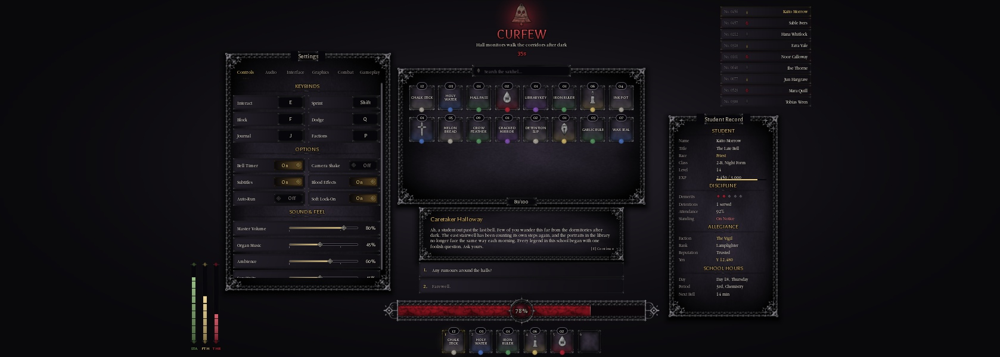

# Nightmare Highschool

A Roblox school-life action RPG set in a cursed high school after dark. Races are Human, Priest and Vampire, the currency is Yen, and the interaction key is **E**. All content is original.

This repo holds the project's **changelogs, update posts and design docs**. The game itself is built in Roblox Studio, in the NH Combat Test dev place.

| Path | What |
|---|---|
| [`CHANGELOG.md`](CHANGELOG.md) | Full changelog, newest first |
| [`updates/discord/`](updates/discord/) | Discord update posts, ready to paste (each under 2000 characters) |
| [`docs/`](docs/) | Design and build docs: combat and weapons, the admin panel, main menu, school clock, attendance and discipline, classes, factions, quests, races, sports, the UI kit, VFX. [`Implementation-Status.md`](docs/Implementation-Status.md) is the version-by-version index |
| [`art/dev-products/`](art/dev-products/) | Icons for the Spin Shop's Developer Products (512 px, upload them on the Creator Dashboard); generator in [`tools/dev-products/`](tools/dev-products/) |
| [`tools/vfx/`](tools/vfx/) | Blender (Cycles) script that renders the main menu's VFX sprites (volumetric smoke flipbook, plasma, crystal shards, embers, mist), plus `make_soft_vfx.py`: soft-edged tendril, shard and film-grain textures |
| [`tools/hair-rig/`](tools/hair-rig/) | Blender auto-rigger for the owner's catalog hairs (`nh_hair_autorig.py`, head fits in `heads.txt`): roots pinned to the scalp, bone chains per hanging lock. Raw `Hair OBJ's/` and `Hair FBX/` stay out of git |
| [`art/logo/`](art/logo/) | The Nightmare High crest as a PBR relief (`bake_relief.py`, `nh_logo_pbr.py`), used as `Theme.Images.Crest` / `CrestFlat` |
| [`art/ui/kit2/`](art/ui/kit2/) | UI kit v2 pieces at 2x (hammered iron, tooled leather, stitching) and the 4K screen mock-ups, with a layout checker that fails on overlaps or spills (`mockups.py`) |
| [`tools/ui-textures/`](tools/ui-textures/) | Python scripts that generate the UI kit's original gothic textures, with PBR lighting baked in (`pip install pillow numpy`) |

## Latest update
**New keys, a cinematic view and fixed cameras (1.11.0, 2026-11-02):** menu keys moved clear of combat (` Locker, P Options, M Report Card, L Factions), study groups live in a quiet bottom-left dock, \\ hides all UI for a letterboxed cinematic view, and every scripted camera was audited (locker hide, barber, wardrobes, no more stuck cameras). Big-wave announcement: [The Living School](updates/discord/announcements/2026-11-02-the-living-school.md). Patch notes: [game update](updates/discord/game-updates/2026-11-02-keys-cinematic-cameras.md). All posts: [updates/discord](updates/discord/README.md).

**The Locker, snacks, study groups and a living timetable (1.10.0, 2026-11-02):** students now go to class, crowd the new concession stand at lunch and head to clubs after school. Press G for your Locker (inventory, gear, a snack pouch on your hotbar), U for a study group of up to four with shared EXP, and L for the new Report Card. Gear chests stand up properly now. See [the Discord post](updates/discord/game-updates/2026-11-02-locker-and-study-groups.md).

**Polish and an anti-teleport check (1.9.3, 2026-11-02):** soft glowing rings instead of hard neon, sports result cards that count up your rewards, EXP sparks, a desk bell when you sit in class, a red-ink stamp when your record gets worse, candle-lit Night Study, and a server check that puts teleport cheaters back where they were. See [the Discord post](updates/discord/game-updates/2026-11-02-polish-and-anti-teleport.md).

**VFX Batch 4 complete (1.9.0, 2026-11-02):** red string on the evidence board and a SOLVED stamp, goals that light up the pitch, a new Bloodrush aura, painted sigils, a teleport veil, a locker-eye view, NPCs that fade in and out, and an arrival card when you enter school. See [the Discord post](updates/discord/game-updates/2026-11-02-night-sight-and-batch-4.md).

**Night sight and the full moon (1.8.7, 2026-11-02):** night races press **H** to see in the dark, their eyes glowing in their race colour. Full-moon nights now look the part, and getting back up from downed has its own moment.

**Known bugs cleared (1.8.6, 2026-11-02):** smarter enemies that walk around walls, health that comes back out of combat, no more stuck sprint or block, a working aerial-heavy cooldown, and fixes for an animation leak, missed respawns and unthrottled inputs.

**Delinquents go down (1.8.5, 2026-11-02):** beaten delinquents drop instead of dying. Carry them, grip them, or finish them with your race action for the reward, before they get back up.

**Fluid fights (1.8.4, 2026-11-02):** Fist and Claws running attacks and downslams now land every time and flow like Katana's, the Claws class spawns with its claws on, dashing hands straight back to your sprint, and Settings has a **Main Menu** button. See [`CHANGELOG.md`](CHANGELOG.md) and [the Discord post](updates/discord/game-updates/2026-11-02-fluid-fights.md).

**Earlier on 2026-11-02:**
- **1.8.2 to 1.8.3:** real hair on every NPC, no more floating or sinking students, chests that face the room, and a full end-to-end audit.
- **1.8 to 1.8.1:** the Headmaster's Desk admin panel (F3), and wolves that fight a fair, telegraphed pattern. See [the Discord post](updates/discord/game-updates/2026-11-02-headmasters-desk.md).

**2026-11-01:**
- **1.7 to 1.7.1:** the Claws class, wolves, 40 gear pieces in chests, living hair, blinking faces and delinquent crews to fight. See [the Discord post](updates/discord/game-updates/2026-11-01-claws-wolves-gear.md).
- **1.6:** Fists and Enrollment. See [the Discord post](updates/discord/game-updates/2026-11-01-fists-and-enrollment.md).
