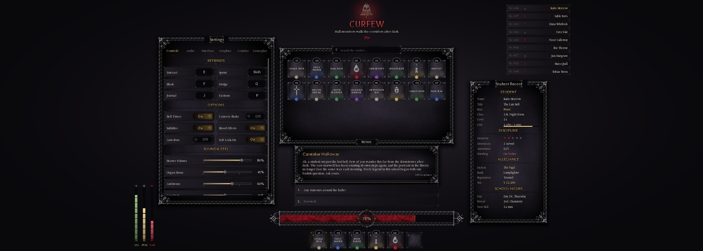

# Nightmare Highschool

A Roblox school-life action RPG set in a cursed high school after dark. Races are Human, Priest and Vampire, the currency is Yen, and the interaction key is **E**. All content is original.

This repo holds the project's **changelogs, update posts and design docs**. The game itself is built in Roblox Studio, in the NH Combat Test dev place.

| Path | What |
|---|---|
| [`CHANGELOG.md`](CHANGELOG.md) | Full changelog, newest first |
| [`updates/discord/`](updates/discord/) | Discord update posts, ready to paste (each under 2000 characters) |
| [`docs/`](docs/) | Design and build docs: combat and weapons, the admin panel, main menu, school clock, attendance and discipline, classes, factions, quests, races, sports, the UI kit, VFX. [`Implementation-Status.md`](docs/Implementation-Status.md) is the version-by-version index |
| [`art/dev-products/`](art/dev-products/) | Icons for the Spin Shop's Developer Products (512 px, upload them on the Creator Dashboard); generator in [`tools/dev-products/`](tools/dev-products/) |
| [`tools/vfx/`](tools/vfx/) | Blender (Cycles) script that renders the main menu's VFX sprites (volumetric smoke flipbook, plasma, crystal shards, embers, mist), plus `make_soft_vfx.py`: soft-edged tendril, shard and film-grain textures |
| [`tools/hair-rig/`](tools/hair-rig/) | Blender auto-rigger for the owner's catalog hairs (`nh_hair_autorig.py`, head fits in `heads.txt`): roots pinned to the scalp, bone chains per hanging lock. Raw `Hair OBJ's/` and `Hair FBX/` stay out of git |
| [`art/logo/`](art/logo/) | The Nightmare High crest as a PBR relief (`bake_relief.py`, `nh_logo_pbr.py`), used as `Theme.Images.Crest` / `CrestFlat` |
| [`art/ui/kit2/`](art/ui/kit2/) | UI kit v2 pieces at 2x (hammered iron, tooled leather, stitching) and the 4K screen mock-ups, with a layout checker that fails on overlaps or spills (`mockups.py`) |
| [`tools/ui-textures/`](tools/ui-textures/) | Python scripts that generate the UI kit's original gothic textures, with PBR lighting baked in (`pip install pillow numpy`) |
| [`tools/`](tools/) | Per-feature Studio mirrors and checks: each feature folder (for example [`chat-factions-ui/`](tools/chat-factions-ui/), [`soccer2/`](tools/soccer2/), [`admin-console/`](tools/admin-console/)) keeps `live/` (the scripts as installed), `pre/` (before the change), `checks/` (Edit and Play checks) and a `REPORT.md`. `tools/admin-console/` also holds the fetch, install and run helpers |

## Latest update
**The chat and the Factions panel, by candlelight (2.41.0, 2026-11-25):** the chat in the top left goes quiet when nobody's talking: just the lines over a soft dark patch. Press /, move the mouse over it or get a new message and its iron frame, candle-lit header and bar fade back. New lines drift in like smoke. The Factions panel (L) is rebuilt to match: "Who's Who After Dark" with a flickering candle, each faction's card washed in its colour, five rank pips, and bars that fill as it opens. The left-edge Factions and Journal buttons are gone (L and J, the Phone and the gamepad menu open them). Reduce Motion stills all of it. Soccer matches now play the published FIER clips. See [the changelog](CHANGELOG.md) and [the UI Kit](docs/UI-Kit.md).

**The staff console, Soccer 2.0, the Infirmary and a new pace (2.40.0, 2026-11-24):** F3 opens the Headmaster's Console for staff: Moderate and Test sides, 85 commands with a hold-to-confirm for the dangerous ones, Ctrl+K, saved warnings, notes, bans and mutes, and a searchable staff log. Soccer 2.0 brings 24 new clips: kicks meet the ball, dives and dribbles follow their own travel, falls last as long as the stun, and the keeper catches and holds. The Infirmary is furnished, with a patient on bed 1. Everyone walks at 10 and sprints at 20, then 27, and NPCs move by the same rules. See [the changelog](CHANGELOG.md) and [the admin panel doc](docs/Admin-Panel.md).

**Skies and lighting (2.39.0, 2026-11-23):** 19 painted skies across seven times of day from Dawn to the Witching hour, with the full, new and crimson moons, the event seasons, drifting clouds and a brighter, bluer night. See [the changelog](CHANGELOG.md).

**Quiet Corners (2.38.0, 2026-11-23):** the whole screen gets quieter. The HUD fades back when you're calm and steps up in combat; notifications are paper slips; prompts are a single key cap; the compass, the dialogue calling card and the Journal (now an open book) are redrawn; and case files become the Evidence Wall, where you pin clues and link them. See [the changelog](CHANGELOG.md) and [the UI Kit](docs/UI-Kit.md).

**The Bells (2.37.0 to 2.37.1, 2026-11-23):** misdeeds the staff see build Heat, and Heat rings up to five Bells on a rail under the clock, from Murmur to The Tolling. Ring enough and the hall monitors hunt you, and a Summons sends you to Room 106. The tracked-quest card is easier to read too. See [the changelog](CHANGELOG.md).

**The Bell Tower (2.36.0 to 2.36.1, 2026-11-21):** the clock in the top right is rebuilt as the Bell Tower: a timetable dial with the hand at the time and the moon in its window, an iron plate with the day, time and period, and a conduct row with a wax seal tinted by your discipline level and a detention slip. Your quest is a parchment Lead Card under it, with fang pips for counted objectives and a J key for the Journal. No rules changed. See [the changelog](CHANGELOG.md) and [the UI Kit](docs/UI-Kit.md#the-bell-tower-cluster-236).

**The first morning, without the cuts (2.35.0, 2026-11-21):** two of the tutorial's cutscenes, sneaking out and the bus, no longer cut away. The camera glides out of your own view and back into it, and your own character is the actor: you crouch past Biscuit the dog (stand up near him and the bedroom light flicks on), vault the fence, and walk to the black bus and board it under the title card. Wickfield is private to each player, and a death or rejoin puts you back on your last checkpoint. See [the changelog](CHANGELOG.md) and [the spec](docs/superpowers/specs/2026-11-20-tutorial-seamless-cinematics-design.md).

**Path wardrobe & the Today card (2.34.0, 2026-11-18):** Standing Path tiers now unlock things to wear: the Academic Pin, Scarred Knuckle Wraps and Silver Sigil (modelled in PBR), and the Rolled Sleeves, Loosened Tie and Worn Blazer uniforms. The phone's home screen gets the Today card. This completes Phase 3, Progression & Identity. See [the game update](updates/discord/game-updates/2026-11-18-path-wardrobe.md), [the announcement](updates/discord/announcements/2026-11-18-make-a-name.md) and [the spec](docs/expansion/14-Progression-and-Identity.md).

**Trophies (2.33.0, 2026-11-18):** nine trophies to earn, each modelled in gilt, oak, leather and crimson enamel: the Club Cup, the Honour Roll Plaque, the Ring Belt, the Register (Chapter One) and five Path Medals. Watch them turn in the Trophy Case (M, Honours & Trophies) and see them on your dorm room's trophy wall. See [the game update](updates/discord/game-updates/2026-11-18-trophies.md) and [the spec](docs/expansion/14-Progression-and-Identity.md).

**The Permanent Record (2.32.0, 2026-11-18):** M now opens the school's leather-bound file on you, remade in its own PBR art with a cover for your race (Human, Priest, Vampire, Werewolf, Ghoul, Wraith), each with its own slow effect. Nine tabs laid out the same way, 30 Honours to earn (two secret), and Notable Entries written in the school's voice. The book opens, pages turn, and new honours stamp in. See [the game update](updates/discord/game-updates/2026-11-18-the-permanent-record.md) and [the spec](docs/expansion/14-Progression-and-Identity.md).

**Standing Paths (2.31.0, 2026-11-18):** you're becoming somebody. Five paths (Academic, Social, Combat, Athletic, Supernatural) climb as you play, from Freshman Nobody to Academic Elite or Beginner to Feared, and a tier never drops. Each tier gives you its title and a banner; tier 4 gets you named on the PA or the Midnight Broadcast; students and staff start to recognise you. See [the game update](updates/discord/game-updates/2026-11-18-standing-paths.md) and [the spec](docs/expansion/14-Progression-and-Identity.md).

**After dark (2.30.0, 2026-11-18):** the school talks back. The PA chimes and types real announcements over the clock: the morning bell, lunch, dismissal, a rumble and curfew at 10 PM. Night FM is remade as a full music app in a new gilt-and-lacquer dress, and its Midnight Broadcast station has a voice: the host, the hall monitors, public service notices and some strange stories about a missing student. After 10 PM the hall monitor walks the halls, so get back to the dorms. This completes Phase 2, the Living School (2.27 to 2.30). See [the game update](updates/discord/game-updates/2026-11-18-after-dark.md), [the announcement](updates/discord/announcements/2026-11-18-the-living-school-2.md) and [the spec](docs/expansion/13-Living-School.md).

**Word gets around (2.29.0, 2026-11-18):** what happens at school becomes rumours. Students pass them on in their chats, and each retelling may stretch the story, but never about you: a rumour about a real player stays true. Six small scenes now play out around you (an argument, a locker shove, a defaced notice board, footsteps at dusk, a figure in the hall, a dare), and you can step in. See [the game update](updates/discord/game-updates/2026-11-18-word-gets-around.md) and [the spec](docs/expansion/13-Living-School.md).

**Teachers take the register (2.28.0, 2026-11-18):** four teachers and the Headmaster now keep the school day. Ms. Sallow, Mr. Hale, Mr. Pryce and Dr. Whitlock teach at their desks and retire to the Staff Room between classes, and each class seats its own six classmates. Start a fight in front of a teacher and they'll put their name on it. See [the game update](updates/discord/game-updates/2026-11-18-teachers-take-the-register.md) and [the spec](docs/expansion/13-Living-School.md).

**The students have names now (2.27.0, 2026-11-18):** the school's background students are 24 named classmates, three per clique. Stop and look at one and they'll introduce themselves, and they remember you across visits: shove one and they won't forget it, share snacks and they'll thank you. Classmates you've met are listed under Tab. See [the game update](updates/discord/game-updates/2026-11-18-the-students-have-names.md) and [the spec](docs/expansion/13-Living-School.md).

**The Strikethrough, Chapter One's finale (2.26.0, 2026-11-18):** After Hours now ends in a fight you play in Room 102 at night. Dodge, shove, win a tug of war over Mira's file, and finish it; every miss changes the scene, and losing the tug of war tears her record in half. This completes Chapter One (2.22 to 2.26). See [the game update](updates/discord/game-updates/2026-11-18-the-strikethrough.md), [the announcement](updates/discord/announcements/2026-11-18-chapter-one.md) and [the spec](docs/expansion/12-Interactive-Cutscenes.md).

**Cutscenes you play (2.25.0, 2026-11-17):** cutscenes can stop and ask you to act: press on the beat, mash, dodge, hold, or answer in time. Alone, the scene follows you the instant you press; with your study group, it follows the group. The roll call is the first: answer to your name on the beat, or Mr. Hale notices. Your best grade per cutscene is in the Journal. See [the game update](updates/discord/game-updates/2026-11-17-cutscenes-you-play.md) and [the spec](docs/expansion/12-Interactive-Cutscenes.md).

**Chapter One opens with a roll call (2.24.0, 2026-11-17):** new students now begin with a cutscene. The bell rings, you hurry to Room 102, Mr. Hale reads the register, and one name gets no answer. Then comes a short Orientation quest with Mr. Hale. After Hours now ends on the COLLECTED cliffhanger. The cutscene system behind them handles skip votes, rejoining mid-cut and replays from the Journal. See [the game update](updates/discord/game-updates/2026-11-17-the-roll-call.md) and [the plan and results](docs/expansion/11-Phase1-Plan.md). Next: interactive cutscenes ([doc 12](docs/expansion/12-Interactive-Cutscenes.md)).

**The phone (1.12.0, 2026-11-02):** every student now carries a phone (Y). It has a wallet to send Yen, Night FM for your own music, the Midnight Bell school paper, classmates, a camera, and wallpapers you can change. Click the clock for the new timetable. See [the game update](updates/discord/game-updates/2026-11-02-the-phone.md) and [the docs](docs/Phone.md).

**New keys, a cinematic view and fixed cameras (1.11.0, 2026-11-02):** menu keys moved clear of combat (` Locker, P Options, M Report Card, L Factions), study groups live in a quiet bottom-left dock, \\ hides all UI for a letterboxed cinematic view, and every scripted camera was audited (locker hide, barber, wardrobes, no more stuck cameras). Big-wave announcement: [The Living School](updates/discord/announcements/2026-11-02-the-living-school.md). Patch notes: [game update](updates/discord/game-updates/2026-11-02-keys-cinematic-cameras.md). All posts: [updates/discord](updates/discord/README.md).

**The Locker, snacks, study groups and a living timetable (1.10.0, 2026-11-02):** students now go to class, crowd the new concession stand at lunch and head to clubs after school. Press G for your Locker (inventory, gear, a snack pouch on your hotbar), U for a study group of up to four with shared EXP, and L for the new Report Card. Gear chests stand up properly now. See [the Discord post](updates/discord/game-updates/2026-11-02-locker-and-study-groups.md).

**Polish and an anti-teleport check (1.9.3, 2026-11-02):** soft glowing rings instead of hard neon, sports result cards that count up your rewards, EXP sparks, a desk bell when you sit in class, a red-ink stamp when your record gets worse, candle-lit Night Study, and a server check that puts teleport cheaters back where they were. See [the Discord post](updates/discord/game-updates/2026-11-02-polish-and-anti-teleport.md).

**VFX Batch 4 complete (1.9.0, 2026-11-02):** red string on the evidence board and a SOLVED stamp, goals that light up the pitch, a new Bloodrush aura, painted sigils, a teleport veil, a locker-eye view, NPCs that fade in and out, and an arrival card when you enter school. See [the Discord post](updates/discord/game-updates/2026-11-02-night-sight-and-batch-4.md).

**Night sight and the full moon (1.8.7, 2026-11-02):** night races press **H** to see in the dark, their eyes glowing in their race colour. Full-moon nights now look the part, and getting back up from downed has its own moment.

**Known bugs cleared (1.8.6, 2026-11-02):** smarter enemies that walk around walls, health that comes back out of combat, no more stuck sprint or block, a working aerial-heavy cooldown, and fixes for an animation leak, missed respawns and unthrottled inputs.

**Delinquents go down (1.8.5, 2026-11-02):** beaten delinquents drop instead of dying. Carry them, grip them, or finish them with your race action for the reward, before they get back up.

**Fluid fights (1.8.4, 2026-11-02):** Fist and Claws running attacks and downslams now land every time and flow like Katana's, the Claws class spawns with its claws on, dashing hands straight back to your sprint, and Settings has a **Main Menu** button. See [`CHANGELOG.md`](CHANGELOG.md) and [the Discord post](updates/discord/game-updates/2026-11-02-fluid-fights.md).

**Earlier on 2026-11-02:**
- **1.8.2 to 1.8.3:** real hair on every NPC, no more floating or sinking students, chests that face the room, and a full end-to-end audit.
- **1.8 to 1.8.1:** the Headmaster's Desk admin panel (F3), and wolves that fight a fair, telegraphed pattern. See [the Discord post](updates/discord/game-updates/2026-11-02-headmasters-desk.md).

**2026-11-01:**
- **1.7 to 1.7.1:** the Claws class, wolves, 40 gear pieces in chests, living hair, blinking faces and delinquent crews to fight. See [the Discord post](updates/discord/game-updates/2026-11-01-claws-wolves-gear.md).
- **1.6:** Fists and Enrollment. See [the Discord post](updates/discord/game-updates/2026-11-01-fists-and-enrollment.md).
