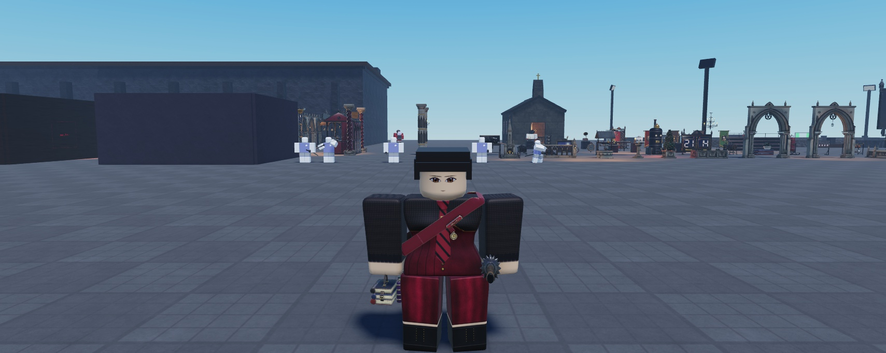

# 3D accessories (Kit A: player accessories; Kit B: the Headmaster's Circle)

Two approved kits of 3D accessories for the R6 body: **Kit A**, 28 player designs sold at the School Store, and
**Kit B**, "The Headmaster's Circle", 11 admin-only regalia pieces (`Admin = true`, never sold). The owner approved
both lists ("Make them all. I like it.") and the quality bar ("HIGH QUALITY WORK ONLY"), and set the fit rule:
**"Make sure nothing clips or overlaps or hovers."**

They're cosmetic only: no stats, and nothing reads or writes Race. The race-flavoured pieces can be worn by anyone.

R6 has no layered clothing, so every piece is a MeshPart riding one R6 part: either rigid, or rigged with bones that
`Controllers.Character.AccessorySway` swings (the same maths as HairSway).

Status: **in progress.** Batch 1 (uniform and school, 10 items, 18 store items) is in NH Combat Test and play-tested
(1.79.0); two of its pieces were rebuilt after the play-test (the satchel and the Head Student's sash, see "The
katana") and wait for the owner's import of `art/group-upload-accessories/batch1-fix/`; until then the game hides those
two. The owner pre-approved every later batch "as long as they follow the standards" (2026-11-11). **All of both kits is
now built** (batches 2-8: 49 more items, 2026-11-11), checked together with 0 fails, and merged into
`Config.Accessories`; they wait for the owner's import (see "Not done yet").

## Batches

| Batch | Kit A / B | Items | State |
|---|---|---|---|
| 1 | A 1-6 | clique crest pins (8), Prefect and Head Student sashes, school tie, velvet bow tie, leather satchel, messenger bag, book strap, the Ink Club's chained grimoire, choir collar, falling ruff | **in the game, play-tested (1.79.0)**; satchel and Head sash rebuilt for the katana, waiting for import |
| 2 | A 8-12 | tricorn, top hat, bowler (crimson bands), veiled mourning toque, fascinator, crooked witch hat, hunter's wide-brim, lace / bone / gilt masquerade half-masks | **built, baked, 0 fails; staged** (`batch2/`) |
| 3 | A 13-16 | race-flavoured: opera-cape clasp, signet ring, moon-stone torc, wolf-tooth necklace, torn shoulder fur, lantern on a hook, grave-moss shawl, tattered hood, scythe pendant | **built, baked, 0 fails; staged** (`batch3/`) |
| 4 | A 17-20 | hunter and armory: bandolier, pauldrons, gorget, bracers, gauntlets, back crossbow | **built, baked, 0 fails; staged** (`batch4/`) |
| 5 | A 21-24 | magic: rune halo, orbiting sigils, a crow familiar, crystal pendant, potion belt | **built, baked, 0 fails; staged** (`batch5/`) |
| 6 | A 25-28 | civilian: pocket watch, lace parasol, crook umbrella, candle lantern, knitted scarves (two colours) | **built, baked, 0 fails; staged** (`batch6/`) |
| 7 | A 7 + B 2 | the Delinquents' long coat and the Headmaster's greatcoat (torso shell, sleeves on the arms, rigged split coattails) | **built, baked, 0 fails; staged** (`batch7/`); hairs: see below |
| 8 (Kit B) | B 1, 3-11 | the Headmaster's Circle: crow mantle, thorned crown, raven-skull pauldron, iron keys, shadow trail, chained ledger, sigil halo, seal of office, signet, staff, observer mask | **built, baked, 0 fails; staged** (`kitb/`) |

### Batches 2 to 8 (built 2026-11-11, waiting for the owner's import)

Checked together with batch 1: `acc_check.py` **0 fails** over all 39 models (12 bodies, motion, sway limits, every
pair that can be worn together, the admin capes, the katana, each hair at the piece's fit). Contact sheets:
`img/accessories/batch2_sheet_a.jpg`, `batch2_sheet_b.jpg`, `batch3_sheet.jpg`, `batch4_sheet.jpg`, `batch5_sheet.jpg`, `batch6_sheet.jpg`.

| Batch | Items (hairs that can wear it, of 35) |
|---|---|
| 2 | tricorn (24), top hat (22), bowler (21), veiled mourning toque (10, Female), fascinator (24, Female), witch hat (23), hunter's wide-brim (22), lace / bone / gilt half-masks (15 / 11 / 11) |
| 3 | opera-cape clasp (32), bat signet ring (35), moonstone torc (10), wolf-fang necklace (11), torn shoulder fur (12), ghoul's lantern on the right hip (35, a light), grave-moss shawl (15), tattered hood (14; pale wisps drift off it), scythe pendant (8). Race-flavoured, anyone may wear them |
| 4 | bandolier (17), pauldrons (34), gorget (20), bracers (35), gauntlets (35), crossbow (21) |
| 5 | rune halo (30; it turns slowly in its own plane), orbiting sigils (35; four plates circle the head), crow familiar (18; it looks about, blinks, flicks its tail, settles its wings), caged crystal pendant (15), potion belt (32) |
| 6 | pocket watch (34), crook umbrella (35), lace parasol (35), candle lantern (35; a flickering light), striped / grey-violet scarves (4 each: almost every hair hangs where a scarf wraps the neck) |

What these batches added to the rules:
- **Hats at every hair's fit** (`acc_hatcapes.py`): the Midnight Lord's high collar meets every brimmed or veiled hat
  at some hair's fit, so it can't be worn with hats; the veiled toque can't be worn with capes or the crow.
- **Orbits are checked at every angle** (5 degree steps, the bob range, both hair-fit sizes), against bodies in both
  strides, hairs, hats at their fits, the capes and the other pieces (`nh_acc_batch5.py --motioncheck`).
- **The game's way of wearing a head piece** (scaled about the headband, lifted) is now what the checker tests for
  hair; the few hairs that cross a piece that way are ruled out (`hair_overrides.json`, applied by `acc_hairgroup.py`).
- **Pieces worn together share one hair fit** (a hat and its veil; `acc_hairgroup.py`).
- **A hood is a hat that reaches the shoulders**: its per-hair fits also keep it above the torso and out of the arms' swing (`acc_hoodfit.py`), which leaves 14 hairs.
- **Shared space across batches** became exclusive pairs: the crow vs the fur, the shawl and the hood; the crystal pendant vs the torc and the opera clasp.
- New slots: **Belt** (the potion belt) and **Watch** (the pocket watch); the bracers and gauntlets share **Arms**.

### Batch 7 (the coats) and Kit B (built 2026-11-11)

Final check over every built item (90 pieces, the katana and the five capes included, `--capes --hair`):
**`CHECK done 0 fails`**. Contact sheets: `img/accessories/batch7_sheet.jpg`, `kitb_sheet.jpg`.

| Item | Pieces, mount | Hairs (of 35) | Moves |
|---|---|---|---|
| Delinquent's Long Coat (Kit A 7, 1100) | shell (Torso), two sleeves (arms), two rigged coattails (Tails, locked fore-and-aft) | **4** (the shell) | the tails swing |
| Headmaster's Greatcoat (Kit B 2) | the same build in velvet, crimson lining and turnbacks, a gilt crow on the back | **4** (the shell) | the tails swing |
| Murder of Crows Mantle | feather mantle + two ember-eyed crows (Torso) | 6 | the crows look about, blink, flick their tails, settle their wings; a feather drifts off now and then |
| Crown of Thorned Brass | Head | 17 | the stone's glow breathes; a small crimson light |
| Raven-Skull Pauldron | left arm | 33 | ember eyes breathe |
| Three Iron Keys | Torso, orbiting the head | 35 | orbit 3 rpm, bob |
| Shadow Trail | a hidden anchor under the feet | 35 | dark smoke, a few feathers and rare embers while walking |
| Floating Chained Ledger | the book and its chain (right arm, the chain through a ring on a wrist cuff) | 35 | bobs; the pages turn over one by one, then settle |
| Crimson Sigil Halo | Head, behind it | 31 | turns in its own plane; **flares** when its wearer uses a staff teleport |
| Seal of Office | Torso (chest top) | 9 | |
| Headmaster's Signet | left hand | 35 | |
| Staff of Office | held in front of the right hand | 35 | the raven head's eyes breathe |
| Observer Half-Mask | Head | 13 | |

- **Admin only:** every Kit B item is `Admin = true`, has no price and is never sold or owned. It shows only in the
  Wardrobe's staff-only Admin tab, and the server refuses it on a non-staff player (the look check and `AccessoryWear`).
- **Regalia colour:** each Kit B item has `Tint` (`Ember` or `Crimson`). While regalia is worn, `AccessoryWear` sets
  `NHRegaliaTint` (Color3) and `NHRegalia` (the deciding item id) on the character: the most visible piece decides
  (halo, shoulders, hat, coat, held, collar, trail, familiar, face, ring). The staff teleport flock reads it to take
  the same colour (`Controllers.World.TpFlock`, 1.84.1: the birds' eye glints, the smoke and the motes).
- **The halo's flare:** `Features.Fx.VeilMove` stamps `NHAdminFlare` (server time) on a staff member's character when
  they teleport as their flock or move a student; an invisible staff member's move shows nothing (`install/patch_fx_flare.luau`).
- **The coats' hair limit (owner decision):** the coat shells fit only 4 of 35 hairs; even short cuts rest on the
  shoulder tops and the nape, where any coat goes. As built, putting on a coat refuses those hairs (and a hair change
  takes the coat off). Trimming the shoulders and scooping the nape gets 12-14 hairs; a full scoop gets 19 but no longer
  reads as a coat. Tails and sleeves fit all 35.
- **Exclusive with the coats:** every cape, sashes, bags, shoulders, arms, lapel pins, hip pieces, the belt, the watch,
  the crow familiar, the crystal pendant, the scarves, the torc, the fang necklace, the scythe pendant, the hood; and
  the regalia mantle, seal, ledger, pauldron and staff. The ties, bow tie, choir collar, ruff and gorget are compatible.
- **Kit B's own exclusions:** the mantle (neck, collar, sash, back, the crow familiar, the veiled toque, the hood);
  the seal (sashes, bags, the tie, the pendants, the furs, the crow); the halo (the brimmed and veiled hats, the hood,
  the Midnight collar); the ledger (arms, four capes); the staff (the blackened pauldrons, the Warden's mantle);
  the raven pauldron (the veiled toque).

## Hair tuck (hair that goes over, under or round a piece)

Owner: "For the coats and any other accessories, position the hair so that it wraps around them or under them, etc. so
it doesn't look like anything is clipping into each other and looks very natural and cool." Until now a piece simply
refused every hair that passed through it. Now, where it can be done cleanly, the hair moves instead.

**The rigs (v2).** The 35 catalog hairs were skinned almost entirely to their root bone (on Males_Long_Length_Messy
8,185 of 8,292 vertices): only the tips could move. `tools/hair-rig/nh_hair_autorig.py` now writes v2 weights: every
vertex follows its nearest lock chain, the crown stays on HairRoot (fading out over the first 0.16 studs of the lock),
and the weights are smoothed over the mesh's edges so each strand card bends as one piece. The bones are unchanged:
every bone's name and rest position, and every vertex at rest, match the hairs in the game exactly (checked on all 35).
The v2 hairs wait in `art/group-upload-hair-v2/` for the owner's import; `tools/hair-rig/swap_v2.luau` then swaps each
catalog hair's Handle (backup: `ServerStorage.NH_Backup.Hair_v1`) and marks it `NHHairRig = 2`.

**The solve** (`art/characters/accessories/acc_hairtuck.py`). For every hair an item refused, it looks for the gentlest
turn of each lock's bones that clears the item, on the standard body and at the item's shallowest and deepest body
fits. A tuck is kept only if all of these hold, else the hair stays refused:
- no hair triangle crosses a piece triangle (the same test as `acc_check --hair`);
- no strand sinks into the head or torso further than at rest (the nape may sink a little where a collar hides it);
- strand cards are not stretched or crushed (the worst 0.5% of edges within 15%) or twisted against their neighbours
  (within 30 degrees);
- at most 3% of the head the hair covered at rest, and that the piece leaves in view, goes bare;
- bends near the scalp cost more than bends further down a lock (at most 40 degrees per bone axis).
Pieces that move on their own (orbits, bobs, idles: the crows, the ledger, the keys, the sigils, the halos) keep their
refusals: their tucks were only cleared at rest. Hats and masks gain little: what crosses them is the crown and the
fringe, which stay on the root bone.

**Result.** Every hair against every item that doesn't move (2,100 pairs), then `acc_tuckcheck.py` (below) until it
found nothing: **148 hair x item pairs are worn tucked**, and 31 items gained hairs:

| Item | Hairs before -> after (of 35) |
|---|---|
| Falling ruff | 22 -> 29 |
| Seal of Office | 9 -> 16 |
| Choir collar | 25 -> 30 |
| Moonstone torc | 10 -> 14 |
| Hunter's bandolier | 17 -> 21 |
| Prefect's sash | 17 -> 20 |
| Satchel, crossbow, gorget, scythe pendant | 20, 19, 20, 8 -> 23, 22, 23, 11 |
| Bow tie, messenger bag, fang necklace, moss shawl, tattered hood, crystal pendant, both scarves | +2 each (scarves 4 -> 6) |
| Raven pauldron, pauldrons, pocket watch, three crest pins | -> all 35 |
| Mourning toque, hunter's hat, bone mask, observer mask, potion belt | +1 each |
| **Long coat / greatcoat** | **4 -> 5** |

The coats gain least: the hair they cross lies on the shoulders and the nape, and a lock lifted over the collar on
the deepest body fit leaves the head bare. The check also found hairs that four items allowed but that crossed them
on some body type's depth fit (the old fit was measured on the standard body only). Those are refused now:
crimson fascinator 24 -> 23, opera clasp 32 -> 31, torn fur 12 -> 10, crow mantle 6 -> 4.

**Pairs and sway.** A tuck may not push hair into any other item the hair can wear with it (the solve keeps every such
item as an obstacle). `acc_tuckprune.py` drops the tucks the check still found unsafe in pairs (74, in
`tuck/drop.json`), so those hairs stay refused. A tucked lock holds still (`HairSway` `TUCK_SWAY = 0`): the tucks lay
the hair just clear of the piece, and at a 35% sway 73% of them swung back in.

**In the game.**
- Each item's pieces carry `NHHairTuck` (`acc_assemble.py` writes it from `tuck/<Model>.<LeadPiece>.json`).
- `UI.AccessoryWear` merges the tucks of everything worn (per bone, the larger turn) into the character's
  `NHHairTuck` and poses previews.
- `Controllers.Character.HairSway` eases the tuck in (about a quarter second); a tucked lock then holds still, the
  others sway as before.
- A hair that isn't a v2 rig is never turned, and a piece that needs a tuck for it isn't worn and isn't offered
  (`Wear.FitsHair`), so nothing changes until the hairs are imported.
- `acc_tuckcheck.py` checks it as the game wears it: each item alone, every two items worn together with their tucks
  merged (per bone, the larger turn), on the standard body and the shallowest and deepest body fits.

## The no-clipping rules (how "nothing clips, overlaps or hovers" is checked)

Every piece is measured by `art/characters/accessories/acc_check.py` (headless Blender), not judged by eye:

- **Bodies:** each piece against all 12 body types (the plain R6 boxes and the 11 meshed bodies of `docs/Body-Types.md`),
  after that body's depth fit. A vertex more than 0.003 studs inside a body fails; a piece that should rest on the body
  and sits more than 0.035 studs off it fails (hover).
- **Motion:** the arms and legs swung to +-55 degrees (the R6 walk's amplitude), and each rigged piece bent to its sway
  limit in every direction it may swing.
- **Other pieces:** every pair of pieces that can be worn together, at rest and with each swinging piece at its limits;
  and the five admin capes (`--capes`).
- **Hair** (head pieces, `acc_hairfit.py`): every rigged hair the barber sells, at its in-game size.
- **The katana** (1.79): the game's one sheathed weapon, measured in NH Combat Test (`E:/NH-Work/acc/katana_obstacles.json`,
  each part padded 12%): the scabbard at the left hip against every piece (rest, both strides, every sway limit, all
  12 bodies), and the drawn katana in the right hand against right-arm pieces.

### The katana (found in the 1.79 play-test)

The sheathed katana hangs at the **left hip**: its guard sits in front of the hip and the scabbard runs back along the
left side at hip height. In the first play-test it went straight through the satchel's bag (15 sample points inside),
and the new checker pass found the Head Student's sash crossing its guard on the deep bodies. So:

- **The left hip belongs to the sword.** The satchel is mirrored to the right hip (strap from the left shoulder), and
  the Head Student's sash now runs over the left shoulder to the right hip like the Prefect's (its rosette moved to
  the left breast). Hip pieces go on the right.
- **Held pieces are hidden while a weapon is drawn** (or a Tool is in the hand): the book strap hangs from the right
  hand, where the drawn katana's grip is. `Services.Features.Accessories` hides the Held slot's pieces while the
  Humanoid's `Equip` attribute is true.

What R6 forces, and how the kits deal with it:

- **The arms are flush on the torso's sides.** A strap round the torso has to pass under the arm. It lies in the arm's
  inner 0.1 studs, where the arm (which swings in its own plane) always covers it, so it reads as passing under the arm.
- **A striding leg's top corners poke out of the torso's lower front and back.** Sashes and straps cross the hips high,
  bags sit above that band, and hooks hang under the arms.
- **The head mesh dips about 0.12 studs below the torso top**, so collars and straps keep clear of the neck.
- **The only space no limb sweeps** is beside the hips under the arms (x > 1, z < -1). The satchel and the grimoire hang
  there, and swing only fore and aft (`NHSwayLock = "X"`); the tie swings only flat on the chest (`"Z"`).
- **Long hair over the neck and shoulders** (owner: "Rework them"): long hair hangs round the neck and down over the
  shoulders, chest and back (r 0.6 to 0.8 about the neck, z 0.85 to 1.35). So the choir collar is two lobes on the chest
  front and the ruff is a front "falling ruff" (a frill across the throat over a lace cascade); neither reaches the nape
  or the shoulder tops. Sashes cross the shoulder at x 0.92 and bag straps at x 0.86 (beyond that, a swinging arm's top
  corner rises through them).
- **Layers on the chest:** tie and pins on the shirt layer, sashes above, bag straps above those. Each piece's depth fit
  is per body, so `acc_check.py --fixlayers` raises an outer piece on a body only as far as needed to clear the inner
  pieces it crosses there (measured), and writes that back to the layout.
- **Every piece against every hair:** pieces that can't move (torso, limbs) are either clear of a hairstyle or not; a
  hairstyle that passes through a piece can't be worn with it (`NHHairFit` "x"), the same rule as hats.
- **Hats over hair:** a hat can't fit 35 hairstyles at one size. Each head piece carries a fit per rigged hair
  (`NHHairFit`: a uniform scale about the headband and a lift), the smallest one with no strand through it. A hair
  that would need more than the limit can't wear that piece: the Wardrobe says so and the server refuses it.

### What can't be worn together (`Config.Accessories.Conflicts`)

Some pairs would pass through each other whatever the geometry, so they're exclusive. Wearing one takes the other off
(the Wardrobe says what came off), and the server enforces it.

| Item or slot | Can't be worn with | Why |
|---|---|---|
| Choir collar | ties, sashes, bags | it covers the throat and the chest top |
| Falling ruff | ties | its frill and cascade cover the throat and the knot |
| a sash | bags, clique pins, the bow tie | the sashes cross the chest and back where those go (the flat school tie fits under) |
| every cape | bags, collars, sashes | capes hang over the back and both shoulders |
| Duelist's Shoulder Cape | clique pins, the bow tie | it crosses the left chest |
| Night Warden's Mantle | ties | it closes over the throat |
| Leather satchel | held pieces, hip pieces | it hangs on the right hip (away from the sword), where they hang too |

The Vamp, Rogue and Fur capes only exist in Studio; they follow the every-cape rule and haven't been measured.

### Hair compatibility (batch 1, the 35 rigged hairs, at rest)

| Piece | Hairs it can be worn with |
|---|---|
| School tie, book strap, grimoire | 35 |
| Clique pins | 34 |
| Bow tie | 31 |
| Messenger bag (the bag / its strap) | 30 / 20 |
| Choir collar | 25 |
| Falling ruff | 22 |
| Satchel (on the right since 1.79) | 20 |
| Prefect sash / Head Student sash | 17 / 17 |

A hair change (barber, creator) takes off any piece the new hair passes through and says so; the server does the same,
whatever the client sends.

What still stops the sashes and straps is very long hair hanging down the front of the chest, which any diagonal strap
crosses. Hair sway (HairSway bends strands as you move) isn't part of the check; only hair at rest is.

## How it works in the game

| Part | What |
|---|---|
| `ReplicatedStorage.Config.Accessories` | the item list (Id, Name, Slot, Model / Piece, Price, Gender, Clique, Admin, Tint), every batch merged in (an item stays hidden until its template is in `NHAccessories`: `Ready`), `Conflicts`, `Parse` / `Join` / `Resolve` / `Clean` / `CapeClash` |
| `ReplicatedStorage.UI.AccessoryWear` | wears the look's accessories: each piece on its R6 part, scaled to the part, deepened for the body type, fitted to the hair; Welds (so Height v2's stretch moves them) |
| `UI.Appearance` | look field `Acc` (comma list of ids, one per slot); `Sanitize`; `ApplyTo` calls `AccessoryWear.Wear`; the server's look check (owned or free in Studio, gender, staff for `Admin`, hair fit, cape clashes) |
| `Services.Player.Identity` | `Identity.Accessories`: owned ids (ProfileService through `SetIdentity`) |
| `Services.Features.Accessories` | the School Store sale: Yen, near `NHSchoolStore`, clique members only for clique pieces; remotes `NHAccRemotes` |
| `Controllers.Gui.Wardrobe` | the **Accessories** tab and the staff-only **Admin** tab (a wardrobe station shows Outfit, Accessories, Admin) |
| `Controllers.Gui.Enrollment` | the School Store's **Accessories** tab (the old stat-gear tab is now **Gear**) |
| `Controllers.Character.AccessorySway` | swings rigged pieces: profiles Flutter, Loops, Pendulum, BackHang, Tails; keep-out (never toward the body) and axis locks |
| `Controllers.Character.AccessoryFx` (1.79) | pieces' own motion and light: `NHOrbitAxis` / `NHOrbitRpm` (orbit about the mount), `NHBob`, `NHIdle` (a familiar's look / blink / tail / wings, a ledger's pages; bones in `NHIdleBones`), `NHPulse`, `NHFlare` (on `NHAdminFlare`), `NHTrail` (emitters while walking; any other emitter runs all the time), flickering lights; Reduce Motion tones it down and stops every emitter. Not used by batch 1 |
| `ReplicatedStorage.NHAccessories.<Item>` | templates (`tools/accessories/assemble_<batch>.luau` builds them from the owner's imports) |

Template attributes on each piece: `NHMount`, `NHFit` (on the nominal R6 part), `NHFitBody`, `NHSway`, `NHSwayKeepOut`,
`NHSwayLock`, `NHSeat` and `NHHairFit` (head pieces).

## The art pipeline

```
E:/Blender/blender.exe -b --factory-startup -P art/characters/accessories/nh_acc.py -- batch1 --gpu      # build, bake, export, render
E:/Blender/blender.exe -b --factory-startup -P art/characters/accessories/acc_check.py -- [--capes]     # the clearance check
E:/Blender/blender.exe -b --factory-startup -P art/characters/accessories/acc_hairfit.py               # head pieces vs every hair
python art/characters/accessories/acc_sheet.py out.jpg Item,Item                                        # contact sheets
python art/characters/accessories/acc_assemble.py batch1 Item,Item --ids ids.json                       # the Studio assembly script
python art/characters/accessories/acc_stage.py <folder> Item,Item [--suffix v2]                         # the upload folder (maps at 1024)
python art/characters/accessories/acc_textures.py                                                       # veil nets, lace (alpha)
```

- **Space:** studs on the nominal R6 body (torso 2 x 2 x 1 at the origin, head centre z 1.5), Blender -Y front, +X the
  character's left. FBX at `global_scale = 0.01`.
- **Maps:** one 2048 atlas per item (colour with baked AO, normal, roughness, metalness, an emissive mask for glowing
  parts), 64 samples on the GPU, from the props' 2048 PBR sets plus procedural cloth, velvet, metal and enamel.
  Veils and lace are alpha pieces (`AlphaMode Transparency`) with their own tiling textures.
- **Rigs:** `Root > H<n> > C<n>_<k>`, like the capes; pendulums keep everything above their pivot on `Root`.
- **Renders:** front, three-quarter, side, back and a close-up on the R6 mannequin, and on the Female body; head pieces
  on the game's own hairs (Males_Short, Females_Straight_Bob) at their in-game size.

## Verified

**Offline** (headless Blender): batch 1 passes `acc_check.py` with 0 fails on all 12 bodies, in motion, at every sway
limit, against every compatible piece, the five admin capes and the katana (the book strap is only reported against
the drawn katana: it's hidden while a weapon is drawn).

**In NH Combat Test, Studio Play, slot 4 "Testy" (Female body), 2026-11-11.** `Config.MainMenu.SlotCount = 4` and
`NHTestNoMenuKeys` during the test, both restored afterwards.



- **Templates:** the assembly built all 10 items (19 pieces) from the owner's import: every size matched the builder,
  every mesh came in upright, the swinging pieces carry their bones, all 38 maps set.
- **Wardrobe by real clicks** (locker-room station, E then the Accessories tab): the tab listed all 18 items by slot;
  the School Tie, Vigil pin, satchel, grimoire, book strap and Prefect's Sash went on and were saved to the profile.
  The Prefect's Sash took off the satchel and the pin (its exclusive pairs). The sash lies over the tie where they cross.
- **On the server character:** each piece welded to its part at its fit; the Female body's depth fit applied (the pin
  at z -0.472 = 0.902 x the nominal -0.523). Through the admin desk's Build remote: **Plus** deepened the satchel to
  1.204 and set the tie at z -0.632, **Petite** 0.965 and -0.550, exactly the fit table.
- **Swing, real held keys:** walking and turning (37 studs, 15.1 speed): book strap 16.3 deg, grimoire 9.2, tie 1.1;
  sprint and a jump (38.6): book strap 20.0, grimoire 7.4, tie 1.3; with the satchel, walk, strafe and sprint: satchel
  18.9. At rest 0.1 or less. All inside the limits the checker swept (Pendulum 34, Flutter 8).
- **School Store by real clicks:** the Accessories tab, other cliques' pins "Members only", Testy's own (Pack) pin
  bought for 180 (Yen 718 to 538, `Identity.Accessories` = pin-pack).
- **Server refusals** (the store remote): too far from the store, another clique's pin, buying twice, an unknown id.
- **Not staff** (`NHStaff` 0): the station showed Outfit and Accessories only, no Admin tab.
- **Console:** nothing from the new code (only the place's existing asset and sound messages).

**What the play-test changed** (all reinstalled in Edit, compiled, not yet re-played):
- the satchel and the Head Student's sash (see "The katana"), staged in `art/group-upload-accessories/batch1-fix/`;
- the Held slot hides while a weapon is drawn;
- a hair change at the barber kept a piece the new hair passes through (it wasn't drawn, but stayed in the saved
  look): the server now takes it off, the Wardrobe does too and says so, and the wear code leaves no empty holder;
- "Took off ..." messages stay up (they were replaced by "Saved to your profile" a second later);
- the store's header said "Uniform tops" over the accessories; each store card now shows the piece in 3D with its
  name and slot.

## Not done yet

- **Owner:** import `art/group-upload-accessories/batch1-fix/` (2 FBX, 8 images) into group 15981569, then the
  assembly rebuilds the satchel and the Head sash; until then the game hides those two items.
- A second play-test of the fixes above (the Held hide by a real draw, the barber taking a piece off, the store's 3D
  cards), a second player watching, NPCs (they don't wear accessories), combat animations (a swing of the sword
  isn't part of the check).
- **Owner:** import `art/group-upload-accessories/batch2/` to `batch7/` and `kitb/` (FBX and maps) into group 15981569;
  then the IDs are read by name and `acc_assemble.py <batch> <Items> --ids` builds each batch's templates, and each
  batch is play-tested on slot 4. Until then none of batches 2-8 shows in the game.
- **Owner decision:** the coats' hair limit (above).
- Unverified until the import: the crows' and pages' bone axes and the page-turn direction, the emitters' look (they
  are emitted from a point in a cone; sprites: the teleport feather and the place's VFX smoke), the hidden trail
  anchor, every pulse and the halo's flare.
- The Vamp / Rogue / Fur capes against accessories (measure in Studio); built hairstyles and outside catalog hairs
  (a default fit, unverified).
- The Map place: `Config.Accessories`, `UI.AccessoryWear`, `Controllers.Character.AccessorySway` / `AccessoryFx`,
  `Services.Features.Accessories`, `ReplicatedStorage.NHAccessories`, and the `UI.Appearance`, `Player.Identity`,
  `Gui.Wardrobe`, `Gui.Enrollment` and `Features.Fx` (`patch_fx_flare`) patches (`tools/accessories/`).
