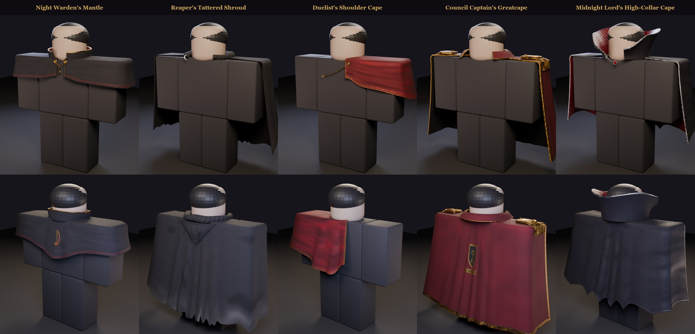
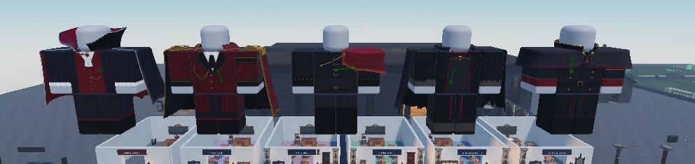
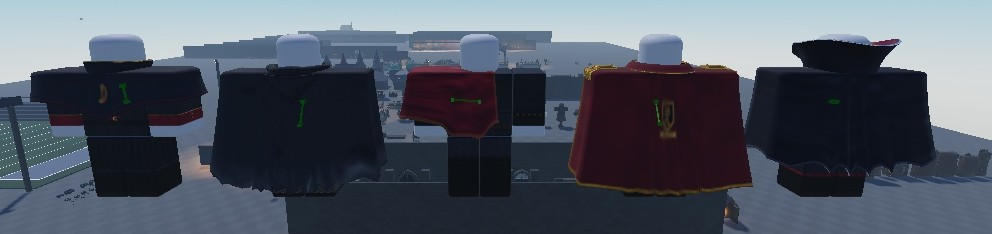

# Admin capes (3D, PBR)

The admin clothing kit's Shirt and Pants templates can only carry one baked colour image. These five capes give the
admin outfits real shape and real PBR: rigged MeshParts with a SurfaceAppearance (colour, normal, roughness and
metalness, all 2048), worn through the game's cape system and swung by `Controllers.Character.CapeSway`.
They are **staff-only**.



| Cape | Goes with | What it is | Tris | Bones |
|---|---|---|---|---|
| Night Warden's Mantle | Night Warden Greatcoat | a shoulder cape to mid-back in charcoal wool twill; a standing collar edged in brass; crimson silk lining; crimson piping above the hem, brass thread down the front edges; a brass key over a crimson crescent embroidered on the back; brass bosses and a chain clasp with the Warden's key hanging from it | 7.0k | 14 |
| Reaper's Tattered Shroud | Reaper's Hooded Cloak | a cloak to the calf in weathered black-grey linen; the hood down on the back, its opening toward the neck; a cowl round the neck; a torn sawtooth hem with loose threads and ash-grey dust rising from it; patched mends stitched in crimson thread; a silver crescent brooch | 9.3k | 26 |
| Duelist's Shoulder Cape | Duelist's Jacket & Cape | a short crimson velvet cape over the left shoulder, longest down the back; a gold-embroidered vine border on the hem and both edges; black satin lining; a brass ring brooch and a gold cord across the chest | 5.4k | 15 |
| Council Captain's Greatcape | Council Captain's Coat | a long crimson wool greatcape with a black velvet lining; brass epaulettes with bullion fringe hold it on the shoulders; a turn-down collar edged in brass; a brass chevron braid on the hem and front edges; the Council crest (crossed keys and a crescent on a black shield, a ribbon reading CONCILIUM) embroidered in gold on the back | 10.0k | 26 |
| Midnight Lord's High-Collar Cape | Midnight Lord Tailcoat | a knee-length cape with a bat-wing scalloped hem; black velvet with a tone-on-tone damask (a diamond lattice with crescents and bats); crimson satin lining; a tall fanned collar, quilted crimson satin inside, piped in silver; a silver chain clasp with a faceted crimson gem | 10.8k | 26 |

## How they're built

`art/characters/capes/nh_admin_capes.py` builds all five in headless Blender:

```
E:/Blender/blender.exe -b --factory-startup -P nh_admin_capes.py -- [--only WardenMantle,...] [--nobake]
python paint_capes.py [Set ...]
E:/Blender/blender.exe -b E:/NH-Work/capes/<Set>.blend -P cape_preview.py -- --key <Set> --maps E:/NH-Work/capes/maps
```

- **Space:** studs on a 2 x 2 x 1 R6 torso centred at the origin. Blender -Y is the front and +X is the character's
  left, as `docs/Female-Body.md` measured for the 3D importer. FBX at `global_scale = 0.01`.
- **The drape:** each cape starts at a neckline ellipse and runs across the shoulder tops (the yoke rises a little
  toward the neck), rolls over the shoulder edge (softer over the shoulder corners) and hangs. Flare, folds that
  deepen toward the hem, and a backward drift at the sides are per cape; hems are straight, sawtooth-torn (Reaper)
  or scalloped (Midnight Lord). The cloth is a real shell, 0.03 to 0.04 studs thick, with its own lining UVs and rims.
- **The rig, as CapeSway expects:** `Root` (depth 0) > `H<n>` hinges at the top of each column (depth 1, never moved)
  > `C<n>_<k>` chain bones down the hang (depth 2+). CapeSway swings each chain bone back about the torso's right
  axis, more the deeper it is, so the shoulders stay put and the hem swings most. The front panels of the mantle and
  the duelist cape have no chain (swinging them back would push them into the chest). Collars, clasps, the cowl and
  the epaulettes ride `Root`; the Reaper's hood rides the cloth under it. At most 4 weights a vertex.
- **The maps** (`paint_capes.py`): each UV island is painted in studs, from the widths and lengths the builder
  measured, so the weave, trims and embroidery keep their real size from the neckline to the hem. Wool twill,
  velvet (crushed pile), satin (long sheen streaks), linen (plain weave and slubs), brass, silver and gold thread each
  have their own height, roughness and metalness. Heights become an OpenGL tangent-space normal map. Ambient
  occlusion is baked in Cycles from the cape's own geometry. Palette: crimson #600E1A, black, brass; no blood.

## In the game (NH Combat Test)




- `UI.Appearance.Capes` lists them after the Fur Cape with `Admin = true`. Saves store a cape by its Id, so nothing
  that was saved moves. Ids: `CapeWardenMantle`, `CapeReaperShroud`, `CapeDuelist`, `CapeCaptain`, `CapeMidnight`.
  The two long names have a `Short` label for the Wardrobe button ("Captain's Greatcape", "Midnight Lord's Cape").
- **Staff-only, three places:**
  - the Wardrobe's Cape row (`Controllers.Gui.Wardrobe`) shows them only to staff (`Appearance.IsStaff`, the player
    attribute `NHStaff` that `Features.Admin` sets). The row now wraps three to a line;
  - the server's look check (`UI.Appearance`, the `Set` remote) turns an admin cape from anyone else into no cape,
    in Studio too. Other capes are still free in Studio, as before;
  - `Appearance.WearCape` doesn't put one on a player who isn't staff (a look saved before staff was taken away).
    Previews and dummies with no player still show it.
- They aren't sold in the Spin Shop and don't count toward the "of 3" capes on the Identity card.
- Templates: `ReplicatedStorage.NHCapes.<Name>`, with `NH_TorsoFit` (the CapeBody's CFrame on a 2 x 2 x 1 torso,
  the mesh's bounding-box centre from the builder) and `NHAdminCape = true`. `tools/capes/assemble_admin_capes.luau`
  turns the imported FBX models into these templates.

### Asset ids (group 15981569)

| Cape | Mesh | Color | Normal | Roughness | Metalness |
|---|---|---|---|---|---|
| Night Warden's Mantle | 71126289152763 | 116672460086178 | 133407446101457 | 100541077512381 | 122698314959326 |
| Reaper's Tattered Shroud | 86792079675471 | 102870607206081 | 103076532309349 | 113957250202381 | 103288338312897 |
| Duelist's Shoulder Cape | 96867956517779 | 82829571371610 | 90163964254307 | 83012266523685 | 122167191814576 |
| Council Captain's Greatcape | 128977396381880 | 81424694842197 | 105599732977835 | 84176605512600 | 108222512683315 |
| Midnight Lord's High-Collar Cape | 99992342468374 | 134877268273695 | 87099915353183 | 110805795304970 | 102327465896233 |

**Import check:** the imported meshes came in at exactly the builder's sizes, and each Root bone sat within 0.001
studs of where the builder put it relative to the mesh centre, so the scale, the front and left/right are right
(the Duelist's cape is on the character's left).

**If a cape shows plain white in Studio:** Studio caches a failed fetch of a map that was loaded while it was still
in review, for the rest of that session, Play Solo included. The Reaper's normal map did this. Setting the map again
(the same id) made Studio fetch it again; reopening Studio also clears it. Live servers aren't affected.

## Play-tested (NH Combat Test, slot 4 "Testy", 2026-11-10)

`Config.MainMenu.SlotCount = 4` and `NHTestNoMenuKeys` during the tests, both restored afterwards.

- **All five, by real clicks** in the creator's Wardrobe (Outfit > Cape) as staff: the server wore each one, at its
  fit offset on the torso, and saved it to the profile.
- **Not staff** (`NHStaff` set to 0): the Cape row showed only None, Vamp, Rogue and Fur. Testy's whole saved look,
  sent to the server with the Duelist cape, was saved with no cape and nothing worn; the rest of the look was kept.
- **Sway, female body** (the Captain's Greatcape, its deepest centre bone): 0.1 to 1.4 degrees breathing at rest,
  12.7 to 16.6 walking (speed 14.4), back to 1.3 after stopping, 8.0 after a jump. The Vamp Cape measured 18.7 walking
  in the Map place.
- **Male body** (Standard, by a real click in the creator), the Reaper's Tattered Shroud: 15.5 degrees walking.
- **Textures:** all five rendered with their maps, in Studio over the matching admin outfits (front and back) and in
  Play.
- **Console:** nothing new (only the place's existing sound-permission messages).
- **Testy** was put back to the female body and the Vamp Cape, the look it had before.

## Not checked yet

- Another player's view (the sway runs on every client; only my own character was watched).
- Body types other than Standard and Female, and very short or very tall heights (the cape scales with the torso,
  like the other capes).
- Running, combat and emotes with a cape on.
- **R6 arm corners:** on the Standard body, the arm's top corner can poke through the shoulder roll when the arm
  swings (the arms are separate parts and the cape rides the torso). The Vamp, Rogue and Fur capes sit the same way.
- The Map place (not edited).
