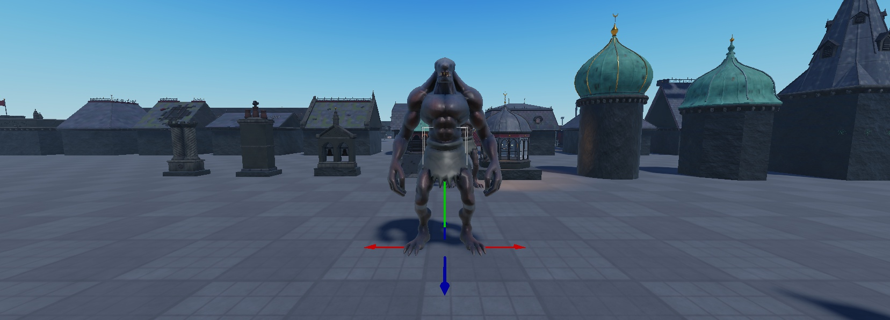
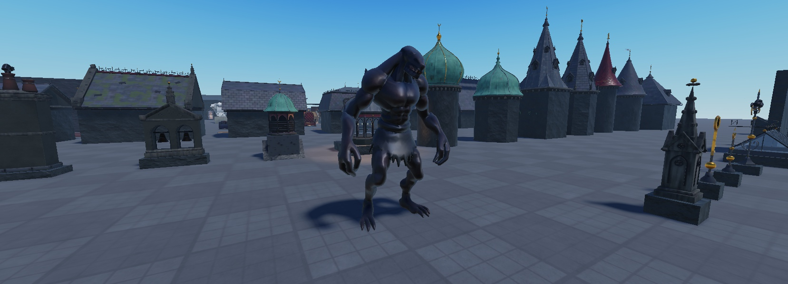
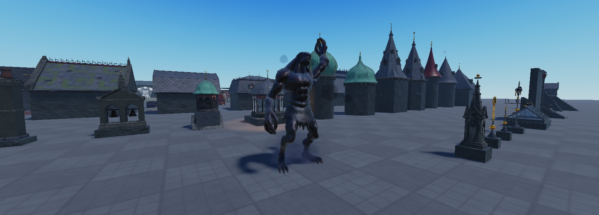
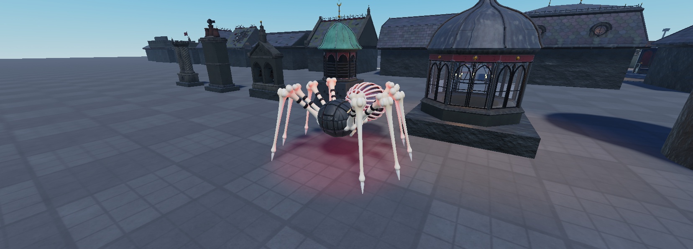
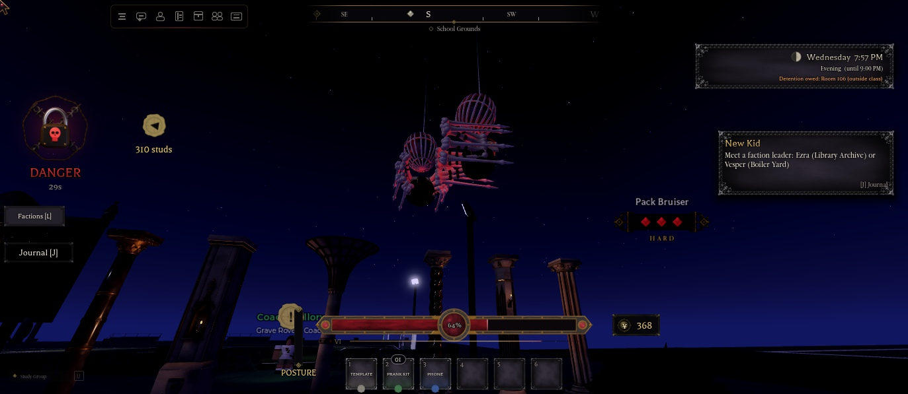
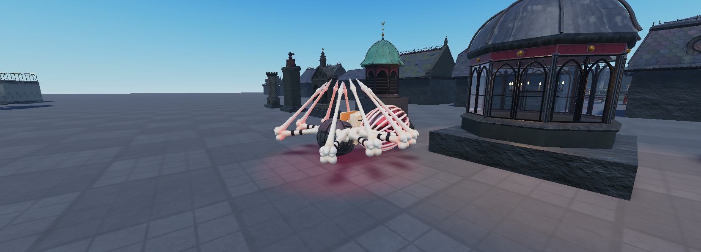
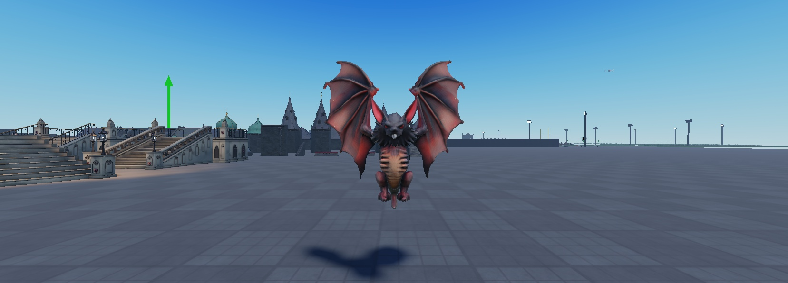
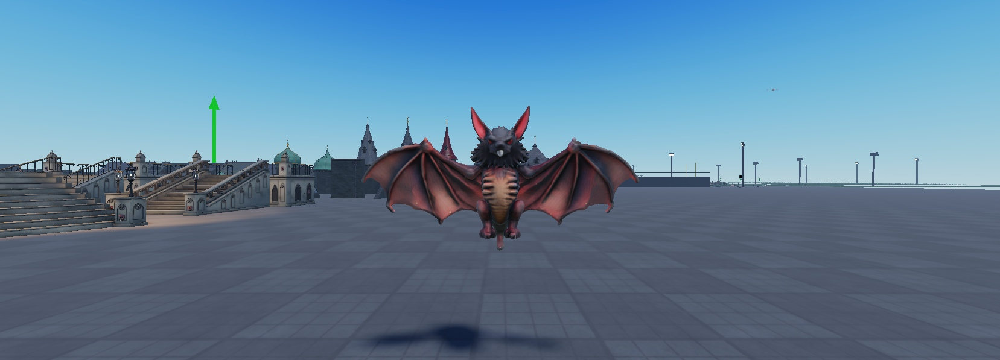
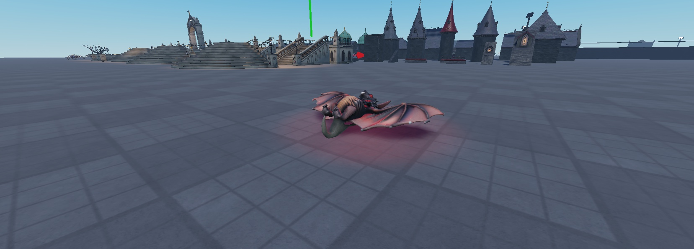

# Beasts

Night creatures run by one shared system. The wolves (`Features.WildWolves`) are separate and untouched. Design: `docs/superpowers/specs/2026-11-05-beasts-design.md`.

**Built so far:** the Hellhound (1.56.0), the Grave Ghoul (1.57.0), the Night Stalker (1.59.0), the Bone Spider (1.60.0) and the Crypt Bat (1.61.0). The ghoul's, the stalker's, the spider's and the bat's clips are waiting for the owner to publish them (see "Publishing their clips").
**Planned:** the Stone Gargoyle.

## Where things are

| What | Where |
|---|---|
| The system (server) | `ServerScriptService.Services.Features.Beasts` |
| Each beast's numbers | `ReplicatedStorage.Config.Beasts` (`Defs.<Name>`) |
| The beast models | `ServerStorage.NHBeasts.<Model>`, with an `Animations` folder inside |
| The Hellhound's fire | `ReplicatedStorage.Beasts.HellhoundFX` (`Apply(model)`, `Breath(model, on)`) |
| The special-attack warning (client) | `StarterPlayerScripts.Controllers.StateController.Indicators.BeastTell` |
| Lairs | parts tagged `NHBeastLair` with a `Beast` attribute. Placeholders in `workspace.NHBeastLairs`: `HellhoundLair` in the boiler yard, `GraveGhoulLair` on open ground at (-200, -200) (this map has no graveyard yet), `NightStalkerLair` at (300, 200), `BoneSpiderLair` at (-220, 60), `CryptBatLair` at (-100, -420) |
| Unpublished clips | `ServerStorage.NHBeasts.Clips.<Model>`: one KeyframeSequence per clip, waiting for the owner to publish |
| Where students look (Freeze) | client `StarterPlayerScripts.Controllers.World.BeastGaze` sends to `ReplicatedStorage.NHBeastGaze` |
| Trophies | `ReplicatedStorage.Config.Items.Trophies` (`Kind = Trophy`) |
| Admin | the admin panel's Spawns tab, "Beast: <Name>" (command `SpawnBeast`) |

## How a beast fights

- **Spawning:** after dark (19:30 to 05:30) it comes out of its lair, wanders near it, and is gone by morning. Its first sight of a student plays its `Sighted` clip once (the Hellhound howls).
- **The pattern:** it attacks in a fixed order (`Pattern`) that loops, so players can learn it.
- **The Kanji:** only **special** moves (`Special = true`) show a warning first, the game's own critical-attack Kanji (`CombatFX.Heavy`), bigger and with the critical glow and ring, plus the Critical sound. Normal attacks have no warning.
- **Openings:** every special is followed by an opening (`Rest`, `Recover`) where it stands still.
- **Stuns:** students' hits stun it (`Stun1` / `Stun2`), and a posture break plays `GuardBroken`. For `StunGuard` seconds after a stun wears off, hits can't stun it again or call off its attack, so mashing can't stun-lock it.
- **Turns:** one beast attacks a student at a time; the rest circle.
- **Giving up:** it gives up past its `Leash` and walks home.
- **Damage:** it goes through `Downed.ApplyDamage`, so a beast can down a student but never kill one. Beasts are `NoDowned`: they die outright.
- **Reach:** measured from the beast's body, out to its mouth plus the move's range. A big beast's mouth is studs ahead of its middle, so a student pressed against it is still in reach.
- **Death:** the `Death` clip plays and holds its last frame, and the body fades. Its root is pinned at standing height and stops being solid, so the clip does all the falling (a dead Humanoid stops holding its HipHeight). A move under way when it died doesn't land or play. The killer gets `Reward.Exp` (Combat), `Reward.Yen`, and a `Reward.Trophy` at its chance, with a notice.
- **Safety:** a beast never tips over or ragdolls. It isn't solid while a leap or dive carries it through the air, so it can't fling a student it passes through. It only hops or pounces onto floor, never off an edge. If it ever falls off the world, it's put back at its lair.

## The Hellhound

| | |
|---|---|
| Health | 180 (a wolf is 70) |
| Pattern | Bite (8), Bite2 (10), **Fire Breath** (3 a tick, 7 ticks), Bite (8), Hop back, **Pounce** (14) |
| Openings | about 2 s after the breath, about 4 s after the pounce |
| Stun guard | 2 s |
| Spawns | 1, in the boiler yard at night; back 4 minutes after a kill |
| Reward | 160 Combat EXP, ¥60, a 15% chance of the Ember Tooth |

It's the owner's wolf rig scaled up 1.35x and charred black. The owner's rules for its look:
- **No outline**, and only the game's own VFX.
- **Fire:** the burning-status flame, dimmed so it doesn't blow out under the night bloom, on a continuous mane down the back, the tail and the paws.
- **The head:** no fire except **burning eyes**, and **one horn** in the middle of the forehead.

The horn and the nine spikes are held to the bones with RigidConstraints, so they follow every animation. Checked in Play: 0° off while the head swung 27°.

## The Grave Ghoul

| | |
|---|---|
| Health | 110 |
| Ambush | waits **buried** under its grave. A student within 16 studs gets churning dirt and the Kanji over the grave, then it bursts up (**Emerge**). The burst hits anyone within 6 studs for 8 and throws them clear |
| Pattern | Swipe (7), Swipe2 (9), Swipe (7), **Grab** (14) |
| Grab | after the Kanji it lunges with both claws. Caught, you're held stunned for 1 s, then slammed for 14. **A friend's hit on the ghoul breaks the hold** (no slam). If it misses, it stumbles, a 2.4 s opening |
| Stun guard | 1.5 s |
| Home | with nobody about, it walks back to its grave and digs back in |
| Spawns | 2 at night; back 3 minutes after a kill |
| Reward | 90 Combat EXP, ¥35, a 15% chance of the Grave-Dirt Locket |

It's an AI-generated grey-hided ghoul (pointed ears, a grin of teeth, long claws, clawed feet, a burial rag), auto-rigged as an R15 body. Its 11 clips are hand-keyed for a hunched, twitchy crawler. They're built by a script into `ServerStorage.NHBeasts.Clips.GraveGhoul`.

 

## The Night Stalker

| | |
|---|---|
| Health | 130 |
| Freeze | it can't move while a student is looking at it (within 32° of the centre of their view, 70 studs, clear sight). It stops dead mid-stride. Turn your back and it closes in |
| Pattern | Sweep (9), Chop (11), **Reach** (13: a lunge spearing one arm 11 studs out; the Kanji first; then an opening) |
| Stun guard | 1.8 s |
| Spawns | 1 at night, placeholder lair at (300, 200); back 4 minutes after a kill |
| Reward | 120 Combat EXP, ¥45, a 15% chance of the Stalker's Finger-Bone |

It's an AI-generated lean, muscular dark creature with long clawed arms and an eyeless, grinning head, picked from nine tries after the owner turned down a pale mannequin ("make it cooler and higher quality"). It's scaled to 9 studs and auto-rigged R15. Shadow wisps curl off its shoulders and arms, a cold pale light comes from its head, and a faint bluish mist sits at its feet. Its 10 clips are hand-keyed for a tall, deliberate, wrong-moving thing, with the head cocked hard to one side.

Where students look comes from `StarterPlayerScripts.Controllers.World.BeastGaze`. It sends the camera's position and direction to `ReplicatedStorage.NHBeastGaze` a few times a second, only while a freezing beast is within 90 studs. The server ignores a camera more than 40 studs from its character.

 

## The Bone Spider

| | |
|---|---|
| Health | 65 |
| Hanging | it hangs head down on a silk thread 13 studs over its lair (lower under a ceiling). A student who walks within 9 studs of the spot below gets the Kanji on the floor and its thread trembles, then it drops, turning to land on its feet facing them: 7 to anyone within 5 studs, who's thrown clear. Alone again for 12 s, it walks back and climbs its thread |
| Pattern | Fang (6), Fang 2 (8), Fang (6), **WebSpit** (the Kanji first; it rears back and spits a glob of silk at where you stood when the Kanji ended: 4 and the Slow state, walk speed 5 and no jumping for 2.5 s; a miss leaves a fading splat; then an opening) |
| Stun guard | 1.2 s |
| Spawns | 2 at night, placeholder lair on open ground at (-220, 60); back 2.5 minutes after a kill |
| Reward | 70 Combat EXP, ¥28, a 15% chance of the Bone Spider's Fang |

It isn't humanoid, so the R15 auto-rig was no use. Its rig is built by a script from four generated bone pieces: a skull for its body (`Thorax`), a ribcage for its abdomen (`Abdomen`), and eight legs of a femur and a tibia each, joined by Motor6Ds (`RootJoint`, `Pedicel`, `<L|R><1-4>Hip`, `<L|R><1-4>Knee`). A red light burns in the skull. Its 12 clips are hand-keyed: an alternating four-legs-at-a-time walk and run, a rear-up fang strike, a twisting side snap, the spit, stuns, a guard break where its legs buckle, the hang, the drop, and a death where it rolls onto its back with its legs curled up.

The design called for wall climbing. It's done as the hang and drop instead: the Humanoid can't walk up walls, and dropping from above does the same job (it's somewhere you don't look).

 

## The Crypt Bat

| | |
|---|---|
| Health | 50 |
| Flight | it hovers about chest-high on a student, flying on its Humanoid's HipHeight (5 studs), so it moves like any other beast |
| Pattern | Rake (5), Rake 2 (6), **Dive** (10: the Kanji first; it swoops down through where you stood and carries on past; then an opening), Rake (5), **Screech** (the Kanji first; a shriek and a pale violet shockwave: 3 and a 1 s Stun to everyone within 40° in front of it, out to 14 studs; then an opening) |
| Stun guard | 1.0 s |
| Spawns | 2 at night, placeholder lair on open ground at (-100, -420) (the bell tower isn't in this map yet); back 2.5 minutes after a kill |
| Reward | 60 Combat EXP, ¥24, a 15% chance of the Crypt Bat's Wing-Claw |

It's an AI-generated bat (picked from three tries) with red eyes, fangs, tall ears, a ribbed belly and dark crimson, torn wings. The generator's own parts left the wings inside the body mesh, so Studio's segment tool cut it into a body and two wings. Those sit on its own Motor6D rig: `RootJoint` and a shoulder per wing (`RShoulder`, `LShoulder`). A faint red light glows at its eyes and a dark crimson streak trails off each wingtip as it beats. Its 11 clips are hand-keyed around the wingbeat: hover, fly and fast-fly loops, a rear-and-rake, a twisting snap, the dive, the screech, two stuns, a guard break where it drops out of the air and flutters back up, and a death where it falls onto its back with its wings spread.

The Dive is the Hellhound's Leap with three new options: `Arc` (negative swoops down instead of bounding up), `Dur` and `Through` (it carries on past you). The Screech's shockwave is the game's own blunt block-hit effect, tinted.

 

## Publishing their clips (owner)

The Grave Ghoul, the Night Stalker, the Bone Spider and the Crypt Bat play their clips in Studio straight from the KeyframeSequences. A live server needs them published, so until then **they don't spawn in live servers** (the Hellhound does).

For each KeyframeSequence in `ServerStorage.NHBeasts.Clips.GraveGhoul` (11: Idle, Walk, Run, Attack1, Attack2, Stun1, Stun2, GuardBroken, Death, Emerge, Grab) and `ServerStorage.NHBeasts.Clips.NightStalker` (10: the same without Emerge and Grab, plus Reach) and `ServerStorage.NHBeasts.Clips.BoneSpider` (12: Idle, Walk, Run, Attack1, Attack2, WebSpit, Stun1, Stun2, GuardBroken, Death, Hang, Drop) and `ServerStorage.NHBeasts.Clips.CryptBat` (11: Idle, Walk, Run, Attack1, Attack2, Dive, Screech, Stun1, Stun2, GuardBroken, Death):
1. Right-click it, choose **Save to Roblox**, and publish it under the group so the game can play it.
2. Paste the new id into the `AnimationId` of the Animation with the same name in that beast's `Animations` folder (`ServerStorage.NHBeasts.<Beast>.Animations`).

Once all of a beast's clips have ids, it spawns everywhere.

## Trophies

A rare drop from a beast you kill, kept in your Locker under All. A trophy is never sold, never pinned to the hotbar and never used; you can drop it.

## Adding a beast

1. Build its model and rig. The Grave Ghoul's route works well for anything shaped like a person: an AI-generated mesh, then Studio's auto-rig as an R15 body. Anything else gets its own Motor6D rig: the Bone Spider's from separately generated pieces, the Crypt Bat's from one mesh cut apart with Studio's segment tool.
2. Put the template in `ServerStorage.NHBeasts` with an `Animations` folder: `Idle`, `Walk`, `Run`, its attack clips, `Stun1`, `Stun2`, `GuardBroken`, `Death`, plus its unique clips. Unpublished clips go in `ServerStorage.NHBeasts.Clips.<Model>` as KeyframeSequences, and their Animations stay blank until the owner publishes them.
3. Add its entry to `Config.Beasts.Defs`: stats, `Pattern`, `Moves`, `Spawn`, `Reward`.
4. Tag its lair parts `NHBeastLair` with `Beast = <its Spawn.Lair>`.
5. Add its trophy to `Config.Items.Trophies`.
6. Its admin button appears by itself.
