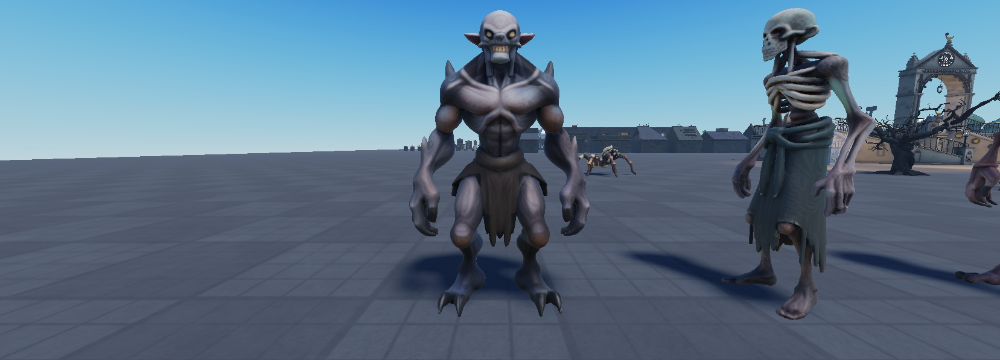
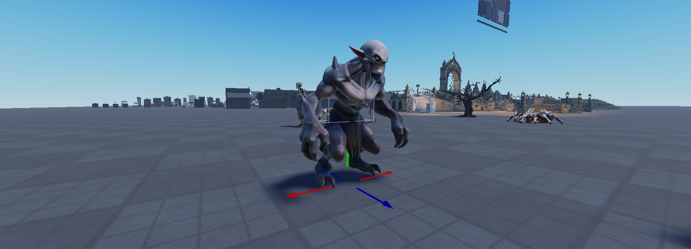
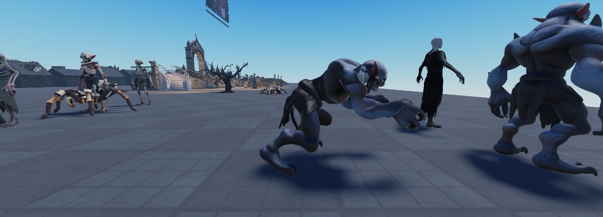

# Beasts

Night creatures run by one shared system. The wolves (`Features.WildWolves`) are separate and untouched. Design: `docs/superpowers/specs/2026-11-05-beasts-design.md`.

**Built so far:** the Hellhound (1.56.0), the Grave Ghoul (1.57.0; its clips are waiting for the owner to publish them, see below).
**Planned, one at a time:** the Bone Spider, the Crypt Bat, the Night Stalker, the Stone Gargoyle.

## Where things are

| What | Where |
|---|---|
| The system (server) | `ServerScriptService.Services.Features.Beasts` |
| Each beast's numbers | `ReplicatedStorage.Config.Beasts` (`Defs.<Name>`) |
| The beast models | `ServerStorage.NHBeasts.<Model>`, with an `Animations` folder inside |
| The Hellhound's fire | `ReplicatedStorage.Beasts.HellhoundFX` (`Apply(model)`, `Breath(model, on)`) |
| The special-attack warning (client) | `StarterPlayerScripts.Controllers.StateController.Indicators.BeastTell` |
| Lairs | parts tagged `NHBeastLair` with a `Beast` attribute. Placeholders in `workspace.NHBeastLairs`: `HellhoundLair` in the boiler yard, `GraveGhoulLair` on open ground at (-200, -200) (this map has no graveyard yet) |
| Unpublished clips | `ServerStorage.NHBeasts.Clips.<Model>`: one KeyframeSequence per clip, waiting for the owner to publish |
| Trophies | `ReplicatedStorage.Config.Items.Trophies` (`Kind = Trophy`) |
| Admin | the admin panel's Spawns tab, "Beast: <Name>" (command `SpawnBeast`) |

## How a beast fights

- **Spawning:** after dark (19:30 to 05:30) it comes out of its lair, wanders near it, and is gone by morning. Its first sight of a student plays its `Sighted` clip once (the Hellhound howls).
- **The pattern:** it attacks in a fixed order (`Pattern`) that loops, so players can learn it.
- **The Kanji:** only **special** moves (`Special = true`) show a warning first, the game's own critical-attack Kanji (`CombatFX.Heavy`), bigger and with the critical glow and ring, plus the Critical sound. Normal attacks have no warning.
- **Openings:** every special is followed by an opening (`Rest`, `Recover`) where it stands still.
- **Stuns:** students' hits stun it (`Stun1` / `Stun2`), and a posture break plays `GuardBroken`. For `StunGuard` seconds after a stun wears off, hits can't stun it again or call off its attack, so mashing can't stun-lock it.
- **Turns:** one beast attacks a student at a time; the rest circle.
- **Giving up:** it gives up past its `Leash` and walks home.
- **Damage:** it goes through `Downed.ApplyDamage`, so a beast can down a student but never kill one. Beasts are `NoDowned`: they die outright.
- **Reach:** measured from the beast's body, out to its mouth plus the move's range. A big beast's mouth is studs ahead of its middle, so a student pressed against it is still in reach.
- **Death:** the `Death` clip plays and the body fades. The killer gets `Reward.Exp` (Combat), `Reward.Yen`, and a `Reward.Trophy` at its chance, with a notice.
- **Safety:** a beast never tips over or ragdolls. It only hops or pounces onto floor, never off an edge. If it ever falls off the world, it's put back at its lair.

## The Hellhound

| | |
|---|---|
| Health | 180 (a wolf is 70) |
| Pattern | Bite (8), Bite2 (10), **Fire Breath** (3 a tick, 7 ticks), Bite (8), Hop back, **Pounce** (14) |
| Openings | about 2 s after the breath, about 4 s after the pounce |
| Stun guard | 2 s |
| Spawns | 1, in the boiler yard at night; back 4 minutes after a kill |
| Reward | 160 Combat EXP, ¥60, a 15% chance of the Ember Tooth |

It's the owner's wolf rig scaled up 1.35x and charred black. The owner's rules for its look:
- **No outline**, and only the game's own VFX.
- **Fire:** the burning-status flame, dimmed so it doesn't blow out under the night bloom, on a continuous mane down the back, the tail and the paws.
- **The head:** no fire except **burning eyes**, and **one horn** in the middle of the forehead.

The horn and the nine spikes are held to the bones with RigidConstraints, so they follow every animation. Checked in Play: 0° off while the head swung 27°.

## The Grave Ghoul

| | |
|---|---|
| Health | 110 |
| Ambush | waits **buried** under its grave. A student within 16 studs gets churning dirt and the Kanji over the grave, then it bursts up (**Emerge**). The burst hits anyone within 6 studs for 8 and throws them clear |
| Pattern | Swipe (7), Swipe2 (9), Swipe (7), **Grab** (14) |
| Grab | after the Kanji it lunges with both claws. Caught, you're held stunned for 1 s, then slammed for 14. **A friend's hit on the ghoul breaks the hold** (no slam). If it misses, it stumbles, a 2.4 s opening |
| Stun guard | 1.5 s |
| Home | with nobody about, it walks back to its grave and digs back in |
| Spawns | 2 at night; back 3 minutes after a kill |
| Reward | 90 Combat EXP, ¥35, a 15% chance of the Grave-Dirt Locket |

It's an AI-generated grey-hided ghoul (pointed ears, a grin of teeth, long claws, clawed feet, a burial rag), auto-rigged as an R15 body. Its 11 clips are hand-keyed for a hunched, twitchy crawler. They're built by a script into `ServerStorage.NHBeasts.Clips.GraveGhoul`.

 

### Publishing its clips (owner)

The ghoul plays its clips in Studio straight from the KeyframeSequences. A live server needs them published, so until then **it doesn't spawn in live servers** (the Hellhound does).

For each of the 11 KeyframeSequences in `ServerStorage.NHBeasts.Clips.GraveGhoul` (Idle, Walk, Run, Attack1, Attack2, Stun1, Stun2, GuardBroken, Death, Emerge, Grab):
1. Right-click it, choose **Save to Roblox**, and publish it under the group so the game can play it.
2. Paste the new id into the `AnimationId` of the Animation with the same name in `ServerStorage.NHBeasts.GraveGhoul.Animations`.

Once all 11 have ids, the ghoul spawns everywhere.

## Trophies

A rare drop from a beast you kill, kept in your Locker under All. A trophy is never sold, never pinned to the hotbar and never used; you can drop it.

## Adding a beast

1. Build its model and rig. The Grave Ghoul's route works well: an AI-generated mesh, then Studio's auto-rig as an R15 body.
2. Put the template in `ServerStorage.NHBeasts` with an `Animations` folder: `Idle`, `Walk`, `Run`, its attack clips, `Stun1`, `Stun2`, `GuardBroken`, `Death`, plus its unique clips. Unpublished clips go in `ServerStorage.NHBeasts.Clips.<Model>` as KeyframeSequences, and their Animations stay blank until the owner publishes them.
3. Add its entry to `Config.Beasts.Defs`: stats, `Pattern`, `Moves`, `Spawn`, `Reward`.
4. Tag its lair parts `NHBeastLair` with `Beast = <its Spawn.Lair>`.
5. Add its trophy to `Config.Items.Trophies`.
6. Its admin button appears by itself.
