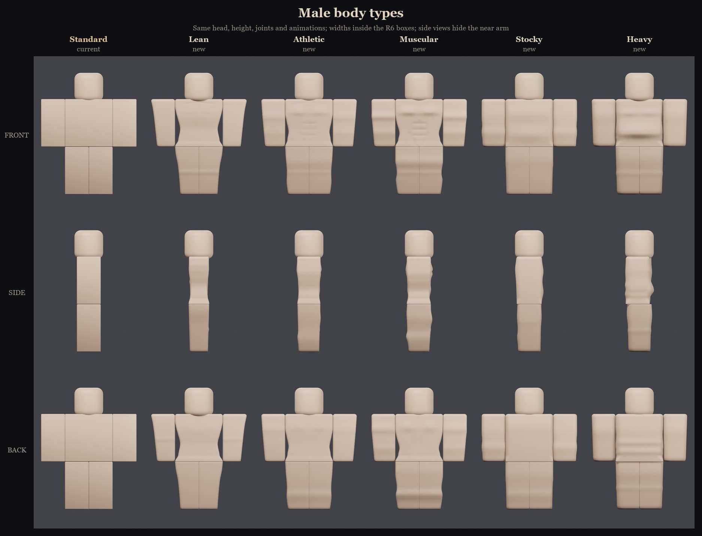
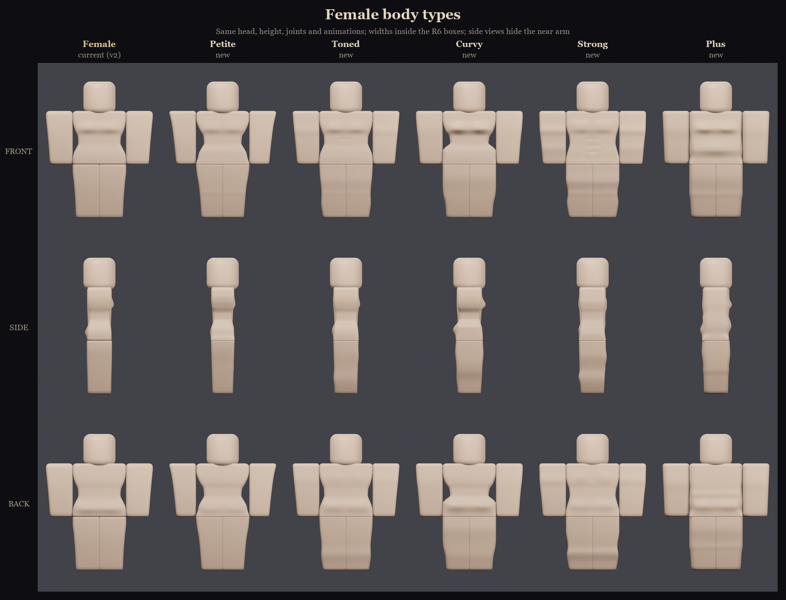
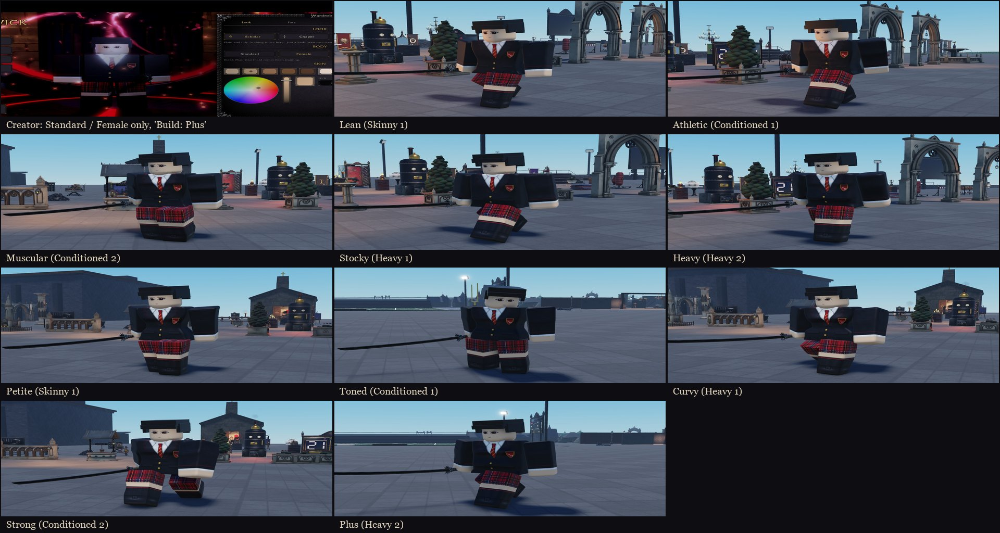

# Body types (1.69.0)

There are ten extra R6 bodies, five for each gender. Each one is a variant of that gender's current body: the standard R6 block body for male, and the [Female body v2](Female-Body.md) for female.

The owner's requests that shaped them:
- "Make a bunch for them in different shapes, muscles, etc. Make them all respective to their current models."
- "MAKE THEM STILL RESEMBLE NORMAL R6 CHARACTER PROPORTIONS THOUGH."
- Then "more detailed & exaggerated", and finally "no overlap in the legs from the torso", "no shoulder pads", "less cartoony".

**The bodies are earned, never picked:** "Only through training (or the admin menu)."




## The roster

| Build | Step | Male | Female |
|---|---|---|---|
| Average | 0 | Standard (the plain R6 body, no meshes) | Female (v2) |
| Skinny | 1 | **Lean**: a narrow waist, a sunken stomach, collarbones, thin limbs with knobby elbows and knees | **Petite**: a tiny waist, collarbones, a small bust, very slender limbs |
| Conditioned | 1 | **Athletic**: a V-taper, firm pecs, a six-pack with V-lines, toned arms and legs | **Toned**: a firm waist, light abs and V-lines, shoulder blades, toned arms, quads and calves |
| Conditioned | 2 | **Muscular**: big pecs and a sternum line, a deep six-pack, broad shoulder blades, big arms, quads and calves | **Strong**: pecs under the bust, a six-pack, shoulder blades, big arms, quads and calves |
| Heavy | 1 | **Stocky**: a deep barrel chest, a hunched upper back, a firm gut, thick limbs and big forearms | **Curvy**: a big bust, a tiny waist, wide full hips, seat and thighs |
| Heavy | 2 | **Heavy**: a big round belly over the waistline, a soft chest, back rolls, love handles, thick soft limbs | **Plus**: a big soft belly, a large bust and seat, back rolls, wide soft arms and thick thighs |

What every body keeps:
- the same head, part sizes, joints and animations;
- widths inside the R6 boxes (torso 2, limbs 1);
- legs that meet each other and the hips like standard R6, and arms flush with the torso.

**Depth (front to back)** goes past the standard 1 stud on the bigger bodies:

| Depth | Bodies |
|---|---|
| 0.87 | Lean |
| 0.94 | Petite |
| 1.05 | Athletic, Toned |
| 1.07 | Strong |
| 1.14 | Muscular |
| 1.19 | Stocky, Plus |
| 1.22 | Heavy |
| 1.23 | Curvy |

## How it works in the game

- **The body list:** `UI.Appearance.Bodies` keeps `standard` (1) and `female` (2) first, then `lean`, `athletic`, `muscular`, `stocky`, `heavy`, `petite`, `toned`, `curvy`, `strong` and `plus`.
  - Saves store the id, so the order is safe.
  - Each entry has `Gender`, `Build`, `Step` and five `Meshes`, which `ApplyTo` puts on as `NHBodyMesh` CharacterMeshes.
- **Gender:** `Appearance.BodyGender(body)` and `Appearance.IsFemale(look)` replace every old `Body == 2` check, so the female bodies count as female everywhere. That covers:
  - the hair order;
  - NPC eye sets and hair;
  - Enrollment's uniform pick;
  - the Queen title;
  - female outfits and form outfits.
- **Builds:**
  - `Appearance.BodyBuild(body)` returns a body's `build, step`.
  - `Appearance.BodyFor(gender, build, step)` returns the body index: the highest step up to `step` that exists, else that gender's base body.
- **Training (server):** `Appearance.SetBuild(player, build, step)` is the one way to change a build.
  - `build` is `"Average"`, `"Skinny"`, `"Conditioned"` or `"Heavy"`, and `step` is 1 or 2 (0 for Average).
  - It keeps the student's gender, saves through ProfileService (`Data.UpdateState` `SetAppearance`) and re-applies the look.
  - It returns `ok, bodyName`.
- **Server guard:** the look-save handler keeps the saved build and step. A client can only change gender, and only in the creator, so a forged request can't pick a build.
- **Creator (Wardrobe Look tab):** Body offers only Standard / Female. Switching gender keeps the build (Athletic becomes Toned, Plus becomes Heavy), and a trained student sees "Build: Plus. Your build comes from training."
- **Admin desk (F3):** the Student tab has a Build row under Height: Average, Skinny, Conditioned I, Conditioned II, Heavy I and Heavy II. It runs `SetBuild` (in `Features.Admin`), which is logged.

### Mesh ids (group 15981569; the imported MeshParts are in `ServerStorage.NHBodyTypes`)

| Body | Torso | Right Arm | Left Arm | Right Leg | Left Leg |
|---|---|---|---|---|---|
| lean | 80599151440718 | 81698806804529 | 115700541325418 | 102705588776863 | 133298074138660 |
| athletic | 131786090664045 | 132414762109621 | 131417759794420 | 120173701032082 | 112936256263410 |
| muscular | 77979027494394 | 105787224767323 | 132341858324942 | 123508178938073 | 129971107420398 |
| stocky | 97395586937787 | 116817128513775 | 99902053204043 | 127221281464817 | 110235894677793 |
| heavy | 113481648066946 | 94026483479391 | 117091958168532 | 111602082267684 | 76843775024418 |
| petite | 98160542260548 | 137735929863681 | 140464173247332 | 93849031916640 | 81128309715298 |
| toned | 109650324114415 | 108348625488717 | 101966670697769 | 91312785820514 | 119700145873929 |
| curvy | 90093573152527 | 97161066706362 | 81650822243600 | 79830470075363 | 116410414866469 |
| strong | 97081723455688 | 81789560903270 | 121910719117018 | 135474747479085 | 86478900952963 |
| plus | 77671978644176 | 131507995802644 | 132653815234283 | 120966302767125 | 138612636058559 |

Backups:
- `ServerStorage.NH_Backup.BodyTypes_pre`: the seven scripts before the gender, build and picker changes.
- `ServerStorage.NH_Backup.BodyTypes_preMeshes`: `UI.Appearance` before the ten bodies were added.

## Building them

`art/characters/bodies/nh_body_types.py` builds them in headless Blender. It reuses the Female body's rings, UVs and caps from `art/characters/female/`.

```
E:/Blender/blender.exe -b --factory-startup -P nh_body_types.py -- [--render] [--fbx] [--only lean,heavy]
python compose_lineup.py
```

`compose_lineup.py` runs with the system Python, because Blender's Python has no Pillow.

**Each body is a spec:**
- width and depth profiles for the torso, arms and legs;
- corner radii;
- features that push along the surface normal: bumps (pecs, bust, belly, seat, biceps, calves, kneecaps) and grooves (abs, sternum, spine, collarbones, V-lines).

**Then the generator:**
- Softens everything with `tone()`, the realism pass.
- Widens the hips over the bottom 0.28 studs, so they cover the leg tops with a square joint. The legs' top edge and the torso's bottom edge are near-square.
- Balances front and back depth, so each mesh stays centred:
  - `stretch` grows the smaller side's features (bust against seat);
  - `shift` moves the part slightly (bellies and muscles, at most 0.1 stud back for Heavy).
- Widens any thin limb about its flat inner side until its outer side reaches the box edge.

**Why everything has to be centred:** Roblox's 3D importer re-centres every mesh on its own bounding box. Measured on the imported props, even doors modelled from the hinge come out centred. A CharacterMesh draws the mesh at its true size, so any part whose box isn't centred would shift. The generator checks every part, and `body_report.json` lists each part's extents.

**Importing:** the FBX is exported at 0.01 scale with Blender's -Y as the front (see [Female-Body](Female-Body.md#building-and-importing)). After an import, check every mesh with `EditableMesh` for size, facing and the flat inner sides. The 1.69.0 import passed all 50.

## Play-tested (NH Combat Test, slot 4 "Testy")



- **All ten bodies**, through the admin desk's own remote (`NHAdmin.Run("SetBuild", ...)`, what the Build buttons call):
  - the right five CharacterMeshes on the server character;
  - a blazer, tartan skirt and socks with skin-coloured hands, and the hair and face showing;
  - walking (the Walk track: a real held S key for the male bodies, a scripted walk for most female ones and a real W for Plus);
  - a real-click katana M1 (the M1 track), except Toned.
- **Average** went back to the Standard body (no meshes).
- **Creator:** after a Studio restart, the Look tab showed only Standard / Female and "Build: Plus. Your build comes from training", so the build was saved.
- **Server guard:** a forged look asking for Muscular (a build never trained) became Heavy (male), keeping the saved Heavy step 2. That result was saved: the next session loaded as Heavy.
- **Console:** only the admin log lines and the place's existing sound and archive messages.

## Known and not verified

- **A grey flash on first load:** the first time a body's meshes load, Roblox takes about 5 seconds to build the clothing texture. Until then, some parts can show grey or the shirt can look wrong. It was fine on every later look.
- **Not tried:**
  - the creator's Female and Standard buttons with real clicks on a trained body (the same remote was tested with a forged request);
  - Toned's M1;
  - a made-up build name (the admin rate limit answered first, so the server's "Unknown build" check is code-reviewed only);
  - NPC students (they still use only Standard and Female);
  - a second player watching;
  - the viewport previews;
  - every outfit and form outfit on every body;
  - capes;
  - M2, blocking and taking hits.
- **Testy (slot 4)** was left on Standard with the tartan skirt.
- **The Map place** doesn't have the body types yet. It only has the Female body; sync it from this doc.
