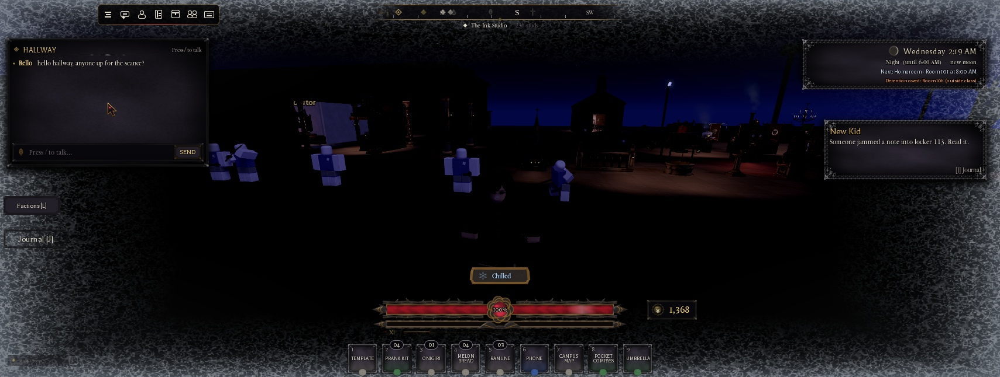
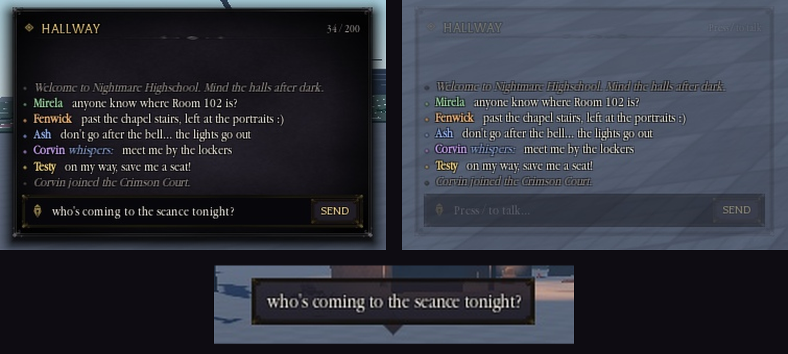

# Chat and the typing guard (2.1.0)

Owner: "completely change the chat ui and fix it so it doesn't activate any UI or anything while typing".

## The chat window: `Controllers.Gui.Chat` (client, both places)
- **It replaces Roblox's chat window and input bar.** On start it sets `ChatWindowConfiguration.Enabled` and
  `ChatInputBarConfiguration.Enabled` to false and builds the `NHChat` ScreenGui (DisplayOrder 3, the HUD's layer).
- **Built from the UI kit:**
  - a `Kit.Panel` with the thin frame, 470 x 300 design px at the top left, scaled by `Kit.AutoScale`;
  - a header ("HALLWAY", with the key hint or the letter count);
  - a scrolling log;
  - the bar (a `FrameThin` rim, the `IconNib` quill, a TextBox and SEND).
- **Messages still go through TextChatService:**
  - **Sending:** the bar calls `TextChannel:SendAsync` on `ChatInputBarConfiguration.TargetTextChannel` (else
    `RBXGeneral`).
  - **Showing:** the log shows `TextChatService.MessageReceived`. So `FaceTalk`, the top bar's unread pip and anything
    else on that signal keep working.
  - **Names:** Roblox's prefix (a coloured "Name:") is stripped to the plain name and inked by the window.
  - **Message text** comes escaped from TextChatService and is shown as is.
- **Lines:**
  - **Inks:** you are `Theme.Colors.Gold`; others are one of seven inks by `UserId`.
  - **Tags:** whispers (`RBXWhisper*` channels) get "whispers:" or "to Name:", and team channels "[team]".
  - **System messages** (no `TextSource`) are italic and dim.
  - **The log** keeps the last 120 lines and stays on the newest unless you scrolled up.
- **Keys:**
  - / focuses the bar; the / itself is dropped.
  - Enter sends; Esc leaves the bar (the draft stays).
  - Up / Down walk the last 30 sent.
  - There's a 0.6 s gap between sends (a held Enter).
- **Fade:** 10 quiet seconds (no message, hover or focus) fade the frame, header and bar; the lines stay readable.
- **Shown / hidden:**
  - `Chat.SetShown(on)` (the top bar's Chat button calls it through `TopBar.SetChat`).
  - The window hides while the player attribute `InMainMenu` is true.
  - The cinematic view hides it with the rest of `PlayerGui`.
- **Bubbles:** `BubbleChatConfiguration` gets the students' look (see `World.NpcLook`):
  - `Theme.Colors.Well` with a 6 px corner (the tail takes this colour);
  - bone `Theme.Colors.Text` in Garamond 19;
  - the bubble image tinted `GoldDeep`.
  - That image (`rbxassetid://94961441938931`) is a rim. A hollow frame like `FrameThin` leaves the bubble without a
    body, so don't use one. The Map's config had no image, so the code supplies this one when it's empty.
- **Edit-mode preview:** run `require(<Chat>:Clone()).Preview(screenGui)` (or `Preview(gui, true)` for the faded look).

## The typing guard: `ReplicatedStorage.Packages.Bind.Typing`
- `Typing.Active()` is true while any TextBox has focus, or Roblox's chat bar does (`ChatInputBarConfiguration.IsFocused`).
  `UserInputService:GetFocusedTextBox()` can't see Roblox's chat bar, because it lives in CoreGui.
- `Typing.Blocks(input)` is true for keyboard and controller input while typing. Mouse and touch still go through.
- **`Bind.Keybinds`** returns early on `Typing.Blocks` in `InputBegan`. That covers every combat key in
  `Keybinds.Config`. `InputEnded` still dispatches, so a key held when typing starts lets go.
- **Controllers:** every one that asked `GetFocusedTextBox()` asks `Typing.Active()` instead.
- **New key handlers:** check `Processed` (gameProcessedEvent) or `Typing.Active()`. A handler that has to ignore
  `Processed` (Tab and the keybind package mark keys processed) must check `Typing.Active()`.
- **ContextActionService** actions don't fire while a TextBox has focus (tested), so CAS binds need nothing.

## Testing without typing in chat
- Focus a text box from code (`Box:CaptureFocus()`), then send keys with Studio's keyboard tool. They arrive as
  processed, with focus.
- **To send a note through the real path:** set `NHChat.Window.Content.Bar.Box.Text`, then `Box:ReleaseFocus(true)`.
  That's Enter.
- `require` from `execute_luau` gets its own module copy. To test the top bar's Chat button, click it; don't call
  `TopBar.SetChat`.

## Not covered yet
- Your own bubble after a sent message didn't show in Studio solo, even with Roblox's chat on. `DisplayBubble` shows.
- Real typing, other players and whispers, phones and controllers.
