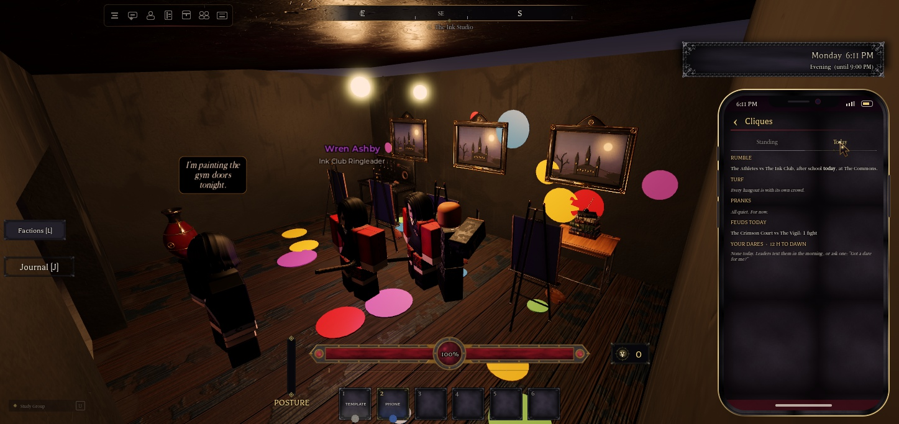
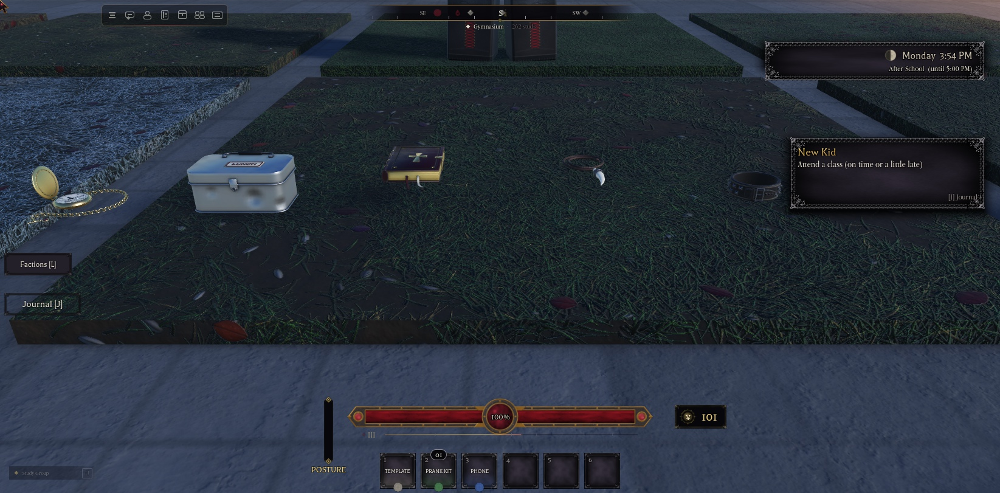
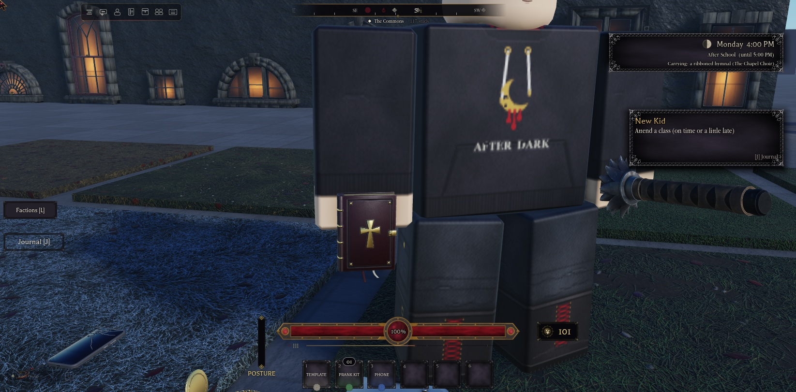
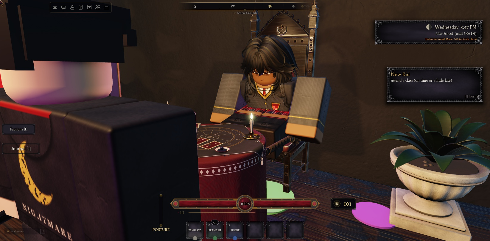
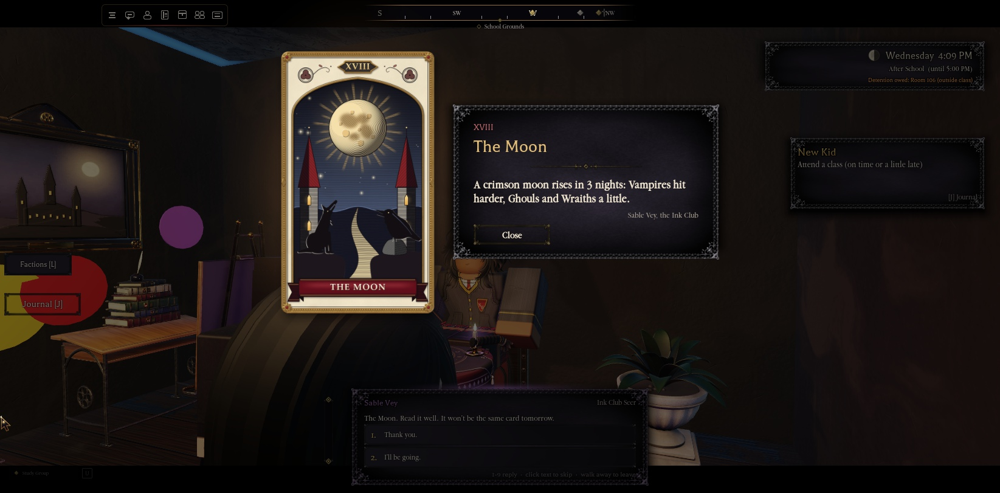
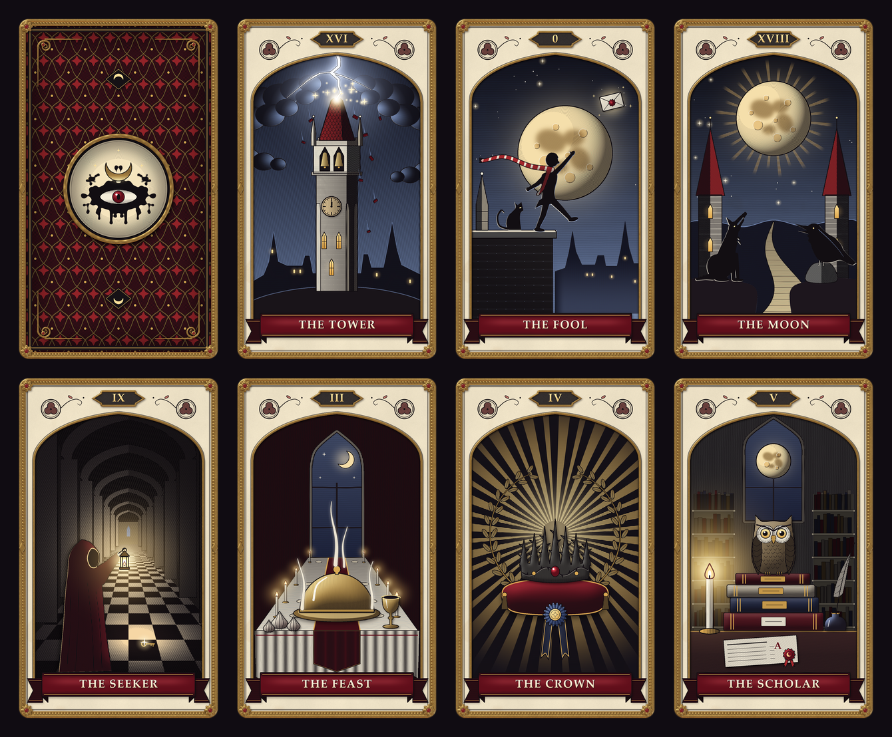

# Cliques

Added in 1.21.0 (Phase 1). The owner, 2026-11-03: the game is heavily inspired by Bully, so there should be cliques and groups, Bully-style, with our theme on them.

Every student belongs to a crowd with its own hangout, leader, rival, dress and lines. Each clique remembers how you've treated its members, and the phone's **Cliques** app shows where you stand with each one.

- **Config:** `ReplicatedStorage.Config.Cliques`
- **Server:** `Services.Social.Cliques`
- **Client:** the phone (`Controllers.Gui.Phone`) and `Controllers.World.Chatter`

## The eight cliques
| Id | Clique | Crowd | Hangout | Leader | Rival |
|---|---|---|---|---|---|
| Vigil | The Vigil | Scholars | The Archive | Ezra Vale | The Crimson Court |
| Court | The Crimson Court | Night elite | The Crimson Parlor (new) | Vesper Crane | The Vigil |
| Athletes | The Athletes | Jocks | The Gymnasium | Captain Rhys Thorne (new) | The Ink Club |
| Delinquents | The Delinquents | Greasers | The Back Lot | Bruno Vance | The Ordinary |
| Pack | The Pack | Bullies | The Den (new) | Dex Moreno | The Chapel Choir |
| Ordinary | The Ordinary | Regulars | The Commons (new) | Pip Larkin | The Delinquents |
| Choir | The Chapel Choir | Faithful | The Chapel (new) | Lucien Grey (new) | The Pack |
| Ink | The Ink Club | Artists | The Ink Studio (new) | Wren Ashby (new) | The Athletes |

- **The two factions are cliques too.** The Vigil and the Crimson Court are still joined, ranked and given missions through `Services.Social.Factions` (see Factions-and-Reputation.md). Their clique card also shows your faction rank.
- **The Ordinary** used to be a rumoured faction in `Config.Factions.Planned`. It's now a clique you can stand well or badly with, but not join.

## Members
NPCs carry the attribute `Clique`:
- **Scheduled students:** the 14 students get theirs from `Config.Cliques.Students`, by schedule index: 3 Ordinary, 2 each of Vigil, Court, Athletes and Ink, and 1 each of Choir, Pack and Delinquents. Their school clothes come from their clique's palette (`Look.Tops` / `Bottoms` / `FemaleBottoms`, all real `Appearance` ids).
- **Named NPCs:** `Config.Cliques.Npcs` maps the cast, the delinquents and the ambient students by name. `Services.Social.Cliques` tags them as they appear in `Live` and `NHAmbient`.
- **The three new leaders:**
  - Captain Rhys Thorne, "Athletes captain"
  - Lucien Grey, "Chapel Choir cantor"
  - Wren Ashby, "Ink Club ringleader"

  Each stands at the middle of their clique's gathering spots. They're built from the NPC rig with a full `NpcLooks` spec, their feet are measured onto the floor, and their name tags match the cast's. Their quests came in Phase 3 (below).
- **Turf clothes:** each clique also has a `Civ` palette (Court, Delinquents, Pack). It's in the config only for now; the dress code still uses its own swap pools.

## Hangouts
Students go to their clique's hangout:
- **At Break:** everyone.
- **After school:** athletes go to their club (gym, field, pitch); everyone else goes to the hangout.
- **In the evening:** the students who stay.

At the hangout they walk to a free **gathering spot**, face the group, sometimes lean, chat a while, then move to another spot.

- **Spots** are parts tagged `NHCliqueSpot`, with the attribute `NHCliqueSpot = <clique id>`. (1.46.1) None of them puts a student inside a prop any more; see School-Simulation.md, Standing clear of props.
  - **Count:** 61 in all: Athletes 8, Court 8, Delinquents 8, Ordinary 8, Pack 8, Vigil 7, Choir 7, Ink 7.
  - **In existing places:** the Vigil's are in the Archive, the Athletes' are courtside in the gym, and the Delinquents' are on the Back Lot.
- **Taken spots:** a spot counts as taken while a student is walking to it.
- **Unreachable spots:** if nobody can walk to a spot, it's skipped for 2 minutes. Three of the Archive spots sit round a table where the pathfinder has no room.

### The five new places (stand-ins)
These are built in `workspace.NHCliqueAreas` from primitives and the school's props, in the school's style. **The builder replaces them with the real map.** Moving a hangout means moving its region box and its spots.

| Place | Where | What's there |
|---|---|---|
| The Commons | 135, −45 | 64 × 40 paving with low walls, a fountain, 4 hall benches, planters, topiaries, lamps, a notice board and a sundial |
| The Chapel | −40, 150 | 22 × 34 gothic stone with stained glass, gables, a bell tower and a gold cross; altar, candelabra, and pews made from hall benches |
| The Ink Studio | 50, 228 | 26 × 20 dark plaster splashed with paint; easels, framed paintings, a workbench, two warm lamps |
| The Crimson Parlor | 165, 228 | 34 × 24 damask; a sofa, armchairs, a chess table, a chandelier and banners |
| The Den | −236, −80 | a mossy clearing in the woods: a fire, a coal pile, logs, rocks, a keg and a cart |

Each place has a region card (Regions.md). The Parlor and the Den are Turf, so NPCs there dress in civilian clothes.

## Standing
Standing is how a clique's members see you, from −100 to 100. It's saved per slot in `PlayerData.Social.Cliques` (one number per clique, cleaned on every read).

| Tier | From |
|---|---|
| Respected | 60 |
| Friendly | 20 |
| Neutral | −10 |
| Wary | −40 |
| Hostile | below −40 |

- **Phase 1 source:** putting a clique member on the floor costs **−8** with that clique (`Downed.OnDowned`, with you as the attacker).
- **Rivals:** any change gives the rival clique the opposite of a quarter of it. Downing a Delinquent gives The Ordinary +2.
- **Notifications:** you get one when your standing changes ("−8 The Delinquents"). Crossing into a new tier adds a line, for example "They're wary of you now." or "They respect you now."
- **API:**
  - `Cliques.Get(player)` returns `{ [id] = value }`
  - `Cliques.Add(player, id, amount, reason?)`
  - `Cliques.Tier(value)`
  - `Cliques.State(player)` returns the list for the phone

## The phone app
The **Cliques** icon takes the Factions icon's place on the phone's grid. The factions panel still opens with **L** and from the app.

The app shows each clique as a card with:
- its colour stripe and name
- its crowd and hangout, and its tagline
- your standing on a bar running out from the middle (left for negative, right for positive), with the number and the tier
- its leader and its rival
- **The Vigil and the Crimson Court only:** your faction rank ("member" if you've joined) and a **Faction** button that opens the factions panel

The page refreshes while it's open when your standing changes.

- **Remotes:** `ReplicatedStorage.NHCliques` (attribute `Ready`)
  - `Get` (RemoteFunction, 4 calls a second at most) returns the list
  - `Changed` (RemoteEvent) fires when your standing moves

## Voice lines
Every clique has five lines of its own. A student in a clique says one of them about half the time, and the student or kind lines otherwise (`Controllers.World.Chatter`). Staff never use clique lines.

## Phase 2 (1.27): reactions, turf and scuffles
`Services.Social.CliqueFights` (new), with its settings in `Config.Cliques.Fights`.

**Reactions.** Your tier with each clique sits on your player as `CliqueTier_<Id>`; `Social.Cliques.SyncTiers` refreshes it every 3 s and on every change.
- Clique members near you say that clique's `Reactions[tier]` line about 70% of the time. Neutral keeps their usual lines.
- At a hangout, a student whose clique respects you or is hostile to you turns to face you within 10 studs (`Features.Schedules` `Local.Linger`).

**Turf confrontations.** Stay `TurfLinger` (8) s inside the hangout box (`workspace.Regions`) of a clique that's Hostile to you.
- **The crew:** `ConfrontCrew` (2, or 3 at -70 or lower) members spawn at the clique's spots farthest from you.
- **The fight:** one taunts you, and they fight only you (`FixedTarget`) at the clique's tier.
- **Ending:**
  - you get `LetGoDistance` (30) studs past the box: a "Leave" line
  - you go down: a jeer
  - they're all down
  - `ConfrontTime` (90) s pass
- **Cooldown:** `ConfrontCooldown` (120) s per clique.
- Dueling and protected students are left alone.

**Rival scuffles.** `ScuffleKinds` segments (Break, Lunch, After School, Evening), at most every `ScuffleEvery` (240) s. A rival pair from `RivalPairs` fights at the defender's hangout, which needs a student within `ScuffleSeeRange` (120) studs.
- **Fighters:** 2 or 3 a side. The defenders come out of their group and the rivals walk in from 22 studs. Targets come from threat, so they never pick on bystanders.
- **Joining in:** hit one and it turns on you. You count as being on the side you've hit less. `HelpDown` (+6) with that side for each rival you put down, and `HelpWin` (+10) if it wins. The usual -8 and rival share come from `Social.Cliques`.
- **The monitor:** on school grounds, after 4 s, `School.HallMonitor.Respond(venue, onArrive)` sends the nearest free monitor on duty. When it arrives it says "Break it up!" and the scuffle ends; survivors say their Scatter line.
- **Ending:** a side all down, `ScuffleTime` (60) s, or the monitor. Everyone walks away from the nearest student and despawns once nobody's within 40 studs, or after 15 s (never while carried or gripped).

**Fighters** are spawned for each event (`AI.Spawn`): the clique's `Fighter` name, its clothes, its `Tier` (health 60 / 75 / 90 for Easy / Normal / Hard), Fist, and the tier pips on the tag. The scheduled students keep their routine; the ones nearby watch (`workspace` `NHScuffleAt`).

**Fight lines.** `Taunt`, `Jeer`, `Leave`, `Rally` and `Scatter` show as speech bubbles via `NHCliques.Say`, to students within 90 studs.

| Tier | Cliques |
|---|---|
| Easy | Ordinary, Ink Club, Chapel Choir |
| Normal | Vigil, Athletes, Delinquents |
| Hard | Crimson Court, Pack |

`LeaderTier` is one above.

## Phase 3 (1.28): leader quests, rewards and turf wars

**Leader quests.** Two per clique (`Config.Quests` `Clique<Id>1` and `Clique<Id>2`, Category `Clique`, `Giver` = the leader's NpcId).
- **Unlocking:** quest 1 needs Neutral standing (-10 or more). Quest 2 needs Friendly (20) and quest 1 done (`Requires.Clique = { Id, Min }`, `Config.Cliques.QuestOpen`).
- **Rewards:** `{ Yen, Cliques = { [Id] = delta } }` (20 / 40 Yen, +20 / +30), applied by `Quests` `GiveRewards` and shown by `RewardText`.

| Clique | Leader | Quest 1 | Quest 2 |
|---|---|---|---|
| Vigil | Ezra | Lamplighter (VigilLampA-C after 5 PM) | The Missing Page (Page1893 from the Records Office, after hours) |
| Crimson Court | Vesper | An Invitation (timed delivery to Lucien) | Bad Blood (scuffle vs the Vigil) |
| Athletes | Rhys | Warm-up (Target Practice drill) | Bench Them (scuffle vs the Ink Club) |
| Delinquents | Bruno | Five-Finger Discount (SnackCrate, after hours) | The Lot's Champion (down RingChampion) |
| Pack | Dex | Lunch Money (LunchMoneyA-C; -10 Ordinary) | Raid the Chapel (scuffle vs the Choir) |
| Ordinary | Pip | Hall Pass (timed delivery to Mallory) | Stand Together (scuffle vs the Delinquents) |
| Chapel Choir | Lucien | Candles at Dusk (ChoirVotiveA-C after 5 PM) | Drive Them Out (scuffle vs the Pack) |
| Ink Club | Wren | Fresh Canvas (PaintShelf to Wren) | Masterpiece (GymDoors after school, Witness = Vandalism; -10 Athletes) |

**The `Scuffle` objective** (`Type = Scuffle`, `Clique = <side>`).
- **How it counts:** `Social.CliqueFights` calls `Quests.Progress(Player, "Scuffle", Winner)` for each student who put at least one rival down on the winning side.
- **Scuffle choice:** every 60 s, while any player has one active, the next scuffle prefers that clique's rival pair (`Wanted`).

**The new leaders.** Rhys (Athletes), Lucien (Choir) and Wren (Ink Club) are regular cast now, in `Config.Npcs` (with `Clique`), `NpcLooks` and `ServerStorage.Dialogue` (GiverTemplate). `Social.Npcs` sets their `Clique` attribute. Their posts (`NpcPost`) are in the middle of their clique's spots, in `workspace.NHCliqueAreas.QuestProps`.

**Quest props** (`Studio/clique_quest_props.luau`, idempotent). These are stand-ins: quests find them by attribute (`QuestObject`, `QuestArea`), so the builder can move or replace them. The snack crate is made at runtime by `Social.Cliques`, behind the `NHConcession`-tagged stand.

**Rewards** (`Config.Cliques` `PHASE3`, `Social.Cliques.CheckRewards`).
- **Unlocking:** at Respected (60) with quest 2 done, the player gets `CliqueReward_<Id>` and a notification. The clique's first title comes earlier, at Friendly.

| Reward | How |
|---|---|
| Titles | `Titles[1]` at Friendly, `Titles[2]` at the reward (`AwardTitle`) |
| One-click look | `SignatureLook { Top, Bottoms }`, shown in the Wardrobe's Clique Looks row. The top is granted into `Identity.Uniforms` via `Data.UpdateState` `SetIdentity`. |
| Backup | Hit by an NPC inside the hangout (+20 studs) or within 30 studs of its students: two members spawn on the attacker. At most once every `BackupCooldown` (90) s, never in duels, and they leave after 40 s or when the fight ends. |
| Discount | `Perk { Shop, Off }`: Ordinary gives 25% off at the Concession, Delinquents 25% off Boards. `Config.Cliques.PriceFactor(Player, Shop)` takes the best one, and the Locker, Inventory and Skateboard prices use it. |

**Turf wars** (`Social.CliqueFights`).
- **The day:** an in-game day runs from 6 AM to 6 AM.
- **Taking a hangout:** a rival winning `TurfWins` (2) scuffles at a clique's hangout in one day takes it.
  - The holders keep it until the next 6 AM.
  - `workspace` gets `NHTurfHolder_<Owner>` = holder and `NHTurf_<RegionId>` = holder's name.
- **While it's held:**
  - `Features.Schedules` sends the owners' students elsewhere and lets the holders use the spots. Their activity label names the hangout.
  - The region card shows "Held by ..." (`RegionsClient`).
  - A scuffle there has the holders defending.
- **Taking it back:** the owners retake it with one win.
- **Bonus:** fighters on the winning side of a deciding scuffle get `TurfBonus` (+15).
- **Notifications:** students within 220 studs get one when a hangout is taken or retaken. At 6 AM, everyone gets one when it returns.

## Phase 4 (1.33): events

Design: [docs/superpowers/specs/2026-11-04-clique-events-design.md](superpowers/specs/2026-11-04-clique-events-design.md). Settings: `Config.Cliques.Events`. The owner's order for what's next: **leader showdowns (friend or foe), then joining a clique.**

### Pranks (`Services.Social.CliquePranks`, new)

**Prank spots.** Two per hangout (`PrankSpots`).
- **Made at runtime:** anchors in `workspace.NHCliqueAreas.PrankSpots`, from the clique's two gathering spots farthest apart.
- **Map override:** any part with the attribute `NHPrankSpot = <clique>` is used instead, and then none are made for that clique.
- Each spot has a **Prank** prompt (hold E, 4 s).

**Messes** (`workspace.NHCliqueAreas.Messes`, attributes `Victim`, `By`, `ByPlayer`, `Kind`, `Spot`).

| Kind | Looks like |
|---|---|
| Tag | The pranksters' `Slogan` in their colour, in marker text (`Font.PermanentMarker`) on the floor (your own pranks: GOTCHA, WAS HERE, ...) |
| Stink | A green canister and green smoke (the combat dust's smoke texture, tinted) |
| Trash | The school's `TrashCan` model on its side, with paper everywhere |

- **Placement:** on the visible surface. Decorative floor tiles often don't collide, so the walking floor can be lower.
- **Cleaning:** hold E (3 s) on a mess: `PrankClean` (+3) with the victims. Messes also go at 6 AM ("The janitor cleaned up every hangout overnight.").
- **Reactions:** the victims' students within 25 studs complain (`Pranked` lines, at most every 40 s each).
- **One mess per spot:** a spot's Prank prompt is off while its mess is there.

**Prank desks (1.66).** A landed prank also swaps one classroom desk for the pranksters' `StudentDeskPrank<Clique>` (their colour, a slogan and an emblem). Your own prank uses the clique you stand 60+ with, or a carved or graffiti desk. Hold F (3 s) to scrub it. The janitor clears them at 6 AM. At most 6 at once (`CliquePranks.TagDesk`).

**NPC pranks.**
- **When:** at Break, Lunch, After School and in the Evening, at most every `PrankEvery` (360) s (the first one 3 minutes in), and only with a student within `PrankSeeRange` (120) studs.
- **What happens:** a member of one rival walks in from 30 studs, works for `PrankTime` (6) s (a `Shh` line) and leaves the mess.
- **Stop it:** hit them first. They drop it and fight you; each one you put down is `PrankStop` (+6) with the victims.
- **Help:** hold E by them ("Keep watch"). They finish twice as fast: `PrankHelp` (+6) with the pranksters, −6 with the victims.

**Your pranks.**
- **The kit:** a **Prank Kit** (`Config.Items` `PrankKit`, Kind `Prank`) costs 15 Yen at the concession stand (discounts apply). The stand sells `DailyLimit` (3) a day, counted in `Inventory.Daily` by the event day.
- **Using it:** hold E on a prank spot, or use the kit from the hotbar while standing on one. `Inventory.Take` spends it.
- **Standing:** `PrankMine` (−15) with the victims and `PrankMineRival` (+8) with their rival. The rival's automatic quarter share is topped up to 8.
- **Witnesses:**
  - `HallMonitor.CheckWitness(Player, "Vandalism")`: Recognized books it now, Spotted means the monitor comes.
  - A victim member within `PrankSeen` (20) studs with line of sight shouts and calls a confrontation (`CliqueFights.Confront`).
- **Quests:** counts for the `Prank` objective (`Quests.Progress(P, "Prank", victim)`).

### Rumble days (`CliqueFights`)

- **Planning:** every `RumbleEveryDays` (3) event days, a rival pair is picked (yesterday's most heated, else random) for the **next** day's After School at the Commons (`RumbleVenue` = the Ordinary's hangout). Everyone gets a text from one side's leader (`CliqueEvents.RumblePlanned`) and a toast.
- **Start:** a student within `RumbleStartRange` (160) studs, or 10 in-game minutes into After School.
- **The fight:** `RumbleWaves` (3) waves of `RumbleSize` (3) a side. A side's next wave walks in when its wave is all down. A fighter who goes down is out for good: they leave, and they count toward that side's losses. At most `RumbleTime` (240) s.
- **Staff:**
  - At `RumbleMonitor` (60) s, the hall monitor responds. They keep fighting: "There's only one of them!"
  - At `RumbleStaff` (120) s, the nearest coach (Coach Mallory / Varga / Dunmore) walks over, says "That's ENOUGH! Everyone, out!", ends it, and walks back.
- **Winning:**
  - The side still standing wins, or the side that lost fewer when it's stopped.
  - The winners hold the losers' hangout until 6 AM the day after (`SetTurf` with `Until`).
  - Helpers on the winning side get `RumbleWin` (+15), and the `Scuffle` objective counts it.
- **No overlap:** no scuffle starts during a rumble, and no rumble during a scuffle.
- **Feuds:** `CliqueFights.Feuds()`: scuffles and rumbles per rival pair per event day.

### The bulletin (the Cliques app: **Standing** | **Today**)

The phone's Cliques app has a `Kit.TabBar`. **Today** (`NHCliques.Today`, `CliqueEvents.Today`) shows:
- **Rumble:** the next one (today / tomorrow), the live one with waves left, and the last result.
- **Turf:** hangouts held by someone else.
- **Pranks:** one going on, and messes not cleaned yet (by a clique, "someone", or "you").
- **Feuds today:** fights per pair, and wins.
- **Your dares:** taken (with progress), done, or waiting in Texts, plus hours to dawn.

It refreshes every 5 s while open.

### Dares (`Services.Social.CliqueEvents`, new; `Config.Quests` `Dare<Clique>1-3`)

- **The pool:** each leader has three dares. One is that leader's dare of the day (`Quests.DareFor(Leader)`, rotating by the event day, which runs 6 AM to 6 AM).

| | Dare 1 | Dare 2 | Dare 3 |
|---|---|---|---|
| Type | Prank the rival's hangout (`Prank`) | Win a scuffle or rumble for us (`Scuffle`) | The clique's own: Vigil and Ink a lesson (B or better / pass), Court a 30-min note to Ezra, Athletes Target Practice, Delinquents a ring duel, Pack the notice-board shakedown, Ordinary attend a class, Choir a Chapel votive after 5 PM |
| Reward | 15 Yen, +8 | 20 Yen, +10 | 10 Yen, +6 |

- **Rules** (`Dare = true`, `Category = "Dare"`, `Repeatable = "Daily"`):
  - Only today's dare can start (`CanStart` → `NotToday`).
  - Doing it marks the event day (`Done` = `DareDay`).
  - An unfinished dare simply goes away at 6 AM (`ExpireDare`, with a toast; no Failed entry).
  - The journal tags it "DARE · GONE AT 6 AM".
- **Texts:** each morning, or on loading a slot that hasn't had today's, 1 to 3 (`DaresPerDay`) leaders who are Neutral or better text you their dare (`CliqueEvents.SendDares`).
  - The phone's new **Texts** app (an envelope glyph; red badge for unread) lists the texts, with **Accept** (starts the quest) and **Not today**.
  - Texts are saved per slot in `PlayerData.Phone.Texts` (newest first, `TextsKept` 30), and `Phone.DareDay` records the morning's send.
  - Remotes: `NHPhone.Texts` and `NHPhone.TextAction`.
- **In person:** any leader you're Neutral or better with offers their dare in dialogue as "Got a dare for me?" (`QuestChoices`).

### Test hooks (Studio, `ServerStorage.NHTestBridge`)

`Prank(by, victim)`, `PrankHit(name, down?)` (as if you hit or downed the prankster), `PrankMine(name, victim, useKit?)`, `Messes()`, `CleanAll()`, `Rumble(a, b, now?)` (now: start it; else plan it for tomorrow), `RumbleState()`, `Dares(name)` (send today's texts again), `Today(name)`, `DareFor(leader)`. Standing only changes with a loaded slot.

## Phase 5 (1.34): leader showdowns

`Services.Social.CliqueShowdowns` (new); settings in `Config.Cliques.Showdown`; lines `Challenge`, `Call`, `Beaten`, `Gloat` and `Crown` on each clique; quests `Showdown<Clique>` in `Config.Quests` (Category `Clique`, `Showdown = <clique>`, a `Defeat` objective with Target `Showdown<Clique>`, +50 Yen).

**Two ways in (owner's pick: friend or foe).**
- **As a friend:** Friendly (20) with the clique and its leader's quest 2 done. Ask the leader: "I want to test myself." (`QuestChoices`), and the quest starts.
- **As a foe:** Hostile with the clique. Once an event day the leader texts you a challenge (their `Challenge` line, in Texts), and the quest starts by itself.
  - You answer it After School or in the Evening (`FoeKinds`).
  - Not answered by night: the quest fails, and that clique's crews confront you twice as often the next day (`NHGrudge_<clique>`, read by CliqueFights' turf confrontations).
- **Gates:** `Quests.CanStart` asks `CliqueShowdowns.CanChallenge`. A won showdown is done for good. After a loss or a forfeit, not again the same event day.

**The fight.**
- **Start:** walk into the clique's hangout with the quest active, outside class.
- **The leader:**
  - The real leader (`Social.Npcs`) steps aside.
  - A fighter in their look (`NpcLooks.Specs`) takes their place at `LeaderTier` with `LeaderHealth`: Normal 130, Hard 160, Nightmare 190. The Court's and the Pack's leaders are the toughest.
  - Fists, and they target only you.
- **The ring:** `RingSize` (5) members stand round you, `RingRadius` (14) studs out, shouting every `ShoutEvery` (6) s.
- **Half health:** the leader shouts their `Call` and `Backup` (2) of the ring join in.
- **Endings:**
  - Down the leader: you win.
  - Go down: you lose.
  - Get `ForfeitDistance` (30) studs past the hangout: a forfeit.
  - At most 5 minutes.
- **The hall monitor:** while it lasts, the hangout is covered by a `CombatAllowed` part, so the monitor leaves it alone, as in Bruno's ring.
- **Afterwards:** the ring walks off, the fighter goes and the real leader comes back.

**Win / lose.**
- **Win:**
  - Their `Beaten` line, and the clique goes up to Respected (60) if it was lower. Downing the leader's −8 is part of that.
  - The quest's Defeat objective completes (+50 Yen).
  - `PlayerData.Social.Showdowns.Won[<clique>]` is set.
- **Lose:** their `Gloat` line, and try again on a later day. If the leader was Hostile, `FoeLoss` (−5) more.

**King (or Queen) of the School.** Beat all eight (either way):
- the title (`KingTitle`), with Queen for a female body;
- the Player attribute `NHKing`:
  - `KingOff` (10%) off at every shop (`Config.Cliques.PriceFactor`, the best discount wins);
  - backup at every clique's hangout (CliqueFights' backup);
- a text from every leader (their `Crown` line);
- the Midnight Bell's front page ("... runs this school").

**The bulletin.** The Today tab has a **Showdowns** line: leaders beaten out of 8, open challenges and waiting leaders, and the King line.

**Test hooks.** `Showdown(name, clique, path?)` (start a fight now), `ShowdownState()`, `ShowdownHurt(clique, amount)`, `ShowdownWin(name, clique)` (record a win: needs a slot), `CanShowdown(name, clique)`.

## Phase 6 (1.35): joining a clique

`Services.Social.CliqueMembership` (new); settings in `Config.Cliques.Membership`; lines `Joined`, `Betrayed` and `Greet` on the six joinable cliques; jobs `Job<Clique>1-3` in `Config.Quests`.

**One crowd at a time (owner's pick).**
- **The Vigil and the Crimson Court** are joined through `Social.Factions`, as before.
- **The other six** (Athletes, Delinquents, Pack, Ordinary, Choir, Ink Club) are joined through this service.
- **No doubling up:** a faction member can't join one of the six, and the other way round. `Factions.CanJoin` returns `CliqueMember`, and the leaders' faction dialogue has a line for it.

**Joining.** Respected (`JoinAt` 60) and the leader's showdown won (Phase 5). Ask the leader: "I want to join you." (`Dialogue.GiverTemplate`).
- **Refusals:** NotRespected, NotBeaten ("Ask me for a showdown"), OtherClique.
- **Saved in** `PlayerData.Social.Membership`.
- **Player attributes:** `NHClique` (also set for a faction member) and `NHCliqueRank`.

**Ranks** (by your standing while you're in):

| Rank | From | What you get |
|---|---|---|
| Hanger-on | 60 | Members greet you by name (`Greet` lines, only you see them: `Cliques.SayTo`), and their backup comes anywhere (`CliqueFights` backup) |
| Member | 75 | One crew member walks with you outside class and fights with you |
| Lieutenant | 90 | A crew of two; member jobs pay `LieutenantBonus` (1.5x) |

**The crew** (`CrewStep`, every 0.5 s).
- **Who:** the clique's fighters (`CliqueFights.SpawnFighter`, Player attribute `NHCrewOf`).
- **Following:** they walk 4 studs behind you, and catch up by teleporting if you get 70 studs ahead.
- **Fighting:** they fight NPCs who hit you or that you hit. Never players.
- **When they're gone:** in class, at night, on the main menu, in duels and sports, and while you're down.
- **Losses:** a downed crew member is replaced after `CrewRespawn` (60) s.

**Rivals.** The rival clique confronts you on its turf even if it doesn't hate you. `CliqueFights.TurfStep` reads `NHClique`.

**Member jobs** (`Job = true`, Category `Job`).
- **One a day** from the leader, "Got a job for me?" (`Quests.JobFor`, the dares' daily rules: done for the event day, gone at 6 AM).
- **The three:**
  - **Hold the Line:** win 2 scuffles or rumbles for us.
  - **Payback:** prank the rival twice.
  - **Guard Duty:** stop a rival prank at our hangout. The new `StopPrank` objective counts when you put the prankster down, and `CliquePranks.GuardDuty` sends the rival's prank about 30 s after you take the job.
- **Reward:** +6 standing and 25 Yen, and half again for a Lieutenant.

**Leaving is a betrayal (owner's pick).**
- **How:** from the leader ("I'm out.", then "I'm sure. I'm out."), or the phone (Leave, pressed twice within 6 s; `NHCliques.Leave`).
- **What happens:**
  - Your standing drops to `BetrayTo` (−50, Hostile).
  - Your showdown win with them is wiped, so their leader challenges you again (Phase 5).
  - Their leader texts you their `Betrayed` line.
  - Your job is dropped and the crew walks off.
- **Rejoining** means Respected and beating them again.
- **The factions** keep their own leaving rules (you keep half your standing).

**Phone.** The clique's card in the Cliques app shows **MEMBER · rank** with a crimson **Leave** button. The Today tab shows **Your clique**: rank, points to the next rank, and today's job and its state.

**Test hooks.** `MemberTest(name, clique?, rank?)` treats a no-slot player as a member at a rank, with nothing saved; no clique ends it. Also `MemberState(name)`, `CliqueCanJoin(name, clique)` (1.38.3; it was `CanJoin`, which the factions command replaced) and `GuardDuty(name, clique)`.

**Prank messages (1.38.4).** Holding E on a prank spot that refuses now says why: too far, already pranked, or "Finish what you're doing first." when you're mid-fight or down. The no-kit note is unchanged.

## Save-slot test (1.38.3)

Every saved clique path was played on a temporary fourth slot ("Testy"): standing, a real showdown win, joining through the leader, ranks and the walking crew, the Warm-up and Bench Them quests, a dare, a member job (with the Lieutenant bonus), prank kits and their daily limit, the clique reward and titles, King of the School, leaving, and joining another clique afterwards. A fresh Play session read it all back. The test found one bug: greetings showed "{Name}" instead of your first name (fixed in 1.38.3).

To run it again: set `Config.MainMenu.SlotCount` to 4, play, and use TestBridge `ChooseSlot` 4, `SetName`, `EnterSchool`. Set it back to 3 afterwards. Studio saves go to the test store.

## Test hooks (Studio only, `ServerStorage.NHTestBridge`)
- `SchedulePlan(kind, name?, hour?)`: put every student on a plan now, for example `("Break", "Break", 9)`
- `ScheduleDebug()`: each student's index, clique, activity and seat
- `Cliques(name)`: the phone's list for a player
- `CliqueAdd(name, id, amount, reason?)`: change a player's standing
- `Scuffle(defender, attacker)`, `Confront(name, clique)`, `FightState()`: start a scuffle or a confrontation now, and see what's running (with the last result and the turf)
- `TurfWin(owner, rival, winner)`: record a scuffle result at `owner`'s hangout, as if one had ended
- Set `ReplicatedStorage` attribute `NHTestNoMenuKeys` during automated Play tests: the main menu then ignores the keyboard, so a stray Enter or Space can't press Continue and load a slot. Clear it afterwards.

## Lost & Found (1.42)

`Services.Features.LostFound` (server) and `Controllers.World.LostFound` (client).

- **Where:** up to 3 lost things lie around at a time, near the `NHCliqueSpot` gathering spots, never in a Forbidden region. Each has a glint and a "Pick up" prompt (`NHLostPickUp`). A taken item turns up somewhere else 150 to 300 seconds later.
- **The things:**

  | Item | Owner |
  |---|---|
  | varsity scarf | Athletes |
  | ink-stained sketchbook | Ink |
  | studded wristband | Delinquents |
  | wolf-tooth pendant | Pack |
  | ribboned hymnal | Choir |
  | dented lunch tin | Ordinary |
  | brass pocket watch, cracked phone | nobody |

- **Carrying:** one at a time, welded to the right hand (`NHHeldLost`). The Player attributes are `NHLostItem`, `NHLostItemText` and `NHLostItemClique`, and the clock shows "Carrying: …". It isn't saved: you drop it if you leave or go down.
- **Returning:** your client shows a "Return" prompt (`NHLostReturn`) on students (`workspace.NHSchedule`) of the owner's clique, and calls `ReplicatedStorage.NHLostFound.Return`. The return gives +5 standing with that clique and a thank-you line.
- **Handing in:** the "Hand in" prompt (`NHLostHandIn`) is on any Model tagged `NHLostFoundBox`. It pays ¥15 for an owned item and ¥20 for an unowned one.
- **The limit:** 5 returns or hand-ins a day, on the 6 AM event day (`PlayerData.Social.LostFound {Day, N}`).
- **Props:** batch 24 (`School-Props.md`); the items fall back to a plain block if a template is missing.
- **Test hooks:** `LostSpawn(id, position)` and `LostState` on `ServerStorage.NHTestBridge`.

## The Ink Club seer (1.45)

`Services.Features.Fortune` (server), `Controllers.Gui.Fortune` (client), `ServerStorage.Dialogue.Sable`.

- **Sable Vey**, "Ink Club Seer" (`Config.Npcs` Sable, `NpcLooks` Sable), sits at the tarot table in the Ink Studio (props batch 26).
  - The root is anchored at the post with a seated pose (`POSE`: hips forward, hands lowered), the Animate script is paused, and the model has `NHSeated`. `Social.Npcs` doesn't turn a seated NPC to face the player.
  - **(1.46.1) On the cushion:** the hip joints lift the legs half their thickness, so the thighs lie level with the hips. `Features.Seats` then rests Sable on the chair's cushion (`SeatHeight` 1.6) and keeps clear of the chair back.
  - **(1.46.1) The table:** placed at 0.9 scale, 3.25 in front of the chair, so the knees clear the cloth.
  - **(1.46.1) The idle** (`Controllers.World.SeerIdle`, every client): a 9-second keyframed loop on the joints. Sable breathes, looks down at the cards, glances up at the nearest student within 14 studs, leans in toward them and settles back.
  - Sable carries `Clique = Ink` on the model, but has no Clique in `Config.Npcs`, so the "join us" choices don't appear.
- **A reading:** "Read my fortune. (¥5)" in Sable's dialogue, once per event day (`PlayerData.Social.Fortune {Day, Card, Text}`). With no Yen, or nothing to tell, Sable says so and nothing is taken.
- **The hints** (`Fortune.Hints(P)`): each topic gives a riddle and a plain line. At Ink Club standing 20+ (Friendly) you get the plain one.

  | Card | Topic | Source |
  |---|---|---|
  | The Tower (XVI) | a live, today's or tomorrow's rumble, else the most heated feud | `CliqueFights.Rumble`, `Feuds` |
  | The Fool (0) | a dare you haven't finished | `CliqueEvents.Today(P).Dares` |
  | The Moon (XVIII) | the next crimson or blue moon (within 8 nights), else the new or full moon | `Lineage` |
  | The Seeker (IX) | a lost thing and the region it lies in | `LostFound.Loose()`, `workspace.Regions` |
  | The Feast (III) | today's special and its twist for your race | `Config.Items.TodaySpecial`, `RaceNote` |
  | The Crown (IV) | who leads one of this week's superlatives (first initial in the riddle) | `Superlatives.Board().Leaders` |
  | The Scholar (V) | your graded lessons and average so far this week | `ReportCards.State(P).Week` |

- **The card** (`ReplicatedStorage.NHFortune.Show`): the card rises face down, flips to its face (`UI.Theme.FortuneCards`, `art/ui/hud/make_tarot_cards.py`), and an ornate plate shows the numeral, name and hint. It closes with the button, a click, or walking 22 studs from Sable. Reduce Motion skips the motion. "What did the cards say again?" shows it again.
- **Test hooks:** `FortuneRead(name, card?)`, `FortuneReset`, `FortuneHints`, `FortuneToday`, `FortuneStanding(name, clique, value?)`.

## Next phases
- ~~**Phase 2:** reactions, turf, scuffles and the hall monitor.~~ Done in 1.27.0 (above).
- ~~**Phase 3:** turf, leader quests and rank rewards for every clique.~~ Done in 1.28.0 (above).
- ~~**Phase 4:** events: pranks, rumble days, the bulletin and dares.~~ Done in 1.33.0 (above).
- ~~**Phase 5:** leader showdowns, friend or foe, and King of the School.~~ Done in 1.34.0 (above).
- ~~**Phase 6:** joining a clique.~~ Done in 1.35.0 (above). That completes the owner's Phase 4-6 plan.
