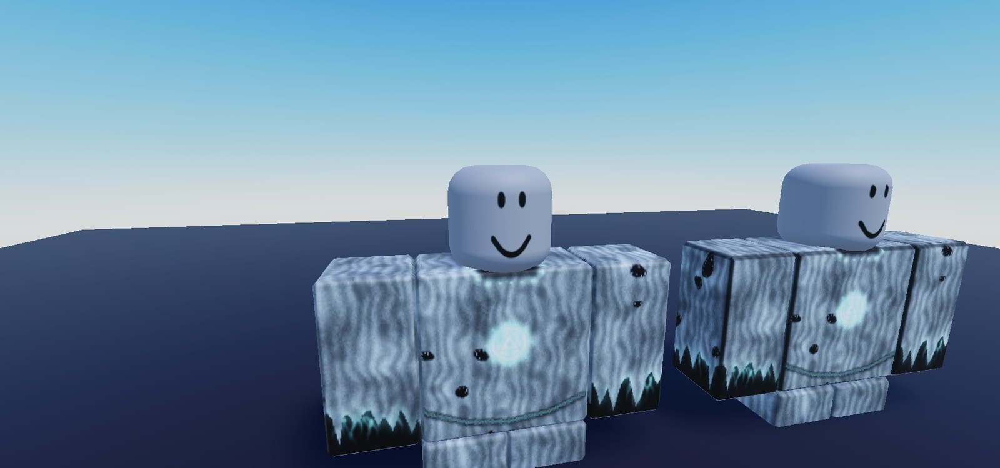
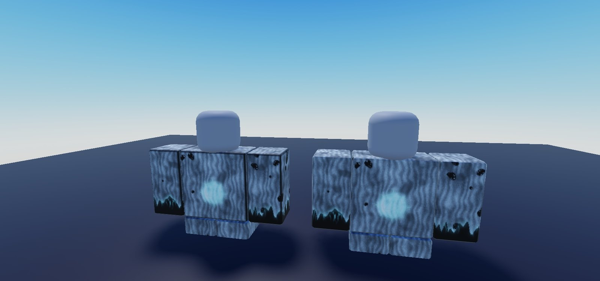
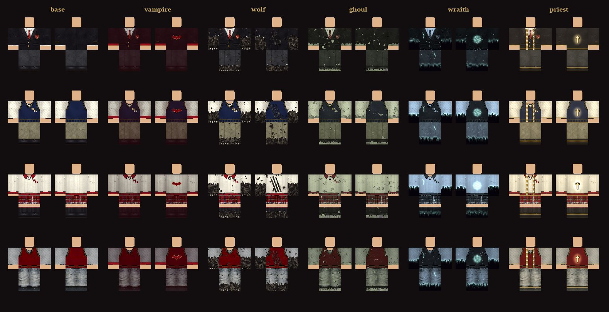
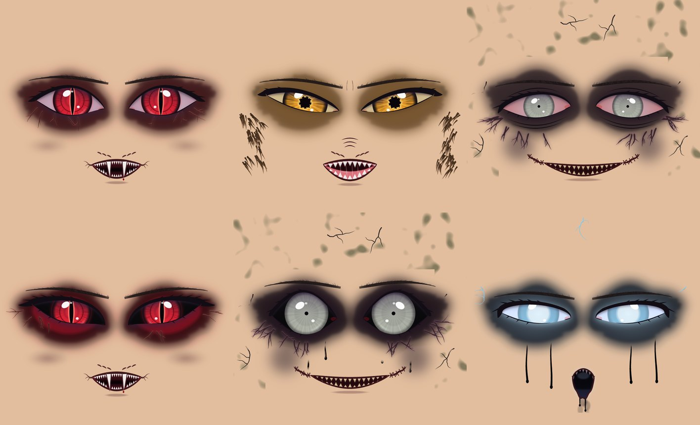
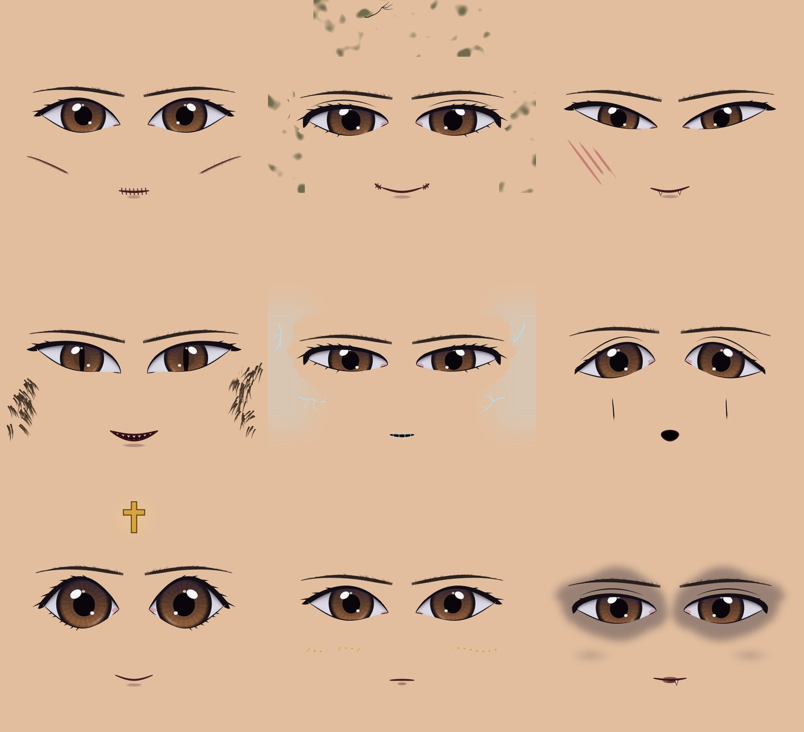
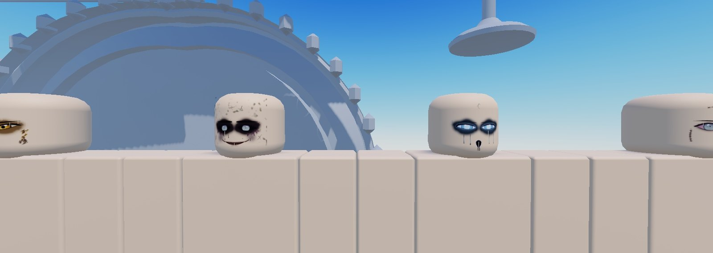

# Clothing and faces: seams, transformation outfits, race faces (1.37.0)

NH Combat Test, 2026-11-04. Art: `art/clothing/tools/` (clothing) and `tools/ui-textures/` (faces).

## 1. Clothing seams: no more dark borders

The owner spotted a pale outfit (the Wraith Banshee) with a black, frayed border round every body part.

**Cause.** The clothing generators darkened the outermost pixels of every face of the 585x559 template:

| What did it | Where |
|---|---|
| `face_seams()` darkened each face's first and last column | `shirts_new.py` |
| `finish()` added extra edge darkening on every face (on top of its soft rounding) | `nhcloth.py` |
| `outline_of()` / `rot_edges()` drew torn-edge outlines along each face's outer edge too, not only round holes | `nhcloth.py`, `forms.py` |
| Outlines round arm tops, paw pads, soles and ghoul feet | `shirts_new.py`, `forms.py`, `pants.py`, `ghoul_uniform.py` |
| Pants sat on an opaque **black** margin, which filtering bled into every leg seam | `nhextra.pants_shell` |

On dark cloth this barely showed. On pale cloth it was a black border. The audit (`tools/seam_audit.py`) found edge pixels 15 to 74% darker than the cloth beside them on all 69 generated templates; the owner's 6 original templates had none.

**Fix.**
- The edge darkening is gone. `face_seams` is a no-op. `outline_of` never counts a face's own edge, so torn edges outline only real holes and rips.
- `nhcloth.save()` now **bleeds** every template:
  - each pixel outside the 18 face rectangles copies the nearest face pixel (colour and alpha), so margins continue the art;
  - fully transparent pixels take the colour of the nearest visible pixel (alpha stays 0), so filtering never blends in white or black.
- The generators rebuild bit-for-bit, so every design is otherwise unchanged. All 69 were rebuilt, re-uploaded and swapped in `UI.Appearance` (69 ids on 62 lines; old to new in `art/clothing/variants/seamfix_id_swap.tsv`). After the fix, average edge darkening is 0 to 17% (the normal soft rounding), and the Banshee shirt went from 74% to 2%.

 

## 2. Transformation variants of every outfit

When a character transforms, they used to swap into one fixed form outfit. Now **every everyday piece has its own transformed version per form**, so a student keeps their own outfit, changed by the form:

| Form | What happens to your clothes |
|---|---|
| Vampire | deepens to velvet and wine, a crimson silk collar and cuffs with gold edges, a bat on the back; pants get a silk side stripe |
| Wolf | sleeves and trouser legs burst into fur below a ragged tear, claws and paws, rips and back slashes showing fur, grime |
| Ghoul | drained and grave-stained, rotted holes and frayed cuffs show grey skin, bony knuckles or bare toes, stitched repairs, mould |
| Wraith | the colour drains cold, sleeves, hems and legs dissolve into void and mist with a spectral rim, glowing cracks, a sigil on the back |
| Priest | a warm gold grade, a white stole with gold crosses, gold cuff and hem bands, a radiant cross on the back |

- **56 pieces** (31 tops, 20 bottoms, the 5 ghoul race uniform pieces, including the owner's 5 original uniforms) x 5 forms = **280 templates**, all seam-bled. Made by `art/clothing/tools/form_variants.py`.
- **In game:**
  - `ReplicatedStorage.UI.FormVariants` maps each worn template id to its 5 variants.
  - `Appearance.FormVariant(form, template)` looks one up (Werewolf = Wolf).
  - When you transform in the NH uniform or wardrobe pieces and both your top and bottoms have a variant, you wear those. Otherwise you get the old form outfit (for example in your own Roblox outfit).
- Pieces already in the game (the old form outfits) are unchanged.



## 3. Faces: menacing transformations, race faces

New art, all through the face strip shell (`head.NHFacePlate`), with a no-overlap check against every eye (8 shapes x 2 sets x 7 forms), brow and mouth:

- **Mouths, re-rendered with a PBR-style material bake.** Roblox can't run real PBR materials on face images (SurfaceAppearance only works on MeshParts), so each pixel is classed (enamel, wet tongue, gums, cavity, lip, line, void), given height and roughness, and lit (GGX specular, diffuse, cavity occlusion, a little subsurface). All 40 everyday mouths are re-uploaded.
- **New transformed mouths:**
  - Vampire: a wide snarl with long curved fangs over the lip, full rows of sharp teeth, a void throat and dark veins at the corners
  - Wolf: lips peeled back with long uneven canines and drool
  - Ghoul: an ear-to-ear grin stitched up the cheeks, with yellowed uneven teeth
  - Wraith: a gaping wail with broken ash-grey teeth and the void dripping off the jaw
- **Form face layer** (`NHFormFace`, under the eyes, while transformed):
  - Vampire: sunken sockets, a crimson glow, hollow cheeks (stronger at stage 2)
  - Wolf: an amber glow, frown and snarl creases, fur on the cheeks
  - Ghoul: black sunken sockets, rot and cracked skin, hollow cheeks, black ooze at stage 2
  - Wraith: hollow void sockets, an icy glow, void tears, frost cracks
- **Race faces (race-locked, everyday).** Race is read-only from the `Race` attribute; nothing here writes it.
  - **Marks** (`NHMarks` layer, new saved look field `Marks`):
    - Anyone: Freckles, Cheek Scar, Beauty Mark, Plaster
    - Vampire: Bat Mark, Noble Pallor
    - Werewolf: Claw Scars, Wild Tufts
    - Ghoul: Stitched Cheeks, Grave Rot
    - Wraith: Frost Veins, Void Tears
    - Priest: Holy Brand, Scripture
  - **Race mouths:**
    - Ghoul: Sewn Shut, Split Smile
    - Vampire: Fanged Smirk, Wine Lips
    - Werewolf: Canines, Feral Grin
    - Wraith: Frozen Seam, Hush
    - Priest: Serene, Solemn
  - **Bloodline eyes** (new look field `RaceEyes`): your race's eyes without transforming. Priests get a gold iris.
  - The Wardrobe Face tab shows only your race's options. The renderer also checks the race (`Appearance.RaceAllows`), so a race-locked choice never shows on another race.
- Saves: the look is still stored only through ProfileService (`PlayerData.Appearance` via `SetAppearance`). `Marks` is an id like the other face fields. Old saves load unchanged; `LEGACY_ORDER` is untouched, and `resolveIndex` now tolerates keys it has no legacy order for.

 


## 4. Moderation: keep blood minimal

On 2026-11-04 Roblox moderation warned the owner's account over a generated vampire variant that had blood spatter and drips (asset 73434200858112).

- All blood was taken out of the new outfit variants and face layers.
- Only two tiny drops remain: one on a vampire fang tip, and one on the Fanged Smirk.
- 38 unused vampire variants with blood had already been uploaded. They are listed in `art/clothing/variants/ARCHIVE_THESE_blood_assets.txt` for the owner to archive in the Creator Dashboard.

**Rule:** no gore, and blood only as a tiny accent.

## Rebuild

```
python art/clothing/tools/make_all.py; python art/clothing/tools/female.py; python art/clothing/tools/forms2.py
python art/clothing/tools/form_variants.py            # 280 variants -> variants/forms/
python art/clothing/tools/seam_audit.py               # seam check
python tools/ui-textures/gen_eyes.py eyes; python tools/ui-textures/gen_face.py faceparts eyes
python tools/ui-textures/gen_menace.py menace eyes faceparts    # form faces + marks, overlap-checked
```
