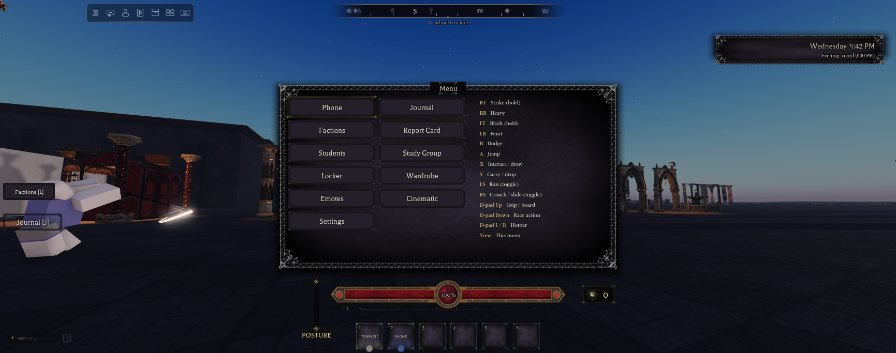
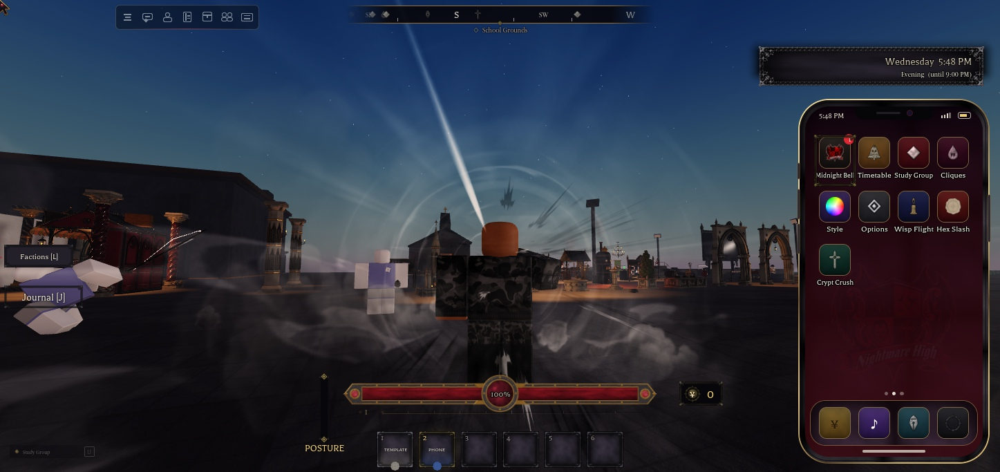

# Console controls

A gamepad plays the whole game: combat, carrying, race actions, the skateboard, the hotbar, every menu (1.31.0), the Settings sliders and the class lessons (1.32.0). Xbox and PlayStation pads both work, and every hint names the buttons on the pad you hold (1.32.0). `StarterPlayerScripts.Controllers.Gui.GamepadControls` adds what isn't a plain key; the combat buttons sit next to each action's keyboard key in `Bind.Keybinds.Config`.

## The buttons

| Xbox | PlayStation | On foot | Riding a board |
|---|---|---|---|
| RT | R2 | Strike (hold); as a wolf, bite | - |
| RB | R1 | Heavy; as a wolf, leap | - |
| LT | L2 | Block (hold) | Push (hold) |
| LB | L1 | Feint | - |
| B | Circle | Dodge (closes a menu when one is open) | - |
| A | Cross | Jump (Roblox's) | Ollie |
| X | Square | Interact with a prompt, or draw / sheathe | Kickflip |
| Y | Triangle | Carry / drop (and greet a stranger's prompt) | - |
| LS (L3) | L3 | Run, a toggle | - |
| RS (R3) | R3 | Crouch / slide, a toggle (held with RT: uppercut) | - |
| D-pad Up | D-pad Up | Grip, or take out / put away your board | Get off |
| D-pad Down | D-pad Down | Your race's action on a downed body | - |
| D-pad Left / Right | D-pad Left / Right | The hotbar slot before / after | - |
| View | Touchpad (press) | The quick menu | - |
| Left stick | Left stick | Move | Steer (up pushes, down brakes) |
| Right stick | Right stick | Camera | Camera |

- **Combat buttons run the keyboard's action modules.** `Keybinds.Config` lists the keyboard key first, then the gamepad button. A Settings rebind replaces only the keyboard key (`InputController.Rebind` keeps `Button*` and `DPad*` entries).
- **LS and RS are toggles.** They press Shift and Ctrl through `InputController.Press`, as the touch buttons do. RS is bound through ContextActionService at priority 3000, because Roblox's gamepad camera uses RS for zoom.
- **The wolf** (`WolfForm`): RT keeps biting while held (every 0.35 s) and RB leaps, the keyboard's click and R.
- **No combat from a menu** (1.32.0): while a menu is open the Player attribute `NHPadMenu` is set, and `Bind.Keybinds` ignores pad buttons (by key code name: `Button*` and `DPad*`), so RT, LB, X and the rest drive the menu instead of striking or feinting. Releases still go through, so a held block always ends.

## PlayStation and Xbox (1.32.0)

- **Same buttons, different names.** Roblox reports a PlayStation pad with the same key codes as an Xbox pad (ButtonA is Cross, ButtonSelect is the touchpad press or Create). Only the names change.
- **`Components.PadStyle()`** returns `"Xbox"` or `"PlayStation"`:
  - the Settings choice **Controls > Controller > Button names**: Auto, Xbox or PlayStation (saved in `PlayerData.Settings.ControllerButtons`; the client sets the Player attribute `NHPadStyle`);
  - on Auto, the connected pad: `UserInputService:GetStringForKeyCode(ButtonA)` is `"ButtonCross"` on a PlayStation pad. (Steam Input or other remappers on PC can report a PS pad as Xbox: that's what the manual choice is for.)
  - Studio: the ReplicatedStorage attribute `NHPadStyleTest` forces one.
- **`Components.KeyName`** gives the pad's name for a button: Cross, Circle, Square, Triangle, L1, R1, L2, R2, L3, R3, Touchpad and Options on PlayStation; A, B, X, Y, LB, RB, LT, RT, LS, RS, View and Menu on Xbox.
- **`Components.PadText(s)`** fills `{A}`, `{B}`, `{L1}` and so on with those names. Write the template in a plain `"..."` string: in a Luau backtick string `{A}` is read as a variable.
- **`Components.PadControls`** is the one list of what each button does (the quick menu's list and the Settings Controls tab both read it).
- When the pad or the choice changes, `Components.InputKindChanged` fires, so hints redraw.

## The quick menu (View)

- **Buttons:** Phone, Journal, Factions, Report Card, Students, Study Group, Locker, Wardrobe and Emotes. Night races also get Transform and Night Sight. Then Cinematic and Settings.
- **Controls list:** the button mapping is on the right side of the menu.
- **Built from kit parts:** `Kit.Panel` and `Kit.Button`.
- **Why View is free:** `GuiService.AutoSelectGuiEnabled` is off, so View opens this menu instead of Roblox's top-bar selection. Everything on the top bar is in this menu.

## Menus

- **What counts as a menu:** a visible panel at least 400 design px tall or most of the screen, the emote menu, the study group drawer or the quick menu.
- **When one opens** on a gamepad, its top-left button is selected, and navigation is held inside it (`GuiService:AddSelectionParent`). The D-pad and left stick move between buttons, and A presses.
- **Selection outline:** the kit's FrameThin in gold (`PlayerGui.SelectionImageObject`).
- **B closes the open menu**, and doesn't dodge: B is taken at priority 3000 only while a menu or the cinematic view is open.
  - `GamepadControls.Menus` maps each menu's gui to its close function.
  - A menu not in the list gets its Close button selected instead.
  - Closing the phone also puts away the phone item if you're holding it from the hotbar.
- **Dialogue:** the first reply is selected. B leaves, as before.
- **The main menu** has its own D-pad, A and B navigation (unchanged).
- **Where the selection starts** (1.32.0): buttons with the attribute `NHPadFirst` are picked first (top-left among them); buttons with `NHPadSkip` are never picked first but can still be reached ("Leave lesson"). A gui child with `NHNotPanel` doesn't count as the panel (the lesson's dim backdrop).

## Settings on a controller (1.32.0)

- **Sliders:** with a slider selected, D-pad Left / Right (or the left stick) step it, and repeat while held (after 0.4 s, every 0.09 s). The step is the slider's own step, or a twentieth of the range when that is finer (Field of View steps by 2). Selection stays on the slider sideways; up and down still move on. Sliders that apply on release (UI Scale) apply when you let go. The D-pad and the stick are tracked apart, so a resting stick's small movements can't cancel a held D-pad.
- **Tabs:** LB / RB (L1 / R1) change tab, and the selection moves to the new tab's first control.
- **Controls tab:** on a controller, the **Controller** section comes first: the Button names choice and every button with what it does (fixed). With a keyboard it's under the keys, shown when a pad is plugged in.
- **Keyboard keys can't take a controller button.** Rebinding a key row and pressing a pad button cancels, and `Settings.ValidKey` refuses `Button*`, `DPad*` and `Thumbstick*` names (in saved data too).

## Lessons on a controller (1.32.0)

The lesson screen counts as a menu. B is the lesson's own back (`Activities.PadBack`), and on the report card B closes it.

| Lesson | Controller |
|---|---|
| Every lesson | Nothing is selected during the 3-2-1, so one press can't leave; "Leave lesson" is reachable but never picked first |
| Mathematics (Pop Quiz) | D-pad to an answer, A to pick it (starts on the first answer; the "1)" key prefixes are hidden) |
| Chemistry (Lab Mix) | LT LB RB RT (L2 L1 R1 R2), left to right like the lanes; the pads show those names |
| English (Word Scramble) | D-pad to a letter and A to place it (the selection moves on to the next free letter); B undo, X clear, Y shuffle |
| History (Match the Past) | D-pad to a card, A to flip it |
| Report card | Close is selected; A or B closes it |

## Hints

`Components.InputKind()` returns "Gamepad", "Touch" or "Keyboard" (from the last input), and `Components.InputKindChanged` fires when that changes. Hints switch with it:

| Where | Keyboard | Gamepad | Touch |
|---|---|---|---|
| Main menu | W / S or ↑ / ↓ to choose · Enter to select | D-pad to choose · A to select | Tap to choose |
| Save slots | A / D or ← / → … Enter to play … Backspace | D-pad to choose · A to play · B to go back | Tap a slot to play |
| Intro | Press any key to skip | Press any button to skip | Tap to skip |
| Dialogue | 1-9 reply · click text to skip · walk away to leave | D-pad to choose · A to reply · B to leave | Tap a reply |

Key caps use `Components.KeyName`, which now also names LS, RS, View, Menu and the D-pad directions.

## Testing in Studio

- **Turn it on:** set the ReplicatedStorage attribute `NHGamepadTest = true`, so the kit treats the session as a gamepad (hints, menu selection).
- **Press buttons:** Studio's keyboard input tool can send gamepad key codes (ButtonR2, DPadUp and so on).
- **Action log:** with the flag on, `InputController` writes each action it runs to the Player attribute `NHLastAction`.
- **Board:** a no-slot player gets one with the Player attribute `NHSkateTest`.
- **Set the flag before Play** (in Edit): the action log only switches on at start.
- **Studio's simulated pad buttons arrive as keyboard input**, which is why the menu block and the rebind check look at the key code name, not the input type. They also don't move Roblox's menu selection (only a real pad does).
- **Lessons:** `Studio/tests/ps5_lesson.luau` fires `PlayerGui.NHActivityTest` (a Studio-only BindableEvent in `Gui.Activities`) with made-up content, so a lesson screen opens without a class or a save. The server has no session for it.
- **Button names:** `Studio/tests/ps5_names.luau`.
- **Clean up:** clear the flags afterwards.

## Not done yet

- **Not tried by hand with a real controller or on a console.** Studio's simulated buttons aren't a gamepad:
  - A pressing the selected button, and D-pad / stick navigation between buttons, weren't exercised (mouse clicks stood in for A).
  - Analog trigger thresholds weren't checked (they matter most in Lab Mix).
  - The stick stepping a slider wasn't exercised.
- **PlayStation detection** was checked against a real PlayStation pad plugged into the dev PC (Roblox reported "ButtonCross"), not on a PS4 / PS5 console.
- **No lock-on** for combat. The camera is Roblox's default.
