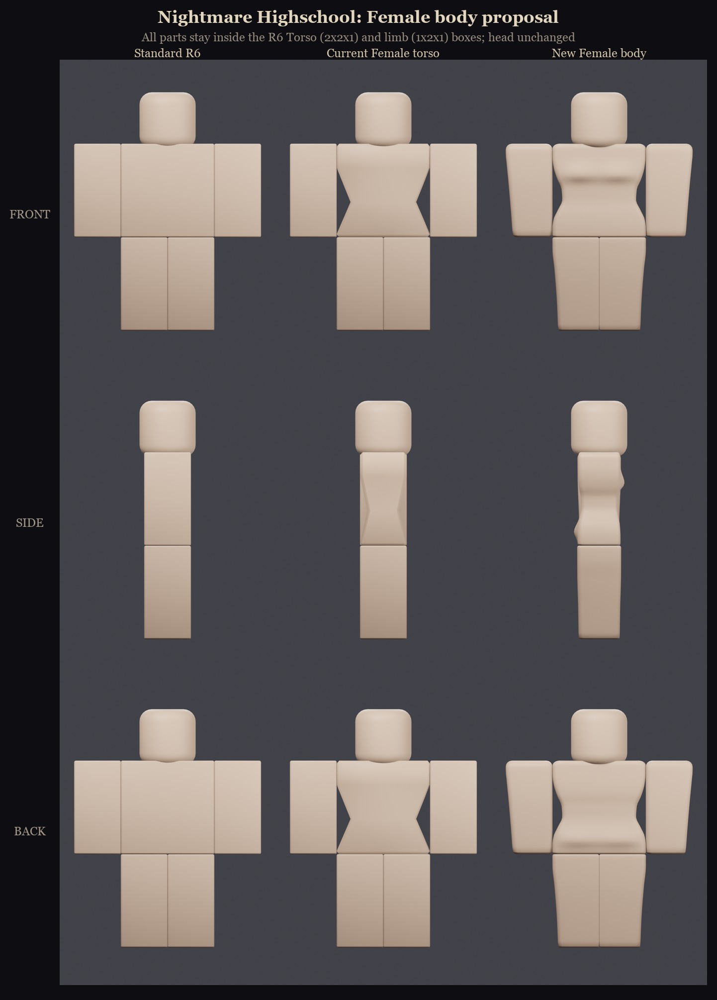
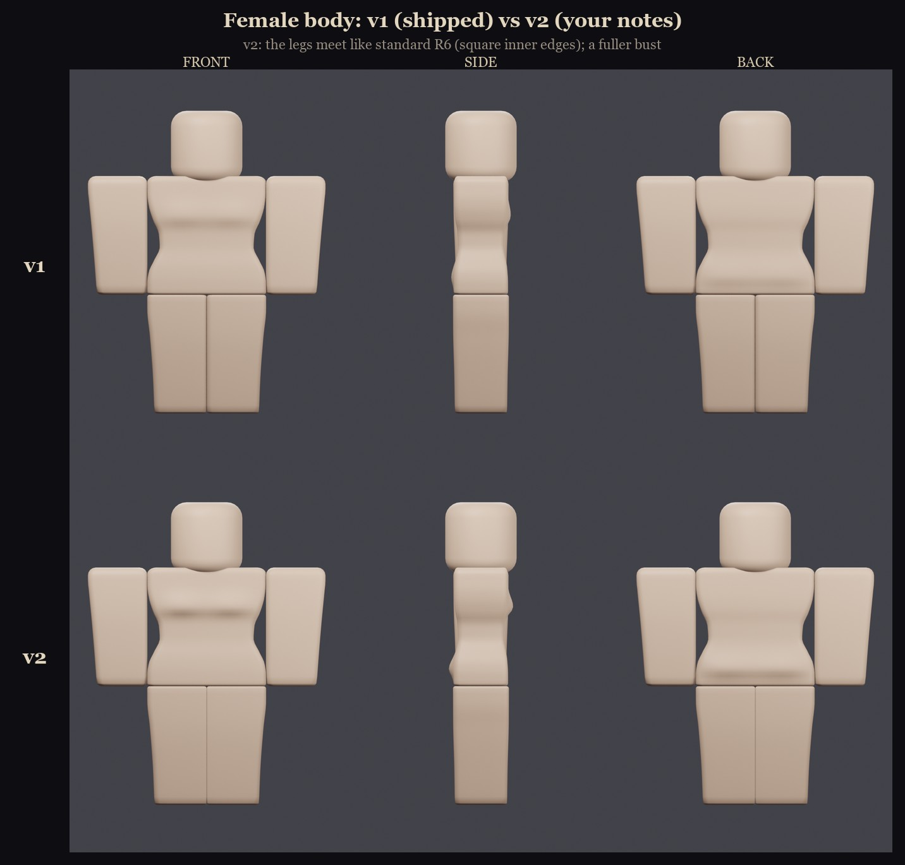
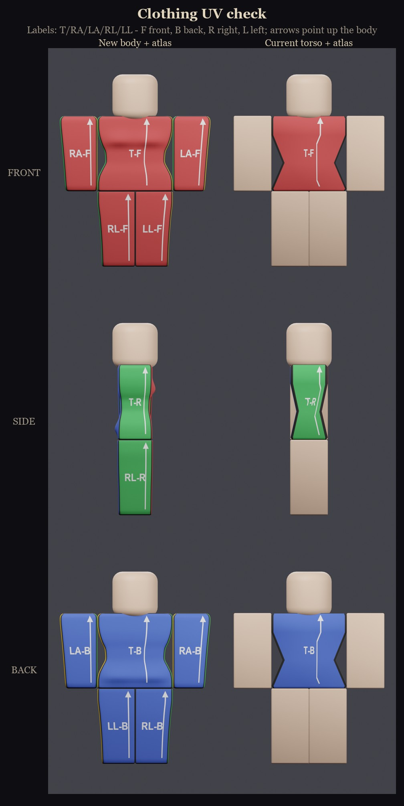
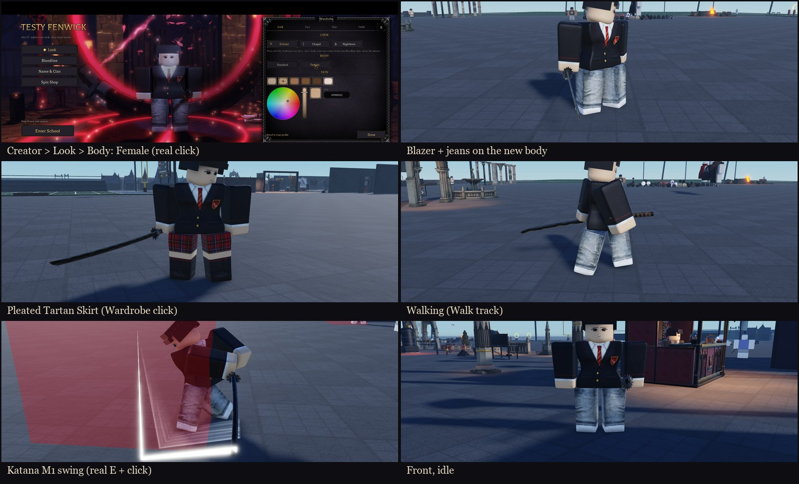
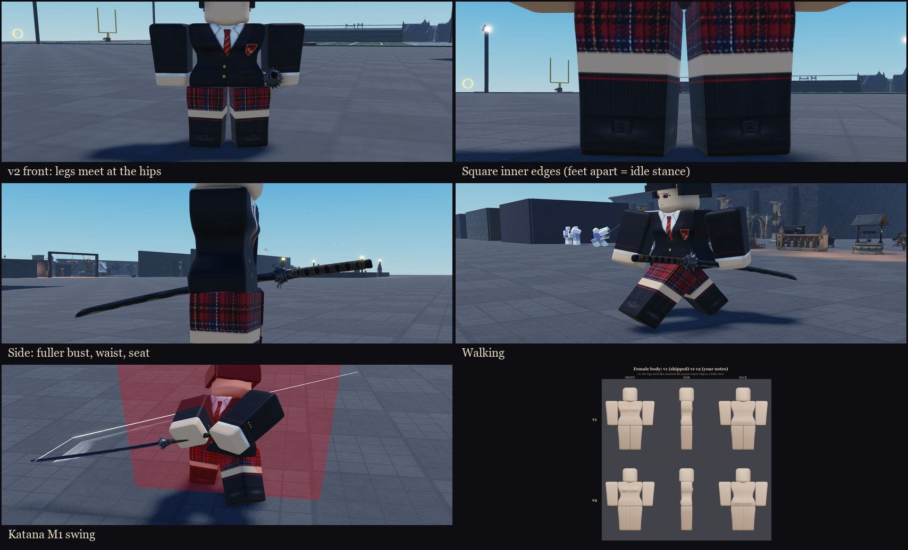

# Female body (1.68.0, v2 in 1.68.1)

The Female body choice is a full feminine R6 body: torso, arms and legs. It keeps the hourglass of the old Female torso, but it still reads as a classic R6 character, as the owner asked: "MAKE THEM STILL RESEMBLE NORMAL R6 CHARACTER PROPORTIONS THOUGH."



## The shape

Every limb mesh stays inside its R6 part box (1 x 2 x 1). The torso is 2 x 2 wide and tall, and 1.08 studs deep at the bust (v2). The head, the part sizes, the joints and the animations are unchanged.

- **Torso:** the old torso's hourglass, smoothed.
  - The waist curves in to 1.58 studs. The old torso pinched to 1.40 in a sharp V; standard R6 is 2.0.
  - The shoulders and hips stay at the full 2 studs, and the top edge rolls over softly.
  - **v2 (1.68.1, owner: "make the bust a little more noticeable"):** the bust projects 0.105 studs, up from 0.06, with a clearer underside. The torso is 1.08 studs deep at the bust instead of 1.0. The seat got a little fuller too, so the front and back depths match and the mesh stays centred.
- **Arms:** full width at the shoulder, so they sit flush against the torso. They taper on the outer side to 0.85 studs at the wrist, with rounded tops. The inner side stays flat.
- **Legs:** full width at the hip, tapering on the outer side to 0.88 studs at the ankle. The inner sides stay flush, so the legs meet in the middle.
  - **v2 (owner: "The legs should still connect like these kind of. I don't like how much of a gap there is"):** the inner edges are near-square (radius 0.02, was 0.09), so the legs touch with only a fine seam like standard R6. In v1, the rounded inner edges made a wide V-groove.
  - **The idle stance:** the game's idle animation stands every character with its feet slightly apart, standard bodies too. Measured on NPCs, the legs sit at +0.51 / -0.585 at their 0.9 scale, the same as on the Female body. So at idle the legs touch at the hips and open toward the feet. That comes from the animation, not the meshes.



## How it's applied

- `UI.Appearance.Bodies`:
  - `female` is the same entry as before, with the same id and the same index 2, so saves and every `Body == 2` check still work. Those checks are in the Wardrobe hair order, NPC looks, Schedules, Enrollment, CliqueShowdowns, `dressPick` and `FormOutfit`.
  - It now has `Meshes = { Torso, RightArm, LeftArm, RightLeg, LeftLeg }`. `TorsoMesh` is still there for anything that only reads the torso.
- `Appearance.ApplyTo`:
  - It adds one `CharacterMesh` named `NHBodyMesh` per part.
  - It first removes any `CharacterMesh` on those parts, including meshes from a player's own avatar package, which Roblox would otherwise stack.
  - Choosing Standard removes ours, as before.
- Skin colour still comes from `BodyColors`, and clothing from the Shirt and Pants. Hair, faces (the SurfaceGui strips on the head), capes and weapons attach to the same parts as before.

| Part | Mesh id (group 15981569) |
|---|---|
| Torso | 107771235632658 (v2; v1 was 100376795847355) |
| Right Arm | 107796907683955 |
| Left Arm | 80112520115136 |
| Right Leg | 111053847385892 (v2; v1 was 118860096662549) |
| Left Leg | 87713593848889 (v2; v1 was 115152584533690) |

The previous Female torso was 48112070, Roblox's 2011 "ROBLOX Girl - Torso" (asset 48474356), on standard limbs. The imported MeshParts are kept in `ServerStorage.NHFemaleBody` (v1) and `ServerStorage.NHFemaleBody_v2` (the torso and legs). Backups of `UI.Appearance`:
- `ServerStorage.NH_Backup.FemaleBody_pre`: before the new body.
- `ServerStorage.NH_Backup.FemaleBody_v1`: before the v2 ids.

## Clothing: the R6 CharacterMesh atlas

Roblox doesn't map clothing onto a `CharacterMesh` with the 585 x 559 template coordinates. It composites the Shirt and Pants into a 1024 x 512 atlas, and the mesh UVs index that atlas. The layout below was measured from Roblox's own package meshes (Girl torso 48112070, Woman, Robloxian 2.0, ROBLOX Boy and Girl). It's written down in `art/characters/female/atlas.py`.

**Side strips:** each part's four sides form one strip. The part's height runs along +x, with the bottom of the part at the lower x.

| Part | Strip x range | Sides, top to bottom |
|---|---|---|
| Torso | 32..160 | R (0..64), F (64..192), L (192..256), B (256..384) |
| Right Arm | 232..360 | B, R, F, L (64..320) |
| Left Arm | 432..560 | R, F, L, B (0..256) |
| Right Leg | 632..760 | B, R, F, L (64..320) |
| Left Leg | 832..960 | R, F, L, B (0..256) |

**Caps:** the top ("U") and bottom ("D") caps sit in a row at y 328..392, 8 px apart:

| Cap | x range |
|---|---|
| Torso U | 200..328 |
| Torso D | 336..464 |
| RL U | 472..536 |
| LL U | 544..608 |
| RL D | 616..680 |
| LL D | 688..752 |
| RA D | 760..824 |
| LA D | 832..896 |
| RA U | 904..968 |

LA U is on the next row: x 200..264, y 400..464.

**How UVs are assigned:** each ring of the body maps its sides corner-to-corner onto those regions. A narrow waist therefore shows the whole front of a shirt rather than cropping it, which is the same as on Roblox's own torso.

`art/characters/female/atlas_check.png` is a labelled atlas. Rendering a mesh with it shows straight away whether each face lands correctly.



## Building and importing

`art/characters/female/nh_female_body.py` builds everything in headless Blender:

```
E:/Blender/blender.exe -b --factory-startup -P nh_female_body.py -- [--render]
```

- The parts are shaped as lofted rounded-rectangle rings from smooth profiles.
- The bounding box of every part is centred and symmetric, so the importer can't shift it.
- It writes `E:/NH-Work/femalebody/fbx/NHFemaleBody.fbx`. `--parts Torso,RightLeg,LeftLeg --name NHFemaleBody_v2` exports only those parts, which is how v2 was imported.
- `--render` also runs `render_compare.py`, and `compose_sheet.py` builds the comparison and UV sheets.

**Roblox's 3D importer (measured on 2026-11-10, three imports):**

1. It reads a Blender FBX exported at `global_scale = 1` as centimetres, so the mesh asset is 100 times too big. A `CharacterMesh` draws a mesh at its true size, so export at `0.01`.
2. It honours the FBX axis settings and treats Blender's **-Y** as the front. Model the front on -Y, or turn the geometry 180 degrees for the export, which is what the script does.
3. After an import, check each mesh asset with `AssetService:CreateEditableMeshAsync`. It works on group-owned meshes. Confirm the bounding box (2 x 2 x 1 / 1 x 2 x 1), which way is the front (the front-band UVs should average z < 0), and the flat inner side of each limb.

## Play-tested (NH Combat Test, slot 4 "Testy", 1.68.0)



- **Customisation:** PLAY, then Slot IV's Play, then the creator's Look tab, then Body: Female, all with real clicks. It showed "Saved to your profile".
  - The server character then had all five `NHBodyMesh` CharacterMeshes on standard-size R6 parts (2 x 2 x 1 and 1 x 2 x 1).
  - After Enter School, the new character got them again, a few seconds after spawning, the same as the rest of the look.
- **Clothing:** checked from front, back and side.
  - The Black Blazer: lapels, tie, crest and pockets on the torso front, cuffs at the wrists and buttons near the cuffs.
  - Jeans: back pockets on the back, shoes at the bottom of the legs.
  - The Pleated Tartan Skirt, chosen at the locker-room Wardrobe with a real click: tartan, knee socks and shoes.
  - Skin colour shows on the hands.
- **Animations:** the Walk track, with legs and arms swinging, no gaps and the clothing intact. A real E equipped the katana, and real clicks played the M1 swing with its slash effect.
- **Hair and eyes:** both still show on the head.
- **Console:** nothing new. There were only the place's existing sound-permission and archived-asset messages.

## Play-tested again (v2, 1.68.1, slot 4)



- The server character had the v2 torso and legs, with the v1 arms.
- Front: the legs meet at the hips. A close-up showed the square inner edges, with the feet apart in the idle stance.
- Side, with the near arm hidden on the client: the fuller bust, the waist and the seat, with the blazer mapped down the side.
- The Walk track played, and a real E and click played the M1 swing.
- Female NPC students also have the five meshes: Vesper Crane, Sable Vey, Coach Mallory and Wren Ashby.
- Console: nothing new.

## Not verified

- **Not checked:**
  - How female NPC students look up close (v2 confirmed only that they have the meshes).
  - A second player watching. The meshes are created on the server and replicate like the rest of the look, but this wasn't tested with two players.
  - The `CharacterPreview` viewport and the slot-card pedestals, which weren't checked closely.
  - The other female outfits (sailor uniform, gala gown and others).
  - The Countess and Banshee transformation outfits.
  - Capes on the new torso.
  - M2, aerials, blocking and being hit.
- **"Use my Roblox outfit" mode:** our meshes replace the avatar's package meshes on all five parts. That matches what the torso-only version did for the torso, but it wasn't tested with a real package avatar.
- **Testy's look:** slot 4 "Testy" was left on the Female body with the Pleated Tartan Skirt. It was on Standard with Uniform Trousers before the test.
