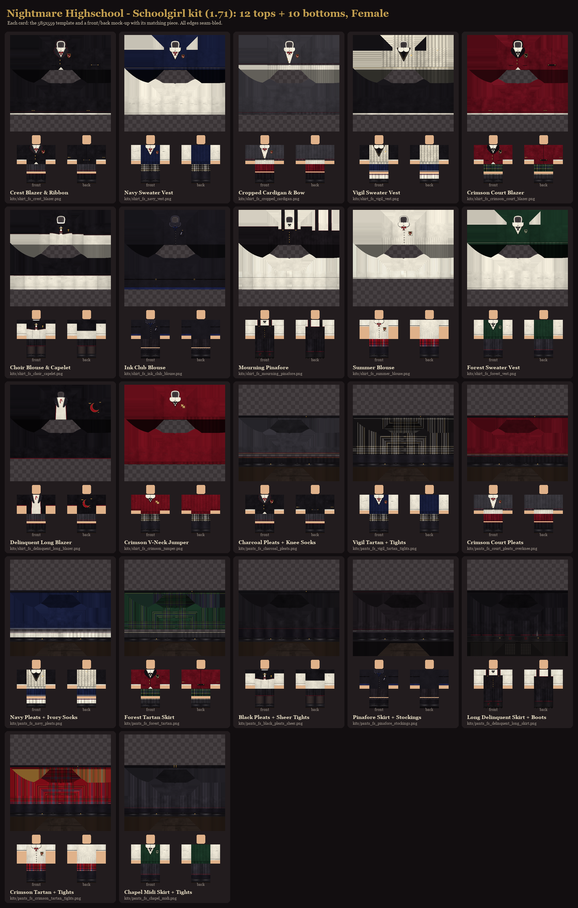
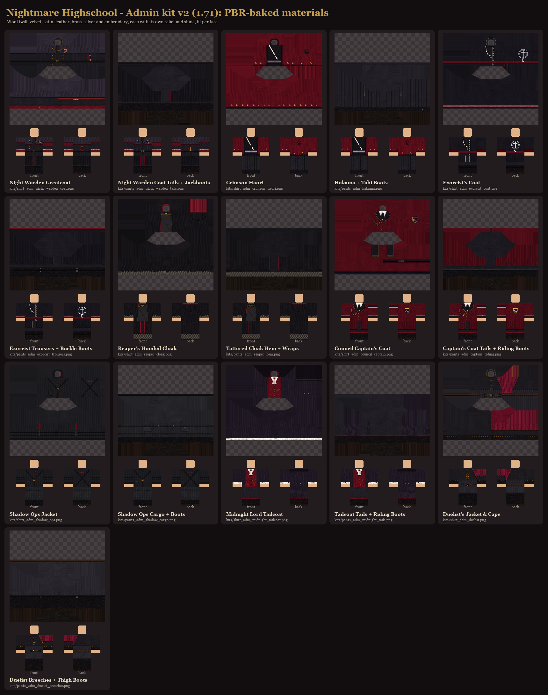
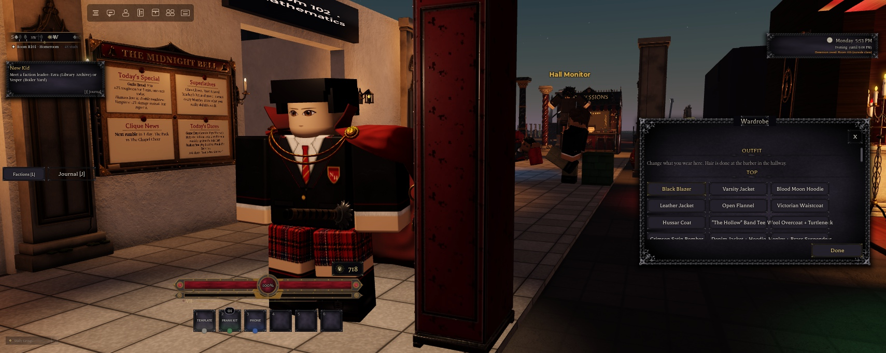
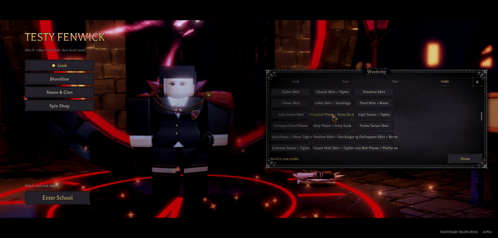
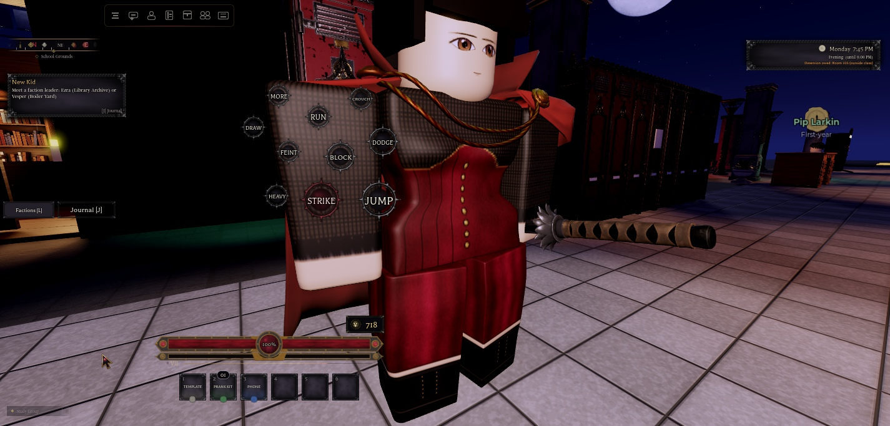
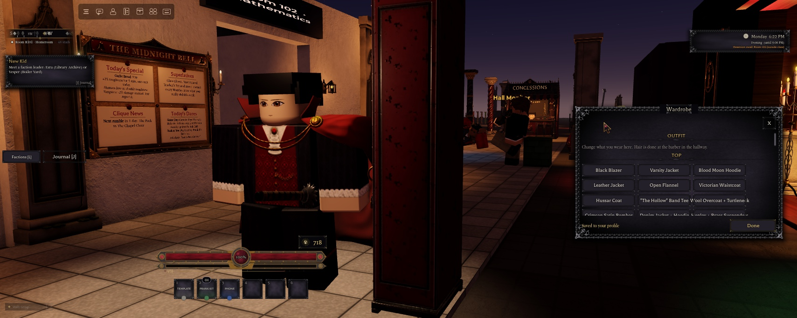
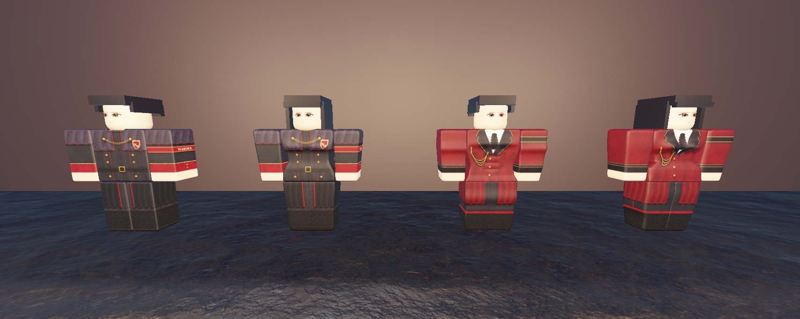
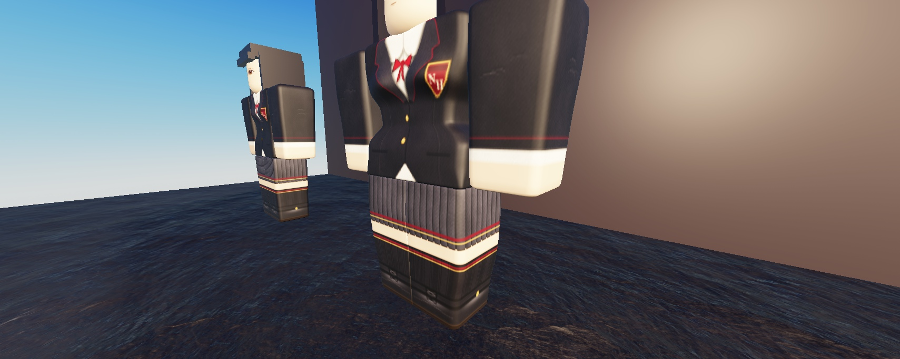

# Gender clothing kits (1.73.0)

The owner asked: "make a kit of school girl outfits and another kit for more civilian clothing. Remember to fix the edges so no black marks, etc. on them. (I want this because the clothing needs to be separate by gender)". Then: "add a kit of cool outfits for admins to choose from. Add cool cloaks, jackets, etc. Use cool anime fits as references but IN OUR STYLE", and "Make the admin clothing higher quality, better shaping, texturing, etc. with PBR textures".

There are 62 new classic templates (585 x 559), all published under the group (15981569):

| Kit | Pieces | Gender | Generator |
|---|---|---|---|
| Schoolgirl | 12 tops, 10 bottoms | Female | `art/clothing/tools/kit_school_f.py` |
| Civilian | 6 + 6 per gender | Female and Male | `art/clothing/tools/kit_civilian.py` |
| Admin | 8 outfits (8 tops, 8 bottoms) | Unisex, staff only | `art/clothing/tools/kit_admin2.py`, `kit_admin2_more.py` |



All files, contact sheets and `kit_manifest.json` (file, label, key, gender, asset id) are in `art/clothing/variants/kits/`. The upload folder was `art/group-upload-clothing-kits/` (asset names `NHKit_<file>`).

## The pieces

**Schoolgirl tops:** Crest Blazer & Ribbon, Navy Sweater Vest, Cropped Cardigan & Bow (the three starter uniforms), Vigil Sweater Vest (The Vigil), Crimson Court Blazer (The Crimson Court), Choir Blouse & Capelet (Chapel Choir), Ink Club Blouse (The Ink Club), Mourning Pinafore, Summer Blouse, Forest Sweater Vest, Delinquent Long Blazer (The Delinquents), Crimson V-Neck Jumper.

**Schoolgirl bottoms:** Charcoal Pleats + Knee Socks (starter), Vigil Tartan + Tights, Crimson Court Pleats (over-knee socks), Navy Pleats + Ivory Socks, Forest Tartan Skirt, Black Pleats + Sheer Tights, Pinafore Skirt + Stockings, Long Delinquent Skirt + Boots, Crimson Tartan + Tights, Chapel Midi Skirt + Tights.

**Civilian, female:** Wine Velvet Corset (sheer sleeves), Cropped Moto Jacket & Lace Cami, Off-Shoulder Moon Sweater, Victorian Lace Blouse, Cropped Crimson Hoodie, Long Duster & Slip Top / Corset-Belt Flares + Platforms, Velvet Midi Skirt + Boots, Leather Mini + Ripped Tights, Wide-Leg Trousers, Tartan Skater + Thigh-Highs, Lace-Hem Maxi Skirt.

**Civilian, male:** Wool Overcoat + Turtleneck, Crimson Satin Bomber (embroidered moth), Denim Jacket + Hoodie, Henley + Brass Suspenders, Shawl Cardigan + Tie, Track Jacket / Wool Trousers + Chelsea Boots, Dark Jeans + High-Tops, Track Pants + Sneakers, Chinos + Loafers, Ripped Black Jeans + Boots, Cargo Shorts + Socks.

**Admin (staff only):** original anime-inspired archetypes in the school's crimson, black and brass; none copies a specific show's costume.

| Top | Bottoms |
|---|---|
| Night Warden Greatcoat (half cape, chain clasp, crest, WARDEN armband) | Night Warden Coat Tails + Jackboots |
| Crimson Haori (over a black kimono, brass crescents, obi) | Hakama + Tabi Boots |
| Exorcist's Coat (high collar, silver clasps, rosary, back sigil) | Exorcist Trousers + Buckle Boots |
| Reaper's Hooded Cloak (tattered sleeves, skull clasp) | Tattered Cloak Hem + Wraps |
| Council Captain's Coat (aiguillettes, epaulettes, COUNCIL armband) | Captain's Coat Tails + Riding Boots |
| Shadow Ops Jacket (funnel collar, chest rig, straps) | Shadow Ops Cargo + Boots |
| Midnight Lord Tailcoat (brocade waistcoat, jabot, cape collar) | Tailcoat Tails + Riding Boots |
| Duelist's Jacket & Cape (one-shoulder cape, crossed belts, gauntlets) | Duelist Breeches + Thigh Boots |



## Clean edges (no black marks)

Every template goes through the 1.37.0 seam fix (`nhcloth.save()` bleeds the margins and the colour of transparent pixels; nothing darkens a face's own edge; see [Clothing-and-Faces](Clothing-and-Faces.md)). The kits also fix three more causes of dark lines at the corners of limbs (`art/clothing/tools/kit_common.py`):

- **Fold lines on an edge.** `female.pleated()` put a dark fold on every column where `x % 8 == 0`, which is the first or last column of some leg faces (x 280, 440). `kit_common.pleats()` lays pleats out per face, so a face starts and ends mid-pleat. Knit ribs, corset boning and every other repeating line are placed per face the same way.
- **Tartan stripes on an edge.** `kit_common.face_plaid()` starts every face at the point of the sett where the first and last columns have the same colour.
- **Black slivers on the front hips.** The owner's jeans template (which every pants template is built on) keeps an opaque black upper torso and leaves 2 px slivers at the front-hip corners (rows 178 to 182). Kit pants make the upper torso see-through and carry the waistband up to row 178, so sheer and cropped tops show skin there, not black.

`tools/seam_audit.py` on all 62: the worst edge is 16 to 20% darker than the cloth beside it (the normal soft rounding; 0 to 17% is the 1.37.0 range), against 74% for the old Banshee shirt.

## PBR-baked admin kit

Classic Shirt and Pants templates take one colour image: Roblox has no normal, roughness or metalness maps for them (SurfaceAppearance only works on MeshParts). So the admin kit bakes its materials in, with `art/clothing/tools/pbr_cloth.py`:

- Every pixel carries **albedo, height, roughness, metalness, specular and sheen**, painted as material layers: wool twill, velvet, satin, leather, linen, knit, embroidery thread, lace, brass and silver.
- **Shaping:** draped folds (`folds`), raised seams and piping (`seam`, `topstitch`), domed buttons, studs and chain links (`dome`), and layers that ride on the height below (a strap over folds).
- **Lighting**, per template face:
  - normals from the height map, edge-replicated inside the face, so nothing bleeds across a seam;
  - one key light from above and toward the viewer, the same on both sides, so the corners of neighbouring faces match;
  - Lambert diffuse and GGX specular, a sky and ground environment for metals, velvet sheen, cavity AO and short cast shadows under raised layers.

Checked in Studio on Standard, Female, Muscular and Curvy rigs: the twill, the domed brass buttons, the chain, the crest and the raised piping read in game.

**Real 3D PBR** (cloaks and capes as rigged MeshParts with SurfaceAppearance, through the cape system) is a separate task: the "3D PBR cloaks for the NH admin kit" session.

## Gender separation (UI.Appearance)

- **Every top and bottom has a gender** (`Appearance.GenderOf`): its own `Gender` field ("Male", "Female", "Unisex"), else `Female = true` or `FemaleClothing` makes it Female, `UnisexClothing` makes it Unisex, and the rest is Male.
  - **Unisex** (shown to both, the owner's choice): Gym / PE Shirt, Varsity Jacket, Blood Moon Hoodie, "The Hollow" Band Tee, Striped Joggers, Dark Indigo / Black / Ripped Jeans.
  - **Female:** the 14 female pieces from 1.13.0, the Pleated Tartan Skirt, Black Skirt + Fishnets, and the schoolgirl and female civilian kits.
  - **Male:** everything else.
- **The gender comes from the body** (`Appearance.BodyGender`, so the female body types count as female).
- **`Appearance.ClothingAllows(entry, look, staff)`** decides what a look may wear. Used by:
  - the **Wardrobe** Outfit tab (`Controllers.Gui.Wardrobe`): only your gender's tops and bottoms, plus Unisex; what you already wear stays listed;
  - the **School Store** (`Services.School.Enrollment` Catalog and Buy, and its client): only your gender's school tops; tab 3 is now "Polos & Blouses";
  - the **server's look check** (`Appearance.StartServer`, before the ownership rule): a forged request for the other gender's piece keeps what you had.
- **Switching gender** in the creator (`Appearance.DressForGender`) swaps each piece for its counterpart (`Appearance.Counterparts`, e.g. Black Blazer and Crest Blazer, Uniform Trousers and Charcoal Pleats, Leather Jacket and Moto Jacket), else to that gender's default (Blood Moon Hoodie; Cargo + Boots for male, Corset-Belt Flares for female).
- **Ownership counts for both versions** (`Appearance.OwnsTop`): a student who bought the Black Blazer owns the Crest Blazer too, so switching gender never loses a school top.
- **Starter uniforms** (`StarterUniforms.Female`): Crest Blazer, Navy Sweater Vest or Cropped Cardigan, with Charcoal Pleats.
- **Clique looks** (`Config.Cliques` `SignatureLook.FemaleTop / FemaleBottoms`): the Wardrobe's Clique Looks shows the girls' version on a female body, and `Social.Cliques` grants that top with the reward (on every join for students who already earned it).

| Clique | Female look |
|---|---|
| The Vigil | Vigil Sweater Vest + Vigil Tartan |
| The Crimson Court | Crimson Court Blazer + Court Pleats |
| The Athletes | Varsity Jacket + Cheer Skirt |
| The Delinquents | Delinquent Long Blazer + Long Delinquent Skirt |
| The Pack | Off-Shoulder Moon Sweater + Corset-Belt Flares |
| The Ordinary | Navy Sweater Vest + Navy Pleats |
| The Chapel Choir | Choir Blouse & Capelet + Chapel Midi |
| The Ink Club | Ink Club Blouse + Black Pleats + Sheer Tights |

- **NPCs** (`Features.AmbientNpcs`, `Features.Schedules`): random looks pick from the NPC's own gender (`Appearance.RandomPiece`), never the admin kit.

## The admin kit is staff-only

- `Features.Admin` sets the player attribute **`NHStaff`** (its `Shared.Level`: 0 none, 1 admin, 2 owner) as each player joins.
- `Appearance.IsStaff(player)` reads it. Pieces with `Admin = true` show in the Wardrobe and pass the server check only for staff. They're never sold (they're in `CivilianTops` / `CivilianBottoms`, so no ownership is needed).
- **In Studio every player is level 2** (`Shared.Level` returns 2 under `RunService:IsStudio()`), so the non-staff case can only be seen in a live server, or by setting `NHStaff` to 0 by hand.

## Play-tested (NH Combat Test, slot 4 "Testy", 2026-11-10)

Everything below used real E presses and real clicks on the game's own Wardrobe, creator and menu buttons, and read back what the server put on the character.

- **Male, at the locker-room wardrobe station:**
  - The Wardrobe listed only male and Unisex pieces, the new male civilian kit, and the 8 admin outfits (Studio counts everyone as owner, `NHStaff` 2).
  - The one female piece listed was the Pleated Tartan Skirt Testy already wore: a saved piece stays until it's changed.
  - The school tops showed only the owned Black Blazer.
- **Admin outfit on the male body:** clicks wore the Midnight Lord Tailcoat and the Tailcoat Tails. The server applied both, and the panel showed "Saved to your profile". The Walk track played (speed 10.6).
- **Creator (PLAY, then Slot IV), Body: Female:**
  - The body got its 5 meshes, and the unisex admin outfit stayed on.
  - The Outfit tab listed no male pieces.
  - The only school top was the Crest Blazer, owned through the Black Blazer (`OwnsTop`).
  - The list also had the Unisex pieces, the older female pieces, the schoolgirl skirts, the female civilian kit and the admin kit.
- **Clicks on the Female body:**
  - Crest Blazer & Ribbon and Charcoal Pleats were applied by the server.
  - **Gender switch:** Standard turned them into the Black Blazer and Uniform Trousers (counterparts, no meshes). Female again turned them back into the Crest Blazer and Charcoal Pleats.
- **School Store catalogue, as the female student:** 18 tops.
  - Two Unisex (varsity jacket, PE shirt), the four older female school tops and the 12 schoolgirl tops.
  - No male tops and no admin pieces. The Crest Blazer showed as owned.
- **Body type:** the admin desk's own remote (`SetBuild` Heavy 1) made Testy Curvy (torso mesh 90093573152527).
  - Clicks wore the Wine Velvet Corset and Velvet Midi Skirt.
  - After Enter School, a close-up showed the boning, the brass busk, the velvet and the sheer sleeves over skin, with no dark lines at the torso or leg corners.
  - The Walk track played (speed 14.4).
- **Staff only:** with `NHStaff` set to 0, the Wardrobe at the station listed none of the admin pieces, and the normal pieces were still there. `NHStaff` was then set back to 2.
- **Console:** nothing from these changes. There were only the place's usual sound-permission and archived-asset lines, and one `Visuals.Blood` decal error from the existing combat effects.
- **Testy (slot 4)** is left on the Female body (Average build) in the Wine Velvet Corset and Velvet Midi Skirt. Before the test it was Standard in the Black Blazer and Pleated Tartan Skirt.

 
 
 

## Not verified

- **A forged look request** (the other gender's piece sent straight to `NHAppearance.Set`) wasn't sent live. A command-line `require` gets its own copy of the module, without the player's saved look. The same `ClothingAllows` and `DressForGender` rules were checked on the live data in Edit, and the Wardrobe and creator paths above go through that server check.
- **The non-staff case on a live server:** in Studio `Features.Admin` makes everyone owner. Only the attribute path (`NHStaff` 0) was tested.
- **Not looked at closely:** every one of the 62 pieces in game (about 10 were seen in game; all 62 passed the edge audit), the male School Store catalogue, the Clique Looks' female versions (Testy has no clique reward), and the Enrollment desk's new female starter pick.
- **Not tried:** a second player watching, NPCs dressed in the new pieces, transformation (FormVariants) versions of the new pieces (they fall back to the old form outfits), and capes over the admin coats.
- **The Map place** doesn't have any of this yet. It needs a sync of `UI.Appearance`, the Wardrobe, `Services.School.Enrollment` and its client, `Social.Cliques`, `Config.Cliques`, `Features.Admin` (the `NHStaff` attribute), `Features.AmbientNpcs` and `Features.Schedules`.

## Saves

Looks are still saved only through ProfileService (`PlayerData.Appearance`, `SetAppearance`), by id. New pieces were appended, so old saves and `LEGACY_ORDER` are unchanged. Nothing here reads or writes Race.

Backups of every changed script: `ServerStorage.NH_Backup.GenderKits_pre`.

## Rebuild

```
python art/clothing/tools/kit_school_f.py
python art/clothing/tools/kit_civilian.py
python art/clothing/tools/kit_admin2.py
python art/clothing/tools/seam_audit.py art/clothing/variants/kits/*_fs_* art/clothing/variants/kits/*_c?_* art/clothing/variants/kits/*_adm_*
```
