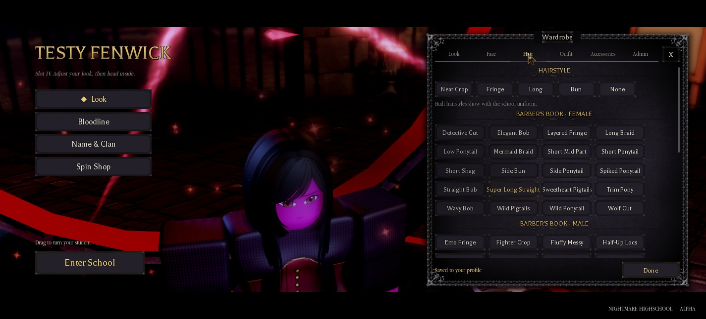
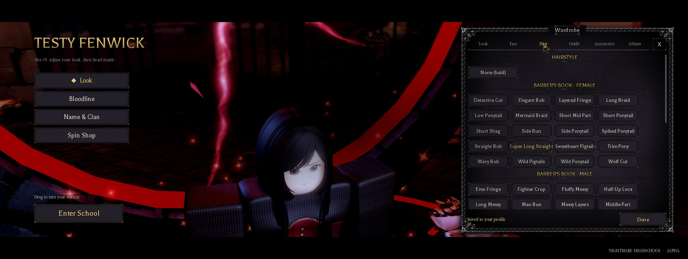
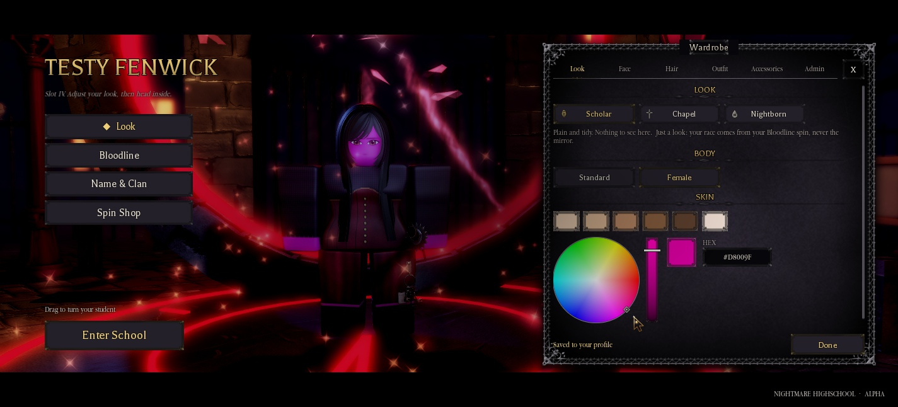
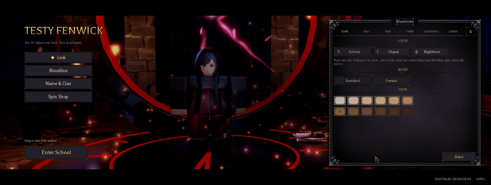
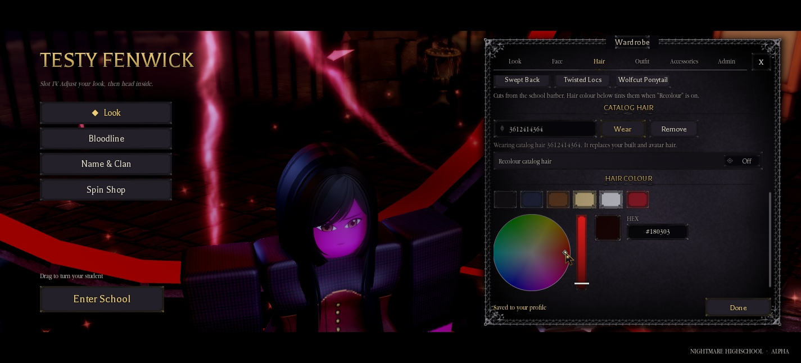
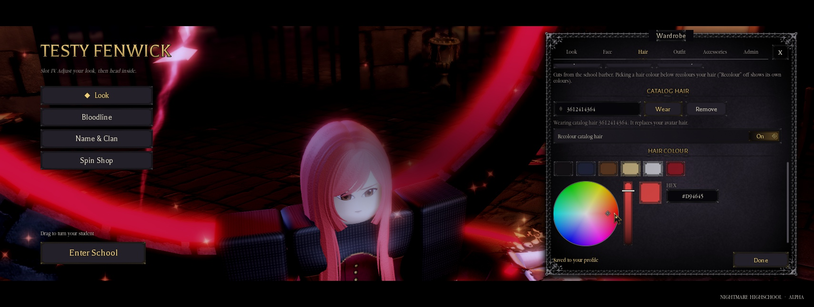
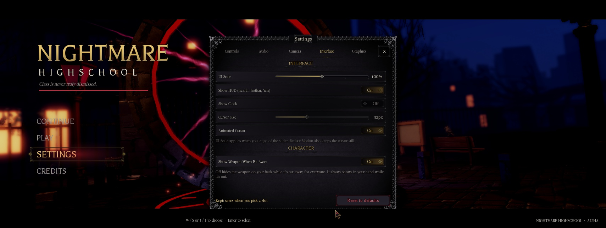
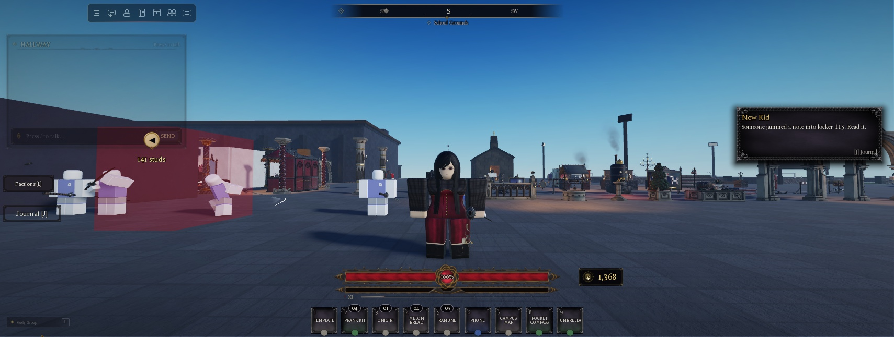

# Hair, skin, the colour wheel, Options and loading (2.1.3)

The owner's request (2026-11-12): delete the box hairstyles an AI session made, take Claude off the credits, fix the
colour wheel and the options, and speed up loading. On the hair colour, the owner added: "people should only be able to
choose certain skin tones, especially dependant on their race. Make sure the main menu, etc. shows it in real time." For
Wraiths, the owner chose a shadow palette.

Everything below is live in NH Combat Test and the Map. CHANGELOG 2.1.3 has the test record.

## Hair

- **Removed:** the four box hairstyles (Neat Crop, Fringe, Long, Bun). They were made of blocks by `UI.Appearance`'s
  `hair()`, which is gone. `Appearance.HairStyles = { "None" }`.
- **All hairs are real:** the barber's book (`ReplicatedStorage.NHHairCatalog`, 35 rigged hairs), catalogue ids, or bald.
- **Old saves:** `Sanitize` reads a box hair (or a missing hair; the old default was Fringe) as a real one, through
  `Appearance.BoxHairFallback`:

| Box hair | Male body | Female body |
|---|---|---|
| Neat Crop | Short Crop 3576061351 | Short Crop 3576061351 |
| Fringe | Emo Fringe 2688717892 | Layered Fringe 3502132184 |
| Long | Long Messy 9000000001 | Super Long Straight 3612414364 |
| Bun | Man Bun 9000000003 | Side Bun 3608734264 |

- A chosen "None" stays bald. "Use my Roblox outfit" keeps the avatar's hair.
- The save is only rewritten the next time the look is saved, to `Hair = "None"` with the real `HairId`.
- `LEGACY_ORDER` is frozen and keeps the old names, so number saves still read.

 

## Skin: only your race's tones

- **Palettes:**
  - `Appearance.SkinPalette(race)`: the race's `Lineage` Palette, otherwise `Appearance.NaturalSkins`.
  - Natural tones: 12, light to dark, including the six old presets.
  - Vampire and Ghoul: unchanged.
  - Wraith (new): black, two charcoals, three greys, a light grey and a pale grey.
- **The Look tab** shows the tones as swatches. There is no colour wheel for skin.
- **Two guards:**
  - The server's Set handler snaps `SkinHex` to `Appearance.AllowedSkin(race, colour)`.
  - `ApplyTo` snaps the colour it draws, so every view shows an allowed tone, live: the creator, the menu's slot
    students and hero, players and NPCs.
- **A race change** (the Bloodline spin) redraws the swatches (the Wardrobe re-renders on `Race`), and the server
  re-applies the look.
- **Your own saves:** Rello (Wraith, `#000000`) and Raiyon (Vampire) look the same. Ren (Werewolf, Nightborn) moved one
  shade.

 

## The colour wheel (`Components.ColorPicker`)

The same picker serves hair, eye and brow colour.

- **Dark starts:** the wheel only lifted brightness when it was under 5%, and the black hair preset is 9%. So red came
  out `#180303`, still black. It now lifts anything under 30% to 85% when you touch the wheel; the bar still darkens it.
- **Hair colour did nothing:** catalogue hairs only take the colour with "Recolour catalog hair" on, and it was off by
  default. Picking a hair colour (a swatch or the wheel) now turns it on (`ColorBlock`'s `Also` fields). The toggle
  stays, so you can turn it back off.

 

## Options (`UI.Settings`, `Gui.SettingsMenu`, `Gui.MainMenu`)

- **Changes made in the main menu were lost.**
  - Before a slot loads, the server has no profile, so it dropped the save. `Settings.Load` was waiting for the
    profile, and it then overwrote everything with the slot's saved settings.
  - Now `queueSave` sees there's no profile, keeps the change and shows "Kept: saves when you pick a slot". `Load`
    (and the slot-switch watch) then saves it into the slot.
- **Show HUD, Show Clock and Screen Vignette didn't stick after the menu.**
  - `MainMenu.HideHud(true)` stores each screen's state and hides it. `HideHud(false)` put that old state back, after
    the saved settings had been applied.
  - It now re-applies those three settings after restoring.

 

## Loading

| Step | Before | After |
|---|---|---|
| Loading screen | 21.5 to 27 s, 953 assets | 13.5 to 14.5 s, 85 assets (the rest load in the background) |
| Slot list | 1.04 s | 0.07 s |
| Look after spawning | 6.1 s | 1.4 to 1.6 s |
| Look after Enter School | 7.70 s | 2.23 s |

These are Studio Play numbers. A live server differs: its DataStore and asset cache are not Studio's.

- **`ReplicatedFirst.NHLoadingScreen`:**
  - `collect(Roots, Seen, Menu)`. The screen waits only for the menu scene, the PlayerGui, Lighting and the menu
    textures.
  - `background()` then preloads ReplicatedStorage, workspace, SoundService and MaterialService, two batches at a time.
  - `NHLoadStats` reports the preload time; `NHLoadRest` reports the background part.
  - `MIN_TIME` (6 s) and the stamp outro (about 3 s) are the art's timing and weren't changed. Lowering `MIN_TIME`
    would cut a few more seconds.
- **`Services.Player.Slots`:**
  - `List` reads the slots side by side (`task.spawn` for each `ViewSlot`).
  - It's also started at join, while the loading screen plays, and the result is cached for 60 s or until a slot is
    picked.
  - Calls that come in during a read wait for it (`ListLoading`).
- **`UI.Appearance` `onCharacter`:**
  - With the StarterCharacter, `HasAppearanceLoaded` never turns true, so the old 6 s cap ran on every spawn and
    respawn.
  - It now waits until the avatar's own pieces (BodyColors, clothing, accessories) have been quiet for 0.25 s, 1.5 s at
    most. Anything later is stashed by `guardLate`, as before.
- **Unchanged:** `LoadProfileAsync` (about 1.1 s in Studio) and every save rule (ProfileService only; Race never set by
  the client).

## Credits

- `Config.MainMenu.Credits` lists Game (Swisha (concept) & WhosRello) and Map (The NH build team).
- The Systems and UI kit lines naming Claude were removed.

## Backups

- CT: `ServerStorage.NH_Backup.{Appearance, Wardrobe, Components, Slots, NHLoadingScreen, Settings, SettingsMenu,
  Lineage, MainMenu, ConfigMainMenu}_pre213`.
- Map: `ServerStorage.NHCore.Backups.{Appearance, Wardrobe, Components, Settings, SettingsMenu, Lineage,
  ConfigMainMenu}_pre213`.
