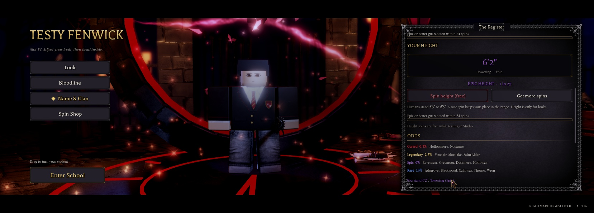
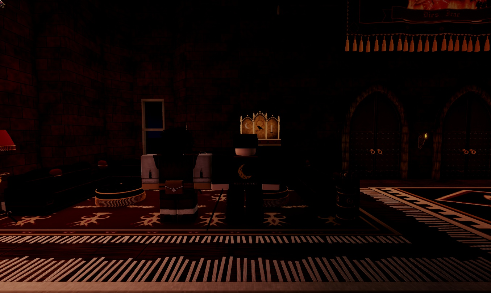
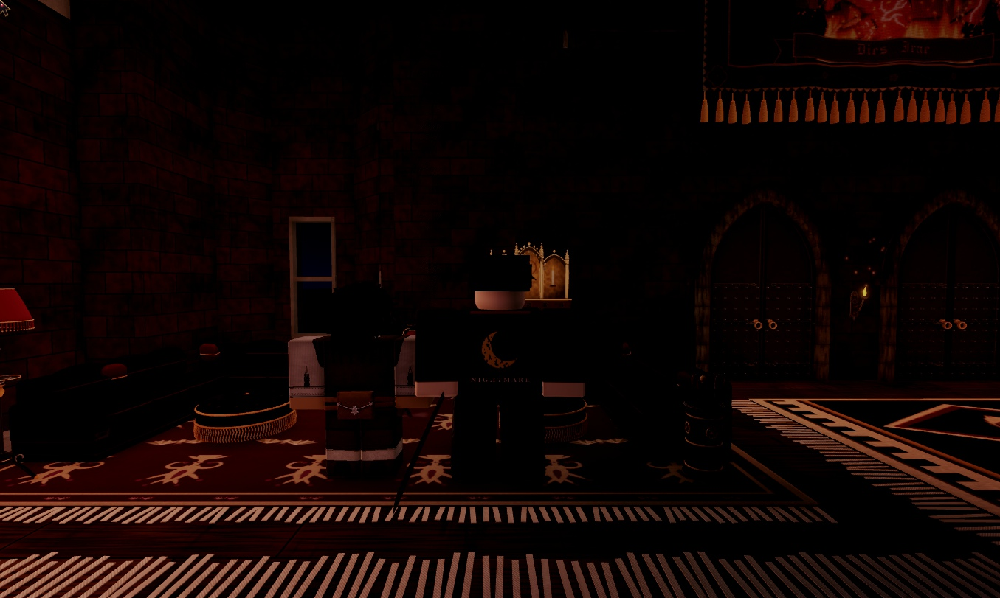
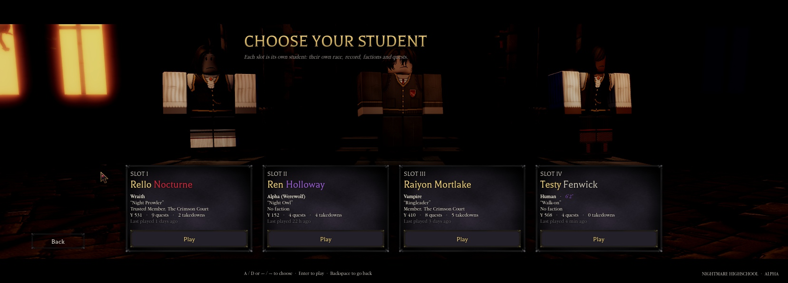
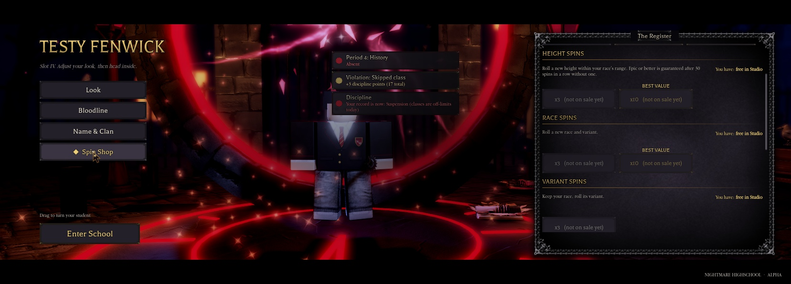
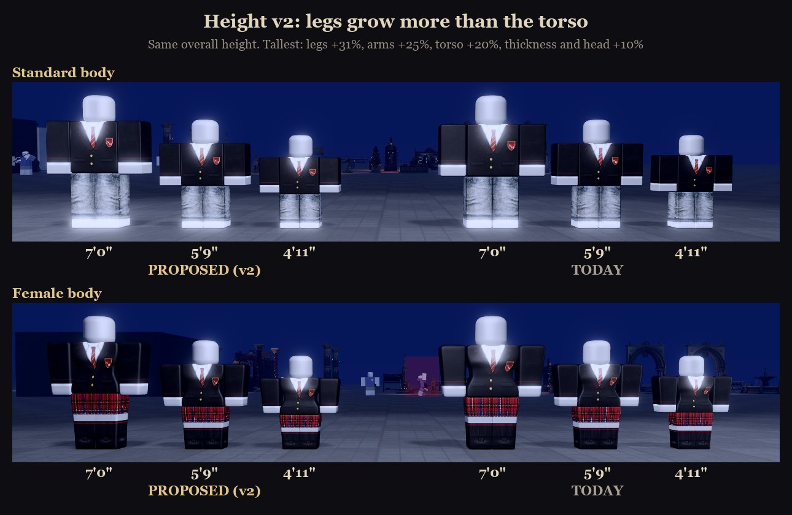
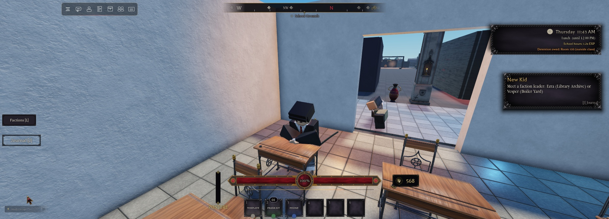
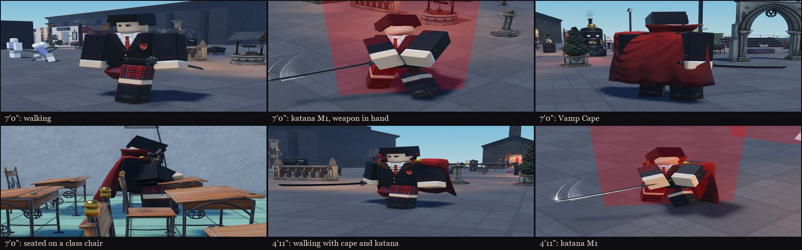

# Height

Every student has a height. Like race and clan, it's **rolled by the server, never chosen**, and it's **cosmetic only**: it never changes reach, health, speed or damage. Design: `docs/superpowers/specs/2026-11-06-height-spin-design.md`. Built in 1.62.0.

## The roll

A roll picks **P**, your place in your race's range (0 is the shortest that race gets, 1 the tallest). The band P lands in is the rarity. Both ends are rare, so short and tall are equally hard to get.

| Rarity | Share | Short side | Tall side |
|---|---|---|---|
| Legendary | 1% each | Pint-Sized | Giant |
| Epic | 4% each | Tiny | Towering |
| Rare | 10% each | Small | Very Tall |
| Uncommon | 15% each | Short | Tall |
| Common | 40% | Average | Average |

- **How a spin rolls:** first a rarity, by its share. Then a band of that rarity you don't already have (Common has only Average, so Average can come up again). Then an even place inside the band.
- **Pity:** after **30 spins in a row** without Epic or better, the next is Epic or better (either end).
- **A race spin keeps your place.** The save stores P, so a Towering Human who becomes a Werewolf is still Towering, in Werewolf heights.

## The ranges

**Average (5'9") is a standard R6 body**: model scale 1.0, the 2-stud torso of a plain Roblox R6 rig (1.63.1, owner: "Normal height should be the height of a normal r6 character"). Every height goes up and down from there. Inches are the height scale × 69, rounded.

Each race has a shortest, a middle and a tallest height (1.63.2, owner: "Make the heights a little more noticeable from normal R6. Especially the tallest heights."):

| Race | Shortest | Middle (P = 0.5) | Tallest |
|---|---|---|---|
| Human, Priest | 4'11" (0.86) | 5'9" (1.00, a normal R6) | 7'0" (1.22) |
| Vampire, Wraith | 5'2" (0.90) | 5'10" (1.02) | 7'0" (1.22) |
| Werewolf | 5'6" (0.95) | 6'1" (1.06) | 7'0" (1.22) |
| Ghoul | 4'9" (0.82) | 5'6" (0.96) | 6'7" (1.14) |

- **The curve:** the distance from the middle grows with the square of how far your place is from the middle, so Average stays close to normal and each rarer band steps further out. For a Human: Average 5'7" to 5'11", Tall to 6'4", Very Tall to 6'9", Towering to 7'0", Giant 7'0"; Short down to 5'4", Small to 5'1", Tiny to 5'0", Pint-Sized 4'11".
- **The ceiling is 7'0" (1.22):** a body's torso is 2 studs wide times its scale, and the door kit's classroom doorway is 2.49 studs wide. Werewolves are still the tallest race through their higher middle.

NPC students use the Human range.

## Spins

- **A new student:** a free first roll plus **2 height spins**.
- **A save from before heights:** a free first roll the next time the slot loads. The creator opens the register and plays the reveal.
- **The Spin Shop:** **Height3** and **Height10** (3 / 10 spins, price hints R$ 49 / 149, "Best value" on the 10). `ProductId = 0` until the owner creates them, like the other products. Grants go through `Services.Player.Purchases`, once per receipt.
- **Free in Studio** while testing (`Heights.FreeInStudio`).

## Where players see it

- **Name & Clan tab:** a **Your height** reel under the clan, e.g. `6'2"` over "Towering · Epic", with "EPIC HEIGHT · 1 in 25", a **Spin height** button, "Get more spins", your race's range and the pity bar. Epic and better land with a rarity burst. When the reel lands the camera pulls back to the full-body shot, then returns to the register.
- **Height odds** under the clan odds.
- **The Spin Shop:** a Height Spins group with "You have N".
- **Slot cards:** the race line shows the height in its rarity's colour ("Human · 6'2""), and the student on that card's stage stands at their height.
- **In school:** you are that height.

 

## How the body is scaled

- Players use the classic R6 body (`StarterPlayer.StarterCharacter`, built at model scale 0.9). R6 has no body-height sliders.
- **Before 1.70.0** the whole character was scaled evenly, so a tall student was a bigger copy of a normal R6 body, head included.
- **Since 1.70.0, a height is a shape, not just a size.** The owner asked: "slightly increase your arm size, etc. but make ur arms, torso, and legs a little longer too", then "Make the legs grow a bit more than the torso".
  - **Thickness and the head** grow with the square root of the height: `Model:ScaleTo(Heights.Normal x sqrt(height))`.
  - **The torso, legs and arms** are then stretched along their length to make up the rest of the height (`Config.Heights.Proportions`). The legs get 1.2x the average share, the torso 0.8x and the arms the average.
  - **The overall height and the inches are the same as before.** Average (5'9") is still exactly a standard R6 body.

| Height | Legs | Arms | Torso | Thickness and head |
|---|---|---|---|---|
| 4'11" (0.86, shortest) | -19% | -16% | -13% | -7% |
| 5'4" (0.93) | -10% | -8% | -6% | -4% |
| 5'9" (1.00) | R6 | R6 | R6 | R6 |
| 6'4" (1.10) | +15% | +12% | +9% | +5% |
| 7'0" (1.22, tallest) | +31% | +25% | +20% | +10% |

- **How the stretch is applied:** `Config.Heights.SetStretch(model, torso, legs, arms)`.
  - It lengthens those parts and the HumanoidRootPart.
  - It moves every Attachment on them and every joint and weld that uses them: shoulders, hips and neck (Motor6D), weapon grips, capes and gear.
  - `StretchOf(model)` reads the current stretch back from the parts' own size, so it is never stored and survives rebuilds.
  - An even `ScaleTo` and the stretch commute, so the order doesn't matter.
- **The body types and the Female body** are CharacterMeshes, and a CharacterMesh stretches with its part, clothing included (tested in game before the build).
- **`Services.Player.Height`** (server) applies it after `EntityLoader` has rebuilt the body (it sets `NHDescribed` after `ApplyDescriptionReset`; scaling before that would be undone), after every spin, and when the race changes. It mirrors read-only `HeightScale`, `HeightBand` and `HeightText` on the player.
- **Speed and jump are put back** right after scaling, because `ScaleTo` also multiplies `WalkSpeed` and `JumpPower`. A tall student is never faster.
- **Looks and weapons are built at the base, unstretched size (1.70.0: the stretch is taken off too, then put back).** `UI.Appearance.ApplyTo` and `EntityLoader.SetWeapon` put a scaled body back to 0.9 (`Heights.Base`, the size they're designed for) while they build (hair, marks, capes and weapons are placed in studs for that body), then restore the height. Catalog hair is loaded first, so nothing waits while the body is at the base size.
- **Already height-aware:** race cosmetics (sized from the torso), 3D gear (sized from the head), and seating (the client measures the hips against the cushion).
- **Made height-aware:** the vault's knee, waist and head heights scale with the body (1.70.0: and with the torso and leg stretch) (for bodies from 0.85 to 1.55 times the game's build size).
- **Combat:** hitboxes are fixed boxes in front of the attacker's root (6 × 10 × 7), so reach never changes, and a body up to 12% bigger is barely bigger inside that box.

 

## NPC students

Class students (`NHSchedule`) and ambient students (`NHAmbient`) each get a fixed height from their name and look, in the Human range. Their feet stay where they were placed. Other NPCs (enemies, staff at stations) keep today's size.

## Saving

`PlayerData.Identity.Height = { P, Band, Spins, Pity, Seen }`, through Identity's `SetIdentity` (ProfileService only). The server rolls P; a client can only ask to spin (`NHIdentity.SpinHeight`) and say it has seen the reveal (`NHIdentity.SeenHeight`).

## Code

| What | Where |
|---|---|
| Bands, ranges, odds, inches | `ReplicatedStorage.Config.Heights` |
| Roll, spins, pity, save, remotes | `ServerScriptService.Services.Player.Identity` (`SpinHeight`, `AddHeightSpins`, `SeenHeight`) |
| Putting it on the body | `ServerScriptService.Services.Player.Height` (`Apply`, `Queue`, `ScaleKeep`, `Of`) |
| The reel, reveal and shop group | `StarterPlayerScripts.Controllers.Gui.Identity` (`HeightRolled`, `RevealHeight`) |
| Slot cards and menu students | `Services.Player.Slots` (`HeightText`, `HeightBand`, `HeightScale`), `Controllers.Gui.MainMenu` |
| Looks / weapons at the base size; NPC heights | `UI.Appearance` (the `ApplyTo` wrapper), `Managers.EntityLoader` (`SetWeapon`) |
| Test bridge (Studio) | `SpinHeight`, `HeightUnseen` (marks it unseen so the reveal plays again) |

## Admin (1.63)

The admin panel's Student tab has **Spin height** (a free re-roll) and **Shortest**, **Average**, **Tallest** (the ends and the middle of the student's race range), and the Self tab has **Spin my height**. In NH Combat Test these are saved like a normal spin; they're commands `SpinHeight` and `SetHeight` (`Pick = Shortest | Average | Tallest`) on `Features.Admin`, through `Height.Spin` / `Height.Set`. The roll itself now lives in `Config.Heights.Roll`, shared by both places.

## The Map place (1.63)

Heights are in the Map place's core add-on too, so the owner and the builder see students at different heights on the real map. The Map has no saving and no register, so its `Services.Player.Height` is its own version: every player rolls a height when they join (the same odds), kept for the session only, and the admin panel re-rolls or sets it. The rest is the same code: `Config.Heights`, the look wrapper in the Map's `UI.Appearance`, the loader's `NHDescribed` flag and the weapon wrapper in `EntityLoader`, and the vault. See [[Map-Core-Preview]].

## Play-tested, 1.70.0 (NH Combat Test, slot 4 "Testy")

Both ends were set through the admin desk's `SetHeight` (Shortest, Tallest).

| Check | 7'0" | 4'11" |
|---|---|---|
| Body | torso 2.21 x 2.41, legs 2.61, arms 2.51, head x1.10 | torso 1.85 x 1.74, legs 1.62, arms 1.68, head x0.93 |
| Walking (real key) | yes | yes |
| Sprinting (real Left Shift) | speed 25, Sprint track | speed 25, Sprint track |
| Walk speed | 14.4, unchanged | 14.4, unchanged |
| Katana | real E, a real-click M1; the handle 0.35 studs from the hand | a real-click M1; the handle 0.08 studs from the hand |
| Vamp Cape (real click at the locker-room Wardrobe) | worn, and the stretch survived the look rebuild | still worn after the height change |
| Sitting on a class chair (real E) | seated, hips 0.07 above the cushion | seated, hips 0.06 above the cushion |

- **Other checks:**
  - clothing and hair showed at both heights;
  - NPC students get the same shapes;
  - the console had only the admin log lines and the place's existing asset messages.
- **Not tried:**
  - the main-menu slot pedestals and the creator preview at a height;
  - vaulting;
  - a second player;
  - body types and races at the two ends;
  - transformed forms.
- **Testy** was put back to Average and keeps the Vamp Cape.
