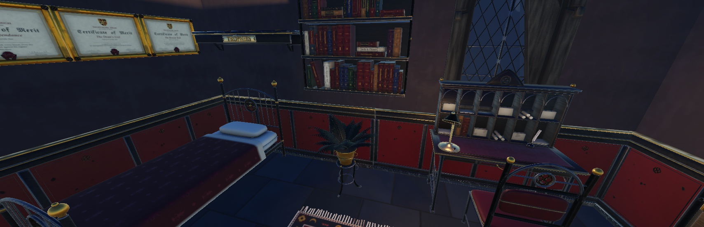
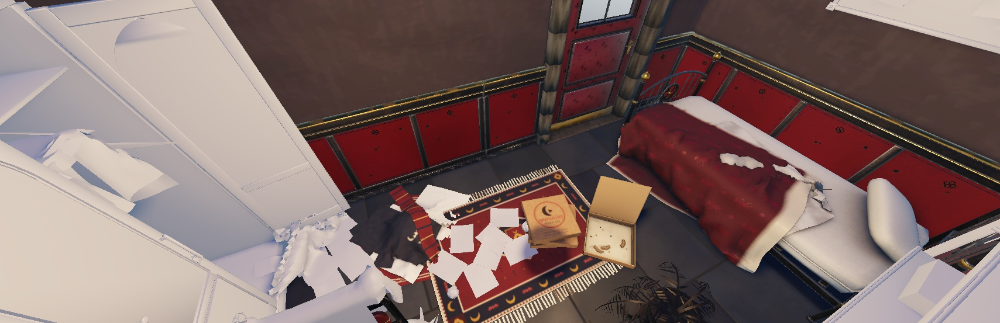
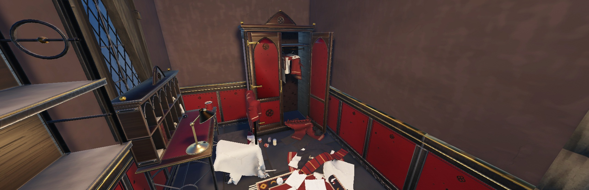

# Homes

Every student has a private home. Phase 1 (1.64.0) is the **dorm room**, free from day one. The room's look follows your latest report card, and **Mom & Dad** text about your grades and can cut off your allowance. Off-campus homes (phase 3) and shared building interiors (phase 2) come later, when the owner says. Design: `docs/superpowers/specs/2026-11-06-homes-interiors-design.md`.

## Getting in and out

- **Hallway doors** are anything tagged `NHHomeDoor` (a door Model or part). Each gets an invisible prompt part in front of it (`NHHomePromptPart`) with "Enter your room" (E, a 0.3 s hold). The prompt sits on its own part because prompts on the door-kit mesh never showed. The door's attribute `NHHomeFront` (default -1) picks which side of the door the prompt stands on.
- **One hallway serves the whole server.** Walking in takes you to **your own copy** of the room, built from the template the first time you go in. No room is ever "taken".
- Inside, the room's door (the template's `Exit` part) has **Leave** (E), which brings you back to where you came in, and, for the owner only, **Send guests out** (F).
- The trip uses the game's teleport veil (`Fx.VeilMove`). You can't go in while in a fight (combat-tagged), downed, carrying or being carried.
- The copies are built in a grid far below the map (`Config.Homes.Grid`: from (4000, -360, 4000), 120 studs apart, 8 to a row) in `workspace.NHHomes`. A room is destroyed when its owner leaves the server (any guests are sent back first). While you're inside, your player has the attribute `NHInHome` = the owner's UserId.

## The room follows your grades

The room shows one of five states, from your **latest report card's average**. Before your first card it's Tidy (a fresh start). A new card changes it at once, with a toast if you're inside: "Your room looks different. Your report card is in."

| Card | State | What changes |
|---|---|---|
| A+ / A | **Spotless** | made bed, framed certificates, the trophy shelf, a full bookshelf, a healthy plant, a warm bright light |
| B | **Tidy** | made bed, full bookshelf, the trophy shelf, a healthy plant |
| C | **Lived-in** | a jacket over the chair, books stacked, a coffee cup, a sparse shelf, the light a bit lower |
| D | **Slipping** | unmade bed, clothes on the chair, papers on the floor, a wilting plant, a dim bulb |
| F | **A wreck** | clothes on the floor, pizza boxes, overdue notices pinned up, empty cans, the wardrobe hanging open, a dead plant, an empty shelf, a flickering bulb |

**The trophy shelf** (Spotless and Tidy) shows up to four of the owner's beast trophies, as small stand-ins of their locker models, redrawn each time the owner walks in.

## Mom & Dad

A **Mom & Dad** contact texts right after the Office's report-card text (a few original lines for each mood, in `Config.Homes.Parents.Lines`):

| Card | Their text | Allowance |
|---|---|---|
| A+ / A | proud (Top) | the card's allowance **+¥20** |
| B | pleased (Good) | as the card says |
| C | "We expect better" (Fair) | as the card says |
| D | a warning (Warn) | as the card says (a D pays 0 already) |
| F, or a second D card in a row | "We're cutting off your allowance" (CutOff) | **cut off** |

- **Cut off:** no allowance at all (the attendance bonus too) until a card of **C or better**, which brings it back (Restored, plus the +¥20 if it's an A). A card below C while cut off gets "Still not good enough" (StillCut). A week with no graded lessons sends no news, but stays cut off.
- `School.ReportCards` still pays the allowance: in its hand-out it calls `Homes.Adjust(P, Card)` before paying, then `Homes.AfterCard(P, Card)` after the Office's text.

## Visitors

- From the phone's **Classmates** app, **Invite to my room** on a classmate's card. They get a text with **Visit** and **Maybe later**. The invite lasts 10 minutes (`Config.Homes.InviteMinutes`), and only while you're still in the server.
- The text names you if they know you (`Strangers.Knows`), otherwise "A classmate".
- Guests land in your room; you get a "You have a guest" toast. Their Leave takes them back to where they came in.

## Saving

`PlayerData.Housing = { Owned = { "Dorm" }, Current = "Dorm", CutOff = false, DStreak = 0 }`, through ProfileService only (the `SetHousing` action, cleaned by `Config.Homes.Sanitize`). The room's state isn't saved: it comes from the report cards.

## Making a room template

A template is a Model in `ServerStorage.NHHomes` (the dorm is `Dorm`), with:

- a **`Spawn`** part (where you arrive, facing its front) and an **`Exit`** part (the inside of the door);
- **`TrophySpot1`..`TrophySpot4`** parts, where the trophies stand;
- lights: any Light whose part (or the light itself) has the attribute `NHHomeLight`; each state scales their brightness (`Light`) and A wreck flickers them;
- props with the attribute **`NHHomeState`**, a comma list of the states they show in (`"Spotless,Tidy"`). Props without it always show. Hidden pieces are see-through and don't collide.

The dorm is built from the dorm room kit (props batch 34, 1.64.1) by `tools/homes/build_dorm_room.luau`. It is a 20 by 10 stud room (interior x -10 to 10, z -8 to 2, floor top -0.1). The door wall is at the front left, the window at the back right, and the trophy spots sit on the trophy shelf's top, inside its model. The old plain-part stand-in is in `ServerStorage.NH_Backup.NHHomes_DormStandIn`.

## In NH Combat Test

- `workspace.NHDormWing` (a stand-in, `NHStandIn`): a short hallway at (40, 0, -440) with three classroom-kit doors tagged `NHHomeDoor`, rooms 101 to 103, and a "DORMITORY · WEST WING" sign. The builder makes the real dorm wing in the Map place.

## Code

| What | Where |
|---|---|
| Homes, states, the grid, parents' lines and rules | `ReplicatedStorage.Config.Homes` |
| Private copies, doors, states, trophies, visitors, the allowance rules | `ServerScriptService.Services.Features.Homes` |
| The allowance hook | `School.ReportCards` (`Local.Deliver`) |
| The invite text and its Visit button | `Features.Phone` (texts carry `Invite`; `TextAction`), `Gui.Phone` (Classmates card, text buttons) |
| The invite remote | `ReplicatedStorage.NHHomes.Invite` (RemoteFunction) |
| Saving | `PlayerData.Housing`, `UpdateState` `SetHousing` |
| Test commands | `TestBridge`: `HomeInfo`, `HomeEnter`, `HomeLeave`, `HomeState`, `HomeCard`, `HomeTrophy`, `HomeInvite`, `ReportDeliver` |
