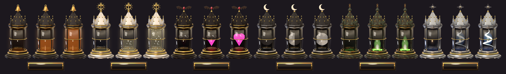
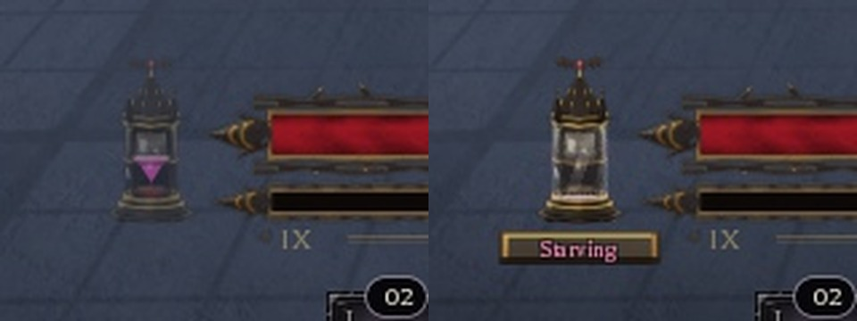
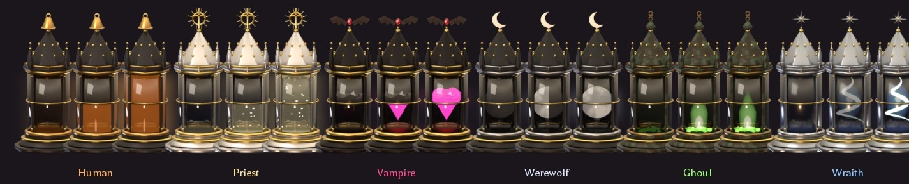
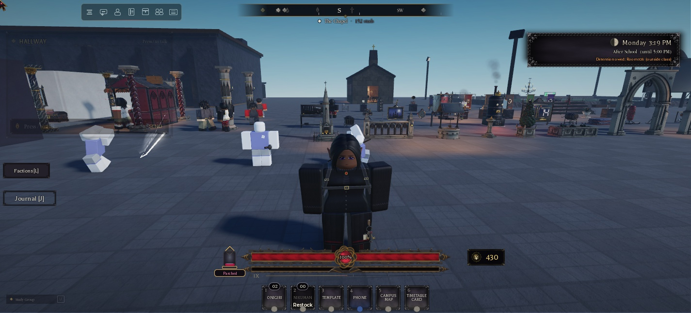
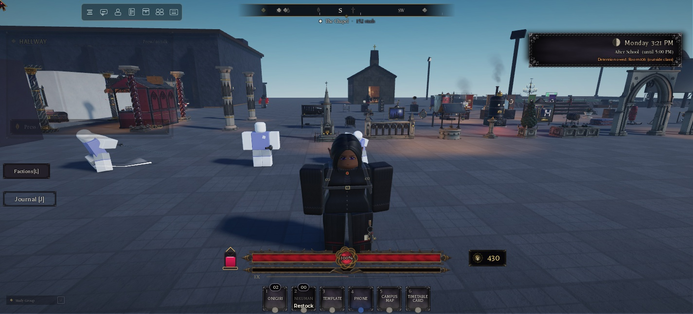

# Hunger (Hunger 1.0: phases 1 and 2)

Up: [[Hunger-and-Body-Concept]] · Related: [[Races-and-Bloodlines]], [[Racial-Grips]], [[QOL-Kit]], [[Training]]

The owner picked **phases 1 and 2** of the [concept](Hunger-and-Body-Concept.md): the need itself, and the race vessels.
Their "Your calls" were not answered, so this build uses each call's recommended option:
- the new need is called **Hunger**;
- hunger never costs health;
- away from the game, hunger never falls below 35;
- plain food gives Ghouls and Wraiths nothing.

Body drift (Lean / Heavy from eating) is phase 3 and isn't built; `Reserve` is saved as 0.

## What it is

Every student has **Hunger**, from 0 to 100. It falls while you play and rises when you eat what your race eats. It is
not the Races 1.2 Bloodline meter (`Lineage.Hunger`, which only rises and opens the rites); a racial grip still fills
that one as before, and now fills this one too.

| Band | Hunger | Effect |
|---|---|---|
| Stuffed | 90 to 100 | 2 min of food coma when you reach it: −6% sprint |
| Full / Fed / Peckish | 20 to 90 | nothing |
| Hungry | 5 to 20 | −4% damage, 5% easier to spot (your stomach growls) |
| Starving | 0 to 5 | −8% damage, 5% easier to spot, −10% class EXP |

- **Never:** health loss or death from hunger.
- **Decay:** 0.55 a minute of play (about 33 an hour) before the race's factor. It pauses in the main menu, while dead,
  and while evolving.
- **Away:** hunger falls at a quarter of the rate, never below 35. A save already below 35 stays where it was.
- **New students** and saves from before hunger start at 70. A new race (the bite, a race spin) starts at 60 at least.

### Food

| Food | Hunger |
|---|---|
| a small snack (heals up to 15) | +8 |
| a snack (heals 16 to 40) | +14 |
| a big snack (heals 41 to 80) | +24 |
| a lunch meal, or a heal over 80 | +40 |
| a drink or sweet (a buff) | +4 |
| a snack-tin bite | by its heal, as above |

An item's own `Hunger` field in `Config.Items` overrides this.

### Races

| Race | Plain food | Decay | Grips and extras |
|---|---|---|---|
| Human | 100% | 1x (Superhuman 1.2x) | none |
| Priest | 100% | 1x | Holy Water Lemonade +14 |
| Vampire | 25% | 1.25x by day, 0.75x at night, 0 under a crimson moon | The Kiss +45 |
| Werewolf | 100%, meaty x1.5 (Bloodmoon 1.7, Alpha 1.9), sweets x0.5 | 2x on a full moon (Bloodmoon 2.2, Alpha 2.4) | Maul +35 |
| Ghoul | 0% ("Ash.") | 0.6x (Ghast 0.5x, Crypt Lord 0.4x) | Eat Body +55, Mystery Meat Loaf +25 |
| Wraith | 0% ("Nothing.") | 1x, 0.5x on a new moon | Soul Siphon +40; +2 a minute with 3+ others within 12 studs (Revenant 14, Hollow King 18) |

The concept's race specials (the Priest's fast, the Sanguine Tonic, Charnel Tins, Wraith warmth and Fade, the frenzies)
are phase 4.

### Best food
At full health, the snack wheel's middle (Best food) now feeds you instead of saying "You're not hurt.". Below Full,
it eats the cheapest thing you carry that brings hunger up to about 80 for your race, else the most filling one.
- At full health and Full or better, it says "You're not hurt or hungry."
- With nothing your race can eat on you, it says "Nothing here will feed you." (Ghouls and Wraiths) or "Nothing on you
  would fill you up.".

### The snack wheel
Each socket has a small pill at the top of its well showing what that snack does for your hunger:
- "+14" in your race's colour;
- or "+8" struck through in grey when your race can't eat it, so a Ghoul sees at a glance that only the Meat Loaf works.

## The vessel (the HUD)

A small race reliquary tucked against the left end of the Thornrose health bar, with an enamel plate under it that
names the band in the race's words.

**Subtle pass (owner: "Make its placement and sizing a little more subtle"):**
- **Size:** the vessel is 92 px tall (44 wide); the stand-in is 46 x 68. It was 136 / 114.
- **Placement:** it sits 2 px from the bar's end.
- **The plate** (84 x 18) shows only for 4 s after a band change, on hover, and while Hungry or Starving.
- **Quieter:**
  - a dimmer halo;
  - half as many, smaller motes;
  - a lighter frost;
  - a softer vignette;
  - a 1 px growl;
  - smaller numbers.
- **Resting:** it fades to 45% after 12 s while Fed or better.

| Race | In the vessel | Plate words (Stuffed → Starving) |
|---|---|---|
| Human | warm amber broth with rice and spring onion, under a brass lunch bell | Stuffed · Full · Fed · Peckish · Hungry · Starving |
| Priest | holy water with gold motes, under a silver sun-cross | Sated · Blessed · Fed · Fasting · Hungry · Faint |
| Vampire | a faceted ruby heart on black velvet that lights up (no liquid), under bat wings and a garnet | Gorged · Sated · Fed · Thirsting · Parched · Starving |
| Werewolf | a moon disc that fills left to right like a phase, under a silver crescent | Gorged · Full · Fed · Prowling · Ravenous · Starving |
| Ghoul | an acid-green grave flame over an ember bed, under a lantern cap and chain | Gorged · Full · Fed · Gnawing · Hollow · Frenzied |
| Wraith | a cold blue soul-wisp in a frosted bell jar that brightens | Warm · Kindled · Steady · Thin · Fading · Hollow |

**Motion** (one render loop):
- **Idle:**
  - the surface breathes;
  - motes drift up through the contents;
  - a highlight crosses the glass every 6 s;
  - the Vampire's heart beats (faster at night).
- **Running:** the liquid tilts with your sideways speed, on a damped spring.
- **Eating:**
  - a bead in the race colour arcs into the top;
  - a splash ring flares and the level eases up;
  - "+14" drifts up, or "Ash." / "Nothing." for a race that can't eat it.
- **Band change:** the plate turns over to the new word.
- **Hungry:** frost creeps in, with a small growl shake about every 40 s.
- **Starving:** the halo pulses at 0.9 Hz and a soft vignette darkens the screen edges. Under Reduce Flashing, both are
  steady.
- **Resting:** while you're Fed or better and nothing changes for 12 s, it fades to 45%, and the plate tucks away.
  Hovering shows "Fed · 63 / 100".

### Art

The art is made in two stages, like the Training set:
- **`art/ui/hud/blender_hunger_vessels.py`** (headless Blender, Cycles) models each vessel in 3D and renders it empty,
  full, and as a contents mask. Each vessel has:
  - a quatrefoil plinth, a glass jar in a strapped cage, and an octagonal spire with pinnacles and crockets;
  - the race finial and contents;
  - full PBR materials: hammered iron, brushed brass, gilt, silver, verdigris, velvet, glass, emissive and volume light;
  - ambient-occlusion grime and edge wear.

  It also renders the band plate.
- **`art/ui/hud/finish_hunger_vessels.py`** (Pillow) builds the upload set:
  - it cuts every race to one shared frame;
  - it makes Fill (the full render kept only where the contents are), the white Glow, the shared Frost, the Plate, the
    Splash and the Mote;
  - it bleeds the edges and resizes premultiplied;
  - it writes `out/hunger/layout.json` (the frame's aspect and where the contents sit).
- **The frame:** all six share one 264 x 552 frame (aspect 0.478), with the contents between 46% and 85% of its height
  (`Config.Body.ArtAspect`, `ArtFill`). On the HUD the vessel is 92 px tall and 44 px wide.

**Uploaded:** the owner imported `art/group-upload-hunger/` (22 images) under group 15981569. The ids were read by
name from the group's image inventory (one per name) and set in `Config.Body.Art`:

| Race | Back | Fill | Glow |
|---|---|---|---|
| Human | 84764828890865 | 92501604024020 | 131245003988873 |
| Priest | 94070707547013 | 130948692528601 | 125824448438035 |
| Vampire | 101890322150335 | 102798096485969 | 101568386950431 |
| Werewolf | 122077151490816 | 98116974505580 | 139388068287737 |
| Ghoul | 98067528481264 | 131095693419592 | 80220184230970 |
| Wraith | 121840574269645 | 138836639263225 | 135538733937729 |

**Shared sprites:** Frost 95255146828905, Plate 84440332534399, Splash 98543895840857 and Mote 131916021444619.

- **Preloading:** the client preloads your race's vessel and the shared sprites.
- **The splash:** the eating splash uses the baked ring.
- **The stand-in:** an iron-framed jar from frames, with a brass-edged cap. It's only drawn if a race's Back or Fill
  id is missing.

**In play (slot 3, a Vampire):**
- the real art loaded (Back, Fill, Glow, Plate and Mote: `IsLoaded`);
- at Fed (left), the ruby heart is lit to the level and the vessel rests faded with no plate;
- at Starving (right), the heart has gone dark, frost covers the glass and the plate reads "Starving".

**All six races in game:** each race's uploaded Back, Fill and Glow, drawn by the client in a test overlay with the
HUD's own fill modes (Rise, Wipe, Fade) at empty, half and full. All loaded and read as designed; the overlay was then
removed.

| Hungry (the plate shows) | Fed, resting (the plate tucks away) |
|---|---|
|  |  |

## Code

| Piece | Where |
|---|---|
| Bands, races, sub-races, moons, food values, words, colours, art ids, `Gain`, `DecayRate`, `Sanitize` | `ReplicatedStorage.Config.Body` |
| The need: load (migrate, time away), decay loop, eating, grips, the Wraith crowd, effects, saving | `ServerScriptService.Services.Features.Body` |
| The vessel | `StarterPlayer…Controllers.Gui.HungerVessel` |
| Eating feeds hunger (`Use`, `KitEat`), Best food at full health (`Local.UseBestHunger`) | `Services.Features.Inventory` |
| A racial grip feeds hunger | `Services.Features.RaceAction` |
| The "Hunger" effect source | `Services.Player.Progression` (`Effects`) |
| `SetBody` | `ReplicatedStorage.Functions.UpdateState`, `ReplicatedStorage.PlayerData` (`Body = {}`) |

**Saving:**
- `PlayerData.Body = { Hunger, LastTick, Reserve, Race, V }`, through ProfileService only.
- The profile table is updated in place every 5 s tick, and autosaved by ProfileService.
- `SetBody` runs on every meal, every band change and once a minute.
- `Race` is the save's race at the last save, so a slot load's `Race` attribute change isn't taken for a turn.

**The server decides everything:**
- The client never sends a hunger value.
- Eating is rate-limited by the 12 s "full" cooldown.
- Decay comes from the server clock.
- `Get` is limited to one call every 0.3 s.

**Attributes:** `Hunger` (one decimal) and `HungerBand` on the player. **Remotes:** `ReplicatedStorage.NHBody` (`Get`
RF; `Event` RE: `Ate`, `Fed`, `Band`, `Race`).

**Test hooks** (`Services.Features.Body`): `TestSet(P, n)`, `TestTick(P, seconds)`, `State(P)`, `AdminSet(P, n)`.

**Backups:** `ServerStorage.NH_Backup.Hunger_pre` holds UpdateState, PlayerData, Inventory, RaceAction and Progression
as they were. **Sources:** `tools/hunger-100/`. Install a file with
`python tools/hunger-100/install.py <file> <dot.path> <Class> [studio_id]`, which checksums it.

## Tested (NH Combat Test, slot 3, a Vampire; slot 4 was locked)

| Check | Result |
|---|---|
| A save from before hunger | loaded at 70 (Full); saved `{ Hunger, LastTick, Race = Vampire, V = 1 }` |
| Daytime decay (Vampire) | 41.25 an hour (x1.25); one hour of ticks took 69.8 to 28.5 |
| Away about 10 minutes | 70 came back as 68 (a quarter of the rate) |
| Onigiri / The Kiss / Eat Body, as a Vampire | +2 / +45 / 0 |
| Hungry | damage −0.04, spotted +0.05 on the character |
| Stuffed | `NH_SprintMult` 0.943 for the food coma |
| Best food at full health, hunger 40 (the real remote) | ate the Nikuman: "Nikuman: +4 hunger" |
| The vessel | "Gorged" at 95; "Starving" with the vignette at 3; a low fill under "Parched" at 15 |

**Fixed during the test:**
- the theme's title font is an `Enum.Font`;
- `HungerBand` lagged one band behind;
- the stand-in's fill ignored its level (two UIGradients on one frame).

**Not tested:**
- the other five races' vessels on the live HUD (they were checked in a test overlay, not on the HUD itself);
- the eating animation by eye;
- the snack wheel's chips;
- the Wraith's crowd;
- the moons;
- a real grip finish;
- the snack tin;
- two players.
