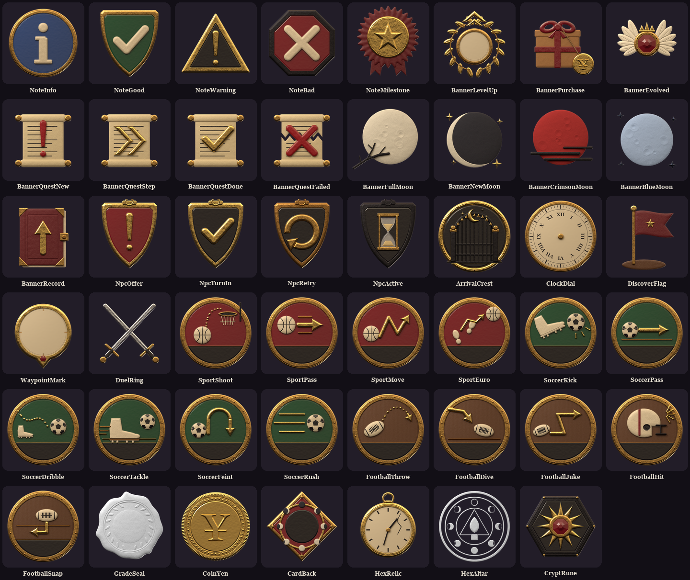

# The Icon Set (replacing the overused wax seal): NH Combat Test

The owner: *"I'm tired of using this icon for everything. Create unique icons for everything that uses this icon, other than what it was used for."*

The icon was the UI kit's wax seal, `Theme.Images.Seal` (130174890638243; older 119862801131834). It was made for the **rarity gem on item slots** (the UI kit's "wax-seal rarity gems"), and it keeps that one job. Every other use now has its own icon.

## What changed

| Where | Before | Now (`Theme.Images.<key>`) |
|---|---|---|
| Notification toasts | the seal, tinted by kind | `IconNoteInfo` (blue "i" plaque), `IconNoteGood` (green shield, tick), `IconNoteWarning` (gilt warning triangle), `IconNoteBad` (crimson octagon, cross), `IconNoteMilestone` (gilt star rosette) |
| Level-up banner | seal + level number | `IconBannerLevelUp`: a laurel wreath with a rising chevron; the level number sits in its ivory centre |
| Purchase banner | seal + "¥" | `IconBannerPurchase`: a parcel tied with crimson ribbon and a gold yen tag |
| Evolved banner | seal + tier numeral | `IconBannerEvolved`: bone wings round a crimson gem, under a small crown |
| Quest banners | seal + "!", "»", "✓", "✗" | `IconBannerQuestNew` / `QuestStep` / `QuestDone` / `QuestFailed`: a scroll with a crimson "!", gilt chevrons, a gilt tick, or torn with a crimson cross |
| Moon banners | seal | `IconBannerFullMoon` (a pale moon behind a bare branch), `IconBannerNewMoon` (a dark moon with a silver rim), `IconBannerCrimsonMoon`, `IconBannerBlueMoon` |
| Discipline record improved | seal | `IconBannerRecord`: the crimson ledger with a gilt up-arrow |
| NPC quest markers | seal + glyph | `IconNpcOffer` (crimson shield, "!"), `IconNpcTurnIn` (ink shield, tick), `IconNpcRetry` (brass return arrow), `IconNpcActive` (iron shield, hourglass) |
| Arrival stamp | seal | `IconArrivalCrest`: the school gates under a crescent moon in a gilt ring |
| Get-up dial (on the floor) | seal | `IconClockDial`: an ivory clock face with roman numerals (the game still draws the hands) |
| Region discovered | seal | `IconDiscoverFlag`: a crimson pennant planted on a mound |
| Waypoint chevron | seal | `IconWaypointMark`: a gilt pin with an ivory head (the arrow turns inside it) |
| Compass: duel ring | seal | `IconDuelRing`: crossed rapiers |
| Sports touch buttons | seal on all 15 | basketball (crimson): `IconSportShoot`, `Pass`, `Move`, `Euro`; soccer (green): `IconSoccerKick`, `Pass`, `Dribble`, `Tackle`, `Feint`, `Rush`; football (oak): `IconFootballThrow`, `Dive`, `Juke`, `Hit`, `Snap`. Each shows its move; the title sits in the dark band at the bottom |
| Report card average, activity grade | seal | `IconGradeSeal`: a white wax seal with a laurel ring and a smooth centre for the letter (tinted in game, like before) |
| Allowance coin | seal + "¥" label | `IconCoinYen`: a struck gold coin |
| Memory Match card backs | seal | `IconCardBack`: a lozenge with a ring of moon phases round a dark centre (the "?" sits in it) |
| Hex Slash | seal relic, seal altar | `IconHexRelic` (a cracked pocket watch), `IconHexAltar` (a circle of moon phases, tinted faint) |
| Crypt Crush seal piece | seal | `IconCryptRune`: an iron keystone with a gilt sun rune and a crimson gem |

Full-colour icons are listed in `Theme.Baked`, and the code shows those untinted (white `ImageColor3`). `IconGradeSeal` and `IconHexAltar` stay greyscale and keep their tints.

Not changed: the item-slot rarity gem (the seal's own job), `Gui.Training` (the training build is drawing its own icons), `Gui.MainMenu` ("Seal" there is a 3D part), `Gui.Strangers` (faction icons).

## The art

All 47 are original, made for this set and rendered in Blender like the training HUD:

1. `art/ui/hud/make_seal_icons.py`: each design as a relief (16-bit height) and a material map.
2. `art/ui/hud/blender_seal_icons_render.py`: headless Blender + Cycles. The relief is displaced geometry with full PBR shaders (brass, gilt, black iron, ink and crimson enamel, parchment, wax, bone, moon chalk, kraft paper) and the HUD's lights (warm key, cool fill, candle rim).
3. `art/ui/hud/finish_seal_icons.py`: bleeds the colour under the clear pixels (no dark fringes), sizes them (256 for the small ones, 512, 1024 for the arrival crest) and writes `art/group-upload-icons/NHIcon<Name>.png`.

## Ids

Uploaded under the group (15981569) through the owner's bulk import as `NHIcon<Name>`, read back by name (47 found, no duplicates), and thumbnails reported Completed (45 straight away, 2 a few minutes later). The ids are in `art/ui/hud/out/seal_icons/ids.json` and in `Theme.Images` between `-- (icon set start)` and `-- (icon set end)`.

## Code (NH Combat Test, 1.84.0)

Backups: `ServerStorage.NH_Backup.SealIcons_20261111`. Patched: `UI.Theme` (the keys, `Theme.Baked`), `UI.Components` (`ToastIcons`, the toast picks its icon by kind), `Gui.Moments` (banners take an `Icon`; quest, purchase and evolved banners drop their text glyph since the icon says it; level-up keeps its number), `World.FullMoon`, `World.MoonPhases`, `World.SchoolFx`, `World.QuestSeals` (an icon per state, swapped on restyle), `World.Arrival`, `World.GetUp`, `World.Regions`, `World.Waypoint`, `Gui.Compass` (baked markers untinted), `Gui.Sports` / `Gui.Soccer` / `Gui.Football` (each button's own face, the title moved to the bottom band), `Gui.Phone` (grade seal, coin; the "¥" label is gone), `Gui.Activities` + `MemoryMatch` (card back shown at 0.15 transparency), `Gui.PhoneGames.Hex`, `Gui.PhoneGames.Crypt` (the rune replaces the seal and its pip). Patch tools: `E:\NH-Work\sealicons\patches.lua`, `apply.py`.

## Tested (Play, slot 4 "Testy")

- **Verified:** all 47 images load in game ([grid](img/icon-set-ingame-grid.jpg)); toasts show their kind's icon ([toasts](img/icon-set-toasts.jpg)); the level-up banner with the number in the wreath ([level up](img/icon-set-levelup.jpg)); the report card's grade seal and the earlier weeks' seals ([seal](img/icon-set-report-seal.jpg)); the allowance coin, greyed when unpaid ([coin](img/icon-set-report-coin.jpg)); the Hex Slash altar ([altar](img/icon-set-hex-altar.jpg)); the NPC markers (Ezra: hand-in, Dex and Pip: offer, all loaded; [screenshot](img/icon-set-npc-marker.jpg), small at that distance). No script errors from the patched scripts.
- **Not seen live yet:** the arrival stamp (only plays on a first entry), the region discovery flag (no card fired after a teleport), the quest / moon / purchase / evolved / record banners, the waypoint pin up close, the get-up dial, the compass duel-ring marker, the sports touch buttons (they only exist on touch devices), Memory Match card backs, the Hex Slash pocket watch (none was thrown in the run) and the Crypt Crush rune. Each uses the same image path as the verified ones.
- Test side effects on Testy only: +2500 EXP (level 7 to 11), a report card delivered, discovered places reset.

## Map place

The Map place shares the toasts, the rarity gem, the Moments banners, the phone report seal and coin, Hex Slash, Crypt Crush and the get-up dial. It was not edited; the Map-sync session ports these (same patch list).
