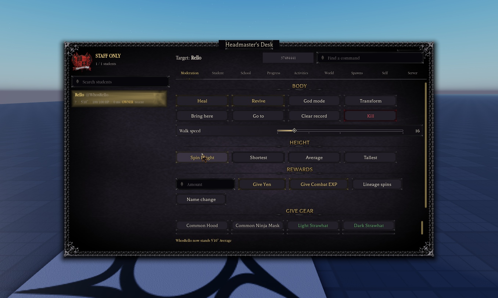

# The core game in the Map place (2026-11-05)

Owner: "let's transfer the core game (movement, cinematic mode, etc.) into the "Map" place first so me and the builder
can preview how the game's gonna FEEL with the map".

**Map place:** placeId 111107083446202, where the builder is building the school (Team Create, live).

## What the owner chose
- **Movement:** sprint and fast sprint, dash (Q), slide (Ctrl while sprinting) and crouch, vault, shift lock on Left Alt,
  the custom R6 character and animations, including the new jump and landing.
- **Cinematic mode and the camera:** the cinematic view (`\`), the game's camera, cursor and shift-lock reticle.
- **Day/night and ambience:** the school clock (5 real minutes a game hour), the day cycle's lighting grades, the moon
  phases, the ambient sounds and the soundscape.
- **Combat:** M1/M2, block and parry, the weapons, posture, the combat tag, downed and getting up, the wolf form.
- **No training dummies** (the owner's choice).
- **No saving.** `ServerScriptService.Services.Player.Data` in the Map place is an in-memory stand-in with the same API:
  every player gets a fresh copy of `PlayerData.DEFAULT_PLAYER_DATA` and it is thrown away on leaving. There is no
  ProfileService and no DataStore call in the add-on, so the real save data is never read or written.
- **Roblox's standard PlayerModule** (owner approved): the Map place uses Roblox's newer built-in player controls,
  which have no PlayerModule, so shift lock sat on Shift (which is sprint) and the game's camera hooks had nothing to
  attach to. The same unmodified PlayerModule and PlayerScriptsLoader that NH Combat Test runs were added.

## What was added
Every top-level item carries the attribute `NHCore = true`. `ServerStorage.NHCore.README` lists it all in the place.

| Where | What |
|---|---|
| ReplicatedStorage | ModuleLoader, PlayerData, Lineage, Config, Functions, Remotes, Packages, Assets (animations, sounds, effects, weapons), UI (Theme, Components, Settings) |
| ReplicatedFirst | Preloader, Packages (the animation preloader) |
| ServerScriptService | `Services` (only the core: ActionManager and its actions, Crouch, the Data stand-in, EntityLoader, StateManager, Server, Downed, Posture, CombatTag, CombatSpeed, Fx, Notifications, Transformation, Vow, MoonPhases, SchoolClock, the AI library DamageLogic uses, Studio.Game), `NHCoreMap` (the bootstrap) |
| ServerStorage | Packages (DamageLogic, HitBox, AirCombat, AnimMarkers, Trails, DamageTypes, SimplePath), Assets (weapon modules, Vows), Services (AirWeld), NHWolf (the wolf form), NHCore (the R6 character, the vignette, the runtime folders, the README) |
| StarterPlayer.StarterPlayerScripts | Loader, Controllers (only the core: StateController and its effects, Fx, GuiController, InputController, AnimationController, ShiftLockKey, Vault, Camera, Cinematic, ShiftLockCursor, Cursor, DownedHud, CombatTag, Notifications, DayCycle, Ambient, Soundscape, FullMoon, MoonPhases, GetUp, Veil), PlayerModule, PlayerScriptsLoader |

**Only while the game runs** (applied by `NHCoreMap`, never saved): gravity 210, jump-power mode (JumpPower 50, walk 16),
the custom character, the vignette, `workspace.Live` and `workspace.Visuals`. `NHCoreMap` also boots the server modules
(what NH Combat Test's `ServerScriptService.Loader` does), after that setup.

**Not touched:** nothing the builder made was moved, changed or deleted; no Workspace, Lighting or StarterPlayer
property was edited in Edit (checked after the transfer: gravity 196.2, `CharacterUseJumpPower` false, no
StarterCharacter, the builder's lighting and 5,075 workspace instances, none of them the add-on's). Not brought over:
the main menu and save slots, the school simulation and NPCs, the phone, quests, cliques, sports, skateboards, the
HUD clock.

## How it was carried over
The scripts and assets were serialized in NH Combat Test (`SerializationService`, 1,286 instances, 228 scripts, 666 KB),
moved across as text and unpacked in the Map place into the services, which were empty. The import refuses if a name
is already taken. The module list came from tracing every `require` from the chosen systems.

## Tested (Map place, local play-test, real keys and mouse)
- The character spawns on the game's R6 rig in `workspace.Live`, gravity 210, with the clock running and no errors
  on the server or the client (the only console lines are known: the aerial sound needs "share access", the chrono
  package's join message, and a Studio plugin's DataStore call).
- **Movement:** W walks (22 studs in 1.5 s); Shift sprints, then fast sprint at 2.2 s (40.5); Ctrl slides; Q dashes;
  Space plays Jump, Fall and Land.
- **Shift lock** on Left Alt with the game's reticle; Shift doesn't toggle it.
- **Cinematic:** `\` hides every HUD and shows the cinematic bars; pressing it again brings them back.
- **Combat:** E draws the weapon; three M1s and an M2 swing and spawn hitboxes.
- **Night:** with the clock moved to 23:00 (run time only), the night grade, darker ambient and the moon phase apply.
- **Not tried:** a fight against another player (there's no one to hit without dummies), the wolf form, the downed
  state, and walking the whole map. Two people in the place at once (the builder and the owner) wasn't tried.


## Added 2026-11-06 (1.58.0): shift lock fixed, character customization

- **Shift lock.** The Map runs Roblox's newer player scripts, so the engine made its own PlayerModule
  (`StarterPlayer.PlayerModule`) alongside the game's classic one: Shift (sprint) toggled shift lock and the camera lost
  its shoulder offset. Fixed with three place settings: `Workspace.PlayerScriptsUseInputActionSystem` off (the owner),
  `StarterPlayer.CreateDefaultPlayerModule` false, `StarterPlayer.EnableMouseLockOption` on. Tested: Shift doesn't lock,
  Left Alt does with the game's reticle, the character sits 1.75 studs to the side.
- **Customization.** The Wardrobe with faces, hair, capes and accessories. K opens it anywhere (the Map has no wardrobe
  stations); the server accepts changes anywhere while `workspace.NHAnywhereWardrobe` is on (set by `NHCoreMap`).
  Everything is unlocked by the Data stand-in, and nothing is saved. Added (tagged NHCore): `UI.Appearance` (Map
  version), `UI.EyeArt`, `UI.FormVariants`, `ReplicatedStorage.NHCapes`, `NHHairCatalog`, `NHGear`,
  `ServerScriptService.NHAppearance`, `Services.Features.Gear`, `Services.Player.Identity` (a stand-in: owned items only),
  `Controllers.Gui.Wardrobe` (Map version). Tested: the look applies, K opens it, a school top, a cape and an accessory
  apply away from any station.
- **Removing it:** the removal command below also takes these (they're tagged). The three place settings are set back in
  Properties if wanted.


## Added 2026-11-06 (1.59.1): the doors open

The game's door system (`Services.Features.Doors`, `Controllers.World.Doors`) is in the add-on, so every door-kit door
in the Map (all already tagged `NHDoor`) opens and closes with E, swings away from you and shuts itself after 7 seconds.
The doors themselves weren't changed. Tested on both Gothic double doors.


## Added 2026-11-10 (1.67.0): living hair, blinking eyes, "Open" only on doors

- **Hair sway:** `Controllers.Character.HairSway` (NH Combat Test's, byte for byte). The barber's 35 rigged hairs were already here (`ReplicatedStorage.NHHairCatalog`, identical to NH Combat Test's: 1,133 bones), but nothing moved them. The strands now sway with movement, turns, falls and wind.
- **Blinking:** `Controllers.Character.EyeBlink` (NH Combat Test's, byte for byte). Eyes blink every 2.5 to 6 s and squint while combat-tagged. The lid art was already in `UI.EyeArt`.
- **The UI was already here:** the Wardrobe's Face and Hair tabs and `UI.Appearance` match NH Combat Test's line for line, apart from the Map's own adapters. NH Combat Test has no eye look-around system.
- **Doors:** 33 archways and window frames in the Map are the Headmaster door's frame with the leaf taken out, still tagged `NHDoor`, so they showed "Open Door". The Map's `Services.Features.Doors` now skips a door-kit model with no `DoorLeaf` part. The 86 real doors are unchanged. If the builder puts a leaf back in one of those frames, it gets its prompt again on the next run.
- **Tested (local play-test):** 86 prompts, none on the archways; E opened a classroom door; 18 studs through an archway showed nothing; 3 blinks in 10 s and a squint during a combat tag; the Barber's book picked a 40-bone hair with real clicks, and it swayed 1 to 3 degrees at rest and 11 to 14 while walking. Not tried: a second player, sprint/fall sway, Reduce Motion.
- The two controllers are tagged `NHCore` (they also go with the Controllers folder in the removal command). `ServerStorage.NHCore.README` lists them.
- **1.67.1, capes sway:** `Controllers.Character.CapeSway` (NH Combat Test's, byte for byte, tagged `NHCore`). The Vamp, Rogue and Fur capes were already here, rigged the same as NH Combat Test's; they now swing when you run, lag on turns, flutter in the air and breathe at rest. Tested: the Vamp Cape, put on with real clicks, breathed 0.1 to 1.5 degrees at rest, swung to 18.7 while walking and fluttered to 7.8 after a jump.


## Added 2026-11-10 (1.68.2): the female body

- The Map's `UI.Appearance` now has NH Combat Test's v2 Female body (`docs/Female-Body.md`): five R6 CharacterMeshes instead of the old single torso. It's NH Combat Test's live file plus the Map's one `NHAnywhereWardrobe` line, checked byte for byte. The previous Map copy is in `ServerStorage.NHCore.Backups.Appearance_pre_FemaleBody`.
- **When `UI.Appearance` is copied again:** take NH Combat Test's live file, then put this line back as the first line of `function Appearance.AtTag(p, tag)`: `if workspace:GetAttribute("NHAnywhereWardrobe") then return true end`.
- **Live look changes (1.75.2):** the Map has no main menu, so the server used to put back every change to a look field outside outfit and hair. Gender, skin, eyes, brows, mouth and the rest snapped back after the first look. Now the K wardrobe changes everything live (`docs/img/map-live-look-wardrobe.jpg`). This is a second Map-only line in `UI.Appearance`'s Set handler (`Appearance.StartServer`), the guard `if saved and saved.Created and p:GetAttribute("InMainMenu") ~= true and not workspace:GetAttribute("NHAnywhereWardrobe") then`, with a `(Map preview)` comment above it. **When `UI.Appearance` is copied again, re-add both Map lines** (this guard and the `AtTag` line). The before-copy is `ServerStorage.NHCore.Backups.Appearance_preLiveLook`.
- **Tested (local play-test):** K > Look > Body: Female (real click) gave all five meshes on a 0.87-scale character, with clothing, skin and hair showing and the Walk track playing. The owner then checked it in the same play-test ("I checked everything. It looks good."). Claude didn't try an M1.


## Added 2026-11-10 (1.69.1): body types

- The Map has NH Combat Test's 1.69.0 body types (`docs/Body-Types.md`): twelve bodies, a build from the admin desk only, gender from the Wardrobe.
- **Files:** `UI.Appearance` (NH Combat Test's live file + the Map's `NHAnywhereWardrobe` line), `Services.Features.Admin` and `Controllers.Gui.AdminPanel` (NH Combat Test's, byte for byte), `Controllers.Gui.Wardrobe` (NH Combat Test's Body row and `IsFemale`, on top of the Map adapters). Before-copies in `ServerStorage.NHCore.Backups.BodyTypes_pre`.
- **To try it:** F3 > Student > click your name > Build: Skinny, Conditioned I/II or Heavy I/II. Switch gender in K > Look > Body; the build carries over. Nothing is saved in the Map.
- **Tested (local play-test):** every Build button with real clicks gave the right body for both genders, Female carried Heavy II over to Plus, and the Strong body walked and swung the katana (M1.1, M1.2). A second check gave Muscular through the desk; a barber cut kept the build, and it walked and swung too. A build is saved as the body inside the look, so there is no separate data field.
- **When copying the Wardrobe again:** take NH Combat Test's live file and re-add the Map adapters: `Bloodline` in `TABS`, `Local.BloodlineTab`, it in the Render list, the `NHAnywhereWardrobe` check in `Shared.Toggle`, and the K handler at the end of `OnStart`.


## Added 2026-11-10 (1.69.2): moon banners

- `Controllers.Gui.Moments` (NH Combat Test's, byte for byte, tagged `NHCore`). `World.FullMoon` and `World.MoonPhases` had waited for it since 1.54, so the full, new, crimson and blue moon banners never showed. Now they do.
- It also shows the school bell and period card when the clock changes period, and the roll-call fade on a respawn after a death.
- **Tested (local play-test):** the full-moon, new-moon and crimson-moon banners (through the `NHMoonPreview` / `NHMoonPhasePreview` test attributes) and a real period-change bell card. The "Infinite yield ... Moments" warning is gone.


## Added 2026-11-10 (1.70.1): Height v2

- Heights stretch the torso, legs and arms (NH Combat Test 1.70.0, `docs/Height.md`) instead of scaling the body evenly.
- **Files:** `Config.Heights`, `Managers.EntityLoader`, `Character.Vault` (NH Combat Test's, byte for byte), `UI.Appearance` (NH Combat Test's + the Map line), and the Map's own `Services.Player.Height` (its `Apply` now uses `Heights.Proportions` and `SetStretch`). Before-copies in `ServerStorage.NHCore.Backups.HeightV2_pre`.
- **Tested (local play-test):** Tallest (7'0") and a Human's Shortest (4'11") through the desk gave NH Combat Test's exact part sizes. Walking, sprinting and the katana M1 worked at both, and the stretch survived a look change.
- **When the Map's Height is copied again:** it's a Map version (no saving), so port only `Apply` from NH Combat Test.


## Changed 2026-11-10 (1.71.0): hair swings without stretching

- `Controllers.Character.HairSway` is the fixed version (bend, never twist; capped per strand and per joint; dash and teleport spikes ignored), byte-identical to NH Combat Test's. See `docs/Clothing-and-Faces.md` (Living hair). The old one is in `ServerStorage.NHCore.Backups.HairSway_preStretchFix`.


## Added 2026-11-10 (1.72.0): Group A first batch, lockers only in the locker room

- Touch and gamepad controls, study groups (U), strangers (G), skateboards (B) and the locker screen are in, copied from NH Combat Test.
- **The locker room.** Owner: "I want students to be able to interact with the lockers ONLY in the locker room, and the builder hasnt made it yet."
  - `workspace["Locker Room Placeholder"]` holds "Locker Room Stand-in" (six copies of the builder's `Locker`, tagged `NHLockerRoomLocker`, a bench and an invisible wall) and `LockerRoomZone` (an invisible box tagged `NHLockerRoomZone`). The builder's Part there is untouched.
  - `ServerScriptService.NHLockerRoom` gives every `NHLockerRoomLocker` an "Open Locker" E prompt while the game runs.
  - `Gui.Locker`'s Map adapter only opens the locker inside the zone (the `` ` `` key, the top bar, the gamepad menu, the prompt), and closes it when you leave. Outside, you get the toast "Your locker is in the locker room."
  - The hallway lockers (`NHLockerProp`) don't open it. They're for locker hiding later (C).
  - **When the real room is built:** tag its lockers `NHLockerRoomLocker`, fit `LockerRoomZone` to the room, and delete the Stand-in.
- Items 5, 7 and 8 followed in 1.72.1, so Group A is done.
- **Known gap:** the admin desk's sparring partner can't spawn. The Map's `Services.AI.AI.Rig` holds only its Animate script; NH Combat Test's holds the whole body.

## What the Map still lacks (re-sorted 2026-11-10, around how far the school is built)

Owner: "The builder is still making the school so give me a better list". The builder has the main building's outside up (the front, both wings around their courtyards, the entrance stairs, the front yard with the dead oaks and a gate) on open baseplates. There are no sports fields, dorms or town yet, and most rooms are still being fitted. So the list is sorted by what each system needs from the map, checked in NH Combat Test's code (which tags and workspace folders it looks for).

Done so far: the core (1.54), customization, doors, admin, heights (v2), races and faces, body types, hair and eye motion, capes, moon banners, prompts, emotes, the oaks, Settings, the top bar, the HUD, the clock and the timetable.

**A. Ready now: needs nothing from the map** (lowest risk first; nothing is saved in the Map)
1. ~~Touch and gamepad controls~~ (1.72.0)
2. ~~Party and Study Group~~ (1.72.0)
3. ~~Strangers~~ (1.72.0)
4. ~~Skateboards~~ (1.72.0, with `ReplicatedStorage.NHSkate`)
5. ~~Progression and the Student Record~~ (1.72.1)
6. ~~Inventory and the locker screen~~ (1.72.0). **Owner: only in the locker room.** For now that's the "Locker Room Placeholder" folder (stand-in lockers and a `LockerRoomZone`; see the 1.72.0 section). Buying waits for the concession stand (below).
7. ~~The phone and phone games~~ (1.72.1)
8. ~~Race actions and tier-up~~ (1.72.1). Turning (the bite, `Player.Turning`) isn't in yet; its hint is hidden until it is. A tier-up of its own needs quests (rites).

**B. Ready once the builder tags a few spots** (the outside and courtyards are enough; the builder adds the tag to a part)
- Night beasts (`Features.Beasts`): `NHBeastLair` spots. Until then the admin desk can spawn one.
- Wild wolves (`Features.WildWolves`): `NHWolfSpawn`.
- Delinquent crews (`Features.Delinquents`): `NHDelinquentSpawn`, for the yard or the courtyards.
- Gear chests (`Features.GearChests`): `NHChestSpot`, anywhere.
- The notice board (`Features.NoticeBoard`): an `NHNoticeBoard` part, for example by the entrance.
- *Check in for all of these: they're combat or loot.*

**C. Waits for the rooms inside**
- Seats on chairs (`Features.Seats`, `PlayerSeats`): they also bring "Sit" E prompts back, which needs the owner's OK given doors-only E (1.67.0).
- Locker hiding (`LockerProps`, `World.LockerDoors`, `LockerPOV`): hallway lockers.
- Lost & Found (`NHLostFoundBox`), the concession stand (`NHConcessionSpot`) and the fortune teller (a region and a seat).
- Regions and the compass (`Features.Regions`, `World.Regions`, `Gui.Compass`): region boxes per room or area, once rooms are final.
- NPC students and staff (`AmbientNpcs`, `NpcLooks`, `Schedules`, `Social.Npcs`, `Dialogue`): seats, rooms and stations.
- The school day (`School.*`: classes, attendance, detention, enrollment, report cards, substitutes, the hall monitor, activities, the class locker): classrooms with their doors.
- Quests and investigations (`Quests.*`): quest objects placed in rooms.
- Cliques and factions (`Social.*`: hangouts, turf, pranks, showdowns): hangout spots.

**D. Waits for areas the builder hasn't started**
- Sports (`Sports.*`): the fields and the gym.
- Homes and dorms (`Features.Homes`): `NHHomeDoor` dorm rooms.

**E. Keep out of the Map unless the owner says otherwise**
- Save slots, the main menu and Back to Menu (`Player.Slots`, `Gui.MainMenu`, `Features.BackToMenu`): the Map has no saving on purpose.
- Purchases and the Spin Shop (`Player.Purchases`): real Robux.
- Cmdr, and the anti-teleport and kill trackers: infrastructure for the live game.

**Also keep in step:** the posture rail (1.74.0) and the Thornrose health bar with its briar rail (1.77.0) landed in NH Combat Test, so the Map's `Gui.KitHud` needs re-copying (its `Gui.Progress` already places the EXP strip under the rail). The admin teleport flocks are synced (1.75.1).

## Removing it
Run this in the Map place's command bar, then save:

```lua
for _, s in {game.ReplicatedStorage, game.ReplicatedFirst, game.ServerScriptService, game.ServerStorage, game.StarterPlayer.StarterPlayerScripts} do for _, c in s:GetChildren() do if c:GetAttribute("NHCore") then c:Destroy() end end end
```

## Keeping it in step
The add-on is a copy taken at 1.53.0, with the 37 core scripts changed in 1.55.0 copied in afterwards (verified byte for byte). Later changes in NH Combat Test don't reach the Map place by themselves: copy it
again the same way (remove it with the command above first).


## Added 2026-11-06 (1.63.0): the admin panel and heights

Owner: "make sure to throw the admin panel in "Map" place as well as the height system".

- **The admin panel** (the Headmaster's Desk, F3): `Services.Features.Admin` and `Controllers.Gui.AdminPanel`, the same as NH Combat Test's. Staff are the group's high ranks (254+); in Studio, including Team Create play-tests, everyone is. Commands for systems the Map doesn't have (beasts, quests, sports, school) answer with a message instead of erroring.
- **Heights:** `ReplicatedStorage.Config.Heights` and a Map version of `Services.Player.Height`. Every player rolls a height when they join (the same odds as the full game), kept for the session only, since the Map doesn't save. The desk's Student tab has Spin height, Shortest, Average and Tallest.
- **Updated for heights** (copies of NH Combat Test's, or the same edit): the Map's `UI.Appearance` (looks are built at the base size, then the height is restored), `Managers.EntityLoader` (the `NHDescribed` flag; weapons built at the base size) and `Character.Vault` (its heights scale with the body). The Map's own copies from before were identical to NH Combat Test's except for these edits.
- All of it is tagged `NHCore`, so the removal command takes it. `ServerStorage.NHCore.README` lists it.
- **Tested (Map place, local play-test):** a 5'10" roll on join with the body scaled to match and walk speed unchanged; F3's desk opened with the Height section; real clicks set Tallest (6'3") and spun (5'10"); a look re-applied on the tall body kept the hair exactly in place; Heal, Announce, God on and off, Clear enemies and the inspector worked, and Spawn beast and Teleport answered with messages; no errors. Not tried: two people at once, and a play-test in Team Create with the builder.



**1.63.1:** Average is now the size of the Map's standard R6 rig (`Workspace.Rig`, model scale 1.0): side by side both stand 5.29 studs tall. Heights go up and down from there.

**1.63.2:** wider heights, the same as the full game: 4'11" to 7'0" for the Map's students (the Human range), with Average still the rig's size.


## Added 2026-11-08 (1.65.0): races, gender and faces

Owner: "Now transfer the race, gender, and face system over to the "Map" place", plus race and tier on the admin desk.

- **Races:** `ServerScriptService.NHLineage` starts `ReplicatedStorage.Lineage` (the Map already had it), so every player rolls a race, variant and two traits on join, kept for the session. Heights re-scale to the race's range on their own.
- **Race looks:** `ServerStorage.NHRaceCosmetics` (228 instances), `Services.Player.RaceCosmetics` and `Controllers.Character.TailSway`.
- **Night sight:** `Services.Features.NightSight` and `Controllers.Character.NightSight` (H).
- **The Bloodline tab** (`Controllers.Gui.Bloodline`) is a fifth tab in the Map's wardrobe (K), through a small adapter in the Map's `Gui.Wardrobe`.
- **Gender and faces:** the wardrobe already had the body choice and all the faces, unchanged in NH Combat Test since 1.58. The race skin palettes and race faces switch on now that a race is set.
- **Admin:** Race and Tier on the desk's Student tab, and My race and My tier on the Self tab (the same Admin, AdminPanel and Lineage as NH Combat Test, checksums equal).
- **Not here:** race passives (no stats system), hunger, rites, the evolution cutscenes and the bite.
- **How:** serialized in NH Combat Test (`tools/races-map/export_race_pieces.luau`), moved as text in chunks, and unpacked in the Map (`import_race_pieces_map.luau`), which refuses if a name is taken. The admin and wardrobe patches are in `tools/races-map/`.
- **Tested (local play-test):** a Werewolf rolled on join with ears, tail and fur; every race and tier command through the remote; night sight on and off; real clicks on the wardrobe's Spin race and the desk's Ghast and Tier II; no script errors.


## Added 2026-11-08 (1.65.1): the wolf form works

The add-on had the server side of transforming and the wolf since 1.54, but not `Controllers.Character.Transformation`, the client controller that sends T. It is now copied from NH Combat Test, byte for byte. As the wolf, a click bites and R jump-bites.

**To test it (for the builder):** F3 > Self > My race **Werewolf** (or Bloodmoon or Alpha) > My tier **Tier II** or **Tier III**, then **T**. The form lasts 60 s, then a 30 s cooldown. Tier I only gets the claw stance and the eyes. The desk works for everyone in Studio play-tests (Team Create included); on a live Map server, only the group's rank 254+ can use it.

**Tested:** a Tier II Alpha transformed (body hidden, wolf welded, Howl), walked (Walk, then Idle), bit (Bite1), jump-bit (JumpBite, a 16-stud lunge) and changed back.
