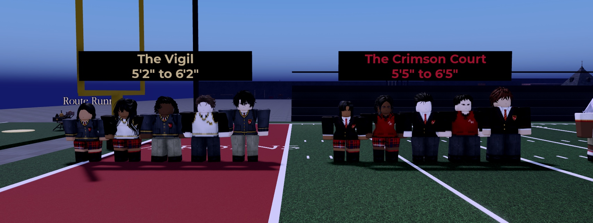
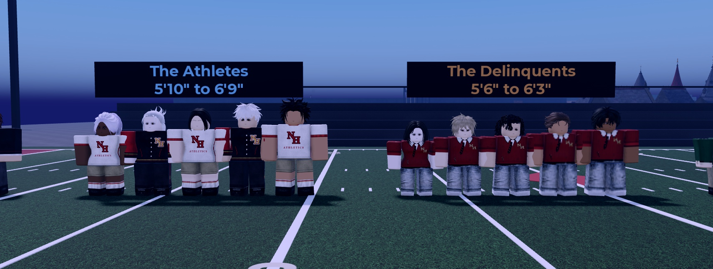
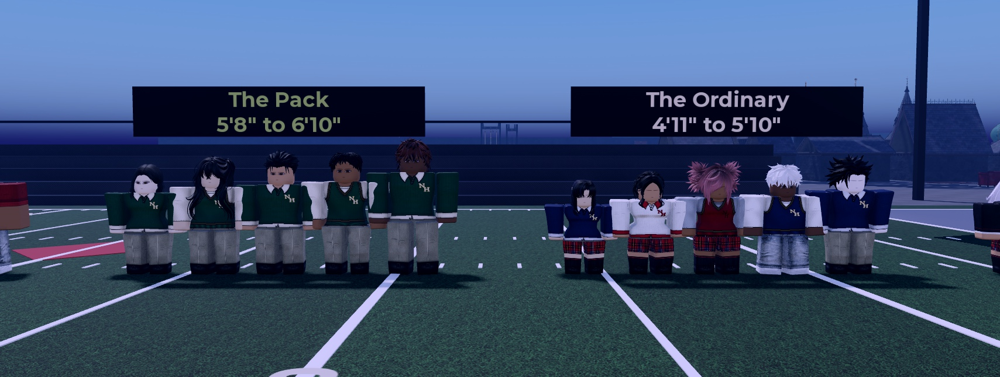
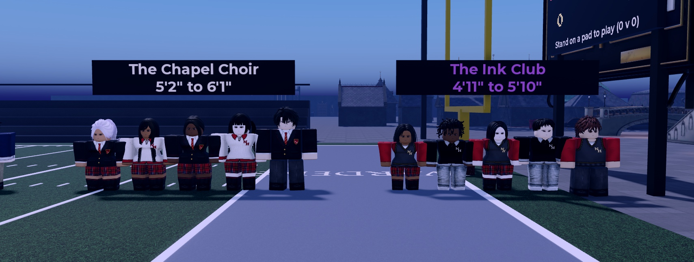
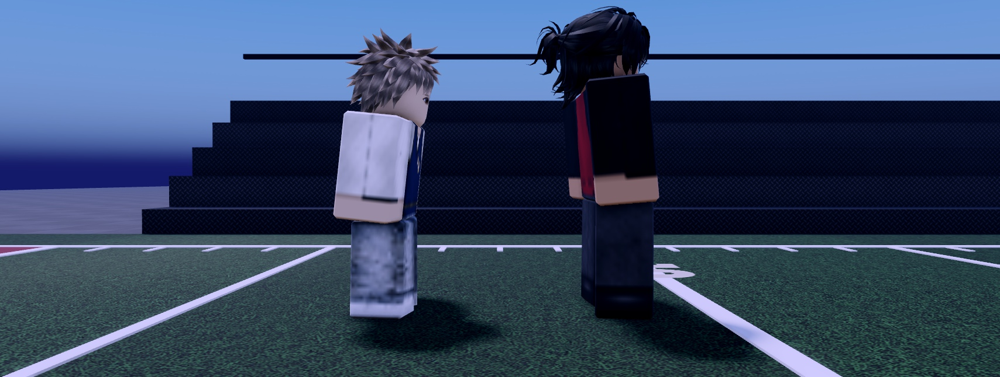

# NPC builds: heights, bodies and posture by clique and personality (2.3.0)

Owner: "I want the NPC's to have random heights, etc. based on their respective cliques and personalities."

Every student NPC now gets a **build** rolled from its clique and its personality:
- a height;
- a body type;
- a bravery and a sociability;
- a posture;
- a walking pace and an idle tempo.

The roll is **seeded by the student's own key**, so the same student is the same every time they spawn. The module is
`ReplicatedStorage.Config.NpcBuilds`, identical in both places. Source: `tools/npc-builds-230/`.

Each group is the shortest, the 25th, 50th and 75th percentile, and the tallest of 80 rolls for that clique (boys and
girls alternating). The sign gives the shortest and the tallest.

## The cliques

| Clique | Heights (80 rolls) | Bodies (weights) | Posture | Pace | Personality |
|---|---|---|---|---|---|
| Athletes | 5'10" to 6'9" | Athletic/Toned 5, Muscular/Strong 4, Average 1 | chest out (-1) | 1.08 | brave, social |
| Pack | 5'8" to 6'10" | Lean/Petite 5, Athletic/Toned 4, Average 1 | slight prowl (+1) | 1.04 | the bravest |
| Crimson Court | 5'5" to 6'5" | Average 5, Lean/Petite 3, Athletic/Toned 2 | upright, chin up (-3) | 0.94, unhurried | brave, the most social |
| Delinquents | 5'6" to 6'3" | Average 4, Stocky/Curvy 3, Athletic/Toned 2, Heavy/Plus 1 | slouch (+2) | 0.96, a swagger | brave |
| Vigil | 5'2" to 6'2" | Average 6, Lean/Petite 3, Stocky/Curvy 1 | stooped (+2) | 1.00 | mixed, shy |
| Chapel Choir | 5'2" to 6'1" | Average 6, Lean/Petite 2, Stocky/Curvy 2 | upright (-1) | 0.98 | mixed |
| Ordinary | 4'11" to 5'10" | Average 5, Lean/Petite 4, Stocky/Curvy 1 | (+1) | 1.00 | mostly timid |
| Ink Club | 4'11" to 5'10" | Lean/Petite 6, Average 4 | hunched (+2) | 0.97 | mixed, shy |

**Heights:**
- Heights are scales on a normal R6 (`Config.Heights`: 1.00 = 5'9"), drawn from the clique's range. Most land near the
  middle (the average of two rolls).
- Girls are 0.03 shorter (about 2 inches).
- Every height stays inside the Human range, 4'11" to 7'0" (0.86 to 1.22). 1.22 is the classroom doorway's ceiling.

**Body types** are the ten trained bodies (`UI.Appearance.Bodies`, see [Body-Types](Body-Types.md)), in the student's own
gender (`Appearance.BodyFor`).

## Personality

**Bravery and sociability** (0 to 1) are rolled inside the clique's range. They feed the brain as they always did:
- Brave or Timid lines at 0.5;
- the Senses' bravery;
- the view range.

Before 2.3.0 both were `math.random` on every server. On top of the clique:
- **Timid** (bravery 0.1): hunches about 5 degrees more, walks 10% slower, and is a touch shorter (-0.016).
- **Brave** (bravery 0.9): stands about 5 degrees taller, walks 10% faster, and is a touch taller.
- **Sociability:** sets the idle clip's tempo, lively (1.15x) or subdued (0.85x).

## Posture

**What it is:**
- The upper body (torso, head and arms together) leans forward or back from the hips, between -5 and +7 degrees.
- It's put on the joints' **C1** (RootJoint and both hips). The legs are turned back by the same amount, so the legs, the
  hips and the feet don't move (measured: 0.0000 studs).
- The clips, NpcLook's head turns (`Neck.C0`) and ContactFeel's bump lean (`RootJoint.C0`) all still play on top.
- Students sit, lean on walls and eat **straight**: `Schedules`' `Local.Pose` takes the posture off for any pose and puts
  it back when they stand.

**Why the head doesn't tilt on its own** (measured in Blender with all 35 barber hairs, worn as in game):
- **Head tilted on the torso:** pushes the long hairs into the back or the chest. 2 degrees already adds 0.02 studs
  (the clip tolerance is 0.003), and 6 degrees adds 0.09 (`Females_Gojo_PonyV2`).
- **Whole upper body leaning:** keeps every hair clear of the legs at any angle from -12 to +12 degrees.
- **The torso's bottom edge** moves at most 0.06 studs at 7 degrees (0.5 x sin 7), less than the walk clip moves the
  hips. The meshed bodies' hips already cover the leg tops.
- Scripts: `tools/npc-builds-230/neck_pitch_check.py` and `hip_pitch_check.py`.

## Walking

- **Speed:** each student's stroll (`S.Speed`) is 6.0 x pace x height^0.35, between 4.8 and 7.2. The cap matters:
  7.2 x the brain's 1.35 hurry stays under 10, where the run clip starts.
- **Stride:** the walk and run clips are slowed for longer legs (`S.Stride` = leg length / 1.8, the legs the clip was
  measured on), so the feet don't slide.
- **`S.Up`** (the root's height over the feet, used by Nav, standing up from a seat and the nudges) is measured after the
  body is scaled. Before 2.3.0 it was measured on the unscaled rig, 0.3 to 0.75 studs short.

## Who gets a build

| Who | Key | Clique | What they get |
|---|---|---|---|
| NH Combat Test's 14 class students (`Features.Schedules`, `NHSchedule`) | `Schedule\|<index>` | `Config.Cliques.Students` | everything |
| NH Combat Test's ambient students (`Features.AmbientNpcs`, `NHAmbient`) | `Ambient\|<name>\|<x>,<z>` | `Config.Cliques.Npcs`, else Ordinary | height, body, personality (no posture: they're doing reps, sitting or napping) |
| The Map's students (`Features.MapStudents`, `NHStudents`) | `Schedule\|<index>` | `Config.Cliques.Students` | everything |

- **Matching students:** the same index gets the same clique and build in both places.
- **Gender and clothes:** these are still rolled once per server, so a student's gender, and with it their body's
  variant and the 0.03 height offset, can differ between servers. Their clique range, build path, posture and pace
  don't.
- **The Map's students had no height at all before 2.3.0:** `NHStudents` wasn't in `UI.Appearance`'s `NPC_HEIGHT`.
- **Named NPCs** (leaders, staff, enemies) keep their size.

Model attributes:
- `NHBuild`: e.g. `Athletes | 6'7" Conditioned 1 | brave 0.76 social 0.92 | torso -4.2 | speed 7.15`.
- `NHHeightWant`, read by UI.Appearance.
- `NHPosture` and `NHPostureOn`.
- `NHPreC1` on the three joints while the posture is on.

## Code

| What | Where |
|---|---|
| Ranges, the roll, the posture | `ReplicatedStorage.Config.NpcBuilds` (`Roll`, `BodyFor`, `Describe`, `SetPosture`, `ClearPosture`) |
| The height | `UI.Appearance`'s NPC height block reads `NHHeightWant`; a new wrapper takes the posture off while a look is rebuilt |
| Class students | `Features.Schedules` (`OnStart`, `Local.Spawn`, `Local.Pose`) |
| Ambient students | `Features.AmbientNpcs` (`Local.Spawn`) |
| The Map's students | `Features.MapStudents` (`OnStart`, `spawn`, `pose`) |

The exact edits: `tools/npc-builds-230/patches.md`. Backups:
- NH Combat Test: `ServerStorage.NH_Backup.NpcBuilds_pre220`.
- The Map: `ServerStorage.NHCore.Backups.Appearance_pre230` and `MapStudents_pre230`.

## Play-tested

### NH Combat Test, slot 4 "Testy" (entered through the real `NHSlots` remotes)

- **The lineup:** 40 students, 5 per clique, through the real `ApplyTo` path, shown in the pictures above. Every body
  type showed its meshes, clothes, hair and painted face.
- **The live crowd:** all 14 class students spawned with their builds (`SchedulePlan` BeforeSchool) and walked from the
  gate into the hallway.
- **Class:** the six class students walked through the doors into R102 and sat, straight. Their hips were 0.05 to 0.06
  studs over the cushion (the height doc measured 0.06 to 0.07 in 1.70.0).
- **Lunch:** all 14 walked there with their posture and stood straight to eat.
- **Nudges:** Testy walked straight at a walking Vigil student. It reacted (`MakeWay`, then `Space`) and played
  `Nudge_Left` and `Nudge_Right`, with its posture on.
- **Console:** only the place's existing asset messages.

### The Map

- All 6 students got their clique's build: heights 5'2" to 6'7", Conditioned and Skinny bodies, and their posture.
- They walked between the yard and the halls (Break, then Passing).
- **Console:** only the Map's existing messages.

### Jumping in a crowd: not new

Students hop over each other about once every 8 seconds in a morning crowd. That's Nav's "stuck: jump" step, and it
happened before 2.3.0 too. Measured over 75 s of Before School with 14 students:

| Code | Jumps |
|---|---|
| 2.3.0 | 100 |
| 2.3.0 with the old `S.Up` | 99, 119 |
| Before 2.3.0 | 115 |

On the Map, over 45 s of passing time with 6 students: 27 jumps with 2.3.0, 35 before.

### Not tried

- A second player watching.
- Ambient students' reps and seats at their new heights. Their heights were already rolled before 2.3.0, and only
  their body types and the range are new.
- A full in-game day.
- The Map's lineup picture: its camera script takes the camera back.
