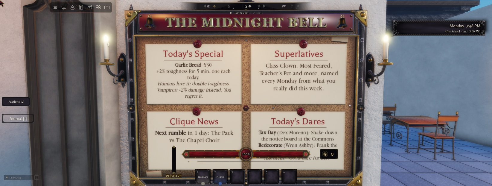
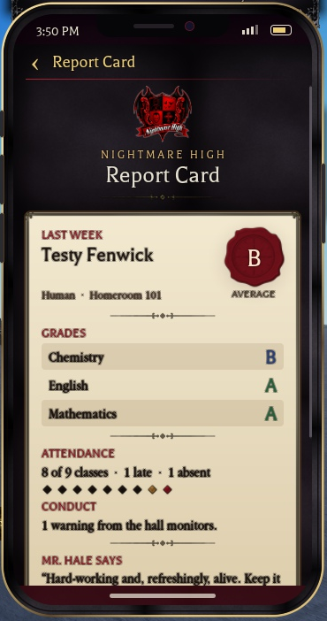
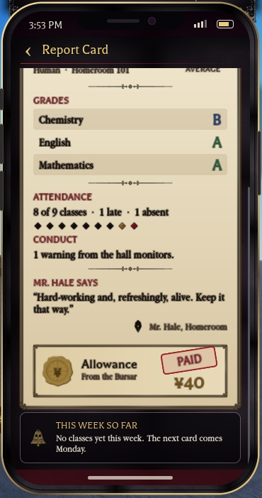
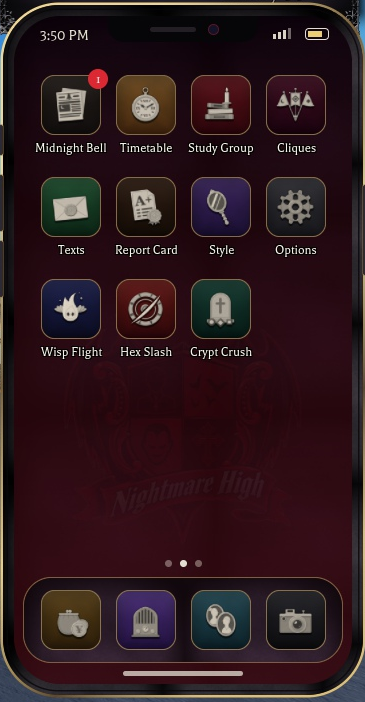

# The phone

Added in 1.12.0. Server: `Services.Features.Phone`. Client: `Controllers.Gui.Phone`. Model: `ServerStorage.NHPhoneModel` (the owner's model; the original is in `NH_Backup.Keys_pre.Phone_original`).

## The handset
- **Spawning:** every character spawns with a **Phone** Tool, attribute `NHPhone`. Its model is welded to an invisible handle, and the screen shows the crest.
- **Equipping (hotbar, or Y):** opens the UI. Unequipping closes it. Closing from inside the phone (Camera, Timetable...) also puts it away.
- **The pose:** the game's animations don't raise the arm for tools, so on equip the server sets the right shoulder's `C0` to `Base * Angles(0, 45°, 105°)`, which replicates to everyone. Unequipping restores it.
- **Steady while moving (1.13.2):** `Controllers.Character.PhoneHold` (client) clears the right shoulder's `Transform` every frame (`PreSimulation`, after the animations), for every character holding the phone within 150 studs. Without it, the walk and run arm swing moved the phone away from the face. The left arm keeps swinging.
- **The grip:** solved in Play against the R6 `RightGrip` weld. It stands the phone upright with the screen toward the face.

## The screen
A modern smartphone layout (the owner's reference) in the school's style:
- **Body:** rounded iron with a polished-gold gradient edge, side buttons, and the kit's `PanelBg` slate grain.
- **Notch:** a speaker slot and a lens.
- **Status bar:** the school clock, signal and battery.
- **Wallpaper:** a preset gradient, or your own image through `rbxthumb`, with the crest faint behind it.
- **App grid:** 4 wide. Each icon is a rounded enamel tile in its own colour, with the kit glyph pressed into a `SlotBg` well and a gold hairline. Labels are 13 pt Fantasy with a full outline and a shadow, and long names shrink to fit their tile.
- **Bottom:** page dots, a frosted dock, and red badges.

## Apps
| App | Where | What it does |
|---|---|---|
| Wallet | dock | send Yen (1 to 5,000, 5 s apart, confirm step); history (last 15) |
| Night FM | dock | your own music by audio ID (only you hear it); recent IDs (last 10) |
| Classmates | dock | everyone in the building; send Yen, invite to your study group, invite to your dorm room (`docs/Homes.md`) |
| Camera | dock | the cinematic view |
| The Midnight Bell | grid | the live school paper |
| Timetable | grid | opens the timetable |
| Study Group | grid | opens the study group drawer |
| Cliques | grid | all eight cliques and your standing with each; the Vigil and the Court also show your faction rank and open the factions panel (1.21.0, replaces the Factions icon; see Cliques.md) |
| Style | grid | wallpapers: 8 presets or an image ID |
| Options | grid | opens Options |

Per the owner, there's no Report Card, Locker or Journal in the phone.

## Games (1.18)
Three of our own takes on classic phone-game genres, drawn only with the UI kit's art (Glow, Pip, Seal, the kit icons, Frames and gradients). Each has its own grid icon. Every game opens on a title card with a how-to line, **your best**, and **Best in the building** (the top 5 in this server). The game-over card shows your score, "New best!" if it is one, Play again and Back.

| Game | Genre | How it plays |
|---|---|---|
| **Wisp Flight** | flappy | Tap to lift a candle wisp through gaps in wrought-iron spires under the moon; touching iron, the ground or the sky ends it ("The flame gutters"). One point per spire pair; gaps tighten and speed rises slowly. |
| **Hex Slash** | slicing | Drag fast across the stage to slash cursed relics tossed up from below: candles, blood drops, wax seals, quills, bells. Each one splits into halves. 3 or more in one swipe is a combo. A missed relic costs a candle (3 lives). Slash the pale **holy cross** and the run ends. |
| **Crypt Crush** | match-3 | Swap neighbouring runes on an 8 × 8 slab (six runes, each with its own colour and shape) to line up 3 or more. Only swaps that make a match are allowed. Matching 4 makes a **sigil** that clears its row and column; matching 5 makes a **seal** that clears one colour when swapped. Cascades multiply. 30 moves a run, and a board with no moves reshuffles. |

- **Input:** taps and drags on the game only. The stage's input pad is a UI button, so the clicks never reach combat or movement.
- **Stopping:** going Back or putting the phone away stops the game.
- **Reduce Motion:** fewer particles and no flash.
- **Files:**
  - Client: `Controllers.Gui.PhoneGames` (the shell), with `PhoneGames.Wisp`, `PhoneGames.Hex`, `PhoneGames.Crypt` and `PhoneGames.CryptBoard` (the match-3 rules as pure functions, self-tested 39/39).
  - Server: `Services.Features.PhoneGames`.
- **Saved:** `PlayerData.Arcade = { Best = { Wisp, Hex, Crypt } }`, through the UpdateState action `SetArcade`, cleaned on every read. Each slot keeps its own bests.
- **Remotes:** `ReplicatedStorage.NHArcade` has three calls:
  - `Get` returns `{ Best, Board }`. Board rows are `{ Name, Score, Me }`. Names follow the stranger rule (a student you don't know shows as "a stranger"), and you show as "You".
  - `Begin(game)` stamps the start of a run on the server clock.
  - `Submit(game, score, seconds)` saves a new best.
- **Anti-cheat on Submit:**
  - The score must be at most Grace + Rate × the run's length.
  - The run's length is the shorter of what the client says and the server's own time since `Begin` plus 2 s.
  - One submit per 2 s per player.
  - The caps:

    | Game | Cap | Rate (points per second) | Grace |
    |---|---|---|---|
    | Wisp Flight | 5,000 | 1.2 | 3 |
    | Hex Slash | 99,999 | 16 | 20 |
    | Crypt Crush | 300,000 | 4,000 | 2,000 |

- **Tested (Studio Play, slot II, evening):** all three open from the grid, start, play and end.
  - Wisp Flight showed its moon, spires and fence, and the game-over card.
  - Hex Slash slashed 3 relics with the crimson trail and split halves, and its 3 lives ran out.
  - Crypt Crush made a 3-match (30 points), moves dropped to 29, and the board refilled.
  - The best saved (Hex 3) and showed on the board as "You".
  - The pad's pointer coordinates match the stage (no inset offset).
  - No console errors.
  - Not tested: two players on one board, Reduce Motion, sigils and seals in live play (covered by the logic self-test), and the anti-cheat caps against a forged submit.

## Data and remotes
- **Saved:** `PlayerData.Phone = { History, Recent, Wallpaper = { Preset, Image? } }`, written with `SetPhone` and checked by `Phone.Sanitize`.
- **Remotes:** `ReplicatedStorage.NHPhone` has Get, Send, Gazette, Contacts, SaveRecent and SaveWallpaper (RF), plus Changed (RE).

## Names
- Wallet, Classmates and the paper show a student's name only if you know it (`Strangers.Knows`); otherwise "a stranger".

## The Midnight Bell's superlatives and the notice board (1.39)

**Superlatives** (`Social.Superlatives`). A school week is five event days. Each save slot counts pranks, scuffle and rumble wins, takedowns, detentions earned, classes with a B or better, and dares, member jobs and showdowns (`Social.Weekly`). Counts go every minute to an OrderedDataStore per award per week (`NHSup_<Id>`, scope = week; "[Test] " in Studio), so every server shares one leaderboard. The top student with at least 3 wins: Class Clown, Most Likely to Start a Riot, Most Feared, Most Likely to Be Expelled, Teacher's Pet, Most Likely to Run the School. Winners wear the title through the next week (`Social.TempTitles`) and are named by first name. Monday's paper prints last week's winners right after the front page; other days show the leaders so far.

**The notice board** (`Features.NoticeBoard`, props batch 22 `MidnightBellBoard`). Any model tagged `NHNoticeBoard` gets live text on its card faces (`NHBoardCard` 1..4): today's special, the superlatives, clique news (rumbles, turf), and two of today's dares, refreshed every 30 s. Its "Read" prompt opens your phone at the Midnight Bell. It hangs on the R102 wall of the Main Hall.

## Report cards and the app icons (1.40)

**Report cards** (`School.ReportCards`). Each save slot tallies its school week (the superlatives' week): each subject's lesson grades, attendance and conduct (`Social.Reports.Week`). On Monday at 6 AM, or at the next login, the finished week becomes a card (`Social.Reports.Cards`, last 4): each subject's average letter (F..A+), attendance, conduct, Mr. Hale's comment (by tier, with a race joke one week in three), and an allowance paid once: A/A+ 60, B 40, C 20, D/F 0, +20 for perfect attendance, halved after a detention. The Office texts that it's in. Then **Mom & Dad** text about it, and can add +¥20 on an A or cut the allowance off (`docs/Homes.md`).

**The Report Card app**: the crest masthead, the card on parchment in a gilt frame with the average stamped on a crimson wax seal, the grades on striped rows, attendance pips, conduct, Mr. Hale's signed comment, the allowance as a bursar's voucher with a PAID stamp, earlier weeks, and this week so far. The tile has a badge until the newest card is read.

| Top | Bottom |
|---|---|
|  |  |

**App icons.** Every app has its own icon in one family (greyscale PBR relief, tinted warm bone, with a soft shadow): `Theme.Images.IconReport` and `IconAppGazette`, `IconAppTimetable`, `IconAppGroup`, `IconAppCliques`, `IconAppTexts`, `IconAppStyle`, `IconAppOptions`, `IconAppWisp`, `IconAppHex`, `IconAppCrypt`, `IconAppWallet`, `IconAppRadio`, `IconAppContacts`, `IconAppCamera`. Made with `art/ui/hud/make_report_icon.py` and `make_app_icons.py`.

