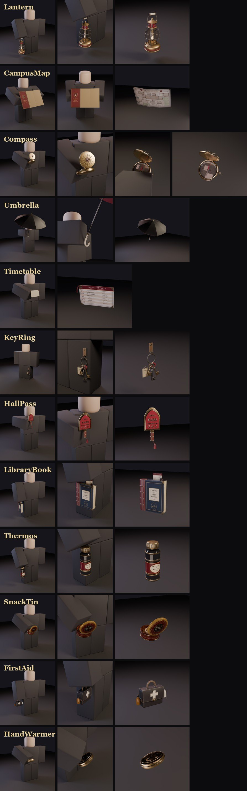
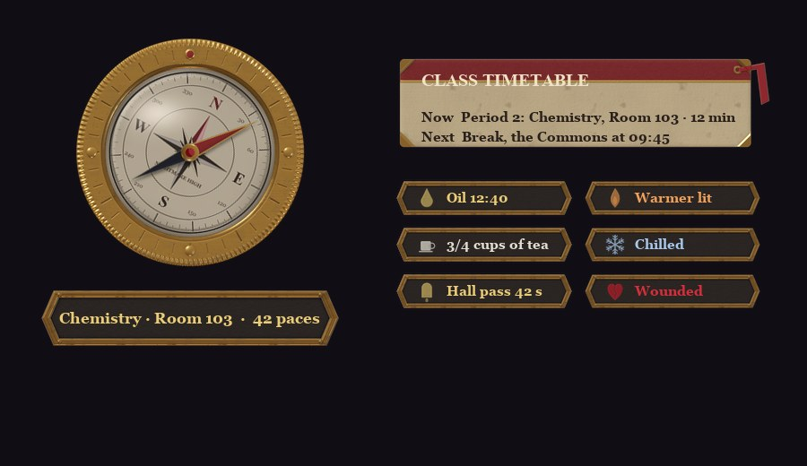
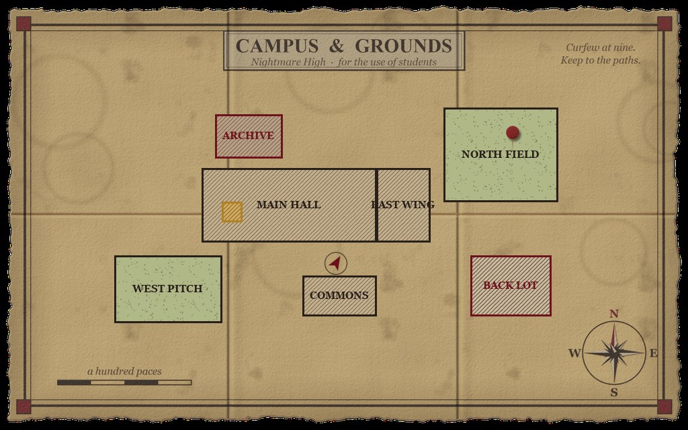
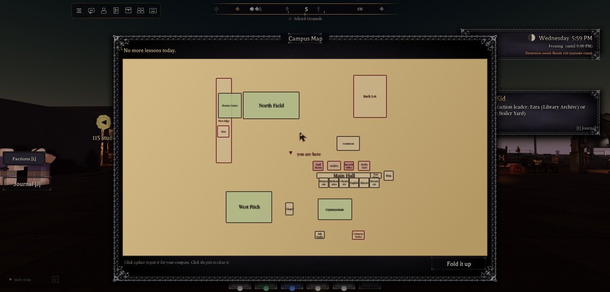
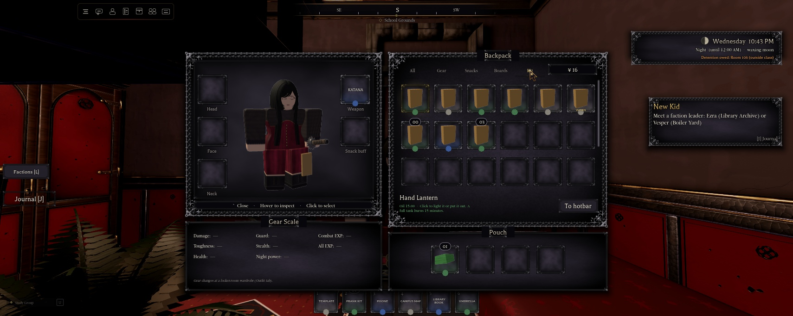

# The everyday-carry kit (QOL items)

Twelve things a student keeps in a coat pocket, each modelled in 3D, held in the R6 hand and doing one small useful
thing. Owner approved the design and every effect as proposed (2026-11-11), including the four new systems: Night Chill,
Wounded, Rain nights and lost keys. Design: `docs/superpowers/specs/2026-11-11-qol-items-design.md`.

## The items

| Item | Get it | Price | What it does |
|---|---|---|---|
| Hand lantern | MORROW & VANE | ¥150, oil ¥15 | Click to light it or put it out. Gives a PointLight on the flame: range 22, brightness 1.6, (255, 170, 90), with shadows; it flickers on clients. The tank burns 15 real minutes, and only while lit and held. Putting it away puts it out. |
| Campus map | starter kit | | Click to open the paper map. It's drawn from `workspace.Regions` (both places): every place by kind, your next class ringed in gold, a live you-are-here mark. Click a place to pin a waypoint for the compass; click the pin to clear it. |
| Pocket compass | MORROW & VANE | ¥120 | While held, a brass dial shows. The card turns to north, the needle (on the dial and on the 3D model) to the target, with its name and distance. The target is the first of: your pin, your tracked quest, your next class (school day), your dorm (evening and night), north. |
| Umbrella | MORROW & VANE | ¥180 | While open, it keeps you dry in the rain and caps your fall speed at 28 studs/s. It won't open while you're combat-tagged, and getting tagged shuts it. |
| Timetable card | starter kit | | While held, a card shows Now and Next. Click it to open the full Timetable. |
| Dorm keys | starter kit | new set ¥50 | Worn on the left trouser pocket. Your own room needs them: without them, the door rattles. When another student downs you, there's a 10% chance they drop: glinting keys anyone can pick up and return (¥10 from the Office). The Office cuts a new set at any time, and the old set stops working. |
| Hall pass | the Office | ¥40, one a day | 3 punches, one a class period. Showing it means the hall monitor lets you be for 60 real seconds. If it was already chasing you, it stops ("Carry on."), but only within 3 s of the chase starting. It does not count as attendance. |
| Library book | the Archive desk | card free, books free | One loan at a time, one book per subject plus a general history. While pinned: +3% class EXP and +10% on that subject's lessons. Due in 3 school days. A late return costs ¥10 a day, up to ¥30, and no new loans while a fine is owed. |
| Thermos | THE WICK & KETTLE | ¥100, refill ¥20 | 4 cups. A sip takes 1.2 s: −30 posture (half if tagged) and +35 stamina in a sports match. 20 s cooldown. Tea clears the Chill; coffee gives +2% class EXP for 3 min (the one-buff rule). |
| Snack tin | THE WICK & KETTLE | ¥80, refill ¥30 | 6 biscuits: +15 health over 4 s each. Out of combat only, and it shares the food "full" cooldown. |
| First-aid pouch | MORROW & VANE | ¥90, 3 bandages ¥25 | Bandaging takes 2.5 s at half walk speed, and taking a hit cancels it without using the bandage. Gives +25 health over 5 s and clears Wounded for 2 min. |
| Hand warmer | MORROW & VANE | ¥110, charcoal ¥10 | Light it from the hotbar or the Locker. It works from the pocket. A stick burns 50 real minutes (one game night). While it's lit, the Chill can't touch you. |

## The new systems

- **Night Chill.** Outdoors from 21:00 to 06:00, after 60 s outside, you're Chilled.
  - **Counts as outdoors:** the Grounds, Sports and Turf regions, the Boiler Yard and the Ring, or no region at all, unless there's a solid roof overhead.
  - **While chilled:** frost breath, frost at the screen edges, posture recovers 25% slower, and out-of-combat regen pauses.
  - **It fades** 15 s after you go indoors, drink tea or light a warmer.
  - **Races:** Wraiths and Vampires are immune; Werewolves chill half as fast.
- **Wounded.** Below 25% health: ink-dark screen edges, a heartbeat, and −10% walk speed out of combat (never below the combat-speed floor). A bandage clears it for 2 min.
- **Rain nights.**
  - **When:** at 20:00 each game day, a 1 in 4 chance of rain lasting 2-4 game hours (workspace `NHRain`, `NHRainEnd`).
  - **What you see and hear:** rain around your camera, but not under a roof or in your room; the rain loop; a darker grade.
  - **Soaked:** after 8 s in the rain without an open umbrella or a roof you're Soaked, which chills you at once at night.
- **Lost keys.** See the dorm keys row above.

## Holding

- **The pose:** equipping an item poses the arm through the shoulder Motor6D C0 at once, like the phone. `Config.KitHolds` R / L gives the pitch and yaw. `World.KitFx` holds that shoulder still against the walk animations on every client.
- **Body types and height:** every item is fitted per body type (`Config.KitHolds` Fit, measured on all 12 bodies) and scaled with the character's height. The keys scale to the leg.
- **Use clips:** 12 KeyframeSequences are in `ServerStorage.NHKitAnims`. Once the owner publishes them and fills `Config.Kit.Anims`, a use plays its clip, and the hold steadier stands aside while it plays.

## The HUD and its art

- **The art:** baked by `art/ui/hud/make_kit_ui.py`, the same PBR pipeline and icon family as the health bar, posture rail and phone apps. It includes:
  - the compass (bezel, a card that turns, the needle, the crystal)
  - a 9-slice brass plate for labels and chips
  - the timetable card
  - the map sheet with hatch and stipple tiles, the you-are-here mark and a brass pin
  - ten chip icons
  - frost and ink screen edges
- **Upload:** `art/group-upload/kit-ui/` (23 images, named `Kit<Piece>.png`). Until their ids are in `Config.Kit.Art`, the HUD draws plain stand-ins.
- **Layout:** the compass sits right of the health bar, with its label above it. The card and chips sit above the health bar.

## Models

- **Builder:** `art/characters/qol/nh_qol.py` (Blender, headless). It reuses the accessory kit's materials, bake and R6 mannequin (`accessories/nh_acc.py`, imported, never edited).
  - The printed art comes from `qol_prints.py`.
  - Contact sheets come from `qol_sheet.py`.
  - The holds and fits table comes from `qol_holds.py`.
  - The per-body clearance check is `qol_bodies.py`.
- **Bakes:** 2048 PBR, 64 samples on the GPU, through the shared bake slots. Upload copies at 1024 are in `art/group-upload/qol-kit/` (47 maps; CampusMap's all-black metal map is left out).
- **Meshes:** `art/characters/qol/fbx/NHQol_<Item>.fbx`, in item space (the origin is the grip point; the keys are in character space), exported at 0.01. Separate pieces:
  - Glass: `Lantern_Glass`, `Compass_Glass`
  - Glow: `Lantern_Glow` (255, 158, 66), `HandWarmer_Glow` (255, 92, 26)
  - moving parts: `Compass_Needle`, `SnackTin_Lid`

  Every piece is far under the 20.48-stud cap.
- **Clearance:** every item was checked in its hold pose on all 12 body types after that body's fit: 0 fails in 144 checks. That means no crossing triangles, nothing more than 0.003 inside, and the held point touching the hand. The keys clear the leg on every body.

| Item | Tris | Pieces |
|---|---|---|
| Lantern | 13,416 | Main, Glass, Glow |
| CampusMap | 1,176 | Main |
| Compass | 6,552 | Main, Needle, Glass |
| Umbrella | 12,384 | Main |
| Timetable | 932 | Main |
| KeyRing | 6,120 | Main |
| HallPass | 10,792 | Main |
| LibraryBook | 2,580 | Main |
| Thermos | 5,056 | Main |
| SnackTin | 7,512 | Main, Lid |
| FirstAid | 3,592 | Main |
| HandWarmer | 5,232 | Main, Glow |

## Code (NH Combat Test)

| What | Where |
|---|---|
| Items, prices, counters, numbers, the save format, art and clip ids | `ReplicatedStorage.Config.Kit` |
| Hold poses, grips, piece layout, per-body fits (generated) | `ReplicatedStorage.Config.KitHolds` |
| Everything that changes the game | `ServerScriptService.Services.Features.Kit`: remotes `ReplicatedStorage.NHKit` (Get, Act, Changed) |
| Counters, map, compass, card, chips, the Locker tab's card | `Controllers.Gui.KitUi` |
| Hold steadier, fall cap, frost and ink, breath, rain, flicker, jingle | `Controllers.World.KitFx` |
| The save (`PlayerData.Inventory.Kit`); the flask coffee buff | `Config.Items` (Sanitize, KitBuffs) |
| SetKit, GiveBuff, KitEat | `Features.Inventory` |
| The book's EXP; the Chill pauses regen | `Player.Progression` |
| The Chill slows guard recovery | `Features.Posture` |
| Wounded and bandaging walk speed | `Features.CombatSpeed` |
| The pass (`NHPassUntil`, `MonitorChaseAt`, "Carry on.") | `School.HallMonitor` |
| Your room needs your keys | `Features.Homes` |
| The thermos' stamina (`NHStaminaBoost`) | `Sports.Basketball`, `Sports.Soccer`, `Sports.Football` |
| The Kit tab | `Controllers.Gui.Locker` |
| Studio test hook (runs inside the game's module) | `ServerStorage.NHKitTest:Invoke(cmd, playerName, ...)` |
| Stand-in counters (Combat Test only, when nothing is tagged) | `workspace.NHKitCountersStandIn` |

Each patched line in an existing script is marked `(kit 1.79)`.

## Verified (Studio Play, NH Combat Test, slot 4 "Testy")

- **Starter kit:**
  - granted on first join (map, card, keys), with the map and card on the hotbar and the keys worn
  - saved across sessions
- **The Kit tab:** lists the kit with charges and "WORN", and Pin works. There's a 3-pin limit.
- **Counters:**
  - Purchases are refused out of range or at the wrong counter, and so are a second pass the same day, an item you already own, a full tank, and a refill without the item.
  - The clique / King discount is charged.
  - Bogus remote calls (unknown id, numbers, tables, unknown actions) are refused.
- **Map:**
  - It opens on click, drawn from the regions, with the you-are-here mark and the next-class line.
  - Clicking a place pins it, and the compass then points to the pin ("Your pin · 91 paces").
- **Lantern:**
  - It lights only when held, with the light on at range 22.
  - Oil drains (900 → 896 in 4 s).
  - Putting it away puts it out.
  - It still lights after the tool is re-dressed.
- **Thermos, snack tin, pass, warmer:**
  - Thermos: posture 60 → 30, 3 cups left, the stamina boost sent, a second sip refused for 20 s.
  - Biscuit: heals.
  - Pass: refused outside class.
  - Warmer: lit, using the stick.
- **Wounded and bandages:**
  - Wounded comes on below 25% health, at walk speed ×0.9.
  - A bandage gives +25 and clears Wounded.
- **Hall pass in class (Period 2):**
  - The monitor chased, the pass ended the chase at once, and there was no chase for its 60 s.
  - Attendance was not granted.
  - A second punch in the same period was refused.
- **Library:**
  - You need a card first, and loans are one at a time.
  - Pinned: +3% class EXP, +10% on Chemistry, 0 on History.
  - Two days late: the effect stops, and the fine is ¥20 owed (no Yen to pay), which blocks new loans.
- **Umbrella:**
  - From 90 studs: fastest fall 28.0 studs/s, landing after 2.7 s (0.89 s without it).
  - It shuts on a combat tag, and re-equipping is refused while tagged.
- **Night Chill and rain:**
  - Chill: chilled outdoors at 22:00, regen paused (health stayed at 70), cleared about 15 s under the chapel roof.
  - Rain: on, the loop loaded and played, the grade darker, soaked after 8.4 s outdoors.
- **Lost keys:**
  - Dropped, a glinting model spawned, and the keys left the hip.
  - Your own dorm door rattled and refused you.
  - Picking them up as the owner brought them back, and then the door let you into your room.
- **Holds and clearance:**
  - The posed map's handle matched the Blender layout to the 1/100 000 stud.
  - Per-body clearance: 0 fails in 144 checks.
- **Console:** no kit errors.
- **Test settings:** put back: `SlotCount = 3`, `NHTestNoMenuKeys` cleared.

## Not verified

- **Two players:** another student returning your keys, or handing them in at the Office or a box (¥10), needs a two-player test server.
- **The late pass:** "Too late, you're caught out" after the 3 s grace. Each test pass was still active when the next period began, and Testy then had no Yen for another one.
- **Real meshes and art:** nothing has been seen in game yet. The meshes, maps and HUD art wait for the owner's upload (below), and the stand-ins show until then. The compass position and the final HUD layout with the real art were not play-tested; only the stand-in layout was.
- **Use clips:** not published, so not seen playing.
- **The 3D needle:** it turns on the client, but that can't be seen on a stand-in model.
- **The Chill's guard effect:** that posture recovers 25% slower is in the code but wasn't measured.
- **Thermos stamina:** the +35 in a live match wasn't tried.
- **Rain and the umbrella:** the umbrella keeping you dry in the rain wasn't tried with the two together.
- **Testy's records:** spent ¥522 at the counters and has about ¥16 left. The kit's test state stays on that slot.
- **Phones and touch screens:** the HUD wasn't checked on them.

## For the owner

- **Meshes:**
  1. Import the 12 FBX from `art/characters/qol/fbx/` into NH Combat Test (File > Import 3D, so they land under the group).
  2. Upload `art/group-upload/qol-kit/` (47 maps) and `art/group-upload/kit-ui/` (23 HUD images) with Asset Manager > Bulk Import.
  3. I then read the ids by name, build `ReplicatedStorage.NHKit.Models` from the imports (centres from `Config.KitHolds`, SurfaceAppearances, Glass and Neon), and fill `Config.Kit.Art`.
- **Animations:** publish the 12 KeyframeSequences in `ServerStorage.NHKitAnims` and send the ids (or paste them into `Config.Kit.Anims`).
- **Save the place.**

## What the Map place needs

These are for the "Port hair, eyes and their UI to the Map place" session:

- **The scripts:**
  - new: `Config.Kit`, `Config.KitHolds`, `Features.Kit`, `Gui.KitUi`, `World.KitFx`
  - patched, from Combat Test: Items, Inventory, Progression, Posture, CombatSpeed, HallMonitor, Homes, Basketball, Soccer, Football, Locker. Each patch is marked `(kit 1.79)`.
- **Assets:** `ReplicatedStorage.NHKit.Models` (after the import), and `ServerStorage.NHKitAnims` if the clips play there.
- **Counters:** tag the four counters `NHKitShop` with attribute `Shop`:
  - MORROW & VANE's counter: `Sundries`
  - THE WICK & KETTLE's counter: `Cafe`
  - the Office in the Main Hall: `Office`
  - the Archive desk: `Archive`

  The stand-ins are Combat Test only.
- **Regions:** the boxes must cover the campus (the map is drawn from them). Indoor rooms should be indoor regions or have roofs.
- **Lost & Found:** boxes tagged `NHLostFoundBox` take handed-in keys.
