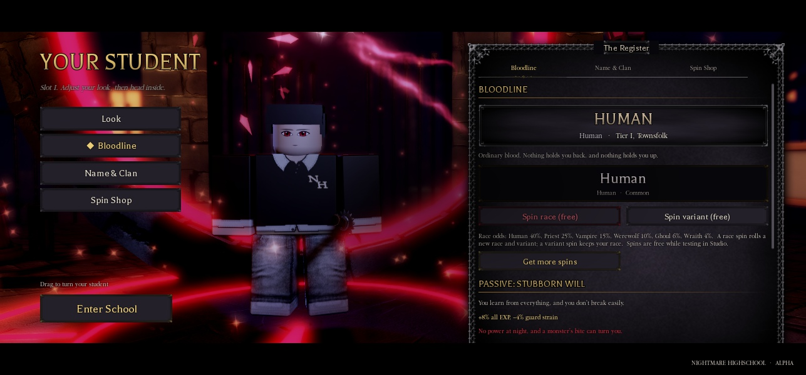
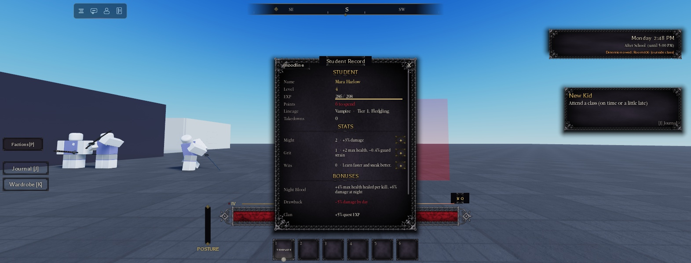
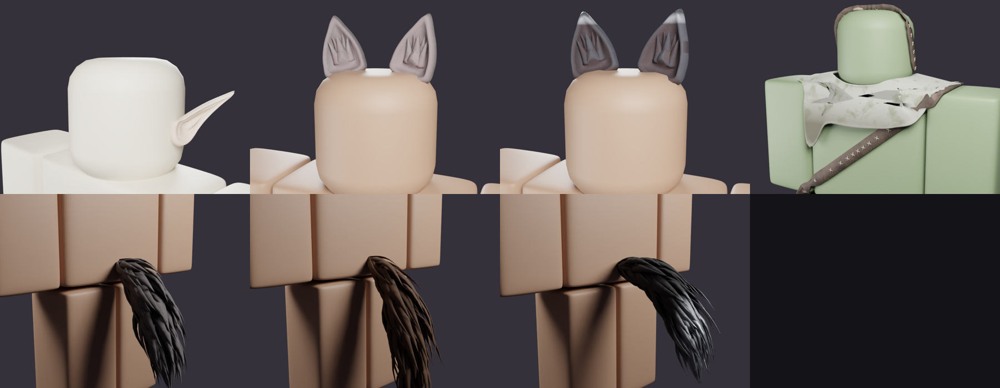

# Races and Bloodlines: NH Combat Test

**Status:** Phase 1 is built and playtested in Studio (one player). Numbers are a balance **proposal**; tune them in `ReplicatedStorage.Lineage`.
**Design:** [`superpowers/specs/2026-10-30-races-design.md`](superpowers/specs/2026-10-30-races-design.md). **Plan:** [`superpowers/plans/2026-10-30-races-phase1.md`](superpowers/plans/2026-10-30-races-phase1.md).

The concept doc gives three base races (Human, Priest, Vampire) with spin-only sub-races and three race tiers. The user's 2026-10-30 brief adds **Werewolf, Ghoul and Wraith**, asks for a gothic-castle feel, race looks and balanced passives, and wants Humans and Priests to be able to be **turned**.

Race is always **rolled by the server**; players never pick it.

## Roster

| Race | Roll | Family | Sub-races (rarity, weight) | Tiers I → II → III |
|---|---|---|---|---|
| Human | 40% | Mortal | Human (Common 90) · Superhuman (Rare 10) | Townsfolk → Hunter → Slayer |
| Priest | 25% | Mortal | Priest (Uncommon 85) · Grand Priest (Epic 12) · Pope (Legendary 3) | Acolyte → Exorcist → Saint |
| Vampire | 15% | Undead | Vampire (Uncommon 85) · Nobleblood (Epic 12) · Royal Vamp (Legendary 3) | Fledgling → Night Gentry → Elder |
| Werewolf | 10% | Cursed | Werewolf (Uncommon 85) · Bloodmoon (Epic 12) · Alpha (Legendary 3) | Cursed → Moonbound → Feral Lord |
| Ghoul | 6% | Undead | Ghoul (Rare 85) · Ghast (Epic 12) · Crypt Lord (Legendary 3) | Starveling → Grave-eater → Charnel Lord |
| Wraith | 4% | Undead | Wraith (Rare 85) · Revenant (Epic 12) · Hollow King (Legendary 3) | Whisper → Shroud → Dirge |

- **Monsters** are Vampire, Werewolf, Ghoul and Wraith.
- **Sub-race boost:** the second sub-race multiplies the passive's strengths by **1.15**, the third by **1.3**. Drawbacks are never boosted.
- **Tiers:** existing saves keep their kill-based tier for now. Earning tiers through hunger and rites is Phase 3.

## Passives (Tier I / II / III, before the sub-race boost)

| Race | Passive | Strengths | Drawback |
|---|---|---|---|
| Human | Stubborn Will | +8 / 10 / 12% all EXP · −4 / 6 / 8% guard strain · Slayer (III): +8% damage vs monsters | No night power; can be turned |
| Priest | Consecrated | +6 / 9 / 12% damage vs the undead · −6 / 9 / 12% damage taken from the undead · +5% class EXP | −5% damage at night |
| Vampire | Night Blood | +6 / 9 / 12% damage at night · heal 4 / 6 / 8% max health per kill | −5% damage by day |
| Werewolf | Moon-Blooded | +10 / 15 / 20 max health · +5 / 8 / 10% damage at night · +2.5 / 4 / 5% more on a full-moon night | +10% chance to be spotted |
| Ghoul | Grave Hunger | −5 / 8 / 10% damage taken · heal when badly hurt · heal 6 / 9 / 12% max health per execution | −10% class EXP |
| Wraith | Unseen | −10 / 15 / 20% chance to be spotted · −6 / 9 / 12% guard strain · +6 / 9 / 12% EXP at night | −10 max health |

- **Full moon:** every 4th in-game night. A night runs 20:00 to 06:00.
- **How they apply:**
  - `Services.Player.Progression` adds the race passive to stats, clan perk and traits.
  - Day and night damage goes into `NH_DamageDealt`.
  - The family bonuses go on the character as `NH_VsUndead`, `NH_VsMonster` and `NH_FromUndead`.
  - `Downed.ApplyDamage` multiplies by `Lineage.DamageScale(attacker, target)`, which reads the `Race` attribute from the player or an NPC model.
- **New effect keys** (all active, in `Config.Progression`): `AllExp`, `DamageVsUndead`, `DamageVsMonster`, `DamageTakenFromUndead`, `DamageByDay`, `HealOnKill`, `HealOnExecute`, `FullMoonPower`.
  - Low-health regeneration now reads as "heal N HP/s when badly hurt".

## Where you see it
- **Bloodline tab** (creator: Look / **Bloodline** / Name & Clan / Spin Shop; in school, from the Student Record's **Bloodline** button). It shows:
  - the race crest in the race's colour, the sub-race and the tier title
  - the race and variant spin reel with the six-race odds
  - the passive in gold and the drawback in crimson
  - what Tier II and III would give, and your traits with rerolls
- **No duplicate tabs:**
  - The Wardrobe's old Lineage tab is gone; it now has Look / Face / Hair / Outfit.
  - In the creator, the Register panel hides its own tab strip, because the menu's left-hand buttons pick the tab.
  - The docked panel fits between the menu's letterbox bars, and its contents scroll.
- **Student Record:** the Lineage row reads "Vampire · Tier I, Fledgling". The Bonuses list the passive and its drawback.
- **Skin palettes** (UI-kit session): a Vampire's skin is limited to 5 pale and 4 dark tones, and a Ghoul's to 6 ghoul tones, in both outfit modes. `Lineage.Palette(raceId)` is the data.

## Looks (Races 1.1)
Race-only cosmetics, chosen in the Bloodline tab's **Looks** section. Grander versions unlock at Tier II and III.

| Race | Slot | Tier I | Tier II | Tier III |
|---|---|---|---|---|
| Vampire | Ears | Pointed, Swept | Long Swept | Elder |
| Werewolf | Ears | Upright, Tufted | Torn | Moon-marked |
| Werewolf | Tail | Brush, Bushy, Bobbed | Shaggy | Moon-marked |
| Werewolf | Fur colour | Ash, Charcoal, Umber, Russet, Wheat, Snow | | |
| Ghoul | Grave wear | None (the ghoul uniform shows in school uniform) | Stitch straps | Grave shroud, or both |
| Wraith | Cold wisps | Pale | Grave green, Violet | |
| Wraith | Frost | None | | Frost-tipped fingers |

- **Art:** modelled in Blender on the R6 rig (`art/races/NH_RaceCosmetics.blend`), exported as FBX (`art/races/fbx/`), PBR textures in `art/races/textures/` (ids in `art/races/fbx/textures.json`). Imported once into `ServerStorage.NHRaceCosmetics` (see [Race-Cosmetics-Import.md](Race-Cosmetics-Import.md)).
- **Each MeshPart** carries `NH_Part` (Head or Torso), `NH_Offset` (from that part's centre, at standard R6 size), `NH_Tint` (skin, fur or none) and optionally `NH_Squeeze`.
- **Server:** `Services.Player.RaceCosmetics` builds the character's `NHRaceLooks` folder.
  - It scales each piece to the real body (torso height / 2).
  - It tints vampire ears to the head colour and werewolf pieces to the fur colour.
  - It adds the Wraith particles.
  - It rebuilds whenever `Race`, `RaceTier` or `RaceLooks` changes, and on respawn.
- **Saving:** `PlayerData.Lineage.Looks = { [slot] = optionId }`, set through `NHLineage.SetLook` (server-validated, rate-limited). `Lineage.ResolveLooks` falls back to a Tier I option when a saved look is above your tier. The resolved looks are mirrored as the player attribute `RaceLooks`.
- **Tail animation:** `Controllers.Character.TailSway` (client).
  - It writes each bone's `Transform` on Heartbeat, after the Animator's step, so the pose survives until the frame renders.
  - Tails more than 140 studs away stay still.

## Code
| Piece | Where |
|---|---|
| Races, families, tiers, passives, palettes, `Passives`, `PassiveEffects`, `TierName`, `IsFullMoon`, `DamageScale` | `ReplicatedStorage.Lineage` |
| Effect keys and labels | `ReplicatedStorage.Config.Progression` |
| Passives applied, heals on kill and execution, `Sheet.RaceInfo` | `ServerScriptService.Services.Player.Progression` |
| Race damage multiplier (one line) | `ServerScriptService.Services.Features.Downed` (`ApplyDamage`) |
| Bloodline tab content | `StarterPlayer…Controllers.Gui.Bloodline`, shown by `Controllers.Gui.Identity` |
| Test bridge | `SetRace(name, race, sub?, tier?)`, `RaceDamage(attacker, target, damage)` |

Saving is unchanged: `PlayerData.Lineage = { Race, SubRace, Tier, Traits, Spins }`, written only by the server.

## Verified (Studio playtest, one player)
- **Pure checks:** 87 of them (`tests/lineage_test.luau`): odds, boosts, tier scaling, families, full moon, palettes, `Sanitize`, damage scale and effect texts.
- **Damage multiplier** (with Might 2, so a base of 1.03):

  | Case | Multiplier |
  |---|---|
  | Vampire by day | 0.98 |
  | Vampire at night | 1.09 |
  | Alpha Werewolf on a normal night | 1.095 |
  | Alpha Werewolf on a full-moon night | 1.1275 |

- **Werewolf (Alpha):** max health 115 (100 + 2 Grit + 13), and 1.10 chance to be spotted.
- **Priest:** a 10-damage hit dealt **10.918 to a Vampire** dummy (×1.06) and 10.30 to a Werewolf one (not undead).
- **Heals:**
  - A real grip execution as a Ghoul healed **+6.12** (6% of 102).
  - As a Vampire, the kill healed **+4.08** (4%).
- **UI:**
  - The Bloodline tab rendered in the creator and in school, and a race spin animated the reel and re-rendered.
  - The Record shows the race rows.
  - The UI audit check found no small or faint text in the tab.
- **Bug found and fixed:** a leftover copy of the Progression module (from a timed-out check) made every Progression hook run twice. I removed it, and both heals and EXP then applied once.

## Not yet
- **Phase 3:** race hunger, rites, earned tiers, the **tier-up cutscene** (cinematic camera and choreography, per race and tier), and the bite that turns Humans and Priests.
- **Not playtested yet:** two players seeing each other's race effects, and Fated, Wraith and Werewolf effects in real fights.
