# School Props (Blender) and School Surfaces (PBR)

The greybox school is being dressed with modelled props and PBR surface materials, made to the [VFX Design Bible](VFX-Design-Bible.md)'s look: candlelit oak, wrought iron, slate, brass and deep crimson enamel.

## School surfaces
**Tool:** `tools/vfx/make_pbr_materials.py` (numpy).
- It writes seamless 1024² PBR sets (colour, OpenGL normal, roughness, metalness).
- Everything uses integer-period noise, so every map tiles.

**On the school** (MaterialVariants in `MaterialService.NHSchoolPBR`):

| Variant | Base material | Studs per tile | Used on |
|---|---|---|---|
| `NH_Linoleum` | CeramicTiles | 6 | classroom floors (two-tone checker, speckle, grime at the grout) |
| `NH_Boards` | WoodPlanks | 12 | floorboards |
| `NH_DeskWood` | Wood | 8 | wood props, furniture placeholders |
| `NH_PaintedMetal` | Metal | 6 | metal parts (chipped enamel with bare metal) |
| `NH_Slate` | Slate | 10 | slate parts |
| *(built-in Plaster)* | Plaster | - | walls |

**Prop-only sets:** `NH_Leather`, `NH_Brass`, `NH_Limestone`, `NH_Iron`, `NH_Paper`.

**Reversible:**
- Every changed part has the tag `NHPbr` and the attribute `NHPbrFrom = "<Material>|<Variant>"`.
- `Studio/pbr_revert.luau` (session tools) restores them.

## Props
**Tool:** `art/props/nh_props.py`. Run it headless in Blender 5.x:

```bash
"E:/Blender/blender.exe" --background --factory-startup --python art/props/nh_props.py -- <Prop|all> --size 1024 --samples 32
```

Batches 4 and 5 are baked at 2048 on the GPU (about 1–2 minutes a prop on the RX 6600 XT):

```bash
"E:/Blender/blender.exe" --background --factory-startup --python art/props/nh_props.py -- <Prop> --size 2048 --samples 64 --gpu
```

- `--gpu` bakes and renders with Cycles on the GPU (HIP here; CUDA or OptiX where present).
- A 2048 bake reads the same seamless sets made at 2048 from `art/props/source_2k/`, so small props aren't baked from upscaled 1024 sources. That folder isn't committed; make it with `python tools/vfx/make_pbr_materials.py art/props/source_2k 2048`.
- 2048 bakes also pack the UV islands at one texel density, by shape with rotation and an 8-pixel gap. Bake margins scale with the size (16 px at 2048). 1024 bakes are unchanged.
- Roblox takes maps up to 4096, so the 2048 maps are used as they are.
- The log line lists each piece's triangles (Roblox caps a mesh piece at 20k).
- Previews show `*_Glass` pieces as glass and `*_Glow` pieces lit, as they look in Roblox. `PREVIEW_PAD` moves the camera back for tall props, and `OPEN_DEG` sets how far a piece opens in the `_open` preview.

**How a prop is made:**
- **Modelling:** each prop is modelled in studs from bevelled parts and wrought-iron curves.
- **Weathering at bake time:**
  - edge wear: lighter wear on wood and leather, bare metal showing through paint and enamel
  - crevice dirt from ambient occlusion
  - rounded-edge normals
- **Bake:** one 1024 atlas per prop: colour × AO, normal, roughness, metalness.
- **Output:** `art/props/fbx/*.fbx`, `art/props/textures/*`, previews in `art/props/previews/`.
- **Asset ids:** in `art/props/props.json`.

**Rigged props** have several meshes, `<Prop>_<Piece>`:
- **Lockers:** `Body` and `Door0` (`Door1`).
- **Vending machine:** `Body`, `Wares`, `Flap`, `Glass`, `Glow`.
- **Altar:** `Altar`, `Reredos`, `Items`, `Glow`. It's split because Roblox caps a mesh at 20k triangles.
- **Bookshelf:** `Case`, plus each book as its own mesh.
- **Football machine:** `Main`, `WheelL`, `WheelR` (origin on the axle; they can spin about Blender Z), `Glass`.
- **Toilet stall:** `Body` and `Door0` (origin on the hinge).
- **Sink:** `Main`, `TapHot` and `TapCold` (origin on the spindle), `Water`.
- **Mirrors:** `Main` and `Mirror`.

Door, flap and tap origins sit on their hinge lines.

**Batch 2 setup** (`Studio/props_setup2.luau`, run after importing the batch-2 FBX files):
- Measures every template from its parts, so it doesn't depend on the dims above.
- Glass pieces become Glass material; Glow pieces become Neon with a PointLight (amber on the vending machine and candelabra, crimson on the altar).
- Tags the vending machine `NHVendingProp` and the bookcase `NHBookshelfProp`, and marks every book `Book = true`.
- Props with no placeholder (chairs, sofa, altar, candelabra, bookcases) get an invisible anchor part named `NHPropSpot_<key>`, which `props_revert.luau` also removes.
- The Staff Room furniture stays clear of the watcher's patrol loop (x 37–52, z 17–29).

**Batch 3 setup** (`Studio/props_setup3.luau`, run after importing the batch-3 FBX files from `art/props/fbx/`):
- Same template steps as batch 2 (scale, SurfaceAppearance, Glass and Neon pieces, bottom-centre pivot, Atomic streaming). The bench, clock, cabinet and alchemy table collide; the rest don't.
- The sconce's Glow gets a warm PointLight and the `NHCandle` tag; the alchemy table's Glow a soft green light.
- The pendulum gets `NHSwing` with its hinge at the top-centre of its own box (±5°, 2 s), animated by `Controllers.World.Ambient`.
- Placed copies are named `<Prop>_<key>` and tagged `NHPropBatch3`; `Studio/props_revert3.luau` removes them. Every placement reports anything solid it overlaps.
- **Hall layout:** the classroom walls face the hall at z 58.5 with 8-stud doors at the room centres (x 62, 92, 122, 152, 182, 212); the door headers carry the room signs, so nothing hangs on them.

**Batches 4 and 5 setup** (`Studio/props_setup4.luau`, run after importing the batch-4 and batch-5 FBX files from `art/props/fbx/`):
- Same template steps as batch 3. The floor props collide (vase, plant, umbrella stand, coat rack, football machine, bleachers, sink, stall); doors, taps, water and glow don't.
- `*_Mirror` pieces become a dark reflective finish (SmoothPlastic, reflectance 0.35; Glass read as a pale panel), and `*_Water` pieces hidden water.
- Glow pieces get the `NHCandle` tag and a warm PointLight (lamp, candles, a wider one on the chandelier).
- The football machine's wheels get `SpinHinge` / `SpinAxis` attributes. Nothing spins them yet, and the drill's placeholder machine in `workspace.Sports` is left alone.
- **Rigged on the locker system:** the stall and the sink are tagged `NHLockerProp`. Each has an invisible `NHPropSpot` part linked by a `Placeholder` ObjectValue, which carries the prompt. Model attributes set the prompt text and the auto-close time:
  - **Stall:** "Stall / Open". `Door0` swings **out** 95°, toward the front of the stall, and shuts after 8 s. The setup picks the swing sign from the geometry and its report checks the door opens outward.
  - **Sink:** "Sink / Turn on". The cross heads turn a quarter (hot one way, cold the other), the water shows, and it turns off after 6 s.
  - **Code:** `Services.Features.LockerProps` reads `PromptObject`, `PromptOpen`, `PromptClose` and `AutoClose` (defaults: Locker, Open, Close, 8 s) and skips models outside the workspace. `Controllers.World.LockerDoors` shows parts with a `ShowWhenOpen` transparency while open. Patch: `Studio/patch_lockers_rig.luau`.
- **Placement:** on the owner's call these go on the baseplate for the builder, not into the school. One copy of each sits in `workspace.NHPropsShowcase`, facing the spawn. Batch 4 is in the front row (z 58, from x −100); the table props sit on low slate plinths. Batch 5 is behind (z 70), with the chandelier hanging 6 studs up. Copies are tagged `NHPropBatch4` / `NHPropBatch5`, and `Studio/props_revert4.luau` removes them.
- **Look:** on theme with the Institution (candlelit gothic: ink, bone, wax, paper, brass, crimson `#600E1A`). Wood is kept to the books, crates and small accents. The stall is black marble with brass-inlaid arches, cast-iron pilasters and a crimson enamel door. The clock, coat rack and hall mirror are cast iron, and the picture frame is black lacquer and gilt.

**Batches 6 to 9 setup** (`Studio/props_setup6.luau`, run after importing their FBX files from `art/props/fbx/`):
- Same template steps as batch 4. `*_Pool` is water that always shows (the fountain). `*_Wall` gets the seamless castle stone (the cloister arches). Glow pieces get a warm light and `NHCandle`, except the boiler's fire, which gets `NHAmbient:Embers`.
- **Used with a prompt** (the locker system, as the stall and sink):
  - **Boiler:** "Furnace / Open". The firebox door swings out 100°, and the setup checks it opens outward.
  - **Valve wheel:** "Valve / Turn". The wheel turns 540° about its own axle and goes back after 4 s.
  - **Filing cabinet:** "Cabinet / Open". The top drawer slides out 1.1 studs.
  - **Gramophone:** "Gramophone / Play". The record spins while it plays, for up to 45 s.
- **Always on** (`Controllers.World.Ambient`, only within 60 studs, halved for Reduce Motion):
  - the banner cloths sway (`NHSwing`)
  - the boiler's flue and the pipe vent give off steam (`NHAmbient:Steam` spots)
  - the candles flicker
  - retrofitted on batches 4 and 5: the football machine's wheels spin (`NHSpin`), and the chandelier sways
- **New code:**
  - `Ambient` gains `NHSpin` (`SpinHinge`, `SpinAxis`, `SpinSpeed`, `SpinWhenOpen`) and an optional `SwingPhase` for `NHSwing`.
  - `LockerDoors` gains `SwingAxis` (turn about any axis), `SlideBy` (slide instead of turn) and `SwingTime`.
  - Patch: `Studio/patch_rig2.luau`.
- **Tiled pieces:** `nh_props.TILED` lists pieces that skip the baked atlas and get world-scaled UVs (8 studs a tile) with a seamless set instead: `CloisterArch_Wall` and `CloisterArchNoLamp_Wall` use `NH_CastleStone`.
  - The same stone is the texture-library set **CastleStone** (MaterialVariant `NHCastleStone`, Limestone, 8 studs a tile; see [[Textures]]). A builder can run it across a wall and blend it into the arch.
  - Made by `tools/vfx/make_castle_stone.py`.
- **Placement** on the baseplate for the builder (`workspace.NHPropsShowcase`, tags `NHPropBatch6` to `NHPropBatch9`):
  - batch 6 behind the first rows (z 84)
  - batches 7 and 8 in front (z 44, z 30)
  - the pillars to the west (x −232, z 70)
  - `Studio/props_revert6.luau` removes them.
- **Look:** on theme with the Institution: dark weathered castle stone, moss and ivy, brass, iron and crimson, candlelight, gothic carving. On the owner's notes the courtyard and pillars got a second, more detailed pass. Duplicates of existing models were skipped: the menu set's lamppost, bench, statue, urn, gargoyle and gate, the sports balls and cones.

**Batches 10 to 14 setup** (`Studio/props_setup10.luau`, run after importing their FBX files from `art/props/fbx/`):
- Same template steps as batches 6 to 9.
- **Used with a prompt** (the locker system):
  - **Headmaster's desk:** "Desk / Open". The right drawer slides out 0.9 studs.
  - **Safe** and **curiosity cabinet:** "Safe / Open", "Cabinet / Open". The doors swing out 100°; the cabinet's glass swings with its frame.
  - **Shop fronts:** "Door / Open". The shop doors swing out 95°.
  - **Town door:** "Door / Open". It swings 95° in, into the building.
  - The setup checks each door's direction and prints it.
- **Always on** (`Controllers.World.Ambient`): the awnings, the stall valance and the shop and hanging signs sway (the hanging sign wider), smoke rises from the chimney, embers come off the fireplace, and the candles and lanterns flicker. The desk lamp, the portrait light and the shop and window lights are steady.
- **Glass:** the coffee table's top is smoked (dark, 0.35 transparency); other glass is the usual pale glass.
- **The concession stand:** `Services.Features.Concession` builds the stand from `ServerStorage.NHProps.ConcessionStand` when it is there (patch `Studio/patch_concession.luau`).
  - It sits on the same spot as the plank stand, with its counter's front edge where the old counter's was. The prompt, the lunch queue and Mrs. Okada stay where they were.
  - The CONCESSIONS sign and the menu are drawn on the stand's own blank boards (template attributes `CounterFrontZ`, `SignFace`, `MenuFace`, set by the setup).
  - Without the template the plank stand is built as before.
- **Placement** on the baseplate for the builder: east of the gym (x 198 to 252), ten rows from z 120 north, 14 apart (`workspace.NHPropsShowcase`, tags `NHPropBatch10` to `NHPropBatch14`). The space south of the school is now the Commons. `Studio/props_revert10.luau` removes them.
- **Look:** on theme: dark sooty town stone with soot streaks and moss (darker than the castle stone, which read beige on these pieces), oxblood and crimson enamel, cast iron, brass and gilt, black lacquer and marble, warm gaslight. Wood is kept to crates and a barrel. The wall pieces have their backs flat for a builder's wall, on an 8-stud rhythm.

**Batches 15 to 17 setup** (`Studio/props_setup15.luau`, run after importing their FBX files from `art/props/fbx/`):
- Same template steps as batches 10 to 14. Steam rises over the serving counter's pans and from the coffee machine (`NHAmbient:Steam` spots); the heat lamps, the bakery lamp and the pendant lamp are steady, and the caddy's candle flickers. The pendant lamp's shade is crimson glass.
- **Placement** on the baseplate north of the gym for the builder (x 70 to 136, rows from z 228, 12 apart; tags `NHPropBatch15` to `NHPropBatch17`), clear of the gym, the Ink Studio and the Crimson Parlor. `Studio/props_revert15.luau` removes them.
- **The spire** is one baked piece, so the builder can scale it for bigger towers.

**Batch 19, the lamp and light kit** (`Studio/props_setup19.luau`, run after importing its FBX files from `art/props/fbx/`):
- **What's in it:** twelve light fixtures that fill the gaps round the school's existing lights (WallSconce, OilLamp, CandleCluster, Chandelier, Candelabra, DeskLamp, PendantLamp, the menu set's lamppost).
- **Same template steps as batch 15**, with a tuned light on every Glow piece. The lights use the tags `Controllers.World.Ambient` already reads, so no new script was needed:
  - `NHCandle`: the light flickers on smooth noise. With Reduce Flashing (`NHReducedFlash`) it barely moves.
  - `NHLamp`: the outdoor gas lamps (GasLampPost, GasLampTwin, WallLantern) light at dusk and go out at dawn, each a moment apart, and their mantles turn plain by day.
  - `NHAmbient:Embers`: the torch's fire.
- **Special lights:** the twin lamp gets a light in each lantern (invisible `NHLightSpot` parts). The stage spotlight gets a SpotLight (range 50, 38°, shadows) aimed out of its lens, plus a dim fill. It is the kit's only shadow-casting light, so the VFX bible's budget of eight shadow lights in view holds.
- **Glass:** the votive cups are crimson glass, the chandelier's crystals clear and bright.
- **Collision:** the floor-standing fixtures collide; wall, hanging and stage pieces don't.
- **Placement** on the clear lot south of the Commons for the builder (`workspace.NHPropsShowcase`, tag `NHPropBatch19`; `Studio/props_revert19.luau` removes them):
  - the floor pieces in a row at z −152 from x 30, facing −Z (view them from the south)
  - the wall pieces on a castle-stone display wall behind them (z −140)
  - the hanging pieces under an iron display beam, tops at 12.9
  - The wall, beam and posts are tagged `NHLightKitDisplay`; delete them once the pieces are in the map.
- **Textures:** all 48 maps are published under the Nightmare Highschool group (Studio Asset Manager bulk import). The meshes went to the group with the FBX import.

**Batch 20, the stair and bridge kit** (`Studio/props_setup20.luau`, run after importing its FBX files):
- **What's in it:** building pieces for the map builder, made to the courtyard set's standard.
  - **Stone:** dark weathered castle stone with worn treads, dirt in the joints, moss and hairline cracks.
  - **Carving:** blind trefoil lancets, crocketed pinnacle newels, crimson and gilt crests.
  - **Ironwork:** a gothic cast-iron balustrade on the rake (trefoil-headed arches, gilt roundels, a brass handrail).
  - **Lights:** gas lanterns.
- **Stairs are baked whole.** The bridges are too long for one sharp atlas. Their broad flat faces are a `_Wall` piece in the seamless castle stone (the group-owned CastleStone set, 8 studs a tile), tinted (150, 158, 150) to match the baked stone round them. The carved details are baked.
- **Walkable:** stone pieces collide with `PreciseConvexDecomposition`, so treads, landings and decks can be walked on. Rails and girders don't collide; the iron bridge has invisible side barriers (`NHBarrier`).
- **Lanterns:** the grand stair's, the landing's and the bridges' lanterns light at dusk and flicker (`NHLamp`, `NHCandle`).
- **The importer caps a mesh at 2048 units.** The two 24-stud bridges came in at about 0.85 scale, so the setup scales them back to their baked width.
- **Placement** south of the lamp kit (`workspace.NHPropsShowcase`, tag `NHPropBatch20`; `Studio/props_revert20.luau` removes them):
  - the stairs in a row at z −200 from x 30
  - the bridges at z −226
  - all facing −Z

**Batch 31, stair blending pieces** (1.50.1, `Studio/props_setup31.luau`, run after importing `art/props/fbx/stair-blend-batch31/`):
- **StairStoneBlock:** a 4 x 4 x 4 block of the stairs' own stone, for filling round, under and between the stairs.
  - It is baked from the same material as the stair cheeks (not the bridges' tiled castle stone, whose grain is coarser). 1.50.2 resampled its maps to the stairs' detail (about 33 px a stud; the bake had 167, which made it look brighter) and darkened its colour map to 0.85, so it reads the same shade as a cheek beside it (checked in stock lighting with no shadows on either face).
  - Resizing a block stretches its texture. Build long walls from several blocks, and turn some 90° or 180° so the dirt pattern doesn't repeat.
- **StairRailLevel:** the stair balustrade as a level 8-stud run. Lengths butt end to end (there's no bar at the +X end). Copy the `_Post` piece to the open end of a run.
- **Showcase:** at x 122, z −200 on the stair row, two blocks with a rail on top (`docs/img/stair-blend-showcase.jpg`; matched against a stair cheek in `docs/img/stair-block-match.jpg` and `stair-block-match-render.png`).

**Batch 32, the school entrance kit** (1.51.0, `Studio/props_setup32.luau`, run after importing `art/props/fbx/entrance-batch32/`):
- **What's in it:** 15 pieces in the stair kit's stone, carving and ironwork. Every flight is 10 treads (rise 0.6) up to a 6-high porch, so they join each other and the batch 20 stairs.
  - **Straight and split:** EntranceFlight (under a pierced stone parapet), EntranceFlightBowed (flared, bowed treads), EntranceSideFlightL / R (a split stair either side of a porch), EntrancePorch, EntranceNewelLantern.
  - **Curved:** EntranceHalfRound, EntranceHalfRoundMoon, EntranceQuarterRound, EntranceRoundDais, and EntranceSweepL / R (a horseshoe stair's two arms).
  - **The Moonrise entrance:** EntranceMoonStair (a phase in every tread, from the new moon to the full), EntranceMoonPorch (a moon dial in the floor), EntranceMoonPortico (the doorway, PER NOCTEM AD LUCEM, a full-moon rose window that glows at night).
- **Porch railings are separate pieces** (`_RailFrontL`, `_RailFrontR`, `_RailLeft`, `_RailRight`). Delete the ones where a flight joins.
- **Left and right:** the import turns Blender +X into Roblox -X, but L and R are named from the viewer's side, facing the front: SideFlightL and SweepL stand on the viewer's left.
- **Wide pieces:** the half-rounds are wider than the importer's 20.48-stud cap, so the setup scales them back.
- **Collision:** stone collides. Rails, nosings, inlays, glass and glow don't (as the stair kit).
- **Showcase:**
  - Row 1, z -375: Grand, Bowed, Split, Moonrise and Horseshoe, as whole entrances.
  - Row 2, z -410: the round pieces.
  - Screenshots: `docs/img/entrance-kit.jpg`, `entrance-kit-night.jpg`, `entrance-kit-round.jpg`, `entrance-portico.jpg`.

**Batch 33, the dead oak** (1.52.0, `Studio/props_setup33.luau` then `props_maps33.luau`, after importing `art/props/fbx/deadoak-batch33/DeadOak.fbx` with its rig):
- **DeadOak:** a great dead oak, about 10 studs tall, rigged (43 bones) and animated on the client (`Controllers.World.SpookyTree`). It creaks, groans, curls its limbs like claws, and shudders and reaches toward a player within 16 studs.
- **To place more:** copy the template and keep its `NHSpookyTree` tag; the controller picks up every tagged tree. Its pivot is the ground line, and the roots sink 1.14 below it.
- **Pieces:** the trunk and great limbs collide (Hull); the twigs don't.
- **Showcase:** x 214, z -410 (`docs/img/dead-oak.jpg`, `dead-oak-night.jpg`).

**Batch 21, the painting and art kit** (`Studio/props_setup21.luau`):
- **What's in it:** six paintings in gilt, black lacquer and ebonised frames, plus gallery stanchions with a crimson velvet rope, a stack of canvases under a drape, and a painter's table with a candle.
- **The canvases:** each painting's `_Canvas` piece skips the frame's atlas and carries its own 2048 painting (`nh_props.CANVAS`, front-projected UVs), so the brushwork stays sharp. It gets the shared varnish roughness map and no normal map, because the canvas weave read as a screen-door grid.
- **The paintings are original:** `art/props/paint_canvases.py` paints them procedurally with a brush-stroke pass and an aged varnish.
  - **Moonlit Abbey:** a ruined abbey under the full moon.
  - **Blood Moon:** a wolf howling at a blood moon.
  - **Ghost Ship:** a ghost galleon in a moonlit storm.
  - **Raven Still Life:** the skull, books, quill and candle are a Blender render (`art/props/paint_renders.py`), with the raven painted on.
  - **Cameo:** a Victorian lady's silhouette.
  - **Triptych:** the crest's moon, raven on the key, and candle, in gilt tempera.
- **Placement:** on a crimson damask gallery wall (the `NHDamaskWallpaper` set over an `NHBloodMarble` skirting, tagged `NHArtKitDisplay`) at z −171 from x 22, with the stanchions, table and canvas stack in front (tag `NHPropBatch21`; `Studio/props_revert21.luau` removes them).

| Prop | Triangles | Replaces / goes to |
|---|---|---|
| StudentDesk | 4.8k | `Desk` ×48 (R101–R106) |
| TeacherDesk | 4.7k | `TeacherDesk` ×6 |
| Chalkboard | 6.1k | new, on the wall behind each teacher desk (a `ChalkboardSpot` part) |
| Locker | 10.1k (2 pieces) | the 8 hallway lockers, including Locker113, which carries the quest note |
| HidingLocker | 15.2k (3 pieces) | the Records Office and Staff Room hiding lockers |
| StudentChair | 3.5k (wrought iron to match the desk) | batch 2: behind every student desk (48) |
| TeacherChair | 3.9k | batch 2: tucked into each teacher desk (6) and around the Staff Room table (4) |
| Armchair, Sofa | ~3.4k each | batch 2: the Staff Room lounge on the south wall (2 armchairs, 1 sofa) |
| VendingMachine | 13k (5 pieces) | batch 2: over the hallway `VendingMachine` (quest spot LostSpotC keeps its prompt) |
| TrashCan | 2.3k | batch 2: over R106 `TrashBin` (the detention prompt stays), and one in the Staff Room |
| Bookshelf | 11k (Case + 93 books) | batch 2: 9 bookcases replace the Archive's 13 narrow blocks (5 on the south wall, 2 per side wall) |
| Altar | 26k (4 pieces) | batch 2: the Archive's north-west rite corner, facing the room (crimson glow) |
| Candelabra | 10.3k (2 pieces) | batch 2: either side of the altar |
| GrandfatherClock | 14.9k (Case, Pendulum, Glass) | batch 3: the hall, on R103's wall east of the door; the pendulum swings (`NHSwing`) |
| WallSconce | 3k (Sconce, Glow, Glass) | batch 3: the hall, west of each classroom door (6); the flame flickers (`NHCandle`) |
| HallBench | 5.2k | batch 3: the hall, on the R101, R104 and R106 walls (3) |
| NoticeBoard | 3.2k | batch 3: the hall, on the R102 and R104 walls (2) |
| CelestialGlobe | 4.8k | batch 3: the Archive, in front of the east shelves |
| AlchemyTable | 5.8k (Main, Glass, Glow) | batch 3: the Archive's north-east corner (green potion glow) |
| SchoolBell | 3.7k (Bracket, Bell) | batch 3: high on R104's wall, west of its door |
| TrophyCabinet | 10.8k (Main, Glass) | batch 3: the hall, on R105's wall west of the door (x 172.5) |
| CeramicVase | 6.4k | batch 4: an oxblood-glazed floor urn with brass bands and handles (showcase) |
| FlowerVase | 14.9k (Main, Glass) | batch 4: crimson roses, white lilies and baby's breath in a smoky glass vase |
| PottedPlant | 7.9k | batch 4: an aspidistra in a gadrooned limestone urn |
| LunchTray, LunchTrayEmpty | 5.5k / 2.6k | batch 4: a pewter tray full (mash, mystery meat, peas, roll, jelly, apple, milk) and after lunch |
| BookStack | 9.7k | batch 4: six bound books with an inkwell and a quill |
| OilLamp | 3.9k (Main, Glow, Glass) | batch 4: brass and crimson enamel, glass chimney, flame |
| WallClock | 9.5k (Main, Glass) | batch 4: cast-iron case, brass bezel, crimson crest, glass front |
| PictureFrame | 7.0k | batch 4: the school on its hill under a full moon, black and gilt frame |
| CandleCluster | 6.3k (Main, Glow) | batch 4: seven melted pillar candles on an iron tray |
| UmbrellaStand | 10.3k | batch 4: fluted iron, two umbrellas and a cane |
| CoatRack | 6.8k | batch 4: cast-iron hall stand with a crimson scarf and a satchel |
| FootballMachine | 20.8k (Main, WheelL, WheelR, Glass) | batch 4: the Iron Wardens' steam throwing machine (spinning wheels, crate of footballs) |
| Bleachers | 13.3k | batch 5: four tiers of crimson enamel seats on an iron frame |
| Chandelier | 16.7k (Main, Glow) | batch 5: two-tier wrought iron, 12 candles |
| GothicMirror | 6.8k (Main, Mirror) | batch 5: a tall pointed-arch hall mirror in cast iron |
| BathroomMirror | 2.0k (Main, Mirror) | batch 5: an iron washroom mirror with a brass shelf |
| Sink | 7.3k (Main, TapHot, TapCold, Water) | batch 5: a marble washstand with brass pillar taps (turn on: the taps turn, the water runs) |
| ToiletStall | 17.9k (Body, Door0) | batch 5: black marble and iron with a crimson door that swings out; a toilet with a pull-chain cistern inside |
| TowelRail | 1.6k | batch 5: brass, with a crimson towel |
| BannerRavens, BannerRovers, BannerWardens | 10.7k (Cloth, Main) | batch 6: club banners: Night Ravens purple with a raven, Grave Rovers green with a grave cross and ball, Iron Wardens iron grey and rust with a shield; the cloth sways |
| BannerVigil, BannerCrimson | 9.5k (Cloth, Main) | batch 6: faction banners: The Vigil ink and gold with a candle, The Crimson Court crimson with a thorned rose; the cloth sways |
| ChessTable | 15.3k | batch 6: marble and iron, a full carved set in bone and ink |
| ArtEasel | 5.0k (Main, Glass) | batch 6: iron easel, a moonlit canvas in progress, palette and brushes |
| Gramophone | 7.4k (Main, Record) | batch 6: brass horn, crimson cabinet; "Gramophone / Play" spins the record |
| Telescope | 3.6k (Main, Glass) | batch 6: brass refractor on an iron tripod |
| FilingCabinet | 8.8k (Main, Drawer0) | batch 6: cast iron with brass label frames; "Cabinet / Open" slides the top drawer out |
| Typewriter | 13.6k | batch 6: black enamel and brass, a typed sheet |
| TeaTrolley | 14.9k | batch 6: iron and brass, teapot, cups, cake stand |
| Pigeonholes | 12.8k | batch 6: staff mail cubbies with letters and parcels |
| BallRack | 14.6k | batch 7: basketballs, soccer balls and footballs on an iron rack |
| Hurdle | 2.0k | batch 7: iron frame, crimson enamel bar |
| TackleDummy | 6.4k | batch 7: padded leather dummy on an iron sled |
| GymMatStack | 6.8k | batch 7: crimson and ink leather mats |
| WaterKeg | 7.4k | batch 7: iron-banded keg with a brass tap and tin cups |
| Scoreboard | 7.1k | batch 7: gothic wall scoreboard with club lamps; to replace the greybox scoreboards at the pitch |
| Boiler | 12.7k (Main, Glow, Door0) | batch 7: riveted boiler; "Furnace / Open" swings the firebox door out on the fire; steam from the flue, embers from the fire |
| PipeRun | 6.6k | batch 7: wall pipes with valves and a gauge; steam from the vent |
| ValveWheel | 3.4k (Main, Wheel) | batch 7: "Valve / Turn" turns the hand wheel one and a half turns |
| CoalPile | 4.1k | batch 7: coal heap with a shovel |
| CoalCart | 7.9k | batch 7: iron coal cart, full |
| Workbench | 7.9k | batch 7: iron bench, vice, tools |
| Fountain | 15.0k (Main, Pool) | batch 8: octagonal gothic fountain, grotesque spouts, a brass raven; the water (Pool) always shows |
| CloisterArch | 15.8k (Main, Wall, Glass, Glow) | batch 8: a cloister bay with a hanging lantern; its wall face (Wall) carries the seamless NHCastleStone |
| CloisterArchNoLamp | 14.7k (Main, Wall) | batch 8: the same arch without the lantern |
| StonePlanter | 15.1k | batch 8: buttressed bed with crimson roses, ferns and ivy |
| Topiary | 14.1k | batch 8: clipped yew in a carved tub |
| Sundial | 5.0k | batch 8: clustered pedestal, brass dial, a crow |
| Well | 12.3k (Main, Glass, Glow) | batch 8: wellhead under an iron canopy and slate roof, lantern |
| Balustrade | 10.0k (Main, Glass, Glow) | batch 8: pierced gothic parapet, tiles every 8 studs, a lantern |
| Memorial | 11.6k (Main, Glow) | batch 8: the founders' memorial spire, votives, iron railing |
| PillarCluster | 14.6k | batch 9: clustered pier, stiff-leaf capital, grotesques |
| PillarOctagon | 15.3k (Main, Glow) | batch 9: octagonal pier, blind tracery, stone ravens, a candle bracket |
| PillarTwisted | 15.8k | batch 9: twisted wine-marble column on crouching grotesques |
| PillarFanVault | 14.9k | batch 9: column springing a fan vault with carved bosses |
| PillarNiche | 7.5k (Main, Glow) | batch 9: square pier with a canopied candle niche |
| PillarMarble | 11.4k | batch 9: black marble with gilt bands and capital |
| PillarIron | 9.6k | batch 9: cast-iron column with traceried brackets |
| Pilaster | 3.6k (Main, Glow) | batch 9: wall pilaster with a blind arch, a crest and a lantern |
| HeadmasterDesk | 16.0k (Main, Drawer0) | batch 10: black lacquer pedestal desk, gilt mouldings, crimson leather top, inkstand, blotter, files, bell; "Desk / Open" slides the right drawer out |
| HeadmasterChair | 11.1k | batch 10: throne-like wingback in tufted crimson leather on a black and gilt frame, carved crest |
| Fireplace | 17.6k (Main, Glow) | batch 10: a wall piece in dark sooty stone, carved gothic overmantel with the crest, iron fire dogs, logs and coals; embers from the fire |
| FounderPortrait | 5.2k (Main, Glow) | batch 10: a wall piece: the founder in oils, side-lit on a dark ground, heavy gilt gothic frame, a brass picture light |
| Safe | 10.0k (Main, Door0) | batch 10: cast iron, brass dial and handle, gilt pinstripes, on castors; "Safe / Open" swings the door out |
| CuriosityCabinet | 12.3k (Main, Door0, Glass) | batch 10: black glass-fronted cabinet of confiscated things (slingshot, skull, potions, a cursed doll, a dagger, cards); "Cabinet / Open" swings the glazed door out |
| OfficeRug | 1.0k | batch 10: 12 x 8 crimson and ink gothic rug with a fringe |
| DeskLamp | 3.8k (Main, Glow) | batch 10: brass, crimson cased-glass shade with gilt ribs; a steady glow |
| FounderBust | 6.2k | batch 10: marble bust of the founder on a black marble plinth with a gilt band |
| SchoolCrest | 8.5k | batch 10: a wall piece: the Institution's shield (raven, moon, key, candle), crossed swords, a parchment scroll |
| DecanterTray | 5.0k (Main, Glass) | batch 10: silver tray, crystal decanters and glasses |
| Hourglass | 5.6k (Main, Glass) | batch 10: brass and black, red sand |
| ShopApothecary | 29.5k (Main, Upper, Display, Glow, Glass, Door0, Cloth) | batch 11: a 12 x 12 shop front (wall piece) in sooty stone and oxblood iron, a lit bay of coloured bottles, a hanging sign that sways; "Door / Open" swings the shop door out |
| ShopCurio | 29.3k (Main, Upper, Display, Glow, Glass, Door0, Cloth) | batch 11: a second shop front in green: an arched window of clocks, masks, candles and a caged raven, gilt balls that sway; "Door / Open" |
| MarketStall | 28.4k (Main, Goods, Stand, Glass, Glow, Cloth) | batch 11: iron-framed stall, crimson and black awning (the valance sways), apples, pumpkins, jars, a lantern |
| HangingSign | 2.9k (Main, Cloth) | batch 11: a wall bracket with an oxblood sign (crescent moon and mortar) that swings |
| Postbox | 5.2k | batch 11: crimson cast-iron pillar box, gothic cap, a crest |
| StreetPump | 4.3k (Main, Pool) | batch 11: cast-iron parish pump over a stone trough of water |
| NewsKiosk | 8.1k (Main, Glass, Glow) | batch 11: octagonal iron kiosk, posters, a domed roof and a lamp |
| TelephoneBooth | 19.7k (Main, Roof, Glass, Glow) | batch 11: gothic cast-iron booth: lancet windows with tracery, an ogee dome with cresting, a lit lantern, a brass telephone inside |
| Bollards | 10.0k | batch 11: three iron bollards with a sagging chain, 8 long |
| IronRailing | 5.7k | batch 11: an 8-stud wrought-iron railing with spear finials on a stone plinth; tiles end to end |
| Signpost | 6.4k | batch 11: fluted iron fingerpost with three symbol boards (school, church, crossroads) and a crow |
| CratePile | 15.2k | batch 11: market crates, sacks, a hooped barrel and a tarpaulin |
| TownDoor | 10.4k (Main, Glass, Door0, Glow) | batch 12: a wall piece: stone arch with a fanlight, a studded oxblood door, a lantern, a step; "Door / Open" swings it in (needs a 4 x 7.6 opening behind) |
| TownWindow | 14.4k (Main, Glass, Glow) | batch 12: a wall piece: sash window in a stone surround, a warm lit room behind with curtains, oxblood iron shutters |
| BayWindow | 12.2k (Main, Glass, Glow) | batch 12: a wall piece: an oriel bay on carved corbels, lead roof, leaded lights, a lit room |
| Chimney | 6.6k | batch 12: brick and stone stack with clay pots; smoke from the middle pot |
| IronBalcony | 14.1k | batch 12: a wall piece: stone slab on scrolled brackets, wrought-iron railing, 8 wide |
| ShopAwning | 11.2k (Main, Cloth) | batch 12: a wall piece: iron-framed crimson and black awning, 8 wide; the valance sways |
| Dormer | 8.7k (Main, Glass, Glow) | batch 12: slate dormer with a gabled stone front and a dim lit window; sits on a 45° roof |
| Drainpipe | 5.1k | batch 12: a wall piece: 12-stud cast-iron downpipe with a hopper head, brackets and a shoe |
| StoneStoop | 5.6k | batch 12: four worn stone steps with iron handrails and a boot scraper |
| TableRound | 13.3k | batch 13: 4 across, black marble with fine veins and a gilt edge on a carved iron claw-foot pedestal (top 3.0) |
| TableOval | 12.4k | batch 13: 8 x 4.5 black lacquer, gilt stringing, a crimson velvet runner, twin pedestals (top 3.0) |
| TableBanquet | 15.0k (Main, Glow) | batch 13: 16 x 3.5 feast table: a thick stone slab on gothic iron trestles, a crimson runner, two candlesticks (top 3.0) |
| TableCafe | 5.3k | batch 13: 2.5 square bistro table, marble top on a cast-iron base (top 2.7) |
| TableHexagon | 10.1k | batch 13: hexagonal library table with a crimson leather inset, a brass edge, six legs and a stretcher (top 3.0) |
| TableDemilune | 11.6k | batch 13: a wall piece: half-moon console, marble top, gilt carved apron, black lacquer cabriole legs (top 3.0) |
| TableCoffee | 8.4k (Main, Glass) | batch 13: low table, smoked glass top on a brass and iron frame, books below (top 1.5) |
| TableSide | 6.0k | batch 13: small tripod side table, marble top with a gallery rail (top 2.5) |
| ConcessionStand | 61.8k (Main, Shelves, Roof, Sign, Cloth, Goods, Glass, Glow) | batch 14: Mrs. Okada's stand remodelled: cast iron and oxblood under a slate roof with cresting and a crow, a crimson and black awning that sways, lanterns, a black marble counter of sweet jars, pastries and potion sodas, snack shelves, blank boards for the sign and menu text |
| ServingCounter | 19.0k (Main, Food, Glass, Glow) | batch 15: 10-stud steam-table counter: black marble top, oxblood gothic panels, brass tray rail, a glass sneeze guard, pans of mash, peas, stew, sausages and something green, heat lamps; steam over the pans |
| TrayRack | 9.5k | batch 15: tall iron trolley rack full of pewter trays and a few dirty plates |
| DrinksDispenser | 7.4k (Main, Glass) | batch 15: counter piece: crimson and amber juice in glass jugs with brass taps, a brass tea urn, cups on a drip tray |
| BakeryCase | 14.4k (Main, Glass, Glow) | batch 15: glass pastry case on a black lacquer base with gilt mouldings and crimson pointed-arch door panels, gilt cresting; pastries, tarts, iced buns and a dark cake |
| CoffeeMachine | 8.3k | batch 15: counter piece: brass and oxblood steam coffee machine with gauges and levers, cups on top; steam from the dome |
| KitchenShelf | 8.9k | batch 15: a wall piece: iron shelf with copper pots and pans, ladles, jars of preserves and sacks |
| DishStack | 11.3k | batch 15: counter piece: stacks of plates and bowls, a cutlery bin and a cup tree |
| CafeteriaTable | 16.0k | batch 16: 10-stud dining table with both benches: black lacquer top with a brass edge and carved initials, gothic iron trestles, crimson leather pads (top 3.0, seats 1.8) |
| CafeChair | 6.7k | batch 16: ornate cast-iron chair with a crimson cushion (seat 1.9) |
| CafeBooth | 16.8k (Main, Table) | batch 16: gothic high-backed booth: two crimson tufted benches with carved pointed-arch backs and a black marble table (seats 1.75, table 2.9) |
| ChalkMenuStand | 6.6k | batch 16: iron A-frame chalkboard with a crest, chalk scribbles and doodles (a cup, a cake, a skull) |
| CondimentCaddy | 3.4k (Main, Glow) | batch 16: table piece: brass caddy with salt and pepper, a sauce bottle, mustard, napkins and a little candle |
| CakeStand | 9.1k (Main, Glass) | batch 16: table piece: three-tier silver stand with black-iced cakes, raspberries and a glass dome |
| PendantLamp | 8.3k (Main, Glow, Glass) | batch 16: hanging iron lamp on a chain with a crimson glass shade (4 tall; hang its top from a ceiling) |
| Spire | 4.9k | batch 17: the memorial's crocketed octagonal spire as a building piece, 12 tall and 3 across, for towers and big roofs; scale it in Studio |
| SpireCross | 5.4k | batch 17: the same spire with the memorial's iron cross and ring on top |
| SkateboardMoonlit, SkateboardBone, SkateboardRavens, SkateboardRovers, SkateboardWardens, SkateboardGargoyle, SkateboardVigil, SkateboardCrimson, SkateboardHeadmaster | 7.8k each (Main, TruckF, TruckB, WheelFL, WheelFR, WheelBL, WheelBR) | batch 18: the nine rideable skateboards; see [[Skateboards]] |
| GasLampPost | 12.1k (Main, Glow, Glass) | batch 19: 11-stud cast-iron gas lamp standard: an octagonal plinth with crimson enamel lancet panels and gilt quatrefoils, a fluted shaft with a crimson crest collar, a stiff-leaf capital, the lamplighter's ladder bar, a hexagonal gothic lantern with gablets and crockets; lit at dusk, flickers |
| GasLampTwin | 17.3k (Main, Glow, Glass) | batch 19: the same standard with a scrolled cross-arm, two lanterns and an iron raven on the centre finial |
| WallLantern | 3.9k (Main, Glow, Glass) | batch 19: a wall piece: a hexagonal gas lantern on a scrolled bracket from a pointed iron shield with a crimson inset and a gilt quatrefoil |
| HangingLantern | 5.7k (Main, Glow, Glass) | batch 19: a large hexagonal lantern of three candles on a chain from a ceiling rose (hang its top) |
| FloorLamp | 9.2k (Main, Glow) | batch 19: standard lamp: a scrolled iron tripod, a fluted black lacquer and gilt column with a black marble tray, a pleated crimson silk shade with a beaded fringe |
| ChandelierCorona | 19.4k (Main, Glow) | batch 19: a 4-across gothic iron corona: a crimson band behind a gilt arcade, eight turrets with gilt spires, sixteen candles, rods to a gilt orb and a chain |
| ChandelierCrystal | 17.9k (Main, Glass, Glow) | batch 19: a gilt chandelier: a cut-glass bowl, twelve scrolled arms with crimson candle sleeves, crystal swags and prism drops |
| PricketStand | 7.7k (Main, Glow) | batch 19: a tall floor candlestand: a scrolled tripod, a twisted iron shaft, a spiked brass drip pan and a guttering church candle |
| VotiveStand | 15.1k (Main, Glass, Glow) | batch 19: a stepped iron votive rack of 18 tea lights in crimson glass cups, a pointed back panel with a gilt quatrefoil and a brass offering box |
| StageSpotlight | 6.8k (Main, Glow, Glass) | batch 19: a Victorian limelight: crimson enamel lamp house, brass bands, cooling rings, a vent cap and a lens on a telescoping tripod; a real SpotLight |
| Footlights | 7.3k (Main, Glow) | batch 19: an 8-stud run of stage footlights (tiles end to end): crimson and gilt front, four brass reflectors with wire guards |
| TorchSconce | 3.0k (Main, Glow) | batch 19: a wall piece: a burning iron torch with a pitch-wrapped cresset in a ring on a gothic plate; embers |
| StairStone | 11.6k | batch 20: a straight flight of 8 worn stone treads (rise 0.75) between carved cheek walls, pinnacle newels with crests; 6 wide inside, 6 up, 10 long |
| StairStoneRailed | 26.4k (Main, Rail) | batch 20: the same flight with the gothic cast-iron balustrade and brass handrail, iron newels at the head |
| StairLanding | 33.8k (Main, Faces, Floor, Lamps, Glow, Glass) | batch 20: a 7.6 x 7.6 landing 6 high: buttresses into crocketed pinnacles, traceried lancet panels with a large crest, an arched corbel table, flagstones round a crimson and gilt quatrefoil medallion, two gas lanterns |
| StairGrand | 39.7k (Main, Runner, Rail, Glow, Glass) | batch 20: the 12-wide grand stair: a crimson runner with gilt borders and quatrefoils on brass rods, carved cheeks, the balustrade, crested newel pedestals with gas lanterns |
| StairSpiral | 14.5k (Main, Rail) | batch 20: a tower stair: a clustered newel, 20 wedge treads making a turn 12 high, a head landing, an iron rail with gilt roundels (1.38.2: metalness map re-uploaded as 119049869824909) |
| StairIron | 25.4k (Main, Rail) | batch 20: an open cast-iron stair: chequer-plate treads with brass nosings, stringers pierced with quatrefoils, the balustrade |
| StairStoneBlock | 0.1k | batch 31: a 4 x 4 x 4 block of the stair cheeks' baked castle stone (1.50.2 maps StairStoneBlock2_*, softened to the stairs' detail and darkened 0.85; no metal map) |
| StairRailLevel | 6.0k (Main, Post) | batch 31: the stair balustrade on a level 8-stud run that butts end to end, and its turned iron post |
| EntranceFlight | 31.3k (Main, Parapet, Newels, Glow, Glass) | batch 32: the straight grand flight under a pierced stone parapet, lantern newels |
| EntranceFlightBowed | 37.9k (Main, Rail, Newels, Glow, Glass) | batch 32: bowed treads flaring 15 to 10 wide between splayed cheeks, the iron balustrade |
| EntranceSideFlightL / R | 17.7k (Main, Rail) | batch 32: a split stair's 5-wide flights climbing along the facade |
| EntrancePorch | 31.4k (Main, Deck, 4 rails) | batch 32: an 18 x 9 flagstone porch, crocketed piers, removable railings |
| EntranceNewelLantern | 4.6k (Main, Glow, Glass) | batch 32: a crested pedestal with a gas lantern |
| EntranceHalfRound | 29.0k (Main, Noses, Newels, Glow, Glass) | batch 32: half-round steps fanning from a doorway, a crest landing |
| EntranceHalfRoundMoon | 53.3k (Main, Noses, Inlays, Newels, Glow, Glass) | batch 32: the half-round with moon phases, a moon dial and crescent piers |
| EntranceQuarterRound | 21.6k (Main, Noses, Newels, Glow, Glass) | batch 32: a quarter fan for a corner |
| EntranceRoundDais | 34.3k (Main, Noses, Newels, Glow, Glass) | batch 32: five steps all round a round platform, four lantern newels |
| EntranceSweepL / R | 27.8k (Main, Cheeks, Rail, Newels, Glow, Glass) | batch 32: a horseshoe stair's curved arms, the balustrade bent round both sides |
| EntranceMoonStair | 48.0k (Main, Cheeks, Rail, Piers, Glow, Glass) | batch 32: the moon-phase grand flight, crescent-and-raven piers |
| EntranceMoonPorch | 41.9k (Main, Deck, 2 rails) | batch 32: the porch with the moon dial |
| EntranceMoonPortico | 23.1k (Main, Gable, MoonGlow, Glow, Glass) | batch 32: the PER NOCTEM AD LUCEM doorway, the full-moon rose window |
| DeadOak | 69.7k (Main, Twigs, Twigs2, Twigs3) | batch 33: a rigged (43 bones), client-animated dead oak, procedural cracked bark |
| BridgeStoneArch | 43.5k (Wall, Main, ParapetL, ParapetR, Piers, Glow, Glass) | batch 20: a 24-long humped stone footbridge: dark voussoirs, a crested keystone, a hood moulding, pierced gothic parapets, crested end piers with lanterns |
| BridgeIron | 37.3k (Main, Girders, Glow, Glass) | batch 20: a 24-long cast-iron footbridge: crimson lattice girders with gilt bosses and spear finials, arched ribs with ring spandrels, carved abutments, lanterns |
| BridgeDeck | 17.7k (Wall, Main) | batch 20: a 16-stud straight span with the pierced parapets; tiles end to end |
| BridgePier | 3.4k (Wall, Main) | batch 20: a 16-high pier with cutwaters, string courses, iron cramps and crests; carries BridgeDeck |
| PaintingAbbey | 2.9k (Main, Canvas) | batch 21: 6 x 4: a ruined abbey under the full moon, a carved gilt frame with rosettes and a crested crown |
| PaintingBloodMoon | 2.3k (Main, Canvas, Glow) | batch 21: 4 x 3: a wolf at a blood moon, black lacquer with a gilt slip, a brass picture light |
| PaintingGhostShip | 6.3k (Main, Canvas, Glow) | batch 21: 5 x 3.3: a ghost galleon in a moonlit storm, an ebonised frame with a gilt rope moulding, a picture light |
| PaintingRaven | 2.5k (Main, Canvas) | batch 21: 3 x 4 lancet-arched: a raven on a skull by candlelight, a crocketed gilt frame on a sill |
| CameoSilhouette | 4.1k (Main, Canvas) | batch 21: a 1.5 x 2 oval: a Victorian lady's silhouette on crimson, a gilt laurel frame with a velvet bow |
| Triptych | 7.0k (Main, Canvas) | batch 21: three arched gilt panels (moon, raven on the key, candle) with pinnacles on a crimson and gilt predella |
| GalleryStanchions | 3.5k | batch 21: two brass posts with a sagging crimson velvet rope, 6 apart |
| CanvasStack | 5.5k | batch 21: canvases leaning on the wall, backs out, under a crimson drape, an empty gilt frame, paint pots |
| PainterTable | 6.1k (Main, Glow) | batch 21: an iron table with a black marble top: a palette of paints, brush jars, tubes, a rag, a small skull and a flickering candle |

**Placed on the map** (`Studio/props_map.luau`; `Studio/props_map_revert.luau` removes them). 91 copies of the batch 4 to 9 templates, in `workspace.NHPropsMap/<Area>`, tagged `NHPropMap`, named `<Prop>_<Area>_<n>`, with a `MapArea` attribute. Each row of the script gives a prop, an area, x and z, and the way its front faces. Rays find the floor or table top under it, or the wall behind it for wall pieces.

| Area | Copies | Props |
|---|---|---|
| Hall | 24 | PillarMarble ×2 at the west entrance; PillarNiche ×4 along the open south edge; Pilaster ×7 framing the gaps between classrooms; GothicMirror over the west bench; PictureFrame ×3; BannerCrimson and BannerVigil; CeramicVase ×2; PottedPlant ×3 |
| Forecourt | 4 | PillarTwisted ×2 and PillarOctagon ×2: an avenue from spawn to the hall's west end |
| Staff Room | 11 | LunchTray, LunchTrayEmpty, CandleCluster and FlowerVase on the staff table; WallClock over the door; CoatRack, UmbrellaStand, Pigeonholes, TeaTrolley, Gramophone, PictureFrame |
| Archive | 5 | Typewriter, BookStack and OilLamp on the study table; Telescope; BannerVigil outside, on the archive's hall wall by the door |
| Records Office | 4 | FilingCabinet ×2 by the door, OilLamp on the tall cabinet, WallClock |
| Boiler Yard | 8 | Boiler, PipeRun on the west fence, ValveWheel and Workbench on the east fence, CoalPile, CoalCart, PillarIron ×2 at the open north side |
| Quad (between the classrooms and the gym) | 19 | CloisterArchNoLamp ×2 and CloisterArch: an arcade at the quad's west entrance; Fountain on the gym door; Topiary ×2 flanking the door; StonePlanter ×5 against the classroom backs; PillarFanVault, Sundial, Memorial, ArtEasel, ChessTable, Well, Balustrade ×2 |
| Gym | 8 | BannerRavens, BannerRovers and BannerWardens on the entrance wall between the windows; Chandelier ×2 from the roof (no collision); BallRack, GymMatStack, WaterKeg |
| Pitch | 2 | Bleachers ×2 behind the north wall, facing the pitch |
| Football practice | 6 | Hurdle ×3, TackleDummy ×2 and WaterKeg on the north sideline |

- **Kept clear:**
  - **Rite props:** copies stay 1.5 studs from `School.NHRiteProps`. The Archive is a rite room (altar and bookshelves), so it gets only table props and the telescope. In the Boiler Yard the copies sit away from the anvil, ash heap and crate stack, and the boiler's door doesn't swing toward the anvil.
  - **Other no-go spots:** the `MarkWall`s (there is no pilaster at the R105/R106 gap, and the planter behind R103 moved along), the `NHPropSpot_*` placeholders (the Staff Room's south end is kept for the sofa and armchairs), the watcher's patrol round the staff table, and the room exits.
  - **Sports play zones:** the gym's `Court.Bounds` and `Practice.DrillBounds`, and the drill's `TargetBounds` and `RouteBounds`, which cover the whole practice turf.
  - **The classroom gaps:** the 3-stud gaps between classrooms stay open. They are an alley from the hall to the quad.
- **Left out:**
  - **The washroom set** (BathroomMirror, Sink, ToiletStall, TowelRail): the school has no washroom yet.
  - **FootballMachine and Scoreboard:** these went in as swaps for Sports greybox pieces in 1.18.3 (below), except the gym's scoreboard.
- **Checks in the script:** each copy reports any visible part it digs into (pieces shrunk 0.25 so resting contact passes) and any rite prop within 1.5 studs.

**Swapped for the Sports greybox** (`Studio/props_swap.luau`; `Studio/props_swap_revert.luau` shows the greybox again). The Sports code and the greybox parts' positions are unchanged. The greybox parts are hidden (Transparency 1, the old value kept in `NHSwapHidden`) and keep their collision. The copies (tags `NHPropMap` and `NHPropSwap`) have no collision, touch or queries.

- **The drill's throwing machine:**
  - `Football` throws from 1.5 studs above the part with `SportDrillMachine` and rests the ball 2 studs above it, so that part stays where it is.
  - `FootballMachine_Practice_1` stands over it on the turf, facing the routes (−X). Its top is 0.13 below the throw point.
  - The greybox machine, its stand and its two wheels are hidden.
- **The pitch and field scoreboards:**
  - `Matches` writes into the SurfaceGui `Board` on the part with `SportScoreboard`, so that live panel stays.
  - `Scoreboard_Pitch_1` and `Scoreboard_Field_1` are the gothic board scaled 3.29× (24.7 × 19.7) to frame it. The board's face recess (5.6 × 3.1 studs at the prop's own size) sits 0.05 behind the panel, which covers the board's painted digits. The club lamps show above the panel and the crest and finials top it off.
  - The wooden greybox frames are hidden, and the board legs stay as its posts.
- **Not the gym's board:** at that size the crest would go through the gym roof, so the gym keeps its greybox board.

## In Roblox
**Import:**
1. Use File → Import 3D. FBX comes in at 100× scale with a rotated pivot.
2. `Studio/props_setup.luau` then:
   - scales the props to studs
   - adds each prop's SurfaceAppearance
   - gives each template an unrotated bottom-centre pivot
   - works out each door's swing (`SwingDeg`)
   - files the templates in `ServerStorage.NHProps`
   - places a copy over every placeholder in `workspace.School.NHProps`

**Placeholders stay:**
- Each placeholder is made invisible (`NHPropReplaced`, `NHPropOrigTransparency`) but keeps its collision, attributes, prompts and hiding spots, so gameplay is untouched.
- Each prop links back to its placeholder with an ObjectValue named `Placeholder`.
- Prop meshes don't collide and aren't hit by raycasts.
- `Studio/props_revert.luau` undoes the placement.

**Facing:**
- Student desks face away from the teacher desk, and the student sits at the low edge of the lid.
- The teacher desk's drawers face the teacher.
- The chalkboard hangs on the inner face of the wall behind the teacher desk.
- Hallway lockers face the hall, and hiding lockers face their room.

## Animation
**Lockers:**
- **Server,** `Services.Features.LockerProps`, sets the model attribute `Open`:
  - Hiding lockers swing open and shut whenever someone hides or leaves (the HidePrompt's `UserOnly` changes).
  - Quest lockers open briefly when their quest prompt is used.
  - Other hallway lockers get an Open/Close prompt and close themselves after 8 s.
- **Client,** `Controllers.World.LockerDoors`:
  - It swings each door 105° about its hinge line on every client, over 0.45 s open and 0.4 s closed.
  - It works with StreamingEnabled: doors that arrive later are registered when they stream in.
  - It moves "rider" parts with the door (ObjectValues named `Rider`), such as the quest note on locker 113.
  - With Reduce Motion on, the door snaps open instead of swinging.

**Vending machine and bookshelf** (batch 2):
- **Server,** `Services.Features.SchoolProps`, checks every request (distance, cooldown):
  - **Vending machine:** a "Thump", or the existing quest search, sets `RattleAt`.
  - **Bookshelf:** "Pull a book" unanchors every book with a nudge, so they fall with real physics that everyone sees the same way. After 12 s the books float back over 1.6 s.
- **Client,** `Controllers.World.SchoolProps`:
  - Adds the "Thump" and "Pull a book" prompts locally, and only while no quest prompt on that spot is showing.
  - Plays the rattle: the cabinet rocks on its front edge, the wares jitter, the flap clacks and the sign flickers. Reduce Motion and Reduce Flashing tone it down.

## Verified (Studio)
**Classrooms:** desks, teacher desks and chalkboards render correctly (screenshot).

**Locker doors:**
- **Records Office:** hid in the locker and left it. The door opened to −105° in 0.45 s, held and closed, on both hide and leave (client measurement).
- **Hallway:** a hallway locker opened through `Open`.

**Weathered textures (2026-10-31):** all 76 placed batch-1 props use the weathered bake (classroom and locker-row screenshots). The two end lockers of the hall row were turned sideways by the first placement; all eight now face the hall, and `props_setup.luau` faces the row across the hall.

**Texture ids:**
- All 14 props have their four maps in `art/props/props.json`.
- `Studio/props_ids.py` keeps it current: `set` merges upload results, `luau` writes a re-texture script, and `setup2` fills `props_setup2.luau`.

**Batch 2 (2026-10-31):**
- **Placed:** 48 student chairs, 10 teacher chairs, the Staff Room sofa and armchairs, 2 bins, the vending machine, 9 Archive bookcases, the altar and 2 candelabra.
- **Checked:** every prop sits on its floor (raycast), and the classroom, Staff Room, Archive and vending machine were checked in screenshots.
- **Play:**
  - **Vending rattle:** a Thump set `RattleAt`, and the cabinet rocked up to 2.1° with the flap swinging 34°, then returned exactly to rest.
  - **Book fall:** a Pull unanchored all 93 books, and 38 left the case in 2.5 s. All were back, anchored, at 14.5 s.
  - **Prompts:** all 10 appear.
- **Importer quirks:** the importer's pivot is rotated, and `Model.WorldPivot` is ignored once a PrimaryPart is set. So `props_setup2` sets the PrimaryPart's PivotOffset to a world-axis bottom centre, and `Studio/props_fix_pivots2.luau` repairs copies placed with the old pivot.
- **Streaming:** the vending machine and bookcases use `ModelStreamingMode = Atomic`, and the client waits for the prompt's host piece (`VendingMachine_Body`, `Bookshelf_Case`).
- **Look tweaks in Studio:**
  - vending glass is light and see-through, with a shelf light inside
  - the altar's glow is crimson

**Not verified yet:**
- two-player locker sync, and the rattle and book fall seen from a second player

**Batch 3 (2026-11-03):**
- **Baked:** all 8 at 1024 with 32 samples (previews in `art/props/previews/`, sheet `_batch3_final_sheet.png`), maps uploaded, ids in `props.json`.
- **Dry run:** `props_setup3` placed boxes of each prop's real size: no clashes (the first pass hit R103's sign and the rite bone crate, and both props were moved). The stand-ins were removed afterwards.
- **Imported and placed (1.13.1):** all 16 copies, with no clashes and no imports left in the workspace. The trophy cabinet moved to x 172.5, so it no longer crowds the R105 sconce.
- **Tested:** screenshots of the hall and the Archive. In Play at night the clock's textures show, the pendulum swings and the sconces glow.
- **Clock colour map:** uploaded again as `132406564544469` (same image as before). In the Edit view the clock can look plain grey, because Studio caches a failed download; Play shows it correctly.
- **Not verified yet:** the props seen by a second player.

**Batches 4 and 5 (2026-11-03):**
- **Baked:** all 20 at 2048 with 64 samples on the GPU, from the 2048 sources (previews in `art/props/previews/`, sheet `_batch4_final_sheet.png`). At 100% the maps are sharp (stone pores, grain, leather). Maps uploaded, ids in `props.json`.
- **Owner's notes acted on:** higher-quality and non-blurry textures, on theme with the game, the football drill machine, bleachers, a chandelier, mirrors and a bathroom set with a rigged stall door and sinks, a less wooden stall and set, and a stall door that swings out.
- **Dry run:** `props_setup4` placed boxes of each prop's real size (with door, tap, water, mirror, glass and glow stand-ins) on the baseplate: 20 placed in two rows, no clashes, and the stall door opens out. The stand-ins and their templates were removed afterwards.
- **Locker patch, in Play:** all 11 lockers set up, and the 8 hallway prompts still read "Locker / Open"; templates in ServerStorage are skipped.
- **Imported and placed (1.15.1):** all 20 in `workspace.NHPropsShowcase` with no clashes and no imports left in the workspace. The stall door's sign came out −95° on the real geometry, and the check confirms it opens out.
- **Tested in Play (solo):**
  - **Prompts:** the stall reads "Stall / Open" and turns to "Close" when open; the sink reads "Sink / Turn on".
  - **Opening:** the stall door swung −95° with its centre 0.9 studs in front of the stall, the taps turned −90° / +90°, and the water showed at 0.35.
  - **Closing:** everything went back to 0° and the water hid.
  - **Textures:** all 25 SurfaceAppearances loaded in Play. In the Edit view a few show plain white until Studio finishes fetching them.
- **Not verified yet:** the prompts triggered by a player and the auto-close timers (Open was set directly), the props seen by a second player. Nothing spins the football machine's wheels yet.

**Batches 6 to 9 (2026-11-03):**
- **Baked:** all 42 at 2048 with 64 samples on the GPU, and every piece is under 16k triangles. Maps uploaded, ids in `props.json`. The castle stone was uploaded at 2048 (the arch walls) and at 1024 (the library set).
- **Code, in Play:** `NHSpin` turned a test part 91° in 0.5 s at 180°/s, with no script errors from the patched `Ambient` or `LockerDoors`.
- **Dry run (Edit):** boxes of each prop's real size: 42 placed in four rows, no clashes; removed afterwards.
- **Imported and placed (1.18.1):**
  - all 42 with no clashes and no imports left in the workspace
  - the furnace door opens out (−100° on the real geometry)
  - the football machine's wheels and the chandelier were retrofitted
- **Tested in Play (solo):**
  - **Prompts:** all four read correctly.
  - **Opened:** the furnace door swung out −100°, the valve wheel turned 540°, the drawer slid out, and the record spun at 200°/s.
  - **Closed:** everything went back to rest.
  - **Always on:** the football wheels spin and a banner sways about ±1.6°, both within 60 studs of the camera.
  - **Textures:** every batch 6–9 map loaded on the client, including five that showed a failed fetch in Edit (Studio's caching quirk).
- **Not verified yet:** a player pressing the prompts and the auto-close timers, the steam and ember emitters up close, and a second player's view.

**Placed on the map (2026-11-03, 1.18.2):**
- **Edit:**
  - 91 copies with no clashes and none within 1.5 studs of a rite prop.
  - A box check against every invisible zone left only the whole-room zones and the gym chandeliers, which hang inside `Court.Bounds` and don't collide.
  - Screenshots of every area.
- **Play (solo):**
  - **Prompts:** all 91 copies reached the client, and the five rigged ones were ready with their prompts on the server: "Furnace / Open", "Valve / Turn", "Cabinet / Open" ×2, "Gramophone / Play".
  - **Opened** (Open set from the server):
    - the furnace door turned −100° and moved toward the front (out)
    - the valve wheel turned 540°
    - both drawers slid 1.1 studs out
    - the record spun
  - **Closed:** all went back to rest and the record stopped.
  - **Always on:**
    - the hall's Crimson banner swayed through 3.2°
    - a gym chandelier swayed 1.6°
    - the boiler's embers and a steam vent ran
    - the second vent waits behind the three-nearest-emitters cap, as designed; emitters are off while a player is in the main menu
  - No script errors.
- **Not verified yet:**
  - a player walking the map
  - a player pressing the prompts, and the auto-close timers
  - a second player's view
  - performance with all the copies' lights on a low-end device

**Greybox swaps (2026-11-03, 1.18.3):**
- **Edit:**
  - The three copies are placed; the only overlap is the board legs, which run behind the boards as designed.
  - 91 of 91 rays from the front reach each live panel.
  - Screenshots of both boards and the machine.
- **Play (solo):**
  - **Drill:** "Start Route Runner" started the drill, and the drill ball rested on the new machine, 0.6 above its top.
  - **Machine:** its wheels spin.
  - **Boards:** both panels showed the live status "Stand on a pad to play (0 v 0)" in their gothic frames.
  - No script errors.
- **Not verified yet:**
  - a throw seen leaving the machine: the test runner tripped the drill's own teleport and bounds checks before a route was called
  - a full match on the pitch or field with the score changing

**Batches 10 to 14 (2026-11-04):**
- **Baked:** all 42 at 2048 with 64 samples on the GPU, and every piece is under 16k triangles. Maps uploaded, ids in `props.json`. Sheet `art/props/_batch10_14_final_sheet.png`.
- **Dry run in Studio:** with stand-in boxes, `props_setup10` made all 42 templates, set the concession stand's attributes and placed all 42 rows east of the gym with no clashes. `props_revert10` (MOCKS) cleared it. The door-direction checks need the real models (the stand-ins have no hinge).
- **Concession code:** `patch_concession.luau` applied (8 edits) and the module compiles. With no template yet, the plank stand is still built.
- **Imported and set up (2026-11-04):** the owner imported the 42 FBX files; `props_setup10` made the templates and placed them east of the gym with no clashes, and every door opens the right way on its real hinge (the safe, cabinet and shop doors out, the town door in). Two stray re-imports (Pilaster, Workbench) were deleted. The maps show in Studio.
- **The concession stand in Play:** the stand is the new model, the plank greybox is gone, Mrs. Okada, the prompt and the lunch spots are there, and the CONCESSIONS sign is drawn on the stand's own board. The sign and menu boards' real faces sat 0.2 and 0.48 studs in front of the reported spots (the text would have been hidden inside them), so the setup now measures the boards and the counter with rays; the live template is fixed.
- **Not verified yet:** the textures seen on a client in Play (two Play checks were stopped from outside), the doors and sways in Play, buying from the new stand, and the lunch queue at it.

**Map copies restored (2026-11-04):** eight quad copies had gone missing (cause unknown: the cliques hangouts did not remove them): the Memorial, the Well, the three cloister arches, the ArtEasel, the ChessTable and the PillarFanVault. Re-running `Studio/props_map.luau` (it only adds what is missing) put them back at their spots, with no clashes.

**Batches 15 to 17 (2026-11-04):**
- **Baked:** all 16 at 2048 with 64 samples on the GPU, every piece under 16k triangles. Maps uploaded, ids in `props.json`. Sheet `art/props/_batch15_17_final_sheet.png`.
- **Dry run in Studio:** with stand-in boxes, `props_setup15` made all 16 templates and placed the three rows north of the gym with no clashes.
- **Imported and set up (2026-11-04):** the owner imported the 16 FBX files; `props_setup15` made the templates and placed the three rows north of the gym with no clashes and no stray imports. The maps load in Studio (a few fill in a little later in the Edit view).
- **Not verified yet:** the steam and lights in Play.

**Batch 19, the lamp and light kit (2026-11-04, 1.36.0):**
- **Baked:** all 12 at 2048 with 64 samples on the GPU, every piece under 20k triangles (the largest, the corona, 18.1k). Sheet `art/props/_batch19_final_sheet.png`. Five were re-baked after a first look: the wall lantern's and votive stand's crimson insets had faces sitting exactly on their panels (streaks in the bake), and the floor lamp's silk, the corona's band and the footlights' front read pink, so they use the deeper crimson now.
- **Dry run (Edit):** stand-in boxes placed all 12 with no clashes and the right lights and tags; removed afterwards.
- **Imported and set up:** the owner imported the 12 FBX files. The setup made the templates and placed all 12 with no clashes, the floor pieces on the plate (bottom 0.90) and the hanging pieces' tops at the beam (12.90). The lights and tags match the table above (checked by script).
- **Textures in the group:** the owner bulk-imported the maps under the group. All 48 ids were read back by name (no duplicates) and swapped into the 12 templates and 12 copies (24 SurfaceAppearances). The meshes are group-owned too.
- **Screenshots:** day (`docs/img/lamp-kit-day.jpg`), a close-up of the hanging pieces (`lamp-kit-hanging.jpg`), and night with Studio's clock at 0:00 (`lamp-kit-night.jpg`, the clock put back to 13:00 straight after). Every map shows, including the twin lamp and floor lamp, which were blank while they used account-owned uploads.
- **Tested in Play (solo, slot II, 2026-11-04):** with the camera close by, the candles and fire flickered (the pricket 0.95 to 1.10, the corona 1.41 to 1.59, the torch 1.23 to 1.40; Reduce Flashing off) and the floor lamp stayed steady at 1.0. With the client's clock moved to 21:00 (on that client only, so no save data was touched), the gas post, the twin lamp and the wall lantern all lit, their mantles turned to Neon, and they went out again back at day.
- **Not verified yet:** Reduce Flashing's calmer flicker in Play, the embers up close, and how the kit's lights cost on a low-end device.

**Batches 20 and 21, stairs and bridges, the art kit (2026-11-04, 1.38.0):**
- **Baked:** all 19 at 2048 with 64 samples on the GPU, every piece under 20k triangles (the largest, the landing's Faces, 18.0k). Sheets `art/props/_batch20_final_sheet.png` and `_batch21_final_sheet.png`.
- **The owner's notes acted on:** "make the stair kit higher quality and more on theme" (the stairs were rebuilt in the courtyard set's manner: baked weathered stone, carving, gothic ironwork); "make the landing a little more high quality" (buttresses, pinnacles, traceried panels, a corbel table, a floor medallion, lanterns).
- **Imported and set up:** the owner imported the 19 FBX files and bulk-imported all 85 maps under the group; the ids were read back by name (no duplicates).
  - **Placed:** every copy with no clashes, the floor pieces on the plate (bottom 0.90).
  - **The two long bridges:** they came in small (the 2048-unit import cap) and were scaled back to 24.25 and 24.3 wide.
  - **The Blood Moon painting:** hung higher, so the leaning canvas stack doesn't touch it.
  - **Stray imports:** eight duplicate imports of the art kit were removed.
- **Screenshots:** the stairs (`docs/img/stair-kit.jpg`), a bridge by day and night (`bridge-kit.jpg`, `bridge-kit-night.jpg`, the clock put back to 13:00) and the gallery (`art-kit-gallery.jpg`, `art-kit-closeup.jpg`). Every map shows.
- **Tested in Play (solo, slot II, 2026-11-04):**
  - **Stairs:** the character walked (Humanoid MoveTo) from the ground to the top tread of StairStone, StairStoneRailed, StairGrand and StairIron, and tread by tread up StairSpiral onto its head landing.
  - **Landing:** it holds a player on its flagstones (a ray finds the floor at 6.94).
  - **Bridges:** the character walked across the stone arch over its hump, along the iron bridge and along the deck span. Walking sideways on the iron bridge stopped at the invisible barrier, just inside the girders.
  - **Lanterns:** the same NHLamp / NHCandle setup as the lamp kit, whose dusk switch and flicker were checked in this Play test.
- **Not verified yet:** a real player climbing with the keyboard and the camera on the spiral, and walking the iron stair's open treads with shift lock.

## Batch 22 (1.39): the Midnight Bell notice board

| Prop | Tris | Notes |
|---|---|---|
| MidnightBellBoard | 14.4k (Main, Glow, Card1-4) | a cast-iron notice board with brass corners, a crimson enamel header "THE MIDNIGHT BELL" in gilt, four blank parchment cards on cork under crimson wax seals, two candle sconces; 6.8 x 4.9 studs |

- **Baked** at 2048 with 64 samples on the GPU; maps under the group (colour 92319858284386, normal 87035507197237, rough 130751943740698, metal 117676090672369). The cards' rectangles are in `art/props/midnight_bell_board_faces.json`.
- **In Roblox:** `Studio/props_setup22.luau` builds the template (ServerStorage.NHProps.MidnightBellBoard) with an invisible upright text face on each card (`CardNFace`, `NHBoardCard`), replaces the R102 hall board (the old one is in `ServerStorage.NH_Backup.Bundle1_pre`), moved 0.85 toward the doorway so its left sconce clears the pillar, and puts a copy on a slate backing wall on the showcase at x 82 (`NHPropBatch22`). `Features.NoticeBoard` writes the live cards.


## Batch 23 (1.43): the window kit and the gothic crown conservatory

`art/props/nh_props_batch23.py`; the 2D shapes (lancets, tracery, rose, crescent, foils) are in `art/props/window_shapes.py`, shared with the stained-glass painter `art/props/stained_glass.py`.

| Prop | Tris | Notes |
|---|---|---|
| LancetWindow | 2.9k (Main, Glass, Room, Glow) | a tall lancet, chamfered jamb stones, square quarries, iron saddle bars, a hood mould on carved label stops, a candle on the inner sill |
| TwinLancet | 7.1k (Main, Glass, Room) | two lancets under one arch, plate tracery pierced by a quatrefoil, a shafted mullion, diamond leading |
| TripletLancet | 5.9k (Main, Glass, Room) | three stepped lancets with shafts between, square quarries, a shared sill |
| TraceryWindow | 8.1k (Main, Stained) | four lights, two sub-arches, a cusped head circle and spandrel foils in bar tracery; stained glass |
| RoseWindow | 8.0k (Main, Stained) | twelve petals round a cusped hub, foils between the petal heads; stained glass |
| StainedLancet | 4.5k (Main, Stained, Glow) | a candle under a crescent moon on starry blue, a gilt trefoil in the head; a pricket candle on the sill |
| TraceryWindowClear, RoseWindowClear | 10.2k, 8.2k (Main, Glass, Room) | the same with clear (leaded) glass and the lit room behind |
| Oculus | 2.8k | a round window, four keystones, an iron quatrefoil grille |
| DiamondPaneArch | 4.4k | a pointed iron casement: two leaves and a head light, diamond leading, brass handles and stays, a candle |
| SashWindow | 2.8k | a classroom sash under a segmental voussoir head: crimson enamel sashes, iron Y-tracery in the top sash, a brass lock |
| GothicBay | 8.6k | a canted bay on a traceried plinth, trefoil-headed lights, a crenellated parapet, a crimson window seat and a candle |
| LucarneDormer | 6.2k | a stone dormer: twin lights, pinnacled piers, a crocketed gable with a foil, a slate roof with iron cresting (runs back +Y) |
| ArrowSlit | 3.0k (Main, Room) | a cross loop with oillets through coursed ashlar, a slice of warm light behind |
| Fanlight | 3.3k | a half-round iron sunburst over a door, voussoirs, a crimson and gilt keystone shield |
| BasementGrate | 3.0k | a segmental window in a rusticated plinth, heavy bars and rivetted flats, rust stains |
| BrokenWindow | 5.0k | a smashed leaded lancet: shards in the cames, bent leads, two boards nailed across, glass on the sill |
| ShutteredWindow | 5.1k (Main, Room) | closed crimson enamel iron shutters: louvres, a pierced crescent moon, strap hinges, a drop bar |
| PlainSash, CrossWindow, PictureWindow, RoundArchWindow, HalfRoundWindow, SquareWindow | 0.4k to 2.6k (Main, Glass, Room) | the regular clear windows: plain glass in slim iron frames, stone surrounds |
| ConservatoryDome | 56.9k in 9 pieces, the largest 14.5k | the gothic crown: an octagonal glass hall of iron lancets, a faceted glass crown dome on crocketed ribs, an openwork spire with a gilt crescent, eight pinnacled piers with flying buttresses, an iron tracery crown band, a candle corona; 18.8 x 24.9 studs |
| ConservatoryBeds | 21.0k (Main 6.1k, Plants 15.0k) | a round bed with a rose-climbed iron obelisk, ferns and broad leaves, four iron urns |

- **Baked** at 2048 with 64 samples on the GPU; 100% crops checked. Maps are under the group (`art/group-upload/windows-batch23/`, 112 images). The ids are in `art/props/windows_batch23.json`. ArrowSlit has no metal map (all black).
- **Pieces:**
  - **Glass:** Roblox Glass.
  - **Room:** the lit room behind clear glass. One shared image (`WindowRoom`, warm amber), front-projected, glowing through its emissive mask. Delete it from a placed window when the opening is a real hole in a wall.
  - **Stained:** the stained glass, the same way. Each is its own 2048 painting, original (no copied church designs, no figures, no gore).
  - **Glow:** a few small candle flames (`NHCandle`).
- **The conservatory:**
  - **Tiled stone:** the plinth and floor are `_Wall` / `_Floor` in the group's tiled CastleStone set, darkened to (104, 108, 102). Its glass needs no maps, so the 2048 atlas goes to the ironwork.
  - **Collision:** the stone, the columns and the spires collide precisely. Seven invisible `NHBarrier` panels hold the glazed bays, so you go in by the doorway only. The iron Drum doesn't collide, because its hull bridged the doorway.
  - **Light:** the corona's light reaches 22 studs.
- **In Roblox:** `Studio/props_setup23.luau` builds the templates in `ServerStorage.NHProps` (`NHBuildKit = "Windows"`) and places the showcase (`workspace.NHPropsShowcase.Windows`, `NHPropBatch23`). `props_revert23.luau` removes them.
  - Two slate walls face −Z: gothic and stained at z −95 from x 88, regular and the rest at z −125.
  - The dormer stands free at the end of the first wall.
  - The conservatory and its beds stand at x 195, z −215.


## Batch 24 (1.42): the Lost & Found kit

| Prop | Tris | Size (W x D x H studs) | Notes |
|---|---|---|---|
| LostScarf | 6.5k | 1.35 x 0.44 x 0.18 | the Athletes' varsity scarf, folded: crimson knit, bone stripes, a shield patch |
| LostSketchbook | 5.4k | 0.87 x 1.06 x 0.14 | the Ink Club's black cloth sketchbook, blue-black ink splatters, a crimson pencil |
| LostWristband | 1.8k | 0.51 x 0.47 x 0.15 | the Delinquents' studded leather cuff |
| LostPendant | 3.0k | 0.42 x 0.83 x 0.09 | the Pack's wolf-tooth pendant on a coiled cord |
| LostHymnal | 3.4k | 0.52 x 0.86 x 0.14 | the Choir's crimson hymnal, gilt cross and edges, two ribbons |
| LostLunchTin | 7.5k | 0.89 x 0.55 x 0.43 | a dented tin with a hand-painted LUNCH label |
| LostPocketWatch | 8.2k | 0.74 x 0.83 x 0.38 | a brass hunter watch lying open, cracked dial, coiled chain |
| LostPhone | 5.5k | 0.46 x 0.94 x 0.05 | a cracked phone with a crimson crescent charm |
| LostFoundBox | 14.6k | 2.68 x 2.12 x 3.49 | an iron-bound oak chest, lid propped open, overflowing, with a hand-lettered LOST & FOUND board |

- **Baked** at 2048 with 64 samples on the GPU. Each prop is one piece, with its origin at the bottom centre; the 35 maps are under the group (the ids are in `Studio/props_setup24.luau`). The scarf has no metal map.
- **In Roblox:** `Studio/props_setup24.luau` builds the templates in `ServerStorage.NHProps` (`NHBuildKit = "LostFound"`). `Features.LostFound` clones the item templates for the loose items and the one held in the hand.
  - The showcase has the box and the 8 things on a slate plinth, at x 94, z −170.5, east of the notice board (`NHPropBatch24`).
  - Any Model tagged `NHLostFoundBox` is a hand-in point (the showcase box is tagged).


## Batch 25 (1.44): the door kit, rigged and animated

`art/props/nh_props_batch25.py`. Every door is finished the same on both faces (architraves, panels, straps and studs, handles, the crest), so it looks right from whichever side you come through.

| Prop | Tris | Notes |
|---|---|---|
| ClassroomDoor | 4.3k (Main, Glass, Leaf0, Leaf0Glass) | crimson enamel iron, raised panels, a wired-glass light, brass levers and kick plates both sides, a glazed transom |
| GothicDoubleDoor | 13.3k (Main, Leaf0, Leaf1) | pointed-arch pair, iron-sheathed and studded, strap hinges and ring pulls both faces, a moulded portal with a hood mould both faces |
| IronGate | 10.7k (Main, Leaf0, Leaf1) | wrought-iron double gate, spear tops, scrolls, gilt quatrefoil medallions, stone piers with ball finials |
| HeadmasterDoor | 8.3k (Main, Glass, Leaf0) | black lacquer, six gilt-moulded panels and the crest both faces, brass knobs, an iron sunburst fanlight, a keystone with the crest |
| BookcaseDoor | 9.8k (Main, Leaf0) | a secret oak bookcase of leather-bound books, a panelled iron-strapped back, a hidden pivot |
| SlidingIronDoor | 5.9k (Main, Leaf0, Leaf0Glass) | riveted iron, crimson X-braces, a wired port, an iron head box; slides 4.37 into the wall |
| CellarHatch | 3.6k (Main, Leaf0) | an iron-banded floor hatch with a ring pull over stone steps; its origin is at floor level, the pit below |

- **Baked** at 2048 with 64 samples on the GPU; maps under the group (`art/group-upload/doors-batch25/`). The ids and the rig are in `art/props/doors_batch25.json`.
- **The rig:** each leaf is its own piece whose FBX origin (the Roblox PivotOffset) is the hinge, on the wall's centre line. A leaf's glass is a leaf of its own on the same hinge.
  - `props_setup25.luau` gives each leaf `DoorLeaf`, `DoorKind` (swing, hatch, slide), `SwingDeg` (signed by a test turn so `OpenDir = +1` swings toward the back), `DoorAxis` / `SlideBy` and `SwingTime`.
  - On the model it sets `PromptObject`, `AutoClose`, `OneWay`, `Locked`, `DoorwaySize`, a `DoorPrompt` attachment, and the empty `OpenSound` / `CloseSound` / `RattleSound`.
- **In game:**
  - **Server:** `Services.Features.Doors` adds the prompt and decides `Open` and `OpenDir`, so a door swings away from whoever opened it. It auto-closes after `AutoClose` seconds, holding while a character is in the doorway (up to 30 s more). A locked door rattles.
  - **Client:** `Controllers.World.Doors` moves the leaves with weighted easing, and the leaves collide where each client moves them. Reduce Motion snaps them.
- **Showcase:** a row at z −110 from x 96, between the two window walls, each door between slate wall stubs (`workspace.NHPropsShowcase.Doors`, `NHPropBatch25`; `props_revert25.luau` removes them).
- **For the builder:** set a door into a wall opening of its width (the frames are 1.1 to 1.4 deep). Set `Locked` to lock it, `AutoClose = 0` to keep it open, and fill the sound attributes when there are sounds.


## Batch 26 (1.45): the seer set

| Prop | Tris | Size (W x D x H studs) | Notes |
|---|---|---|---|
| SeerTable | 17.4k (Main, Glow) | 3.17 x 3.15 x 3.53 | a round table draped to the floor in crimson with a bone hem; a black velvet reading cloth with a gilt ink chart (12 houses, invented sigils, an eye), a deck and three face-down cards, a brass chamberstick (`SeerTable_Glow`), an ink pot and quill, a wax dish |
| SeerChair | 11.8k | 2.40 x 2.01 x 6.06 | a tall black gothic chair: iron studs and straps, tracery over crimson velvet, crocketed pinnacles and an iron crescent; no arms; the cushion at 1.6 |

- **Baked** at 2048 with 64 samples on the GPU. The maps are under the group (the ids are in `Studio/props_setup26.luau`). Both pieces of the table share its atlas.
- **In Roblox:** `Studio/props_setup26.luau` builds the templates in `ServerStorage.NHProps` (`NHBuildKit = "Seer"`). It places the set in the Ink Studio (`TheInkStudio.SeerCorner`): the table at (42.2, 226.5) facing into the room, and the chair 3 studs behind it against the west wall. Sable's post (`NpcPost = Sable`) sits 0.15 in front of the chair's origin, 1.5 above the cushion. A copy is on the showcase at x 110, z −170.5 (`NHPropBatch26`). (1.46.1) Placed tables are scaled to 0.9 (`TABLE_SCALE`) so the top sits at a seated R6's middle, with the chair 3.25 behind; the chair has `SeatHeight` 1.6.


## Batch 27 (1.46): the statue kit

`art/props/nh_props_batch27.py`.

**The R6 figures:** each statue is built on the classic R6 body, measured from the owner's R6 rig in Blender: a 2 × 2 × 1 torso, 1 × 2 × 1 arms and legs, a rounded 1.2 head, 5.1 tall. They're built at 1.6 scale (about 8.2 studs) and posed on the real joints (`R6` in the script): the neck at the torso top, the shoulders at (±1.25, 3.5), the hips at (±0.5, 2).

| Prop | Tris | Notes |
|---|---|---|
| FounderStatue | 7.0k | bronze, gown and mortarboard, the crest's key raised, a book; a tall gothic plinth with a brass plaque |
| MourningAngel | 5.6k | veiled marble, weeping into her hands, folded feathered wings; a tomb chest with a carved wreath |
| Gargoyle | 4.2k | horns, bat wings, a fanged grin, a tail; sits on an octagonal column |
| VampireLord | 4.0k | black marble, a crimson-lined cape spread from the arms, a high collar, a crimson gem |
| WerewolfHowl | 4.3k | a wolf head howling, a fur ruff and tail, claws; a mossy rock, a gilt crescent moon on a rod |
| LanternPriest | 6.2k | a marble robe, a crimson stole, a gilt halo, a crescent staff, a lantern with a small flame (Glow) |
| HollowWraith | 9.7k | a faceless cowl, a robe tapering into wisps, tattered sleeves and shackles; floats over a spire |
| KnightGuardian | 6.7k | armour, a crimson tabard with the crest, a greatsword point down, a shield on the back |
| FencingDuel | 6.5k | two bronze students lunging with sabres and masks on one plinth (Figure, Figure2) |
| RavenScholar | 6.1k | a marble student reading on a stone bench, three ravens |

- **Baked** at 2048 with 64 samples on the GPU; maps under the group (`art/group-upload/statues-batch27/`). The ids are in `art/props/statues_batch27.json`. The all-stone Gargoyle, HollowWraith and MourningAngel have no metal map.
- **In Roblox:** `Studio/props_setup27.luau` builds the templates in `ServerStorage.NHProps` (`NHBuildKit = "Statues"`).
  - Plinths collide precisely and the statues collide.
  - The priest's flame is Neon with a short flickering light (`NHCandle`).
  - The row is on the showcase at z −188 from x 110, facing −Z (`workspace.NHPropsShowcase.Statues`, `NHPropBatch27`; `props_revert27.luau` removes it).


## Batch 28 (1.48): the roof kit

`art/props/nh_props_batch28.py`; the roof textures from `tools/vfx/make_roof_tiles.py`.

**How a roof fits:** a pitched roof sits on a wall top at its origin (z = 0). Its footprint is the wall's outer size: 16 × 12 for the wings, 12 × 12 for the pyramid, 12 × 6 for the lean-to.
- A moulded cornice runs round the wall top, and the roof springs from it with a 0.45 overhang at the eaves.
- Gutters hang below the wall top, so seat a roof by its wall plate, not its lowest point. `bounds` in `roofs_batch28.json` gives each piece's bounds about that origin.
- Turret caps fit round towers 8, 7 and 6 across. The octagonal spire and the bell-cast cap fit octagonal towers 8 across, and the broach spire a square tower 8 across.
- The GableSection and the corner share GableRoof's 45° section. They join end to end and against its parapet gables.

**The tiled roof planes:** the slate, lead and copper aren't baked. Each plane is its own piece (`<Prop>_Slate`, `_Moss`, `_Scale`, `_Crimson`, `_Copper`, `_Lead`) with UVs made in the builder:
- u runs along the eaves and v up the slope, with the first course starting at the eaves.
- Cones and domes get UVs round them, so the slates narrow toward the top the way real ones are cut.
- Gable walls and parapets (`_Stone`) use the group's CastleStone set at 8 studs, as the builder's walls do.

| Set | Studs a tile | Look |
|---|---|---|
| NH_RoofSlate | 6 | rectangular slates, 10 courses of 0.6, blue, purple and green-grey, chipped corners, rain streaks |
| NH_RoofMoss | 6 | the same slates gone over to moss and lichen |
| NH_RoofScale | 4 | fish-scale slates, 8 courses of 0.5 |
| NH_RoofCrimson | 4 | fish scales in crimson glaze (#600E1A), glossy, worn thin at the edges |
| NH_RoofCopper | 6 | standing-seam copper in verdigris, dark bronze showing in streaks |
| NH_RoofLead | 6 | lead sheet with rolls every 2 studs and drips every 3, white bloom |

| Prop | Tris | Notes |
|---|---|---|
| GableRoof | 10.8k | 45°, parapet gables on kneelers, crocketed pinnacles, crimson ridge tiles, iron cresting |
| GableSection | 4.4k | an 8-stud run of the 45° roof with open ends |
| GableRoofLow | 1.0k | 30°, slates over the gables, lead verges, lead ridge roll |
| GableRoofSteep | 9.5k | 60°, cusped crimson-enamel bargeboards, pendants, spiked hip knobs, tall cresting |
| HipRoof | 8.5k | 45° hipped, lead hip rolls and hooks, a crested ridge, moon knobs |
| PyramidRoof | 7.1k | a 12 × 12 tower's pyramid at 55°, a lucarne on each face, a tall moon finial |
| MansardRoof | 16.4k | fish-scale sides with four oeil-de-boeuf dormers, a crested lead curb, a low lead roof |
| GambrelRoof | 3.8k | steep and shallow slopes, lead knuckle rolls, round vents in castle-stone gables |
| LeanToRoof | 3.3k | 12 × 6 in lead against a taller wall (its back at y = +3), a crimson cusped valance |
| FlatRoofParapet | 15.4k | a lead deck, castle-stone parapet, quatrefoil panels, corner pinnacles, grotesque spouts, hatch |
| BattlementRoof | 9.2k | machicolated parapet on triple corbels, merlons with arrow slits, a crimson banner |
| ConeTurretCap | 8.3k | a bell-cast fish-scale cone for a tower 8 across, four lucarnes, moon finial |
| WitchHatCap | 6.6k | a tall flared crimson-scale cap for a tower 6 across, gilt band, gilt candle-flame finial |
| OctagonSpire | 9.2k | octagonal slate spire, two tiers of lucarnes, corner pinnacles, the crest's gilt key |
| BroachSpire | 6.1k | octagonal lead spire on broaches over a square tower, lucarnes, moon finial |
| BellCastCap | 3.9k | octagonal verdigris ogee cap with copper rolls, gilt orb and spike |
| OnionDome | 7.7k | verdigris onion with gilt ribs for a tower 7 across, gilt onion and moon finial |
| GabledDormer | 2.3k | for 45° roofs (its foot on the slates, the roof plane rising behind): a traceried lancet with the lit room behind |
| OxeyeDormer | 2.0k | for 60° roofs and steeper: a round window, an iron quatrefoil, a lead bonnet, the lit room behind |
| RidgeCresting | 2.9k | 8 studs of crimson ridge tiles with iron cresting, to repeat along any ridge |
| RidgeTiles | 2.2k | 8 studs of plain crimson ridge tiles with gilt-knobbed ends |
| HipCap | 0.3k | a lead hip roll for a 45° hipped roof (it falls at 35°), with a hip hook |
| RoofCornerL | 7.5k | the corner of two 45° wings in an L: a hip outside, a lead valley inside |
| EavesGutter | 3.4k | a wall's gutter, a crimson hopper with the gilt foil, a downpipe on eared straps |
| ChimneyStack | 3.2k | castle stone, oversailing courses, three clay pots, a lobster-back cowl |
| TwinFlue | 9.2k | two twisted gothic shafts on a moulded base, with crowned caps |
| Weathervane | 3.0k | an iron raven on the arrow, a gilt crescent tail, lettered quarters |
| BellCote | 4.1k | a double bell-cote: two bronze bells, coped gable, crocketed pinnacle |
| Cupola | 5.6k | louvred, on a lead saddle that sits astride a 45° ridge, verdigris cap |
| LanternRoof | 16.1k | glazed octagonal lantern on a stone kerb, lead ogee dome, a lit corona of candles inside |
| SkylightRoof | 2.0k | an 8 × 4 glazed ridge rooflight on a lead kerb |
| RuinedRoof | 7.5k | a 12-stud run fallen in to the charred rafters, gap in the ridge, bent cresting, loose slates |
| MossyGableRoof | 11.6k | GableRoof gone to moss, slipped slates, a broken pinnacle |
| PatchedRoof | 1.8k | GableRoofLow with riveted lead patches, a tin sheet, odd slates, a tarred seam |
| MoonFinial | 0.8k | iron spike, gilt orbs, gilt crescent moon |
| KeyFinial | 1.3k | the crest's gilt key on an orb |
| StonePinnacle | 4.2k | crocketed stone pinnacle with gablets and blind trefoils |

Tris are whole-prop counts. The largest single piece is FlatRoofParapet's Main at 15,396.

- **Baked** at 2048 with 64 samples on the GPU. The maps are under the group (`art/group-upload/roofs-batch28/`, 166 images), and the ids are in `art/props/roofs_batch28.json` (`_tiles` holds the roof sets).
  - No metal map for RidgeTiles, TwinFlue, or the slate, moss, scale and crimson sets.
- **In Roblox:** `Studio/props_setup28.luau` builds the templates in `ServerStorage.NHProps` (`NHBuildKit = "Roofs"`).
  - Main, the roof planes and the stone collide (Main precisely, so a parapet doesn't roof over its deck).
  - Glass is Roblox Glass, except the skylight, whose sky-facing panes are plain see-through. Room uses the window kit's WindowRoom image, and the lantern's candles are `NHCandle` flames.
- **The showcase:** three rows facing −Z (`workspace.NHPropsShowcase.Roofs`, `NHPropBatch28`; `props_revert28.luau` removes it):
  - z −285: the big roofs on slate wall blocks.
  - z −322: towers and roof features.
  - z −352: dormers on slope wedges, ridge pieces on ridge wedges, and finials.


## Batch 29 (1.49): the soft furnishings and tapestry kit

`art/props/nh_props_batch29.py`. The woven maps come from `weave_textiles.py`, using `weave_motifs.py` and `weave_dyes.py`; the tapestries from `tapestry_renders.py` (Blender) and then `tapestry_weave.py`.

**Woven pieces:** the rugs, mats, carpet tiles and tapestry cloths aren't baked.
- Each has its own maps (colour, normal, roughness, plus metal where there's gilt thread), mapped straight onto it: from above for floor pieces, from the front for hangings.
- The foot of every woven map is a 32 px swatch band: fringe wool on the left, the binding or backing on the right. The fringe, edges and back use it.
- `TEXTILE` in the batch file lists these pieces. The batch overrides `canvas_uv` / `canvas_material` for them, and makes the bake steps skip a prop that has only woven pieces.

**The upholstery sets** (`art/props/source_fabric/`, seamless, 1024) are tinted per material and baked into each seat's atlas:

| Set | Look |
|---|---|
| NH_Velvet | crushed pile, soft lighter patches |
| NH_Damask | a damask flower in satin on twill (tone on tone) |
| NH_DamaskBat | bats and crescents in satin on twill |
| NH_Stripe | regency stripe: crimson satin, gilt pinstripes, ink ground (untinted) |
| NH_TapestryWeave | millefleur sprigs on ink, ribbed (untinted) |

| Prop | Tris | Notes |
|---|---|---|
| VelvetChesterfield | 12.9k | crimson velvet, diamond-tufted back and arms, rolled arms, three piped cushions, nailheads, bun feet |
| CamelbackSofa | 15.4k | black velvet, humped back, carved ebony rail with a gilt bead, bolsters, cabriole legs on gilt claw-and-ball feet |
| ChaiseLongue | 12.2k | crimson damask, scrolled head, sloping back rail, tasselled bolster, turned legs on brass castors |
| GothicSettle | 14.3k | three tufted crimson arches, pinnacles with gilt finials, open arms with balusters, quatrefoil apron |
| ShellLoveseat | 9.3k | bone velvet, scalloped shell back with gilt channel cords and rim, tapered gilt legs |
| CornerSectional | 18.4k | 9 × 9 L in ink-blue velvet, piped seat and back cushions, bat-damask pillows |
| CoffinCouch | 11.4k | black lacquer coffin back with a tufted crimson pad, brass coffin handles |
| BatwingSofa | 6.9k | bat-wing back in black bat damask, gilt wing bones, a bat's head with red eyes |
| ThroneSettee | 15.3k | the Headmaster's: tall pointed tufted back, crocketed gilt frame, the crest, ravens on the arms |
| TuftedBench | 6.2k | 6 × 1.8 window bench, plum velvet, turned legs with gilt collars, tassels |
| RoundOttoman | 12.5k | 3.4 across, radially tufted top, tasselled gilt button, bullion fringe |
| MothMedallionRug | 2.8k | 12 × 8: moth on a crescent, circling bats, corner cobwebs and spiders, thorned-rose border, keys |
| WatchingRunner | 4.1k | 18 × 4: eyes in lozenges, bats, battlement borders |
| ThornRoseRug | 1.9k | round, 9 across: a rose in a thorn wreath, a wheel of petals, bats round the rim |
| StarChartRug | 0.3k | octagon, 8 across the flats: moon phases, constellations, an arcaded border |
| RavenHearthRug | 1.6k | half-round, 7 × 3.5 (the flat edge at the back, for a hearth): a raven over a sunburst, flames |
| BatDamaskRugWorn | 2.1k | 9 × 6: damask flowers and bats, worn through to the knot rows |
| Doormat / DoormatCrest | 0.1k | 4 × 2.4 coir: "Nightmare High" under a bat / the key on a shield between bats |
| BathMat | 0.1k | 3.2 × 2 cotton loops, navy stripes, the crest |
| CarpetDamask / CarpetWeb / CarpetHarlequin / CarpetMoth | 12 tris | 8 × 8 seamless tiles; butt them edge to edge for wall-to-wall carpet |
| TapestryHeadmaster, TapestryPriestDemon, TapestryAngelDemon, TapestryJudgement, TapestryCrest | 16.6k | 7.5 × 10 cloth (`Weave`, 10.6k) on a gilt rod with brackets, rings and finials (`Main`, 5.9k); the back flat at y = 0 for a wall |
| TapestryWolfHunt | 22.8k | the frieze, 13 × 7.3 (`Weave` 14.2k, `Main` 8.6k) |

Tris are whole-prop counts; every single piece is under 20k (the largest is CornerSectional at 18,432).

**The tapestries:** each is a painted night scene in the art kit's style with the figures set in.
- The figures are R6 bodies posed on the statue kit's rig and lit in Blender: a moon rim, warm lantern light, velvet and gilt, and glowing lanterns, halos, eyes and ember veins.
- The effects are painted on: bloom, god rays, rising embers, lightning, mist and a holy circle.
- Then comes the paintings' brush pass, and the weave: horizontal ribs, tone stepped in hatched teeth as real tapestry weaving does, abrash, gilt thread (the metal map).
- A woven border frames each one: a thorned rose stem, bats in the corners, the crest at the top, a blackletter title on a ribbon.


## Batch 30 (1.50): the library kit

`art/props/nh_props_batch30.py`. The printed atlas comes from `art/props/library_atlas.py`, run with the system Python and PIL. It writes `textures/LibraryAtlas_{color,gilt,height}.png` and `LibraryGlobe_color.png`. The atlas regions and the 142 book designs are in `art/props/library_atlas.json`.

**The books:**
- Each book is a box mapped onto the atlas through a "Spine" UV layer: the spine onto its cell, the boards onto its leather swatch, the edges onto its paper swatch.
- The atlas material reads colour, gilt (metal, smoother) and height (a bump for the raised bands and the debossed titles) over a fine leather grain, then gets the usual bake weathering.
- The atlas is drawn at twice its size and filtered down. Gilt is tooled: a dark pressed rim, a sheen and pinhole wear.
- `fill_row` stands books on a shelf. It makes runs of matching sets, stacks lying flat with their titles across, books leaning on a neighbour's top corner (placed by geometry, never through it) and the odd gap. `dfun` caps the depth on a shaped shelf (the corner case).

**The bake layout:** batch 30 replaces `bake_uv` with `bake_uv_weighted`. It falls back to the usual one for a prop with no books or printed faces.
- Each book is laid out as one island from its "Unfold" layer: the spine at 2.6 times the kit's texel density, the boards and edges as thin strips (0.12) folded off it.
- Faces with an `nh_uvk` weight are scaled by it: printed plates 2, chain links 0.5, cobweb threads 0.25.
- After the pack, the layout is shrunk to fit the tile if it overruns. A second pack would collapse it to a point.
- Result: 38 to 70% of a book-heavy prop's 2048 map is used, against about 30% with the usual layout.
- The 8-pixel gap is too wide for a small test bake (512), which comes out empty. Test at 1024 or more.

**Dust:** `dustify()` mixes dust into every material's colour where it faces up (with a soft noise), making it rougher and less metallic, before the bake (ShelfDusty).

| Prop | Tris | Notes |
|---|---|---|
| ArmillarySphere | 7.5k | brass rings, a gilt ecliptic, a little earth; Rings turn (NHSpin, 9°/s) |
| BankerLamp | 0.6k | green glass shade on brass (Glow: the bulb) |
| BookCart | 3.8k | two tiers of books both sides, iron frame, castors, brass handles |
| BookPile | 0.8k | three floor piles, one with an open book on top |
| CandleLamp | 3.9k | two candles under a crimson tole shade on a brass rod (Glow) |
| CardCatalogue | 14.5k | 30 labelled drawers (A to Fa-Fz) on a stand, one pulled out with its cards, CATALOGUE plaque |
| ChainedBookcase | 19.3k | a press with every other book on an iron chain to a rod, a sloping desk with a chained open book |
| CirculationDesk | 7.8k | traceried front, LIBRARIAN plaque and crest; bell, date stamp, ledger, card box, returned books, candle lamp (Glow); shelves behind |
| CobwebCorner | 3.1k | sheet webs and threads for a room's top corner (walls at +Y, like LibShelfCorner); no metal map |
| ForbiddenCage | 14.8k | black and plum books in an iron cage: spear-tipped bars, two doors chained shut, padlock, RESTRICTED plaque, DO NOT OPEN tag |
| Lectern | 4.6k | a dark bronze raven, wings spread as the rest for a chained bestiary, on an iron column |
| LibCandelabra | 2.5k | three lights, dripping wax (Glow) |
| LibShelfArched | 8.0k | under a pointed arch: carved spandrels, pinnacles, a traceried niche, ASTRONOMY plaque |
| LibShelfCorner | 5.4k | for a room corner, its two backs meeting at +Y (turn it 45° for a square room), POETRY plaque |
| LibShelfDouble | 13.6k | double-sided, books both faces, traceried end panels, LANGUAGES plaques both sides |
| LibShelfHalf | 4.0k | half height, moulded top with brass bookends, a pile and a chamber candle (Glow) |
| LibShelfLadder | 11.6k | 14 tall, a brass rail on three arms and a rolling ladder hooked on it (Ladder: its own piece) |
| LibShelfTall | 7.5k | seven shelves, ebony pilasters with brass capitals, cornice and crest, gilt HISTORY plaque |
| LibrarianBust | 4.6k | bronze R6 bust: spectacles, soft cap, quill behind the ear, crimson scarf; LIBRARIAN plaque on the pedestal |
| LibraryChair | 2.1k | armless, pointed back, crimson cushion; seat top 1.55 (SeatHeight 1.55) |
| LibraryClock | 7.3k | black and crimson longcase: moon-phase arch, lancet door (Glass), Pendulum swings (NHSwing) |
| MapChest | 6.0k | six plan drawers with cup handles; the map of the moor, brass weights, dividers, a roll |
| NewspaperRack | 2.0k | three Nightmare Heralds on reading sticks, NEWSPAPERS plaque |
| OpenBook | 2.0k | the phases of the moon on a tasselled crimson velvet cushion |
| ReadingTableLong | 4.9k | 12 × 4.2, pierced trestles, crimson leather top, a raised rail with two banker's lamps (Glow), open books, inkwell |
| ReadingTableRound | 4.5k | 5 across, baluster and scroll feet, crimson inset, books, a magnifier |
| ReturnsBox | 1.7k | iron-bound, brass slot with a book half posted, RETURNS plaque |
| RollingLadder | 2.1k | platform ladder on castors, brass handrails |
| ScrollRack | 7.7k | diamond lattice of scrolls, eight numbered tags; no metal map |
| ShelfDusty | 12.0k | dust on every ledge (baked), cobwebs, gaps, fallen books, a candle stub |
| ShelfEndCap | 3.8k | end panel for a stack: twin lancets, crocketed gable and pinnacles, POETRY plaque, a shelf card |
| ShelfToppled | 7.8k | fallen on its back, books tumbled inside and spilled round it (12 × 12 footprint) |
| SilenceSign | 8.7k | crimson enamel, SILENCE in raised gilt letters, "quiet in the stacks", iron tripod stand |
| StepStool | 2.0k | two steps, crimson leather treads, quatrefoil cheeks |
| StudyCarrel | 2.7k | arched sides, a shelf of books, a hooded lamp (Glow), a QUIET PLEASE card; 4.5 inside for R6 arms |
| TerrestrialGlobe | 5.8k | an invented world (Orbis Nocturnus) in a brass meridian and oak horizon ring; Globe turns (NHSpin, 6°/s) |

- **Baked** at 2048 with 64 samples on the GPU, one prop per Blender run (`Studio/bake30.sh`, resumable). Every piece is under 20k triangles.
  - The maps are under the group (`art/group-upload/library-batch30/`). The ids are in `art/props/library_batch30.json`.
  - ScrollRack and CobwebCorner have no metal map.
- **Importing:** the FBX files must be the final ones. The first import was made from drafts, and its UVs didn't match the maps.
  - `Studio/match30.luau` checks each imported mesh against the final FBX by UV fingerprint (distinct UVs and their mean u).
  - `Studio/rebuild30.luau` builds a prop from its final mesh assets. Those come in at 100 times, so the setup scales them down; `fixpieces30.luau` then puts the small pieces back.
- **In Roblox:** `Studio/props_setup30.luau` builds the templates in `ServerStorage.NHProps` (`NHBuildKit = "Library"`).
  - Cases collide as boxes and furniture precisely. Lamps, books, the open book and the web don't collide.
  - Glow is Neon with a small light; flames flicker (`NHCandle`). The clock's door is Glass.
  - The Pendulum swings (`NHSwing`, 4°, 2 s). Globe and Rings turn about the tilted axis (`NHSpin`; Blender (sin 23.4°, 0, cos 23.4°) is Roblox (−sin, cos, 0)).
  - LibraryChair has `SeatHeight` 1.55.
- **The showcase** (`workspace.NHPropsShowcase.Library`, `NHPropBatch30`; `props_revert30.luau` removes it): four rows facing −Z from x 252, at z −130 (shelving), −160 (furniture), −190 (fittings and books) and −220 (atmosphere).
  - Chairs are drawn up to the tables and the carrel.
  - The small pieces stand on dark blocks, and the web hangs between two dark walls (`NHLibraryKitDisplay`).


## Batch 34 (dorm): the dorm room kit

`art/props/nh_props_batch34_dorm.py` (named `_dorm` because `nh_props_batch34.py` is the beasts kit). The private dorm room of the homes spec (`docs/superpowers/specs/2026-11-06-homes-interiors-design.md`): one furniture set with tidy-to-messy variants and state-only extras, so a room can follow the report card. In Studio since 1.64.1: the owner imported the 35 FBX files and bulk-imported the 142 maps under the group, and the ids were read back by name (no duplicates). The templates are in `ServerStorage.NHProps` (`NHBuildKit = "Dorm"`, scaled to 1:1, pivots at the kit origins, fronts facing -Z), and the dorm room is built from them (see [[Homes]]).

- **Printed atlases:** `art/props/dorm_atlas.py` (system Python, PIL) writes `textures/DormPrint_*` (certificates, notices, papers, the marked test, the pizza box, can wraps, the mug, the night outside the window) and `textures/DormCloth_*` (the clothes' flat patterns), and `art/props/dorm_atlas.json` (regions and garment outlines). Faces map onto them through the "Spine" UV, as the library kit's books do, and are baked.
- **The rug:** `art/props/dorm_weave.py` weaves `DormRug` with batch 29's machinery (not baked, like the other rugs).
- **Tiled sets:** `tools/vfx/make_dorm_sets.py` makes `NH_DormPlaster`, `NH_DormEnamel` and `NH_DormFloor` (seamless 2048, 5 studs a tile) for the shell's `_Plaster`, `_Panel` pieces and the floor. The furniture's crimson enamel is the same set.
- **Cloth:** the blankets, sheets and clothes are Blender cloth simulations (joined pieces fall together on smooth proxy colliders; flung vertices are pulled back and cut). `JacketOnChair` and `ClothesOnChair` are built in DormChair's frame: put them at the chair's pivot.
- **Run:** `Studio/run34.py` (scratch) through nh_props without editing its import list; `bake34.sh` bakes 2048 / 64 samples / GPU, FBX to `art/props/fbx/dorm-batch34/`. `upload34.py` fills `art/group-upload/dorm-batch34/` (142 maps). `sheet34.py` and `render34.py` make the review sheets and room renders in `art/props/renders/dorm-batch34/`.

| Prop | Tris | Notes |
|---|---|---|
| DormBed / DormBedUnmade | 17.2k / 19.4k | cast iron, brass knobs; crimson damask blanket with a bone binding; mattress top 1.84 |
| DormDesk | 9.0k | iron trestles, ebonised top 2.95 with a crimson leather inset, shallow drawer, a hutch of pigeonholes |
| DormChair | 3.9k | iron, pointed back, crimson leather pad; seat top 1.7 |
| DormWardrobe / DormWardrobeOpen | 9.0k / 22.4k (Main 10.5k, Clothes 11.9k) | enamel inserts, brass strap hinges; the right door open, clothes hanging and spilled |
| DormShelfFull / Sparse / Empty | 3.4-4.4k | wall shelf on iron brackets, library-atlas books; Empty is dusty with cobwebs |
| DormPlantHealthy / Wilting / Dead | 13.3k / 10.6k / 9.1k | a fern in a brass pot on an iron stand |
| DormDeskLamp | 3.0k | brass; Glow: the bulb |
| DormCeilingLight | 4.3k | iron pendant, Glass: the frosted globe, Glow: the bulb; 2.75 tall (its top meets the ceiling) |
| DormRug | 1.4k | 6 x 4 woven |
| CertificateHonourRoll / DeansList / PerfectAttendance | 2.1k | gilt frame, printed certificate with the crest, wax seal |
| TrophyShelf | 6.8k | black marble, brass TROPHIES plaque; spots for beast trophies at (±0.75, -0.05, 1.0) and (±2.25, -0.05, 1.0) |
| JacketOnChair, ClothesOnChair | 6.3k, 8.8k | in DormChair's frame |
| DormBookStack, CoffeeCup, PaperScatter | 0.1k, 1.6k, 3.4k | |
| ClothesPile, PizzaBoxes, OverdueNotices, EmptyCans | 11.1k, 1.2k, 5.7k, 2.9k | |
| DormWall / DormWallWindow / DormWallDoor | 2.6k / 5.2k / 2.9k | 10 x 12 x 0.5; Window: Glass and Sky pieces; Door: a 5 x 8 opening |
| DormFloor, DormCeiling | 12, 2.5k | 10 x 10; floor top 0.3; the ceiling's underside 0.6 above its origin (the cornice hangs to 0) |
| RoomNumberPlate / RoomNumberPlateBlank | 1.2k / 0.3k | brass, 101 raised / blank |

The upload folder leaves out five metal maps that are pure black (ClothesOnChair, ClothesPile, PizzaBoxes, NH_DormFloor, NH_DormPlaster) and the rug has none, so it holds 142 of the 147 maps.


## Batch 35 (lounge): the Teachers' Lounge kit

`art/props/nh_props_batch35.py`. The staff room: a corner to brew tea, mark books and sit out a free period. Cast iron, black marble, crimson enamel, brass and gilt, dark oak and ebonised wood, bone china, ink, paper and slate. Every name and word on the props is invented (the crest, STAFF ONLY, the chalked rota, the staff Mr. Hale, Miss Vane, Dr. Crowe, Mrs. Ashby, Mr. Thorne and Mr. Graves).

- **Printed atlas:** `art/props/staff_atlas.py` (system Python, PIL) writes `textures/StaffPrint_{color,gilt,height}.png` and `art/props/staff_atlas.json`. It holds the rota slate and name tags, the ledger pages, exercise book covers, marked sheets, playing cards, the dartboard face and score slate, mug wraps and the biscuit barrel wrap, plus batch 36's prints. It reuses `dorm_atlas.py`'s drawing code. Faces map onto it through the "Spine" UV and are baked, as in the dorm kit.
- **China and mugs:** `wrap_lathe` turns a profile with a Spine UV, so a print wraps round it once (u = 0.25 faces the front) and plain bands (the crimson band, the gilt lines) are painted from swatches.
- **Run:** `E:/NH-Work/props3536/run3536.py` loads nh_props without editing its import list (add `--fast` for a quick unbaked look). `bake3536.sh` bakes 2048 / 64 samples / GPU, one Blender process per prop, FBX to `art/props/fbx/lounge-batch35/`. `upload3536.py` fills `art/group-upload/lounge-batch35/`. `sheet3536.py` and `render3536.py` make the contact sheet and the staged render in `art/props/renders/lounge-batch35/`.

| Prop | Tris | Notes |
|---|---|---|
| TeaUrn | 8.3k | brass samovar on an iron stand with a spirit lamp; tap at the front; crest medallion; 2.3 tall, stands on a counter |
| SpiritKettle | 4.5k | copper kettle, brass swing handle, on a cast-iron spirit stove; 1.15 tall |
| TeaSet | 12.2k | ebonised tray (1.9 x 1.25), teapot, three cups and saucers, sugar bowl, milk jug, spoon; bone china with a crimson band between gilt lines |
| MugRack | 13.2k | wall piece (hangs from its back face): dark oak board, a shelf with a tea caddy and sugar jar, six iron hooks and six mugs; 2.6 wide |
| BiscuitBarrel | 9.3k | bone china printed with the crest and BISCUITS; brass lid, foot and bail handle |
| KitchenetteCounter | 7.9k | 6 x 2.2; black marble top at 3.0 with a marble upstand behind; three drawers, two drawers over two crimson-panelled doors, brass pulls |
| IceBox | 5.3k | dark oak, 2.4 x 1.7 x 3.5; ice door over food door, zinc-lined openings, brass latches, hinges and an ICE plate, zinc drip tray; top at 3.54 |
| MarkingStack | 2.1k | nine printed exercise books, a red fountain pen on top, three marked sheets and an open book beside it |
| Gradebook | 1.9k | open ledger (1.7 x 1.15) with printed pages of marks, an inkwell and a dip pen |
| StaffRotaBoard | 5.5k | wall piece: 4.6 x 4.2 framed slate chalked STAFF DUTY ROTA (DUTY / MON..FRI), chalk ledge, a brass rail of six name hooks with tags |
| WallTelephone | 4.4k | wall piece: oak crank telephone, two brass bells, mouthpiece horn, crank, earpiece on its hook, writing shelf, battery box; 2.9 tall, hang its bottom about 2.5 up |
| CardTable | 7.8k | folding card table, 2.8 square, green baize top at 2.45; two hands of cards, the deck, a face-up pile, chips |
| StaffOnlySign | 4.4k | wall piece: 1.8 x 0.55 brass plaque, crimson enamel field, raised gilt STAFF ONLY |
| Dartboard | 5.4k | wall piece: dark oak cabinet (2.2 x 2.4) with both doors swung open (4.3 wide open); the board centred 1.25 up; three darts; chalk score slate in the left door |
| StaffLockers | 14.0k | three tall dark oak lockers, 5.0 x 1.6 x 7.0; louvred pointed-arch vents, raised panels, brass name plates with tags, keyholes, lever handles |

All 15 metal maps have some metal, so the upload folder holds all 60 maps.


## Batch 36 (school): the School prop kit

`art/props/nh_props_batch36.py`. Classrooms, the laboratory, the music room and the gymnasium. Same house look and the same printed atlas as batch 35 (the wall map, a slate of sums, sheet music, the blotter, specimen labels, the fire bucket wrap, the dunce cap, the metronome scale). The wall map is an invented country (The Nocturne Reaches) with invented place names. The skeleton is clean and educational. Run, bake and upload as batch 35 (`run3536.py`, `bake3536.sh`, `upload3536.py`); FBX in `art/props/fbx/school-batch36/`, renders in `art/props/renders/school-batch36/`.

| Prop | Tris | Notes |
|---|---|---|
| Abacus | 11.1k | dark oak frame on splayed feet, ten rods of crimson and bone beads; 1.8 wide, 1.8 tall |
| AnatomySkeleton | 16.9k | life-size teaching skeleton (5.3 tall) hung from an iron stand on a cross base; 5.7 tall overall |
| LabBench | 15.3k | 6 x 2.6; slate top at 3.0; three brass gas pillars with swan-neck nozzles and lever valves; cupboards and drawers; reagent shelf at 4.15 with labelled bottles |
| TestTubeRack | 5.0k (Main 3.5k, Glass 1.5k) | oak rack, six tubes (Glass) with coloured liquids, a Bunsen burner and hose; stands on a bench |
| SpecimenJars | 10.7k (Main 8.2k, Glass 2.5k) | wall piece: 3.4 wide ebonised shelf (top 0.6 above its origin), five labelled jars (Glass): frog, sea-horse, beetles, mandrake root, octopus |
| Microscope | 3.6k | brass on a black horseshoe foot; 1.66 tall; stands on a bench |
| WallMap | 2.6k | wall piece: oak batten and roller, 4.1 x 2.8 pull-down map, pull ring at the bottom (origin at the ring); batten top 3.55 above it |
| WritingSlate | 1.3k | slate in an oak frame, lying flat, chalked sums; chalk and a slate pencil |
| InkwellSet | 2.4k | blotter pad (1.7 x 1.05), standish with two inkwells and two dip pens, rocker blotter |
| Satchel | 4.0k | oxblood leather, flap, two brass buckles, handle, shoulder strap; 1.25 wide |
| DunceStool | 4.5k | tall oak stool, seat top 2.6, a printed paper dunce cap on it |
| UprightPiano | 17.8k | ebonised, 5.2 x 2.0 x 4.6; key tops at 2.45; pointed fretwork over crimson silk, sheet music, two brass candle sconces, brass pedals |
| MusicStand | 2.7k | iron tripod, lyre desk with two sheets; 4.15 tall |
| Metronome | 0.5k | ebonised pyramid, printed tempo scale, brass pendulum, winding key; 0.9 tall |
| Radiator | 13.3k | cast iron, fourteen sections, 2.9 wide, 2.55 tall; brass valve wheel at the left (its pipe goes into the floor), bleed key at the right |
| FireBucketRack | 14.9k | wall piece: 3.4 wide oak board, crimson field, four crimson FIRE buckets on iron hooks, sand in them |
| DrinkingFountain | 3.8k | wall piece: pointed black marble back, marble basin rim at 2.8, brass bubbler and push button, drain pipe down to the floor at the origin |
| VaultingHorse | 3.5k | leather body, top at 4.0, on four splayed adjustable oak legs; 4.4 long |

The upload folder leaves out WritingSlate's metal map (pure black), so it holds 71 of the 72 maps.


## Batch 37 (detention): the detention kit

`art/props/nh_props_batch37.py`. Room 106, detention: strict and grim, never violent (no canes, no shackles). It also holds the StudentDesk variants and the clique prank desks, all built on `nh_props.student_desk`, so they share StudentDesk's size, frame, heights, footprint and pivot (only StudentDeskBroken changes its heights). The prank desks use the slogans and colours from `ReplicatedStorage.Config.Cliques`.

- **Printed atlases:** `art/props/kits3739_atlas.py` (system Python, PIL; it reuses `dorm_atlas.py`) writes `textures/DetentionPrint_*`, `ElectivesPrint_*` and `DormHousePrint_*`, and `art/props/kits3739_atlas.json` (regions, and the tool wall's layout). Faces map onto them through the "Spine" UV and are baked. All text, names and designs are invented.
- **Run:** `E:/NH-Work/props373839/run373839.py` runs nh_props without editing its import list. `bake373839.sh all37|all38|all39|<Prop>` bakes at 2048 / 64 samples / GPU, one Blender at a time (it waits for any other bake). `upload373839.py`, `sheet373839.py` and `render373839.py` make the upload folders, contact sheets and staged renders.
- **Files:** FBX in `art/props/fbx/detention-batch37/`, maps in `art/props/textures/<Prop>_*.png`, upload copies in `art/group-upload/detention-batch37/`, renders in `art/props/renders/detention-batch37/`.

The upload folder holds all 100 maps (25 props x 4; no metal map is pure black).

| Prop | Tris | Notes |
|---|---|---|
| DetentionDesk | 12.6k | heavy desk and seat on one cast-iron frame bolted to an iron floor plate; carved initials and scratches; desk top 2.45, seat top 1.7; seat at -Y (the student faces +Y); pivot at the desk's centre |
| LinesChalkboard | 5.2k | wall board, back on the wall (y = 0), foot of the tray at z = 0; slate 6.8 x 3.9 full of "I will not talk in class." in chalk; ROOM 106 on the crest |
| LinesPaperStack | 3.6k | a stack of lined pages full of lines, a loose page, a worn pencil; for a desk top |
| SupervisorPodium | 8.2k (Main 8.0k, Glow 0.2k) | oak platform 7 x 5 x 0.7 with a step at the back; desk top 3.7 above the floor (3.0 above the platform); Glow: the lamp bulb; bell, register, pen |
| DetentionLog | 4.2k | the register open on a slanted iron stand (reading face about 3.1-3.5), pen on a chain |
| ConfiscatedBox | 6.0k | open crate 2.2 x 1.5 x 1.2, CONFISCATED board; a slingshot, two phones, three comics (invented), cards, a skateboard wheel |
| SchoolRulesBoard | 2.1k | ten invented rules under the crest, gilt frame, wax seal; back on the wall (y = 0), foot at z = 0, 3.4 tall |
| DetentionSign | 5.2k | door sign 2.6 x 1.15: DETENTION in raised gilt, SILENCE under it; back at y = 0, foot at z = 0 |
| FacingWallDesk | 2.4k | desk top 2.45 between 5.0-tall side panels and a front board; set its +Y side to the wall (the student sits at -Y) |
| WindowGrille | 4.9k | cast-iron bars with spear finials and a quatrefoil band, 4 x 6; back lugs on the wall (y = 0), foot at z = 0 |
| KeyRingHook | 9.2k | eight big keys on a ring; plate on the wall (y = 0), the hook at z = 1.0 above the pivot |
| WallBell | 3.0k | red enamel dome, brass striker and coil box, conduit up the wall; plate centre 0.6 above the pivot, back at y = 0 |
| StudentDeskCarved | 15.1k | heart with initials, tally marks, a crude skull, R.V. WAS HERE carved into the lid; same size, frame, heights, footprint and pivot as StudentDesk (top 2.38-2.45) |
| StudentDeskGraffiti | 10.9k | ballpoint and marker doodles: a crossed-out heart, a bat, BORED, SOS; gum under the shelf and lip; same size, frame, heights, footprint and pivot as StudentDesk (top 2.38-2.45) |
| StudentDeskBroken | 5.6k | front right leg snapped (the piece on the floor), tipped onto that corner, lid split with the right half hanging off its hinge; same footprint and pivot as StudentDesk, heights differ |
| StudentDeskWobbly | 5.6k | front left foot short, propped on a book and a folded wad of paper; scuffs and chips; same size, frame, heights, footprint and pivot as StudentDesk (top 2.38-2.45) |
| StudentDeskInkStained | 6.1k | toppled inkwell, a dried ink pool running off the front edge, drips, ink fingerprints; same size, frame, heights, footprint and pivot as StudentDesk (top 2.38-2.45) |
| StudentDeskPrankVigil | 17.1k | #EBCD78 marker over carving: THE VIGIL REMEMBERS, a lit candle; swapped in on a classroom StudentDesk's pivot when the clique pranks the room; same size, frame, heights, footprint and pivot as StudentDesk (top 2.38-2.45) |
| StudentDeskPrankCourt | 10.6k | #C8283C marker over carving: FANGS OUT, a crown with fangs and a drip; swapped in on a classroom StudentDesk's pivot when the clique pranks the room; same size, frame, heights, footprint and pivot as StudentDesk (top 2.38-2.45) |
| StudentDeskPrankAthletes | 10.3k | #5A96DC marker over carving: VARSITY, a pennant and a star; swapped in on a classroom StudentDesk's pivot when the clique pranks the room; same size, frame, heights, footprint and pivot as StudentDesk (top 2.38-2.45) |
| StudentDeskPrankDelinquents | 13.8k | #966E46 marker over carving: BACK LOT RULES, hot-rod flames and a comb; swapped in on a classroom StudentDesk's pivot when the clique pranks the room; same size, frame, heights, footprint and pivot as StudentDesk (top 2.38-2.45) |
| StudentDeskPrankPack | 13.2k | #82965A marker over carving: PACK RUNS THIS, a paw print and claw gouges; swapped in on a classroom StudentDesk's pivot when the clique pranks the room; same size, frame, heights, footprint and pivot as StudentDesk (top 2.38-2.45) |
| StudentDeskPrankOrdinary | 9.3k | #C8BEAA marker over carving: HI MOM, a smiley; swapped in on a classroom StudentDesk's pivot when the clique pranks the room; same size, frame, heights, footprint and pivot as StudentDesk (top 2.38-2.45) |
| StudentDeskPrankChoir | 9.5k | #E6E1D2 marker over carving: REPENT, a halo over a cross; swapped in on a classroom StudentDesk's pivot when the clique pranks the room; same size, frame, heights, footprint and pivot as StudentDesk (top 2.38-2.45) |
| StudentDeskPrankInk | 14.2k | #9650BE marker over carving: ART IS A WEAPON, a dripping quill and splatter; swapped in on a classroom StudentDesk's pivot when the clique pranks the room; same size, frame, heights, footprint and pivot as StudentDesk (top 2.38-2.45) |


## Batch 38 (electives): the electives kit

`art/props/nh_props_batch38.py`. Pieces to dress the new elective classrooms: herbology, home economics, sewing, photography, woodshop, ceramics and drama. The costumes are Blender cloth simulations on pleated patterns.

- **Atlases and run:** as batch 37 (`kits3739_atlas.py`, `run373839.py`, `bake373839.sh`).
- **Files:** FBX in `art/props/fbx/electives-batch38/`, maps in `art/props/textures/<Prop>_*.png`, upload copies in `art/group-upload/electives-batch38/`, renders in `art/props/renders/electives-batch38/`.

The upload folder holds all 72 maps (18 props x 4; no metal map is pure black).

| Prop | Tris | Notes |
|---|---|---|
| PottingBench | 16.1k | slatted bench, top 2.9; terracotta pots with seedlings and plant markers, a soil heap, two trowels, a compost sack below |
| HerbDryingRack | 19.1k | freestanding rack 4.6 wide, 5.6 tall; twelve bundles of drying herbs (sage, thyme, lavender, rue, mint, moonwort) |
| Terrarium | 9.7k (Main 9.6k, Glass 0.1k) | tabletop gothic glass case 2.2 x 1.4, 2.6 to the finials; ferns, moss and pebbles; Glass: the panes |
| CastIronRange | 14.7k | range 5.2 wide, hob 3.0; firebox and two oven doors, hotplates, NOCTURNE maker's plate, warming shelf, flue to 7.5, a kettle |
| PotRack | 15.1k | hangs from the ceiling: its top (the ceiling plates) is 3.4 above the pivot; copper pans on S-hooks, two lids |
| MixingBowlSet | 4.8k | three stacked glazed bowls with flour, a whisk, a rolling pin, a wooden spoon; for a counter |
| TreadleSewingMachine | 7.1k | iron treadle stand, table top 2.6; black japanned machine with gilt RAVENSWORTH decals, belt to the wheel |
| DressForm | 6.3k | form on an iron tripod (shoulders about 5.0); a half-made damask garment pinned round its left side, a tape measure |
| FabricBolts | 1.4k | sloped rack 5.0 wide, 4.4 tall; fourteen bolts in six invented prints, one length unrolled to the floor |
| BellowsCamera | 4.0k | wooden field camera on a tripod, lens centre about 4.6; brass lens, leather bellows, a shutter bulb |
| DarkroomTrays | 5.1k (Main 5.0k, Glow 0.1k) | bench top 3.0, back board to 6.2; DEVELOPER, STOP BATH, FIXER trays, prints pegged on a line; Glow: the red safelight lens |
| WoodLathe | 8.8k | cast-iron lathe on an oak bench (bench top 2.7); a half-turned spindle, gouges, shavings, a flywheel below |
| ToolWall | 4.4k | pegboard 6.0 x 3.6 in an oak frame, its foot 0.4 above the pivot; tools over painted outlines, three outlines empty; back at y = 0 |
| Sawhorse | 1.7k | a pair of sawhorses with a plank (top 2.56) and a saw, sawdust |
| PottersWheel | 5.4k | kick wheel: seat top 1.7 at +Y, wheel head 2.5, a wet clay pot, a slurry bowl, a sponge |
| Kiln | 4.6k | firebrick body in an iron frame 4.4 x 3.6, arched top 5.3, flue to 7.7; iron door with a wheel latch, gauge, spy hole |
| CostumeRack | 10.0k (Main 2.1k, Clothes 7.9k) | rolling rail 6 wide, 6.3 tall; a velvet cape, a gown and a crimson tabard with a gilt key (Clothes: its own piece) |
| TheatreMasks | 13.7k | gilt comedy and silver tragedy masks on a black plaque 2.6 wide, crimson ribbons; back at y = 0, plaque centre 1.0 above the pivot |


## Batch 39 (dorm house): the dorm house kit

`art/props/nh_props_batch39.py`. The dorm building beyond the private room (batch 34's look), personal things for the girls' and boys' rooms, and urinals for the boys' bathroom (batch 5's porcelain, marble and brass).

- **Atlases and run:** as batch 37 (`kits3739_atlas.py`, `run373839.py`, `bake373839.sh`).
- **Files:** FBX in `art/props/fbx/dormhouse-batch39/`, maps in `art/props/textures/<Prop>_*.png`, upload copies in `art/group-upload/dormhouse-batch39/`, renders in `art/props/renders/dormhouse-batch39/`.

The upload folder holds all 100 maps (25 props x 4; no metal map is pure black).

| Prop | Tris | Notes |
|---|---|---|
| BunkBed | 21.1k (Main 10.0k, Bedding 11.0k) | cast iron, 4 x 8; mattress tops 1.84 (like DormBed) and 5.5, posts to 7.5; ladder on the right; Bedding: its own piece |
| Nightstand | 2.4k | ebonised, black marble top 2.3; enamel insets, an alarm clock and a book |
| FloorMirror | 1.6k (Main 1.5k, Mirror 0.1k) | cheval mirror 6.4 tall; Mirror: the glass (like BathroomMirror) |
| LaundryHamper | 8.6k | wicker hamper 2.3 tall on an iron frame, lid propped against it, laundry heaped in it, a sleeve over the rim, a tee on the floor |
| WashingMachine | 4.5k (Main 4.3k, Glass 0.2k) | crimson enamel washer 2.4 x 2.3, top 3.1; RAVENWASH panel, brass dials and porthole; Glass: the window |
| ShowerStall | 11.2k | tiled stall 3.8 x 3.8, walls 7.6; checked floor tray (top 0.38), brass rose and valve, striped curtain on rings |
| MiniFridge | 3.1k | crimson enamel, 1.6 x 1.5 x 2.5; stickers, a note, a soda can on top |
| BeanBag | 1.7k | slumped crimson leather, 3.3 across, 1.4 tall, dented seat |
| PingPongTable | 3.7k | 9 x 5, top 2.5; crimson top with bone lines, printed net on brass posts, two paddles and a ball |
| RADesk | 16.8k | lobby counter 6.0 wide, top 3.0; RESIDENT ADVISER plate, sign-in book (invented names), bell, KEYS board with numbered tags |
| VanityTable | 5.9k (Main 4.4k, Mirror 0.1k, Glow 1.4k) | ebonised, marble top 2.6; arched mirror (Mirror) ringed with twelve bulbs (Glow); a brush and a bottle |
| MakeupSet | 7.3k | an open palette (MOTH & MIRROR lid, mirror inside), brushes in a cup, three lipsticks, a compact |
| JewelryBox | 10.1k | open box 1.2 x 0.8, velvet lined, mirror in the lid; rings, necklaces over the front edge |
| PerfumeTray | 2.7k (Main 1.8k, Glass 0.8k) | mirrored silver tray, three bottles with invented labels and an atomiser; Glass: the bottles (the scent is in Main) |
| ShoeRack | 14.2k | three-tier iron rack 3.0 wide; heels on the top tiers, boots on the floor tier, one boot fallen |
| FairyLights | 13.0k (Main 9.6k, Glow 3.4k) | a string of little bulbs (Glow) in swags from a brass hook; back at y = 0, the hook 3.0 above the pivot |
| WeightBench | 4.1k | pad top 1.6, iron uprights, loaded barbell at 3.4 |
| Dumbbells | 6.4k | A-frame rack 2.6 wide with six hex dumbbells, a pair on the floor |
| GuitarStand | 6.3k | acoustic guitar (invented maker RAVENSWORTH) leaning on an iron stand, headstock about 4.5 |
| TVConsole | 8.1k (Main 8.1k, Glow 0.1k) | slim flat screen (3.6 wide) in a carved dark-oak gothic frame with brass inlay and a crest, on iron feet, on a marble-topped media console (top 1.5); Glow: the screen (the invented game CRYPT CRAWLER is in its baked colour map) and the console's crimson light; an invented slim console, games and a black-and-crimson controller |
| SneakerPile | 11.5k | five sneakers, invented designs (a quatrefoil on the side) |
| DoorHoop | 2.7k | hooks over a door: backboard's back at y = 0, the hooks' top 5.7 above the pivot (raise it so they sit on the door top); a ball |
| Urinal | 4.5k | wall-hung porcelain; pivot on the wall plane at floor level; lip 2.0, bowl top 3.4, push valve at 4.6, brass trap to the floor |
| UrinalDivider | 1.2k | black marble screen 2.2 out from the wall, 1.2 to 4.4, brass brackets and a floor post; pivot on the wall plane at floor level |
| UrinalTrough | 2.4k | floor-standing trough 6.0 wide on a marble step, lip 2.0, tiled splash-back to 5.7, perforated brass flush pipe; pivot at the back on the wall plane |


## Batches 35-39 in NH Combat Test (2026-11-08)

- `tools/props/kits_35_39_templates.luau` turns the imported models into templates in `ServerStorage.NHProps`: scaled to 0.01, one SurfaceAppearance per piece from the group's images (ids in base 36 in its `PK` string), and `NHBuildKit` set to Lounge, School, Detention, Electives or DormHouse.
  - `_Glow` pieces are Neon (the darkroom safelight red), except the TV screen: it keeps its picture and gets a violet SurfaceLight.
  - `_Glass` pieces are Glass at 0.45 transparency. `_Mirror` pieces are reflective Glass.
  - Small and wall props don't collide.
- **90 of 101 imported.** Not imported yet: Kiln, MixingBowlSet, PotRack, PottersWheel, PottingBench, Sawhorse, Terrarium, TheatreMasks, ToolWall, TreadleSewingMachine, WoodLathe. Their images are uploaded, so the script sets them up when run again after the import.
- **Prank desks verified in Play:** `CliquePranks.TagDesk` put the real Vigil, Court, Ink and Pack desks exactly on classroom desks' pivots, at StudentDesk's size, and `CleanAll` removed them all.

- **All 101 templates are in** (the 11 electives were imported later and set up by re-running the script).
- **Showcase:** `tools/props/showcase_kits_34_39.luau` lines up the dorm kit and batches 35-39 in `workspace.NHPropsShowcase`, one folder per kit: Dorm Room, Teachers Lounge, School Props, Detention, Electives and Dorm House.
  - The rows are in the free strip at the north end of the baseplate: x from -236, a dark slate backing wall at z -682, -646, -610, -574, -538 and -502.
  - The props face south, toward the map. Wall pieces hang on the wall, table-top things stand on plinths (`<Name>_ShowcasePlinth`), and the pot rack and the dorm ceiling light hang from a beam.
  - Re-running it rebuilds the six folders.

## Batch 40 (garden): the courtyard and garden kit

`art/props/nh_props_batch40.py`. A haunted gothic academy garden for the courtyards at night, with the school's black wrought iron, weathered limestone, slate, aged brass and moss, plus crimson and violet accents. It has 17 path pieces, 28 plants and 22 features and pieces of furniture, each built around one signature idea. The paths are hand-cut stones; the hedges are clipped into lancet points, battlements, a wolf and a raven; the roundel is a carved compass of moon phases. Glows are kept to moonlight blue-white, candle amber and a faint violet. All designs and text are invented.

- **Run:** `E:/NH-Work/props40/run40.py` runs nh_props without editing its import list (`--check` builds and counts tris only; `--fast` previews without baking). `bake40.sh all|<Prop>` bakes at 2048 with 64 samples on the GPU, one Blender at a time (it waits for any other Blender). `sheet40.py`, `render40.py` (`render.sh`), `upload40.py` and `docs40.py` make the contact sheets, staged renders, upload folder and this section.
- **Files:** FBX in `art/props/fbx/garden-batch40/`, maps in `art/props/textures/<Prop>_*.png` (2048), previews in `art/props/previews/`, upload copies (all resized to 1024) in `art/group-upload/garden-batch40/`, renders in `art/props/renders/garden-batch40/`.
- **Pieces:** each prop is a Main piece plus, where needed, `_Leaves`, `_Path`, `_Inlay`, `_Glass` and `_Glow`. A prop with nothing but Main is one mesh named after the prop.
- **Leaves (`<Prop>_Leaves`, 41 props):** alpha-cut cards on `NH_GardenLeaves`, a 4 x 4 atlas painted by `art/props/garden_atlas.py` (system Python with PIL, numpy and scipy). Its 16 sprites are ivy, hedge leaves, yew, willow, crimson roses, rose leaves, wisteria, fern, lavender, tall grass, bramble, crabapple, nightshade, poppies, moonflowers and thorny twigs. The colour map carries the cut-out in its alpha. **Give every `_Leaves` piece these maps with AlphaMode = Transparency, and turn its DoubleSided on.** The cards carry custom normals pointing out of the plant (the FBX keeps them), so a bush shades as one mass. The clipped topiary is modelled; its cards only soften the edges.
- **nh_props.ATLAS (new):** pieces listed in it skip the bake and keep the UVs their builder made, with a painted map set (`atlas_material`). A point attribute `nh_n` on a piece becomes its custom normals. Three things use it: the Leaves pieces, the roundel's Inlay (`MoonRoundelInlay`, from `garden_atlas.py`) and PathCobbleCurve's Path (curved UVs on `NH_GardenCobble`).
  - `garden_atlas.py` also makes two bake sources that are not uploaded: the bark set `NH_GardenBark` and the worn carvings `NH_GardenRune0-3`.
- **Tiled path faces (`<Prop>_Path`, the gravel, cobble and herringbone pieces):** world-scaled UVs (nh_props.TILED), 10 studs a tile. Their images are the new MaterialVariant sets below, copied into `art/props/textures` as `NH_<Set>` for Blender. Upload the `art/textures` copies once and use them for both the MaterialVariants and these faces.
- **Hand-cut flagstone pieces** (PathFlagstone and its curve, junction and cross, plus PathCrazyPaving and PathPuddleFlag) are real stones, baked. Their open ends are straight on the cell edges, so a run meets on a joint. The 20-wide roundel's centre sits on a cell corner, so the paths enter it at its threshold stones.
- **Pivots:** bottom centre, front toward -Y, unless the table says otherwise. Nothing goes below the pivot.
- **Glow colours for the template:** MushroomRing gills, MoonflowerPatch and GhostOrchid are moonlight blue-white (about 190, 215, 255). NightshadeShrub berries are faint violet (about 150, 90, 255). StoneLanternPost, PathGateArch and the PumpkinPatch face are candle amber.

- **In Studio:** `tools/props/garden_kit_templates.luau` makes the 67 templates in ServerStorage.NHProps (NHBuildKit `Garden`); fill its PK from the group's images first, as for kits 35-39. Leaves get NH_GardenLeaves with AlphaMode Transparency and DoubleSided; Path pieces get their tiled set; the roundel's Inlay gets MoonRoundelInlay; Glass on the pond, bird bath, puddle and rill is dark water; the lantern and gate-arch flames carry an amber PointLight. The walk-through and walk-under props (archway, gate arch, pergola, arbor, gazebo, willow, crabapple, steps, bridge, pond, roundel) collide on their precise shape. `tools/props/showcase_garden_kit.luau` lines them up in workspace.NHPropsShowcase.Garden: three rows east of the other kits, x 24 to 276: plants at the back (wall z -690), features (z -650) and the flat paths at the front (z -610), so no wall hides them.

### Garden texture sets (MaterialVariants)

`art/textures/nh_textures.py` makes five new seamless sets in the style of the existing ones: 2048 masters in `_master`, 1024 game copies in `art/textures/<Set>/`. Their ids are in `textures.json`, and each is a MaterialVariant `NH<Set>` in both NH Combat Test and the Map (tagged NHCore there).

| Set | Base | Studs per tile | What |
|---|---|---|---|
| GardenGravel | Pebble | 10 | crushed slate chips (blue-black, grey-green, a few rust-stained and pale ones) in dark grit, dark rose petals blown into drifts |
| HerringboneBrick | Brick | 10 | aged crimson brick in a 45-degree herringbone, soot-blackened bricks mixed in, white efflorescence at some joints, mossy joints; an even tone overall, so long paths show no repeat |
| MossyPaving | Slate | 10 | hand-cut limestone flags of every size laid by eye, broken corners, a few cracked, deep moss in the joints, lichen rosettes |
| CrazyPaving | Basalt | 10 | broken flags of cleft slate, limestone and rust sandstone with small spalls between, wide mossy joints |
| GardenCobble | Cobblestone | 10 | fan-laid granite cobbles in overlapping arcs, a few warm and pale stones, moss and grit between; the fans have a direction |

### Props

Every piece is under 20k triangles. Every prop is baked at 2048.

**Pathways**

| Prop | Tris | Collides | Notes |
|---|---|---|---|
| PathFlagstone | 3.7k (Main 3.7k, Leaves 0.0k) | yes | 10-stud straight along Y: hand-cut limestone flags (top about 0.3) laid by eye over a moss bed, broken edges that bleed into the grass (about 6.4 wide), one cracked with a root pushing up through it, one with a worn carving (a crescent and stars, a quatrefoil, NOX SERVAT or a bat-winged sigil); the open ends are straight on the cell edges (y = +-5), so runs meet on a joint; grass tufts in the gaps (Leaves) |
| PathFlagstoneCurve | 3.1k | yes | 90-degree turn in a 10 x 10 cell: in at the front (-Y) edge, out at the right (+X) edge (arc centre at the cell's front-right corner); pivot at the cell centre |
| PathFlagstoneJunction | 4.0k (Main 4.0k, Leaves 0.0k) | yes | T in a 10 x 10 cell: through along X, branch to the front (-Y) |
| PathFlagstoneCross | 5.5k (Main 5.5k, Leaves 0.0k) | yes | crossroads in a 10 x 10 cell |
| PathCobble | 7.7k (Path 0.0k, Main 7.6k) | yes | 10-stud straight along Y: fan-laid granite cobbles (Path: GardenCobble, 10 studs a tile; the fans open toward +Y, so lay every piece the same way round), granite kerbs topped with wrought-iron S-curls (to 0.7) |
| PathCobbleCurve | 5.9k (Path 0.1k, Main 5.7k) | yes | 90-degree turn, front (-Y) to right (+X): its Path has its own UVs that bend the fans round the curve (NH_GardenCobble, not world-tiled) and meet the straights at both ends |
| PathGravel | 4.8k (Path 0.0k, Main 4.8k) | yes | 10-stud straight along Y: crushed slate strewn with dark rose petals (Path: GardenGravel, top 0.26), scalloped bat-wing limestone edging (points to 0.6), a few modelled petals |
| PathGravelCurve | 3.8k (Path 0.1k, Main 3.6k) | yes | 90-degree turn, front (-Y) to right (+X), bat-wing edging; Path: GardenGravel |
| PathHerringbone | 3.3k (Path 0.0k, Main 3.3k) | yes | 10-stud straight along Y: aged crimson brick in a herringbone with soot-blackened bricks (Path: HerringboneBrick; lay every piece the same way round), a soldier course each side, one brick toppled onto the grass |
| PathCrazyPaving | 6.4k (Main 6.3k, Leaves 0.0k) | yes | 10-stud straight along Y: small broken flags of cleft slate, limestone and sandstone over moss, one cracked with a root |
| PathPuddleFlag | 4.8k (Main 4.7k, Glass 0.1k) | yes | PathFlagstone with a hollow of sunken stones holding a rain puddle (Glass: the water, top 0.235) |
| PathMoonRoundel | 14.2k (Inlay 0.1k, Main 14.2k) | yes | 20 x 20 round junction, the showpiece (pivot at its centre, which sits on a cell corner of the 10-stud grid): the Inlay (a crescent cradling the school shield, MoonRoundelInlay maps, radius 4.2) in a brass ring; a pale limestone compass field with slate rays (the four long ones to 7.4) and eight brass-ringed moon-phase medallions; a brass band with degree ticks; hand-cut flags out to the kerb ring at 10; four threshold stones with brass arrows where the paths join (the mid-sides) |
| SteppingStones | 1.4k | no | five hand-cut stones (tops 0.15-0.22) bedded in moss along a 10-stud run (Y), the middle one carved with a worn crescent |
| GardenSteps | 4.2k (Main 4.1k, Leaves 0.1k) | yes | three shallow steps 8 wide between mossy cheek walls (11.5 wide), 10 deep: risers 0.6 from the path top (0.3) to a landing at 2.1 at the back (+Y), the bottom step at -Y; each tread three hand-cut slabs, the middle ones worn into hollows; grass and ferns at the foot (Leaves) |
| PathEdgingIron | 3.7k | no | a 10-long run of wrought-iron scroll edging, 0.9 to its spear stakes, along X in the XZ plane |
| PathBridgeSlab | 3.4k (Main 3.4k, Glass 0.0k) | yes | a 10-stud cell where the path (along Y) crosses a narrow rill (along X): two hand-cut limestone slabs bowing up to 0.7 over it, their ends at the path height (0.3) on the cell edges, rough abutments, mossy banks; Glass: the water (top 0.16) |
| PathGateArch | 3.1k (Main 3.0k, Glass 0.0k, Glow 0.0k) | yes | a gothic wrought-iron arch over a path, 8.1 wide, 12.5 to its spear finials, on stone footings (the opening is 7.2); quatrefoil tracery, a brass crescent at the crown, an iron lantern hanging from a hook over the path (Glass: its panes; Glow: the candle flame); walk through along Y; collide on the footings and posts only |

**Plants**

| Prop | Tris | Collides | Notes |
|---|---|---|---|
| RoseBushCrimson | 20.2k (Main 19.0k, Leaves 1.2k) | yes | a full shrub rose 4.6 tall, 4.9 across: a dense leaf mass (Leaves), thorny canes arching out in S-curves, modelled dark crimson roses and buds on its surface and the cane tips, fallen petals round its foot |
| RoseBushBlack | 20.2k (Main 18.9k, Leaves 1.2k) | yes | the same shrub with near-black roses, each with a crimson heart |
| HedgeStraight | 1.0k (Main 0.8k, Leaves 0.3k) | yes | clipped yew 8 long (X), 2.3 thick, its top cut into two lancet points (valleys 4.6, points 6.6); snaps end to end |
| HedgeBattlement | 1.1k (Main 0.9k, Leaves 0.3k) | yes | clipped yew 8 long, 2.3 thick: a wall 5.0 tall with four merlons to 6.2; snaps end to end |
| HedgeCorner | 1.2k (Main 0.8k, Leaves 0.4k) | yes | a square yew tower 3.0 across under a clipped pyramid spire (to 9.6), arms to +X and +Y ending at x = 4.0 and y = 4.0 (butt straights onto them); pivot at the tower's centre |
| HedgeEnd | 0.7k (Main 0.5k, Leaves 0.2k) | yes | a 2.6-square yew pier 5.6 tall with a clipped obelisk on top (to 10.0); its +Y face (y = 1.3) butts onto a straight |
| HedgeArchway | 1.5k (Main 1.2k, Leaves 0.3k) | yes | 8 wide, 2.3 thick, its top rising with the arch to a point at 10.2, yew pinnacles at both ends; a pointed walk-through opening 4.4 wide and 7.6 high (path along Y); collide with a hull that leaves the opening clear |
| HedgeWolf | 3.9k (Main 3.7k, Leaves 0.2k) | yes | estate topiary: a great wolf lying like a sphinx on a clipped plinth (3.6 x 7.2), head up and ears pricked (5.5), its tail curled round; it faces -Y |
| HedgeRaven | 4.5k (Main 4.3k, Leaves 0.1k) | yes | estate topiary: a raven standing on a clipped column (to 6.9): heavy beak, a ruff at its throat, folded wings with long primaries, a wedge tail; it looks out to -Y |
| WeepingWillow | 8.5k (Main 5.3k, Leaves 3.2k) | yes | a weeping willow 12.6 tall, its curtain about 19 across: a thick, burred, leaning trunk splitting into three leaders, limbs arching into a dome, long tapering fronds (Leaves) longest at the rim, with a ragged hem and gaps; walk in under it; collide on the trunk only |
| YewTree | 3.5k (Main 2.9k, Leaves 0.6k) | yes | an ancient yew 12.9 tall: a fluted trunk of four twisted stems over a heaved-up knot of roots, a dark, layered, columnar crown (Leaves) |
| GnarledCrabapple | 4.2k (Main 3.3k, Leaves 0.9k) | yes | a crabapple 9.4 tall bent like a hunched figure: its trunk bows forward (-Y) into a hooded crown, two crooked branches hang in front like arms; red crabapples, windfalls; collide on the trunk only |
| CypressPair | 1.6k (Main 0.8k, Leaves 0.9k) | yes | two cypress spires 16.7 and 13.7 tall, under 2 across, 4 apart on a mulch bed |
| IvyWallPanel | 0.7k (Main 0.4k, Leaves 0.3k) | no | ivy for a wall, 8 x 8.8: back on the wall plane (y = 0), pivot at the bottom centre |
| WisteriaPergola | 3.7k (Main 3.1k, Leaves 0.5k) | yes | a walk-through iron pergola 7.6 wide (posts at x = +-3.4) and 10 long (posts at y = +-4.6; the path runs along Y), beams at 8.4; wisteria racemes and leaves (Leaves); collide on the posts only |
| FernCluster | 0.4k (Main 0.3k, Leaves 0.1k) | no | a fern clump 2.0 tall, 4.3 across, on a moss mound |
| LavenderBed | 1.0k (Main 0.9k, Leaves 0.1k) | no | a brick-edged bed 6.3 x 2.6 of lavender, 2.25 tall |
| RaisedFlowerBed | 0.5k (Main 0.4k, Leaves 0.1k) | yes | a limestone-capped raised bed 6 x 3, rim 1.64; poppies, lavender, moonflowers, ferns, ivy over the front (-Y) |
| MushroomRing | 3.8k (Main 2.7k, Glow 1.1k, Leaves 0.0k) | no | a fairy ring 7.4 across of fifteen tall, thin toadstools (0.5 to 2.3) with pale, lichened bell caps; Glow: the gills under the caps (moonlight blue-white) |
| MoonflowerPatch | 3.0k (Main 2.5k, Glow 0.2k, Leaves 0.3k) | no | a moonflower tangle 4.2 x 3.1, 1.7 tall; Glow: the eight big blooms' centres (pale blue-white) |
| TallGrassClump | 0.1k (Main 0.1k, Leaves 0.0k) | no | wild grass 3.2 tall, 2.5 across |
| ThornBramble | 4.9k (Main 4.8k, Leaves 0.1k) | yes | a bramble thicket 7.5 x 6.4, 2.6 tall: thorny canes, blackberries, bare thorny twigs |
| NightshadeShrub | 10.2k (Main 7.0k, Glow 3.0k, Leaves 0.1k) | no | a nightshade shrub 4 tall with violet star flowers; Glow: its berry clusters (a faint violet) |
| PumpkinPatch | 2.1k (Main 2.0k, Glow 0.0k, Leaves 0.0k) | no | five pumpkins on straw and soil, 6.5 x 5.3, under lobed leaves; Glow: the carved lantern's face (candle amber, toward -Y) |
| PoppyBed | 0.2k (Main 0.1k, Leaves 0.1k) | no | a low bed of crimson poppies 7 x 4, 2.6 tall |
| LilyPads | 3.7k | no | nine pads and three lilies, 3.5 x 4.5; pivot on the water line (KoiPond's water is 0.75 above its pivot) |
| BloodRoseUrn | 13.3k (Main 13.1k, Leaves 0.1k) | yes | a cast-iron urn on a square foot, four bat wings spread from its rim, overflowing with modelled crimson roses, canes trailing down its sides, petals fallen round it; 4.1 tall |
| GhostOrchid | 9.4k (Main 1.6k, Glass 6.9k, Glow 0.9k) | no | ghost orchids on a mossy stump (1.2): leafless, roots clasping the bark, five pale flowers on fine stems to 2.45; Glass: the petals (translucent); Glow: a faint moonlight heart in each |

**Features and furniture**

| Prop | Tris | Collides | Notes |
|---|---|---|---|
| KoiPond | 5.7k (Main 5.4k, Glass 0.2k, Leaves 0.0k) | yes | a kidney-shaped raised pond 13.3 x 8.5: big hand-cut coping stones overhanging the water (top 0.95); Glass: the water (0.75) and the arc a stone toad on the coping spits into it; two koi, lily pads, a lily, reeds (Leaves) |
| BirdBath | 1.8k (Main 1.7k, Glass 0.1k) | yes | a bird bath held up by a carved stone hand, 3.7 tall: the forearm rises from a cuffed plinth and the fingers curl round a scalloped basin; Glass: the water; a brass sparrow on the rim |
| GardenBench | 2.5k | yes | an iron and oak bench 5.8 wide whose back is a raven with its wings spread in layered iron feathers (to 4.6), crimson eyes; seat top 1.7; faces -Y |
| CurvedStoneBench | 0.5k | yes | a curved limestone bench, a 100-degree arc (radius 4.5), 7.8 wide, seat top 1.6; the concave side faces -Y; pivot at the middle support's base |
| LogBench | 1.4k | yes | half a fallen oak as a bench, 7 long: the sawn seat at 1.65, three hammered iron bands, two stone blocks under it, bracket fungi on its bark (front, -Y) |
| IronGazebo | 17.2k (Main 17.1k, Glass 0.0k) | yes | an octagonal gothic iron gazebo 14 across (platform and step), 19.6 to the crescent on its lantern: posts with bat-wing brackets, filigree arches and quatrefoils, a cresting of spears, an onion dome of slate on iron ribs, a lantern on top (Glass); walk in from the front (-Y), up a 0.3 step onto the platform at 0.6; seven benches inside (seat tops 2.3); collide on the platform, posts and benches |
| RoseArbor | 2.0k (Main 1.7k, Leaves 0.2k) | yes | an iron rose arbor 6.8 wide, 4 deep, 9.6 tall; walk through along Y (opening 5 wide); climbing roses (Leaves); collide on the uprights only |
| GardenObelisk | 6.6k (Main 6.5k, Leaves 0.0k) | yes | a limestone obelisk 8.9 tall on a stepped base 2.6 square: the moon's phases in raised slate-and-limestone discs down every face, a brass-capped pyramidion, ivy at its foot (Leaves) |
| UrnPedestal | 2.2k (Main 2.2k, Leaves 0.1k) | yes | a gadrooned limestone urn on a panelled pedestal, rim 5.4: two serpents coiled on its shoulders for handles, heads raised over the lip; lavender, a fern, trailing ivy (Leaves); 7.0 tall |
| LowGardenWall | 0.5k (Main 0.4k, Leaves 0.1k) | yes | a mossy ashlar wall 8 long (X), 1.4 thick at the plinth, 3.08 to the coping; snaps end to end; ivy over its right end |
| GardenWallPier | 0.5k | yes | a wall pier 2.15 square, 4.9 to the ball; stands at a wall run's end |
| StoneLanternPost | 3.1k (Main 2.9k, Glass 0.1k, Glow 0.1k) | yes | a gothic stone lantern 7.4 tall: a twisted Solomonic column, a forged iron cage round a glass chimney (Glass) with a candle flame (Glow, amber), a crocketed canopy |
| Wheelbarrow | 1.4k | no | a wooden wheelbarrow 5.9 long (wheel at -Y), 2.5 tall, soil and a trowel in it |
| GardenToolsLean | 2.9k | no | a spade, a fork and a rake leaning on a crate (2.4 wide, 1.6 tall) from the front (-Y), a sack of bulbs |
| PottingCluster | 2.2k (Main 2.2k, Leaves 0.1k) | no | terracotta pots (a fern, lavender, a seedling), a stack of empties, one on its side, a zinc watering can, a trowel; 4.3 x 3.3 |
| ColdFrame | 0.6k (Main 0.5k, Glass 0.0k, Leaves 0.1k) | yes | a brick cold frame 4.4 x 2.6 (back 1.3, front 0.8), its glazed lid propped open; seedlings; Glass: the panes |
| TrellisPanel | 0.6k (Main 0.6k, Leaves 0.1k) | no | an iron trellis 4 wide, 7.6 tall, on two stone feet, in the XZ plane; climbing roses on both sides (Leaves) |
| KeepOffGrassSign | 2.1k | no | a brass plaque, KEEP OFF THE LAWN, on an iron stake, 1.9 tall, facing -Y (invented) |
| Birdhouse | 1.1k | no | a birdhouse built as a little gothic chapel on a post, 7.9 tall: a slate roof, buttresses, a pointed door hole under a crimson rose window, a bell tower and needle spire over the front (-Y) |
| Scarecrow | 2.4k (Main 2.4k, Leaves 0.0k) | no | an unsettling scarecrow 7.1 tall in a tattered school blazer with the crest: too thin, its sack head lolling, a stitched grin and mismatched button eyes, straw at the cuffs and collar (Leaves), a crow on each arm |
| CourtyardBenchTable | 1.0k | yes | an iron-framed oak table for students, 6 x 4.5: top 2.66, bench seats 1.64 on either side (Y) |
| CrowPerch | 1.4k (Main 1.4k, Leaves 0.0k) | no | a dead snag on a mossy stump, 7.3 tall, two crows (one cawing toward -Y), thorny twigs (Leaves) |


## Batch 41 (art): the art kit, part two

`art/props/nh_props_batch41.py`. The owner liked the paintings, tapestries and statues and asked for many more: 32 new pieces for the haunted gothic school, each with its own silhouette and one signature idea (the swag over the Headmaster, the chains on the cursed student, the thorned bat frame, the moon-phase tondo, the dagged tapestry on its iron ravens...). Subjects are the school's lore: headmasters, cursed students, moonlit ruins, the vampire ball, the werewolf hunt, the clique crests. All designs, names and text are invented.

**The figures use the owner's R6 rig.** Every figure in the batch (the statues, busts, reliefs, the death mask, and every sitter in the paintings, icons and the procession tapestry) is the R6 character from `E:/Blender Shit/CHARACTER SHIT/PaintRigV3.blend`, appended read-only (never saved): armature `RoBone` (Base > Lower > Upper > Head, Upper > R A > R E and L A > L E, Lower > R L > R K and L L > L K, IK foot targets and knee poles), bendy elbows and knees, meshes `Idarkgames9` (head), `Torso`, `Mendula5/6/8` and `Left Leg`, 5.1 tall, facing +Y. `art/props/art41_rig.py` turns it to face -Y, mutes the IK so a pose is exact FK, poses it on the armature (strong, dynamic poses: the chorister's candle raised, the scribe bent over his book, the duchess's fan, the founders laying the stone, the dance), applies the pose (armature and subsurf evaluated into the mesh), then dresses and carves it: costume pieces are skinned to the posed bones by height, so sleeves bend at the elbow and gowns at the waist. The reliefs press the posed figures to 0.32 and 0.35 depth (and decimate them to stay under 20k a piece).

- **Run:** `E:/NH-Work/props41/run41.py` (`--check`, `--fast`, `--nopreview`, `--previewonly`), `bake41.sh all|<Prop>` (2048, 64 samples, GPU, holding a shared bake slot), `sheet41.py`, `render41.py` (gallery, hall), `upload41.py`, `docs41.py`.
- **Files:** FBX in `art/props/fbx/art-batch41/`, maps in `art/props/textures/<Prop>_*.png` (2048), previews in `art/props/previews/`, renders in `art/props/renders/art-batch41/`, upload copies (1024 on the long side) in `art/group-upload/art-batch41/`.
- **The paintings** (`art/props/art41_canvases.py`, system Python with PIL, numpy and scipy): each scene painted procedurally in the batch-21 style, the R6 figures rendered in Blender by `art41_renders.py` (lit with a moon rim and a candlelit key, gilt and ghost masks, glow points) and set in, then candle and torch glow, bloom, mist and snow, the brush-stroke pass, and an old master's finish: amber varnish yellowed unevenly, a craquelure of fine cracks in two sizes (a warped Voronoi network), a vignette. Each painting's `_Canvas` piece carries its own image (`<Name>_canvas.png`, front-projected, `nh_props.CANVAS`), as in batch 21; give it the shared batch-21 `Canvas_rough` map and no normal map. Shapes and sizes the frames and the painter share are in `art/props/art41_layout.py`.
- **Drawn pieces:** the clique heraldry, the stained-glass roundel (leaded, the lead found from the colour edges) and the mosaic (each tessera one colour from the design, gold glints, grout) are drawn, not rendered. The clique emblems are the ones `ReplicatedStorage.Config.Cliques` uses (the prank desks' shapes).
- **The tapestries** (`TapestryCliques`, `TapestryProcession`) are woven with batch 29's weave, border and blackletter ribbon (`tapestry_weave.py`), and use batch 29's TEXTILE mapping: their `_Weave` piece takes the `<Map>Weave_{color,normal,rough,metal}` set directly, not baked.
- **Pivots:** bottom centre, front toward -Y. Wall pieces have their back flat on y = 0 (the pivot on the back face).
- **Showcase:** wall pieces carry their suggested bottom height on the showcase wall (the WALL table in `tools/props/showcase_kits_34_39.luau`); the busts and the icon triptych go on a plinth (PLINTH). Everything else stands on the floor.

### Template notes

- **NHBuildKit:** `Art`.
- **Canvas pieces:** `<Prop>_Canvas` takes `<Prop>_canvas` as its colour map (`IconTriptych_Canvas2` and `_Canvas3` take `IconTriptychL` / `IconTriptychR`) and the shared canvas roughness map (batch 21: `CanvasRoughnessMap` in `art/props/props.json`, rbxassetid://109250550085797); no normal or metal map. The StainedGlassRoundel's canvas can be lit from behind (a SurfaceLight on the wall side, or Glass with a little transparency) as batch 23's stained glass is.
- **Weave pieces:** `TapestryCliques_Weave` takes `TapestryCliquesWeave_*`, `TapestryProcession_Weave` takes `TapestryProcessionWeave_*` (all four maps).
- **Cloth pieces (sway):** BannerPack, BannerChoir, BannerInk and GonfalonStand have a `_Cloth` piece whose origin is on its rod; give it `NHSwing` like the batch-6 banners.
- **Glow (Neon, candle amber about 255, 170, 90, with a short flickering PointLight `NHCandle`):** PaintingVampireBall's two sconce flames, PaintingAcademyPanorama's picture-light tube (warm white 255, 214, 160, a SpotLight down onto the canvas), PlaqueMemorial's votive, IconTriptych's votive.
- **Glow, holy gold (about 255, 230, 160, a PointLight of range 14 at the ring's centre):** StatueChoirChild's aura ring and rays, rune circle and sign-hand flames.
- **Glass:** DeathMaskCase's case (Glass, transparency about 0.6).
- **Collisions:** the floor pieces collide (their plinths and stands precisely; the statues' figures may use their hull). Wall pieces, banners and tapestries don't collide.
- **Separate pieces:** every statue and bust keeps the rig body in `_Figure`, its modelled clothing, hair and props in `_Costume`, and its plinth and scene in `_Main` (all on the prop's one map set).

**Clothing on the rig (owner, 2026-11-09):** the statues wear modelled 3D clothing fitted to the rig's rounded blocks, not paint: jackets, waistcoats and bodices as slightly larger soft-bevelled blocks with hem bands, lapels, seams and buttons; skirts, surplices, coats and cloaks as draped meshes whose folds deepen toward the hem (`gown`, `mantle`); sleeves that bend with the elbow and fold toward the cuff (`sleeve2`); fluted ruffs, belts with buckles and pouches, boots with soles and straps, gloves with cuffs, sashes, stoles, scarves, hats and carved hair locks; mixed materials (bronze-trimmed marble, gilt on black marble, crimson enamel).

**Poses (owner, 2026-11-09):** every statue has its own dynamic pose and a scene base: the chorister's casting stance with an aura, the duellist's low lunge with the brush drawn back, the duchess's over-the-shoulder glare with her cloak flaring.

### Paintings and portraits

| Prop | Tris | Collides | Showcase | Notes |
|---|---|---|---|---|
| PortraitHeadmasterGallery | 10.0k (Canvas 0.0k, Main 9.9k) | no | wall, bottom 1 | gallery height, 4.5 x 8 canvas: Headmaster Corvin Ashgrave at full length in his study, his candle lighting his face, a raven on a pedestal, the moon in a lancet window; a heavy carved gilt frame, a crocketed crest with the school arms, a brass nameplate; **signature:** a crimson velvet swag and tails on a brass rail above it |
| PortraitHeadmistress | 8.4k (Canvas 0.0k, Main 8.4k) | no | wall, bottom 4 | 3 x 4: Headmistress Isolde Morrow, half length, crimson gown, lace ruff, cameo, spectacles, a black book, bookshelves and a candle behind; **signature:** a black wrought-iron frame with riveted strapwork corners, hung on a V of chain from one iron hook |
| PortraitCursedStudent | 5.6k (Canvas 0.0k, Main 5.6k) | no | wall, bottom 4 | 3 x 4: a student in the blazer, head bowed, eyes lit ghost-pale, two ghost arms reaching over his shoulders from a cold corridor, his face scratched through to the ground; **signature:** an ebonised frame chained shut, a brass padlock hanging under it, square nails in the frame |
| PortraitCountessOval | 7.9k (Canvas 0.2k, Main 7.7k) | no | wall, bottom 4 | 2.7 x 3.6 oval: Countess Vesperine of the Crimson Court, red eyes, a high crimson-lined collar, a gilt goblet, damask and a moon window behind; **signature:** a black iron frame wound with a thorned briar, two crimson roses, an iron bat spread on top |
| PaintingVampireBall | 2.8k (Canvas 0.0k, Main 2.6k, Glow 0.2k) | no | wall, bottom 3.5 | 7 x 3.94: the Court's midnight ball, three couples dancing on a chequered floor under the chandelier, the vampire host spreading his cape on the dais before a blood-moon window; a broad gilt frame; **signature:** a bat-winged crimson cartouche on its crown and an iron candle sconce each side (Glow) |
| PaintingWolfHuntSnow | 3.4k (Canvas 0.0k, Main 3.4k) | no | wall, bottom 3 | 6 x 3.375: torch-bearing hunters file into a snowbound pine wood, backs to us, while the werewolf crouches on the crag above; a rough dark-oak frame with iron corner straps; **signature:** a brass hunting horn on its baldric hung on a hook under the frame |
| TondoMoonCloister | 10.6k (Canvas 0.3k, Main 10.4k) | no | wall, bottom 4 | round, 3.6 across: a ruined cloister under the moon seen through its own arcade, a dry fountain in mist, ivy; a round gilt frame; **signature:** a ring of twelve bone-and-ink enamel medallions showing the moon's phases |
| PaintingAcademyPanorama | 4.0k (Canvas 0.0k, Main 4.0k, Glow 0.0k) | no | wall, bottom 5.5 | 9 x 2.6 panorama: the school on its cliff at night, lit windows, the moon's path on the sea, ravens; **signature:** a long black-iron frame studded with brass rivets on scrolled brackets, a long brass picture light (Glow) |
| PaintingClassOf1887 | 3.0k (Canvas 0.0k, Main 3.0k) | no | wall, bottom 4 | 5 x 3.5: the Class of 1887 sat for their portrait (five standing, four on the bench, the Headmaster), one of them pale and see-through; a plain oak frame, brass plate THE CLASS OF 1887; **signature:** a black mourning rosette with two ribbon tails on its corner |
| CliqueHeraldry | 4.6k (Canvas 0.0k, Main 4.6k) | no | wall, bottom 4 | 6.4 x 3.6 painted board: the eight cliques' arms (their config colours and emblems: candle, crown, pennant, flames, paw, smiley, halo and cross, quill) with blackletter name scrolls on an oxblood diaper; **signature:** a carved oak arcade over the board, gilt colonnettes between the shields, pointed arches over each, the school arms on a crocketed gable |
| PortraitMiniatures | 8.4k (Main 7.9k, Canvas 0.5k) | no | wall, bottom 4 | a salon hang of five miniatures on a crimson velvet board (3.9 x 4.6): a Court girl (gilt oval), a vampire (iron roundel), a wolf girl (gilt roundel), a professor (ebony), a chorister (silver octagon); **signature:** the board hung by a crimson ribbon bow from one nail |

### Tapestries and banners

| Prop | Tris | Collides | Showcase | Notes |
|---|---|---|---|---|
| TapestryCliques | 14.2k (Weave 10.0k, Main 4.3k) | no | wall, bottom 1.5 | 6 x 7.9 woven (`TapestryCliquesWeave`): the school crest ringed by the eight clique emblems on roundels in their colours, a thorned vine, a dark millefleur, batch 29's border, OCTO DOMUS, UNA NOX; **signature:** a dagged (vandyked) hem with gilt tassels, hung from a black iron spear rod held by two iron ravens |
| TapestryProcession | 25.2k (Weave 13.0k, Main 12.2k) | no | wall, bottom 2.5 | 12 x 6.75 woven frieze (`TapestryProcessionWeave`): the Chapel Choir and the Vigil cross the bridge at midnight with lanterns and candles, the cantor with the crescent staff leading, the school behind, THE MIDNIGHT PROCESSION; **signature:** hung under a carved oak pelmet with a gilt battlement cresting and a crimson velvet valance |
| BannerPack | 5.6k (Cloth 5.1k, Main 0.5k) | no | wall, bottom 3 | the Pack's war banner, olive with a bone paw; **signature:** a hem torn into ragged points, three claw rips, rope-lashed to a rough crossbar with spike ends hanging from an iron hook. The cloth sways (`Cloth`) |
| BannerChoir | 5.9k (Cloth 5.2k, Main 0.7k) | no | wall, bottom 2.5 | the Chapel Choir's gonfalon, bone with a crimson border, the gilt halo and cross; **signature:** three rounded lobes with tassels at the foot, a gilt crossarm with a cross finial on a wall bracket. Cloth sways |
| BannerInk | 6.0k (Cloth 5.9k, Main 0.1k) | no | wall, bottom 3 | the Ink Club's banner as a hanging scroll: violet, the bone quill, ink splatters and a drip; **signature:** ebony top and bottom rollers with brass caps, hung by a gilt cord from a nail. Cloth sways |
| GonfalonStand | 7.4k (Main 1.7k, Cloth 5.6k) | yes | floor | floor: the school's processional gonfalon, 10.2 tall: an iron tripod with ring feet, a tall oak pole, a gilt crossbar and crescent finial, a swallow-tailed crimson banner with the crest in gilt relief and a gilt fringe. Cloth sways |

### Busts, statues, reliefs and plaques

| Prop | Tris | Collides | Showcase | Notes |
|---|---|---|---|---|
| BustHeadmistress | 14.8k (Main 1.7k, Figure 2.0k, Costume 11.1k) | yes | plinth | plinth piece, bronze, 2.8 tall: Headmistress Morrow, hair drawn up in carved locks to a coiled bun, gilt spectacles, a fluted ruff, a buttoned bodice with gilt trim, a shawl in folds, a cameo, head turned and lifted; black marble socle, MORROW label |
| BustVampireCount | 18.7k (Main 1.6k, Figure 2.0k, Costume 15.2k) | yes | plinth | plinth piece, black marble: hair combed back in locks to a widow's peak, crimson eyes, fangs, a tall ribbed collar lined crimson rising behind his head, a crimson waistcoat with gilt buttons and lapels, a cloak folded over his shoulders, a frilled jabot, a gilt bat clasp and chain; COUNT V. |
| BustVeiledStudent | 8.1k (Main 2.3k, Figure 2.1k, Costume 3.7k) | yes | plinth | plinth piece, marble: a lost student under a carved veil that falls from the crown round the face and over the shoulders in fine folds with a waved hem; the blazer (lapels, bronze buttons and crest, a tie) beneath; IN MEMORIAM on a soot socle |
| StatueChoirChild | 23.6k (Main 2.4k, Figure 4.6k, Costume 12.3k, Glow 4.3k) | yes | floor | **pose: the casting stance.** A marble chorister braced wide, one hand raised before his face in a sign, the other flung down and back, head bowed in the chant; surplice, bell sleeves, fluted ruff, cassock buttons, boots and a bronze stole with gilt tassels. **Glow:** a ring of holy light with rays behind him, a rune circle round his feet and flames round the sign-hand. **Scene:** a cracked chapel floor split outward from his feet, shards thrown out, torn hymnal pages whirling up |
| StatueInkScribe | 22.2k (Main 1.5k, Figure 4.6k, Costume 16.2k) | yes | floor | **pose: the low lunge, blade drawn back.** The Ink Club duellist lunges with a great ink brush drawn back over his shoulder like a sword, the free hand thrust forward, a whipping ribbon of glossy ink and flung drops behind the brush; a long coat flaring in folds, a waistcoat with gilt buttons and lapels, belt, buckle and pouch, a satchel strap, gloves, buckled boots, a scarf streaming back, a beret over curls. **Scene:** his front foot on a toppled pile of books, papers strewn, an overturned inkwell spreading |
| StatueCourtDuchess | 23.9k (Main 3.0k, Figure 3.3k, Costume 17.7k) | yes | floor | **pose: the over-the-shoulder glare.** A Crimson Court duchess in black marble striding away, turned from the waist to glare back with crimson eyes, a crimson-lined cloak flaring on the turn, the gown's train whipping the other way, a closed fan held low like a dagger; a laced bodice, a crimson girdle with a gilt buckle, long crimson gloves, gilt bracelets, a high collar, a curled updo, a tiara. **Scene:** broken iron chains and a burst shackle, rose petals and a fallen goblet on an octagonal plinth |
| SculptureClaspedHands | 10.9k (Main 2.1k, Figure 3.4k, Costume 5.4k) | yes | floor | floor: two marble R6 arms in folded sleeves with fluted cuffs rise from a rough-hewn boulder under a carved cloth, holding the school's great gilt key aloft; plaque WE HOLD THE KEY |
| ReliefFounding | 26.0k (Main 7.0k, Figure 19.0k) | no | wall, bottom 3 | a carved limestone relief, 7 x 4.2: the three founders on the hill in coats, robes and sleeves carved in folds (one kneels to lay the cornerstone, one lifts the key, one holds the charter), the first towers in low relief, a crescent, inscription band IN THE YEAR OF THE BLOOD MOON THE HOUSE WAS FOUNDED |
| ReliefDanseMacabre | 37.5k (Main 0.8k, Figure 18.1k, Figure2 18.7k) | no | wall, bottom 5 | a soot-stone frieze, 9 x 2.6: seven dancers hand in hand kicking their heels, the students in coats and dresses with carved hair, every second dancer a skeleton (the R6 body with curved ribs, spine, pelvis, an eyeless skull and teeth), over a row of little graves (pieces Figure and Figure2) |
| PlaqueMemorial | 14.9k (Main 14.8k, Glow 0.1k) | no | wall, bottom 4.5 | cast bronze, 3 x 2.4: a laurel wreath round a crescent, five lines of raised lettering for the students lost on the night of the Blood Moon, October 1887, rosette bolts; **signature:** an iron bracket under it holding a red votive (Glow) |

### Gallery pieces

| Prop | Tris | Collides | Showcase | Notes |
|---|---|---|---|---|
| EaselCovered | 5.9k | yes | floor | floor, 7.6 tall: a studio easel with a large canvas under a crimson velvet dust sheet, one corner turned up; **signature:** a brass DO NOT UNVEIL tag hanging from the tray |
| StainedGlassRoundel | 10.4k (Canvas 0.3k, Main 10.1k) | no | wall, bottom 4.5 | a leaded stained-glass roundel, 3 across (its own 2048 painting: the raven on the key under the crescent, blue quarries with stars, a ring of crimson and amber lights, lead cames), in a cusped iron ring; **signature:** hung on two chains from a scrolled wall bracket, 1 stud out from the wall so light can reach behind it |
| MosaicRaven | 4.7k (Canvas 0.1k, Main 4.6k) | no | wall, bottom 3 | an arched mosaic panel 3.2 x 4.4 (the raven on the key under the crescent on a gold ground, laid in irregular tesserae with dark grout) set in a limestone surround with a moulding, dentil band, gilt fillet, a sill on corbels |
| IconTriptych | 5.8k (Main 5.5k, Canvas 0.1k, Canvas2 0.1k, Canvas3 0.1k, Glow 0.1k) | yes | plinth | plinth piece, 3.1 tall: a folding icon triptych, wings opened forward at 38 degrees: S. FUNDATOR with the key (centre), S. VIGIL with a candle and S. CANTOR with the hymnal (wings) on punched gold grounds, silver beaded borders, a gable with a cross, a footed ebony stand, a votive (Glow). Three canvas pieces: `Canvas` (IconTriptych), `Canvas2` (IconTriptychL), `Canvas3` (IconTriptychR) |
| DeathMaskCase | 5.2k (Main 5.2k, Glass 0.0k) | yes | floor | floor, 4.6 tall: a plaster death mask (the rig's head cast front-half, eyes closed) on a crimson velvet cushion under a brass-framed glass case (`Glass`), on a slender ebony pedestal, label UNKNOWN STUDENT 1887 |

Every piece is under 20k triangles; every prop is baked at 2048.

**Previews:** `--previewonly` swaps each rebuilt piece's mesh for the exported FBX's (`E:/NH-Work/fbxswap.py`), because a rebuild doesn't give the R6 figure pieces the same geometry and UVs as the bake (the busts, statues and reliefs showed scrambled maps before this fix; the FBX and maps were always correct).

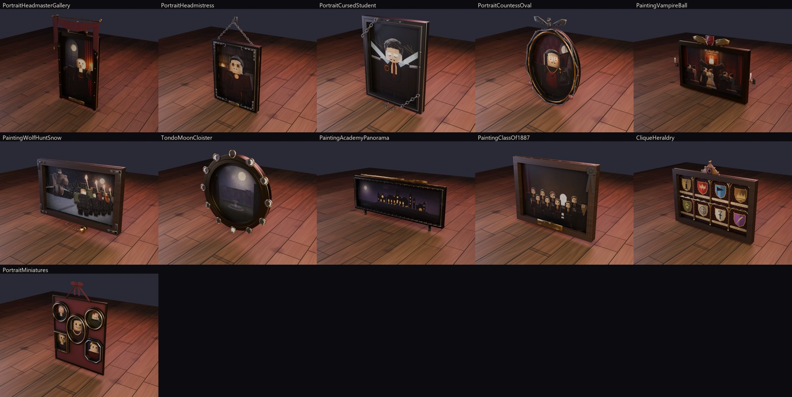
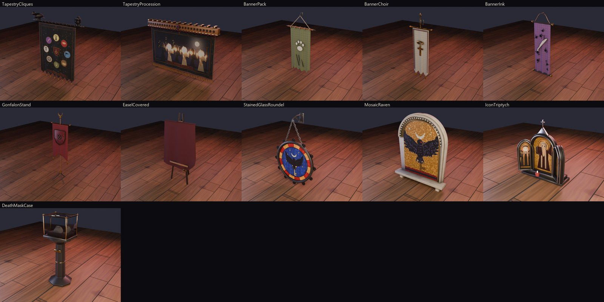
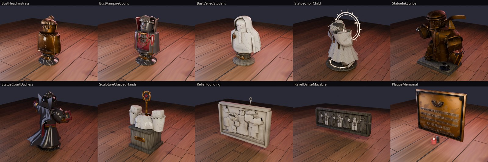
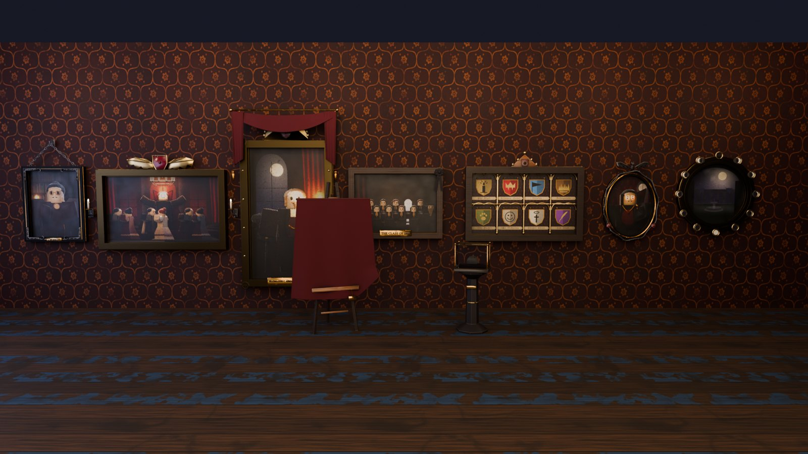
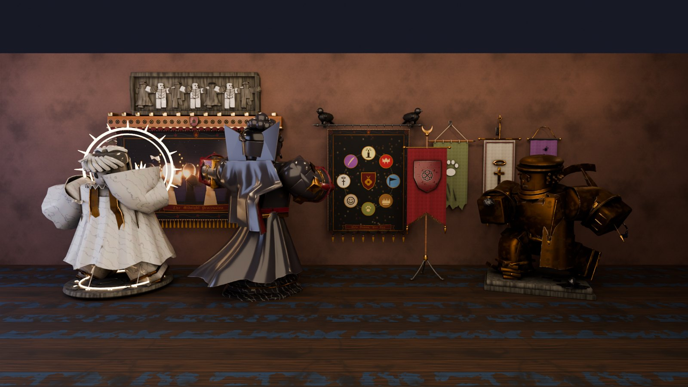

**In Studio (2026-11-10):** `tools/props/art_showpiece_templates.luau` makes the 32 templates in ServerStorage.NHProps (NHBuildKit `Art`; fill its PK from the group's images). Main, Figure, Costume and Cloth take the prop's maps; each Canvas takes `<Prop>_canvas` with the shared canvas roughness (IconTriptych's Canvas2 / Canvas3 the L / R wings); the tapestries' Weave takes `<Prop>Weave`. The four banners' Cloth is tagged `NHSwing` about its rod (the FBX origin). The candle flames (the Vampire Ball's sconces, the plaque's and the triptych's votives) are amber Neon with flickering `NHCandle` lights; the panorama's picture light is a SpotLight, the Choir Child's aura a gold PointLight; the death mask's case is Glass. Floor pieces collide (their Main precisely); wall pieces, banners and tapestries don't. `tools/props/showcase_art_showpiece.luau` lines them up in workspace.NHPropsShowcase.Art at z -718, x -235 to 19, on a new floor slab (ShowcaseFloorSouth: the baseplate ends at z -694), wall pieces at the docs' heights, busts and the triptych on plinths.

## Batch 42 (lighting): the indoor lighting kit

`art/props/nh_props_batch42.py`. Thirty-two indoor light fittings so the school's halls, classrooms and corridors are no longer too dim. Each has its own silhouette and one signature idea, and none repeats the lights the school already has (batch 19's lamp kit, the dorm, library and lounge lights). It has sixteen ceiling pieces (seven chandeliers, pendants and a lantern cluster, classroom lights, the moon orb, gothic ceiling lights and a corridor strip), eight wall pieces and eight floor and table lamps. They are made of black wrought iron, gilt and aged brass, crimson enamel, bone, dark oak, limestone, alabaster and wax. The light is warm candle, gas and lamp light, with four cool pieces: the crystal cascade and the moon orb in moonlight blue, the inverted spire and the witchlight sconce in violet. All designs are invented.

- **Run:** `E:/NH-Work/props42/run42.py` runs nh_props without editing its import list (`--check` builds and counts tris only; `--fast` previews without baking, each prop's glow in its own colour). `bake42.sh all|<Prop>` bakes at 2048 with 64 samples on the GPU, one prop per Blender, taking a shared bake slot (`E:/NH-Work/bakeslots/slot1|2`). `lightbox_glass.py` paints the lightbox's stained glass with the window kit's painter. `sheet42.py`, `render42.py`, `upload42.py` and `docs42.py` make the contact sheets, staged renders, upload folder and this section.
- **Files:** FBX in `art/props/fbx/lighting-batch42/`, maps in `art/props/textures/<Prop>_*.png` (2048, as batch 19's), previews in `art/props/previews/`, upload copies (resized to 1024) in `art/group-upload/lighting-batch42/`, renders in `art/props/renders/lighting-batch42/`.
- **Pieces:** a Main piece plus `_Glow` on every prop. Lanterns, the cascade's crystals, the spire's panes, the witchlight's orb and the mirror sconce's drops have `_Glass`. The mirror sconce has `_Mirror`, and the lightbox has `_Stained`. Every prop's maps are its own; there is no shared atlas. The only extra image set is `StainedLightboxStained_canvas` / `_emissive`, for the lightbox's Stained piece. Give it these the way the window kit's stained glass gets its own: front-projected UVs, ColorMap the canvas, and the emissive mask with EmissiveStrength about 2.
- **Pivots:** bottom centre, front toward -Y (-Z in Roblox). Ceiling pieces are modelled hanging, with their top at the ceiling, so their height is their **drop** (place the pivot at ceiling height minus the drop). Wall pieces have their pivot at the bottom centre of the back face (y = 0), so their back is flat on the wall. Nothing is below the pivot.
- **Glass:** Roblox Glass, Transparency about 0.4. Tint the spire's panes and the witchlight's orb violet (about (120, 70, 180)), and the rest pale.
- **Mirror:** SconceMirror_Mirror is Roblox Glass, Reflectance 0.6, colour (200, 205, 210), like the bathroom mirror.

### Lights for the template

These lights are what make the rooms bright. For each prop, the template sets every `_Glow` piece to Neon in its glow colour, CastShadow off, and adds the light below to the piece named in the On column. Colours are sRGB 0-255. Brightness and Range are the Roblox properties. The big pieces use Range 22-30 and Brightness 2-3, so one chandelier lights a classroom and two light a hall.

- **Shadows:** only the seven chandeliers and the wolf torchère cast shadows (Shadows = yes). The VFX bible allows eight shadow lights in view, so hang at most two shadowed chandeliers per room and leave the rest unshadowed.
- **Flicker:** candle and fire pieces get the tags `Controllers.World.Ambient` already reads (the Flicker column). `NHCandle` makes the light flicker on smooth noise, and only a little under Reduce Flashing. `NHAmbient:Embers` adds sparks over the torch and fire-bowl flames. Gas, bulb, glass and moon pieces are steady.
- **Fill:** five pieces also get a second, dimmer PointLight on the Glow piece (the Fill column): the lamps whose main light is a spot, and the lightbox. Without the fill, the room round a spot stays dark.
- **SpotLight / SurfaceLight Face** is the face of the piece it is on, in Roblox terms once the piece is imported (front = -Z).

| Prop | Light (Face, Angle) | On | Colour | Brightness | Range | Shadows | Fill | Glow colour | Flicker | Drop / mount |
|---|---|---|---|---|---|---|---|---|---|---|
| ChandelierGreatWheel | PointLight | `ChandelierGreatWheel_Glow` | (255, 190, 120) | 3.0 | 30 | yes |  | (255, 170, 90) | NHCandle | drop 8.26 |
| ChandelierAntler | PointLight | `ChandelierAntler_Glow` | (255, 185, 115) | 2.5 | 26 | yes |  | (255, 170, 90) | NHCandle | drop 5.6 |
| ChandelierCage | PointLight | `ChandelierCage_Glow` | (255, 185, 115) | 2.2 | 22 | yes |  | (255, 170, 90) | NHCandle | drop 5.45 |
| ChandelierCascade | PointLight | `ChandelierCascade_Glow` | (200, 220, 255) | 2.5 | 26 | yes |  | (185, 210, 255) | steady | drop 5.0 |
| ChandelierRavenWing | PointLight | `ChandelierRavenWing_Glow` | (255, 185, 115) | 2.5 | 26 | yes |  | (255, 170, 90) | NHCandle | drop 5.3 |
| ChandelierShipHull | PointLight | `ChandelierShipHull_Glow` | (255, 185, 115) | 2.8 | 28 | yes |  | (255, 170, 90) | NHCandle | drop 5.64 |
| ChandelierThornCrown | PointLight | `ChandelierThornCrown_Glow` | (255, 150, 120) | 2.2 | 22 | yes |  | (255, 120, 105) | steady | drop 4.9 |
| LanternCluster | PointLight | `LanternCluster_Glow` | (255, 185, 115) | 2.0 | 20 | no |  | (255, 170, 90) | NHCandle | drop 4.25 |
| PendantSpire | PointLight | `PendantSpire_Glow` | (175, 120, 255) | 1.8 | 18 | no |  | (170, 110, 255) | NHCandle (slow) | drop 4.71 |
| PendantBellCage | PointLight | `PendantBellCage_Glow` | (255, 205, 150) | 2.0 | 20 | no |  | (255, 214, 160) | steady | drop 3.9 |
| ClassroomPendant | PointLight | `ClassroomPendant_Glow` | (255, 232, 200) | 2.0 | 20 | no |  | (255, 236, 205) | steady | drop 4.0 |
| ClassroomTriPendant | SpotLight (Face Bottom, Angle 120) | `ClassroomTriPendant_Glow` | (255, 225, 185) | 2.5 | 24 | no | PointLight (255, 225, 185), 1.0, range 16 | (255, 222, 175) | steady | drop 4.0 |
| MoonOrb | PointLight | `MoonOrb_Glow` | (185, 210, 255) | 2.0 | 22 | no |  | (185, 210, 255) | steady | drop 5.27 |
| TraceryCeilingRose | SurfaceLight (Face Bottom, Angle 160) | `TraceryCeilingRose_Glow` | (255, 225, 185) | 2.0 | 22 | no |  | (255, 228, 190) | steady | drop 0.82 |
| VaultBossLight | PointLight | `VaultBossLight_Glow` | (255, 180, 100) | 2.2 | 22 | no |  | (255, 165, 70) | steady | drop 2.52 |
| CorridorStripLight | SurfaceLight (Face Bottom, Angle 150) | `CorridorStripLight_Glow` | (255, 228, 195) | 1.8 | 18 | no |  | (255, 230, 195) | steady | drop 0.5 |
| SconceIronHand | PointLight | `SconceIronHand_Glow` | (255, 150, 75) | 1.8 | 18 | no |  | (255, 130, 55) | NHAmbient:Embers + NHCandle | pivot at 4.5 |
| SconceBatWing | PointLight | `SconceBatWing_Glow` | (255, 185, 115) | 1.5 | 16 | no |  | (255, 170, 90) | NHCandle | pivot at 4.5 |
| SconceGasBracket | PointLight | `SconceGasBracket_Glow` | (255, 225, 185) | 1.6 | 16 | no |  | (255, 232, 200) | steady | pivot at 5.0 |
| SconceMirror | PointLight | `SconceMirror_Glow` | (255, 190, 125) | 1.6 | 16 | no |  | (255, 170, 90) | NHCandle | pivot at 4.0 |
| SconceGargoyle | PointLight | `SconceGargoyle_Glow` | (255, 150, 75) | 2.0 | 20 | no |  | (255, 130, 55) | NHAmbient:Embers + NHCandle | pivot at 5.0 |
| SconceWitchlight | PointLight | `SconceWitchlight_Glow` | (175, 120, 255) | 1.4 | 14 | no |  | (170, 110, 255) | NHCandle (slow) | pivot at 4.5 |
| CorridorUplighter | SurfaceLight (Face Top, Angle 150) | `CorridorUplighter_Glow` | (255, 222, 180) | 2.0 | 18 | no |  | (255, 225, 185) | steady | pivot at 8.0 |
| StainedLightbox | SurfaceLight (Face Front, Angle 120) | `StainedLightbox_Stained` | (255, 185, 140) | 1.5 | 14 | no | PointLight (255, 180, 110), 0.8, range 10 | (255, 180, 110) | steady | pivot at 3.5 |
| TorchereWolves | PointLight | `TorchereWolves_Glow` | (255, 150, 75) | 2.5 | 24 | yes |  | (255, 130, 55) | NHAmbient:Embers + NHCandle | floor |
| CandelabraDeadTree | PointLight | `CandelabraDeadTree_Glow` | (255, 185, 115) | 1.8 | 18 | no |  | (255, 170, 90) | NHCandle | floor |
| TorchereAlabaster | SpotLight (Face Top, Angle 120) | `TorchereAlabaster_Glow` | (255, 215, 165) | 2.5 | 24 | no | PointLight (255, 215, 165), 1.0, range 14 | (255, 218, 170) | steady | floor |
| CandleHearse | PointLight | `CandleHearse_Glow` | (255, 185, 115) | 2.0 | 20 | no |  | (255, 170, 90) | NHCandle | floor |
| PianoLamp | SpotLight (Face Bottom, Angle 90) | `PianoLamp_Glow` | (255, 222, 175) | 1.5 | 12 | no | PointLight (255, 222, 175), 0.6, range 8 | (255, 222, 175) | steady | table / mantel |
| ReadingLampSwing | SpotLight (Face Bottom, Angle 80) | `ReadingLampSwing_Glow` | (255, 222, 175) | 1.5 | 12 | no | PointLight (255, 222, 175), 0.6, range 8 | (255, 222, 175) | steady | table / mantel |
| DeskLampChapel | PointLight | `DeskLampChapel_Glow` | (255, 175, 95) | 1.2 | 12 | no |  | (255, 165, 70) | steady | table / mantel |
| MantelLampBat | PointLight | `MantelLampBat_Glow` | (255, 140, 90) | 1.2 | 12 | no |  | (255, 120, 75) | steady | table / mantel |

### Props

Every piece is under 20k triangles. Every prop is baked at 2048.

**Ceiling: chandeliers, pendants, ceiling and corridor lights**

| Prop | Tris | Collides | Notes |
|---|---|---|---|
| ChandelierGreatWheel | 22.3k (Main 19.7k, Glow 2.6k) | no | **drop 8.26** (top at the ceiling); 7.13 x 7.13: the great hall wheel: a 7-across iron cartwheel, a crimson felloe between iron tyres, twelve spokes with gilt knops, a mid ring with gilt bosses and iron scrolls in every bay, a crimson drum hub with gilt bands and quatrefoils over a turned pendant; 24 candles on the tyre, 8 in crimson sleeves on the mid ring; four flat bars with knops to a crown, a chain to the rose |
| ChandelierAntler | 21.4k (Main 19.5k, Glow 1.9k) | no | **drop 5.6** (top at the ceiling); 4.57 x 4.57: eight bone antler racks (pitted, tapering beams with burrs and three tines each) bound with iron straps to a turned iron hub, 24 candles on the tines and beam tips, a gilt crescent hanging under the drop; the Pack's |
| ChandelierCage | 15.0k (Main 14.3k, Glow 0.6k) | no | **drop 5.45** (top at the ceiling); 2.16 x 2.16: a domed gothic birdcage 2 across: twenty bars over a crimson-banded tray, a gilt arcade round the middle, a pointed door with a brass latch, a candle tree of eight candles inside, an iron raven on the cage ring |
| ChandelierCascade | 20.3k (Main 8.3k, Glass 10.9k, Glow 1.2k) | no | **drop 5.0** (top at the ceiling); 3.05 x 3.06: a crystal cascade: three gilt hoops of bead strands with prism drops falling in a cone (Glass) round a gilt stem of sixteen moonlight bulb-candles and a lit heart; the cool chandelier |
| ChandelierRavenWing | 15.3k (Main 14.5k, Glow 0.8k) | no | **drop 5.3** (top at the ceiling); 9.61 x 3.23: a sculpted iron raven 8.9 across with its wings spread: a heavy curved beak, crimson eyes, layered hackles at the throat, broad wings of primaries, a run of secondaries and coverts, a fanned tail, talons gripping a gilt orb; ten candles ride the wings' leading edges |
| ChandelierShipHull | 21.2k (Main 19.6k, Glass 0.1k, Glow 1.4k) | no | **drop 5.64** (top at the ceiling); 7.97 x 3.12: an upturned ship's hull of dark oak 8 long, keel to the ceiling: planking seams, ribs inside, scrolled stem and stern posts with gilt knobs, iron-bound gunwales carrying fourteen candles on brackets, three square lanterns hanging under the keel |
| ChandelierThornCrown | 17.9k (Main 16.2k, Glow 1.7k) | no | **drop 4.9** (top at the ceiling); 3.88 x 3.85: a crown of thorns 3.9 across: three twisted iron vines with thorns, a gilt inner ring, twelve rose-glass buds (Glow) on iron calyxes with leaves, thorned rods to an apex and one great glowing rose hanging in its heart |
| LanternCluster | 17.3k (Main 16.7k, Glass 0.2k, Glow 0.4k) | no | **drop 4.25** (top at the ceiling); 1.6 x 1.6: five square gothic lanterns (pierced quatrefoil crowns, pyramid roofs, a candle each; Glass panes) at staggered drops from one octagonal crimson-inset ceiling plate with gilt crockets |
| PendantSpire | 7.7k (Main 7.0k, Glass 0.4k, Glow 0.3k) | no | **drop 4.71** (top at the ceiling); 1.45 x 1.27: an inverted openwork spire: six crocketed iron ribs closing to a gilt point, violet glass between them (Glass: tint it violet, about (120, 70, 180), Transparency 0.4), a gabled crown with gilt trefoils, a violet witchlight burning inside |
| PendantBellCage | 12.0k (Main 11.6k, Glow 0.5k) | no | **drop 3.9** (top at the ceiling); 1.99 x 1.99: the Midnight Bell as a lamp: an openwork bell of sixteen iron ribs, a crimson lip band with gilt quatrefoils, canon loops on the crown; a lit heart inside and a glowing ember clapper below the lip |
| ClassroomPendant | 4.2k (Main 3.6k, Glow 0.6k) | no | **drop 4.0** (top at the ceiling); 0.86 x 0.86: the classroom light: an opal schoolhouse globe (Glow) in four iron straps under a crimson crested gallery, on a downrod with gilt knops |
| ClassroomTriPendant | 8.0k (Main 7.0k, Glow 1.1k) | no | **drop 4.0** (top at the ceiling); 6.6 x 1.15: a 6.6-long gothic iron bar (an arcade of pointed arches between two chords, gilt bosses, spired ends) on two hangers, three crimson enamel cone shades lit cream inside with an opal diffuser and a bulb in each (Glow); for a row of desks |
| MoonOrb | 6.8k (Main 2.8k, Glow 4.0k) | no | **drop 5.27** (top at the ceiling); 3.15 x 2.8: a cratered moon 2.8 across (the Glow) cradled in an iron crescent with a gilt edge, three gilt stars on fine chains, a rod with knops to the rose; moonlight blue |
| TraceryCeilingRose | 12.8k (Main 11.8k, Glow 1.0k) | no | **drop 0.82** (top at the ceiling); 3.69 x 3.69: a flush ceiling light 3.7 across, a rose window laid on the ceiling: twelve spokes, pointed petals, gilt lancets and trefoils, a gilt quatrefoil hub and pendant, over a frosted disc (Glow); its rim is a ring of 24 lit lancets with ballflowers above |
| VaultBossLight | 4.3k (Main 3.9k, Glow 0.4k) | no | **drop 2.52** (top at the ceiling); 3.0 x 3.0: a rib vault in miniature for a ceiling: a 3 x 3 limestone plate, eight moulded ribs (gilt bosses on the diagonals) springing down to an octagonal boss lantern of eight lit amber lancets with a gilt pine-cone drop |
| CorridorStripLight | 8.2k (Main 7.1k, Glow 1.1k) | no | **drop 0.5** (top at the ceiling); 8.03 x 1.01: an 8-stud iron ceiling housing (along X; tiles end to end): a frosted strip behind a gilt grille of pointed arches underneath, and a row of sixteen lit lancets down each side, so it reads from along a corridor as well as from below (all Glow) |

**Wall: sconces, the corridor uplighter and the lightbox**

| Prop | Tris | Collides | Notes |
|---|---|---|---|
| SconceIronHand | 7.3k (Main 6.6k, Glow 0.6k) | no | **mount the pivot 4.5 above the floor**; 0.76 x 1.24, 2.6 tall, stands out 1.24: a sculpted iron hand (knuckled fingers curled round the haft, a thumb over them, claw-tipped, tendons on its back, a gilt ring) reaching out of a gilt-banded lace cuff in a pointed plate, gripping a burning torch (pitch-wrapped cresset, Glow: the fire) |
| SconceBatWing | 7.7k (Main 7.5k, Glow 0.2k) | no | **mount the pivot 4.5 above the floor**; 2.6 x 0.69, 2.18 tall, stands out 0.69: a sculpted iron bat (big ears, fangs, crimson eyes) spread on the wall, its wings scalloped iron plates lined crimson with finger bones; three scrolled arms with crimson candle sleeves |
| SconceGasBracket | 3.4k (Main 2.6k, Glow 0.9k) | no | **mount the pivot 5.0 above the floor**; 0.8 x 1.32, 1.79 tall, stands out 1.32: a brass gas bracket: a wall rose on an iron backplate, a tap with a T key, a jointed swing arm with knuckles and a scrolled iron brace, a pronged gallery holding a frosted tulip shade (Glow) round a mantle; a pull chain with a gilt acorn |
| SconceMirror | 3.2k (Main 2.7k, Glass 0.3k, Mirror 0.1k, Glow 0.2k) | no | **mount the pivot 4.0 above the floor**; 1.45 x 0.67, 2.97 tall, stands out 0.67: a gilt lancet mirror (Mirror) with crockets and a quatrefoil crest; two scrolled arms with crimson candle sleeves and crystal drops (Glass) on their pans, so the mirror doubles the flames |
| SconceGargoyle | 21.2k (Main 19.9k, Glow 1.3k) | no | **mount the pivot 5.0 above the floor**; 1.46 x 1.32, 2.39 tall, stands out 1.32: a sculpted gothic gargoyle crouched on a moulded ogee corbel with ballflowers: muscular haunches, clawed feet hooked over the ledge, a hunched spine with a vertebral ridge, folded bat wings (finger bones and membranes), a long neck with an iron collar chained to the wall, a snarling head (heavy brow, deep-set eyes, ribbed horns, pointed ears, jaws wide open on fangs and a lolling tongue), a barbed tail curling down the corbel; its forepaws clutch an iron cresset on an iron bracket from the corbel's face, the fire rising into its jaws and flames licking from them (Glow). Weathered limestone with lichen blooms and soot streaks above the fire, chipped edges |
| SconceWitchlight | 3.7k (Main 2.9k, Glass 0.4k, Glow 0.3k) | no | **mount the pivot 4.5 above the floor**; 1.34 x 0.82, 2.62 tall, stands out 0.82: a crescent moon of iron on the wall (gilt rim, gilt stars), a violet glass orb lantern (Glass: tint it violet) hung by a chain from its lower horn on a scrolled arm, a gilt star below; Glow: the violet wisp |
| CorridorUplighter | 5.2k (Main 5.0k, Glow 0.2k) | no | **mount the pivot 8.0 above the floor**; 6.06 x 0.68, 1.27 tall, stands out 0.68: a 6-stud wall trough on three bat-wing brackets: a crimson frieze behind a gilt arcade of lancets with trefoils, spired ends; Glow: the open top (uplight) and a slot underneath |
| StainedLightbox | 2.5k (Main 2.2k, Stained 0.1k, Glow 0.2k) | no | **mount the pivot 3.5 above the floor**; 2.67 x 0.5, 4.98 tall, stands out 0.5: a lit lancet of stained glass 1.9 x 3.5 (Stained: a silver crescent cradling a crimson rose over a gilt key, a violet and blue night with gold stars, a ruby and gold border, a gilt trefoil in the head) in a gothic iron case, a crocketed hood with label stops, saddle bars, a stone sill on brackets; Glow: a thin line of light leaking round the glass |

**Floor and table: torchères, floor candelabra, desk, piano, reading and mantel lamps**

| Prop | Tris | Collides | Notes |
|---|---|---|---|
| TorchereWolves | 19.7k (Main 18.6k, Glow 1.1k) | yes | 2.14 x 1.97, 5.75 tall: a fire bowl on a fluted iron column 5.8 tall: a hexagonal plinth with gilt lancets on clawed feet, three sculpted iron wolves' heads howling up from a collar under the bowl (open jaws with fangs, ears laid back, ruffs of fur), a spiked bowl of coals and tall flames; the Pack's |
| CandelabraDeadTree | 7.3k (Main 6.4k, Glow 0.9k) | yes | 2.03 x 2.0, 5.63 tall: a floor candelabra cast as a bare dead tree 5.6 tall: gnarled roots for feet, a trunk of rough bark twisted with ridges, a knot and a hollow, five branches with twigs and spurs; eleven candles on the tips |
| TorchereAlabaster | 4.6k (Main 3.8k, Glow 0.8k) | yes | 1.91 x 1.91, 5.84 tall: an uplighter 5.8 tall: a lit alabaster bowl (Glow) in a gilt cradle on a clustered gothic shaft with gilt annulets and a stiff-leaf capital, a stepped black marble foot |
| CandleHearse | 13.6k (Main 12.4k, Glow 1.2k) | yes | 3.13 x 1.29, 6.83 tall: a triangular iron hearse of fifteen candles on prickets (a crimson plate with gilt foils inside the triangle) on a twisted shaft with a gilt knop and three clawed feet; 6.8 tall |
| PianoLamp | 2.6k (Main 2.2k, Glow 0.4k) | no | 1.83 x 1.12, 1.41 tall: a table piece for a piano lid: a weighted brass foot with a black marble weight, a swan-neck arm, a long brass trough shade lit cream inside over three bulbs (Glow) |
| ReadingLampSwing | 3.0k (Main 2.8k, Glow 0.2k) | no | 0.64 x 1.6, 2.03 tall: a table piece: a reading lamp on a jointed iron swing arm (a brass spring, a gilt counterweight), a cone shade pierced with gilt lancets, black marble on its iron foot |
| DeskLampChapel | 4.0k (Main 3.8k, Glow 0.2k) | no | 0.95 x 0.95, 2.55 tall: a table piece: a desk lamp whose shade is a little chapel tower: four lit amber lancets (Glow) in iron tracery, buttresses with pinnacles, a crocketed spire with a gilt finial, on a crimson-topped plinth |
| MantelLampBat | 9.3k (Main 8.9k, Glow 0.4k) | no | 1.76 x 0.58, 2.08 tall: a mantel piece: a sculpted bronze bat (pug nose, big ribbed ears, fangs, crimson eyes, clawed feet on a rock) on a black marble plinth with a gilt band, its membraned wings raised in a V, the thumbs holding up a crimson-amber glass tulip (Glow) |

- **In Studio:** the template script makes the 32 templates in ServerStorage.NHProps (NHBuildKit `Lighting`). Fill its PK from the group's images first, as for kits 35-40. Each Glow piece becomes Neon in its glow colour with its light, as in the table above. The floor torchères, the dead-tree candelabra and the hearse collide on their hull. The ceiling, wall and table pieces don't collide.
- **Placing them:** a classroom of about 30 x 30 wants one big chandelier (Range 26-30) or a ClassroomTriPendant over each row of desks. A corridor wants a CorridorStripLight every 8 studs (the strips tile end to end) or a CorridorUplighter every 12. A hall wants the GreatWheel or the ShipHull, plus wall sconces every 12-16 studs.

**In Studio (2026-11-09):** `tools/props/lighting_kit_templates.luau` makes the 32 templates in ServerStorage.NHProps (NHBuildKit `Lighting`; fill its PK from the group's images, with `StainedLightboxStained:canvas,emissive` on the end). It applies the light table above: 32 lights and 5 fills, Glow pieces in Neon with the NHCandle / NHAmbient:Embers tags, violet glass on the spire and witchlight, the mirror sconce's glass, and the lightbox's canvas with its emissive mask (strength 2). Only the four floor pieces collide. `tools/props/showcase_lighting_kit.luau` lines them up in workspace.NHPropsShowcase.Lighting: a row at z -560 from x 40 to 227, the 16 ceiling pieces hung under an iron beam at 13.5, the wall pieces at their mount heights, the table lamps on plinths.

## Batch 43 (gym): the gymnasium and sports hall kit

`art/props/nh_props_batch43.py`. The old gothic gymnasium of the Institution: Victorian and Edwardian apparatus with a dark academy twist, in the house look of batches 34-39 (cast iron, dark oak and ebony, crimson leather and enamel, brass and gilt, black marble, bone, hemp and canvas). The five houses (Crimson, Ravens, Rovers, Vigil, Wardens) and the Athletes' blue give the crests and colours. It has 33 props, each built around one signature idea, and none repeats the existing gym props (BallRack, Bleachers, GymMatStack, Hurdle, TackleDummy, FootballMachine, Scoreboard, VaultingHorse, WeightBench, Dumbbells, the lockers, TrophyShelf, TrophyCabinet). All names, mottoes and designs are invented.

- **Printed atlas:** `art/props/gym_atlas.py` (system Python with PIL and numpy, on `dorm_atlas.py`'s Cell and Atlas) paints `GymPrint` (4096; colour, gilt and height). It is a bake source only, so it isn't uploaded. It holds:
  - the five house shields on one outline, with invented mottoes: SANGUIS ET ROSA, NOX ALAS DAT, ULTRA TUMULUM, LUX IN TENEBRIS and FERRO CUSTODIMUS
  - the Athletes' VARSITY pennant and the school crest
  - a stopwatch dial (maker GRAVESEND & THORNE), the First Eleven team sheet and a chalked lap slate
  - the HOUSE POINTS header and its digit tiles, the archery target face, and the SWEATBOX, FIRST AID and HOUSE KIT signs
  - a thermometer scale, the fencing touch dial and the hook-rail name tags

  Its regions and the shield outline are in `art/props/gym_atlas.json`.
- **Run:** `E:/NH-Work/props43/`.
  - `run43.py` runs nh_props without editing its import list (`--check` builds and counts tris; `--fast` previews without baking).
  - `bake43.sh all|<Prop>` bakes at 2048 with 64 samples on the GPU. It holds a shared bake slot (`E:/NH-Work/bakeslots/slot1|slot2`).
  - `sheet43.py`, `render43.py`, `upload43.py` and `names43.py` make the contact sheets, staged renders and upload folder.
- **Files:**
  - FBX in `art/props/fbx/gym-batch43/`
  - maps in `art/props/textures/<Prop>_*.png` (2048)
  - previews in `art/props/previews/`
  - upload copies (all at 1024) in `art/group-upload/gym-batch43/`: 132 maps, 33 props × 4, with no metal map entirely black
  - contact sheets and renders in `art/props/renders/gym-batch43/`
- **Pieces:** each prop is one mesh named after it, except:
  - `CursedTrophy_Main` + `CursedTrophy_Glow`
  - `SaunaDoor_Main` + `SaunaDoor_Door0`
  - `StopwatchStand_Main` + `StopwatchStand_Glass`
- **Pivots:** bottom centre, front toward -Y. Wall pieces have their back on the wall plane (y = 0), with the pivot at their lowest point on that plane. Nothing goes below the pivot.
- **The character rule:** no prop shows a figure or character (the cursed trophy is a cup), so the R6 rig rule didn't apply.

### Template notes (NHBuildKit `Gym`)

- **Kit name:** `Gym`. Every piece takes its own prop's four maps. No piece uses a shared map set.
- **Collisions:**
  - **Floor apparatus and furniture collide** on their precise shape: the horse, bars, beam, box, springboard, stands, trolley, racks, rowing machine, ring corner, target, bow rack, hamper, bench, cage, trophy, stopwatch, chair, sauna surround, wall bars, pulley and first-aid station.
  - **The ceiling pieces** (ClimbingRopes, GymRings) collide on the beam only, so players can walk into the ropes and rings.
  - **PunchingBag** collides on the bag and the wall plate.
  - **BasketballHoop** collides on the uprights and the backboard (not the net).
  - **These don't collide:** FencingPiste (flat; its end posts and scoring box could), BoxingGloves, Megaphone, IndianClubRack, FencingMaskRack, WhistleBoard and HousePointsBoard.
- **Glow:** `CursedTrophy_Glow` is the curse leaking from under the lid and through cracks in the bowl, in a faint violet (about 150, 70, 255). Give it a small violet PointLight (range about 6, brightness about 0.6) above the cup. No other piece glows.
- **Glass:** `StopwatchStand_Glass` is the crystal over the dial: clear Glass, about 0.6 transparency.
- **Door:** `SaunaDoor_Door0` swings out on its left hinge (origin on the hinge line). Rig it like the other `Door0` pieces on the locker system (prompt "Sweatbox / Open").
- **Lights:** only the trophy's violet glow. The gym is lit by the room's own lamps.

### Showcase placement notes

**Wall pieces** (back on the wall; the suggested bottom height is where the pivot goes on the showcase wall):

| Prop | Bottom on the wall | Notes |
|---|---|---|
| WallBars | 0 (stands on the floor) | 6.97 wide, 10.9 tall |
| WallPulley | 0 (stands on the floor) | 8.6 tall |
| LockerBench | 0 (stands on the floor) | hooks at 5.0 |
| SaunaDoor | 0 (stands on the floor) | doorway 3.4 × 7.2 |
| FirstAidStation | 0 (stands on the floor) | 8.1 tall |
| BasketballHoop | 0 (its iron uprights stand on the floor) | rim at 10.0, 13.3 tall |
| PunchingBag | 0 (the bag hangs clear) | the wall plate is at 7.8-10.6, the bag's bottom at 3.4 |
| IndianClubRack | 3.0 | 5.3 tall |
| FencingMaskRack | 3.2 | 3.75 tall |
| WhistleBoard | 3.0 | 4.9 tall |
| HousePointsBoard | 3.2 | 7.6 tall |

**Ceiling pieces:** ClimbingRopes and GymRings hang from a beam. Their pivot is at floor level, under the middle of the beam.
- **Heights:**
  - ClimbingRopes: beam bottom 19.0, top 20.3, ceiling plates' top 22.4; the ropes end 0.3 above the floor.
  - GymRings: beam bottom 18.0, top 19.3, ceiling plates' top 21.3; the rings' bottoms at 7.4.
- **In a room with a ceiling at height C:** place the pivot at C - 22.4 (ropes) or C - 21.3 (rings), and the plates meet the ceiling. The ropes stop short of the floor if C is below 22.4.
- **On the showcase:** stand them on the floor (pivot at 0).

**Small pieces for a plinth:** BoxingGloves (1.7 × 1.6, 0.8 tall) and Megaphone (2.1 long, 1.3 tall). CursedTrophy brings its own marble plinth.

### Props

Every piece is under 20k triangles. Every prop is baked at 2048.

**Apparatus**

| Prop | Tris | Collides | Notes |
|---|---|---|---|
| ClimbingRopes | 19.7k | beam only | ceiling piece: three thick hemp ropes on brass swivel shackles from a heavy riveted iron I-beam on pierced lancet hangers; long crimson leather whippings bound in brass, knotted and frayed ends; the middle rope knotted for climbing; a brass bell under the beam to ring at the top; 9.0 wide, 22.4 tall |
| GymRings | 15.5k | beam only | ceiling piece: two thick ash rings wrapped in crimson leather with brass bands, on broad stitched leather straps studded in brass with big buckles, from swivels under a short heavy beam; 4.2 wide, 21.3 tall |
| WallBars | 12.3k | yes | wall piece: two bays of ash rungs between dark oak posts, the top rung swept forward on iron arms, pointed oak tracery arches over the bays with brass quatrefoils, the school crest in the spandrel; 6.97 x 1.09 x 10.9 |
| PommelHorse | 7.0k | yes | stitched leather body (top 3.8) with bentwood oak pommels, brass end caps with the Crimson and Ravens shields, on two turned cast-iron columns with brass height wheels over soles on wolf-paw feet; 5.1 long |
| ParallelBars | 11.2k | yes | two oval oak rails (tops 4.3), 8.4 long, on iron uprights with brass collars and T-screws, cast-iron soles with gothic gussets and quatrefoil ties, castors |
| BalanceBeam | 8.3k | yes | the house beam: an 11-long suede-topped oak beam (top 4.0) whose ends are carved raven heads with gilt eyes, the five house shields along its front under a brass distance rule, on iron A-trestles pierced with brass-lined lancets and raven-wing brackets; 13.2 long overall |
| VaultingBox | 8.2k | yes | five tapering oak tiers, each banded in a house colour and numbered I-V in gilt, oval hand slots, iron corners, a buttoned leather top at 4.05, castor levers at the ends; 5.0 x 2.6 at the foot |
| Springboard | 8.3k | yes | a curved oak board in ribbed crimson felt rising from 0.25 (front, -Y) to 1.05, on four iron coil springs and an oak sledge, THORNE PATENT plate on the nose; 2.0 x 3.7 |
| HighJumpStands | 6.2k | yes | two stout iron posts 8 apart on heavy bases weighted with stacked iron discs, brass height scales, brass peg carriers with thumb screws, a thick ash bar banded crimson at 4.3; 9.7 wide, 7.65 tall |
| MatTrolley | 13.7k | yes | an iron cradle on castors with pointed-arch ends and a push bar, three rolled leather mats (crimson, ink, crimson) with spiral ends and buckled straps; 5.1 x 2.3 x 3.4 |

**Fitness and boxing**

| Prop | Tris | Collides | Notes |
|---|---|---|---|
| MedicineBallRack | 12.6k | yes | a three-tier stepped oak rack of seven stitched leather medicine balls with brass tags, a pointed back board with the Wardens' shield, a WEIGHTS plate; 4.5 x 2.5 x 4.5 |
| IndianClubRack | 7.1k | no | wall piece: a pointed oak board with the Athletes' VARSITY pennant, three crossed pairs of ebonised Indian clubs banded in house colours and gilt, brass pegs, a chalk shelf; 3.6 wide, 5.3 tall |
| RowingMachine | 4.8k | yes | an oak monorail on iron feet, a crimson leather sliding seat on brass rails, a raked foot stretcher with leather shoes, two iron oar levers on outriggers working brass dashpots, oak handles, a stroke-counter dial; 7.5 x 3.3 x 2.5 |
| WallPulley | 6.2k | yes | wall piece: a cast-iron cabinet like a lancet window (2.5 wide, 8.6 tall), the iron weight stack on steel guides behind a grille of bars, a brass pulley, hemp cord to two oak handles at about 2.6, the Wardens' shield on the hood |
| PunchingBag | 8.5k | bag and plate | wall piece: a scrolled iron gallows bracket (arm at 10.2, 3 out from the wall), swivel, chain and four short chains to a heavy leather bag (3.4 to 7.15) with crimson bands and the Crimson shield, laced seam at the back |
| BoxingRingCorner | 5.8k | yes | a 5 x 5 block of raised canvas ring floor (top 1.4) with a crimson skirt; the corner post at the front left with a buttoned crimson pad bearing the Crimson shield; three crimson-wrapped ropes on brass turnbuckles run off to +X and +Y (where the ring continues), spacer straps, a towel on the top rope; a corner stool and a bucket with a sponge on the floor in front |
| BoxingGloves | 4.3k | no | plinth piece: a pair of crimson leather gloves laced together with bone laces and brass eyelets, lying on their sides; 1.7 x 1.6 x 0.8 |

**Fencing and archery**

| Prop | Tris | Collides | Notes |
|---|---|---|---|
| FencingPiste | 6.8k | no | a raised piste 18 x 2.6 (top 0.3) along X: dark oak boards on a crimson plinth, inlaid brass lines (centre, on guard, end), crimson warning zones, brass edging; brass-capped iron on-guard blocks at the sides; a squat cast-iron end post at each end with a house shield and a brass cord reel; an iron scoring box on legs behind the middle (+Y) with two touch dials, crimson and green lamps; 20.2 overall |
| FencingMaskRack | 13.0k | no | wall piece: a battlemented dark oak board, four fencing masks on iron hooks (mesh faces, white padded rims and bibs with house-coloured trims), two crossed foils above, a SALLE D'ARMES plate; 4.6 wide, 3.75 tall |
| ArcheryTarget | 4.6k | yes | a coiled straw boss with a painted face in the house colours (a raven in the gold), bound in cord, leaning back 15° on an oak tripod easel with brass pegs; three arrows in the face, one in a leg; 5.35 tall |
| BowRack | 9.5k | yes | an oak rack of four strung longbows with leather grips and horn nocks, a top rail ending in carved raven heads, a leather quiver of fletched arrows on the right post, an ARCHERY SOCIETY plate; 5.2 x 1.2 x 5.9 |

**House and team**

| Prop | Tris | Collides | Notes |
|---|---|---|---|
| KitHamper | 6.9k | yes | a wicker kit hamper 3.6 x 2.2 x 2.0, its lid thrown back on a check strap; leather straps, brass buckles, the HOUSE KIT label; house jerseys heaped inside, a Ravens sleeve over the rim, a striped crimson scarf, a football |
| WhistleBoard | 4.2k | no | wall piece: the coach's pointed oak board, a brass COACH plate, the First Eleven team sheet pinned up, a framed slate of laps in chalk, a brass whistle on a crimson lanyard, a stopwatch on a hook, a chalk ledge; 3.2 wide, 4.9 tall |
| HousePointsBoard | 4.8k | no | wall piece: an ebonised gothic board between crocketed pinnacles, the gilt HOUSE POINTS header, the five house shields and the term's points on hanging enamel digit tiles (Crimson 412, Ravens 389, Rovers 251, Vigil 407, Wardens 298), a box of spare tiles; 8.1 wide, 7.6 tall |
| CursedTrophy | 14.6k (Main 13.9k, Glow 0.7k) | yes | the Thorne Cup on its black marble plinth (top 3.4) with gilt columns and a plaque (THE THORNE CUP, never won twice): a tarnished silver cup with bat-wing handles and a bone skull on its lid, bound in an iron chain with a padlock; Glow: violet light under the lid and through cracks in the bowl; 5.9 tall |
| LockerBench | 9.1k | yes | wall piece: a slatted oak bench 8 long (seat 1.6) on three cast-iron frames with pointed arches and a shoe rack, a panelled back with a rail of iron double hooks (5.0) and the house name tags, a towel and a Ravens no. 7 jersey hung up, a canvas kit bag under the seat |
| Megaphone | 2.1k | no | plinth piece: a coach's megaphone in the Athletes' blue enamel with a brass bell rim, mouthpiece, handle and gilt bands, lying on its side; 2.1 long |

**Facilities**

| Prop | Tris | Collides | Notes |
|---|---|---|---|
| SaunaDoor | 6.1k (Main 3.1k, Door0 3.0k) | surround yes | wall piece: the sweatbox, a limestone gothic doorway 5.8 wide and 9.8 tall, an enamel SWEATBOX sign; Door0: a heavy oak plank door with iron strap hinges, a steamed porthole in a brass ring and a ring pull (hinge on the left, opens out); a thermometer on the left jamb, a copper steam pipe with a valve and gauge on the right, an oak bucket and ladle at the foot |
| EquipmentCage | 17.5k | yes | an iron mesh cage 5 x 2.4 x 7 with a crested front and spear finials, its right-hand door padlocked, an EQUIPMENT plate; oak shelves inside with leather balls and footballs, cricket bats and hockey sticks |
| FirstAidStation | 3.4k | yes | wall piece: a canvas stretcher on oak poles stood on end on iron wall brackets, a crimson enamel cabinet (bottom 2.8) with the FIRST AID sign (the Matron is in the east wing), a rolled blanket on top, a brass bell-pull; 5.3 wide, 8.1 tall |
| StopwatchStand | 5.1k (Main 5.0k, Glass 0.2k) | yes | the race clock: a giant brass stopwatch (dial 1.6 across) with a bow, crown and pushers on a fluted cast-iron column on an octagonal base, a last-lap bell on a bracket; Glass: the crystal; 7.6 tall |
| RefereeChair | 2.6k | yes | an umpire's chair: a splayed oak tower with a ladder up its front, iron cross braces, a brass footrest, a crimson leather seat (5.6) and back, a pointed back with the school crest, a crimson flag in a brass socket; 9.3 tall |
| BasketballHoop | 9.5k | uprights and board | wall piece: two flat iron uprights pinned to the wall from the floor, riveted truss arms with brass quatrefoils, an oak backboard (9.6 to 13.2) with a crimson square and the school crest, an iron rim at 10.0 (3.0 out from the wall plus the rim) and a corded net |


**In Studio (2026-11-09):** `tools/props/gym_kit_templates.luau` makes the 33 templates in ServerStorage.NHProps (NHBuildKit `Gym`; fill its PK from the group's images). Every piece takes its own prop's maps; collision is precise on the solid props and off on the no-collide ones and the ropes and rings; CursedTrophy_Glow is violet neon with a small PointLight; SaunaDoor is on the locker system like the Safe ("Sweatbox / Open", Door0 keeps its hinge as its PivotOffset, swings out 95°, NHPropSpot in front of it). `tools/props/showcase_gym_kit.luau` lines them up in workspace.NHPropsShowcase.Gym: one row at z -466 (south of Dorm House), x -236 to 35, the ropes and rings standing under their own beams on iron posts, the gloves and megaphone on plinths.

## Batch 44 (showpiece): statues, set-pieces and grand paintings of the school's legends

`art/props/nh_props_batch44.py`, with `showpiece44_rig.py` (the owner's R6 rig, posed), `showpiece44_poses.py` (every figure's own pose), `showpiece44_chars.py` (modelled clothing), `showpiece44_geo.py` (cloth simulation, effects, gear), `showpiece44_organic.py` (sculpted creatures, hair, mist), `showpiece44_mats.py` (the shared PBR material library), `showpiece44_fit.py` (layer clipping checks), `showpiece44_scenes.py` and `showpiece44_canvas.py` (the paintings).

**The figures:** every character is the owner's R6 rig from PaintRigV3.blend, appended read-only and posed on its armature, so it keeps the R6's exact rounded-block proportions (built at 1.6 studs per R6 unit, about 8.2 tall, like the batch 27 statues). Over it goes modelled clothing that wraps the blocks with matching soft corners: tailored blazers and coats with lapels, piping, seams, crests and buttons; sleeves and trouser legs with wrinkle rings at the bends; boots with soles, toes and buckles; capes, cloaks, coat tails and skirts simulated as cloth (a verlet sheet pinned at the shoulders or waist, gathered so it buckles into folds, pushed by a wind and colliding with the posed body); sculpted hair, hoods, beards and fur (metaball masses with clumped relief); crowns and hats seated on the hair. Creatures (wolves, ravens, bats, ghoul arms) are sculpted organic forms, not blocks. Each figure's hair, headwear, collars and clothes are BVH-tested against each other and trimmed or seated so nothing pokes through. Poses are all different: several are anime and fighting-game stances (an iai-draw lunge, a mid-air spinning kick, a superhero landing, a hand-sign cast, an over-the-shoulder glare, a guard stance in lightning, a rising uppercut, a back-to-back standoff). Every statue stands on its own scene base.

**Materials:** one shared procedural PBR library: twill wool, crushed velvet, silk, denim, rib knit, linen, leather grain, fur, polished and tarnished gold, brushed steel, pitted iron, verdigris bronze, veined marble, the school's limestone and slate sets, oak and ebony, cut gems, parchment, glossy ink, bone. Each drives its own colour, roughness, metalness and normal, so the 2048 bake keeps cloth reading as cloth and metal as metal.

**The paintings:** each is a lit Cycles scene of fully dressed, posed characters in a setting of its own (no two alike), painted over stroke by stroke along the edge flow, with bristle streaks, canvas weave, warm varnish and craquelure. Its Canvas piece carries `<Name>_canvas.png` (colour), plus `<Name>_canvasnormal.png` (the impasto) and `<Name>_canvasrough.png` (glossy varnish, duller cracks): give the Canvas a SurfaceAppearance with those three (no metal map). The frames come from one modular builder: a carved moulding profile swept round the canvas, a slip, a gold bead, bead-and-reel carving, cartouches, corner ornaments, set gems, crests, iron straps, sconces and picture lights.

- **Run:** `E:/NH-Work/props44/run44.py` (`--check` tris only, `--quick` workbench views, `--clip` layering check with head close-ups, `--fast` procedural preview). `bake44.sh` bakes at 2048 with 24 samples on the GPU holding a shared bake slot. `scenes44.py` renders a painting scene; `showpiece44_canvas.py` paints it. `sheet44.py`, `upload44.py`, `docs44.py` make the sheets, upload folder and this section.

- **Files:** FBX in `art/props/fbx/showpiece-batch44/`, maps in `art/props/textures/<Prop>_*.png` (2048), previews in `art/props/previews/`, upload copies (1024) in `art/group-upload/showpiece-batch44/`, sheets in `art/props/renders/showpiece-batch44/`.

- **Pieces:** Main (the base), Figure / Figure2 (the characters), Glow and Glow2 (Neon, one colour each, below), Glass (mist, ghosts, souls, lantern panes) and Canvas. Every piece is under 20k triangles. Pivots: bottom centre, front toward -Y; paintings are wall pieces with the pivot on the back face.

- **In Studio:** NHBuildKit `Showpiece`. Bases collide on their precise shape, figures collide on a box; the effects pieces and Canvas don't collide. Glass pieces: Material Glass, Transparency 0.5, their colour below.


### Statues and set-pieces

| Prop | Tris | Collides | Notes |
|---|---|---|---|
| VampireLordRising | 42.3k (Main 14.9k, Figure 18.4k, Glow 1.4k, Glass 7.7k) | yes | Malachar Crane, the Royal Vamp who founded the Crimson Court, levitating out of his opened coffin: arms flung up in a V, head thrown back, glowing crimson eyes, clawed hands; black wool tailcoat, crimson silk waistcoat, linen jabot and ruby, simulated black velvet cape lined in crimson silk with a tall collar. Base: octagonal plinth, the coffin across it (velvet lining, gilt rim, iron handles), its cracked lid slid down the front, chains, three sculpted bats. Glass: the red mist plume he rises on |
| WerewolfTurning | 28.9k (Main 9.2k, Glow 0.6k, Figure 19.0k, Glow2 0.1k) | yes | the Pack's first Bloodmoon arching back mid-turn: muzzle and ears breaking through, fur bursting from the split back seam, cuffs and trouser legs, claws, a crimson tie flying, shreds of blazer in the air; bronze skin, torn navy wool blazer, grey wool trousers. Base: smashed slate flagstones, rubble, snapped shackle chains; an iron-ringed blood moon on a post behind (Glow) |
| VigilCaptainLantern | 23.9k (Main 3.1k, Figure 19.0k, Glow2 0.5k, Glass 0.0k, Glow 1.3k) | yes | Ezra Vale, captain of the Vigil, striding up a broken graveyard step with a burning lantern held high: grey wool greatcoat with simulated skirt, silver buttons and epaulettes, stand collar, crimson wool scarf streaming, sheathed sabre under his hand. Base: landing and broken step, toppled REQUIESCAT headstone, rubble, votive candles (Glow2). Glow: the ghost-blue lantern flame, embers and a rising wisp; Glass: the lantern panes |
| ChoirConductor | 25.5k (Main 6.1k, Figure 13.3k, Glow 5.0k, Glow2 1.1k) | yes | Lucien Grey, cantor of the Chapel Choir, conducting the dead with both arms raised, head back in song: black cassock with a simulated skirt, linen surplice with bell sleeves and a lace hem, crimson stole with gilt crosses. Base: round plinth with the great cracked chapel bell fallen across it in verdigris bronze, stone chips. Glow: two spectral music staves with notes spiralling round him; Glow2: a moonlight halo |
| InkScribeTendrils | 33.4k (Main 12.6k, Figure 18.4k, Glow 2.4k) | yes | Wren Ashby of the Ink Club in a low painter's lunge across a toppled pile of tomes, thrusting a great brush: linen smock, leather apron, rolled sleeves, sculpted violet velvet beret, silk scarf, black denim, buckled boots. Five glossy ink tendrils climb out of the overturned silver inkwell and pool, coiling round her; Glow: their violet tips and motes and the sigil she paints on the air |
| DelinquentGlare | 27.3k (Main 8.0k, Glow 2.1k, Glow2 0.2k, Figure 16.3k, Glass 0.7k) | yes | Bruno Vance, boss of the Delinquents, walking away and glaring back over his shoulder (anime stance): long black leather duster flaring (simulated), studded leather jacket with zips and a turned-up collar, white tee, torn jeans, buckled engineer boots, pompadour; spray can in hand with a green mist puff (Glass). Base: cracked asphalt, a broken brick wall with his sigil (Glow, toxic green) and tags (Glow2, magenta) with paint drips, cinder blocks, a tyre, spent cans |
| AthleteSpinKick | 26.3k (Main 7.4k, Glow 3.8k, Figure 15.0k, Glow2 0.1k) | yes | Captain Rhys Thorne held mid-air in a spinning hook kick (anime stance) on a cyclone of gold speed ribbons (Glow) and torn-up turf and stones; crimson and gold rugby-knit jersey numbered 1, captain's armband, white shorts, striped socks, studded boots; the match ball blasting off his boot with a trail (Glow2). Base: round plinth topped with a disc of pitch, white lines, upturned clods |
| CourtDuchessThrone | 26.3k (Main 4.3k, Figure 19.0k, Glow 0.7k, Glow2 2.4k) | yes | Vesper Crane, duchess of the Crimson Court, lounging on her throne, legs crossed, chin on her gloved hand, a gold goblet in the other: crimson velvet corset with gold lacing, black silk sleeves and gloves, a simulated crimson velvet skirt spilling over the seat, ruby choker, a gold tiara seated on her long hair, glowing eyes. Base: three-tier black-marble dais with gilt nosings, a velvet runner and rose petals; ebony and crimson-velvet throne with a pointed back and gilt finials. Glow: a blood-moon disc; Glow2: its ring of spikes |
| ReaperGuard | 28.0k (Main 5.6k, Figure 19.0k, Glow2 0.1k, Glow 1.0k, Glass 2.2k) | yes | the Reaper Prefect braced low in a guard stance (fighting-game stance), the great scythe held across his body through both fists: tattered simulated wool cloak lined in violet, sculpted hood, bone skull mask with burning eyes (Glow2), prefect's blazer with silver piping, embroidered crest and sash, gloves, buckled boots. Glow: violet lightning crackling off the blade and down to the ground; Glass: three lost souls coiling round it. Base: grave-soil mound, toppled stone cross, split headstone, iron railings |
| PackAlphaLanding | 25.2k (Main 4.1k, Glow 0.4k, Figure 16.6k, Glow2 0.3k, Glass 3.9k) | yes | Dex Moreno, alpha of the Pack, in a three-point superhero landing that has cracked the plinth: crimson varsity jacket with leather sleeves, gold rib knit and a grey fur collar, white tee, ripped jeans, high-tops, sculpted mane, claws, amber eyes (Glow2). Base: heaved-up slabs round the crater with glowing cracks (Glow) and hanging debris. Glass: a sculpted spectral wolf rearing and howling behind him |
| FounderRavens | 39.4k (Main 19.0k, Figure 19.5k, Glow 0.3k, Glow2 0.6k) | yes | Alaric Vauclair, the Founder, crowned by ravens: arms flung wide on the school's cracked cornerstone (ANNO MDCCCXXI), the great gold key held high: black velvet academic coat with simulated skirt, ermine cape, gold chain and medal, long white hair and beard. Six sculpted ravens wheel round his head with red eyes (Glow) through a ring of moonlight (Glow2); one lands on his open hand. Base: tall octagonal plinth, scrolls, a chain |
| ExorcistSigil | 30.5k (Main 12.5k, Glow 4.9k, Figure 12.0k, Glow2 1.1k) | yes | a Saint of the Exorcists in a hand-sign casting stance (anime stance): one hand raised in the sign of binding with a small glowing sigil before it, the other holding out an open grimoire, pages tearing loose; black cassock with simulated skirt, ivory silk chasuble with gold orphreys and a ruby boss, crimson stole, ebony rosary. Glow: the sigil cut into the floor, candle flames, the binding sigil; Glow2: orbiting shards of light and a halo. Base: cracked crypt flags, chains bursting from the floor |
| GhoulUppercut | 25.8k (Main 8.5k, Figure 13.3k, Glow 0.9k, Glass 3.0k) | yes | the Crypt Lord bursting out of his grave in a rising uppercut (fighting-game stance): grey-green ghoul skin, a crown of bone seated on long white hair, a rotted green frock coat in tatters with silver piping, claws, glowing green eyes. Glow: green soul-fire round the fist and motes; Glass: four souls spiralling up. Base: grave-soil mound, the slab split and heaved up, bones and a skull flying |
| CourtIaiDraw | 26.5k (Main 6.8k, Figure 19.0k, Glow2 0.2k, Glow 0.6k) | yes | Seraphine Crane, the Crimson Court's blade, in a low iai-draw lunge (anime stance): crimson velvet duelling coat with gold frogging and piping, simulated coat tails, black silk sash, lace cravat, tall boots, a long ponytail streaming; the scabbard in one hand, the sabre whipped out in the other with a pale edge (Glow2) and a great crimson slash arc (Glow). Base: terrace with a sheared balustrade, a toppled baluster, a climbing rose, petals in the air |
| TwinRivalsDuel | 40.1k (Main 1.3k, Figure 18.5k, Glow 1.1k, Figure2 19.0k, Glow2 0.3k) | yes | set-piece, two figures (Figure, Figure2): Cassius Vale of the Vigil lunging up the bell-tower stair with a ghost-blue sabre (Glow) against his twin Corvin Crane of the Court parrying high from the step above with a crimson sabre (Glow2); lightning bursts where the blades cross. Navy greatcoat against crimson velvet, both coats simulated and flaring. Base: broken landing and stair, balusters, rubble |
| BackToBackStandoff | 50.8k (Main 14.6k, Glow 5.6k, Figure 19.0k, Figure2 11.7k) | yes | set-piece, two figures back to back (Figure, Figure2): the human Slayer Mara Thorne aiming a heavy crossbow, her leather coat flaring, and Father Anselm holding out a burning reliquary, cassock and stole whipping; six sculpted ghoul arms claw up through the cracked flags round them. Glow: a ring of holy fire and runes, the reliquary flame. Base: round crypt plinth |

### Paintings

| Prop | Tris | Canvas (studs) | Scene | Frame |
|---|---|---|---|---|
| PaintingBellTowerStorm | 9.0k (Canvas 0.1k, Main 8.1k, Glow 0.8k) | 4 x 6 lancet | the Revenant hanging from the great bell's rope in a thunderstorm, lightning through the arches | iron, stepped, iron straps and rivets, star bosses with sapphires (Glow halos, 150,200,255), a bronze bell crest |
| PaintingFloodedCrypt | 10.4k (Canvas 0.0k, Main 9.7k, Glow 0.8k) | 6.4 x 4 | the Crypt Lord wading out of the black water between drowned tombs and candles | carved bone, scooped, skull corners with emerald eyes (Glow halos, 140,255,120), a crimson shield and gold key crest |
| PaintingBurningLibrary | 9.4k (Canvas 0.0k, Main 8.6k, Glow 0.5k, Glow2 0.2k) | 7.2 x 4.05 | Ezra Vale of the Vigil running from the burning library, books under his arm, looking back at the fire | carved gilt ogee with bead-and-reel, acanthus corners, rubies, cartouches; a flaming brazier crest (Glow, 255,130,40) and a brass picture light (Glow2, 255,220,160) |
| PaintingMoonlitRooftop | 13.8k (Canvas 0.2k, Main 12.7k, Glow 0.8k) | 4.2 x 5.6 oval | a Court vampire leaping between rooftops under the full moon, cape spread, a gargoyle below | black lacquer cushion oval with a silver slip, sculpted bats, moonstones (Glow halos, 215,225,255), a crescent-moon crest |
| PaintingChoirLoft | 9.4k (Canvas 0.1k, Main 9.1k, Glow2 0.2k) | 4.4 x 6.2 arch | a choirboy singing the solo in the loft, rose-window moonlight, spectral staves rising from his hymnal | gothic-arched gilt ogee, rosettes with amethysts, a gold crown crest, two candle sconces (Glow2, 255,170,80) |
| PaintingDormCorridor | 6.7k (Canvas 0.0k, Main 6.5k, Glow2 0.2k) | 3.6 x 5 | Pip Larkin of the Ordinary in the dorm corridor at 3 am, candle out, the drowned girl drifting toward him | plain stepped dark oak, brass slip, a brass picture light (Glow2, 255,200,130) |
| PaintingFrozenLake | 13.7k (Canvas 0.0k, Main 12.9k, Glow 0.8k) | 7.2 x 4.05 | a Bloodmoon werewolf howling on the cracked ice under the blood moon, pines on the far shore | frosted silver cushion, star bosses with moonstones (Glow halos, 190,220,255), a howling silver wolf crest |
| PaintingHeadmasterStudy | 9.6k (Canvas 0.0k, Main 9.3k, Glow2 0.2k) | 5 x 6.4 | the Headmaster at his desk by the fire, fingers steepled, a raven on the bust, a horned shadow on the wall | heaviest gilt ogee on a crimson velvet mount, rosettes with rubies, the school shield crest, a brass picture light (Glow2, 255,210,140) |
| PaintingGymMidnight | 9.4k (Canvas 0.0k, Main 9.4k) | 6.4 x 4 | Captain Thorne alone on the gym floor at midnight facing the translucent ghosts of the 1903 team | varsity oak with a gold slip and crimson knit mount, gold stars with rubies, a trophy cup crest |
| PaintingInkArchive | 7.0k (Canvas 0.2k, Main 6.0k, Glow 0.8k) | 5 x 5 tondo | Wren Ashby in the ink-flooded archive calling the ink up into tendrils, an ink wolf and an ink raven | round ebony tondo, scooped, carved leaves, amethysts (Glow halos, 185,90,255), an open-book crest |
| MuralBloodMoonCourtyard | 17.6k (Canvas 0.0k, Main 16.5k, Glow 0.8k, Glow2 0.2k) | 14 x 7.875 (set-piece) | the six cliques standing together in the blood-moon courtyard against the Hollow King rising over the fountain | grand gilt ogee strapped in iron, skull corners with rubies (Glow halos, 255,40,40), a jewelled crown crest, two candle sconces (Glow2, 255,170,80) |

### Effects for the template script

Glow colours are given in the notes (RGB 0-255); Glow is the first colour, Glow2 the second. Attach each effect to an Attachment at the centre of the named piece unless it says otherwise.

| Prop | ParticleEmitter | Light | Beam / Trail |
|---|---|---|---|
| VampireLordRising | on Glass: texture soft smoke puff, Color 140,10,20 -> 60,0,10, Rate 12, Speed 0.5-1.2 up, Lifetime 3-5, Size 2->4, Transparency 0.6->1, Rotation random; on Glow: texture spark, Color 255,40,50, Rate 6, Speed 1-2, Lifetime 2, Size 0.15 | PointLight on Glow, Color 255,40,50, Brightness 2, Range 14 | none |
| WerewolfTurning | on Glow (moon): texture ember, Color 255,90,50, Rate 4, Speed 0.5, Lifetime 4, Size 0.2, SpreadAngle 180 | PointLight at the moon (Glow), Color 255,70,40, Brightness 3, Range 18; PointLight on Glow2 (eyes), Color 255,190,70, Brightness 1, Range 4 | none |
| VigilCaptainLantern | on Glow (lantern flame): texture wisp flame, Color 150,210,255 -> 220,240,255, Rate 18, Speed 0.4-0.8 up, Lifetime 1-1.6, Size 0.4->0, LightEmission 1; embers Color 200,230,255, Rate 5, Speed 1-2, Lifetime 3, Size 0.12 | PointLight on Glow, Color 150,210,255, Brightness 3, Range 16, flicker 0.85-1.0; PointLight on Glow2 (candles), Color 255,170,70, Brightness 0.8, Range 6 | Trail on the wisp tip optional: Color 150,210,255, Lifetime 0.8 |
| ChoirConductor | on Glow: texture music note, Color 255,236,190, Rate 3, Speed 0.6, Lifetime 5, Size 0.5, RotSpeed 20, SpreadAngle 60 up | PointLight on Glow2 (halo), Color 170,200,255, Brightness 1.5, Range 10 | Beam (2 attachments on the baton tip and the halo), Texture soft streak, Color 255,236,190, Width 0.3, Transparency 0.5 |
| InkScribeTendrils | on Glow (tendril tips): texture ink drop, Color 185,90,255 -> 40,0,80, Rate 8, Speed 0.5-1, Lifetime 2, Size 0.25, Acceleration 0,-3,0 | PointLight on Glow (sigil), Color 185,90,255, Brightness 2.5, Range 12 | Trail on the brush tip, Color 185,90,255, Lifetime 0.6, Width 0.3 |
| DelinquentGlare | on Glass (spray): texture mist, Color 150,255,120, Rate 25, Speed 3-5 along the can's -Z, Lifetime 0.6, Size 0.3->1.2, Transparency 0.4->1; on Glow: drips Color 120,255,90, Rate 2, Speed 0, Acceleration 0,-4,0, Lifetime 1 | SpotLight on Glow facing out of the wall, Color 120,255,90, Brightness 3, Range 14, Angle 70 | none |
| AthleteSpinKick | on Glow (cyclone): texture speed streak, Color 255,200,70, Rate 30, Speed 4-6, Lifetime 0.6, Size 0.2, SpreadAngle 360, RotSpeed 200; dust Color 140,120,90, Rate 6 | PointLight on Glow, Color 255,200,70, Brightness 2, Range 12 | Trail on the ball (Glow2), Color 255,90,50 -> 255,200,70, Lifetime 0.5, Width 0.6 |
| CourtDuchessThrone | on Glow (moon): texture rose petal, Color 160,10,25, Rate 2, Speed 0.4 down, Lifetime 6, Size 0.25, RotSpeed 60 | PointLight on Glow, Color 255,40,50, Brightness 3, Range 16 | none |
| ReaperGuard | on Glow (blade): texture spark, Color 200,160,255, Rate 14, Speed 2-4, Lifetime 0.3, Size 0.15; on Glass: texture wisp, Color 190,230,255, Rate 3, Speed 0.5, Lifetime 4, Size 0.6->0, Transparency 0.5->1 | PointLight on Glow, Color 200,160,255, Brightness 2.5, Range 14, strobing 0.6-1.2 (lightning) | Beam between two attachments on the blade tip and the ground bolt, Texture lightning, Color 200,160,255, Width 0.4, CurveSize random |
| PackAlphaLanding | on Glow (cracks): texture ember, Color 255,120,40, Rate 10, Speed 1-2 up, Lifetime 1.5, Size 0.15; dust ring Color 150,140,130, Rate 4, Speed 2, Lifetime 1.5, Size 1->2 | PointLight on Glow, Color 255,120,40, Brightness 2, Range 10; PointLight on the wolf (Glass), Color 160,210,255, Brightness 1.5, Range 12 | none |
| FounderRavens | on Glow2 (ring): texture feather, Color 20,20,30, Rate 1, Speed 0.5, Lifetime 6, Size 0.4, RotSpeed 40 | PointLight on Glow2, Color 190,210,255, Brightness 1.5, Range 12 | none |
| ExorcistSigil | on Glow (floor sigil): texture rune glyph, Color 255,210,120, Rate 6, Speed 1-2 up, Lifetime 2, Size 0.3, LightEmission 1; on Glow2: sparkle Color 170,210,255, Rate 8 | PointLight on Glow, Color 255,210,120, Brightness 3, Range 16 | Beam from the binding sigil (Glow) upward, Color 255,210,120, Width 0.8->0, Transparency 0.4 |
| GhoulUppercut | on Glow (fist): texture soul flame, Color 150,255,110 -> 20,80,20, Rate 20, Speed 1-3 up, Lifetime 1, Size 0.5->0; on Glass: wisps Color 170,255,170, Rate 3 | PointLight on Glow, Color 150,255,110, Brightness 3, Range 14 | Trail on the fist, Color 150,255,110, Lifetime 0.5 |
| CourtIaiDraw | on Glow (slash arc): texture petal, Color 170,10,30, Rate 6, Speed 1-2, Lifetime 3, Size 0.25, RotSpeed 90 | PointLight on Glow, Color 255,40,70, Brightness 2, Range 12 | Trail on the blade tip (Glow2), Color 255,170,190 -> 255,40,70, Lifetime 0.4, Width 0.5 |
| TwinRivalsDuel | at the crossing (Glow): texture spark, Color 200,220,255 / 255,80,90 (two emitters), Rate 30, Speed 4-8, Lifetime 0.25, Size 0.12, SpreadAngle 180 | PointLight at the crossing, Color 220,200,255, Brightness 4, Range 14, strobing | Beam between the two blade tips, Texture lightning, Color 160,180,255, Width 0.3 |
| BackToBackStandoff | on Glow (ring): texture holy flame, Color 255,200,110, Rate 20, Speed 1-2 up, Lifetime 1, Size 0.4->0; on the ghoul arms (Main): dust Color 110,100,90, Rate 2 | PointLight on Glow (reliquary), Color 255,200,110, Brightness 3, Range 16 | none |
| Paintings | candle sconces and braziers: texture flame, Color as the Glow2/Glow, Rate 6, Speed 0.3 up, Lifetime 0.8, Size 0.3->0 | picture lights: SpotLight on Glow2 facing the canvas, Brightness 1.5, Range 8, Angle 70; gem halos: none (Neon only) | none |

**Known weak spots:**
- Several painting canvases are weak at game distance: the Choir Loft and Moonlit Rooftop crop the figure's head, the Bell Tower Storm shows little storm or tower, the Dorm Corridor's figure is a small blur at the end of the hall, and the set reads flat and hazy overall. The frames are strong. Redoing them means reframing the scene cameras in `showpiece44_scenes.py`, then repainting and rebaking the paintings.
- A few forearms pointing at the camera look chunky, and the Founder's beard reads a little like a beak.

**Previews:** `--previewonly` swaps each rebuilt piece's mesh for the exported FBX's (`E:/NH-Work/fbxswap.py`), because a rebuild doesn't give the R6 figure pieces the same geometry and UVs as the bake. Before this fix, the previews showed the maps scrambled over the figures. The FBX and maps were always correct.

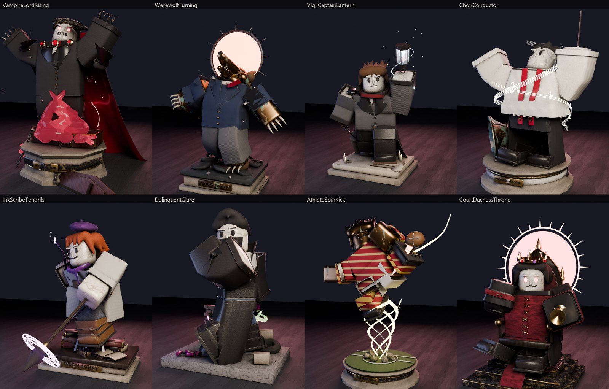
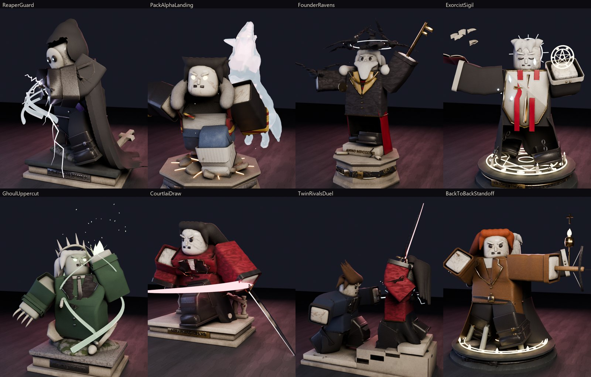
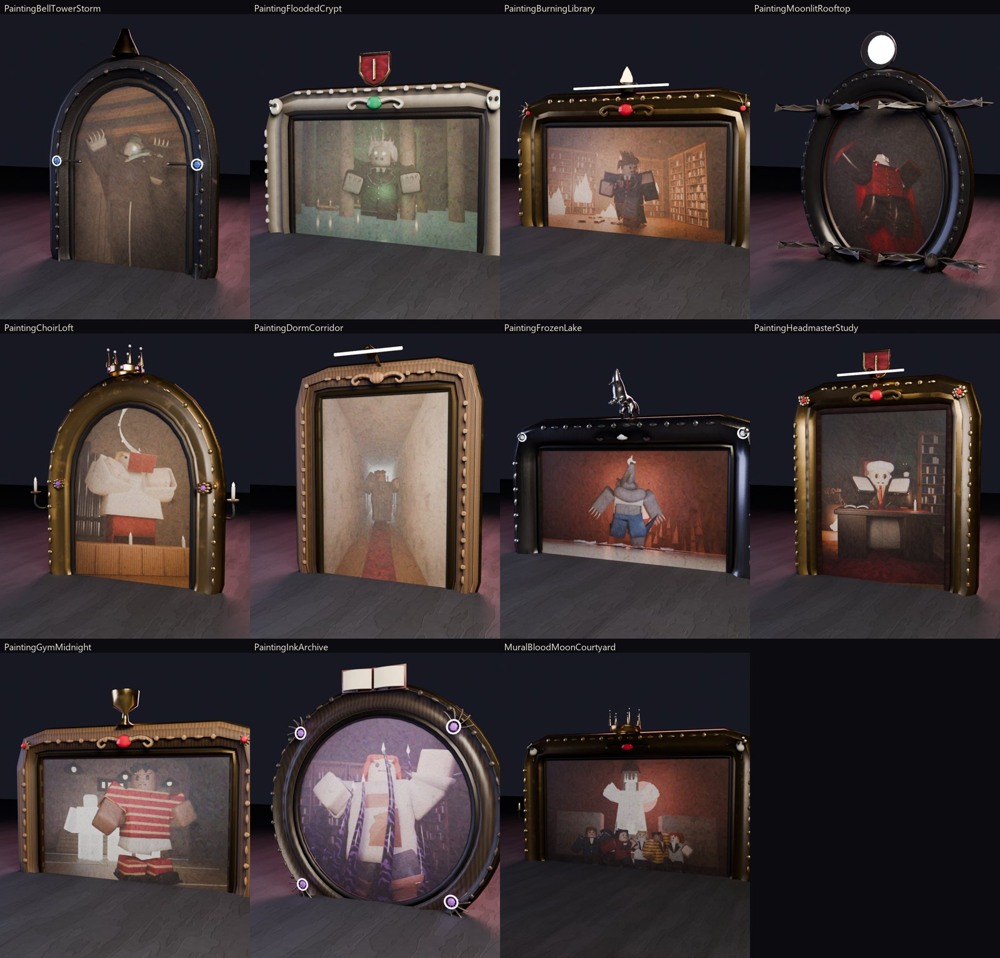
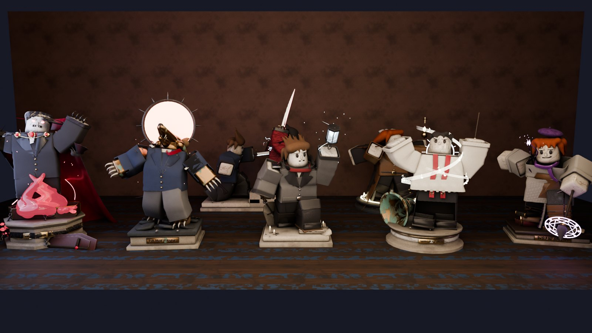
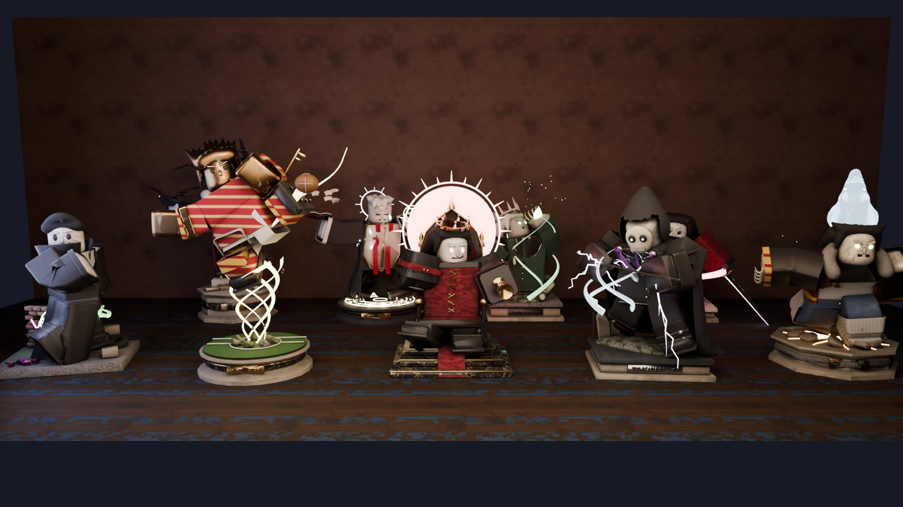
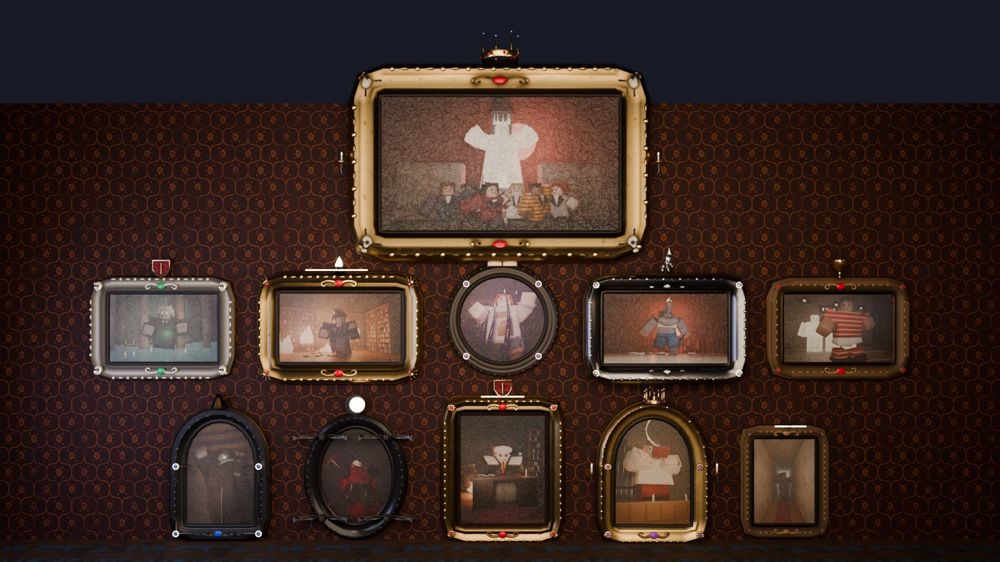

**In Studio (2026-11-10):** the same `tools/props/art_showpiece_templates.luau` makes the 27 templates (NHBuildKit `Showpiece`). Every piece takes its prop's maps; each Canvas takes `<Prop>_canvas`, `_canvasnormal` and `_canvasrough`. Glow and Glow2 are Neon in the colours above, Glass is see-through (0.45) in its colour. The lights and ParticleEmitters from the effects table are on the named pieces, using textures the game already loads (smoke, embers, fire, sparkle, dust); the lantern, the reaper's lightning, the duel's crossing and the paintings' sconces are tagged `NHCandle` to flicker. Not added yet: the Beams and Trails (they need attachment points at blade tips and batons). Statues and set-pieces collide (Main precisely); paintings don't. `tools/props/showcase_art_showpiece.luau` puts the statues in workspace.NHPropsShowcase["Showpiece Statues"] at z -760 (x -235 to -35) and the paintings and mural in ["Showpiece Paintings"] at z -790 (x -235 to -111, bottoms at 2.5, the mural at 1.5).

## Batch 45 (interiors): the shop, bookshop and cafe interiors kit

`art/props/nh_props_batch45.py`. Homes phase 2 (`docs/superpowers/specs/2026-11-06-homes-interiors-design.md`): the shared building interiors the builder places by hand in the Map place. A Victorian-gothic general store (**MORROW & VANE**, Purveyors of Sundries), a dark bookseller (**LANTERNLIGHT BOOKS**) and a candlelit cafe (**THE WICK & KETTLE**), in the house look of batches 34-43: cast iron, black marble, crimson enamel, brass and gilt, glass, ink and paper, with wood only for the books, crates and accents. It has 30 props, each built around one signature idea, and none repeats the existing cafe, library or shop props (CafeBooth, ChalkMenuStand, BakeryCase, ServingCounter, KitchenShelf, SpecimenJars, CuriosityCabinet, CratePile, BookCart and the rest). All names, labels, titles and authors are invented; prices are in yen.

- **Printed atlas:** `art/props/interiors_atlas.py` (system Python with PIL and numpy, on `dorm_atlas.py`'s Cell and Atlas) paints `InteriorsPrint` (4096; colour, gilt and height). It is a bake source only, so it isn't uploaded. It holds:
  - the shop board (MORROW & VANE, Purveyors of Sundries, Established 1851), the M & V monogram, the OPEN / CLOSED faces, PROPRIETOR ONLY
  - the brass yard rule, the till's key caps, sale flags and plates (AMOUNT PURCHASED, VESPER-CROSS REGISTER CO.), the TRUE MEASURE scales dial, the crimson wrapping paper and eight price tickets
  - 24 apothecary drawer labels and the APOTHECARY header, eight sweet-jar labels and the CONFECTIONS header, eight painted postcards and four pamphlets, the POSTCARDS sign
  - five sack stencils, six crate stencils and seven tin labels
  - ten new-release covers (THE LANTERN BELOW by Ottoline Marsh, RAVENS OF GREYHALLOW by Silas Wren, A GRAMMAR OF SHADOWS, THE NIGHT MATRON, SALT & BONE, THE BELL TOLLS THRICE, INK IN THE WATER, THE LAST VIGIL, WHAT THE OWLS KEPT, ONE HUNDRED CANDLES), the LANTERNLIGHT BOOKS plate, NEW THIS MOON, the handwritten STAFF PICKS card and the chalked BARGAINS slate
  - the cafe's gilt script name board, six jar labels and the RING FOR SERVICE card

  Its regions are in `art/props/interiors_atlas.json`. The old bindings on the bookshop's shelves come from the library atlas (batch 30).
- **Run:** `E:/NH-Work/props45/`.
  - `run45.py` runs nh_props without editing its import list (`--check` counts tris, `--quick` workbench views, `--fast` previews without baking, `--previewonly` re-renders previews on the exported FBX meshes).
  - `bake45.sh all|<Prop>` bakes at 2048 with 64 samples on the GPU, holding a shared bake slot (`E:/NH-Work/bakeslots/slot1|slot2`).
  - `sheet45.py`, `render45.py`, `upload45.py`, `names45.py` and `docs45.py` make the contact sheets, staged renders, upload folder and this section.
- **Files:**
  - FBX in `art/props/fbx/interiors-batch45/`
  - maps in `art/props/textures/<Prop>_*.png` (2048)
  - previews in `art/props/previews/` (`<Prop>_open.png` for the doors and the till drawer)
  - upload copies (all at 1024) in `art/group-upload/interiors-batch45/`: 120 maps, 30 props, with the metal maps that are entirely black left out
  - contact sheets and renders in `art/props/renders/interiors-batch45/`
- **Pieces:** each prop is one mesh named after it, except:
  - `ShopCounterCorner`: Main + Glass + Glow
  - `ShopCounterEnd`: Main + Door0
  - `CashRegister`: Main + Glass + Drawer0
  - `DisplayCase`: Main + Glass
  - `GlassCabinetTall`: Main + Door0 + Glass
  - `ApothecaryDrawers`: Main + Glass
  - `SweetJarShelf`: Main + Glass
  - `BookshopCounter`: Main + Glass
  - `CafeBarCounter`: Main + Glass + Glow
  - `CafeBackShelf`: Main + Mirror
- **Pivots:** bottom centre, front toward -Y. Wall pieces have their back on the wall plane (y = 0), with the pivot at their lowest point on that plane. ShopSignInterior's pivot is at its board's bottom. Nothing goes below the pivot.
- **Modular counters:** ShopCounter (6.0 long) and CafeBarCounter (6.0) have flush ends and tile end to end on a 6-stud grid; all three shop counter pieces are 2.2 deep with their front on y = -1.1 (the marble nosing to -1.22). ShopCounterEnd's stub meets a ShopCounter's -X end. ShopCounterCorner is a quarter round: as built, a run along X joins its +X face and a run turned -90 (facing -X) joins its +Y face; turn the corner (and the runs) together for the other corners.

### Template notes (NHBuildKit `Interiors`)

- **Kit name:** `Interiors`. Every piece takes its own prop's four maps. No piece uses a shared map set.
- **Collisions:** floor furniture collides on its precise shape (the counters and gate, cabinets, shelves, display case, island, spinner, stand, barrow, easel, table, sacks, crates, stools, umbrella stand, back bars). These don't collide: ShopScales, CounterBell, OpenClosedSign, ShopSignInterior, PriceTagRail, DoorBellBracket (the till collides as a box on the counter, so it can't be walked through; it can also be left non-colliding).
- **Glow** (Neon):
  - `ShopCounterCorner_Glow`: the lamp's oil flame, warm amber (255, 170, 90). Add a PointLight at the flame (1.7 above the counter top, over the lamp's foot): colour (255, 170, 95), brightness 1.2, range 14, shadows on.
  - `CafeBarCounter_Glow`: the candle's flame, warm (255, 160, 80). Add a PointLight at the flame (about 1.0 above the bar top): colour (255, 160, 85), brightness 0.9, range 12, and give it `NHCandle` so it flickers. No ParticleEmitter.
- **Glass** (see-through, about 0.6 transparency): the lamp's chimney and the hurricane shade (clear, 0.7), the till's sale window, the display case's panes, the tall cabinet's door pane (it swings with Door0, as on the CuriosityCabinet), the apothecary's show globes (0.5, so the coloured water reads), the sweet jars (0.55) and the bookshop counter's case doors.
- **Mirror:** `CafeBackShelf_Mirror` is the back bar's black-silvered glass: Reflectance about 0.35, dark tint.
- **Doors and drawers** (the locker system):
  - `ShopCounterEnd_Door0`: the shopkeeper's gate, hinged on the newel on the RIGHT (swing +1), opens out 100 degrees to the front; prompt "Gate / Open", auto-close 6 s.
  - `GlassCabinetTall_Door0` (+ `_Glass`, same hinge): hinged on the left, opens out; prompt "Cabinet / Open".
  - `CashRegister_Drawer0`: the till drawer, slides out 0.7 to the front (`SlideBy`, like the FilingCabinet's drawer); prompt "Till / Open". (The owner's list allowed a Door0 here; a sliding drawer reads better on a till.)
- **No other lights or particles.** The shops are lit by the room's own lamps (the lighting kit, batch 42).

### Showcase placement notes

**Wall pieces** (back on the wall; the suggested bottom height is where the pivot goes on the showcase wall):

| Prop | Bottom on the wall | Notes |
|---|---|---|
| WallShelfStocked | 0 (stands on the floor) | 6.4 wide, 8.6 tall, 1.2 deep |
| ApothecaryDrawers | 0 (stands on the floor) | 6.7 wide, 10.8 tall; the ledge at 3.4 |
| SweetJarShelf | 0 (stands on the floor) | 5.0 wide, 7.4 tall |
| CafeBackShelf | 0 (stands on the floor) | 6.3 wide, 8.2 tall; the back-bar top at 3.4 |
| OpenClosedSign | 4.0 (on a door or its glass) | 1.3 wide, 1.6 tall; hangs 0.12 off the wall |
| PriceTagRail | 2.0 (a shelf edge or counter front) | 4.05 long, 0.73 tall |
| DoorBellBracket | 7.0 (over the inside of a door) | 1.3 tall, reaches 1.3 out |
| HatUmbrellaStand | 0 (stands on the floor) | 2.5 wide, 6.3 tall |

**Ceiling piece:** ShopSignInterior hangs from two ceiling roses whose tops are 4.6 above the board's bottom (its pivot). In a room with a ceiling at height C, put the pivot at C - 4.6; on the showcase, stand it on a plinth or hang it from a frame.

**Small pieces for a plinth (or a counter top at 3.4):** CashRegister (2.1 x 1.5, 2.8 tall), ShopScales (3.3 x 0.9, 2.3 tall) and CounterBell (1.15 x 0.6, 0.5 tall).

### Props

Every piece is under 20k triangles. Every prop is baked at 2048.

**Counter**

| Prop | Tris | Collides | Showcase | Notes |
|---|---|---|---|---|
| ShopCounter | 7.2k | yes | floor | the general store's counter, 6 long, 2.2 deep, 3.4 tall: a black marble top with a brass nosing and a brass yard rule set into it along the front (the draper's measure), three crimson enamel gothic panels with gilt lancets and quatrefoils in a cast-iron frame, a brass kick plate; on the shopkeeper's side a shelf of brown paper bags, twine spools, tied parcels and a ledger. Ends flush, so runs line up end to end |
| ShopCounterCorner | 7.5k (Main 7.2k, Glass 0.2k, Glow 60) | yes | floor | the outside corner: a quarter round 2.2 x 2.2 with its centre on the inside corner, so a ShopCounter run along X and one turned -90 (along Y, facing -X) meet its two flat ends (turn the corner with the runs). A bowed marble top and nosing, three curved crimson panels between fluted iron colonnettes; on top the shop's brass student lamp: Glass is its chimney, Glow its flame, under a crimson tole shade; 5.6 tall with the lamp |
| ShopCounterEnd | 7.4k (Main 4.8k, Door0 2.6k) | yes (the gate too) | floor | the end of a run, 3.0 long: a 1.2 counter stub (its +X end meets a ShopCounter's -X end) closed by a crimson end panel with the gilt M & V monogram, a square iron newel with a brass ball; Door0: the shopkeeper's cast-iron swing gate with a brass top rail, scrolled infill and a PROPRIETOR ONLY plate, hinged on the newel (right-hand hinge) and opening out to the front; a slim latch post with a brass finial |
| CashRegister | 9.8k (Main 8.9k, Glass 12, Drawer0 0.9k) | yes | plinth (counter) | counter piece: an embossed brass till 1.8 wide with scrolled side panels, three stepped rows of ivory key caps on brass stalks (1 to 500 yen and NO SALE), a crested sale window (Glass) with the YEN 4 50 flags up under an AMOUNT PURCHASED plate, the VESPER-CROSS REGISTER CO. maker's plate, a crank on the right; Drawer0: the till drawer with velvet cups and a gilt pull |
| ShopScales | 5.8k | no | plinth (counter) | counter piece: a crimson enamel cast-iron bed on turned feet, a brass scoop pan and a platform with two bell weights, a dial tower between them (the TRUE MEASURE dial, MORROW & VANE), and a stepped marble stand of five graduated brass bell weights; 3.3 wide |
| CounterBell | 1.1k | no | plinth (counter) | counter piece: a brass dome bell with a plunger on a black marble octagon with a crimson enamel skirt and gilt bead, and the RING FOR SERVICE (once will do) card on a little brass easel; 1.15 wide |
| WrapStand | 6.2k | yes | floor | the wrapping stand: two cast-iron gothic A-frame ends on bun feet with gilt quatrefoils, a roll of brown kraft paper and above it the shop's crimson paper printed with gilt crescents and quatrefoils, each drawn over a serrated brass cutter; a twine cone on a spike with its string run up through a brass eyelet on a gooseneck and hanging down; shears on a hook; 2.8 wide, 4.6 tall |

**Display and stock**

| Prop | Tris | Collides | Showcase | Notes |
|---|---|---|---|---|
| DisplayCase | 9.1k (Main 9.0k, Glass 80) | yes | floor | the jeweller's case, 4 wide and 3.4 tall: turned iron legs and a stretcher shelf, a lacquered cabinet with two crimson gothic panels, a sloped-front vitrine (Glass: front, top, sides and back) over crimson velvet holding pocket watches, a roll of rings with gems, cameo brooches, fountain pens, a silver flask, spectacles, an iron key and price tickets |
| GlassCabinetTall | 11.8k (Main 10.8k, Door0 1.0k, Glass 12) | yes | floor | a tall glazed shop cabinet, 3.2 wide and 9.0 tall: lacquered plinth, cast-iron corner posts, crimson gothic side panels, four frosted glass shelves with brass edges (scent bottles, bone china cups and saucers, silver candlesticks and a gift box, ink bottles; boxed candles below), a pointed iron gable with a gilt quatrefoil and finials; Door0 + Glass: the glazed door with a gothic arched head, brass handle and escutcheon (hinge on the left, opens out) |
| WallShelfStocked | 17.9k | yes | wall, 0 (stands on the floor) | wall piece: the store's wall of stock, 6.4 wide, 8.6 tall, 1.2 deep: crimson enamel end frames with scrolled tops and gilt quatrefoils, five shelves with brass ticket edges and price tickets: lamp-oil cans and soap, labelled tins (BLACK TEA, BOOT BLACKING, CANDLE WAX, LAMP WICKS, BISCUITS, MUSTARD, COCOA), jars and boxes, bottles; tallow candles hung in pairs by their wicks from a brass rod; stencilled stock boxes on top and MORROW & VANE on the cornice |
| IslandShelf | 15.0k | yes | floor | the freestanding island shelf, 5.1 long, 2.6 deep, 5.3 tall, stocked both sides: a stepped pyramid of three tiers between crimson enamel end frames edged in gilt with quatrefoils and finials; wire baskets of turnips, onions and black apples with price tickets on the bottom tier, tins, jars and bottles above, boxes and candle bundles on top, a brass ticket holder on the ridge |
| ApothecaryDrawers | 13.0k (Main 11.6k, Glass 1.4k) | yes | wall, 0 (stands on the floor) | wall piece: the apothecary wall, 6.7 wide, 10.8 tall: a lacquered cupboard base with three crimson gothic panels under a marble ledge (3.4) with a brass mortar and pestle and stoppered bottles; 48 crimson-enamelled tin drawers (8 by 6) with brass label frames (RAD. VALER., FOL. MENTH., PULV. OSSIS, LAP. LUNAE, PULV. NOCTIS ...) and knobs, one pulled out full of dried herbs; three great show globes of red, green and violet water (Glass) and the gilt APOTHECARY header (simples, tinctures, remedies for the night). Different from SpecimenJars and the CuriosityCabinet |
| SweetJarShelf | 12.7k (Main 9.3k, Glass 3.4k) | yes | wall, 0 (stands on the floor) | wall piece: the confectioner's shelf, 5.0 wide, 7.4 tall: a lacquered base, three stepped crimson enamel tiers of tall glass sweet jars (Glass) with black and brass lids and oval labels (BAT DROPS, HUMBUGS, SHERBET MOONS, LIQUORICE BONES, VIOLET CREAMS, ACID TEARS, CINDER TOFFEE, MINT GHOSTS), the sweets heaped inside; an open jar, a brass scoop and a rack of paper cones on the counter top; the gilt CONFECTIONS crest |
| PostcardSpinner | 5.4k | yes | floor | the postcard spinner: a cast-iron spindle 6.8 tall on four scrolled feet, a square rack of four faces with six tiers of wire pockets holding painted postcards (the Institution by night, the bell tower, moonrise on Blackwater, a raven, the high street, the old watchers, the chapel, a full moon), a bottom tier of pamphlets (THE NIGHT OMNIBUS, A WALK THROUGH the old crypts, CURFEW, THE HARVEST FAIR), the POSTCARDS one-yen sign and a crowned finial |
| StockSacks | 13.8k | yes (the truck and sacks) | floor | sacks of stock: a cast-iron sack truck with brass grips and rubber-tyred wheels loaded with two sacks, slumped lumpy hessian sacks tied at the neck (FINE FLOUR, BROWN SUGAR) and an open sack of COFFEE beans with its top rolled down and a brass scoop in it, beans spilt; the hessian stencilled MORROW & VANE |
| StockCrates | 11.2k | yes | floor | stacked pine stock crates with stencilled labels, iron corner plates and rope handles: TALLOW CANDLES under INK under an open CARBOLIC SOAP crate packed with straw and candle bundles, LAMP OIL (THIS WAY UP) beside them and SAFETY MATCHES (KEEP DRY) on the floor; the lid leant against the stack, a crowbar, straw on the floor; 4.2 tall. Different from CratePile |

**Bookshop**

| Prop | Tris | Collides | Showcase | Notes |
|---|---|---|---|---|
| BookshopCounter | 5.4k (Main 5.4k, Glass 24) | yes | floor | the bookseller's counter, 5 long, 3.4 tall: a marble top and brass nosing, the gilt LANTERNLIGHT BOOKS plate on the frieze, a locked rare-books case behind two pairs of arched brass-framed glass doors (Glass) full of old bindings; on top a string-tied tower of books, a stack of new covers, an open ledger, a pen and inkwell; two shelves of stock on the bookseller's side |
| NewReleasesTable | 3.6k | yes | floor | the new-releases table: a black marble top 4.4 x 2.6 (2.9 tall) on two cast-iron gothic trestles with gilt quatrefoils, a slatted iron shelf of boxed stock; three stacks of new books face up (THE LANTERN BELOW, RAVENS OF GREYHALLOW, THE LAST VIGIL ...), two books on brass wire stands and the double-sided NEW THIS MOON card on a brass stand |
| BookStandAngled | 2.8k | yes | floor (or against a wall) | the angled book stand: cast-iron side frames with gilt lancet tracery carrying a sloped crimson enamel back with four brass ledges, twelve new books face out (all ten invented covers), the LANTERNLIGHT BOOKS plate on its crest; 3.9 wide, 5.6 tall |
| BargainBinCart | 5.6k | yes | floor | the bargain barrow: a deep galvanised bin on a cast-iron frame with two big spoked iron wheels at the front and turned legs and brass-gripped handles behind, heaped with jumbled second-hand books, the chalked BARGAINS 3 for 10 yen slate (all sales final, no ghosts refunded) hung on its front; 4.3 long |
| StaffPicksEasel | 1.4k | yes (thin) | floor | the staff-picks easel: a cast-iron tripod easel 5.5 tall with a gilt crescent finial, a gilt-framed card in the night shift's hand (STAFF PICKS: The Lantern Below, Ravens of Greyhallow, A Grammar of Shadows) and two of the books face out on its ledge, a crimson ribbon |

**Cafe**

| Prop | Tris | Collides | Showcase | Notes |
|---|---|---|---|---|
| CafeBarCounter | 13.4k (Main 13.2k, Glow 40, Glass 0.2k) | yes | floor | the cafe's high bar, 6 long, 2.2 deep, 4.0 tall: a black marble top with a round nosing, four crimson enamel gothic panels in a cast-iron frame, a brass foot rail 0.7 up on cast-iron bat-wing brackets; on top a brass candlestick in a glass hurricane shade (Glass; Glow the flame), cups of coffee, a stack of saucers, a silver sugar bowl; two shelves of cups behind. Ends flush to line up |
| BarStool | 4.4k | yes | floor | a cafe bar stool, seat 3.0 (for the 4.0 bar): a fluted cast-iron pedestal on four clawed feet, a brass foot ring with spokes and flat gilt quatrefoils at 1.1, a brass swivel collar, a buttoned crimson leather seat and a low curved iron back hoop (at +Y: turn it to face the bar) |
| CafeBackShelf | 14.9k (Main 14.9k, Mirror 12) | yes | wall, 0 (stands on the floor) | wall piece: the cafe's back bar, 6.3 wide, 8.2 tall: a lacquered cupboard with crimson gothic panels under a marble top (3.4) carrying six big labelled bone-china jars (COFFEE, CHOCOLATE, LOOSE TEA, SUGAR, COCOA, BISCOTTI); a black-silvered mirror (Mirror) between iron pilasters behind two shelves of cups and jars on bat-wing brackets, mugs on brass hooks, and the gilt-scripted THE WICK & KETTLE board on the cornice |

**Signs and fittings**

| Prop | Tris | Collides | Showcase | Notes |
|---|---|---|---|---|
| OpenClosedSign | 2.5k | no | wall, 4.0 (on a door or its glass) | wall piece: a brass hook plate with a crescent finial and two fine chains holding a double-sided enamel sign: OPEN (do come in) in crimson on the front, CLOSED (back at dusk) in ink on the back; turn the model 180 to change it (or flip it with a prompt); 1.3 wide, 1.6 tall |
| ShopSignInterior | 5.4k | no | ceiling | ceiling piece: the indoor hanging sign, a double-sided crimson board 5.0 wide with MORROW & VANE, Purveyors of Sundries, Established 1851 in gilt with key-and-crescent roundels, in a cast-iron frame with a pointed-arch cresting, a gilt crescent and finials, hung from an iron rod on two chains to brass ceiling roses. The pivot is at the board's bottom; the roses' tops are 4.6 above it |
| PriceTagRail | 1.3k | no | wall, 2.0 (a shelf edge or counter front) | wall piece: a 4-long brass ticket moulding with six clip-in bone and enamel price tickets (1 to 40 yen) and three kraft tags on twine from little hooks under it; 0.8 tall. Fits the counters' fronts and the shelf edges |
| DoorBellBracket | 2.4k | no | wall, 7.0 (over the inside of a door) | wall piece: a cast-iron back plate in a pointed-arch outline, an S-scroll arm reaching out 1.1, and a brass bell with its clapper on a coiled steel spring; 1.3 tall |
| ShopStool | 3.6k | yes | floor | the shopkeeper's screw stool, seat 2.5: a cast-iron tripod on claw-and-ball feet, an exposed brass screw column with its thread and a knurled lock wheel, a round crimson leather seat with a brass rim, a brass foot ring |
| HatUmbrellaStand | 7.6k | yes | wall, 0 (stands on the floor) | wall piece: the stand by the door: a cast-iron trough with a pierced gilt quatrefoil front and three brass umbrella loops over a zinc drip tray; a back frame rising to a pointed arch with a gilt quatrefoil and a raven on top, three hat pegs with a bowler and a tall hat hung up; two furled black umbrellas (one crimson-handled) and a silver-topped cane; 6.3 tall |

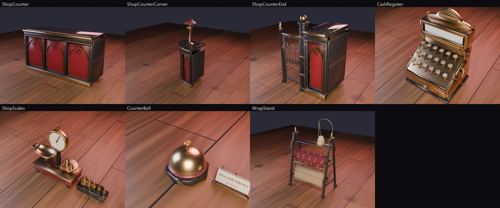
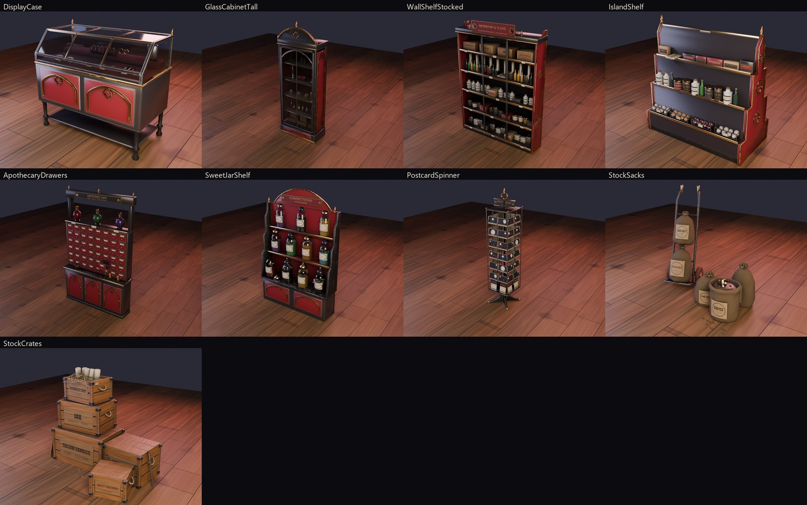
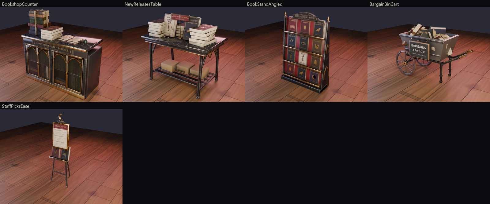
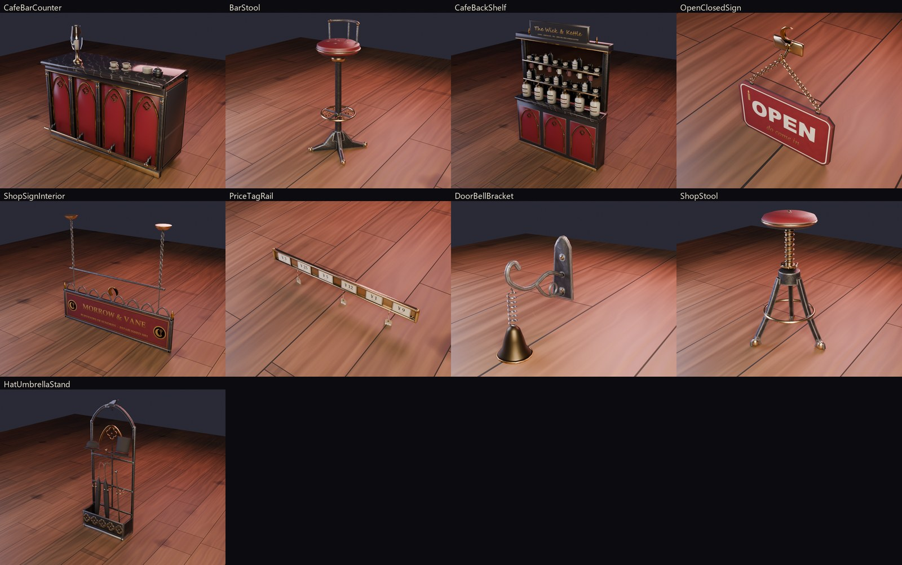
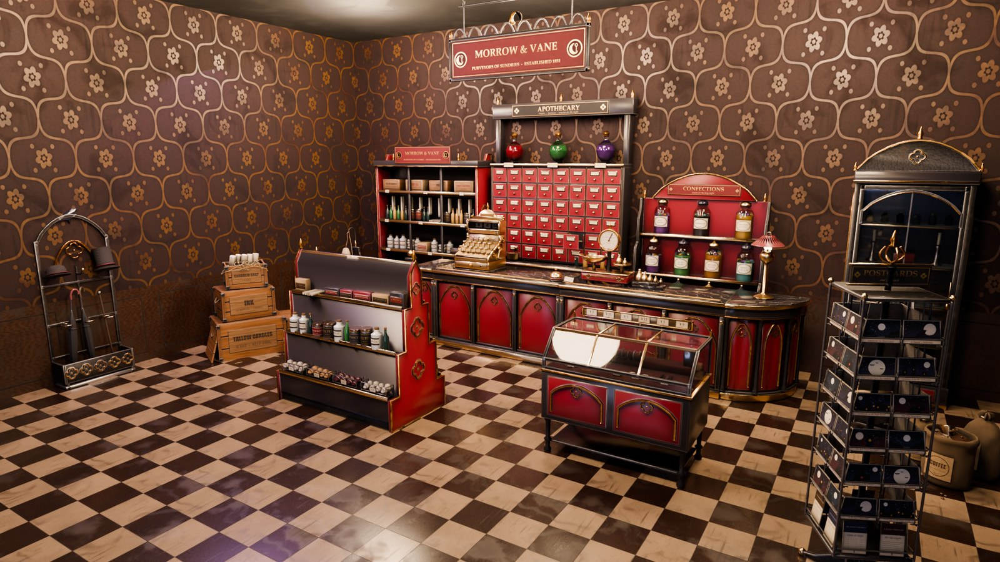
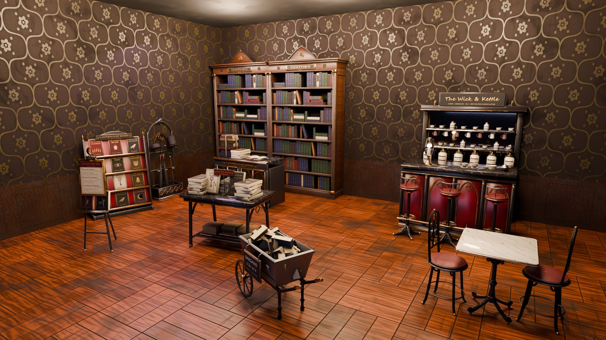

**In Studio (2026-11-10):** `tools/props/shop_kits_templates.luau` makes the 30 templates (NHBuildKit `Interiors`) in ServerStorage.NHProps. Each piece takes its prop's four maps. The two flames are Neon with their PointLights (the cafe candle tagged `NHCandle`), the glass is see-through at the docs' transparencies, and the back bar's mirror reflects at 0.35. The gate (swings out -100), the tall cabinet's door with its pane (100) and the till drawer (slides 0.7 to the front) run on the locker system (`NHLockerProp`: "Gate", "Cabinet" and "Till"). Floor furniture collides on its precise shape. `tools/props/showcase_shop_kits.luau` lines the kit up as the "Interiors" row at z -826, on its own floor slab (ShowcaseFloorShops, z -797 to -905).

## Batch 46 (shops): the armory and the spell shop

`art/props/nh_props_batch46.py`. Homes phase 2: two shared shop interiors the builder places in the town. The **armory** is a monster-hunters' outfitter for the Vigil, built round the game's three weapon classes (katana, fist, claws) and the hunt (silver and ash against vampires, werewolves, ghouls and wraiths); it is iron, steel, silver, leather and crimson, and nothing in it glows. The **spell shop** (Hex and Hollow) is night-violet enamel, brass, black marble and velvet, and it is the one place in this kit where things glow. 29 props, each with its own silhouette and one signature idea. None repeats batch 45's general shop pieces, batch 47's witch-hut pieces, the library's ChainedBookcase / ForbiddenCage / ScrollRack, the seer set, the ArmillarySphere, CelestialGlobe, StarChartRug, SpecimenJars, CrowPerch, TackleDummy or the gym's BowRack. All names, mottoes and designs are invented; no blood or gore anywhere (the claw marks are clean grooves).

- **Which shop is which:** NHBuildKit `Armory` takes the 15 armory props, NHBuildKit `SpellShop` the 14 spell-shop props (the two lists below).
- **Run:** `E:/NH-Work/props46/`.
  - `run46.py` runs nh_props without editing its import list (`--check` counts tris, `--quick` workbench views, `--fast` previews without baking, `--previewonly` re-renders previews on the exported FBX meshes via `fbxswap`).
  - `bake46.sh armory|spell|all|<Prop>` bakes at 2048 with 64 samples on the GPU, holding a shared bake slot.
  - `sheet46.py`, `render46.py`, `upload46.py`, `docs46.py` and `names46.py` make the contact sheets, staged renders, upload folder and this section.
- **Files:**
  - FBX in `art/props/fbx/shops-batch46/`
  - maps in `art/props/textures/<Prop>_*.png` (2048)
  - previews in `art/props/previews/`
  - upload copies (1024) in `art/group-upload/shops-batch46/` (115 maps)
  - contact sheets and the two interiors in `art/props/renders/shops-batch46/`
- **Shared maps:** none. The house crests and the school shield (ShieldWall, KatanaStand, PlateArmourStand) come from batch 43's GymPrint atlas and are baked into each prop's own maps.
- **Pivots:** bottom centre, front toward -Y. Wall pieces have their back on y = 0 with the pivot at their lowest point. No door rigs in this batch: the dagger case is padlocked shut and the wand coffin's glass front is fixed.
- **Square bars:** the builder wraps `nh_props.tube` so square-section bars get outward normals (as built they point in, which the bake's AO turned black and Roblox would cull); the same fix as batch 45. KatanaStand, PolearmRack, Grindstone, HelmShelf, ArmorySign, ClawGauntletDisplay, OddmentsEtagere and SpellShopSign were rebaked with it.

### Template notes (NHBuildKit `Armory` and `SpellShop`)

- **Kit names:** `Armory` for the armory list, `SpellShop` for the spell-shop list. Every piece takes its own prop's four maps.
- **Glass:** SilverDaggerCase_Glass (the sloped lid and front), HuntersReliquary_Glass (the holy-water flasks and the wolfsbane jar), ScryingOrbStand_Glass (the orb), WandCoffin_Glass (the coffin front), PotionHoneycomb_Glass (every bottle), OddmentsEtagere_Glass (the jars): Roblox Glass, about 0.5 transparency (0.3 for the orb, so its mist reads).
- **Glow (Neon), spell shop only:**
  - TetheredGrimoires: `TetheredGrimoires_Glow` (180, 120, 255)
  - PotionHoneycomb: `PotionHoneycomb_Glow` (190, 110, 255), `PotionHoneycomb_Glow2` (120, 255, 150)
  - ScryingOrbStand: `ScryingOrbStand_Glow` (160, 205, 255)
  - WandCoffin: `WandCoffin_Glow` (210, 180, 255)
  - RuneStoneTable: `RuneStoneTable_Glow` (90, 230, 220)
  - ScrollCarousel: `ScrollCarousel_Glow` (220, 230, 255)
  - WaxfallAltar: `WaxfallAltar_Glow` (190, 140, 255)
  - OrreryCounter: `OrreryCounter_Glow` (255, 190, 90)
  - StarChartBanner: `StarChartBanner_Glow` (200, 220, 255)
  - HangingCrystals: `HangingCrystals_Glow` (180, 120, 255), `HangingCrystals_Glow2` (100, 230, 230)
  - FamiliarPerch: `FamiliarPerch_Glow` (255, 180, 60)
  - RuneCircleRug: `RuneCircleRug_Glow` (90, 230, 220)
  - OddmentsEtagere: `OddmentsEtagere_Glow` (170, 255, 120), `OddmentsEtagere_Glow2` (190, 215, 255)
  - SpellShopSign: `SpellShopSign_Glow` (220, 200, 255)
- **Lights and particles** (the template script adds these; positions are from the prop's pivot):
  - Grindstone: light none; particles: optional, while someone uses it: sparks off the wheel's front, colour (255, 190, 110), rate 30, speed 6, lifetime 0.3, size 0.04, spread 25
  - TetheredGrimoires: light PointLight (180, 120, 255), brightness 0.8, range 10, at 3.8 over the plinth; particles: a slow drift of violet motes round the books: colour (190, 140, 255), rate 4, speed 0.3, lifetime 3-5, size 0.08-0.15, light emission 1
  - PotionHoneycomb: light two PointLights in front of the comb at 2.0 and 3.8 (one violet 190, 110, 255, one green 120, 255, 150), brightness 0.6, range 9
  - ScryingOrbStand: light PointLight (160, 205, 255), brightness 0.7, range 9, at the orb (4.25); NHCandle (slow) so the mist breathes; particles: inside the orb: colour (170, 210, 255), rate 6, speed 0.1, lifetime 2, size 0.05-0.1, LockedToPart
  - WandCoffin: light PointLight (210, 180, 255), brightness 0.4, range 5, at the glowing wand tip
  - RuneStoneTable: light PointLight (90, 230, 220), brightness 0.7, range 9, at 3.3 over the table
  - ScrollCarousel: light PointLight (220, 230, 255), brightness 0.4, range 6, at the star (5.9)
  - WaxfallAltar: light two PointLights (190, 140, 255) at 2.3, brightness 1.0, range 12, `NHCandle`; particles: none (the flames are Neon; no fire particles, they would read as real fire)
  - OrreryCounter: light PointLight (255, 190, 90), brightness 0.9, range 10, at the sun (about 5.1 up)
  - StarChartBanner: light none (the stars are small; a SurfaceLight would wash the cloth)
  - HangingCrystals: light PointLight (180, 120, 255), brightness 1.0, range 14, at the big crystal; a second one teal (100, 230, 230), brightness 0.5, range 10; particles: a few sparkles falling off the crystals: colour (200, 180, 255), rate 3, speed 0.5, lifetime 2, size 0.05
  - FamiliarPerch: light PointLight (255, 180, 60), brightness 0.2, range 3, at the owl's eyes (or none)
  - RuneCircleRug: light SurfaceLight or a PointLight 1.0 over the centre (90, 230, 220), brightness 0.5, range 10
  - OddmentsEtagere: light PointLight (170, 255, 120), brightness 0.4, range 5, at the firefly jar (5.2); particles: fireflies in their jar: colour (170, 255, 120), rate 3, speed 0.2, lifetime 2, size 0.03, LockedToPart
  - SpellShopSign: light PointLight (220, 200, 255), brightness 0.6, range 8, at the star (3.0)
- **Collisions:** the Collides column below. Floor furniture collides; signs, wall racks, the rug, the crystals and small clutter don't.

### Showcase placement notes

- **Wall pieces** (bottom height on the wall in the Showcase column): ShieldWall, HelmShelf, CrossbowRack, ArmorySign, PotionHoneycomb, StarChartBanner, SpellShopSign. The two signs are hanging shop signs: their arm sticks out from the wall along the pivot's -Y, the board hangs in the plane at right angles to the wall and is lettered on both faces.
- **Against a wall (floor pieces):** PolearmRack, HuntersReliquary, WandCoffin (its easel legs go 1.3 back), WaxfallAltar, OddmentsEtagere.
- **Ceiling:** HangingCrystals: the pivot is at its lowest point; the ceiling rose's top is 5.2 above it. In a room with a ceiling at height C, place the pivot at C - 5.2. On the showcase, stand it on the floor.
- **Plinth / counter top:** ClawGauntletDisplay (1.8 x 1.0, 2.0 tall) sits on ArmoryCounter (top at 3.18).
- **Pairs:** RuneStoneTable stands on RuneCircleRug (rug top 0.09).

### Props

Every piece is under 20k triangles (the builder decimates anything over 19.5k to 19k). Every prop is baked at 2048.

#### Armory (NHBuildKit `Armory`)

**Weapons**

| Prop | Tris | Collides | Showcase | Notes |
|---|---|---|---|---|
| KatanaStand | 11.3k | yes | floor | A three-tier katana stand in black lacquer with a crimson torii-style top bar (upswept ends) and a Vigil crest plaque: a crimson-sheathed katana, a black one, and on top a katana half drawn to show its blade; 4.6 wide, 3.9 tall. (W x D x H 4.84 x 1.3 x 3.77) |
| PolearmRack | 16.8k | plinth, posts and panel (not the heads) | floor (against a wall) | A monster hunters' polearm rack: a crimson-enamelled plinth banded in black iron with the Vigil crest, two heavy iron posts with silver crescent finials and two loop rails, and five polearms standing broadside with their silver-edged heads up: a halberd, a raven's-beak bec de corbin, a boar spear (silver crossbar lugs, a crimson pennon) in the middle, a tasselled silver pike and a hooked glaive; 4.9 wide, 1.6 deep, 9.0 tall. (W x D x H 5.35 x 1.6 x 9.32) |
| CrossbowRack | 12.0k | no | wall 1.2 | A black iron wall rack of three crossbows standing butt-down, strings drawn: a steel-prod arbalest with its windlass in the middle, a hunting crossbow and a light one either side; a leather bolt case of silver bolts along the bottom rail and a brass BOLT AND BRACE plate; 5.6 wide, 5.3 tall (wall). (W x D x H 5.56 x 0.47 x 5.34) |
| BoltBarrel | 10.9k | barrel only | floor | An iron-hooped oak barrel of hunting ammunition split by an iron cross divider: silver-headed bolts fletched in crimson and bone, longer arrows standing out of one quarter, a SILVER TIPPED brass plate, its lid leaning on the side; 2.2 across, 2.9 tall. (W x D x H 1.99 x 1.63 x 2.74) |
| ClawGauntletDisplay | 6.8k | no | plinth / counter top | A counter-top display for the fist and claw classes: on a raked black iron stand with a crimson velvet bed, a steel Specter-claw gauntlet with three long hooked blades raised on an iron hand-form, a spiked fist gauntlet beside it, a row of brass knuckle-dusters on a rail and two rolled crimson hand wraps; 1.9 wide, 1.1 deep, 1.7 tall (plinth). (W x D x H 1.8 x 1.0 x 1.97) |

**Armour**

| Prop | Tris | Collides | Showcase | Notes |
|---|---|---|---|---|
| PlateArmourStand | 11.3k | yes (the suit and stand as one) | floor | A suit of Vigil plate on a cross-shaped iron stand: a ridged breastplate scored by three claw gouges (a werewolf's, no blood), pauldrons and faulds, a plumed bascinet with a mail aventail, a crimson Vigil tabard and gauntlets hung from the crossbar; 3.0 wide, 6.3 tall. (W x D x H 2.89 x 1.62 x 5.56) |
| MailHauberkStand | 11.3k | yes | floor | A knee-length hauberk of silver mail on an iron dress form: brass-ringed sleeves and hem, a crimson quilted gambeson showing beneath, a mail coif and mantle over the head form, a leather belt with a silver buckle and a price tag reading SILVER MAIL; 2.0 wide, 5.6 tall. (W x D x H 2.54 x 1.68 x 5.25) |
| HelmShelf | 14.7k | no | wall 2.2 | A two-tier black iron helm shelf on scrolled brackets under a gothic arcade with fleur cresting: a gilt-crossed great helm, a lacquered kabuto with a gilt crescent and crimson lacing, a sallet with its bevor, and a wolf-snouted hunter's bascinet with iron ears; 5.4 wide, 1.2 deep, 4.9 tall (wall). (W x D x H 5.3 x 1.76 x 4.84) |
| ShieldWall | 8.2k | no | wall 1.6 | A wall of house arms on a black iron trellis: the school's great shield over two crossed silver-headed spears, the five house shields round it (Crimson, Ravens, Rovers, Vigil, Wardens), spear-tipped top rail, a brass HOUSE ARMS plate; 6.6 wide, 6.7 tall (wall). (W x D x H 6.56 x 0.32 x 6.44) |

**The shop**

| Prop | Tris | Collides | Showcase | Notes |
|---|---|---|---|---|
| ArmoryCounter | 12.4k | yes (body and top; not the scale or bell) | floor | The armourer's counter: crimson-enamelled steel banded and riveted in black iron, a portcullis grille panel with spiked feet either side of a crossed-katanas roundel, a black marble top with a brass blade-length rule inlaid along its front, a brass balance weighing silver shot, a ledger with quill and ink, a service bell and a tray of silver bullets; 6.6 wide, 2.4 deep, 3.9 tall. (W x D x H 6.7 x 2.38 x 4.39) |
| SilverDaggerCase | 12.5k (Main 12.4k, Glass 0.0k) | yes | floor | A locked display case of hunters' silver on iron legs with lion-claw feet: silver daggers fanned on crimson velvet with four silver-capped ash stakes and a silver rosary, under a sloped glass lid (Glass) barred by an iron cross-hasp and padlock; a SILVER ASH IRON plate; 3.8 wide, 1.9 deep, 3.4 tall. (W x D x H 3.88 x 1.89 x 3.38) |
| HuntersReliquary | 18.7k (Main 17.6k, Glass 1.1k) | yes | floor (against a wall) | A limestone reliquary shelf under a pointed arch and silver cross, against the night: holy-water flasks with cross stoppers (Glass), tins and pouches of silver shot, a bundle of ash stakes, a jar of wolfsbane, a garlic braid on the jamb and a rosary over the top shelf; a brass AGAINST THE NIGHT plate; 3.6 wide, 1.4 deep, 7.6 tall. (W x D x H 3.3 x 1.55 x 7.85) |
| Grindstone | 5.4k | yes | floor | A treadle grindstone: a sandstone wheel on a cast-iron A-frame dipping into an iron water trough, a crank and treadle pedal, a copper drip can over the wheel, a tool rest with a blade on it and a side tray with a whetstone and oil can; 1.9 wide, 3.4 deep, 3.3 tall. (W x D x H 1.95 x 2.67 x 3.35) |
| BeastPell | 9.6k | yes (post, torso, head; the arms too, so it can be hit) | floor | A beast-fighting pell for fist and claw training: a leather-hide torso on an iron post with three spring-loaded striking arms (coiled springs at the joints), a riveted iron wolf mask for a head, claw-scored hide, on a bolted iron cross foot weighed down with sandbags; 2.6 wide, 2.6 deep, 6.4 tall. (W x D x H 1.91 x 3.19 x 6.06) |
| ArmorySign | 10.0k | no | wall 4.6 (the arm sticks 3.7 out) | The hanging sign: a scrolled wrought-iron bracket off the wall holding a crimson enamel shield on two rings, crossed silver katanas over three claw slashes, and IRON VIGIL / ARMOURER in gilt on both faces; 3.6 out from the wall, 3.9 tall (wall; pivot on the wall plate). (W x D x H 0.6 x 3.73 x 3.4) |

#### Spell shop (NHBuildKit `SpellShop`)

**Books, scrolls and runes**

| Prop | Tris | Collides | Showcase | Notes |
|---|---|---|---|---|
| TetheredGrimoires | 20.2k (Main 17.7k, Glow 2.5k) | plinth only (players walk under the books) | floor | Five grimoires that will not stay shelved: they float over an octagonal black marble plinth, straining upward at the taut iron chains that moor them to its bollards, boards ajar and loose pages drifting, a violet sigil glowing on each cover and a glowing rune ring set in the plinth (Glow); 2.8 across, 6.4 tall. (W x D x H 2.92 x 2.75 x 5.96); Glow Glow (180, 120, 255) |
| ScrollCarousel | 15.0k (Main 15.0k, Glow 0.0k) | yes | floor | A revolving brass scroll carousel: three tiers of night-enamel trays on a bronze tripod and centre post, rolled scrolls standing in each tier's gallery with coloured wax seals and ribbons, crowned by a crescent moon cradling a glowing star (Glow); 2.2 across, 6.6 tall. (W x D x H 1.94 x 2.03 x 6.35); Glow Glow (220, 230, 255) |
| RuneStoneTable | 5.6k (Main 4.2k, Glow 1.4k) | yes (stones and top; not the floating stones) | floor | A rune-casting table: a round slate top on three squared standing stones, a glowing rune ring cut round its rim (Glow), a brass casting bowl, scattered carved rune stones and a velvet bag, and three stones hanging in the air over the centre, their runes lit (Glow); 3.0 across, 3.6 tall. (W x D x H 2.94 x 2.94 x 3.72); Glow Glow (90, 230, 220) |
| RuneCircleRug | 5.6k (Main 2.4k, Glow 3.2k) | no (flat) | floor | A round rug of deep violet wool with a crimson border and fringe, a glowing rune circle worked into it (Glow): two rings, a seven-pointed star, a crescent at the centre and runes between the rings; 8.4 across, flat. (W x D x H 8.4 x 8.4 x 0.09); Glow Glow (90, 230, 220) |
| StarChartBanner | 5.2k (Main 3.4k, Glow 1.8k) | no | wall 0.8 (rod at 7.15) | A star-chart banner of indigo cloth on an iron rod with crescent finials: five gilt-threaded constellations whose stars glow (Glow), a great gilt crescent at the top and a sun medallion near the hem, a gilt border and a dagged hem with tassels; 4.2 wide, 7.6 tall (wall). (W x D x H 4.66 x 0.47 x 7.35); Glow Glow (200, 220, 255) |

**Potions, crystals and curios**

| Prop | Tris | Collides | Showcase | Notes |
|---|---|---|---|---|
| PotionHoneycomb | 17.1k (Main 9.8k, Glass 5.5k, Glow2 0.6k, Glow 1.2k) | no | wall 1.2 | A brass honeycomb wall of potions: 21 hexagonal cells backed in night-violet enamel, each holding a different bottle (round, tall, cone, bulb, square, heart) of glowing violet or green elixir (Glow, Glow2), a gilt crescent on top and an ELIXIRS plate below; 5.6 wide, 0.6 deep, 5.0 tall (wall). (W x D x H 5.4 x 0.6 x 4.75); Glow Glow (190, 110, 255), Glow2 (120, 255, 150) |
| OddmentsEtagere | 11.1k (Main 8.4k, Glass 1.4k, Glow 0.7k, Glow2 0.5k) | yes | floor (against a wall) | A tall narrow black iron etagere of strange ingredients under a pointed arch: four shelves of glass jars (Glass) holding fireflies and glowing toadstools (Glow), a storm cloud with its lightning (Glow2) and drifting star dust, raven feathers, quartz points, moon salt and snail shells, each with a paper label; 2.2 wide, 1.0 deep, 7.2 tall. (W x D x H 2.14 x 1.04 x 7.29); Glow Glow (170, 255, 120), Glow2 (190, 215, 255) |
| HangingCrystals | 13.6k (Main 8.5k, Glow 3.2k, Glow2 1.9k) | no | ceiling (5.2 from the rose to the lowest point) | A ceiling cluster of glowing quartz: an iron ring hung on three chains from a ceiling rose, nine quartz points on fine chains at different drops round it and a great double cluster in the middle, violet and teal (Glow, Glow2), with brass caps; 3.0 across, 5.2 from the ceiling plate to the lowest point (ceiling). (W x D x H 2.72 x 2.64 x 5.2); Glow Glow (180, 120, 255), Glow2 (100, 230, 230) |
| ScryingOrbStand | 7.1k (Main 5.6k, Glass 1.0k, Glow 0.6k) | yes | floor | A scrying orb held up in a cupped bronze hand on a three-strand twisted bronze column: the orb (Glass) holds a spiral of pale mist round a bright core (Glow), and three silver moon-phase lenses on curling arms circle it; 2.4 across, 5.0 tall. (W x D x H 1.96 x 2.01 x 4.8); Glow Glow (160, 205, 255) |
| WandCoffin | 7.6k (Main 7.4k, Glow 0.1k, Glass 0.0k) | yes | floor (against a wall) | A coffin-shaped wand case stood up on a black iron easel, leaning back: black lacquer with gilt corner fittings, seven wands of ebony, bone, twisted oak, silver and crystal laid across in plum velvet behind a coffin-shaped glass front (Glass) with a brass cross, the crystal-tipped wand glowing (Glow), and a WANDS CHOOSE plate on the ledge; 1.6 wide, 1.9 deep, 4.2 tall. (W x D x H 1.5 x 2.03 x 4.36); Glow Glow (210, 180, 255) |

**The shop**

| Prop | Tris | Collides | Showcase | Notes |
|---|---|---|---|---|
| OrreryCounter | 15.4k (Main 14.9k, Glow 0.4k) | yes (body and top; not the orrery) | floor | The spell shop counter: night-violet enamel between brass pilasters, a row of silver moon-phase medallions along the front, a black marble top; on it a great brass orrery (a glowing sun, Glow, five planets on arms, one ringed, one with a moon), a brass till and an open ledger; 6.4 wide, 2.4 deep, 5.4 tall. (W x D x H 6.32 x 2.47 x 5.37); Glow Glow (255, 190, 90) |
| WaxfallAltar | 9.4k (Main 7.2k, Glow 2.1k) | yes | floor (against a wall) | A black marble altar of three steps crowded with burned-down pillar candles whose wax has poured down every riser in a frozen waterfall, violet flames (Glow); an open spellbook on a gilt stand on top and a tall pointed backboard with a glowing moon sigil (Glow); 3.6 wide, 2.6 deep, 6.0 tall. (W x D x H 3.44 x 2.67 x 5.9); Glow Glow (190, 140, 255) |
| FamiliarPerch | 6.9k (Main 6.6k, Glow 0.3k) | column and foot | floor | A familiar's perch: a brass T-perch with seed and water cups on a twisted iron column and marble foot, a bronze crescent arching over it with a little bell, and a great horned owl on the bar, ear tufts up, amber eyes glowing (Glow), a brass message tube on its leg; 2.2 wide, 1.6 deep, 6.4 tall. (W x D x H 2.38 x 1.59 x 6.15); Glow Glow (255, 180, 60) |
| SpellShopSign | 10.5k (Main 10.4k, Glow 0.0k) | no | wall 4.8 (the arm sticks 3.3 out) | The spell shop's hanging sign: a wrought-iron arm off the wall holding a bronze crescent moon that cradles a glowing star on a chain (Glow), and beneath it a pointed night-enamel board lettered HEX AND HOLLOW / spells charms oddments in gilt on both faces; 3.3 out from the wall, 4.4 tall (wall; pivot on the wall plate). (W x D x H 0.5 x 3.4 x 4.1); Glow Glow (220, 200, 255) |

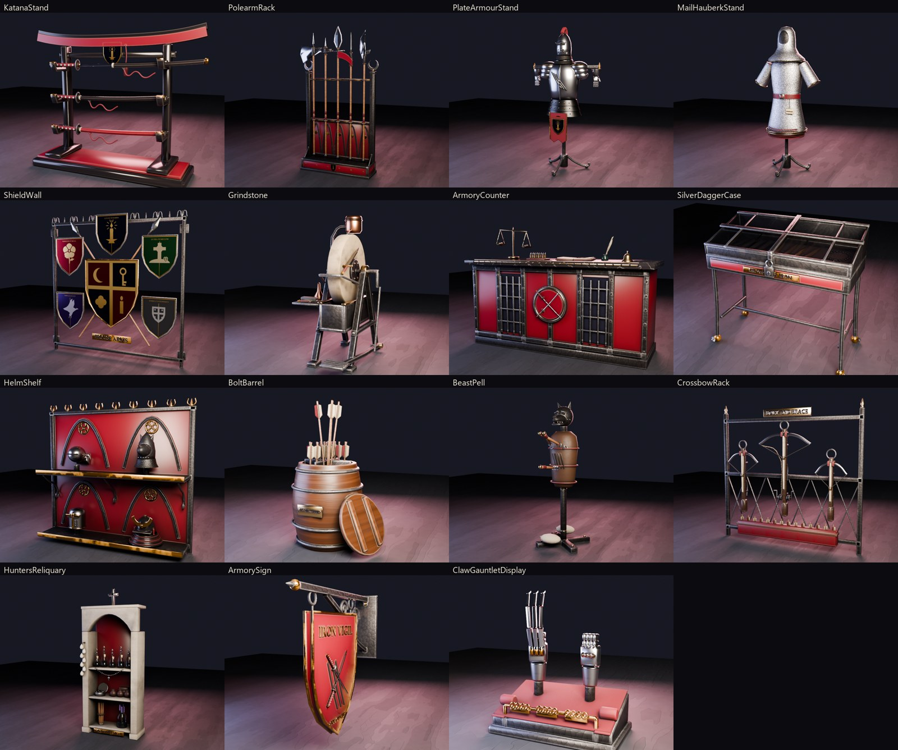
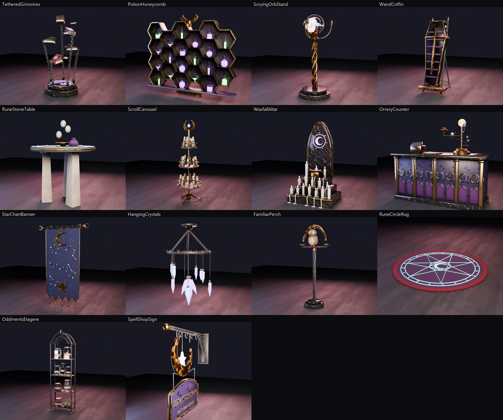
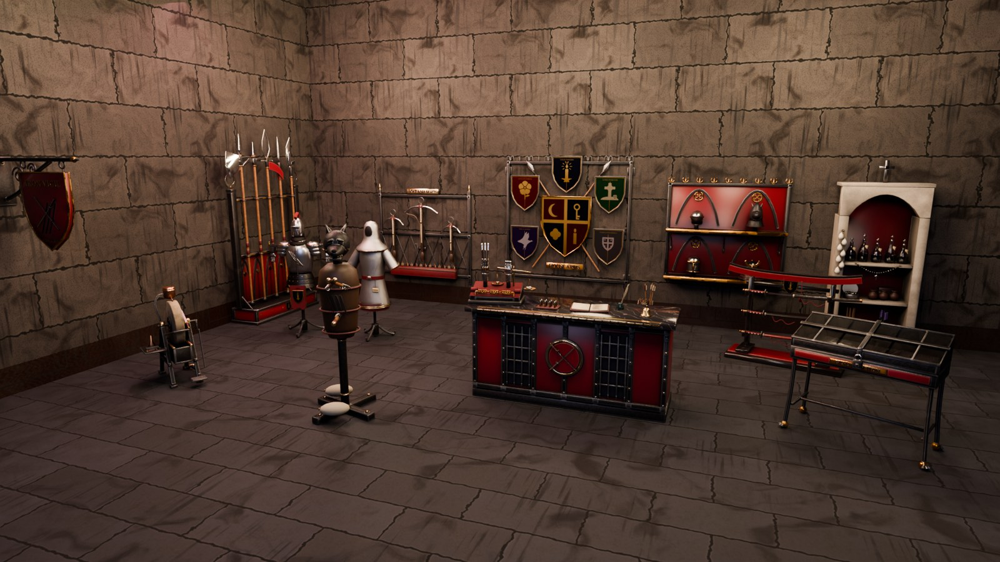
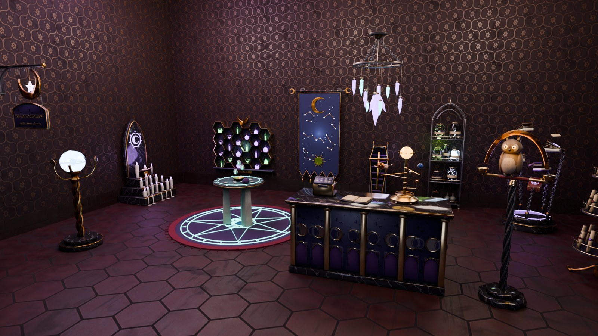

**In Studio (2026-11-10):** the same `tools/props/shop_kits_templates.luau` makes the 29 templates (NHBuildKits `Armory` and `SpellShop`). The spell shop's glows are Neon in the colours above with their PointLights (the scrying orb and the waxfall altar tagged `NHCandle`), plus four particle effects: the grimoires' violet motes, the mist in the orb, the crystals' falling sparkles and the fireflies in their jar. The grindstone's optional sparks are left out. Props marked "Collides: no" don't collide, and the rest collide on their precise shape. The showcase rows are "Armory" at z -862 and "Spell Shop" at z -898, with the rune-stone table standing on its rug.

## Batch 47 (witchhut): the witch hut kit

`art/props/nh_props_batch47.py`. Homes phase 2: a crooked, hand-built, mossy witch's hut for the builder to put up in the woods by the town, inside and out. The house look gives way here to weathered oak, wattle and lime daub, mossy fieldstone, reed thatch and mossy shingles, with hand-forged iron, bone, horn, wax, old bottle glass and patchwork mixed in. The witchy glow (sickly green, faint violet) is only on the magical pieces: the brew, the wisp, the spellbook's sigils, the moon-dew jar, the fairy ring and one charm. Everything else is lit by fire and candle. It is rustic and lived-in, not a shop: the spell shop (batch 46) has the potion wall, crystal ball, wand case and spellbook shelf. There is no blood or gore anywhere, only animal skulls (a goat, a fox, birds), bones, feathers and bottles. It has 26 props: 10 hut pieces and 16 things for inside and around it, each with one signature idea. All text and designs are invented.

It doesn't repeat the existing kits. Next to the garden's MushroomRing (tall, pale, blue gills), PumpkinPatch and StoneLanternPost, the electives' freestanding HerbDryingRack, the gothic Fireplace and CastIronRange, the lounge's SpiritKettle, the library's raven Lectern and the rugs, this kit's ToadstoolRing, GourdPile, WispLanternPost, HerbBeamRack, HearthKettle, SpellLectern and BraidedRug are rustic, hand-made versions with a different silhouette.

- **Printed atlas:** `art/props/witchhut_atlas.py` (system Python with PIL and numpy, on `dorm_atlas.py`'s Cell and Atlas) paints `WitchPrint` (4096; colour, gilt and height). It is a bake source only, so it isn't uploaded. It holds:
  - 16 hand-written jar labels on torn parchment: Moonwort, Wolfsbane, Black Salt, Moon Dew, Toadstool, Crow Quills, Mandrake, Hemlock ("NOT for tea"), Willow Bark, Elderflower, Fen Moss, Dried Moths, Spider Silk, Hag Stones, Thistle Seed and Rue
  - the spellbook's two pages: a moon circle with a finding charm, and moonwort and rue with a pressed leaf
  - four loose notes: a moon calendar, a hiccup remedy ("ask the cat"), a toadstool study and a list of chores
  - ten stitched spellbook spines, the patchwork quilt, the braided rug's coils, the door's hex sign and six burnt sigils for the tags

  Its regions are in `art/props/witchhut_atlas.json`.
- **Run:** `E:/NH-Work/props47/`.
  - `run47.py` runs nh_props without editing its import list (`--check` counts tris; `--quick` makes workbench views; `--fast` previews without baking; `--previewonly` re-renders a preview from the exported FBX).
  - `bake47.sh all|<Prop>` bakes at 2048 with 64 samples on the GPU, holding a shared bake slot.
  - The builder is put together from `src/part*.py` by `asm.sh`.
  - `sheet47.py`, `render47.py`, `upload47.py` and `names47.py` make the contact sheets, staged renders and upload folder.
- **Files:**
  - FBX in `art/props/fbx/witchhut-batch47/`
  - maps in `art/props/textures/<Prop>_*.png` (2048)
  - previews in `art/props/previews/` (plus `HutWallDoor_open.png`)
  - upload copies (all at 1024) in `art/group-upload/witchhut-batch47/`: 94 maps (26 props x 4, less the all-black metal maps)
  - contact sheets and renders in `art/props/renders/witchhut-batch47/`
- **Pieces:** Main (named after the prop when it is the only piece), plus:
  - `_Glow`: green or violet neon (see below)
  - `_Glow2`: fire and candle flames
  - `_Glass`
  - `_Leaves`: alpha-cut cards on batch 40's shared `NH_GardenLeaves` set (ivy, grass, fern, lavender, herbs)
  - `_Door0`: HutWallDoor's door
- **Pivots:** bottom centre, front toward -Y (Roblox -Z), nothing below the pivot, except the hut's roof pieces, which sit on the wall plate like the roof kit's (see the snap table). Wall-hung pieces have their back on y = 0.

### Building the hut (the snap grid)

The hut goes up on an **8-stud grid**. The standard hut is **24 × 16** between post centres: three walls on each long side, two on each end, and a 45° thatched roof whose ridge runs along the middle. The walls stand on a rubble footing, so the **floor is 1.6 above the ground**, and the **wall plates' top is at 12.6**. Put a Part floor (FloorPlanks or OldBoards) at 1.6 inside.

| Piece | Size | Pivot | Where it goes |
|---|---|---|---|
| HutPost | a 2.0 pier to 1.6, a 1.45 post to 12.6 | ground, on the post centre | at every corner and every joint between walls (every 8 along a wall line). A 24 × 16 hut takes 10. |
| HutFooting | 8 long, 1.8 wide, top 1.6 | ground, mid-run | on a wall line between two posts. Its ends tuck into the piers. |
| HutWall, HutWallWindow, HutWallDoor | 8 between post centres, 11 tall, 0.9 thick | the floor (1.6), mid-run, on the wall's centre line | on a footing between two posts, the outside facing out. Their ends tuck into the posts. |
| HutGable | 16 wide, 8.7 to the apex | the wall plates' top (12.6), on the end wall's centre line, mid-end | on a 16-wide end, over its two walls, the skull and owl hole outward |
| HutRoof | one 45° slope, 8 long (the thatch runs 1 past each end, overlapping its neighbours) | the wall plates' top (12.6) at the long wall's centre line | one per 8 along each long wall. Turn the back slope 180°. The eaves hang 1.6 below the plate and 2.4 out, and the slopes meet over the centre line. |
| HutRidge | 8 long (overlaps like the roof), the roll's top 12.05 above its pivot | the wall plates' top (12.6), on the hut's centre line | one per 8 along the ridge. It also carries the ridge pole inside. |
| HutChimney | base 4.4 × 2.8, about 30 tall | ground, its back on the gable wall's outside face | against a gable end (the end wall's line + 0.45). It leans away from the wall. Put HearthKettle inside on the same spot. |
| HutPorch | 8.8 × 5 deck at 1.6, steps to 8.1 out | ground, on the door wall's centre line | under HutWallDoor. Its shingle lean-to tucks under the thatch eaves. |

Other sizes work on the same grid (16 × 16, 32 × 16). Keep the ends 16 wide for the gable and the 45° roof.

### Template notes (NHBuildKit `WitchHut`)

- **Kit name:** `WitchHut`. Every piece takes its own prop's four maps, except the `_Leaves` pieces, which take batch 40's `NH_GardenLeaves` maps (already under the group). Give those AlphaMode = Transparency and turn DoubleSided on. The FBX keeps their custom normals.
- **Collisions:**
  - **The hut pieces collide** on their precise shape: footings, posts, walls (the door opening stays clear), gables, roofs and ridges (so nobody falls through), chimney and porch (deck, steps, posts, rails; not the charms).
  - **Floor furniture collides:** WitchCauldron (pot and hearthstones, not the flames), HearthKettle (stone and hearthstone, not the fire), StrawBed, WitchWorkTable, SpellLectern, WitchHatStand (trunk only), SpellNoteShelf, WitchJarShelf (shelves), BroomCorner (bucket and brooms), CatBasket (basket), GourdPile, WispLanternPost (cairn and staff).
  - **These don't collide:** BraidedRug (flat), ToadstoolRing (walk through it, at your own risk), HerbBeamRack, BoneChimes, and every `_Glow`, `_Glow2`, `_Glass` and `_Leaves` piece.
- **Door:** `HutWallDoor_Door0` swings out (toward the porch) on its left hinge. Its FBX origin is on the hinge line at the door's foot, on the wall's outside face. Rig it like the other `Door0` pieces on the locker system (prompt "Door / Open", PivotOffset = the hinge, swing about 100°). The opening behind it is 4.0 wide and about 7.4 tall.
- **Glass:**
  - HutWallWindow's diamond-leaded panes: old green glass, transparency about 0.4
  - WitchJarShelf's jars: clear, about 0.5
  - BoneChimes' shards and bead: sea-green, about 0.3
  - WispLanternPost's panes: smoky green, about 0.4
- **Glow colours (Neon):**

| Piece | Colour | What |
|---|---|---|
| WitchCauldron_Glow | sickly green (120, 255, 90) | the brew, its bubbles, the slop over the rim |
| WitchCauldron_Glow2 | fire (255, 150, 60) | embers and flames under the pot |
| HearthKettle_Glow2 | fire (255, 150, 60) | embers and low flames |
| SpellLectern_Glow | faint violet (170, 90, 255) | the moon circle and crescent on the left page |
| SpellLectern_Glow2, WitchWorkTable_Glow2 | candle (255, 150, 60) | candle flames |
| WitchJarShelf_Glow | green (120, 255, 90) | the moon dew and the glow-worms in their jars |
| WispLanternPost_Glow | sickly green (120, 255, 90) | the will-o'-the-wisp in the lantern |
| ToadstoolRing_Glow | violet (170, 90, 255) | the gills of the small violet toadstools |
| CatBasket_Glow | cat-eye (190, 255, 80) | the one eye open a slit |
| HutPorch_Glow | violet (170, 90, 255) | the crystal charm |

- **Lights for the template script** (positions from the pivot in studs, as (right, up, forward), forward being toward the prop's front):

| Prop | Light | Colour | Brightness | Range | Where |
|---|---|---|---|---|---|
| WitchCauldron | PointLight | (120, 255, 90) | 1.2 | 14 | over the brew (0, 3.4, 0) |
| WitchCauldron | PointLight, flickers | (255, 150, 60) | 1.5 | 16 | in the fire (0, 0.8, 0) |
| HearthKettle | PointLight, flickers | (255, 150, 60) | 1.6 | 18 | in the fire (0, 1.4, 1.5) |
| SpellLectern | PointLight, flickers | (255, 180, 110) | 0.8 | 8 | at the candle (1.6, 4.0, 0.1) |
| SpellLectern | PointLight | (170, 90, 255) | 0.3 | 5 | over the open book (0, 4.4, 0) |
| WitchWorkTable | PointLight, flickers | (255, 180, 110) | 0.7 | 8 | at the candle (3.0, 4.0, -1.1) |
| WitchJarShelf | PointLight | (120, 255, 90) | 0.35 | 5 | at the moon-dew jar (0.25, 1.2, 0.55) |
| WispLanternPost | PointLight, a slow pulse | (120, 255, 90) | 1.0 | 14 | in the lantern (1.7, 6.3, 0.2) |
| ToadstoolRing | PointLight | (170, 90, 255) | 0.4 | 8 | in the middle (0, 0.8, 0) |
| HutPorch | PointLight | (170, 90, 255) | 0.2 | 4 | at the crystal (0.9, 7.6, 4.6) |

- **ParticleEmitters:**

| Prop | Emitter | Colour | Rate | Speed | Lifetime | Size | Notes |
|---|---|---|---|---|---|---|---|
| WitchCauldron | bubbles | (120, 255, 90) | 6 | 1-2 up | 1-1.6 | 0.15 to 0.35 | from a disc r 1.3 at the brew (y 3.1); LightEmission 1 |
| WitchCauldron | green steam | (90, 200, 80), transparency 0.7 | 4 | 0.5-1 up | 3-4 | 1 to 3 | from the brew, drifting |
| WitchCauldron | embers | (255, 150, 60) | 12 | 2-4 up | 1-2 | 0.08 | from the fire; LightEmission 1 |
| WitchCauldron | smoke | (60, 60, 60), transparency 0.8 | 3 | 2 up | 4-6 | 1 to 4 | from round the pot's belly |
| HearthKettle | embers | (255, 150, 60) | 8 | 2-4 up | 1-2 | 0.08 | from the fire |
| HearthKettle | steam | (220, 220, 220), transparency 0.6 | 3 | 1 | 1.5 | 0.2 to 0.8 | from the kettle's spout (about 2.3, 2.6, 0.8) |
| HutChimney | smoke | (70, 70, 72), transparency 0.75 | 2 | 2-3 up | 6-8 | 1.5 to 5 | from the tall pot's mouth (-0.14, 29.2, 1.95); drift with the wind |
| SpellLectern | violet motes | (170, 90, 255) | 2 | 0.3-0.6 up | 2-3 | 0.06 | from the open book; LightEmission 1 |
| ToadstoolRing | fairy motes | (170, 90, 255) | 3 | 0.2-0.5 | 3-5 | 0.08 | over the ring (a disc r 3.2, y 0.5) |
| WispLanternPost | green sparks | (120, 255, 90) | 2 | 0.3 | 1.5 | 0.06 | from the wisp |

### Showcase placement notes

- **The hut:** build one standard 24 × 16 hut on the showcase (posts, footings, walls with a window either side of the door, gables, roofs, ridges, the chimney on one end, the porch). Hang BoneChimes from the porch beam's end, and put WispLanternPost, ToadstoolRing and GourdPile outside.
- **Wall pieces** (back on the wall):

| Prop | Bottom on the wall | Notes |
|---|---|---|
| HearthKettle | 0 (stands on the floor) | 8.85 wide, 10.5 tall; back on the chimney's wall |
| SpellNoteShelf | 0 (stands on the floor) | 5.7 wide, 8.7 tall, leaning a little |
| WitchJarShelf | 2.4 | 5.4 wide, 5.8 tall |

- **The corner piece:** BroomCorner's pivot is the inside corner itself (walls behind it on y = 0 and to its left on x = 0). Turn it to fit the corner.
- **Hanging pieces:** HerbBeamRack (its ropes' toggles 4.2 above its pivot: tie them to a rafter or beam) and BoneChimes (its loop 4.0 above its pivot). Their pivots are their lowest points.
- **Small pieces for a plinth:** CatBasket (4.3 × 3.5, 1.3 tall).

### Props

Every piece is under 20k triangles. Every prop is baked at 2048.

**The hut**

| Prop | Tris | Collides | Showcase | Notes |
|---|---|---|---|---|
| HutFooting | 4.6k (Main 4.5k, Leaves 0.1k) | yes | floor | an 8-long rubble run (top 1.6, 1.8 wide): fieldstones in mossy mortar on both faces, flat capstones, a little arched crawl vent with an iron grate, toadstools and ferns in the damp at its foot; its ends tuck into the piers |
| HutPost | 1.6k (Main 1.6k, Leaves 0.0k) | yes | floor | a rubble pier with fieldstone quoins and a cap (ground to 1.6) under an eight-sided hewn oak post to 12.6, bowed, knotted, swelling into a jowl at the top, a burnt sigil on its face; grass round its foot |
| HutWall | 9.2k (Main 9.1k, Leaves 0.0k) | yes | floor | 8 between post centres, 11 tall: crooked studs, sagging rails and a curved brace, pillowed daub that bellies out and sags between the posts, fresh and old lime patches, cracks running from the timbers, a place where it has fallen off the wattle (both faces), a course of mossy fieldstones along its foot, a fox skull on a nail, three pegs inside; ivy up one end |
| HutWallWindow | 11.2k (Main 11.0k, Glass 0.0k, Leaves 0.1k) | yes (not the glass) | floor | the same wall round a crooked oak casement 2.7 x 3.4 (sill 3.6): diamond-leaded green panes (Glass), one shutter open flat with a burnt moon sigil, the other hanging askew off one hinge, a window box of fern, lavender and nightshade on iron brackets, a string of small bones; a bottle and a candle stub on the inside sill |
| HutWallDoor | 9.3k (Main 7.2k, Door0 2.0k, Leaves 0.1k) | yes (opening clear) | floor | the wall round a 4.0-wide door opening under a soot-dark lintel that slopes: a horseshoe and a rowan cross in red thread over it, a threshold stone, a bird skull with feathers by it. Door0: five crooked planks of different lengths, forged strap hinges with curled ends, clinched nails, the painted hex sign, a carved bone pull outside; ledges, a brace and a latch bar inside (hinge on the left, swings out) |
| HutGable | 7.5k | yes | floor | the 16-wide end triangle (apex 8.7 over the wall plate) on a tie beam: a king post, raking struts and studs, daub with patches of wattle showing, a round owl hole ringed in willow with a perch, a goat's skull with curled horns and a rowan cross under the apex, raking boards under the thatch; a cobweb in the apex inside |
| HutRoof | 13.4k (Main 13.4k, Leaves 0.0k) | yes | floor | 8 long of one 45-degree slope: pole rafters every 2 and hazel battens (the inside of the roof), 1.3 of combed reed thatch with a bell at the eaves, hollows over the rafters, courses, cushions of moss and seeded grass, a hazel ligger and spars along the eaves; the thatch runs 1 past each end and the runs overlap without fighting |
| HutRidge | 7.0k | yes | floor | 8 long: a block-cut sedge ridge roll astride the slopes, its lower edges cut into points, two hazel liggers a side with criss-cross spars, moss; the ridge pole inside where the rafters cross |
| HutChimney | 12.4k (Main 12.2k, Leaves 0.1k) | yes | floor | a leaning fieldstone stack for a gable end, about 30 tall: a wide firebox base, weathered shoulders, the stack leaning out and kinking back, quoins, iron bands tied back to the wall, an oversailing cap, a crooked clay pot with a tin cowl and a broken one, soot, moss, ivy; a cleanout door, an ash heap and logs at its foot |
| HutPorch | 13.9k (Main 13.5k, Glow 0.2k, Leaves 0.2k) | deck, steps, posts, rails | floor | a plank deck on log joists and stone piers (top 1.6, 8.8 x 4.5) with three big stone steps, two crooked tree-trunk posts with forked tops carrying a log beam, a mossy shingle lean-to under the thatch eaves, branch railings; charms on the beam: a bird skull and feathers, three witch bottles, a straw star, a violet crystal (Glow), a hag stone with bells, a tin moon and star; dried herbs tied up |

**The hearth side**

| Prop | Tris | Collides | Showcase | Notes |
|---|---|---|---|---|
| WitchCauldron | 8.7k (Main 5.8k, Glow2 1.1k, Glow 1.9k) | pot and stones | floor | a cast-iron cauldron (rim 3.3, 3.4 across) on three stubby legs over a ring of hearthstones and crossed charred logs: the brew to the rim with bubbles bursting and rings spreading and a slop down the side (Glow, green), embers and flames licking the belly (Glow2); a bail, a long paddle, a bone-handled copper ladle, a toad on a stone, logs to hand |
| HerbBeamRack | 10.0k (Main 9.9k, Leaves 0.1k) | no | hanging | ceiling piece: a crooked hazel ladder 7.6 long slung on four ropes, hung with ten bundles of drying herbs (lavender, fern, nightshade, poppy heads, rose leaves, twigs), a braid of garlic, a string of chillies, a string of dried mushrooms, a copper sickle on an S-hook |
| WitchJarShelf | 12.2k (Main 9.1k, Glass 2.7k, Glow 0.4k, Leaves 0.0k) | shelves | wall 2.4 | wall piece: three crooked plank shelves on forked branch brackets (the middle one sagging), crowded with hand-blown jars (Glass) and their contents, bottles and glazed crocks, every one hand-labelled (wrapped labels, tags on strings); a jar of moon dew and one of glow-worms (Glow), a bird skull, a candle stub, herbs hung under, a cobweb |
| BroomCorner | 5.5k (Main 5.5k, Leaves 0.0k) | bucket, brooms | corner | corner piece: the witch's flying besom (a crooked handle, birch twigs bound in willow, a copper collar, a violet ribbon and a bell) leaning in the corner, a sweeping broom, a hearth brush and a tin dustpan on a peg board, a bucket of kindling, a swept pile of dust and leaves, a cobweb across the corner |
| SpellLectern | 4.3k (Main 3.6k, Glow 0.6k, Glow2 0.0k) | yes | floor | three roots twisting up from a stump with spreading feet into a crooked book rest (front edge about 4.3): the open spellbook (a moon circle and a finding charm, moonwort and rue) whose sigils glow (Glow, violet), a ribbon, brass corners; a fat candle in a pool of wax on a side branch (Glow2), an inkpot and a quill |
| BoneChimes | 4.9k (Main 4.7k, Glass 0.2k) | no | hanging | hanging piece: a crooked driftwood ring on three cords, strung with bird bones, vertebrae, sea-glass and bottle-glass shards (Glass), copper bells and feathers, a hag stone in the middle with a green glass bead under it |
| HearthKettle | 10.1k (Main 9.2k, Glow2 0.8k, Leaves 0.0k) | stone and hearthstone | wall 0 | wall piece: a fieldstone hearth 7.2 wide under a soot-black lintel cut with witch marks, the fire opening 4.2 x 3.7, the breast to 10.5; a raised hearthstone, firedogs, logs, embers and low flames (Glow2), an iron crane swung over the fire with a soot-black kettle on a pot hook; a mantel of crocks, a candle stub, a carved wooden toad and drying herbs; bellows, a toasting fork, a basket of logs |
| StrawBed | 6.3k (Main 6.3k, Leaves 0.0k) | yes | floor | a low box bed of rough logs (4.6 x 7.6), a lumpy straw mattress with straw poking out, the patchwork quilt (moons and stars stitched on the patches) thrown over and hanging down, a lumpy linen pillow, a headboard of woven bent branches with a bone-hoop charm and dried flowers, a sheepskin on the floor |

**The cottage things and outside**

| Prop | Tris | Collides | Showcase | Notes |
|---|---|---|---|---|
| WitchWorkTable | 6.8k (Main 6.7k, Glow2 0.0k, Leaves 0.0k) | yes | floor | a split-log top (7.4 x 3.4, at 3.2) scored by the knife, on crossed branch trestles lashed with rope, a shelf of crocks and a sack of roots under it; a stone mortar and pestle of crushed herbs, gnarled roots, a board of cut leaves, a brass sickle, bowls of seeds, chillies and lavender, garlic, a notebook open at the hiccup remedy, a candle (Glow2) and a toad |
| WitchHatStand | 6.0k | trunk | floor | a hat stand grown from a sapling (three root feet, 6.6 tall, forked hooks): the tall black hat with a wavy brim and a crown bending over at the tip, a violet band and a tin buckle; a hooded green cloak, a striped scarf, a satchel; buckled pointed boots at its foot, one fallen over |
| CatBasket | 5.0k (Main 5.0k, Glow 0.0k) | basket | plinth | plinth piece: a wicker basket 2.7 across with a patchwork cushion, the witch's black cat curled asleep in it, its tail round its nose, one eye open a slit (Glow); a ball of violet wool with a loose end, a saucer of milk, a picked fish-bone |
| GourdPile | 8.9k (Main 8.9k, Leaves 0.0k) | yes | floor | a heap spilling from a tipped wicker basket: big ribbed pumpkins, a pale ghost pumpkin, warty yellow gourds, a swan-neck gourd, bottle gourds, striped pear gourds, a gourd dipper; straw and fallen leaves |
| BraidedRug | 13.1k | no | floor | an oval braided rag rug 9 x 6.4: sixteen raised coils of three-strand braid in faded rags (crimson, violet, moss, ochre, ink), one end kicked up in a ripple |
| SpellNoteShelf | 10.2k | yes | wall 0 | wall piece: a crooked bookshelf of rough planks with the bark on their edges, leaning a little, five uneven shelves of hand-bound spellbooks with inked titles (Herbal, Of Moons, Hexes, Familiars, Cures ...), scrolls tied with twine, bundles of notes under stones; a fox skull, a jar of quills and a candle stub on top; the moon calendar, the remedy, the toadstool study and the chores list pinned to it |
| ToadstoolRing | 16.5k (Main 14.4k, Glow 2.0k, Leaves 0.0k) | no | floor | a fairy ring 6.4 across: fat fly-agaric toadstools (crimson caps spotted in bone, ringed stems) in clusters round a ring of deep moss, small violet toadstools whose gills glow (Glow) between them, old stones, grass and fallen leaves |
| WispLanternPost | 5.0k (Main 4.6k, Glass 0.0k, Glow 0.3k, Leaves 0.1k) | cairn, staff | floor | a gnarled staff driven into a mossy cairn, crooked up to 8 with a curled arm; a crude iron-banded lantern with smoky panes (Glass) and a peaked tin cap on a chain, a will-o'-the-wisp curling inside it instead of a candle (Glow, green); a bone charm, a crow feather and herbs tied to the staff |

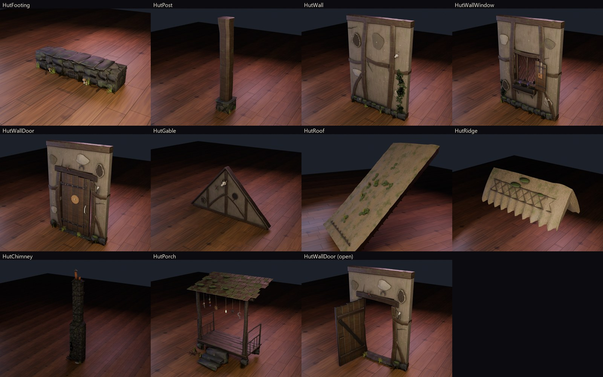
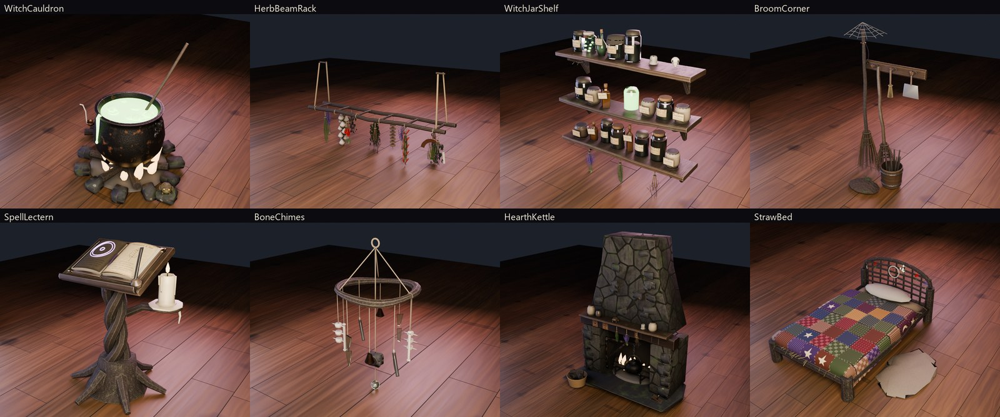
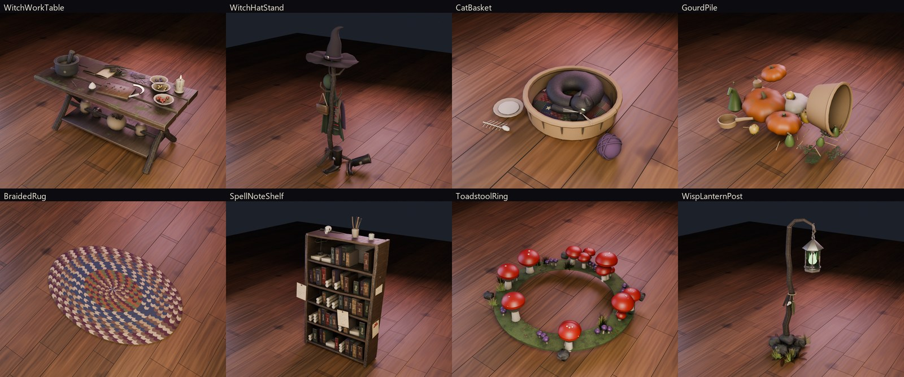
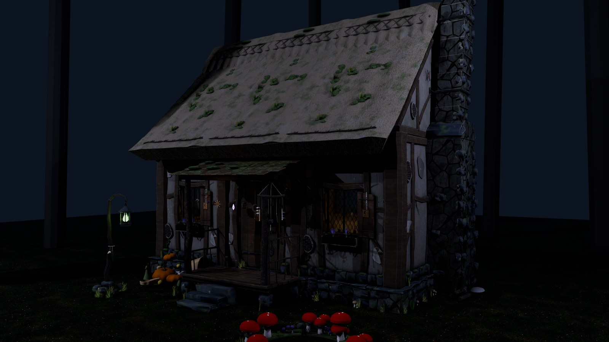
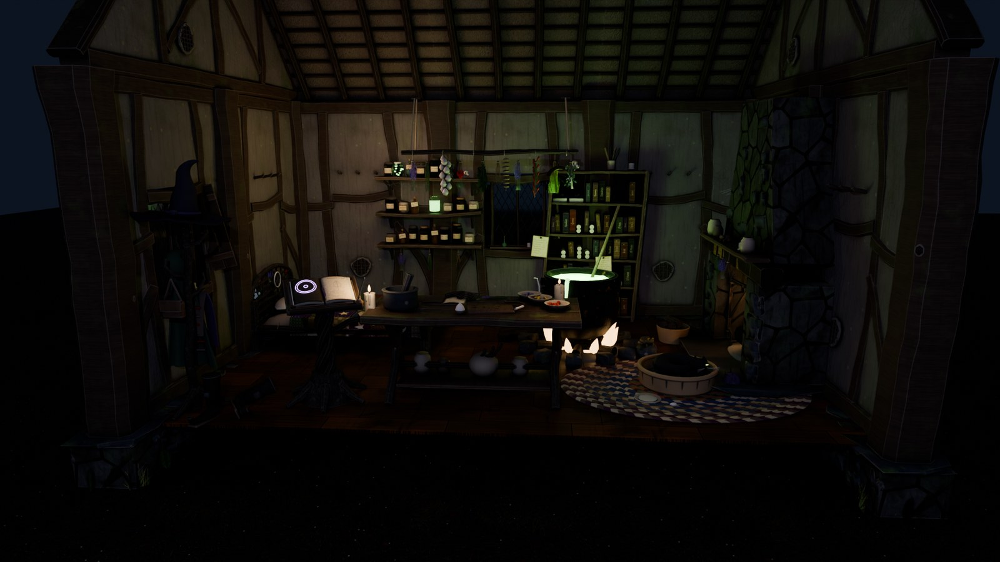

**In Studio (2026-11-10):** `tools/props/witchhut_templates.luau` makes the 26 templates (NHBuildKit `WitchHut`). Each piece takes its prop's maps, and the `_Leaves` cards take `NH_GardenLeaves` as an alpha cut-out, double-sided. The glows are Neon in the colours above with their PointLights, and the fire and candle flames and the wisp are tagged `NHCandle`. The particles are the cauldron's bubbles, green steam, embers and smoke, the hearth's embers and kettle steam, the chimney's smoke from the pot, the lectern's motes, the toadstool ring's fairy motes and the wisp's sparks. The door swings out (100) on the locker system ("Door / Open"). The hut pieces and floor furniture collide precisely; the rug, ring, herb rack and chimes don't. `tools/props/showcase_witchhut.luau` assembles one standard 24 x 16 hut in workspace.NHPropsShowcase["Witch Hut"] at (-200, -935) on its own slab, furnished inside, with the lantern, hat stand, gourds, cat basket and toadstool ring outside.

**Import size cap:** Roblox's importer caps a mesh at 2048 studs. At the FBX's 100x that is 20.48 studs, so a prop taller than that comes in shrunk, the whole model evenly. HutChimney (30.09 tall) came in at 68%, and the gym's ClimbingRopes (22.08, batch 43) at 93%. Both templates scale back to their true height (from the FBX), and the gym and witch-hut template scripts now do this on every run. Future kits: keep each piece under 20.48 studs, or record its true height for the template script.
