# School Props (Blender) and School Surfaces (PBR)

The greybox school is being dressed with modelled props and PBR surface materials, made to the [VFX Design Bible](VFX-Design-Bible.md)'s look: candlelit oak, wrought iron, slate, brass and deep crimson enamel.

## School surfaces
**Tool:** `tools/vfx/make_pbr_materials.py` (numpy).
- It writes seamless 1024² PBR sets (colour, OpenGL normal, roughness, metalness).
- Everything uses integer-period noise, so every map tiles.

**On the school** (MaterialVariants in `MaterialService.NHSchoolPBR`):

| Variant | Base material | Studs per tile | Used on |
|---|---|---|---|
| `NH_Linoleum` | CeramicTiles | 6 | classroom floors (two-tone checker, speckle, grime at the grout) |
| `NH_Boards` | WoodPlanks | 12 | floorboards |
| `NH_DeskWood` | Wood | 8 | wood props, furniture placeholders |
| `NH_PaintedMetal` | Metal | 6 | metal parts (chipped enamel with bare metal) |
| `NH_Slate` | Slate | 10 | slate parts |
| *(built-in Plaster)* | Plaster | - | walls |

**Prop-only sets:** `NH_Leather`, `NH_Brass`, `NH_Limestone`, `NH_Iron`, `NH_Paper`.

**Reversible:**
- Every changed part has the tag `NHPbr` and the attribute `NHPbrFrom = "<Material>|<Variant>"`.
- `Studio/pbr_revert.luau` (session tools) restores them.

## Props
**Tool:** `art/props/nh_props.py`. Run it headless in Blender 5.x:

```bash
"E:/Blender/blender.exe" --background --factory-startup --python art/props/nh_props.py -- <Prop|all> --size 1024 --samples 32
```

Batches 4 and 5 are baked at 2048 on the GPU (about 1–2 minutes a prop on the RX 6600 XT):

```bash
"E:/Blender/blender.exe" --background --factory-startup --python art/props/nh_props.py -- <Prop> --size 2048 --samples 64 --gpu
```

- `--gpu` bakes and renders with Cycles on the GPU (HIP here; CUDA or OptiX where present).
- A 2048 bake reads the same seamless sets made at 2048 from `art/props/source_2k/`, so small props aren't baked from upscaled 1024 sources. That folder isn't committed; make it with `python tools/vfx/make_pbr_materials.py art/props/source_2k 2048`.
- 2048 bakes also pack the UV islands at one texel density, by shape with rotation and an 8-pixel gap. Bake margins scale with the size (16 px at 2048). 1024 bakes are unchanged.
- Roblox takes maps up to 4096, so the 2048 maps are used as they are.
- The log line lists each piece's triangles (Roblox caps a mesh piece at 20k).
- Previews show `*_Glass` pieces as glass and `*_Glow` pieces lit, as they look in Roblox. `PREVIEW_PAD` moves the camera back for tall props, and `OPEN_DEG` sets how far a piece opens in the `_open` preview.

**How a prop is made:**
- **Modelling:** each prop is modelled in studs from bevelled parts and wrought-iron curves.
- **Weathering at bake time:**
  - edge wear: lighter wear on wood and leather, bare metal showing through paint and enamel
  - crevice dirt from ambient occlusion
  - rounded-edge normals
- **Bake:** one 1024 atlas per prop: colour × AO, normal, roughness, metalness.
- **Output:** `art/props/fbx/*.fbx`, `art/props/textures/*`, previews in `art/props/previews/`.
- **Asset ids:** in `art/props/props.json`.

**Rigged props** have several meshes, `<Prop>_<Piece>`:
- **Lockers:** `Body` and `Door0` (`Door1`).
- **Vending machine:** `Body`, `Wares`, `Flap`, `Glass`, `Glow`.
- **Altar:** `Altar`, `Reredos`, `Items`, `Glow`. It's split because Roblox caps a mesh at 20k triangles.
- **Bookshelf:** `Case`, plus each book as its own mesh.
- **Football machine:** `Main`, `WheelL`, `WheelR` (origin on the axle; they can spin about Blender Z), `Glass`.
- **Toilet stall:** `Body` and `Door0` (origin on the hinge).
- **Sink:** `Main`, `TapHot` and `TapCold` (origin on the spindle), `Water`.
- **Mirrors:** `Main` and `Mirror`.

Door, flap and tap origins sit on their hinge lines.

**Batch 2 setup** (`Studio/props_setup2.luau`, run after importing the batch-2 FBX files):
- Measures every template from its parts, so it doesn't depend on the dims above.
- Glass pieces become Glass material; Glow pieces become Neon with a PointLight (amber on the vending machine and candelabra, crimson on the altar).
- Tags the vending machine `NHVendingProp` and the bookcase `NHBookshelfProp`, and marks every book `Book = true`.
- Props with no placeholder (chairs, sofa, altar, candelabra, bookcases) get an invisible anchor part named `NHPropSpot_<key>`, which `props_revert.luau` also removes.
- The Staff Room furniture stays clear of the watcher's patrol loop (x 37–52, z 17–29).

**Batch 3 setup** (`Studio/props_setup3.luau`, run after importing the batch-3 FBX files from `art/props/fbx/`):
- Same template steps as batch 2 (scale, SurfaceAppearance, Glass and Neon pieces, bottom-centre pivot, Atomic streaming). The bench, clock, cabinet and alchemy table collide; the rest don't.
- The sconce's Glow gets a warm PointLight and the `NHCandle` tag; the alchemy table's Glow a soft green light.
- The pendulum gets `NHSwing` with its hinge at the top-centre of its own box (±5°, 2 s), animated by `Controllers.World.Ambient`.
- Placed copies are named `<Prop>_<key>` and tagged `NHPropBatch3`; `Studio/props_revert3.luau` removes them. Every placement reports anything solid it overlaps.
- **Hall layout:** the classroom walls face the hall at z 58.5 with 8-stud doors at the room centres (x 62, 92, 122, 152, 182, 212); the door headers carry the room signs, so nothing hangs on them.

**Batches 4 and 5 setup** (`Studio/props_setup4.luau`, run after importing the batch-4 and batch-5 FBX files from `art/props/fbx/`):
- Same template steps as batch 3. The floor props collide (vase, plant, umbrella stand, coat rack, football machine, bleachers, sink, stall); doors, taps, water and glow don't.
- `*_Mirror` pieces become a dark reflective finish (SmoothPlastic, reflectance 0.35; Glass read as a pale panel), and `*_Water` pieces hidden water.
- Glow pieces get the `NHCandle` tag and a warm PointLight (lamp, candles, a wider one on the chandelier).
- The football machine's wheels get `SpinHinge` / `SpinAxis` attributes. Nothing spins them yet, and the drill's placeholder machine in `workspace.Sports` is left alone.
- **Rigged on the locker system:** the stall and the sink are tagged `NHLockerProp`. Each has an invisible `NHPropSpot` part linked by a `Placeholder` ObjectValue, which carries the prompt. Model attributes set the prompt text and the auto-close time:
  - **Stall:** "Stall / Open". `Door0` swings **out** 95°, toward the front of the stall, and shuts after 8 s. The setup picks the swing sign from the geometry and its report checks the door opens outward.
  - **Sink:** "Sink / Turn on". The cross heads turn a quarter (hot one way, cold the other), the water shows, and it turns off after 6 s.
  - **Code:** `Services.Features.LockerProps` reads `PromptObject`, `PromptOpen`, `PromptClose` and `AutoClose` (defaults: Locker, Open, Close, 8 s) and skips models outside the workspace. `Controllers.World.LockerDoors` shows parts with a `ShowWhenOpen` transparency while open. Patch: `Studio/patch_lockers_rig.luau`.
- **Placement:** on the owner's call these go on the baseplate for the builder, not into the school. One copy of each sits in `workspace.NHPropsShowcase`, facing the spawn. Batch 4 is in the front row (z 58, from x −100); the table props sit on low slate plinths. Batch 5 is behind (z 70), with the chandelier hanging 6 studs up. Copies are tagged `NHPropBatch4` / `NHPropBatch5`, and `Studio/props_revert4.luau` removes them.
- **Look:** on theme with the Institution (candlelit gothic: ink, bone, wax, paper, brass, crimson `#600E1A`). Wood is kept to the books, crates and small accents. The stall is black marble with brass-inlaid arches, cast-iron pilasters and a crimson enamel door. The clock, coat rack and hall mirror are cast iron, and the picture frame is black lacquer and gilt.

**Batches 6 to 9 setup** (`Studio/props_setup6.luau`, run after importing their FBX files from `art/props/fbx/`):
- Same template steps as batch 4. `*_Pool` is water that always shows (the fountain). `*_Wall` gets the seamless castle stone (the cloister arches). Glow pieces get a warm light and `NHCandle`, except the boiler's fire, which gets `NHAmbient:Embers`.
- **Used with a prompt** (the locker system, as the stall and sink):
  - **Boiler:** "Furnace / Open". The firebox door swings out 100°, and the setup checks it opens outward.
  - **Valve wheel:** "Valve / Turn". The wheel turns 540° about its own axle and goes back after 4 s.
  - **Filing cabinet:** "Cabinet / Open". The top drawer slides out 1.1 studs.
  - **Gramophone:** "Gramophone / Play". The record spins while it plays, for up to 45 s.
- **Always on** (`Controllers.World.Ambient`, only within 60 studs, halved for Reduce Motion):
  - the banner cloths sway (`NHSwing`)
  - the boiler's flue and the pipe vent give off steam (`NHAmbient:Steam` spots)
  - the candles flicker
  - retrofitted on batches 4 and 5: the football machine's wheels spin (`NHSpin`), and the chandelier sways
- **New code:**
  - `Ambient` gains `NHSpin` (`SpinHinge`, `SpinAxis`, `SpinSpeed`, `SpinWhenOpen`) and an optional `SwingPhase` for `NHSwing`.
  - `LockerDoors` gains `SwingAxis` (turn about any axis), `SlideBy` (slide instead of turn) and `SwingTime`.
  - Patch: `Studio/patch_rig2.luau`.
- **Tiled pieces:** `nh_props.TILED` lists pieces that skip the baked atlas and get world-scaled UVs (8 studs a tile) with a seamless set instead: `CloisterArch_Wall` and `CloisterArchNoLamp_Wall` use `NH_CastleStone`.
  - The same stone is the texture-library set **CastleStone** (MaterialVariant `NHCastleStone`, Limestone, 8 studs a tile; see [[Textures]]). A builder can run it across a wall and blend it into the arch.
  - Made by `tools/vfx/make_castle_stone.py`.
- **Placement** on the baseplate for the builder (`workspace.NHPropsShowcase`, tags `NHPropBatch6` to `NHPropBatch9`):
  - batch 6 behind the first rows (z 84)
  - batches 7 and 8 in front (z 44, z 30)
  - the pillars to the west (x −232, z 70)
  - `Studio/props_revert6.luau` removes them.
- **Look:** on theme with the Institution: dark weathered castle stone, moss and ivy, brass, iron and crimson, candlelight, gothic carving. On the owner's notes the courtyard and pillars got a second, more detailed pass. Duplicates of existing models were skipped: the menu set's lamppost, bench, statue, urn, gargoyle and gate, the sports balls and cones.

**Batches 10 to 14 setup** (`Studio/props_setup10.luau`, run after importing their FBX files from `art/props/fbx/`):
- Same template steps as batches 6 to 9.
- **Used with a prompt** (the locker system):
  - **Headmaster's desk:** "Desk / Open". The right drawer slides out 0.9 studs.
  - **Safe** and **curiosity cabinet:** "Safe / Open", "Cabinet / Open". The doors swing out 100°; the cabinet's glass swings with its frame.
  - **Shop fronts:** "Door / Open". The shop doors swing out 95°.
  - **Town door:** "Door / Open". It swings 95° in, into the building.
  - The setup checks each door's direction and prints it.
- **Always on** (`Controllers.World.Ambient`): the awnings, the stall valance and the shop and hanging signs sway (the hanging sign wider), smoke rises from the chimney, embers come off the fireplace, and the candles and lanterns flicker. The desk lamp, the portrait light and the shop and window lights are steady.
- **Glass:** the coffee table's top is smoked (dark, 0.35 transparency); other glass is the usual pale glass.
- **The concession stand:** `Services.Features.Concession` builds the stand from `ServerStorage.NHProps.ConcessionStand` when it is there (patch `Studio/patch_concession.luau`).
  - It sits on the same spot as the plank stand, with its counter's front edge where the old counter's was. The prompt, the lunch queue and Mrs. Okada stay where they were.
  - The CONCESSIONS sign and the menu are drawn on the stand's own blank boards (template attributes `CounterFrontZ`, `SignFace`, `MenuFace`, set by the setup).
  - Without the template the plank stand is built as before.
- **Placement** on the baseplate for the builder: east of the gym (x 198 to 252), ten rows from z 120 north, 14 apart (`workspace.NHPropsShowcase`, tags `NHPropBatch10` to `NHPropBatch14`). The space south of the school is now the Commons. `Studio/props_revert10.luau` removes them.
- **Look:** on theme: dark sooty town stone with soot streaks and moss (darker than the castle stone, which read beige on these pieces), oxblood and crimson enamel, cast iron, brass and gilt, black lacquer and marble, warm gaslight. Wood is kept to crates and a barrel. The wall pieces have their backs flat for a builder's wall, on an 8-stud rhythm.

**Batches 15 to 17 setup** (`Studio/props_setup15.luau`, run after importing their FBX files from `art/props/fbx/`):
- Same template steps as batches 10 to 14. Steam rises over the serving counter's pans and from the coffee machine (`NHAmbient:Steam` spots); the heat lamps, the bakery lamp and the pendant lamp are steady, and the caddy's candle flickers. The pendant lamp's shade is crimson glass.
- **Placement** on the baseplate north of the gym for the builder (x 70 to 136, rows from z 228, 12 apart; tags `NHPropBatch15` to `NHPropBatch17`), clear of the gym, the Ink Studio and the Crimson Parlor. `Studio/props_revert15.luau` removes them.
- **The spire** is one baked piece, so the builder can scale it for bigger towers.

**Batch 19, the lamp and light kit** (`Studio/props_setup19.luau`, run after importing its FBX files from `art/props/fbx/`):
- **What's in it:** twelve light fixtures that fill the gaps round the school's existing lights (WallSconce, OilLamp, CandleCluster, Chandelier, Candelabra, DeskLamp, PendantLamp, the menu set's lamppost).
- **Same template steps as batch 15**, with a tuned light on every Glow piece. The lights use the tags `Controllers.World.Ambient` already reads, so no new script was needed:
  - `NHCandle`: the light flickers on smooth noise. With Reduce Flashing (`NHReducedFlash`) it barely moves.
  - `NHLamp`: the outdoor gas lamps (GasLampPost, GasLampTwin, WallLantern) light at dusk and go out at dawn, each a moment apart, and their mantles turn plain by day.
  - `NHAmbient:Embers`: the torch's fire.
- **Special lights:** the twin lamp gets a light in each lantern (invisible `NHLightSpot` parts). The stage spotlight gets a SpotLight (range 50, 38°, shadows) aimed out of its lens, plus a dim fill. It is the kit's only shadow-casting light, so the VFX bible's budget of eight shadow lights in view holds.
- **Glass:** the votive cups are crimson glass, the chandelier's crystals clear and bright.
- **Collision:** the floor-standing fixtures collide; wall, hanging and stage pieces don't.
- **Placement** on the clear lot south of the Commons for the builder (`workspace.NHPropsShowcase`, tag `NHPropBatch19`; `Studio/props_revert19.luau` removes them):
  - the floor pieces in a row at z −152 from x 30, facing −Z (view them from the south)
  - the wall pieces on a castle-stone display wall behind them (z −140)
  - the hanging pieces under an iron display beam, tops at 12.9
  - The wall, beam and posts are tagged `NHLightKitDisplay`; delete them once the pieces are in the map.
- **Textures:** all 48 maps are published under the Nightmare Highschool group (Studio Asset Manager bulk import). The meshes went to the group with the FBX import.

**Batch 20, the stair and bridge kit** (`Studio/props_setup20.luau`, run after importing its FBX files):
- **What's in it:** building pieces for the map builder, made to the courtyard set's standard.
  - **Stone:** dark weathered castle stone with worn treads, dirt in the joints, moss and hairline cracks.
  - **Carving:** blind trefoil lancets, crocketed pinnacle newels, crimson and gilt crests.
  - **Ironwork:** a gothic cast-iron balustrade on the rake (trefoil-headed arches, gilt roundels, a brass handrail).
  - **Lights:** gas lanterns.
- **Stairs are baked whole.** The bridges are too long for one sharp atlas. Their broad flat faces are a `_Wall` piece in the seamless castle stone (the group-owned CastleStone set, 8 studs a tile), tinted (150, 158, 150) to match the baked stone round them. The carved details are baked.
- **Walkable:** stone pieces collide with `PreciseConvexDecomposition`, so treads, landings and decks can be walked on. Rails and girders don't collide; the iron bridge has invisible side barriers (`NHBarrier`).
- **Lanterns:** the grand stair's, the landing's and the bridges' lanterns light at dusk and flicker (`NHLamp`, `NHCandle`).
- **The importer caps a mesh at 2048 units.** The two 24-stud bridges came in at about 0.85 scale, so the setup scales them back to their baked width.
- **Placement** south of the lamp kit (`workspace.NHPropsShowcase`, tag `NHPropBatch20`; `Studio/props_revert20.luau` removes them):
  - the stairs in a row at z −200 from x 30
  - the bridges at z −226
  - all facing −Z

**Batch 31, stair blending pieces** (1.50.1, `Studio/props_setup31.luau`, run after importing `art/props/fbx/stair-blend-batch31/`):
- **StairStoneBlock:** a 4 x 4 x 4 block of the stairs' own stone, for filling round, under and between the stairs.
  - It is baked from the same material as the stair cheeks (not the bridges' tiled castle stone, whose grain is coarser). 1.50.2 resampled its maps to the stairs' detail (about 33 px a stud; the bake had 167, which made it look brighter) and darkened its colour map to 0.85, so it reads the same shade as a cheek beside it (checked in stock lighting with no shadows on either face).
  - Resizing a block stretches its texture. Build long walls from several blocks, and turn some 90° or 180° so the dirt pattern doesn't repeat.
- **StairRailLevel:** the stair balustrade as a level 8-stud run. Lengths butt end to end (there's no bar at the +X end). Copy the `_Post` piece to the open end of a run.
- **Showcase:** at x 122, z −200 on the stair row, two blocks with a rail on top (`docs/img/stair-blend-showcase.jpg`; matched against a stair cheek in `docs/img/stair-block-match.jpg` and `stair-block-match-render.png`).

**Batch 32, the school entrance kit** (1.51.0, `Studio/props_setup32.luau`, run after importing `art/props/fbx/entrance-batch32/`):
- **What's in it:** 15 pieces in the stair kit's stone, carving and ironwork. Every flight is 10 treads (rise 0.6) up to a 6-high porch, so they join each other and the batch 20 stairs.
  - **Straight and split:** EntranceFlight (under a pierced stone parapet), EntranceFlightBowed (flared, bowed treads), EntranceSideFlightL / R (a split stair either side of a porch), EntrancePorch, EntranceNewelLantern.
  - **Curved:** EntranceHalfRound, EntranceHalfRoundMoon, EntranceQuarterRound, EntranceRoundDais, and EntranceSweepL / R (a horseshoe stair's two arms).
  - **The Moonrise entrance:** EntranceMoonStair (a phase in every tread, from the new moon to the full), EntranceMoonPorch (a moon dial in the floor), EntranceMoonPortico (the doorway, PER NOCTEM AD LUCEM, a full-moon rose window that glows at night).
- **Porch railings are separate pieces** (`_RailFrontL`, `_RailFrontR`, `_RailLeft`, `_RailRight`). Delete the ones where a flight joins.
- **Left and right:** the import turns Blender +X into Roblox -X, but L and R are named from the viewer's side, facing the front: SideFlightL and SweepL stand on the viewer's left.
- **Wide pieces:** the half-rounds are wider than the importer's 20.48-stud cap, so the setup scales them back.
- **Collision:** stone collides. Rails, nosings, inlays, glass and glow don't (as the stair kit).
- **Showcase:**
  - Row 1, z -375: Grand, Bowed, Split, Moonrise and Horseshoe, as whole entrances.
  - Row 2, z -410: the round pieces.
  - Screenshots: `docs/img/entrance-kit.jpg`, `entrance-kit-night.jpg`, `entrance-kit-round.jpg`, `entrance-portico.jpg`.

**Batch 33, the dead oak** (1.52.0, `Studio/props_setup33.luau` then `props_maps33.luau`, after importing `art/props/fbx/deadoak-batch33/DeadOak.fbx` with its rig):
- **DeadOak:** a great dead oak, about 10 studs tall, rigged (43 bones) and animated on the client (`Controllers.World.SpookyTree`). It creaks, groans, curls its limbs like claws, and shudders and reaches toward a player within 16 studs.
- **To place more:** copy the template and keep its `NHSpookyTree` tag; the controller picks up every tagged tree. Its pivot is the ground line, and the roots sink 1.14 below it.
- **Pieces:** the trunk and great limbs collide (Hull); the twigs don't.
- **Showcase:** x 214, z -410 (`docs/img/dead-oak.jpg`, `dead-oak-night.jpg`).

**Batch 21, the painting and art kit** (`Studio/props_setup21.luau`):
- **What's in it:** six paintings in gilt, black lacquer and ebonised frames, plus gallery stanchions with a crimson velvet rope, a stack of canvases under a drape, and a painter's table with a candle.
- **The canvases:** each painting's `_Canvas` piece skips the frame's atlas and carries its own 2048 painting (`nh_props.CANVAS`, front-projected UVs), so the brushwork stays sharp. It gets the shared varnish roughness map and no normal map, because the canvas weave read as a screen-door grid.
- **The paintings are original:** `art/props/paint_canvases.py` paints them procedurally with a brush-stroke pass and an aged varnish.
  - **Moonlit Abbey:** a ruined abbey under the full moon.
  - **Blood Moon:** a wolf howling at a blood moon.
  - **Ghost Ship:** a ghost galleon in a moonlit storm.
  - **Raven Still Life:** the skull, books, quill and candle are a Blender render (`art/props/paint_renders.py`), with the raven painted on.
  - **Cameo:** a Victorian lady's silhouette.
  - **Triptych:** the crest's moon, raven on the key, and candle, in gilt tempera.
- **Placement:** on a crimson damask gallery wall (the `NHDamaskWallpaper` set over an `NHBloodMarble` skirting, tagged `NHArtKitDisplay`) at z −171 from x 22, with the stanchions, table and canvas stack in front (tag `NHPropBatch21`; `Studio/props_revert21.luau` removes them).

| Prop | Triangles | Replaces / goes to |
|---|---|---|
| StudentDesk | 4.8k | `Desk` ×48 (R101–R106) |
| TeacherDesk | 4.7k | `TeacherDesk` ×6 |
| Chalkboard | 6.1k | new, on the wall behind each teacher desk (a `ChalkboardSpot` part) |
| Locker | 10.1k (2 pieces) | the 8 hallway lockers, including Locker113, which carries the quest note |
| HidingLocker | 15.2k (3 pieces) | the Records Office and Staff Room hiding lockers |
| StudentChair | 3.5k (wrought iron to match the desk) | batch 2: behind every student desk (48) |
| TeacherChair | 3.9k | batch 2: tucked into each teacher desk (6) and around the Staff Room table (4) |
| Armchair, Sofa | ~3.4k each | batch 2: the Staff Room lounge on the south wall (2 armchairs, 1 sofa) |
| VendingMachine | 13k (5 pieces) | batch 2: over the hallway `VendingMachine` (quest spot LostSpotC keeps its prompt) |
| TrashCan | 2.3k | batch 2: over R106 `TrashBin` (the detention prompt stays), and one in the Staff Room |
| Bookshelf | 11k (Case + 93 books) | batch 2: 9 bookcases replace the Archive's 13 narrow blocks (5 on the south wall, 2 per side wall) |
| Altar | 26k (4 pieces) | batch 2: the Archive's north-west rite corner, facing the room (crimson glow) |
| Candelabra | 10.3k (2 pieces) | batch 2: either side of the altar |
| GrandfatherClock | 14.9k (Case, Pendulum, Glass) | batch 3: the hall, on R103's wall east of the door; the pendulum swings (`NHSwing`) |
| WallSconce | 3k (Sconce, Glow, Glass) | batch 3: the hall, west of each classroom door (6); the flame flickers (`NHCandle`) |
| HallBench | 5.2k | batch 3: the hall, on the R101, R104 and R106 walls (3) |
| NoticeBoard | 3.2k | batch 3: the hall, on the R102 and R104 walls (2) |
| CelestialGlobe | 4.8k | batch 3: the Archive, in front of the east shelves |
| AlchemyTable | 5.8k (Main, Glass, Glow) | batch 3: the Archive's north-east corner (green potion glow) |
| SchoolBell | 3.7k (Bracket, Bell) | batch 3: high on R104's wall, west of its door |
| TrophyCabinet | 10.8k (Main, Glass) | batch 3: the hall, on R105's wall west of the door (x 172.5) |
| CeramicVase | 6.4k | batch 4: an oxblood-glazed floor urn with brass bands and handles (showcase) |
| FlowerVase | 14.9k (Main, Glass) | batch 4: crimson roses, white lilies and baby's breath in a smoky glass vase |
| PottedPlant | 7.9k | batch 4: an aspidistra in a gadrooned limestone urn |
| LunchTray, LunchTrayEmpty | 5.5k / 2.6k | batch 4: a pewter tray full (mash, mystery meat, peas, roll, jelly, apple, milk) and after lunch |
| BookStack | 9.7k | batch 4: six bound books with an inkwell and a quill |
| OilLamp | 3.9k (Main, Glow, Glass) | batch 4: brass and crimson enamel, glass chimney, flame |
| WallClock | 9.5k (Main, Glass) | batch 4: cast-iron case, brass bezel, crimson crest, glass front |
| PictureFrame | 7.0k | batch 4: the school on its hill under a full moon, black and gilt frame |
| CandleCluster | 6.3k (Main, Glow) | batch 4: seven melted pillar candles on an iron tray |
| UmbrellaStand | 10.3k | batch 4: fluted iron, two umbrellas and a cane |
| CoatRack | 6.8k | batch 4: cast-iron hall stand with a crimson scarf and a satchel |
| FootballMachine | 20.8k (Main, WheelL, WheelR, Glass) | batch 4: the Iron Wardens' steam throwing machine (spinning wheels, crate of footballs) |
| Bleachers | 13.3k | batch 5: four tiers of crimson enamel seats on an iron frame |
| Chandelier | 16.7k (Main, Glow) | batch 5: two-tier wrought iron, 12 candles |
| GothicMirror | 6.8k (Main, Mirror) | batch 5: a tall pointed-arch hall mirror in cast iron |
| BathroomMirror | 2.0k (Main, Mirror) | batch 5: an iron washroom mirror with a brass shelf |
| Sink | 7.3k (Main, TapHot, TapCold, Water) | batch 5: a marble washstand with brass pillar taps (turn on: the taps turn, the water runs) |
| ToiletStall | 17.9k (Body, Door0) | batch 5: black marble and iron with a crimson door that swings out; a toilet with a pull-chain cistern inside |
| TowelRail | 1.6k | batch 5: brass, with a crimson towel |
| BannerRavens, BannerRovers, BannerWardens | 10.7k (Cloth, Main) | batch 6: club banners: Night Ravens purple with a raven, Grave Rovers green with a grave cross and ball, Iron Wardens iron grey and rust with a shield; the cloth sways |
| BannerVigil, BannerCrimson | 9.5k (Cloth, Main) | batch 6: faction banners: The Vigil ink and gold with a candle, The Crimson Court crimson with a thorned rose; the cloth sways |
| ChessTable | 15.3k | batch 6: marble and iron, a full carved set in bone and ink |
| ArtEasel | 5.0k (Main, Glass) | batch 6: iron easel, a moonlit canvas in progress, palette and brushes |
| Gramophone | 7.4k (Main, Record) | batch 6: brass horn, crimson cabinet; "Gramophone / Play" spins the record |
| Telescope | 3.6k (Main, Glass) | batch 6: brass refractor on an iron tripod |
| FilingCabinet | 8.8k (Main, Drawer0) | batch 6: cast iron with brass label frames; "Cabinet / Open" slides the top drawer out |
| Typewriter | 13.6k | batch 6: black enamel and brass, a typed sheet |
| TeaTrolley | 14.9k | batch 6: iron and brass, teapot, cups, cake stand |
| Pigeonholes | 12.8k | batch 6: staff mail cubbies with letters and parcels |
| BallRack | 14.6k | batch 7: basketballs, soccer balls and footballs on an iron rack |
| Hurdle | 2.0k | batch 7: iron frame, crimson enamel bar |
| TackleDummy | 6.4k | batch 7: padded leather dummy on an iron sled |
| GymMatStack | 6.8k | batch 7: crimson and ink leather mats |
| WaterKeg | 7.4k | batch 7: iron-banded keg with a brass tap and tin cups |
| Scoreboard | 7.1k | batch 7: gothic wall scoreboard with club lamps; to replace the greybox scoreboards at the pitch |
| Boiler | 12.7k (Main, Glow, Door0) | batch 7: riveted boiler; "Furnace / Open" swings the firebox door out on the fire; steam from the flue, embers from the fire |
| PipeRun | 6.6k | batch 7: wall pipes with valves and a gauge; steam from the vent |
| ValveWheel | 3.4k (Main, Wheel) | batch 7: "Valve / Turn" turns the hand wheel one and a half turns |
| CoalPile | 4.1k | batch 7: coal heap with a shovel |
| CoalCart | 7.9k | batch 7: iron coal cart, full |
| Workbench | 7.9k | batch 7: iron bench, vice, tools |
| Fountain | 15.0k (Main, Pool) | batch 8: octagonal gothic fountain, grotesque spouts, a brass raven; the water (Pool) always shows |
| CloisterArch | 15.8k (Main, Wall, Glass, Glow) | batch 8: a cloister bay with a hanging lantern; its wall face (Wall) carries the seamless NHCastleStone |
| CloisterArchNoLamp | 14.7k (Main, Wall) | batch 8: the same arch without the lantern |
| StonePlanter | 15.1k | batch 8: buttressed bed with crimson roses, ferns and ivy |
| Topiary | 14.1k | batch 8: clipped yew in a carved tub |
| Sundial | 5.0k | batch 8: clustered pedestal, brass dial, a crow |
| Well | 12.3k (Main, Glass, Glow) | batch 8: wellhead under an iron canopy and slate roof, lantern |
| Balustrade | 10.0k (Main, Glass, Glow) | batch 8: pierced gothic parapet, tiles every 8 studs, a lantern |
| Memorial | 11.6k (Main, Glow) | batch 8: the founders' memorial spire, votives, iron railing |
| PillarCluster | 14.6k | batch 9: clustered pier, stiff-leaf capital, grotesques |
| PillarOctagon | 15.3k (Main, Glow) | batch 9: octagonal pier, blind tracery, stone ravens, a candle bracket |
| PillarTwisted | 15.8k | batch 9: twisted wine-marble column on crouching grotesques |
| PillarFanVault | 14.9k | batch 9: column springing a fan vault with carved bosses |
| PillarNiche | 7.5k (Main, Glow) | batch 9: square pier with a canopied candle niche |
| PillarMarble | 11.4k | batch 9: black marble with gilt bands and capital |
| PillarIron | 9.6k | batch 9: cast-iron column with traceried brackets |
| Pilaster | 3.6k (Main, Glow) | batch 9: wall pilaster with a blind arch, a crest and a lantern |
| HeadmasterDesk | 16.0k (Main, Drawer0) | batch 10: black lacquer pedestal desk, gilt mouldings, crimson leather top, inkstand, blotter, files, bell; "Desk / Open" slides the right drawer out |
| HeadmasterChair | 11.1k | batch 10: throne-like wingback in tufted crimson leather on a black and gilt frame, carved crest |
| Fireplace | 17.6k (Main, Glow) | batch 10: a wall piece in dark sooty stone, carved gothic overmantel with the crest, iron fire dogs, logs and coals; embers from the fire |
| FounderPortrait | 5.2k (Main, Glow) | batch 10: a wall piece: the founder in oils, side-lit on a dark ground, heavy gilt gothic frame, a brass picture light |
| Safe | 10.0k (Main, Door0) | batch 10: cast iron, brass dial and handle, gilt pinstripes, on castors; "Safe / Open" swings the door out |
| CuriosityCabinet | 12.3k (Main, Door0, Glass) | batch 10: black glass-fronted cabinet of confiscated things (slingshot, skull, potions, a cursed doll, a dagger, cards); "Cabinet / Open" swings the glazed door out |
| OfficeRug | 1.0k | batch 10: 12 x 8 crimson and ink gothic rug with a fringe |
| DeskLamp | 3.8k (Main, Glow) | batch 10: brass, crimson cased-glass shade with gilt ribs; a steady glow |
| FounderBust | 6.2k | batch 10: marble bust of the founder on a black marble plinth with a gilt band |
| SchoolCrest | 8.5k | batch 10: a wall piece: the Institution's shield (raven, moon, key, candle), crossed swords, a parchment scroll |
| DecanterTray | 5.0k (Main, Glass) | batch 10: silver tray, crystal decanters and glasses |
| Hourglass | 5.6k (Main, Glass) | batch 10: brass and black, red sand |
| ShopApothecary | 29.5k (Main, Upper, Display, Glow, Glass, Door0, Cloth) | batch 11: a 12 x 12 shop front (wall piece) in sooty stone and oxblood iron, a lit bay of coloured bottles, a hanging sign that sways; "Door / Open" swings the shop door out |
| ShopCurio | 29.3k (Main, Upper, Display, Glow, Glass, Door0, Cloth) | batch 11: a second shop front in green: an arched window of clocks, masks, candles and a caged raven, gilt balls that sway; "Door / Open" |
| MarketStall | 28.4k (Main, Goods, Stand, Glass, Glow, Cloth) | batch 11: iron-framed stall, crimson and black awning (the valance sways), apples, pumpkins, jars, a lantern |
| HangingSign | 2.9k (Main, Cloth) | batch 11: a wall bracket with an oxblood sign (crescent moon and mortar) that swings |
| Postbox | 5.2k | batch 11: crimson cast-iron pillar box, gothic cap, a crest |
| StreetPump | 4.3k (Main, Pool) | batch 11: cast-iron parish pump over a stone trough of water |
| NewsKiosk | 8.1k (Main, Glass, Glow) | batch 11: octagonal iron kiosk, posters, a domed roof and a lamp |
| TelephoneBooth | 19.7k (Main, Roof, Glass, Glow) | batch 11: gothic cast-iron booth: lancet windows with tracery, an ogee dome with cresting, a lit lantern, a brass telephone inside |
| Bollards | 10.0k | batch 11: three iron bollards with a sagging chain, 8 long |
| IronRailing | 5.7k | batch 11: an 8-stud wrought-iron railing with spear finials on a stone plinth; tiles end to end |
| Signpost | 6.4k | batch 11: fluted iron fingerpost with three symbol boards (school, church, crossroads) and a crow |
| CratePile | 15.2k | batch 11: market crates, sacks, a hooped barrel and a tarpaulin |
| TownDoor | 10.4k (Main, Glass, Door0, Glow) | batch 12: a wall piece: stone arch with a fanlight, a studded oxblood door, a lantern, a step; "Door / Open" swings it in (needs a 4 x 7.6 opening behind) |
| TownWindow | 14.4k (Main, Glass, Glow) | batch 12: a wall piece: sash window in a stone surround, a warm lit room behind with curtains, oxblood iron shutters |
| BayWindow | 12.2k (Main, Glass, Glow) | batch 12: a wall piece: an oriel bay on carved corbels, lead roof, leaded lights, a lit room |
| Chimney | 6.6k | batch 12: brick and stone stack with clay pots; smoke from the middle pot |
| IronBalcony | 14.1k | batch 12: a wall piece: stone slab on scrolled brackets, wrought-iron railing, 8 wide |
| ShopAwning | 11.2k (Main, Cloth) | batch 12: a wall piece: iron-framed crimson and black awning, 8 wide; the valance sways |
| Dormer | 8.7k (Main, Glass, Glow) | batch 12: slate dormer with a gabled stone front and a dim lit window; sits on a 45° roof |
| Drainpipe | 5.1k | batch 12: a wall piece: 12-stud cast-iron downpipe with a hopper head, brackets and a shoe |
| StoneStoop | 5.6k | batch 12: four worn stone steps with iron handrails and a boot scraper |
| TableRound | 13.3k | batch 13: 4 across, black marble with fine veins and a gilt edge on a carved iron claw-foot pedestal (top 3.0) |
| TableOval | 12.4k | batch 13: 8 x 4.5 black lacquer, gilt stringing, a crimson velvet runner, twin pedestals (top 3.0) |
| TableBanquet | 15.0k (Main, Glow) | batch 13: 16 x 3.5 feast table: a thick stone slab on gothic iron trestles, a crimson runner, two candlesticks (top 3.0) |
| TableCafe | 5.3k | batch 13: 2.5 square bistro table, marble top on a cast-iron base (top 2.7) |
| TableHexagon | 10.1k | batch 13: hexagonal library table with a crimson leather inset, a brass edge, six legs and a stretcher (top 3.0) |
| TableDemilune | 11.6k | batch 13: a wall piece: half-moon console, marble top, gilt carved apron, black lacquer cabriole legs (top 3.0) |
| TableCoffee | 8.4k (Main, Glass) | batch 13: low table, smoked glass top on a brass and iron frame, books below (top 1.5) |
| TableSide | 6.0k | batch 13: small tripod side table, marble top with a gallery rail (top 2.5) |
| ConcessionStand | 61.8k (Main, Shelves, Roof, Sign, Cloth, Goods, Glass, Glow) | batch 14: Mrs. Okada's stand remodelled: cast iron and oxblood under a slate roof with cresting and a crow, a crimson and black awning that sways, lanterns, a black marble counter of sweet jars, pastries and potion sodas, snack shelves, blank boards for the sign and menu text |
| ServingCounter | 19.0k (Main, Food, Glass, Glow) | batch 15: 10-stud steam-table counter: black marble top, oxblood gothic panels, brass tray rail, a glass sneeze guard, pans of mash, peas, stew, sausages and something green, heat lamps; steam over the pans |
| TrayRack | 9.5k | batch 15: tall iron trolley rack full of pewter trays and a few dirty plates |
| DrinksDispenser | 7.4k (Main, Glass) | batch 15: counter piece: crimson and amber juice in glass jugs with brass taps, a brass tea urn, cups on a drip tray |
| BakeryCase | 14.4k (Main, Glass, Glow) | batch 15: glass pastry case on a black lacquer base with gilt mouldings and crimson pointed-arch door panels, gilt cresting; pastries, tarts, iced buns and a dark cake |
| CoffeeMachine | 8.3k | batch 15: counter piece: brass and oxblood steam coffee machine with gauges and levers, cups on top; steam from the dome |
| KitchenShelf | 8.9k | batch 15: a wall piece: iron shelf with copper pots and pans, ladles, jars of preserves and sacks |
| DishStack | 11.3k | batch 15: counter piece: stacks of plates and bowls, a cutlery bin and a cup tree |
| CafeteriaTable | 16.0k | batch 16: 10-stud dining table with both benches: black lacquer top with a brass edge and carved initials, gothic iron trestles, crimson leather pads (top 3.0, seats 1.8) |
| CafeChair | 6.7k | batch 16: ornate cast-iron chair with a crimson cushion (seat 1.9) |
| CafeBooth | 16.8k (Main, Table) | batch 16: gothic high-backed booth: two crimson tufted benches with carved pointed-arch backs and a black marble table (seats 1.75, table 2.9) |
| ChalkMenuStand | 6.6k | batch 16: iron A-frame chalkboard with a crest, chalk scribbles and doodles (a cup, a cake, a skull) |
| CondimentCaddy | 3.4k (Main, Glow) | batch 16: table piece: brass caddy with salt and pepper, a sauce bottle, mustard, napkins and a little candle |
| CakeStand | 9.1k (Main, Glass) | batch 16: table piece: three-tier silver stand with black-iced cakes, raspberries and a glass dome |
| PendantLamp | 8.3k (Main, Glow, Glass) | batch 16: hanging iron lamp on a chain with a crimson glass shade (4 tall; hang its top from a ceiling) |
| Spire | 4.9k | batch 17: the memorial's crocketed octagonal spire as a building piece, 12 tall and 3 across, for towers and big roofs; scale it in Studio |
| SpireCross | 5.4k | batch 17: the same spire with the memorial's iron cross and ring on top |
| SkateboardMoonlit, SkateboardBone, SkateboardRavens, SkateboardRovers, SkateboardWardens, SkateboardGargoyle, SkateboardVigil, SkateboardCrimson, SkateboardHeadmaster | 7.8k each (Main, TruckF, TruckB, WheelFL, WheelFR, WheelBL, WheelBR) | batch 18: the nine rideable skateboards; see [[Skateboards]] |
| GasLampPost | 12.1k (Main, Glow, Glass) | batch 19: 11-stud cast-iron gas lamp standard: an octagonal plinth with crimson enamel lancet panels and gilt quatrefoils, a fluted shaft with a crimson crest collar, a stiff-leaf capital, the lamplighter's ladder bar, a hexagonal gothic lantern with gablets and crockets; lit at dusk, flickers |
| GasLampTwin | 17.3k (Main, Glow, Glass) | batch 19: the same standard with a scrolled cross-arm, two lanterns and an iron raven on the centre finial |
| WallLantern | 3.9k (Main, Glow, Glass) | batch 19: a wall piece: a hexagonal gas lantern on a scrolled bracket from a pointed iron shield with a crimson inset and a gilt quatrefoil |
| HangingLantern | 5.7k (Main, Glow, Glass) | batch 19: a large hexagonal lantern of three candles on a chain from a ceiling rose (hang its top) |
| FloorLamp | 9.2k (Main, Glow) | batch 19: standard lamp: a scrolled iron tripod, a fluted black lacquer and gilt column with a black marble tray, a pleated crimson silk shade with a beaded fringe |
| ChandelierCorona | 19.4k (Main, Glow) | batch 19: a 4-across gothic iron corona: a crimson band behind a gilt arcade, eight turrets with gilt spires, sixteen candles, rods to a gilt orb and a chain |
| ChandelierCrystal | 17.9k (Main, Glass, Glow) | batch 19: a gilt chandelier: a cut-glass bowl, twelve scrolled arms with crimson candle sleeves, crystal swags and prism drops |
| PricketStand | 7.7k (Main, Glow) | batch 19: a tall floor candlestand: a scrolled tripod, a twisted iron shaft, a spiked brass drip pan and a guttering church candle |
| VotiveStand | 15.1k (Main, Glass, Glow) | batch 19: a stepped iron votive rack of 18 tea lights in crimson glass cups, a pointed back panel with a gilt quatrefoil and a brass offering box |
| StageSpotlight | 6.8k (Main, Glow, Glass) | batch 19: a Victorian limelight: crimson enamel lamp house, brass bands, cooling rings, a vent cap and a lens on a telescoping tripod; a real SpotLight |
| Footlights | 7.3k (Main, Glow) | batch 19: an 8-stud run of stage footlights (tiles end to end): crimson and gilt front, four brass reflectors with wire guards |
| TorchSconce | 3.0k (Main, Glow) | batch 19: a wall piece: a burning iron torch with a pitch-wrapped cresset in a ring on a gothic plate; embers |
| StairStone | 11.6k | batch 20: a straight flight of 8 worn stone treads (rise 0.75) between carved cheek walls, pinnacle newels with crests; 6 wide inside, 6 up, 10 long |
| StairStoneRailed | 26.4k (Main, Rail) | batch 20: the same flight with the gothic cast-iron balustrade and brass handrail, iron newels at the head |
| StairLanding | 33.8k (Main, Faces, Floor, Lamps, Glow, Glass) | batch 20: a 7.6 x 7.6 landing 6 high: buttresses into crocketed pinnacles, traceried lancet panels with a large crest, an arched corbel table, flagstones round a crimson and gilt quatrefoil medallion, two gas lanterns |
| StairGrand | 39.7k (Main, Runner, Rail, Glow, Glass) | batch 20: the 12-wide grand stair: a crimson runner with gilt borders and quatrefoils on brass rods, carved cheeks, the balustrade, crested newel pedestals with gas lanterns |
| StairSpiral | 14.5k (Main, Rail) | batch 20: a tower stair: a clustered newel, 20 wedge treads making a turn 12 high, a head landing, an iron rail with gilt roundels (1.38.2: metalness map re-uploaded as 119049869824909) |
| StairIron | 25.4k (Main, Rail) | batch 20: an open cast-iron stair: chequer-plate treads with brass nosings, stringers pierced with quatrefoils, the balustrade |
| StairStoneBlock | 0.1k | batch 31: a 4 x 4 x 4 block of the stair cheeks' baked castle stone (1.50.2 maps StairStoneBlock2_*, softened to the stairs' detail and darkened 0.85; no metal map) |
| StairRailLevel | 6.0k (Main, Post) | batch 31: the stair balustrade on a level 8-stud run that butts end to end, and its turned iron post |
| EntranceFlight | 31.3k (Main, Parapet, Newels, Glow, Glass) | batch 32: the straight grand flight under a pierced stone parapet, lantern newels |
| EntranceFlightBowed | 37.9k (Main, Rail, Newels, Glow, Glass) | batch 32: bowed treads flaring 15 to 10 wide between splayed cheeks, the iron balustrade |
| EntranceSideFlightL / R | 17.7k (Main, Rail) | batch 32: a split stair's 5-wide flights climbing along the facade |
| EntrancePorch | 31.4k (Main, Deck, 4 rails) | batch 32: an 18 x 9 flagstone porch, crocketed piers, removable railings |
| EntranceNewelLantern | 4.6k (Main, Glow, Glass) | batch 32: a crested pedestal with a gas lantern |
| EntranceHalfRound | 29.0k (Main, Noses, Newels, Glow, Glass) | batch 32: half-round steps fanning from a doorway, a crest landing |
| EntranceHalfRoundMoon | 53.3k (Main, Noses, Inlays, Newels, Glow, Glass) | batch 32: the half-round with moon phases, a moon dial and crescent piers |
| EntranceQuarterRound | 21.6k (Main, Noses, Newels, Glow, Glass) | batch 32: a quarter fan for a corner |
| EntranceRoundDais | 34.3k (Main, Noses, Newels, Glow, Glass) | batch 32: five steps all round a round platform, four lantern newels |
| EntranceSweepL / R | 27.8k (Main, Cheeks, Rail, Newels, Glow, Glass) | batch 32: a horseshoe stair's curved arms, the balustrade bent round both sides |
| EntranceMoonStair | 48.0k (Main, Cheeks, Rail, Piers, Glow, Glass) | batch 32: the moon-phase grand flight, crescent-and-raven piers |
| EntranceMoonPorch | 41.9k (Main, Deck, 2 rails) | batch 32: the porch with the moon dial |
| EntranceMoonPortico | 23.1k (Main, Gable, MoonGlow, Glow, Glass) | batch 32: the PER NOCTEM AD LUCEM doorway, the full-moon rose window |
| DeadOak | 69.7k (Main, Twigs, Twigs2, Twigs3) | batch 33: a rigged (43 bones), client-animated dead oak, procedural cracked bark |
| BridgeStoneArch | 43.5k (Wall, Main, ParapetL, ParapetR, Piers, Glow, Glass) | batch 20: a 24-long humped stone footbridge: dark voussoirs, a crested keystone, a hood moulding, pierced gothic parapets, crested end piers with lanterns |
| BridgeIron | 37.3k (Main, Girders, Glow, Glass) | batch 20: a 24-long cast-iron footbridge: crimson lattice girders with gilt bosses and spear finials, arched ribs with ring spandrels, carved abutments, lanterns |
| BridgeDeck | 17.7k (Wall, Main) | batch 20: a 16-stud straight span with the pierced parapets; tiles end to end |
| BridgePier | 3.4k (Wall, Main) | batch 20: a 16-high pier with cutwaters, string courses, iron cramps and crests; carries BridgeDeck |
| PaintingAbbey | 2.9k (Main, Canvas) | batch 21: 6 x 4: a ruined abbey under the full moon, a carved gilt frame with rosettes and a crested crown |
| PaintingBloodMoon | 2.3k (Main, Canvas, Glow) | batch 21: 4 x 3: a wolf at a blood moon, black lacquer with a gilt slip, a brass picture light |
| PaintingGhostShip | 6.3k (Main, Canvas, Glow) | batch 21: 5 x 3.3: a ghost galleon in a moonlit storm, an ebonised frame with a gilt rope moulding, a picture light |
| PaintingRaven | 2.5k (Main, Canvas) | batch 21: 3 x 4 lancet-arched: a raven on a skull by candlelight, a crocketed gilt frame on a sill |
| CameoSilhouette | 4.1k (Main, Canvas) | batch 21: a 1.5 x 2 oval: a Victorian lady's silhouette on crimson, a gilt laurel frame with a velvet bow |
| Triptych | 7.0k (Main, Canvas) | batch 21: three arched gilt panels (moon, raven on the key, candle) with pinnacles on a crimson and gilt predella |
| GalleryStanchions | 3.5k | batch 21: two brass posts with a sagging crimson velvet rope, 6 apart |
| CanvasStack | 5.5k | batch 21: canvases leaning on the wall, backs out, under a crimson drape, an empty gilt frame, paint pots |
| PainterTable | 6.1k (Main, Glow) | batch 21: an iron table with a black marble top: a palette of paints, brush jars, tubes, a rag, a small skull and a flickering candle |

**Placed on the map** (`Studio/props_map.luau`; `Studio/props_map_revert.luau` removes them). 91 copies of the batch 4 to 9 templates, in `workspace.NHPropsMap/<Area>`, tagged `NHPropMap`, named `<Prop>_<Area>_<n>`, with a `MapArea` attribute. Each row of the script gives a prop, an area, x and z, and the way its front faces. Rays find the floor or table top under it, or the wall behind it for wall pieces.

| Area | Copies | Props |
|---|---|---|
| Hall | 24 | PillarMarble ×2 at the west entrance; PillarNiche ×4 along the open south edge; Pilaster ×7 framing the gaps between classrooms; GothicMirror over the west bench; PictureFrame ×3; BannerCrimson and BannerVigil; CeramicVase ×2; PottedPlant ×3 |
| Forecourt | 4 | PillarTwisted ×2 and PillarOctagon ×2: an avenue from spawn to the hall's west end |
| Staff Room | 11 | LunchTray, LunchTrayEmpty, CandleCluster and FlowerVase on the staff table; WallClock over the door; CoatRack, UmbrellaStand, Pigeonholes, TeaTrolley, Gramophone, PictureFrame |
| Archive | 5 | Typewriter, BookStack and OilLamp on the study table; Telescope; BannerVigil outside, on the archive's hall wall by the door |
| Records Office | 4 | FilingCabinet ×2 by the door, OilLamp on the tall cabinet, WallClock |
| Boiler Yard | 8 | Boiler, PipeRun on the west fence, ValveWheel and Workbench on the east fence, CoalPile, CoalCart, PillarIron ×2 at the open north side |
| Quad (between the classrooms and the gym) | 19 | CloisterArchNoLamp ×2 and CloisterArch: an arcade at the quad's west entrance; Fountain on the gym door; Topiary ×2 flanking the door; StonePlanter ×5 against the classroom backs; PillarFanVault, Sundial, Memorial, ArtEasel, ChessTable, Well, Balustrade ×2 |
| Gym | 8 | BannerRavens, BannerRovers and BannerWardens on the entrance wall between the windows; Chandelier ×2 from the roof (no collision); BallRack, GymMatStack, WaterKeg |
| Pitch | 2 | Bleachers ×2 behind the north wall, facing the pitch |
| Football practice | 6 | Hurdle ×3, TackleDummy ×2 and WaterKeg on the north sideline |

- **Kept clear:**
  - **Rite props:** copies stay 1.5 studs from `School.NHRiteProps`. The Archive is a rite room (altar and bookshelves), so it gets only table props and the telescope. In the Boiler Yard the copies sit away from the anvil, ash heap and crate stack, and the boiler's door doesn't swing toward the anvil.
  - **Other no-go spots:** the `MarkWall`s (there is no pilaster at the R105/R106 gap, and the planter behind R103 moved along), the `NHPropSpot_*` placeholders (the Staff Room's south end is kept for the sofa and armchairs), the watcher's patrol round the staff table, and the room exits.
  - **Sports play zones:** the gym's `Court.Bounds` and `Practice.DrillBounds`, and the drill's `TargetBounds` and `RouteBounds`, which cover the whole practice turf.
  - **The classroom gaps:** the 3-stud gaps between classrooms stay open. They are an alley from the hall to the quad.
- **Left out:**
  - **The washroom set** (BathroomMirror, Sink, ToiletStall, TowelRail): the school has no washroom yet.
  - **FootballMachine and Scoreboard:** these went in as swaps for Sports greybox pieces in 1.18.3 (below), except the gym's scoreboard.
- **Checks in the script:** each copy reports any visible part it digs into (pieces shrunk 0.25 so resting contact passes) and any rite prop within 1.5 studs.

**Swapped for the Sports greybox** (`Studio/props_swap.luau`; `Studio/props_swap_revert.luau` shows the greybox again). The Sports code and the greybox parts' positions are unchanged. The greybox parts are hidden (Transparency 1, the old value kept in `NHSwapHidden`) and keep their collision. The copies (tags `NHPropMap` and `NHPropSwap`) have no collision, touch or queries.

- **The drill's throwing machine:**
  - `Football` throws from 1.5 studs above the part with `SportDrillMachine` and rests the ball 2 studs above it, so that part stays where it is.
  - `FootballMachine_Practice_1` stands over it on the turf, facing the routes (−X). Its top is 0.13 below the throw point.
  - The greybox machine, its stand and its two wheels are hidden.
- **The pitch and field scoreboards:**
  - `Matches` writes into the SurfaceGui `Board` on the part with `SportScoreboard`, so that live panel stays.
  - `Scoreboard_Pitch_1` and `Scoreboard_Field_1` are the gothic board scaled 3.29× (24.7 × 19.7) to frame it. The board's face recess (5.6 × 3.1 studs at the prop's own size) sits 0.05 behind the panel, which covers the board's painted digits. The club lamps show above the panel and the crest and finials top it off.
  - The wooden greybox frames are hidden, and the board legs stay as its posts.
- **Not the gym's board:** at that size the crest would go through the gym roof, so the gym keeps its greybox board.

## In Roblox
**Import:**
1. Use File → Import 3D. FBX comes in at 100× scale with a rotated pivot.
2. `Studio/props_setup.luau` then:
   - scales the props to studs
   - adds each prop's SurfaceAppearance
   - gives each template an unrotated bottom-centre pivot
   - works out each door's swing (`SwingDeg`)
   - files the templates in `ServerStorage.NHProps`
   - places a copy over every placeholder in `workspace.School.NHProps`

**Placeholders stay:**
- Each placeholder is made invisible (`NHPropReplaced`, `NHPropOrigTransparency`) but keeps its collision, attributes, prompts and hiding spots, so gameplay is untouched.
- Each prop links back to its placeholder with an ObjectValue named `Placeholder`.
- Prop meshes don't collide and aren't hit by raycasts.
- `Studio/props_revert.luau` undoes the placement.

**Facing:**
- Student desks face away from the teacher desk, and the student sits at the low edge of the lid.
- The teacher desk's drawers face the teacher.
- The chalkboard hangs on the inner face of the wall behind the teacher desk.
- Hallway lockers face the hall, and hiding lockers face their room.

## Animation
**Lockers:**
- **Server,** `Services.Features.LockerProps`, sets the model attribute `Open`:
  - Hiding lockers swing open and shut whenever someone hides or leaves (the HidePrompt's `UserOnly` changes).
  - Quest lockers open briefly when their quest prompt is used.
  - Other hallway lockers get an Open/Close prompt and close themselves after 8 s.
- **Client,** `Controllers.World.LockerDoors`:
  - It swings each door 105° about its hinge line on every client, over 0.45 s open and 0.4 s closed.
  - It works with StreamingEnabled: doors that arrive later are registered when they stream in.
  - It moves "rider" parts with the door (ObjectValues named `Rider`), such as the quest note on locker 113.
  - With Reduce Motion on, the door snaps open instead of swinging.

**Vending machine and bookshelf** (batch 2):
- **Server,** `Services.Features.SchoolProps`, checks every request (distance, cooldown):
  - **Vending machine:** a "Thump", or the existing quest search, sets `RattleAt`.
  - **Bookshelf:** "Pull a book" unanchors every book with a nudge, so they fall with real physics that everyone sees the same way. After 12 s the books float back over 1.6 s.
- **Client,** `Controllers.World.SchoolProps`:
  - Adds the "Thump" and "Pull a book" prompts locally, and only while no quest prompt on that spot is showing.
  - Plays the rattle: the cabinet rocks on its front edge, the wares jitter, the flap clacks and the sign flickers. Reduce Motion and Reduce Flashing tone it down.

## Verified (Studio)
**Classrooms:** desks, teacher desks and chalkboards render correctly (screenshot).

**Locker doors:**
- **Records Office:** hid in the locker and left it. The door opened to −105° in 0.45 s, held and closed, on both hide and leave (client measurement).
- **Hallway:** a hallway locker opened through `Open`.

**Weathered textures (2026-10-31):** all 76 placed batch-1 props use the weathered bake (classroom and locker-row screenshots). The two end lockers of the hall row were turned sideways by the first placement; all eight now face the hall, and `props_setup.luau` faces the row across the hall.

**Texture ids:**
- All 14 props have their four maps in `art/props/props.json`.
- `Studio/props_ids.py` keeps it current: `set` merges upload results, `luau` writes a re-texture script, and `setup2` fills `props_setup2.luau`.

**Batch 2 (2026-10-31):**
- **Placed:** 48 student chairs, 10 teacher chairs, the Staff Room sofa and armchairs, 2 bins, the vending machine, 9 Archive bookcases, the altar and 2 candelabra.
- **Checked:** every prop sits on its floor (raycast), and the classroom, Staff Room, Archive and vending machine were checked in screenshots.
- **Play:**
  - **Vending rattle:** a Thump set `RattleAt`, and the cabinet rocked up to 2.1° with the flap swinging 34°, then returned exactly to rest.
  - **Book fall:** a Pull unanchored all 93 books, and 38 left the case in 2.5 s. All were back, anchored, at 14.5 s.
  - **Prompts:** all 10 appear.
- **Importer quirks:** the importer's pivot is rotated, and `Model.WorldPivot` is ignored once a PrimaryPart is set. So `props_setup2` sets the PrimaryPart's PivotOffset to a world-axis bottom centre, and `Studio/props_fix_pivots2.luau` repairs copies placed with the old pivot.
- **Streaming:** the vending machine and bookcases use `ModelStreamingMode = Atomic`, and the client waits for the prompt's host piece (`VendingMachine_Body`, `Bookshelf_Case`).
- **Look tweaks in Studio:**
  - vending glass is light and see-through, with a shelf light inside
  - the altar's glow is crimson

**Not verified yet:**
- two-player locker sync, and the rattle and book fall seen from a second player

**Batch 3 (2026-11-03):**
- **Baked:** all 8 at 1024 with 32 samples (previews in `art/props/previews/`, sheet `_batch3_final_sheet.png`), maps uploaded, ids in `props.json`.
- **Dry run:** `props_setup3` placed boxes of each prop's real size: no clashes (the first pass hit R103's sign and the rite bone crate, and both props were moved). The stand-ins were removed afterwards.
- **Imported and placed (1.13.1):** all 16 copies, with no clashes and no imports left in the workspace. The trophy cabinet moved to x 172.5, so it no longer crowds the R105 sconce.
- **Tested:** screenshots of the hall and the Archive. In Play at night the clock's textures show, the pendulum swings and the sconces glow.
- **Clock colour map:** uploaded again as `132406564544469` (same image as before). In the Edit view the clock can look plain grey, because Studio caches a failed download; Play shows it correctly.
- **Not verified yet:** the props seen by a second player.

**Batches 4 and 5 (2026-11-03):**
- **Baked:** all 20 at 2048 with 64 samples on the GPU, from the 2048 sources (previews in `art/props/previews/`, sheet `_batch4_final_sheet.png`). At 100% the maps are sharp (stone pores, grain, leather). Maps uploaded, ids in `props.json`.
- **Owner's notes acted on:** higher-quality and non-blurry textures, on theme with the game, the football drill machine, bleachers, a chandelier, mirrors and a bathroom set with a rigged stall door and sinks, a less wooden stall and set, and a stall door that swings out.
- **Dry run:** `props_setup4` placed boxes of each prop's real size (with door, tap, water, mirror, glass and glow stand-ins) on the baseplate: 20 placed in two rows, no clashes, and the stall door opens out. The stand-ins and their templates were removed afterwards.
- **Locker patch, in Play:** all 11 lockers set up, and the 8 hallway prompts still read "Locker / Open"; templates in ServerStorage are skipped.
- **Imported and placed (1.15.1):** all 20 in `workspace.NHPropsShowcase` with no clashes and no imports left in the workspace. The stall door's sign came out −95° on the real geometry, and the check confirms it opens out.
- **Tested in Play (solo):**
  - **Prompts:** the stall reads "Stall / Open" and turns to "Close" when open; the sink reads "Sink / Turn on".
  - **Opening:** the stall door swung −95° with its centre 0.9 studs in front of the stall, the taps turned −90° / +90°, and the water showed at 0.35.
  - **Closing:** everything went back to 0° and the water hid.
  - **Textures:** all 25 SurfaceAppearances loaded in Play. In the Edit view a few show plain white until Studio finishes fetching them.
- **Not verified yet:** the prompts triggered by a player and the auto-close timers (Open was set directly), the props seen by a second player. Nothing spins the football machine's wheels yet.

**Batches 6 to 9 (2026-11-03):**
- **Baked:** all 42 at 2048 with 64 samples on the GPU, and every piece is under 16k triangles. Maps uploaded, ids in `props.json`. The castle stone was uploaded at 2048 (the arch walls) and at 1024 (the library set).
- **Code, in Play:** `NHSpin` turned a test part 91° in 0.5 s at 180°/s, with no script errors from the patched `Ambient` or `LockerDoors`.
- **Dry run (Edit):** boxes of each prop's real size: 42 placed in four rows, no clashes; removed afterwards.
- **Imported and placed (1.18.1):**
  - all 42 with no clashes and no imports left in the workspace
  - the furnace door opens out (−100° on the real geometry)
  - the football machine's wheels and the chandelier were retrofitted
- **Tested in Play (solo):**
  - **Prompts:** all four read correctly.
  - **Opened:** the furnace door swung out −100°, the valve wheel turned 540°, the drawer slid out, and the record spun at 200°/s.
  - **Closed:** everything went back to rest.
  - **Always on:** the football wheels spin and a banner sways about ±1.6°, both within 60 studs of the camera.
  - **Textures:** every batch 6–9 map loaded on the client, including five that showed a failed fetch in Edit (Studio's caching quirk).
- **Not verified yet:** a player pressing the prompts and the auto-close timers, the steam and ember emitters up close, and a second player's view.

**Placed on the map (2026-11-03, 1.18.2):**
- **Edit:**
  - 91 copies with no clashes and none within 1.5 studs of a rite prop.
  - A box check against every invisible zone left only the whole-room zones and the gym chandeliers, which hang inside `Court.Bounds` and don't collide.
  - Screenshots of every area.
- **Play (solo):**
  - **Prompts:** all 91 copies reached the client, and the five rigged ones were ready with their prompts on the server: "Furnace / Open", "Valve / Turn", "Cabinet / Open" ×2, "Gramophone / Play".
  - **Opened** (Open set from the server):
    - the furnace door turned −100° and moved toward the front (out)
    - the valve wheel turned 540°
    - both drawers slid 1.1 studs out
    - the record spun
  - **Closed:** all went back to rest and the record stopped.
  - **Always on:**
    - the hall's Crimson banner swayed through 3.2°
    - a gym chandelier swayed 1.6°
    - the boiler's embers and a steam vent ran
    - the second vent waits behind the three-nearest-emitters cap, as designed; emitters are off while a player is in the main menu
  - No script errors.
- **Not verified yet:**
  - a player walking the map
  - a player pressing the prompts, and the auto-close timers
  - a second player's view
  - performance with all the copies' lights on a low-end device

**Greybox swaps (2026-11-03, 1.18.3):**
- **Edit:**
  - The three copies are placed; the only overlap is the board legs, which run behind the boards as designed.
  - 91 of 91 rays from the front reach each live panel.
  - Screenshots of both boards and the machine.
- **Play (solo):**
  - **Drill:** "Start Route Runner" started the drill, and the drill ball rested on the new machine, 0.6 above its top.
  - **Machine:** its wheels spin.
  - **Boards:** both panels showed the live status "Stand on a pad to play (0 v 0)" in their gothic frames.
  - No script errors.
- **Not verified yet:**
  - a throw seen leaving the machine: the test runner tripped the drill's own teleport and bounds checks before a route was called
  - a full match on the pitch or field with the score changing

**Batches 10 to 14 (2026-11-04):**
- **Baked:** all 42 at 2048 with 64 samples on the GPU, and every piece is under 16k triangles. Maps uploaded, ids in `props.json`. Sheet `art/props/_batch10_14_final_sheet.png`.
- **Dry run in Studio:** with stand-in boxes, `props_setup10` made all 42 templates, set the concession stand's attributes and placed all 42 rows east of the gym with no clashes. `props_revert10` (MOCKS) cleared it. The door-direction checks need the real models (the stand-ins have no hinge).
- **Concession code:** `patch_concession.luau` applied (8 edits) and the module compiles. With no template yet, the plank stand is still built.
- **Imported and set up (2026-11-04):** the owner imported the 42 FBX files; `props_setup10` made the templates and placed them east of the gym with no clashes, and every door opens the right way on its real hinge (the safe, cabinet and shop doors out, the town door in). Two stray re-imports (Pilaster, Workbench) were deleted. The maps show in Studio.
- **The concession stand in Play:** the stand is the new model, the plank greybox is gone, Mrs. Okada, the prompt and the lunch spots are there, and the CONCESSIONS sign is drawn on the stand's own board. The sign and menu boards' real faces sat 0.2 and 0.48 studs in front of the reported spots (the text would have been hidden inside them), so the setup now measures the boards and the counter with rays; the live template is fixed.
- **Not verified yet:** the textures seen on a client in Play (two Play checks were stopped from outside), the doors and sways in Play, buying from the new stand, and the lunch queue at it.

**Map copies restored (2026-11-04):** eight quad copies had gone missing (cause unknown: the cliques hangouts did not remove them): the Memorial, the Well, the three cloister arches, the ArtEasel, the ChessTable and the PillarFanVault. Re-running `Studio/props_map.luau` (it only adds what is missing) put them back at their spots, with no clashes.

**Batches 15 to 17 (2026-11-04):**
- **Baked:** all 16 at 2048 with 64 samples on the GPU, every piece under 16k triangles. Maps uploaded, ids in `props.json`. Sheet `art/props/_batch15_17_final_sheet.png`.
- **Dry run in Studio:** with stand-in boxes, `props_setup15` made all 16 templates and placed the three rows north of the gym with no clashes.
- **Imported and set up (2026-11-04):** the owner imported the 16 FBX files; `props_setup15` made the templates and placed the three rows north of the gym with no clashes and no stray imports. The maps load in Studio (a few fill in a little later in the Edit view).
- **Not verified yet:** the steam and lights in Play.

**Batch 19, the lamp and light kit (2026-11-04, 1.36.0):**
- **Baked:** all 12 at 2048 with 64 samples on the GPU, every piece under 20k triangles (the largest, the corona, 18.1k). Sheet `art/props/_batch19_final_sheet.png`. Five were re-baked after a first look: the wall lantern's and votive stand's crimson insets had faces sitting exactly on their panels (streaks in the bake), and the floor lamp's silk, the corona's band and the footlights' front read pink, so they use the deeper crimson now.
- **Dry run (Edit):** stand-in boxes placed all 12 with no clashes and the right lights and tags; removed afterwards.
- **Imported and set up:** the owner imported the 12 FBX files. The setup made the templates and placed all 12 with no clashes, the floor pieces on the plate (bottom 0.90) and the hanging pieces' tops at the beam (12.90). The lights and tags match the table above (checked by script).
- **Textures in the group:** the owner bulk-imported the maps under the group. All 48 ids were read back by name (no duplicates) and swapped into the 12 templates and 12 copies (24 SurfaceAppearances). The meshes are group-owned too.
- **Screenshots:** day (`docs/img/lamp-kit-day.jpg`), a close-up of the hanging pieces (`lamp-kit-hanging.jpg`), and night with Studio's clock at 0:00 (`lamp-kit-night.jpg`, the clock put back to 13:00 straight after). Every map shows, including the twin lamp and floor lamp, which were blank while they used account-owned uploads.
- **Tested in Play (solo, slot II, 2026-11-04):** with the camera close by, the candles and fire flickered (the pricket 0.95 to 1.10, the corona 1.41 to 1.59, the torch 1.23 to 1.40; Reduce Flashing off) and the floor lamp stayed steady at 1.0. With the client's clock moved to 21:00 (on that client only, so no save data was touched), the gas post, the twin lamp and the wall lantern all lit, their mantles turned to Neon, and they went out again back at day.
- **Not verified yet:** Reduce Flashing's calmer flicker in Play, the embers up close, and how the kit's lights cost on a low-end device.

**Batches 20 and 21, stairs and bridges, the art kit (2026-11-04, 1.38.0):**
- **Baked:** all 19 at 2048 with 64 samples on the GPU, every piece under 20k triangles (the largest, the landing's Faces, 18.0k). Sheets `art/props/_batch20_final_sheet.png` and `_batch21_final_sheet.png`.
- **The owner's notes acted on:** "make the stair kit higher quality and more on theme" (the stairs were rebuilt in the courtyard set's manner: baked weathered stone, carving, gothic ironwork); "make the landing a little more high quality" (buttresses, pinnacles, traceried panels, a corbel table, a floor medallion, lanterns).
- **Imported and set up:** the owner imported the 19 FBX files and bulk-imported all 85 maps under the group; the ids were read back by name (no duplicates).
  - **Placed:** every copy with no clashes, the floor pieces on the plate (bottom 0.90).
  - **The two long bridges:** they came in small (the 2048-unit import cap) and were scaled back to 24.25 and 24.3 wide.
  - **The Blood Moon painting:** hung higher, so the leaning canvas stack doesn't touch it.
  - **Stray imports:** eight duplicate imports of the art kit were removed.
- **Screenshots:** the stairs (`docs/img/stair-kit.jpg`), a bridge by day and night (`bridge-kit.jpg`, `bridge-kit-night.jpg`, the clock put back to 13:00) and the gallery (`art-kit-gallery.jpg`, `art-kit-closeup.jpg`). Every map shows.
- **Tested in Play (solo, slot II, 2026-11-04):**
  - **Stairs:** the character walked (Humanoid MoveTo) from the ground to the top tread of StairStone, StairStoneRailed, StairGrand and StairIron, and tread by tread up StairSpiral onto its head landing.
  - **Landing:** it holds a player on its flagstones (a ray finds the floor at 6.94).
  - **Bridges:** the character walked across the stone arch over its hump, along the iron bridge and along the deck span. Walking sideways on the iron bridge stopped at the invisible barrier, just inside the girders.
  - **Lanterns:** the same NHLamp / NHCandle setup as the lamp kit, whose dusk switch and flicker were checked in this Play test.
- **Not verified yet:** a real player climbing with the keyboard and the camera on the spiral, and walking the iron stair's open treads with shift lock.

## Batch 22 (1.39): the Midnight Bell notice board

| Prop | Tris | Notes |
|---|---|---|
| MidnightBellBoard | 14.4k (Main, Glow, Card1-4) | a cast-iron notice board with brass corners, a crimson enamel header "THE MIDNIGHT BELL" in gilt, four blank parchment cards on cork under crimson wax seals, two candle sconces; 6.8 x 4.9 studs |

- **Baked** at 2048 with 64 samples on the GPU; maps under the group (colour 92319858284386, normal 87035507197237, rough 130751943740698, metal 117676090672369). The cards' rectangles are in `art/props/midnight_bell_board_faces.json`.
- **In Roblox:** `Studio/props_setup22.luau` builds the template (ServerStorage.NHProps.MidnightBellBoard) with an invisible upright text face on each card (`CardNFace`, `NHBoardCard`), replaces the R102 hall board (the old one is in `ServerStorage.NH_Backup.Bundle1_pre`), moved 0.85 toward the doorway so its left sconce clears the pillar, and puts a copy on a slate backing wall on the showcase at x 82 (`NHPropBatch22`). `Features.NoticeBoard` writes the live cards.

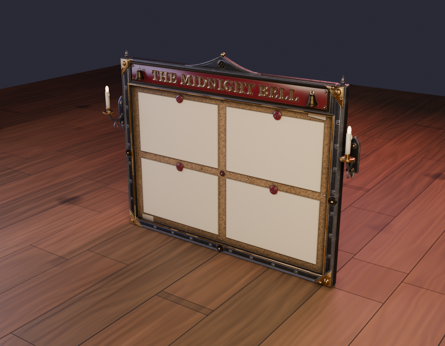

## Batch 23 (1.43): the window kit and the gothic crown conservatory

`art/props/nh_props_batch23.py`; the 2D shapes (lancets, tracery, rose, crescent, foils) are in `art/props/window_shapes.py`, shared with the stained-glass painter `art/props/stained_glass.py`.

| Prop | Tris | Notes |
|---|---|---|
| LancetWindow | 2.9k (Main, Glass, Room, Glow) | a tall lancet, chamfered jamb stones, square quarries, iron saddle bars, a hood mould on carved label stops, a candle on the inner sill |
| TwinLancet | 7.1k (Main, Glass, Room) | two lancets under one arch, plate tracery pierced by a quatrefoil, a shafted mullion, diamond leading |
| TripletLancet | 5.9k (Main, Glass, Room) | three stepped lancets with shafts between, square quarries, a shared sill |
| TraceryWindow | 8.1k (Main, Stained) | four lights, two sub-arches, a cusped head circle and spandrel foils in bar tracery; stained glass |
| RoseWindow | 8.0k (Main, Stained) | twelve petals round a cusped hub, foils between the petal heads; stained glass |
| StainedLancet | 4.5k (Main, Stained, Glow) | a candle under a crescent moon on starry blue, a gilt trefoil in the head; a pricket candle on the sill |
| TraceryWindowClear, RoseWindowClear | 10.2k, 8.2k (Main, Glass, Room) | the same with clear (leaded) glass and the lit room behind |
| Oculus | 2.8k | a round window, four keystones, an iron quatrefoil grille |
| DiamondPaneArch | 4.4k | a pointed iron casement: two leaves and a head light, diamond leading, brass handles and stays, a candle |
| SashWindow | 2.8k | a classroom sash under a segmental voussoir head: crimson enamel sashes, iron Y-tracery in the top sash, a brass lock |
| GothicBay | 8.6k | a canted bay on a traceried plinth, trefoil-headed lights, a crenellated parapet, a crimson window seat and a candle |
| LucarneDormer | 6.2k | a stone dormer: twin lights, pinnacled piers, a crocketed gable with a foil, a slate roof with iron cresting (runs back +Y) |
| ArrowSlit | 3.0k (Main, Room) | a cross loop with oillets through coursed ashlar, a slice of warm light behind |
| Fanlight | 3.3k | a half-round iron sunburst over a door, voussoirs, a crimson and gilt keystone shield |
| BasementGrate | 3.0k | a segmental window in a rusticated plinth, heavy bars and rivetted flats, rust stains |
| BrokenWindow | 5.0k | a smashed leaded lancet: shards in the cames, bent leads, two boards nailed across, glass on the sill |
| ShutteredWindow | 5.1k (Main, Room) | closed crimson enamel iron shutters: louvres, a pierced crescent moon, strap hinges, a drop bar |
| PlainSash, CrossWindow, PictureWindow, RoundArchWindow, HalfRoundWindow, SquareWindow | 0.4k to 2.6k (Main, Glass, Room) | the regular clear windows: plain glass in slim iron frames, stone surrounds |
| ConservatoryDome | 56.9k in 9 pieces, the largest 14.5k | the gothic crown: an octagonal glass hall of iron lancets, a faceted glass crown dome on crocketed ribs, an openwork spire with a gilt crescent, eight pinnacled piers with flying buttresses, an iron tracery crown band, a candle corona; 18.8 x 24.9 studs |
| ConservatoryBeds | 21.0k (Main 6.1k, Plants 15.0k) | a round bed with a rose-climbed iron obelisk, ferns and broad leaves, four iron urns |

- **Baked** at 2048 with 64 samples on the GPU; 100% crops checked. Maps are under the group (`art/group-upload/windows-batch23/`, 112 images). The ids are in `art/props/windows_batch23.json`. ArrowSlit has no metal map (all black).
- **Pieces:**
  - **Glass:** Roblox Glass.
  - **Room:** the lit room behind clear glass. One shared image (`WindowRoom`, warm amber), front-projected, glowing through its emissive mask. Delete it from a placed window when the opening is a real hole in a wall.
  - **Stained:** the stained glass, the same way. Each is its own 2048 painting, original (no copied church designs, no figures, no gore).
  - **Glow:** a few small candle flames (`NHCandle`).
- **The conservatory:**
  - **Tiled stone:** the plinth and floor are `_Wall` / `_Floor` in the group's tiled CastleStone set, darkened to (104, 108, 102). Its glass needs no maps, so the 2048 atlas goes to the ironwork.
  - **Collision:** the stone, the columns and the spires collide precisely. Seven invisible `NHBarrier` panels hold the glazed bays, so you go in by the doorway only. The iron Drum doesn't collide, because its hull bridged the doorway.
  - **Light:** the corona's light reaches 22 studs.
- **In Roblox:** `Studio/props_setup23.luau` builds the templates in `ServerStorage.NHProps` (`NHBuildKit = "Windows"`) and places the showcase (`workspace.NHPropsShowcase.Windows`, `NHPropBatch23`). `props_revert23.luau` removes them.
  - Two slate walls face −Z: gothic and stained at z −95 from x 88, regular and the rest at z −125.
  - The dormer stands free at the end of the first wall.
  - The conservatory and its beds stand at x 195, z −215.

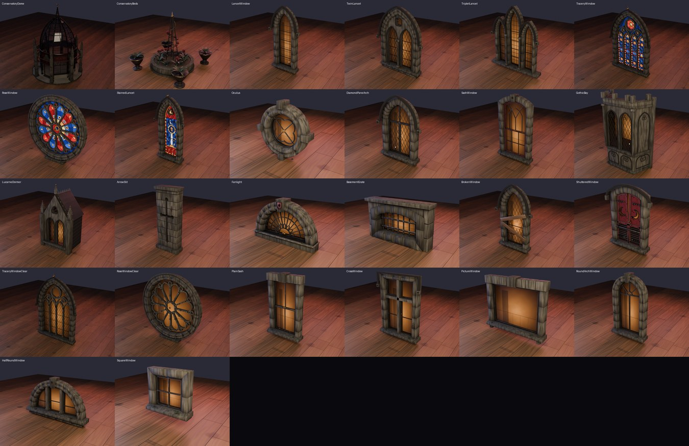
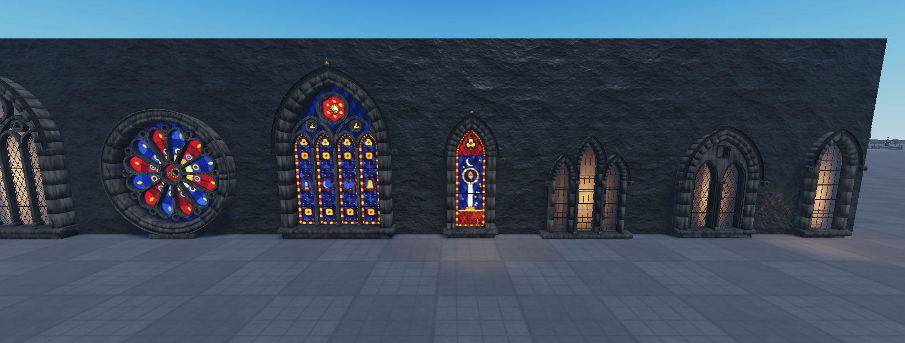
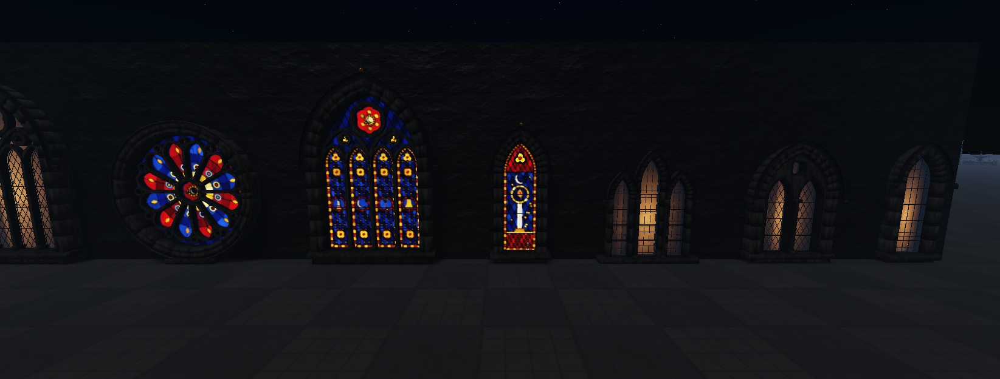
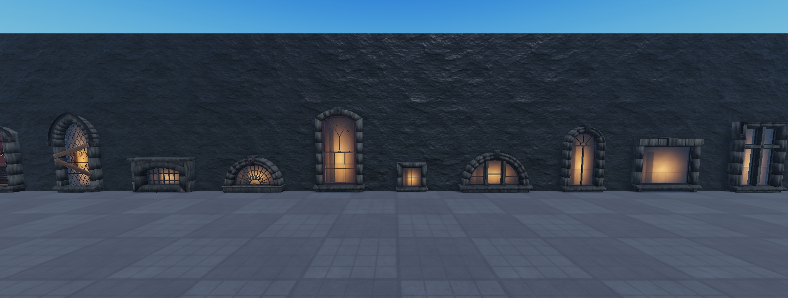
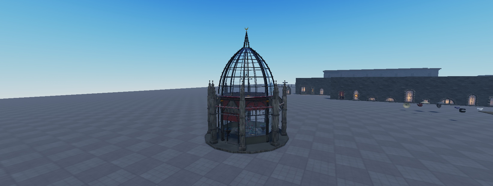
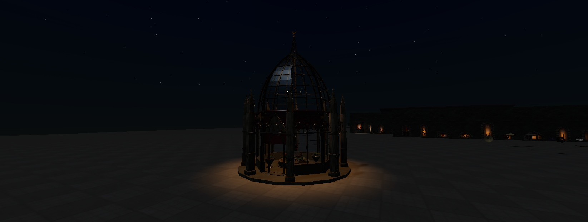
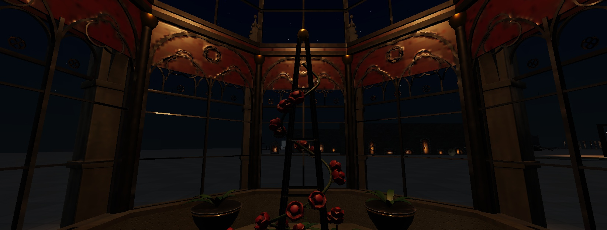

## Batch 24 (1.42): the Lost & Found kit

| Prop | Tris | Size (W x D x H studs) | Notes |
|---|---|---|---|
| LostScarf | 6.5k | 1.35 x 0.44 x 0.18 | the Athletes' varsity scarf, folded: crimson knit, bone stripes, a shield patch |
| LostSketchbook | 5.4k | 0.87 x 1.06 x 0.14 | the Ink Club's black cloth sketchbook, blue-black ink splatters, a crimson pencil |
| LostWristband | 1.8k | 0.51 x 0.47 x 0.15 | the Delinquents' studded leather cuff |
| LostPendant | 3.0k | 0.42 x 0.83 x 0.09 | the Pack's wolf-tooth pendant on a coiled cord |
| LostHymnal | 3.4k | 0.52 x 0.86 x 0.14 | the Choir's crimson hymnal, gilt cross and edges, two ribbons |
| LostLunchTin | 7.5k | 0.89 x 0.55 x 0.43 | a dented tin with a hand-painted LUNCH label |
| LostPocketWatch | 8.2k | 0.74 x 0.83 x 0.38 | a brass hunter watch lying open, cracked dial, coiled chain |
| LostPhone | 5.5k | 0.46 x 0.94 x 0.05 | a cracked phone with a crimson crescent charm |
| LostFoundBox | 14.6k | 2.68 x 2.12 x 3.49 | an iron-bound oak chest, lid propped open, overflowing, with a hand-lettered LOST & FOUND board |

- **Baked** at 2048 with 64 samples on the GPU. Each prop is one piece, with its origin at the bottom centre; the 35 maps are under the group (the ids are in `Studio/props_setup24.luau`). The scarf has no metal map.
- **In Roblox:** `Studio/props_setup24.luau` builds the templates in `ServerStorage.NHProps` (`NHBuildKit = "LostFound"`). `Features.LostFound` clones the item templates for the loose items and the one held in the hand.
  - The showcase has the box and the 8 things on a slate plinth, at x 94, z −170.5, east of the notice board (`NHPropBatch24`).
  - Any Model tagged `NHLostFoundBox` is a hand-in point (the showcase box is tagged).

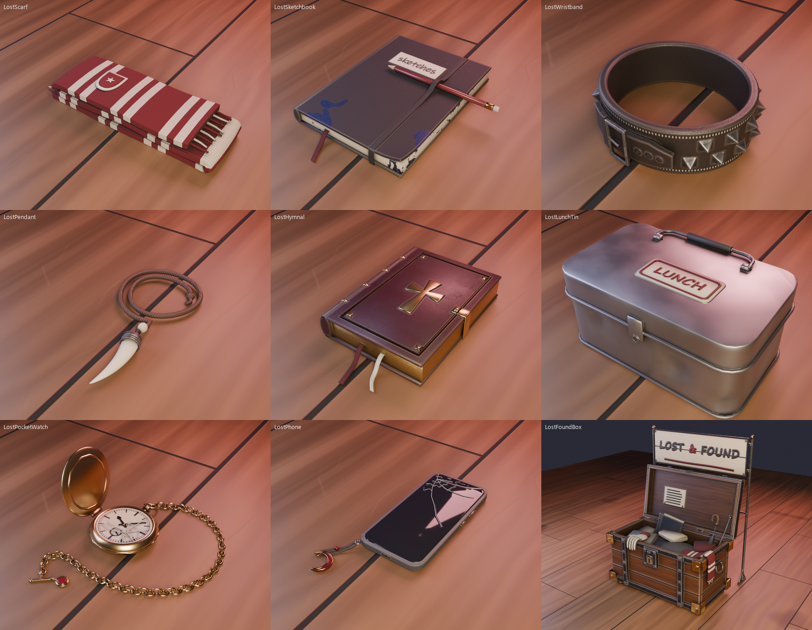
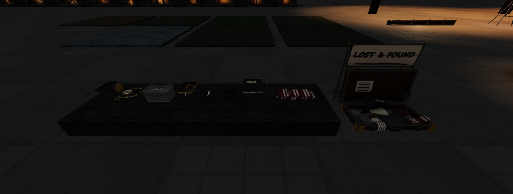

## Batch 25 (1.44): the door kit, rigged and animated

`art/props/nh_props_batch25.py`. Every door is finished the same on both faces (architraves, panels, straps and studs, handles, the crest), so it looks right from whichever side you come through.

| Prop | Tris | Notes |
|---|---|---|
| ClassroomDoor | 4.3k (Main, Glass, Leaf0, Leaf0Glass) | crimson enamel iron, raised panels, a wired-glass light, brass levers and kick plates both sides, a glazed transom |
| GothicDoubleDoor | 13.3k (Main, Leaf0, Leaf1) | pointed-arch pair, iron-sheathed and studded, strap hinges and ring pulls both faces, a moulded portal with a hood mould both faces |
| IronGate | 10.7k (Main, Leaf0, Leaf1) | wrought-iron double gate, spear tops, scrolls, gilt quatrefoil medallions, stone piers with ball finials |
| HeadmasterDoor | 8.3k (Main, Glass, Leaf0) | black lacquer, six gilt-moulded panels and the crest both faces, brass knobs, an iron sunburst fanlight, a keystone with the crest |
| BookcaseDoor | 9.8k (Main, Leaf0) | a secret oak bookcase of leather-bound books, a panelled iron-strapped back, a hidden pivot |
| SlidingIronDoor | 5.9k (Main, Leaf0, Leaf0Glass) | riveted iron, crimson X-braces, a wired port, an iron head box; slides 4.37 into the wall |
| CellarHatch | 3.6k (Main, Leaf0) | an iron-banded floor hatch with a ring pull over stone steps; its origin is at floor level, the pit below |

- **Baked** at 2048 with 64 samples on the GPU; maps under the group (`art/group-upload/doors-batch25/`). The ids and the rig are in `art/props/doors_batch25.json`.
- **The rig:** each leaf is its own piece whose FBX origin (the Roblox PivotOffset) is the hinge, on the wall's centre line. A leaf's glass is a leaf of its own on the same hinge.
  - `props_setup25.luau` gives each leaf `DoorLeaf`, `DoorKind` (swing, hatch, slide), `SwingDeg` (signed by a test turn so `OpenDir = +1` swings toward the back), `DoorAxis` / `SlideBy` and `SwingTime`.
  - On the model it sets `PromptObject`, `AutoClose`, `OneWay`, `Locked`, `DoorwaySize`, a `DoorPrompt` attachment, and the empty `OpenSound` / `CloseSound` / `RattleSound`.
- **In game:**
  - **Server:** `Services.Features.Doors` adds the prompt and decides `Open` and `OpenDir`, so a door swings away from whoever opened it. It auto-closes after `AutoClose` seconds, holding while a character is in the doorway (up to 30 s more). A locked door rattles.
  - **Client:** `Controllers.World.Doors` moves the leaves with weighted easing, and the leaves collide where each client moves them. Reduce Motion snaps them.
- **Showcase:** a row at z −110 from x 96, between the two window walls, each door between slate wall stubs (`workspace.NHPropsShowcase.Doors`, `NHPropBatch25`; `props_revert25.luau` removes them).
- **For the builder:** set a door into a wall opening of its width (the frames are 1.1 to 1.4 deep). Set `Locked` to lock it, `AutoClose = 0` to keep it open, and fill the sound attributes when there are sounds.

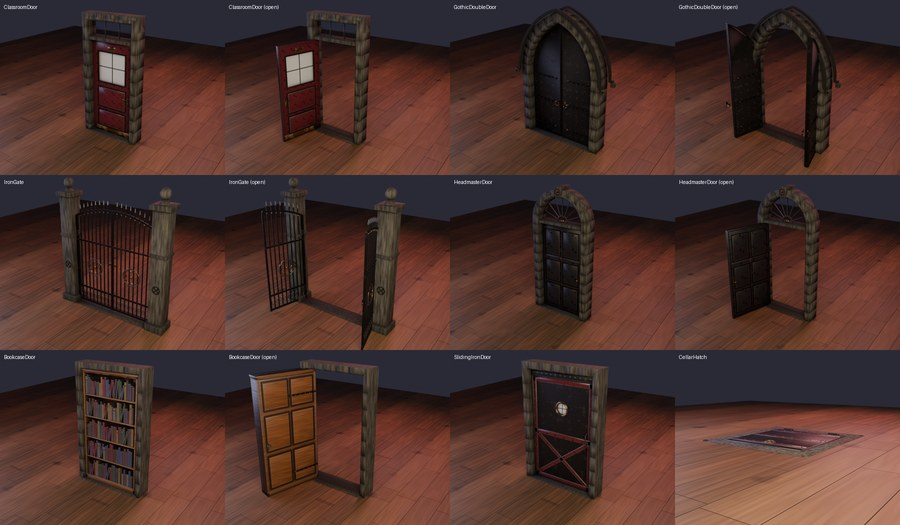
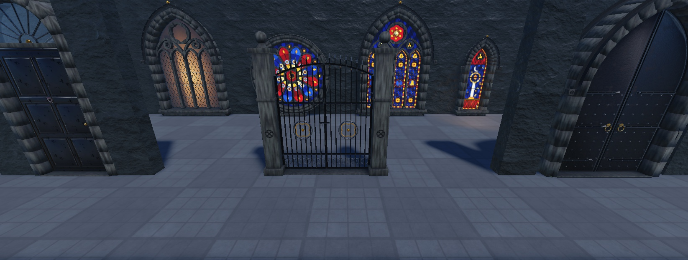

## Batch 26 (1.45): the seer set

| Prop | Tris | Size (W x D x H studs) | Notes |
|---|---|---|---|
| SeerTable | 17.4k (Main, Glow) | 3.17 x 3.15 x 3.53 | a round table draped to the floor in crimson with a bone hem; a black velvet reading cloth with a gilt ink chart (12 houses, invented sigils, an eye), a deck and three face-down cards, a brass chamberstick (`SeerTable_Glow`), an ink pot and quill, a wax dish |
| SeerChair | 11.8k | 2.40 x 2.01 x 6.06 | a tall black gothic chair: iron studs and straps, tracery over crimson velvet, crocketed pinnacles and an iron crescent; no arms; the cushion at 1.6 |

- **Baked** at 2048 with 64 samples on the GPU. The maps are under the group (the ids are in `Studio/props_setup26.luau`). Both pieces of the table share its atlas.
- **In Roblox:** `Studio/props_setup26.luau` builds the templates in `ServerStorage.NHProps` (`NHBuildKit = "Seer"`). It places the set in the Ink Studio (`TheInkStudio.SeerCorner`): the table at (42.2, 226.5) facing into the room, and the chair 3 studs behind it against the west wall. Sable's post (`NpcPost = Sable`) sits 0.15 in front of the chair's origin, 1.5 above the cushion. A copy is on the showcase at x 110, z −170.5 (`NHPropBatch26`). (1.46.1) Placed tables are scaled to 0.9 (`TABLE_SCALE`) so the top sits at a seated R6's middle, with the chair 3.25 behind; the chair has `SeatHeight` 1.6.

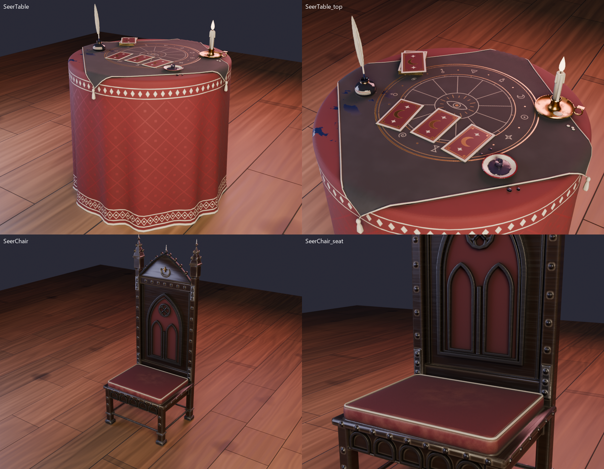

## Batch 27 (1.46): the statue kit

`art/props/nh_props_batch27.py`.

**The R6 figures:** each statue is built on the classic R6 body, measured from the owner's R6 rig in Blender: a 2 × 2 × 1 torso, 1 × 2 × 1 arms and legs, a rounded 1.2 head, 5.1 tall. They're built at 1.6 scale (about 8.2 studs) and posed on the real joints (`R6` in the script): the neck at the torso top, the shoulders at (±1.25, 3.5), the hips at (±0.5, 2).

| Prop | Tris | Notes |
|---|---|---|
| FounderStatue | 7.0k | bronze, gown and mortarboard, the crest's key raised, a book; a tall gothic plinth with a brass plaque |
| MourningAngel | 5.6k | veiled marble, weeping into her hands, folded feathered wings; a tomb chest with a carved wreath |
| Gargoyle | 4.2k | horns, bat wings, a fanged grin, a tail; sits on an octagonal column |
| VampireLord | 4.0k | black marble, a crimson-lined cape spread from the arms, a high collar, a crimson gem |
| WerewolfHowl | 4.3k | a wolf head howling, a fur ruff and tail, claws; a mossy rock, a gilt crescent moon on a rod |
| LanternPriest | 6.2k | a marble robe, a crimson stole, a gilt halo, a crescent staff, a lantern with a small flame (Glow) |
| HollowWraith | 9.7k | a faceless cowl, a robe tapering into wisps, tattered sleeves and shackles; floats over a spire |
| KnightGuardian | 6.7k | armour, a crimson tabard with the crest, a greatsword point down, a shield on the back |
| FencingDuel | 6.5k | two bronze students lunging with sabres and masks on one plinth (Figure, Figure2) |
| RavenScholar | 6.1k | a marble student reading on a stone bench, three ravens |

- **Baked** at 2048 with 64 samples on the GPU; maps under the group (`art/group-upload/statues-batch27/`). The ids are in `art/props/statues_batch27.json`. The all-stone Gargoyle, HollowWraith and MourningAngel have no metal map.
- **In Roblox:** `Studio/props_setup27.luau` builds the templates in `ServerStorage.NHProps` (`NHBuildKit = "Statues"`).
  - Plinths collide precisely and the statues collide.
  - The priest's flame is Neon with a short flickering light (`NHCandle`).
  - The row is on the showcase at z −188 from x 110, facing −Z (`workspace.NHPropsShowcase.Statues`, `NHPropBatch27`; `props_revert27.luau` removes it).

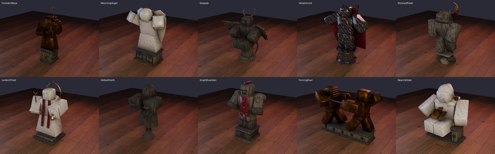
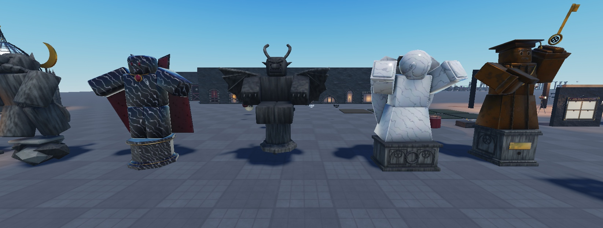
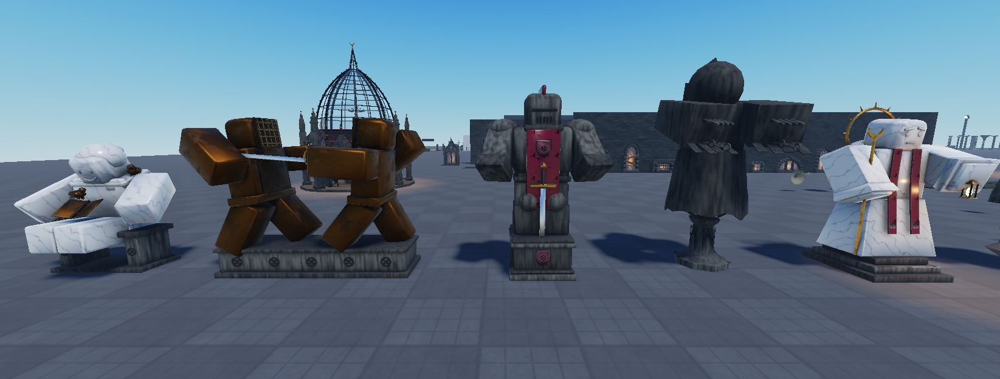
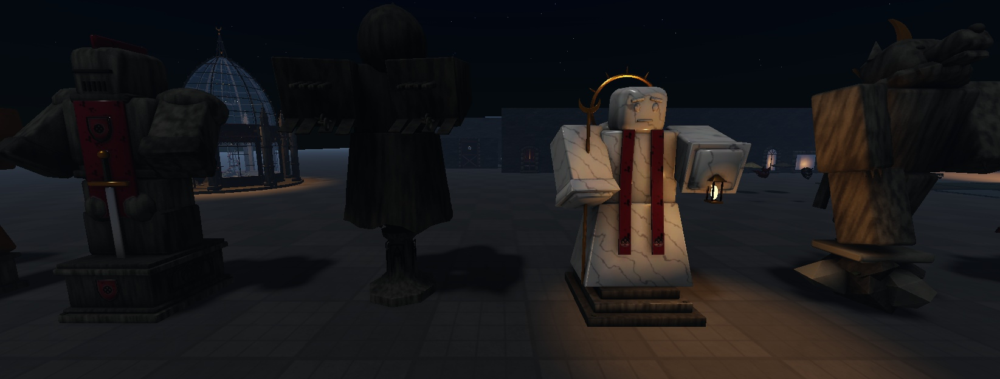

## Batch 28 (1.48): the roof kit

`art/props/nh_props_batch28.py`; the roof textures from `tools/vfx/make_roof_tiles.py`.

**How a roof fits:** a pitched roof sits on a wall top at its origin (z = 0). Its footprint is the wall's outer size: 16 × 12 for the wings, 12 × 12 for the pyramid, 12 × 6 for the lean-to.
- A moulded cornice runs round the wall top, and the roof springs from it with a 0.45 overhang at the eaves.
- Gutters hang below the wall top, so seat a roof by its wall plate, not its lowest point. `bounds` in `roofs_batch28.json` gives each piece's bounds about that origin.
- Turret caps fit round towers 8, 7 and 6 across. The octagonal spire and the bell-cast cap fit octagonal towers 8 across, and the broach spire a square tower 8 across.
- The GableSection and the corner share GableRoof's 45° section. They join end to end and against its parapet gables.

**The tiled roof planes:** the slate, lead and copper aren't baked. Each plane is its own piece (`<Prop>_Slate`, `_Moss`, `_Scale`, `_Crimson`, `_Copper`, `_Lead`) with UVs made in the builder:
- u runs along the eaves and v up the slope, with the first course starting at the eaves.
- Cones and domes get UVs round them, so the slates narrow toward the top the way real ones are cut.
- Gable walls and parapets (`_Stone`) use the group's CastleStone set at 8 studs, as the builder's walls do.

| Set | Studs a tile | Look |
|---|---|---|
| NH_RoofSlate | 6 | rectangular slates, 10 courses of 0.6, blue, purple and green-grey, chipped corners, rain streaks |
| NH_RoofMoss | 6 | the same slates gone over to moss and lichen |
| NH_RoofScale | 4 | fish-scale slates, 8 courses of 0.5 |
| NH_RoofCrimson | 4 | fish scales in crimson glaze (#600E1A), glossy, worn thin at the edges |
| NH_RoofCopper | 6 | standing-seam copper in verdigris, dark bronze showing in streaks |
| NH_RoofLead | 6 | lead sheet with rolls every 2 studs and drips every 3, white bloom |

| Prop | Tris | Notes |
|---|---|---|
| GableRoof | 10.8k | 45°, parapet gables on kneelers, crocketed pinnacles, crimson ridge tiles, iron cresting |
| GableSection | 4.4k | an 8-stud run of the 45° roof with open ends |
| GableRoofLow | 1.0k | 30°, slates over the gables, lead verges, lead ridge roll |
| GableRoofSteep | 9.5k | 60°, cusped crimson-enamel bargeboards, pendants, spiked hip knobs, tall cresting |
| HipRoof | 8.5k | 45° hipped, lead hip rolls and hooks, a crested ridge, moon knobs |
| PyramidRoof | 7.1k | a 12 × 12 tower's pyramid at 55°, a lucarne on each face, a tall moon finial |
| MansardRoof | 16.4k | fish-scale sides with four oeil-de-boeuf dormers, a crested lead curb, a low lead roof |
| GambrelRoof | 3.8k | steep and shallow slopes, lead knuckle rolls, round vents in castle-stone gables |
| LeanToRoof | 3.3k | 12 × 6 in lead against a taller wall (its back at y = +3), a crimson cusped valance |
| FlatRoofParapet | 15.4k | a lead deck, castle-stone parapet, quatrefoil panels, corner pinnacles, grotesque spouts, hatch |
| BattlementRoof | 9.2k | machicolated parapet on triple corbels, merlons with arrow slits, a crimson banner |
| ConeTurretCap | 8.3k | a bell-cast fish-scale cone for a tower 8 across, four lucarnes, moon finial |
| WitchHatCap | 6.6k | a tall flared crimson-scale cap for a tower 6 across, gilt band, gilt candle-flame finial |
| OctagonSpire | 9.2k | octagonal slate spire, two tiers of lucarnes, corner pinnacles, the crest's gilt key |
| BroachSpire | 6.1k | octagonal lead spire on broaches over a square tower, lucarnes, moon finial |
| BellCastCap | 3.9k | octagonal verdigris ogee cap with copper rolls, gilt orb and spike |
| OnionDome | 7.7k | verdigris onion with gilt ribs for a tower 7 across, gilt onion and moon finial |
| GabledDormer | 2.3k | for 45° roofs (its foot on the slates, the roof plane rising behind): a traceried lancet with the lit room behind |
| OxeyeDormer | 2.0k | for 60° roofs and steeper: a round window, an iron quatrefoil, a lead bonnet, the lit room behind |
| RidgeCresting | 2.9k | 8 studs of crimson ridge tiles with iron cresting, to repeat along any ridge |
| RidgeTiles | 2.2k | 8 studs of plain crimson ridge tiles with gilt-knobbed ends |
| HipCap | 0.3k | a lead hip roll for a 45° hipped roof (it falls at 35°), with a hip hook |
| RoofCornerL | 7.5k | the corner of two 45° wings in an L: a hip outside, a lead valley inside |
| EavesGutter | 3.4k | a wall's gutter, a crimson hopper with the gilt foil, a downpipe on eared straps |
| ChimneyStack | 3.2k | castle stone, oversailing courses, three clay pots, a lobster-back cowl |
| TwinFlue | 9.2k | two twisted gothic shafts on a moulded base, with crowned caps |
| Weathervane | 3.0k | an iron raven on the arrow, a gilt crescent tail, lettered quarters |
| BellCote | 4.1k | a double bell-cote: two bronze bells, coped gable, crocketed pinnacle |
| Cupola | 5.6k | louvred, on a lead saddle that sits astride a 45° ridge, verdigris cap |
| LanternRoof | 16.1k | glazed octagonal lantern on a stone kerb, lead ogee dome, a lit corona of candles inside |
| SkylightRoof | 2.0k | an 8 × 4 glazed ridge rooflight on a lead kerb |
| RuinedRoof | 7.5k | a 12-stud run fallen in to the charred rafters, gap in the ridge, bent cresting, loose slates |
| MossyGableRoof | 11.6k | GableRoof gone to moss, slipped slates, a broken pinnacle |
| PatchedRoof | 1.8k | GableRoofLow with riveted lead patches, a tin sheet, odd slates, a tarred seam |
| MoonFinial | 0.8k | iron spike, gilt orbs, gilt crescent moon |
| KeyFinial | 1.3k | the crest's gilt key on an orb |
| StonePinnacle | 4.2k | crocketed stone pinnacle with gablets and blind trefoils |

Tris are whole-prop counts. The largest single piece is FlatRoofParapet's Main at 15,396.

- **Baked** at 2048 with 64 samples on the GPU. The maps are under the group (`art/group-upload/roofs-batch28/`, 166 images), and the ids are in `art/props/roofs_batch28.json` (`_tiles` holds the roof sets).
  - No metal map for RidgeTiles, TwinFlue, or the slate, moss, scale and crimson sets.
- **In Roblox:** `Studio/props_setup28.luau` builds the templates in `ServerStorage.NHProps` (`NHBuildKit = "Roofs"`).
  - Main, the roof planes and the stone collide (Main precisely, so a parapet doesn't roof over its deck).
  - Glass is Roblox Glass, except the skylight, whose sky-facing panes are plain see-through. Room uses the window kit's WindowRoom image, and the lantern's candles are `NHCandle` flames.
- **The showcase:** three rows facing −Z (`workspace.NHPropsShowcase.Roofs`, `NHPropBatch28`; `props_revert28.luau` removes it):
  - z −285: the big roofs on slate wall blocks.
  - z −322: towers and roof features.
  - z −352: dormers on slope wedges, ridge pieces on ridge wedges, and finials.

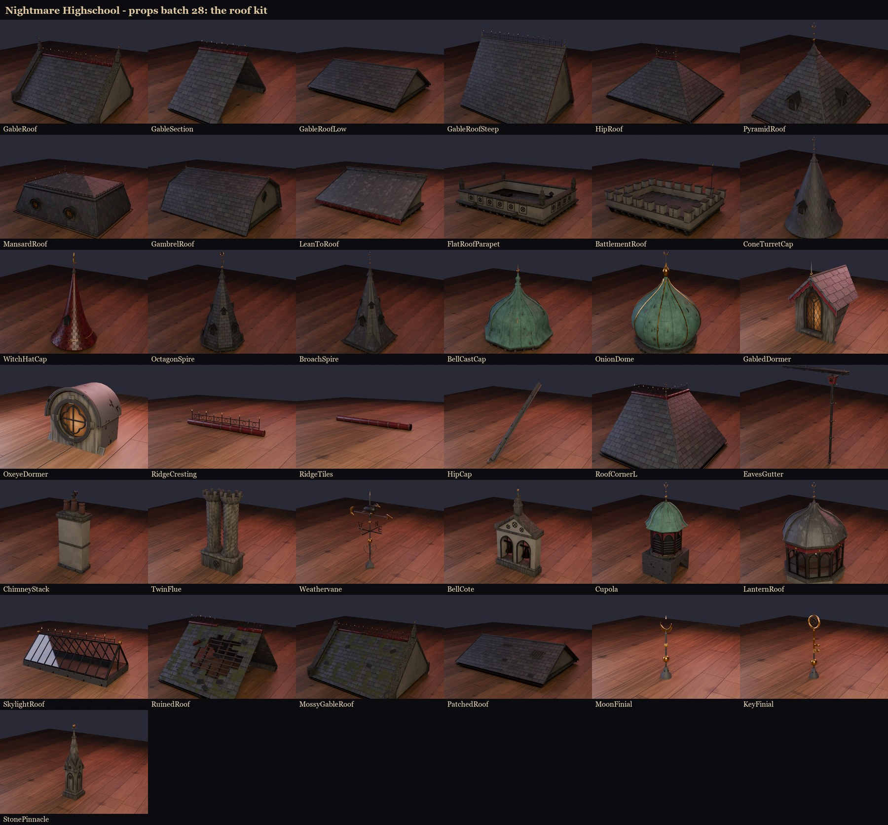
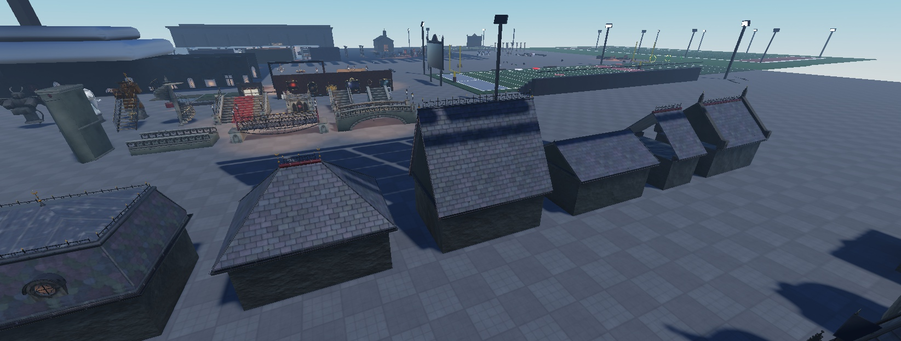
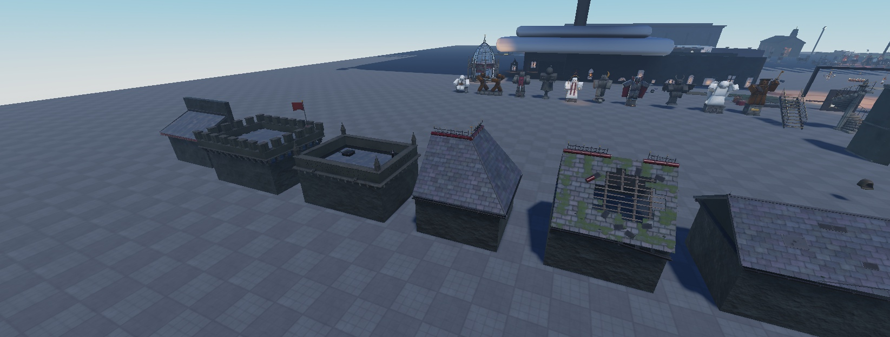
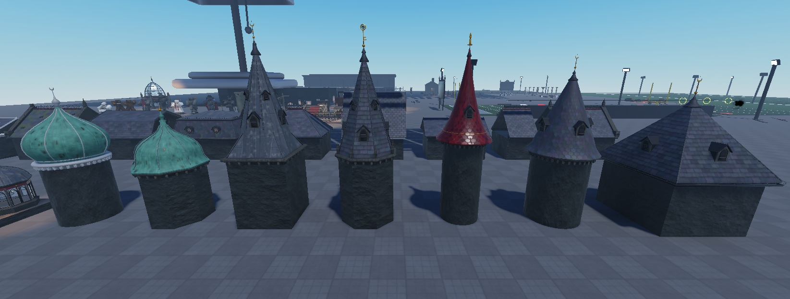
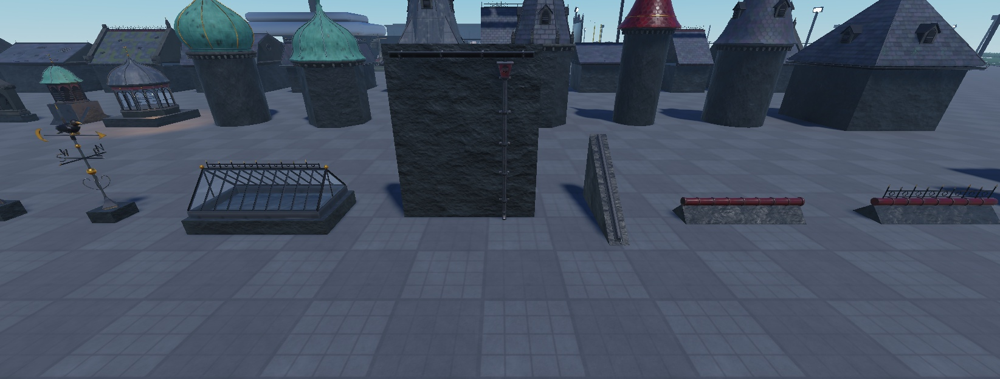
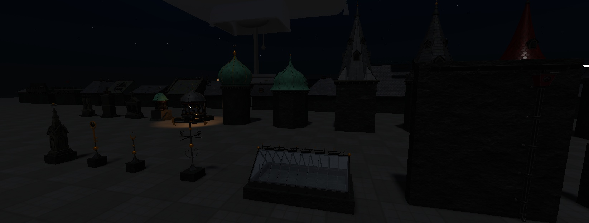
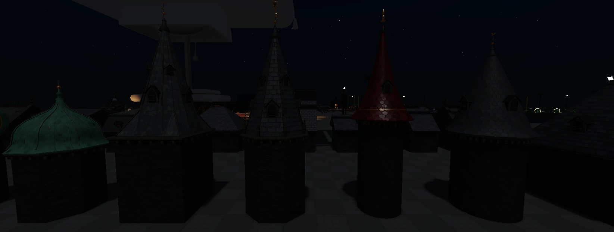

## Batch 29 (1.49): the soft furnishings and tapestry kit

`art/props/nh_props_batch29.py`. The woven maps come from `weave_textiles.py`, using `weave_motifs.py` and `weave_dyes.py`; the tapestries from `tapestry_renders.py` (Blender) and then `tapestry_weave.py`.

**Woven pieces:** the rugs, mats, carpet tiles and tapestry cloths aren't baked.
- Each has its own maps (colour, normal, roughness, plus metal where there's gilt thread), mapped straight onto it: from above for floor pieces, from the front for hangings.
- The foot of every woven map is a 32 px swatch band: fringe wool on the left, the binding or backing on the right. The fringe, edges and back use it.
- `TEXTILE` in the batch file lists these pieces. The batch overrides `canvas_uv` / `canvas_material` for them, and makes the bake steps skip a prop that has only woven pieces.

**The upholstery sets** (`art/props/source_fabric/`, seamless, 1024) are tinted per material and baked into each seat's atlas:

| Set | Look |
|---|---|
| NH_Velvet | crushed pile, soft lighter patches |
| NH_Damask | a damask flower in satin on twill (tone on tone) |
| NH_DamaskBat | bats and crescents in satin on twill |
| NH_Stripe | regency stripe: crimson satin, gilt pinstripes, ink ground (untinted) |
| NH_TapestryWeave | millefleur sprigs on ink, ribbed (untinted) |

| Prop | Tris | Notes |
|---|---|---|
| VelvetChesterfield | 12.9k | crimson velvet, diamond-tufted back and arms, rolled arms, three piped cushions, nailheads, bun feet |
| CamelbackSofa | 15.4k | black velvet, humped back, carved ebony rail with a gilt bead, bolsters, cabriole legs on gilt claw-and-ball feet |
| ChaiseLongue | 12.2k | crimson damask, scrolled head, sloping back rail, tasselled bolster, turned legs on brass castors |
| GothicSettle | 14.3k | three tufted crimson arches, pinnacles with gilt finials, open arms with balusters, quatrefoil apron |
| ShellLoveseat | 9.3k | bone velvet, scalloped shell back with gilt channel cords and rim, tapered gilt legs |
| CornerSectional | 18.4k | 9 × 9 L in ink-blue velvet, piped seat and back cushions, bat-damask pillows |
| CoffinCouch | 11.4k | black lacquer coffin back with a tufted crimson pad, brass coffin handles |
| BatwingSofa | 6.9k | bat-wing back in black bat damask, gilt wing bones, a bat's head with red eyes |
| ThroneSettee | 15.3k | the Headmaster's: tall pointed tufted back, crocketed gilt frame, the crest, ravens on the arms |
| TuftedBench | 6.2k | 6 × 1.8 window bench, plum velvet, turned legs with gilt collars, tassels |
| RoundOttoman | 12.5k | 3.4 across, radially tufted top, tasselled gilt button, bullion fringe |
| MothMedallionRug | 2.8k | 12 × 8: moth on a crescent, circling bats, corner cobwebs and spiders, thorned-rose border, keys |
| WatchingRunner | 4.1k | 18 × 4: eyes in lozenges, bats, battlement borders |
| ThornRoseRug | 1.9k | round, 9 across: a rose in a thorn wreath, a wheel of petals, bats round the rim |
| StarChartRug | 0.3k | octagon, 8 across the flats: moon phases, constellations, an arcaded border |
| RavenHearthRug | 1.6k | half-round, 7 × 3.5 (the flat edge at the back, for a hearth): a raven over a sunburst, flames |
| BatDamaskRugWorn | 2.1k | 9 × 6: damask flowers and bats, worn through to the knot rows |
| Doormat / DoormatCrest | 0.1k | 4 × 2.4 coir: "Nightmare High" under a bat / the key on a shield between bats |
| BathMat | 0.1k | 3.2 × 2 cotton loops, navy stripes, the crest |
| CarpetDamask / CarpetWeb / CarpetHarlequin / CarpetMoth | 12 tris | 8 × 8 seamless tiles; butt them edge to edge for wall-to-wall carpet |
| TapestryHeadmaster, TapestryPriestDemon, TapestryAngelDemon, TapestryJudgement, TapestryCrest | 16.6k | 7.5 × 10 cloth (`Weave`, 10.6k) on a gilt rod with brackets, rings and finials (`Main`, 5.9k); the back flat at y = 0 for a wall |
| TapestryWolfHunt | 22.8k | the frieze, 13 × 7.3 (`Weave` 14.2k, `Main` 8.6k) |

Tris are whole-prop counts; every single piece is under 20k (the largest is CornerSectional at 18,432).

**The tapestries:** each is a painted night scene in the art kit's style with the figures set in.
- The figures are R6 bodies posed on the statue kit's rig and lit in Blender: a moon rim, warm lantern light, velvet and gilt, and glowing lanterns, halos, eyes and ember veins.
- The effects are painted on: bloom, god rays, rising embers, lightning, mist and a holy circle.
- Then comes the paintings' brush pass, and the weave: horizontal ribs, tone stepped in hatched teeth as real tapestry weaving does, abrash, gilt thread (the metal map).
- A woven border frames each one: a thorned rose stem, bats in the corners, the crest at the top, a blackletter title on a ribbon.

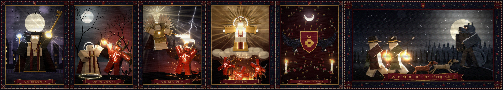
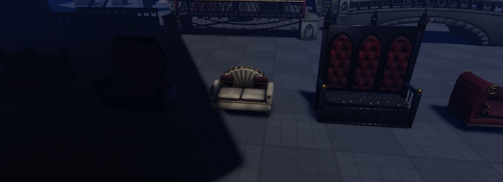
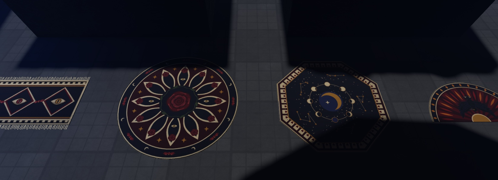
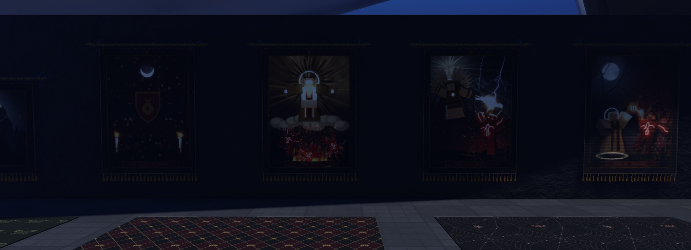
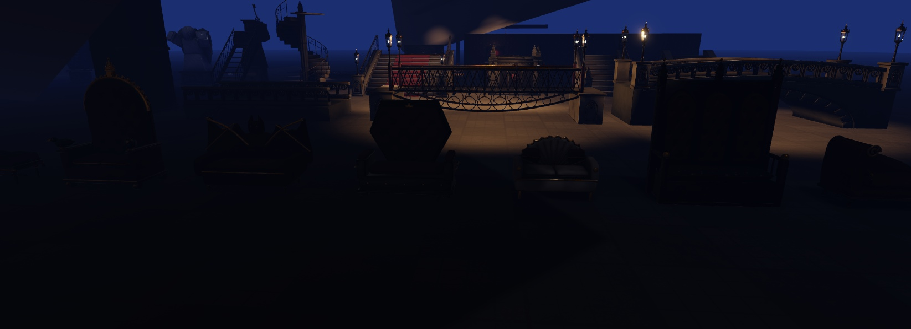

## Batch 30 (1.50): the library kit

`art/props/nh_props_batch30.py`. The printed atlas comes from `art/props/library_atlas.py`, run with the system Python and PIL. It writes `textures/LibraryAtlas_{color,gilt,height}.png` and `LibraryGlobe_color.png`. The atlas regions and the 142 book designs are in `art/props/library_atlas.json`.

**The books:**
- Each book is a box mapped onto the atlas through a "Spine" UV layer: the spine onto its cell, the boards onto its leather swatch, the edges onto its paper swatch.
- The atlas material reads colour, gilt (metal, smoother) and height (a bump for the raised bands and the debossed titles) over a fine leather grain, then gets the usual bake weathering.
- The atlas is drawn at twice its size and filtered down. Gilt is tooled: a dark pressed rim, a sheen and pinhole wear.
- `fill_row` stands books on a shelf. It makes runs of matching sets, stacks lying flat with their titles across, books leaning on a neighbour's top corner (placed by geometry, never through it) and the odd gap. `dfun` caps the depth on a shaped shelf (the corner case).

**The bake layout:** batch 30 replaces `bake_uv` with `bake_uv_weighted`. It falls back to the usual one for a prop with no books or printed faces.
- Each book is laid out as one island from its "Unfold" layer: the spine at 2.6 times the kit's texel density, the boards and edges as thin strips (0.12) folded off it.
- Faces with an `nh_uvk` weight are scaled by it: printed plates 2, chain links 0.5, cobweb threads 0.25.
- After the pack, the layout is shrunk to fit the tile if it overruns. A second pack would collapse it to a point.
- Result: 38 to 70% of a book-heavy prop's 2048 map is used, against about 30% with the usual layout.
- The 8-pixel gap is too wide for a small test bake (512), which comes out empty. Test at 1024 or more.

**Dust:** `dustify()` mixes dust into every material's colour where it faces up (with a soft noise), making it rougher and less metallic, before the bake (ShelfDusty).

| Prop | Tris | Notes |
|---|---|---|
| ArmillarySphere | 7.5k | brass rings, a gilt ecliptic, a little earth; Rings turn (NHSpin, 9°/s) |
| BankerLamp | 0.6k | green glass shade on brass (Glow: the bulb) |
| BookCart | 3.8k | two tiers of books both sides, iron frame, castors, brass handles |
| BookPile | 0.8k | three floor piles, one with an open book on top |
| CandleLamp | 3.9k | two candles under a crimson tole shade on a brass rod (Glow) |
| CardCatalogue | 14.5k | 30 labelled drawers (A to Fa-Fz) on a stand, one pulled out with its cards, CATALOGUE plaque |
| ChainedBookcase | 19.3k | a press with every other book on an iron chain to a rod, a sloping desk with a chained open book |
| CirculationDesk | 7.8k | traceried front, LIBRARIAN plaque and crest; bell, date stamp, ledger, card box, returned books, candle lamp (Glow); shelves behind |
| CobwebCorner | 3.1k | sheet webs and threads for a room's top corner (walls at +Y, like LibShelfCorner); no metal map |
| ForbiddenCage | 14.8k | black and plum books in an iron cage: spear-tipped bars, two doors chained shut, padlock, RESTRICTED plaque, DO NOT OPEN tag |
| Lectern | 4.6k | a dark bronze raven, wings spread as the rest for a chained bestiary, on an iron column |
| LibCandelabra | 2.5k | three lights, dripping wax (Glow) |
| LibShelfArched | 8.0k | under a pointed arch: carved spandrels, pinnacles, a traceried niche, ASTRONOMY plaque |
| LibShelfCorner | 5.4k | for a room corner, its two backs meeting at +Y (turn it 45° for a square room), POETRY plaque |
| LibShelfDouble | 13.6k | double-sided, books both faces, traceried end panels, LANGUAGES plaques both sides |
| LibShelfHalf | 4.0k | half height, moulded top with brass bookends, a pile and a chamber candle (Glow) |
| LibShelfLadder | 11.6k | 14 tall, a brass rail on three arms and a rolling ladder hooked on it (Ladder: its own piece) |
| LibShelfTall | 7.5k | seven shelves, ebony pilasters with brass capitals, cornice and crest, gilt HISTORY plaque |
| LibrarianBust | 4.6k | bronze R6 bust: spectacles, soft cap, quill behind the ear, crimson scarf; LIBRARIAN plaque on the pedestal |
| LibraryChair | 2.1k | armless, pointed back, crimson cushion; seat top 1.55 (SeatHeight 1.55) |
| LibraryClock | 7.3k | black and crimson longcase: moon-phase arch, lancet door (Glass), Pendulum swings (NHSwing) |
| MapChest | 6.0k | six plan drawers with cup handles; the map of the moor, brass weights, dividers, a roll |
| NewspaperRack | 2.0k | three Nightmare Heralds on reading sticks, NEWSPAPERS plaque |
| OpenBook | 2.0k | the phases of the moon on a tasselled crimson velvet cushion |
| ReadingTableLong | 4.9k | 12 × 4.2, pierced trestles, crimson leather top, a raised rail with two banker's lamps (Glow), open books, inkwell |
| ReadingTableRound | 4.5k | 5 across, baluster and scroll feet, crimson inset, books, a magnifier |
| ReturnsBox | 1.7k | iron-bound, brass slot with a book half posted, RETURNS plaque |
| RollingLadder | 2.1k | platform ladder on castors, brass handrails |
| ScrollRack | 7.7k | diamond lattice of scrolls, eight numbered tags; no metal map |
| ShelfDusty | 12.0k | dust on every ledge (baked), cobwebs, gaps, fallen books, a candle stub |
| ShelfEndCap | 3.8k | end panel for a stack: twin lancets, crocketed gable and pinnacles, POETRY plaque, a shelf card |
| ShelfToppled | 7.8k | fallen on its back, books tumbled inside and spilled round it (12 × 12 footprint) |
| SilenceSign | 8.7k | crimson enamel, SILENCE in raised gilt letters, "quiet in the stacks", iron tripod stand |
| StepStool | 2.0k | two steps, crimson leather treads, quatrefoil cheeks |
| StudyCarrel | 2.7k | arched sides, a shelf of books, a hooded lamp (Glow), a QUIET PLEASE card; 4.5 inside for R6 arms |
| TerrestrialGlobe | 5.8k | an invented world (Orbis Nocturnus) in a brass meridian and oak horizon ring; Globe turns (NHSpin, 6°/s) |

- **Baked** at 2048 with 64 samples on the GPU, one prop per Blender run (`Studio/bake30.sh`, resumable). Every piece is under 20k triangles.
  - The maps are under the group (`art/group-upload/library-batch30/`). The ids are in `art/props/library_batch30.json`.
  - ScrollRack and CobwebCorner have no metal map.
- **Importing:** the FBX files must be the final ones. The first import was made from drafts, and its UVs didn't match the maps.
  - `Studio/match30.luau` checks each imported mesh against the final FBX by UV fingerprint (distinct UVs and their mean u).
  - `Studio/rebuild30.luau` builds a prop from its final mesh assets. Those come in at 100 times, so the setup scales them down; `fixpieces30.luau` then puts the small pieces back.
- **In Roblox:** `Studio/props_setup30.luau` builds the templates in `ServerStorage.NHProps` (`NHBuildKit = "Library"`).
  - Cases collide as boxes and furniture precisely. Lamps, books, the open book and the web don't collide.
  - Glow is Neon with a small light; flames flicker (`NHCandle`). The clock's door is Glass.
  - The Pendulum swings (`NHSwing`, 4°, 2 s). Globe and Rings turn about the tilted axis (`NHSpin`; Blender (sin 23.4°, 0, cos 23.4°) is Roblox (−sin, cos, 0)).
  - LibraryChair has `SeatHeight` 1.55.
- **The showcase** (`workspace.NHPropsShowcase.Library`, `NHPropBatch30`; `props_revert30.luau` removes it): four rows facing −Z from x 252, at z −130 (shelving), −160 (furniture), −190 (fittings and books) and −220 (atmosphere).
  - Chairs are drawn up to the tables and the carrel.
  - The small pieces stand on dark blocks, and the web hangs between two dark walls (`NHLibraryKitDisplay`).

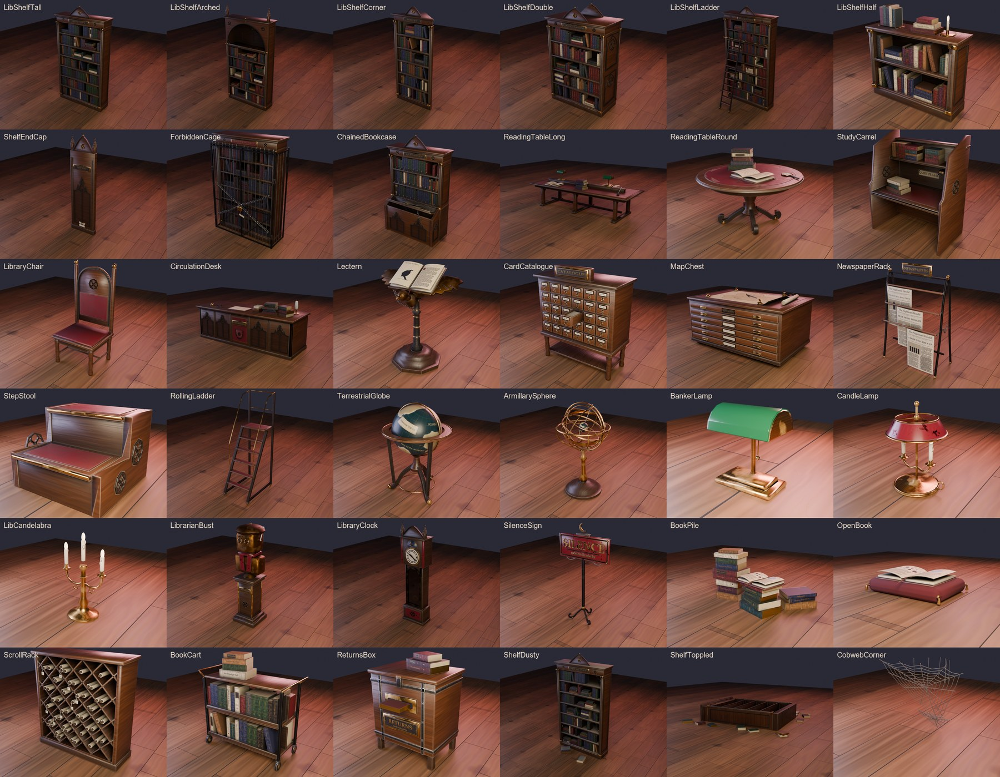
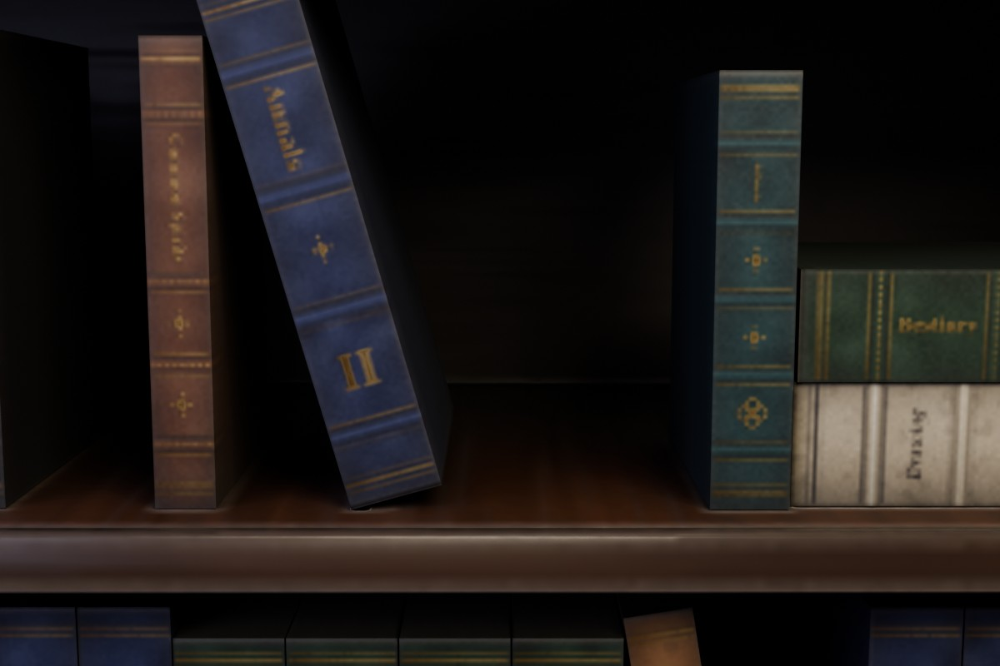
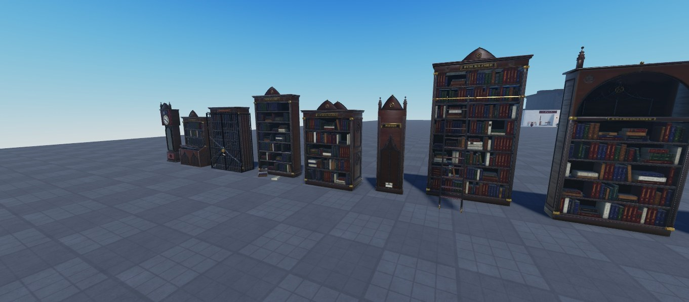
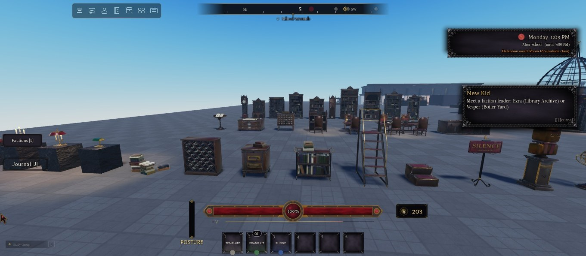
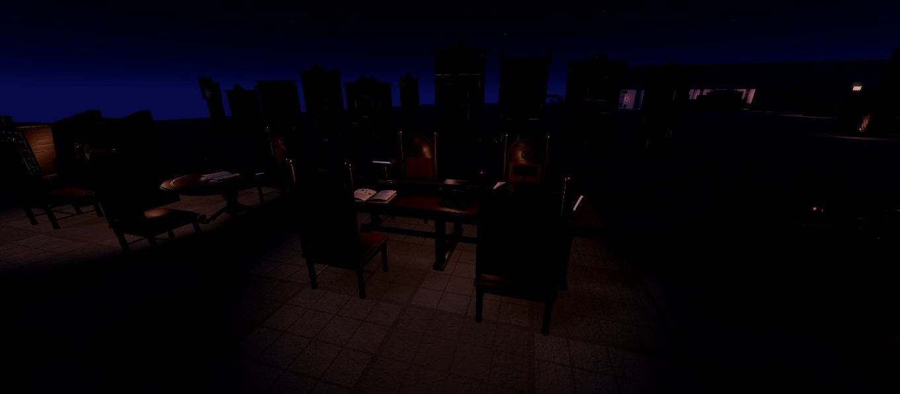
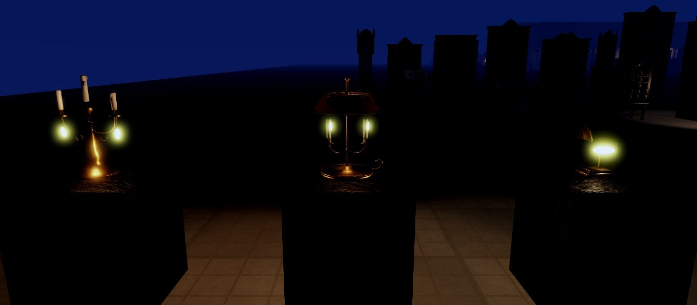

## Batch 34 (dorm): the dorm room kit

`art/props/nh_props_batch34_dorm.py` (named `_dorm` because `nh_props_batch34.py` is the beasts kit). The private dorm room of the homes spec (`docs/superpowers/specs/2026-11-06-homes-interiors-design.md`): one furniture set with tidy-to-messy variants and state-only extras, so a room can follow the report card. In Studio since 1.64.1: the owner imported the 35 FBX files and bulk-imported the 142 maps under the group, and the ids were read back by name (no duplicates). The templates are in `ServerStorage.NHProps` (`NHBuildKit = "Dorm"`, scaled to 1:1, pivots at the kit origins, fronts facing -Z), and the dorm room is built from them (see [[Homes]]).

- **Printed atlases:** `art/props/dorm_atlas.py` (system Python, PIL) writes `textures/DormPrint_*` (certificates, notices, papers, the marked test, the pizza box, can wraps, the mug, the night outside the window) and `textures/DormCloth_*` (the clothes' flat patterns), and `art/props/dorm_atlas.json` (regions and garment outlines). Faces map onto them through the "Spine" UV, as the library kit's books do, and are baked.
- **The rug:** `art/props/dorm_weave.py` weaves `DormRug` with batch 29's machinery (not baked, like the other rugs).
- **Tiled sets:** `tools/vfx/make_dorm_sets.py` makes `NH_DormPlaster`, `NH_DormEnamel` and `NH_DormFloor` (seamless 2048, 5 studs a tile) for the shell's `_Plaster`, `_Panel` pieces and the floor. The furniture's crimson enamel is the same set.
- **Cloth:** the blankets, sheets and clothes are Blender cloth simulations (joined pieces fall together on smooth proxy colliders; flung vertices are pulled back and cut). `JacketOnChair` and `ClothesOnChair` are built in DormChair's frame: put them at the chair's pivot.
- **Run:** `Studio/run34.py` (scratch) through nh_props without editing its import list; `bake34.sh` bakes 2048 / 64 samples / GPU, FBX to `art/props/fbx/dorm-batch34/`. `upload34.py` fills `art/group-upload/dorm-batch34/` (142 maps). `sheet34.py` and `render34.py` make the review sheets and room renders in `art/props/renders/dorm-batch34/`.

| Prop | Tris | Notes |
|---|---|---|
| DormBed / DormBedUnmade | 17.2k / 19.4k | cast iron, brass knobs; crimson damask blanket with a bone binding; mattress top 1.84 |
| DormDesk | 9.0k | iron trestles, ebonised top 2.95 with a crimson leather inset, shallow drawer, a hutch of pigeonholes |
| DormChair | 3.9k | iron, pointed back, crimson leather pad; seat top 1.7 |
| DormWardrobe / DormWardrobeOpen | 9.0k / 22.4k (Main 10.5k, Clothes 11.9k) | enamel inserts, brass strap hinges; the right door open, clothes hanging and spilled |
| DormShelfFull / Sparse / Empty | 3.4-4.4k | wall shelf on iron brackets, library-atlas books; Empty is dusty with cobwebs |
| DormPlantHealthy / Wilting / Dead | 13.3k / 10.6k / 9.1k | a fern in a brass pot on an iron stand |
| DormDeskLamp | 3.0k | brass; Glow: the bulb |
| DormCeilingLight | 4.3k | iron pendant, Glass: the frosted globe, Glow: the bulb; 2.75 tall (its top meets the ceiling) |
| DormRug | 1.4k | 6 x 4 woven |
| CertificateHonourRoll / DeansList / PerfectAttendance | 2.1k | gilt frame, printed certificate with the crest, wax seal |
| TrophyShelf | 6.8k | black marble, brass TROPHIES plaque; spots for beast trophies at (±0.75, -0.05, 1.0) and (±2.25, -0.05, 1.0) |
| JacketOnChair, ClothesOnChair | 6.3k, 8.8k | in DormChair's frame |
| DormBookStack, CoffeeCup, PaperScatter | 0.1k, 1.6k, 3.4k | |
| ClothesPile, PizzaBoxes, OverdueNotices, EmptyCans | 11.1k, 1.2k, 5.7k, 2.9k | |
| DormWall / DormWallWindow / DormWallDoor | 2.6k / 5.2k / 2.9k | 10 x 12 x 0.5; Window: Glass and Sky pieces; Door: a 5 x 8 opening |
| DormFloor, DormCeiling | 12, 2.5k | 10 x 10; floor top 0.3; the ceiling's underside 0.6 above its origin (the cornice hangs to 0) |
| RoomNumberPlate / RoomNumberPlateBlank | 1.2k / 0.3k | brass, 101 raised / blank |

The upload folder leaves out five metal maps that are pure black (ClothesOnChair, ClothesPile, PizzaBoxes, NH_DormFloor, NH_DormPlaster) and the rug has none, so it holds 142 of the 147 maps.

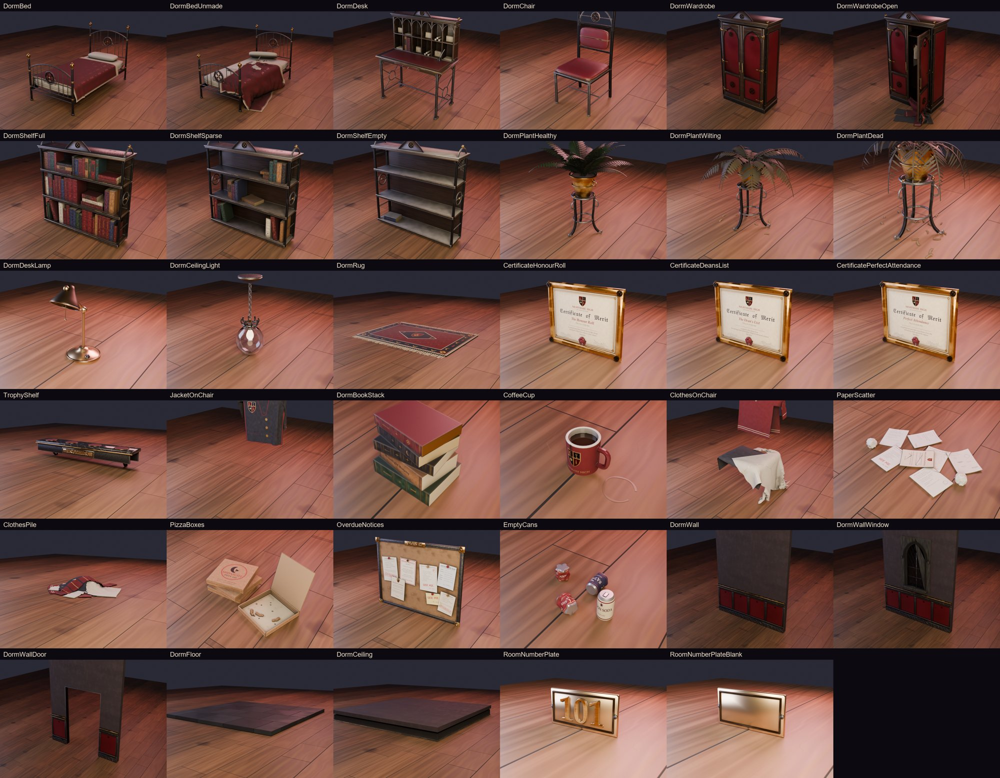
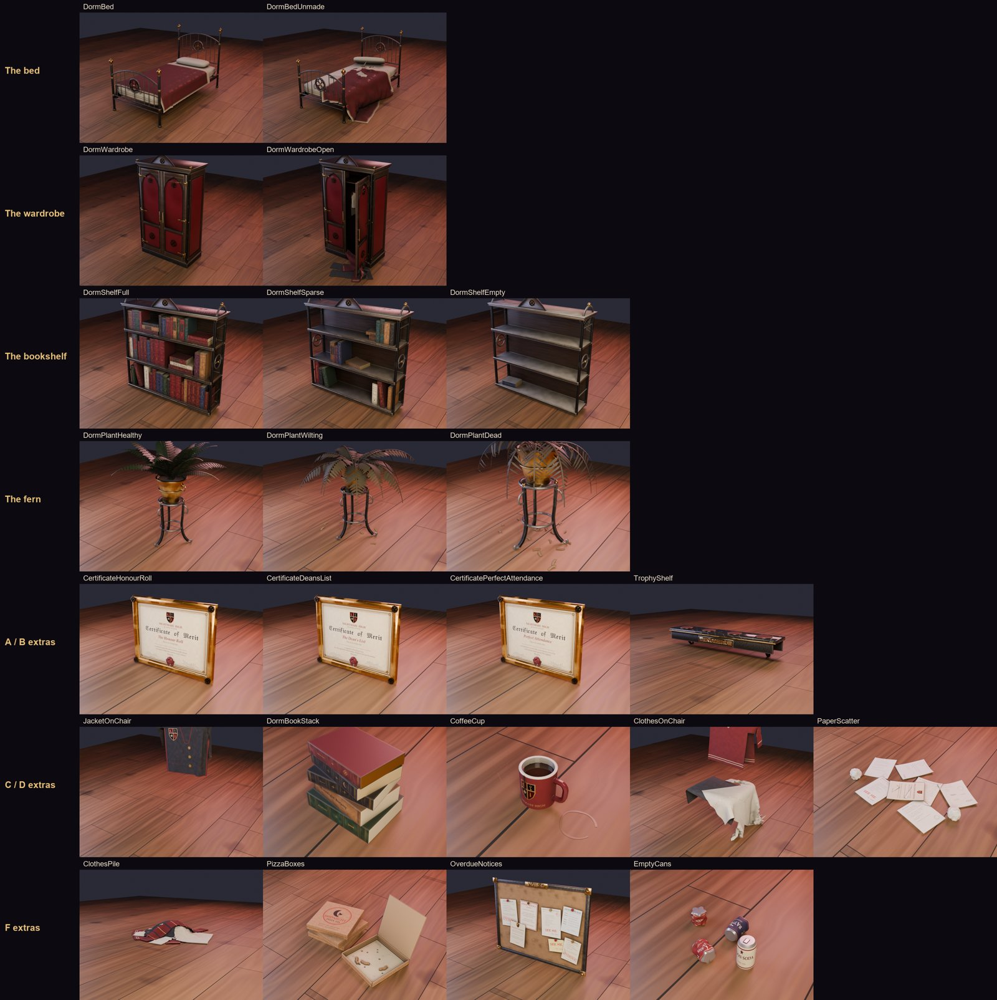
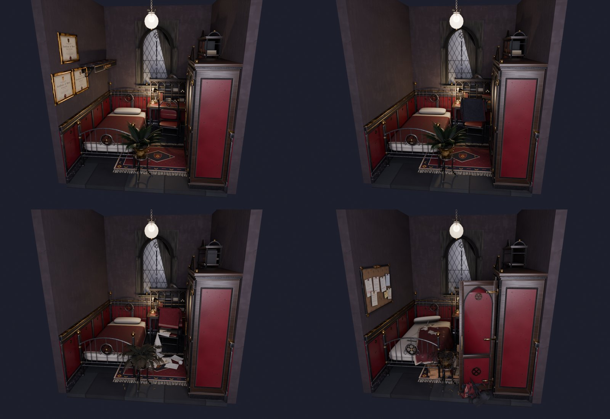

## Batch 35 (lounge): the Teachers' Lounge kit

`art/props/nh_props_batch35.py`. The staff room: a corner to brew tea, mark books and sit out a free period. Cast iron, black marble, crimson enamel, brass and gilt, dark oak and ebonised wood, bone china, ink, paper and slate. Every name and word on the props is invented (the crest, STAFF ONLY, the chalked rota, the staff Mr. Hale, Miss Vane, Dr. Crowe, Mrs. Ashby, Mr. Thorne and Mr. Graves).

- **Printed atlas:** `art/props/staff_atlas.py` (system Python, PIL) writes `textures/StaffPrint_{color,gilt,height}.png` and `art/props/staff_atlas.json`. It holds the rota slate and name tags, the ledger pages, exercise book covers, marked sheets, playing cards, the dartboard face and score slate, mug wraps and the biscuit barrel wrap, plus batch 36's prints. It reuses `dorm_atlas.py`'s drawing code. Faces map onto it through the "Spine" UV and are baked, as in the dorm kit.
- **China and mugs:** `wrap_lathe` turns a profile with a Spine UV, so a print wraps round it once (u = 0.25 faces the front) and plain bands (the crimson band, the gilt lines) are painted from swatches.
- **Run:** `E:/NH-Work/props3536/run3536.py` loads nh_props without editing its import list (add `--fast` for a quick unbaked look). `bake3536.sh` bakes 2048 / 64 samples / GPU, one Blender process per prop, FBX to `art/props/fbx/lounge-batch35/`. `upload3536.py` fills `art/group-upload/lounge-batch35/`. `sheet3536.py` and `render3536.py` make the contact sheet and the staged render in `art/props/renders/lounge-batch35/`.

| Prop | Tris | Notes |
|---|---|---|
| TeaUrn | 8.3k | brass samovar on an iron stand with a spirit lamp; tap at the front; crest medallion; 2.3 tall, stands on a counter |
| SpiritKettle | 4.5k | copper kettle, brass swing handle, on a cast-iron spirit stove; 1.15 tall |
| TeaSet | 12.2k | ebonised tray (1.9 x 1.25), teapot, three cups and saucers, sugar bowl, milk jug, spoon; bone china with a crimson band between gilt lines |
| MugRack | 13.2k | wall piece (hangs from its back face): dark oak board, a shelf with a tea caddy and sugar jar, six iron hooks and six mugs; 2.6 wide |
| BiscuitBarrel | 9.3k | bone china printed with the crest and BISCUITS; brass lid, foot and bail handle |
| KitchenetteCounter | 7.9k | 6 x 2.2; black marble top at 3.0 with a marble upstand behind; three drawers, two drawers over two crimson-panelled doors, brass pulls |
| IceBox | 5.3k | dark oak, 2.4 x 1.7 x 3.5; ice door over food door, zinc-lined openings, brass latches, hinges and an ICE plate, zinc drip tray; top at 3.54 |
| MarkingStack | 2.1k | nine printed exercise books, a red fountain pen on top, three marked sheets and an open book beside it |
| Gradebook | 1.9k | open ledger (1.7 x 1.15) with printed pages of marks, an inkwell and a dip pen |
| StaffRotaBoard | 5.5k | wall piece: 4.6 x 4.2 framed slate chalked STAFF DUTY ROTA (DUTY / MON..FRI), chalk ledge, a brass rail of six name hooks with tags |
| WallTelephone | 4.4k | wall piece: oak crank telephone, two brass bells, mouthpiece horn, crank, earpiece on its hook, writing shelf, battery box; 2.9 tall, hang its bottom about 2.5 up |
| CardTable | 7.8k | folding card table, 2.8 square, green baize top at 2.45; two hands of cards, the deck, a face-up pile, chips |
| StaffOnlySign | 4.4k | wall piece: 1.8 x 0.55 brass plaque, crimson enamel field, raised gilt STAFF ONLY |
| Dartboard | 5.4k | wall piece: dark oak cabinet (2.2 x 2.4) with both doors swung open (4.3 wide open); the board centred 1.25 up; three darts; chalk score slate in the left door |
| StaffLockers | 14.0k | three tall dark oak lockers, 5.0 x 1.6 x 7.0; louvred pointed-arch vents, raised panels, brass name plates with tags, keyholes, lever handles |

All 15 metal maps have some metal, so the upload folder holds all 60 maps.

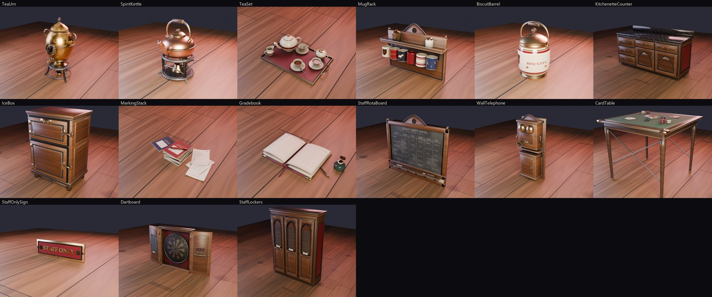
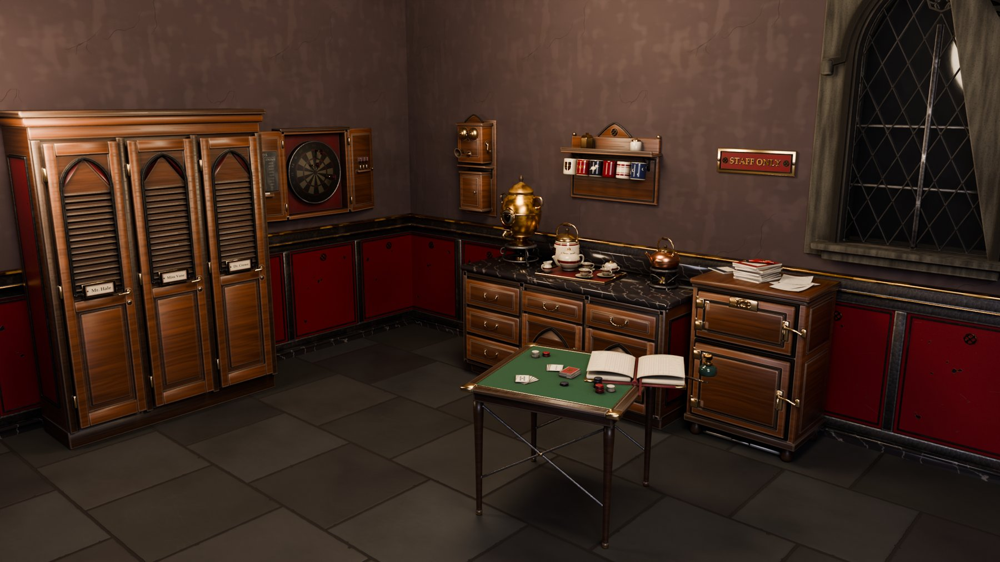

## Batch 36 (school): the School prop kit

`art/props/nh_props_batch36.py`. Classrooms, the laboratory, the music room and the gymnasium. Same house look and the same printed atlas as batch 35 (the wall map, a slate of sums, sheet music, the blotter, specimen labels, the fire bucket wrap, the dunce cap, the metronome scale). The wall map is an invented country (The Nocturne Reaches) with invented place names. The skeleton is clean and educational. Run, bake and upload as batch 35 (`run3536.py`, `bake3536.sh`, `upload3536.py`); FBX in `art/props/fbx/school-batch36/`, renders in `art/props/renders/school-batch36/`.

| Prop | Tris | Notes |
|---|---|---|
| Abacus | 11.1k | dark oak frame on splayed feet, ten rods of crimson and bone beads; 1.8 wide, 1.8 tall |
| AnatomySkeleton | 16.9k | life-size teaching skeleton (5.3 tall) hung from an iron stand on a cross base; 5.7 tall overall |
| LabBench | 15.3k | 6 x 2.6; slate top at 3.0; three brass gas pillars with swan-neck nozzles and lever valves; cupboards and drawers; reagent shelf at 4.15 with labelled bottles |
| TestTubeRack | 5.0k (Main 3.5k, Glass 1.5k) | oak rack, six tubes (Glass) with coloured liquids, a Bunsen burner and hose; stands on a bench |
| SpecimenJars | 10.7k (Main 8.2k, Glass 2.5k) | wall piece: 3.4 wide ebonised shelf (top 0.6 above its origin), five labelled jars (Glass): frog, sea-horse, beetles, mandrake root, octopus |
| Microscope | 3.6k | brass on a black horseshoe foot; 1.66 tall; stands on a bench |
| WallMap | 2.6k | wall piece: oak batten and roller, 4.1 x 2.8 pull-down map, pull ring at the bottom (origin at the ring); batten top 3.55 above it |
| WritingSlate | 1.3k | slate in an oak frame, lying flat, chalked sums; chalk and a slate pencil |
| InkwellSet | 2.4k | blotter pad (1.7 x 1.05), standish with two inkwells and two dip pens, rocker blotter |
| Satchel | 4.0k | oxblood leather, flap, two brass buckles, handle, shoulder strap; 1.25 wide |
| DunceStool | 4.5k | tall oak stool, seat top 2.6, a printed paper dunce cap on it |
| UprightPiano | 17.8k | ebonised, 5.2 x 2.0 x 4.6; key tops at 2.45; pointed fretwork over crimson silk, sheet music, two brass candle sconces, brass pedals |
| MusicStand | 2.7k | iron tripod, lyre desk with two sheets; 4.15 tall |
| Metronome | 0.5k | ebonised pyramid, printed tempo scale, brass pendulum, winding key; 0.9 tall |
| Radiator | 13.3k | cast iron, fourteen sections, 2.9 wide, 2.55 tall; brass valve wheel at the left (its pipe goes into the floor), bleed key at the right |
| FireBucketRack | 14.9k | wall piece: 3.4 wide oak board, crimson field, four crimson FIRE buckets on iron hooks, sand in them |
| DrinkingFountain | 3.8k | wall piece: pointed black marble back, marble basin rim at 2.8, brass bubbler and push button, drain pipe down to the floor at the origin |
| VaultingHorse | 3.5k | leather body, top at 4.0, on four splayed adjustable oak legs; 4.4 long |

The upload folder leaves out WritingSlate's metal map (pure black), so it holds 71 of the 72 maps.

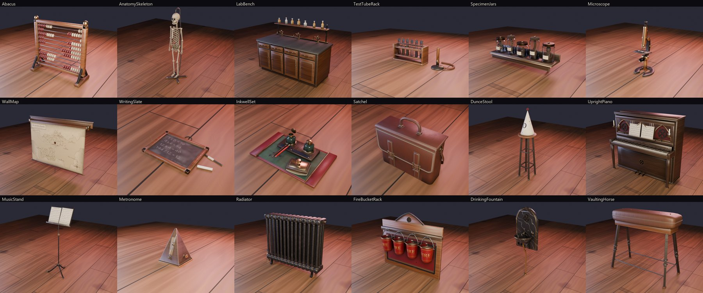
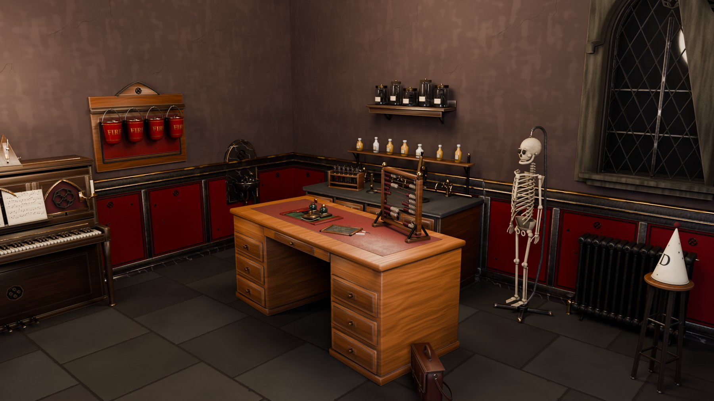

## Batch 37 (detention): the detention kit

`art/props/nh_props_batch37.py`. Room 106, detention: strict and grim, never violent (no canes, no shackles). It also holds the StudentDesk variants and the clique prank desks, all built on `nh_props.student_desk`, so they share StudentDesk's size, frame, heights, footprint and pivot (only StudentDeskBroken changes its heights). The prank desks use the slogans and colours from `ReplicatedStorage.Config.Cliques`.

- **Printed atlases:** `art/props/kits3739_atlas.py` (system Python, PIL; it reuses `dorm_atlas.py`) writes `textures/DetentionPrint_*`, `ElectivesPrint_*` and `DormHousePrint_*`, and `art/props/kits3739_atlas.json` (regions, and the tool wall's layout). Faces map onto them through the "Spine" UV and are baked. All text, names and designs are invented.
- **Run:** `E:/NH-Work/props373839/run373839.py` runs nh_props without editing its import list. `bake373839.sh all37|all38|all39|<Prop>` bakes at 2048 / 64 samples / GPU, one Blender at a time (it waits for any other bake). `upload373839.py`, `sheet373839.py` and `render373839.py` make the upload folders, contact sheets and staged renders.
- **Files:** FBX in `art/props/fbx/detention-batch37/`, maps in `art/props/textures/<Prop>_*.png`, upload copies in `art/group-upload/detention-batch37/`, renders in `art/props/renders/detention-batch37/`.

The upload folder holds all 100 maps (25 props x 4; no metal map is pure black).

| Prop | Tris | Notes |
|---|---|---|
| DetentionDesk | 12.6k | heavy desk and seat on one cast-iron frame bolted to an iron floor plate; carved initials and scratches; desk top 2.45, seat top 1.7; seat at -Y (the student faces +Y); pivot at the desk's centre |
| LinesChalkboard | 5.2k | wall board, back on the wall (y = 0), foot of the tray at z = 0; slate 6.8 x 3.9 full of "I will not talk in class." in chalk; ROOM 106 on the crest |
| LinesPaperStack | 3.6k | a stack of lined pages full of lines, a loose page, a worn pencil; for a desk top |
| SupervisorPodium | 8.2k (Main 8.0k, Glow 0.2k) | oak platform 7 x 5 x 0.7 with a step at the back; desk top 3.7 above the floor (3.0 above the platform); Glow: the lamp bulb; bell, register, pen |
| DetentionLog | 4.2k | the register open on a slanted iron stand (reading face about 3.1-3.5), pen on a chain |
| ConfiscatedBox | 6.0k | open crate 2.2 x 1.5 x 1.2, CONFISCATED board; a slingshot, two phones, three comics (invented), cards, a skateboard wheel |
| SchoolRulesBoard | 2.1k | ten invented rules under the crest, gilt frame, wax seal; back on the wall (y = 0), foot at z = 0, 3.4 tall |
| DetentionSign | 5.2k | door sign 2.6 x 1.15: DETENTION in raised gilt, SILENCE under it; back at y = 0, foot at z = 0 |
| FacingWallDesk | 2.4k | desk top 2.45 between 5.0-tall side panels and a front board; set its +Y side to the wall (the student sits at -Y) |
| WindowGrille | 4.9k | cast-iron bars with spear finials and a quatrefoil band, 4 x 6; back lugs on the wall (y = 0), foot at z = 0 |
| KeyRingHook | 9.2k | eight big keys on a ring; plate on the wall (y = 0), the hook at z = 1.0 above the pivot |
| WallBell | 3.0k | red enamel dome, brass striker and coil box, conduit up the wall; plate centre 0.6 above the pivot, back at y = 0 |
| StudentDeskCarved | 15.1k | heart with initials, tally marks, a crude skull, R.V. WAS HERE carved into the lid; same size, frame, heights, footprint and pivot as StudentDesk (top 2.38-2.45) |
| StudentDeskGraffiti | 10.9k | ballpoint and marker doodles: a crossed-out heart, a bat, BORED, SOS; gum under the shelf and lip; same size, frame, heights, footprint and pivot as StudentDesk (top 2.38-2.45) |
| StudentDeskBroken | 5.6k | front right leg snapped (the piece on the floor), tipped onto that corner, lid split with the right half hanging off its hinge; same footprint and pivot as StudentDesk, heights differ |
| StudentDeskWobbly | 5.6k | front left foot short, propped on a book and a folded wad of paper; scuffs and chips; same size, frame, heights, footprint and pivot as StudentDesk (top 2.38-2.45) |
| StudentDeskInkStained | 6.1k | toppled inkwell, a dried ink pool running off the front edge, drips, ink fingerprints; same size, frame, heights, footprint and pivot as StudentDesk (top 2.38-2.45) |
| StudentDeskPrankVigil | 17.1k | #EBCD78 marker over carving: THE VIGIL REMEMBERS, a lit candle; swapped in on a classroom StudentDesk's pivot when the clique pranks the room; same size, frame, heights, footprint and pivot as StudentDesk (top 2.38-2.45) |
| StudentDeskPrankCourt | 10.6k | #C8283C marker over carving: FANGS OUT, a crown with fangs and a drip; swapped in on a classroom StudentDesk's pivot when the clique pranks the room; same size, frame, heights, footprint and pivot as StudentDesk (top 2.38-2.45) |
| StudentDeskPrankAthletes | 10.3k | #5A96DC marker over carving: VARSITY, a pennant and a star; swapped in on a classroom StudentDesk's pivot when the clique pranks the room; same size, frame, heights, footprint and pivot as StudentDesk (top 2.38-2.45) |
| StudentDeskPrankDelinquents | 13.8k | #966E46 marker over carving: BACK LOT RULES, hot-rod flames and a comb; swapped in on a classroom StudentDesk's pivot when the clique pranks the room; same size, frame, heights, footprint and pivot as StudentDesk (top 2.38-2.45) |
| StudentDeskPrankPack | 13.2k | #82965A marker over carving: PACK RUNS THIS, a paw print and claw gouges; swapped in on a classroom StudentDesk's pivot when the clique pranks the room; same size, frame, heights, footprint and pivot as StudentDesk (top 2.38-2.45) |
| StudentDeskPrankOrdinary | 9.3k | #C8BEAA marker over carving: HI MOM, a smiley; swapped in on a classroom StudentDesk's pivot when the clique pranks the room; same size, frame, heights, footprint and pivot as StudentDesk (top 2.38-2.45) |
| StudentDeskPrankChoir | 9.5k | #E6E1D2 marker over carving: REPENT, a halo over a cross; swapped in on a classroom StudentDesk's pivot when the clique pranks the room; same size, frame, heights, footprint and pivot as StudentDesk (top 2.38-2.45) |
| StudentDeskPrankInk | 14.2k | #9650BE marker over carving: ART IS A WEAPON, a dripping quill and splatter; swapped in on a classroom StudentDesk's pivot when the clique pranks the room; same size, frame, heights, footprint and pivot as StudentDesk (top 2.38-2.45) |

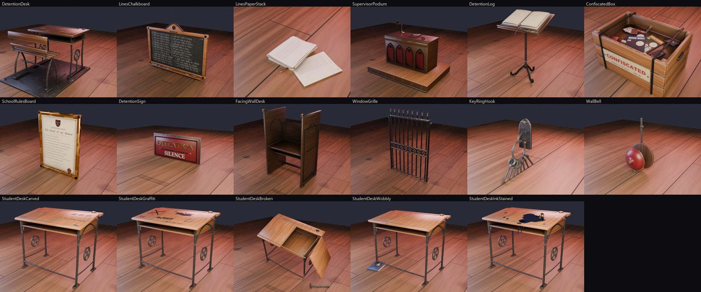
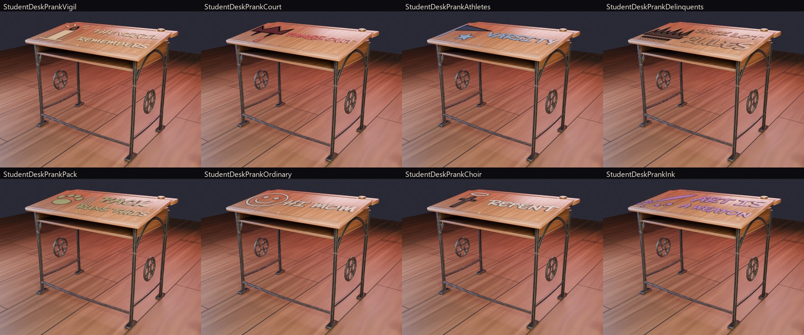
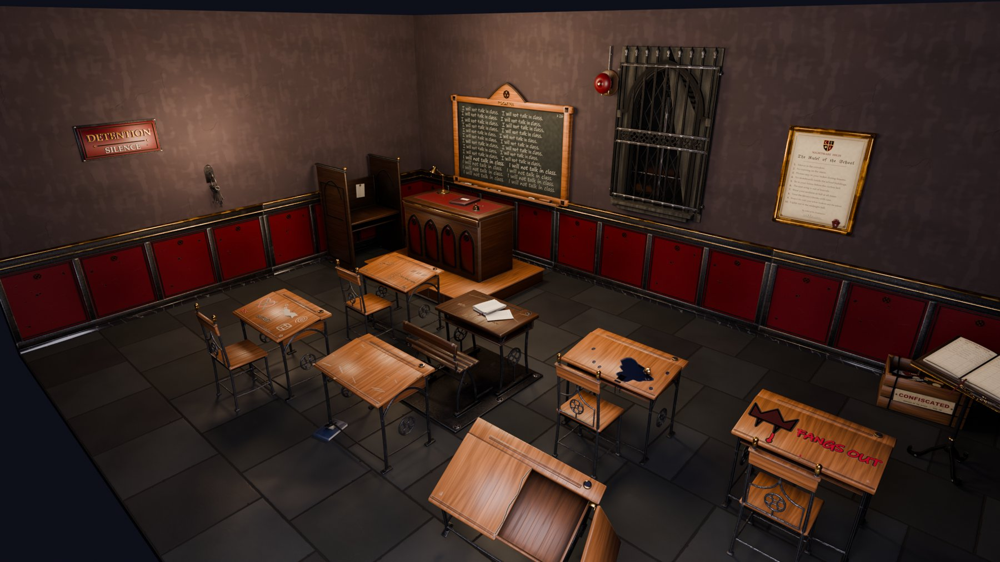

## Batch 38 (electives): the electives kit

`art/props/nh_props_batch38.py`. Pieces to dress the new elective classrooms: herbology, home economics, sewing, photography, woodshop, ceramics and drama. The costumes are Blender cloth simulations on pleated patterns.

- **Atlases and run:** as batch 37 (`kits3739_atlas.py`, `run373839.py`, `bake373839.sh`).
- **Files:** FBX in `art/props/fbx/electives-batch38/`, maps in `art/props/textures/<Prop>_*.png`, upload copies in `art/group-upload/electives-batch38/`, renders in `art/props/renders/electives-batch38/`.

The upload folder holds all 72 maps (18 props x 4; no metal map is pure black).

| Prop | Tris | Notes |
|---|---|---|
| PottingBench | 16.1k | slatted bench, top 2.9; terracotta pots with seedlings and plant markers, a soil heap, two trowels, a compost sack below |
| HerbDryingRack | 19.1k | freestanding rack 4.6 wide, 5.6 tall; twelve bundles of drying herbs (sage, thyme, lavender, rue, mint, moonwort) |
| Terrarium | 9.7k (Main 9.6k, Glass 0.1k) | tabletop gothic glass case 2.2 x 1.4, 2.6 to the finials; ferns, moss and pebbles; Glass: the panes |
| CastIronRange | 14.7k | range 5.2 wide, hob 3.0; firebox and two oven doors, hotplates, NOCTURNE maker's plate, warming shelf, flue to 7.5, a kettle |
| PotRack | 15.1k | hangs from the ceiling: its top (the ceiling plates) is 3.4 above the pivot; copper pans on S-hooks, two lids |
| MixingBowlSet | 4.8k | three stacked glazed bowls with flour, a whisk, a rolling pin, a wooden spoon; for a counter |
| TreadleSewingMachine | 7.1k | iron treadle stand, table top 2.6; black japanned machine with gilt RAVENSWORTH decals, belt to the wheel |
| DressForm | 6.3k | form on an iron tripod (shoulders about 5.0); a half-made damask garment pinned round its left side, a tape measure |
| FabricBolts | 1.4k | sloped rack 5.0 wide, 4.4 tall; fourteen bolts in six invented prints, one length unrolled to the floor |
| BellowsCamera | 4.0k | wooden field camera on a tripod, lens centre about 4.6; brass lens, leather bellows, a shutter bulb |
| DarkroomTrays | 5.1k (Main 5.0k, Glow 0.1k) | bench top 3.0, back board to 6.2; DEVELOPER, STOP BATH, FIXER trays, prints pegged on a line; Glow: the red safelight lens |
| WoodLathe | 8.8k | cast-iron lathe on an oak bench (bench top 2.7); a half-turned spindle, gouges, shavings, a flywheel below |
| ToolWall | 4.4k | pegboard 6.0 x 3.6 in an oak frame, its foot 0.4 above the pivot; tools over painted outlines, three outlines empty; back at y = 0 |
| Sawhorse | 1.7k | a pair of sawhorses with a plank (top 2.56) and a saw, sawdust |
| PottersWheel | 5.4k | kick wheel: seat top 1.7 at +Y, wheel head 2.5, a wet clay pot, a slurry bowl, a sponge |
| Kiln | 4.6k | firebrick body in an iron frame 4.4 x 3.6, arched top 5.3, flue to 7.7; iron door with a wheel latch, gauge, spy hole |
| CostumeRack | 10.0k (Main 2.1k, Clothes 7.9k) | rolling rail 6 wide, 6.3 tall; a velvet cape, a gown and a crimson tabard with a gilt key (Clothes: its own piece) |
| TheatreMasks | 13.7k | gilt comedy and silver tragedy masks on a black plaque 2.6 wide, crimson ribbons; back at y = 0, plaque centre 1.0 above the pivot |

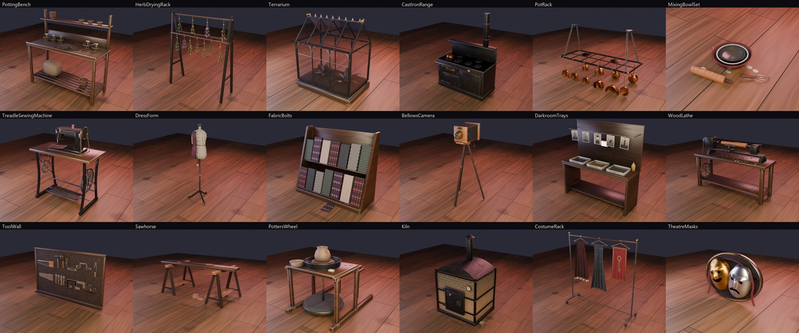
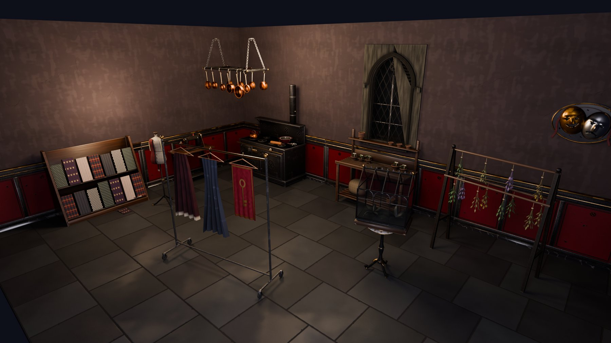
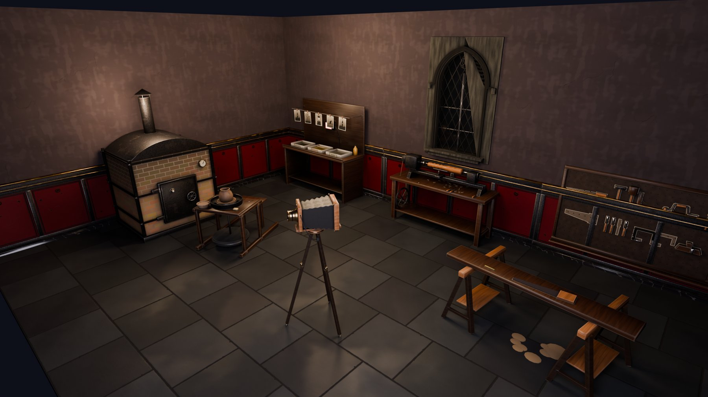

## Batch 39 (dorm house): the dorm house kit

`art/props/nh_props_batch39.py`. The dorm building beyond the private room (batch 34's look), personal things for the girls' and boys' rooms, and urinals for the boys' bathroom (batch 5's porcelain, marble and brass).

- **Atlases and run:** as batch 37 (`kits3739_atlas.py`, `run373839.py`, `bake373839.sh`).
- **Files:** FBX in `art/props/fbx/dormhouse-batch39/`, maps in `art/props/textures/<Prop>_*.png`, upload copies in `art/group-upload/dormhouse-batch39/`, renders in `art/props/renders/dormhouse-batch39/`.

The upload folder holds all 100 maps (25 props x 4; no metal map is pure black).

| Prop | Tris | Notes |
|---|---|---|
| BunkBed | 21.1k (Main 10.0k, Bedding 11.0k) | cast iron, 4 x 8; mattress tops 1.84 (like DormBed) and 5.5, posts to 7.5; ladder on the right; Bedding: its own piece |
| Nightstand | 2.4k | ebonised, black marble top 2.3; enamel insets, an alarm clock and a book |
| FloorMirror | 1.6k (Main 1.5k, Mirror 0.1k) | cheval mirror 6.4 tall; Mirror: the glass (like BathroomMirror) |
| LaundryHamper | 8.6k | wicker hamper 2.3 tall on an iron frame, lid propped against it, laundry heaped in it, a sleeve over the rim, a tee on the floor |
| WashingMachine | 4.5k (Main 4.3k, Glass 0.2k) | crimson enamel washer 2.4 x 2.3, top 3.1; RAVENWASH panel, brass dials and porthole; Glass: the window |
| ShowerStall | 11.2k | tiled stall 3.8 x 3.8, walls 7.6; checked floor tray (top 0.38), brass rose and valve, striped curtain on rings |
| MiniFridge | 3.1k | crimson enamel, 1.6 x 1.5 x 2.5; stickers, a note, a soda can on top |
| BeanBag | 1.7k | slumped crimson leather, 3.3 across, 1.4 tall, dented seat |
| PingPongTable | 3.7k | 9 x 5, top 2.5; crimson top with bone lines, printed net on brass posts, two paddles and a ball |
| RADesk | 16.8k | lobby counter 6.0 wide, top 3.0; RESIDENT ADVISER plate, sign-in book (invented names), bell, KEYS board with numbered tags |
| VanityTable | 5.9k (Main 4.4k, Mirror 0.1k, Glow 1.4k) | ebonised, marble top 2.6; arched mirror (Mirror) ringed with twelve bulbs (Glow); a brush and a bottle |
| MakeupSet | 7.3k | an open palette (MOTH & MIRROR lid, mirror inside), brushes in a cup, three lipsticks, a compact |
| JewelryBox | 10.1k | open box 1.2 x 0.8, velvet lined, mirror in the lid; rings, necklaces over the front edge |
| PerfumeTray | 2.7k (Main 1.8k, Glass 0.8k) | mirrored silver tray, three bottles with invented labels and an atomiser; Glass: the bottles (the scent is in Main) |
| ShoeRack | 14.2k | three-tier iron rack 3.0 wide; heels on the top tiers, boots on the floor tier, one boot fallen |
| FairyLights | 13.0k (Main 9.6k, Glow 3.4k) | a string of little bulbs (Glow) in swags from a brass hook; back at y = 0, the hook 3.0 above the pivot |
| WeightBench | 4.1k | pad top 1.6, iron uprights, loaded barbell at 3.4 |
| Dumbbells | 6.4k | A-frame rack 2.6 wide with six hex dumbbells, a pair on the floor |
| GuitarStand | 6.3k | acoustic guitar (invented maker RAVENSWORTH) leaning on an iron stand, headstock about 4.5 |
| TVConsole | 8.1k (Main 8.1k, Glow 0.1k) | slim flat screen (3.6 wide) in a carved dark-oak gothic frame with brass inlay and a crest, on iron feet, on a marble-topped media console (top 1.5); Glow: the screen (the invented game CRYPT CRAWLER is in its baked colour map) and the console's crimson light; an invented slim console, games and a black-and-crimson controller |
| SneakerPile | 11.5k | five sneakers, invented designs (a quatrefoil on the side) |
| DoorHoop | 2.7k | hooks over a door: backboard's back at y = 0, the hooks' top 5.7 above the pivot (raise it so they sit on the door top); a ball |
| Urinal | 4.5k | wall-hung porcelain; pivot on the wall plane at floor level; lip 2.0, bowl top 3.4, push valve at 4.6, brass trap to the floor |
| UrinalDivider | 1.2k | black marble screen 2.2 out from the wall, 1.2 to 4.4, brass brackets and a floor post; pivot on the wall plane at floor level |
| UrinalTrough | 2.4k | floor-standing trough 6.0 wide on a marble step, lip 2.0, tiled splash-back to 5.7, perforated brass flush pipe; pivot at the back on the wall plane |

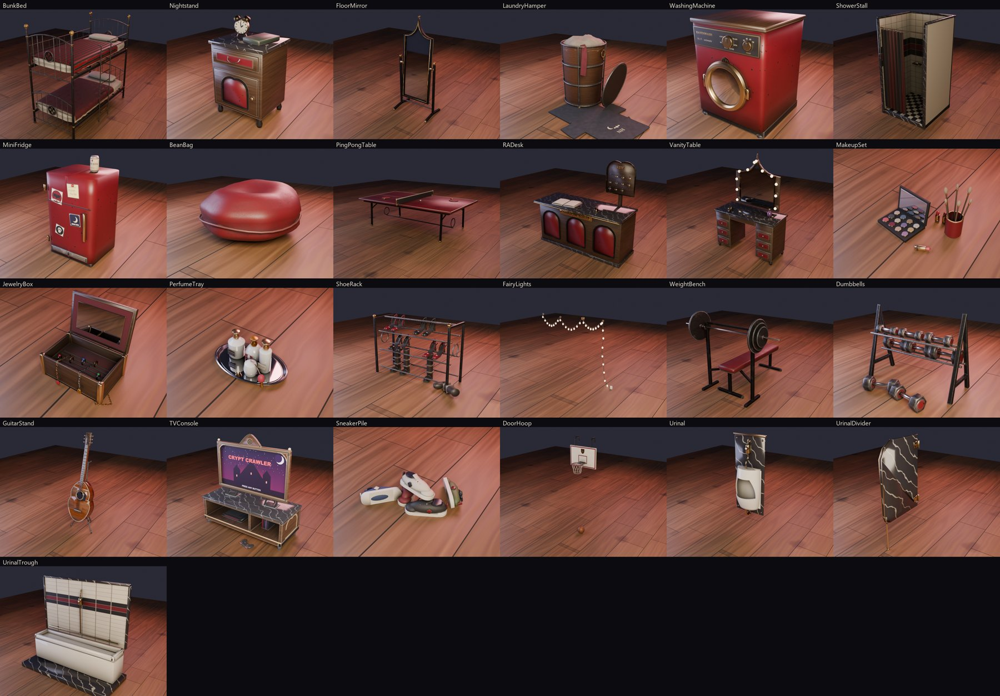
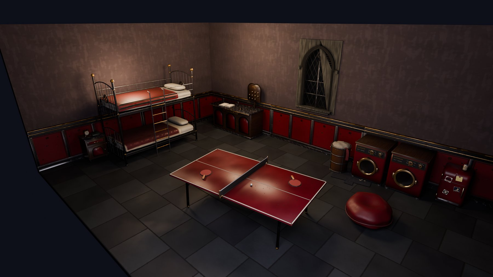


## Batches 35-39 in NH Combat Test (2026-11-08)

- `tools/props/kits_35_39_templates.luau` turns the imported models into templates in `ServerStorage.NHProps`: scaled to 0.01, one SurfaceAppearance per piece from the group's images (ids in base 36 in its `PK` string), and `NHBuildKit` set to Lounge, School, Detention, Electives or DormHouse.
  - `_Glow` pieces are Neon (the darkroom safelight red), except the TV screen: it keeps its picture and gets a violet SurfaceLight.
  - `_Glass` pieces are Glass at 0.45 transparency. `_Mirror` pieces are reflective Glass.
  - Small and wall props don't collide.
- **90 of 101 imported.** Not imported yet: Kiln, MixingBowlSet, PotRack, PottersWheel, PottingBench, Sawhorse, Terrarium, TheatreMasks, ToolWall, TreadleSewingMachine, WoodLathe. Their images are uploaded, so the script sets them up when run again after the import.
- **Prank desks verified in Play:** `CliquePranks.TagDesk` put the real Vigil, Court, Ink and Pack desks exactly on classroom desks' pivots, at StudentDesk's size, and `CleanAll` removed them all.

- **All 101 templates are in** (the 11 electives were imported later and set up by re-running the script).
- **Showcase:** `tools/props/showcase_kits_34_39.luau` lines up the dorm kit and batches 35-39 in `workspace.NHPropsShowcase`, one folder per kit: Dorm Room, Teachers Lounge, School Props, Detention, Electives and Dorm House.
  - The rows are in the free strip at the north end of the baseplate: x from -236, a dark slate backing wall at z -682, -646, -610, -574, -538 and -502.
  - The props face south, toward the map. Wall pieces hang on the wall, table-top things stand on plinths (`<Name>_ShowcasePlinth`), and the pot rack and the dorm ceiling light hang from a beam.
  - Re-running it rebuilds the six folders.

## Batch 40 (garden): the courtyard and garden kit

`art/props/nh_props_batch40.py`. A haunted gothic academy garden for the courtyards at night, with the school's black wrought iron, weathered limestone, slate, aged brass and moss, plus crimson and violet accents. It has 17 path pieces, 28 plants and 22 features and pieces of furniture, each built around one signature idea. The paths are hand-cut stones; the hedges are clipped into lancet points, battlements, a wolf and a raven; the roundel is a carved compass of moon phases. Glows are kept to moonlight blue-white, candle amber and a faint violet. All designs and text are invented.

- **Run:** `E:/NH-Work/props40/run40.py` runs nh_props without editing its import list (`--check` builds and counts tris only; `--fast` previews without baking). `bake40.sh all|<Prop>` bakes at 2048 with 64 samples on the GPU, one Blender at a time (it waits for any other Blender). `sheet40.py`, `render40.py` (`render.sh`), `upload40.py` and `docs40.py` make the contact sheets, staged renders, upload folder and this section.
- **Files:** FBX in `art/props/fbx/garden-batch40/`, maps in `art/props/textures/<Prop>_*.png` (2048), previews in `art/props/previews/`, upload copies (all resized to 1024) in `art/group-upload/garden-batch40/`, renders in `art/props/renders/garden-batch40/`.
- **Pieces:** each prop is a Main piece plus, where needed, `_Leaves`, `_Path`, `_Inlay`, `_Glass` and `_Glow`. A prop with nothing but Main is one mesh named after the prop.
- **Leaves (`<Prop>_Leaves`, 41 props):** alpha-cut cards on `NH_GardenLeaves`, a 4 x 4 atlas painted by `art/props/garden_atlas.py` (system Python with PIL, numpy and scipy). Its 16 sprites are ivy, hedge leaves, yew, willow, crimson roses, rose leaves, wisteria, fern, lavender, tall grass, bramble, crabapple, nightshade, poppies, moonflowers and thorny twigs. The colour map carries the cut-out in its alpha. **Give every `_Leaves` piece these maps with AlphaMode = Transparency, and turn its DoubleSided on.** The cards carry custom normals pointing out of the plant (the FBX keeps them), so a bush shades as one mass. The clipped topiary is modelled; its cards only soften the edges.
- **nh_props.ATLAS (new):** pieces listed in it skip the bake and keep the UVs their builder made, with a painted map set (`atlas_material`). A point attribute `nh_n` on a piece becomes its custom normals. Three things use it: the Leaves pieces, the roundel's Inlay (`MoonRoundelInlay`, from `garden_atlas.py`) and PathCobbleCurve's Path (curved UVs on `NH_GardenCobble`).
  - `garden_atlas.py` also makes two bake sources that are not uploaded: the bark set `NH_GardenBark` and the worn carvings `NH_GardenRune0-3`.
- **Tiled path faces (`<Prop>_Path`, the gravel, cobble and herringbone pieces):** world-scaled UVs (nh_props.TILED), 10 studs a tile. Their images are the new MaterialVariant sets below, copied into `art/props/textures` as `NH_<Set>` for Blender. Upload the `art/textures` copies once and use them for both the MaterialVariants and these faces.
- **Hand-cut flagstone pieces** (PathFlagstone and its curve, junction and cross, plus PathCrazyPaving and PathPuddleFlag) are real stones, baked. Their open ends are straight on the cell edges, so a run meets on a joint. The 20-wide roundel's centre sits on a cell corner, so the paths enter it at its threshold stones.
- **Pivots:** bottom centre, front toward -Y, unless the table says otherwise. Nothing goes below the pivot.
- **Glow colours for the template:** MushroomRing gills, MoonflowerPatch and GhostOrchid are moonlight blue-white (about 190, 215, 255). NightshadeShrub berries are faint violet (about 150, 90, 255). StoneLanternPost, PathGateArch and the PumpkinPatch face are candle amber.

- **In Studio:** `tools/props/garden_kit_templates.luau` makes the 67 templates in ServerStorage.NHProps (NHBuildKit `Garden`); fill its PK from the group's images first, as for kits 35-39. Leaves get NH_GardenLeaves with AlphaMode Transparency and DoubleSided; Path pieces get their tiled set; the roundel's Inlay gets MoonRoundelInlay; Glass on the pond, bird bath, puddle and rill is dark water; the lantern and gate-arch flames carry an amber PointLight. The walk-through and walk-under props (archway, gate arch, pergola, arbor, gazebo, willow, crabapple, steps, bridge, pond, roundel) collide on their precise shape. `tools/props/showcase_garden_kit.luau` lines them up in workspace.NHPropsShowcase.Garden: three rows east of the other kits, x 24 to 276: plants at the back (wall z -690), features (z -650) and the flat paths at the front (z -610), so no wall hides them.

### Garden texture sets (MaterialVariants)

`art/textures/nh_textures.py` makes five new seamless sets in the style of the existing ones: 2048 masters in `_master`, 1024 game copies in `art/textures/<Set>/`. Their ids are in `textures.json`, and each is a MaterialVariant `NH<Set>` in both NH Combat Test and the Map (tagged NHCore there).

| Set | Base | Studs per tile | What |
|---|---|---|---|
| GardenGravel | Pebble | 10 | crushed slate chips (blue-black, grey-green, a few rust-stained and pale ones) in dark grit, dark rose petals blown into drifts |
| HerringboneBrick | Brick | 10 | aged crimson brick in a 45-degree herringbone, soot-blackened bricks mixed in, white efflorescence at some joints, mossy joints; an even tone overall, so long paths show no repeat |
| MossyPaving | Slate | 10 | hand-cut limestone flags of every size laid by eye, broken corners, a few cracked, deep moss in the joints, lichen rosettes |
| CrazyPaving | Basalt | 10 | broken flags of cleft slate, limestone and rust sandstone with small spalls between, wide mossy joints |
| GardenCobble | Cobblestone | 10 | fan-laid granite cobbles in overlapping arcs, a few warm and pale stones, moss and grit between; the fans have a direction |

### Props

Every piece is under 20k triangles. Every prop is baked at 2048.

**Pathways**

| Prop | Tris | Collides | Notes |
|---|---|---|---|
| PathFlagstone | 3.7k (Main 3.7k, Leaves 0.0k) | yes | 10-stud straight along Y: hand-cut limestone flags (top about 0.3) laid by eye over a moss bed, broken edges that bleed into the grass (about 6.4 wide), one cracked with a root pushing up through it, one with a worn carving (a crescent and stars, a quatrefoil, NOX SERVAT or a bat-winged sigil); the open ends are straight on the cell edges (y = +-5), so runs meet on a joint; grass tufts in the gaps (Leaves) |
| PathFlagstoneCurve | 3.1k | yes | 90-degree turn in a 10 x 10 cell: in at the front (-Y) edge, out at the right (+X) edge (arc centre at the cell's front-right corner); pivot at the cell centre |
| PathFlagstoneJunction | 4.0k (Main 4.0k, Leaves 0.0k) | yes | T in a 10 x 10 cell: through along X, branch to the front (-Y) |
| PathFlagstoneCross | 5.5k (Main 5.5k, Leaves 0.0k) | yes | crossroads in a 10 x 10 cell |
| PathCobble | 7.7k (Path 0.0k, Main 7.6k) | yes | 10-stud straight along Y: fan-laid granite cobbles (Path: GardenCobble, 10 studs a tile; the fans open toward +Y, so lay every piece the same way round), granite kerbs topped with wrought-iron S-curls (to 0.7) |
| PathCobbleCurve | 5.9k (Path 0.1k, Main 5.7k) | yes | 90-degree turn, front (-Y) to right (+X): its Path has its own UVs that bend the fans round the curve (NH_GardenCobble, not world-tiled) and meet the straights at both ends |
| PathGravel | 4.8k (Path 0.0k, Main 4.8k) | yes | 10-stud straight along Y: crushed slate strewn with dark rose petals (Path: GardenGravel, top 0.26), scalloped bat-wing limestone edging (points to 0.6), a few modelled petals |
| PathGravelCurve | 3.8k (Path 0.1k, Main 3.6k) | yes | 90-degree turn, front (-Y) to right (+X), bat-wing edging; Path: GardenGravel |
| PathHerringbone | 3.3k (Path 0.0k, Main 3.3k) | yes | 10-stud straight along Y: aged crimson brick in a herringbone with soot-blackened bricks (Path: HerringboneBrick; lay every piece the same way round), a soldier course each side, one brick toppled onto the grass |
| PathCrazyPaving | 6.4k (Main 6.3k, Leaves 0.0k) | yes | 10-stud straight along Y: small broken flags of cleft slate, limestone and sandstone over moss, one cracked with a root |
| PathPuddleFlag | 4.8k (Main 4.7k, Glass 0.1k) | yes | PathFlagstone with a hollow of sunken stones holding a rain puddle (Glass: the water, top 0.235) |
| PathMoonRoundel | 14.2k (Inlay 0.1k, Main 14.2k) | yes | 20 x 20 round junction, the showpiece (pivot at its centre, which sits on a cell corner of the 10-stud grid): the Inlay (a crescent cradling the school shield, MoonRoundelInlay maps, radius 4.2) in a brass ring; a pale limestone compass field with slate rays (the four long ones to 7.4) and eight brass-ringed moon-phase medallions; a brass band with degree ticks; hand-cut flags out to the kerb ring at 10; four threshold stones with brass arrows where the paths join (the mid-sides) |
| SteppingStones | 1.4k | no | five hand-cut stones (tops 0.15-0.22) bedded in moss along a 10-stud run (Y), the middle one carved with a worn crescent |
| GardenSteps | 4.2k (Main 4.1k, Leaves 0.1k) | yes | three shallow steps 8 wide between mossy cheek walls (11.5 wide), 10 deep: risers 0.6 from the path top (0.3) to a landing at 2.1 at the back (+Y), the bottom step at -Y; each tread three hand-cut slabs, the middle ones worn into hollows; grass and ferns at the foot (Leaves) |
| PathEdgingIron | 3.7k | no | a 10-long run of wrought-iron scroll edging, 0.9 to its spear stakes, along X in the XZ plane |
| PathBridgeSlab | 3.4k (Main 3.4k, Glass 0.0k) | yes | a 10-stud cell where the path (along Y) crosses a narrow rill (along X): two hand-cut limestone slabs bowing up to 0.7 over it, their ends at the path height (0.3) on the cell edges, rough abutments, mossy banks; Glass: the water (top 0.16) |
| PathGateArch | 3.1k (Main 3.0k, Glass 0.0k, Glow 0.0k) | yes | a gothic wrought-iron arch over a path, 8.1 wide, 12.5 to its spear finials, on stone footings (the opening is 7.2); quatrefoil tracery, a brass crescent at the crown, an iron lantern hanging from a hook over the path (Glass: its panes; Glow: the candle flame); walk through along Y; collide on the footings and posts only |

**Plants**

| Prop | Tris | Collides | Notes |
|---|---|---|---|
| RoseBushCrimson | 20.2k (Main 19.0k, Leaves 1.2k) | yes | a full shrub rose 4.6 tall, 4.9 across: a dense leaf mass (Leaves), thorny canes arching out in S-curves, modelled dark crimson roses and buds on its surface and the cane tips, fallen petals round its foot |
| RoseBushBlack | 20.2k (Main 18.9k, Leaves 1.2k) | yes | the same shrub with near-black roses, each with a crimson heart |
| HedgeStraight | 1.0k (Main 0.8k, Leaves 0.3k) | yes | clipped yew 8 long (X), 2.3 thick, its top cut into two lancet points (valleys 4.6, points 6.6); snaps end to end |
| HedgeBattlement | 1.1k (Main 0.9k, Leaves 0.3k) | yes | clipped yew 8 long, 2.3 thick: a wall 5.0 tall with four merlons to 6.2; snaps end to end |
| HedgeCorner | 1.2k (Main 0.8k, Leaves 0.4k) | yes | a square yew tower 3.0 across under a clipped pyramid spire (to 9.6), arms to +X and +Y ending at x = 4.0 and y = 4.0 (butt straights onto them); pivot at the tower's centre |
| HedgeEnd | 0.7k (Main 0.5k, Leaves 0.2k) | yes | a 2.6-square yew pier 5.6 tall with a clipped obelisk on top (to 10.0); its +Y face (y = 1.3) butts onto a straight |
| HedgeArchway | 1.5k (Main 1.2k, Leaves 0.3k) | yes | 8 wide, 2.3 thick, its top rising with the arch to a point at 10.2, yew pinnacles at both ends; a pointed walk-through opening 4.4 wide and 7.6 high (path along Y); collide with a hull that leaves the opening clear |
| HedgeWolf | 3.9k (Main 3.7k, Leaves 0.2k) | yes | estate topiary: a great wolf lying like a sphinx on a clipped plinth (3.6 x 7.2), head up and ears pricked (5.5), its tail curled round; it faces -Y |
| HedgeRaven | 4.5k (Main 4.3k, Leaves 0.1k) | yes | estate topiary: a raven standing on a clipped column (to 6.9): heavy beak, a ruff at its throat, folded wings with long primaries, a wedge tail; it looks out to -Y |
| WeepingWillow | 8.5k (Main 5.3k, Leaves 3.2k) | yes | a weeping willow 12.6 tall, its curtain about 19 across: a thick, burred, leaning trunk splitting into three leaders, limbs arching into a dome, long tapering fronds (Leaves) longest at the rim, with a ragged hem and gaps; walk in under it; collide on the trunk only |
| YewTree | 3.5k (Main 2.9k, Leaves 0.6k) | yes | an ancient yew 12.9 tall: a fluted trunk of four twisted stems over a heaved-up knot of roots, a dark, layered, columnar crown (Leaves) |
| GnarledCrabapple | 4.2k (Main 3.3k, Leaves 0.9k) | yes | a crabapple 9.4 tall bent like a hunched figure: its trunk bows forward (-Y) into a hooded crown, two crooked branches hang in front like arms; red crabapples, windfalls; collide on the trunk only |
| CypressPair | 1.6k (Main 0.8k, Leaves 0.9k) | yes | two cypress spires 16.7 and 13.7 tall, under 2 across, 4 apart on a mulch bed |
| IvyWallPanel | 0.7k (Main 0.4k, Leaves 0.3k) | no | ivy for a wall, 8 x 8.8: back on the wall plane (y = 0), pivot at the bottom centre |
| WisteriaPergola | 3.7k (Main 3.1k, Leaves 0.5k) | yes | a walk-through iron pergola 7.6 wide (posts at x = +-3.4) and 10 long (posts at y = +-4.6; the path runs along Y), beams at 8.4; wisteria racemes and leaves (Leaves); collide on the posts only |
| FernCluster | 0.4k (Main 0.3k, Leaves 0.1k) | no | a fern clump 2.0 tall, 4.3 across, on a moss mound |
| LavenderBed | 1.0k (Main 0.9k, Leaves 0.1k) | no | a brick-edged bed 6.3 x 2.6 of lavender, 2.25 tall |
| RaisedFlowerBed | 0.5k (Main 0.4k, Leaves 0.1k) | yes | a limestone-capped raised bed 6 x 3, rim 1.64; poppies, lavender, moonflowers, ferns, ivy over the front (-Y) |
| MushroomRing | 3.8k (Main 2.7k, Glow 1.1k, Leaves 0.0k) | no | a fairy ring 7.4 across of fifteen tall, thin toadstools (0.5 to 2.3) with pale, lichened bell caps; Glow: the gills under the caps (moonlight blue-white) |
| MoonflowerPatch | 3.0k (Main 2.5k, Glow 0.2k, Leaves 0.3k) | no | a moonflower tangle 4.2 x 3.1, 1.7 tall; Glow: the eight big blooms' centres (pale blue-white) |
| TallGrassClump | 0.1k (Main 0.1k, Leaves 0.0k) | no | wild grass 3.2 tall, 2.5 across |
| ThornBramble | 4.9k (Main 4.8k, Leaves 0.1k) | yes | a bramble thicket 7.5 x 6.4, 2.6 tall: thorny canes, blackberries, bare thorny twigs |
| NightshadeShrub | 10.2k (Main 7.0k, Glow 3.0k, Leaves 0.1k) | no | a nightshade shrub 4 tall with violet star flowers; Glow: its berry clusters (a faint violet) |
| PumpkinPatch | 2.1k (Main 2.0k, Glow 0.0k, Leaves 0.0k) | no | five pumpkins on straw and soil, 6.5 x 5.3, under lobed leaves; Glow: the carved lantern's face (candle amber, toward -Y) |
| PoppyBed | 0.2k (Main 0.1k, Leaves 0.1k) | no | a low bed of crimson poppies 7 x 4, 2.6 tall |
| LilyPads | 3.7k | no | nine pads and three lilies, 3.5 x 4.5; pivot on the water line (KoiPond's water is 0.75 above its pivot) |
| BloodRoseUrn | 13.3k (Main 13.1k, Leaves 0.1k) | yes | a cast-iron urn on a square foot, four bat wings spread from its rim, overflowing with modelled crimson roses, canes trailing down its sides, petals fallen round it; 4.1 tall |
| GhostOrchid | 9.4k (Main 1.6k, Glass 6.9k, Glow 0.9k) | no | ghost orchids on a mossy stump (1.2): leafless, roots clasping the bark, five pale flowers on fine stems to 2.45; Glass: the petals (translucent); Glow: a faint moonlight heart in each |

**Features and furniture**

| Prop | Tris | Collides | Notes |
|---|---|---|---|
| KoiPond | 5.7k (Main 5.4k, Glass 0.2k, Leaves 0.0k) | yes | a kidney-shaped raised pond 13.3 x 8.5: big hand-cut coping stones overhanging the water (top 0.95); Glass: the water (0.75) and the arc a stone toad on the coping spits into it; two koi, lily pads, a lily, reeds (Leaves) |
| BirdBath | 1.8k (Main 1.7k, Glass 0.1k) | yes | a bird bath held up by a carved stone hand, 3.7 tall: the forearm rises from a cuffed plinth and the fingers curl round a scalloped basin; Glass: the water; a brass sparrow on the rim |
| GardenBench | 2.5k | yes | an iron and oak bench 5.8 wide whose back is a raven with its wings spread in layered iron feathers (to 4.6), crimson eyes; seat top 1.7; faces -Y |
| CurvedStoneBench | 0.5k | yes | a curved limestone bench, a 100-degree arc (radius 4.5), 7.8 wide, seat top 1.6; the concave side faces -Y; pivot at the middle support's base |
| LogBench | 1.4k | yes | half a fallen oak as a bench, 7 long: the sawn seat at 1.65, three hammered iron bands, two stone blocks under it, bracket fungi on its bark (front, -Y) |
| IronGazebo | 17.2k (Main 17.1k, Glass 0.0k) | yes | an octagonal gothic iron gazebo 14 across (platform and step), 19.6 to the crescent on its lantern: posts with bat-wing brackets, filigree arches and quatrefoils, a cresting of spears, an onion dome of slate on iron ribs, a lantern on top (Glass); walk in from the front (-Y), up a 0.3 step onto the platform at 0.6; seven benches inside (seat tops 2.3); collide on the platform, posts and benches |
| RoseArbor | 2.0k (Main 1.7k, Leaves 0.2k) | yes | an iron rose arbor 6.8 wide, 4 deep, 9.6 tall; walk through along Y (opening 5 wide); climbing roses (Leaves); collide on the uprights only |
| GardenObelisk | 6.6k (Main 6.5k, Leaves 0.0k) | yes | a limestone obelisk 8.9 tall on a stepped base 2.6 square: the moon's phases in raised slate-and-limestone discs down every face, a brass-capped pyramidion, ivy at its foot (Leaves) |
| UrnPedestal | 2.2k (Main 2.2k, Leaves 0.1k) | yes | a gadrooned limestone urn on a panelled pedestal, rim 5.4: two serpents coiled on its shoulders for handles, heads raised over the lip; lavender, a fern, trailing ivy (Leaves); 7.0 tall |
| LowGardenWall | 0.5k (Main 0.4k, Leaves 0.1k) | yes | a mossy ashlar wall 8 long (X), 1.4 thick at the plinth, 3.08 to the coping; snaps end to end; ivy over its right end |
| GardenWallPier | 0.5k | yes | a wall pier 2.15 square, 4.9 to the ball; stands at a wall run's end |
| StoneLanternPost | 3.1k (Main 2.9k, Glass 0.1k, Glow 0.1k) | yes | a gothic stone lantern 7.4 tall: a twisted Solomonic column, a forged iron cage round a glass chimney (Glass) with a candle flame (Glow, amber), a crocketed canopy |
| Wheelbarrow | 1.4k | no | a wooden wheelbarrow 5.9 long (wheel at -Y), 2.5 tall, soil and a trowel in it |
| GardenToolsLean | 2.9k | no | a spade, a fork and a rake leaning on a crate (2.4 wide, 1.6 tall) from the front (-Y), a sack of bulbs |
| PottingCluster | 2.2k (Main 2.2k, Leaves 0.1k) | no | terracotta pots (a fern, lavender, a seedling), a stack of empties, one on its side, a zinc watering can, a trowel; 4.3 x 3.3 |
| ColdFrame | 0.6k (Main 0.5k, Glass 0.0k, Leaves 0.1k) | yes | a brick cold frame 4.4 x 2.6 (back 1.3, front 0.8), its glazed lid propped open; seedlings; Glass: the panes |
| TrellisPanel | 0.6k (Main 0.6k, Leaves 0.1k) | no | an iron trellis 4 wide, 7.6 tall, on two stone feet, in the XZ plane; climbing roses on both sides (Leaves) |
| KeepOffGrassSign | 2.1k | no | a brass plaque, KEEP OFF THE LAWN, on an iron stake, 1.9 tall, facing -Y (invented) |
| Birdhouse | 1.1k | no | a birdhouse built as a little gothic chapel on a post, 7.9 tall: a slate roof, buttresses, a pointed door hole under a crimson rose window, a bell tower and needle spire over the front (-Y) |
| Scarecrow | 2.4k (Main 2.4k, Leaves 0.0k) | no | an unsettling scarecrow 7.1 tall in a tattered school blazer with the crest: too thin, its sack head lolling, a stitched grin and mismatched button eyes, straw at the cuffs and collar (Leaves), a crow on each arm |
| CourtyardBenchTable | 1.0k | yes | an iron-framed oak table for students, 6 x 4.5: top 2.66, bench seats 1.64 on either side (Y) |
| CrowPerch | 1.4k (Main 1.4k, Leaves 0.0k) | no | a dead snag on a mossy stump, 7.3 tall, two crows (one cawing toward -Y), thorny twigs (Leaves) |


