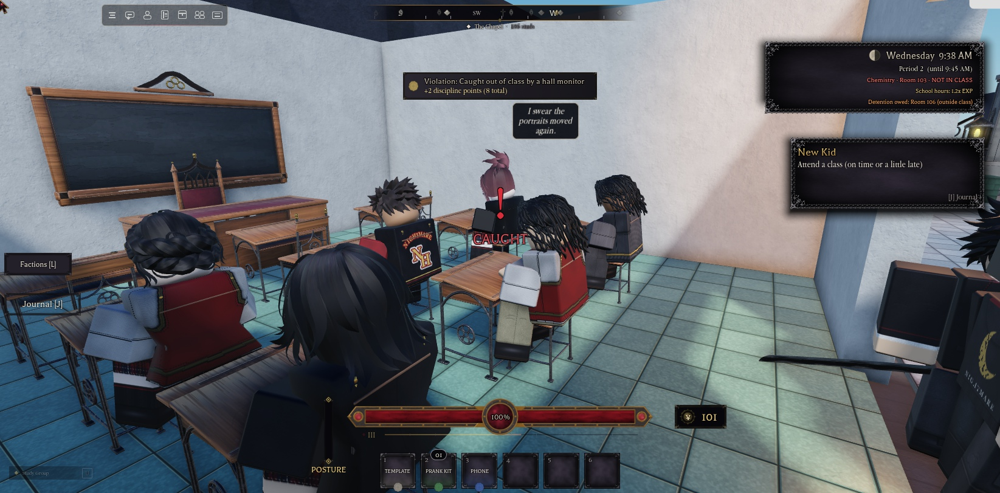
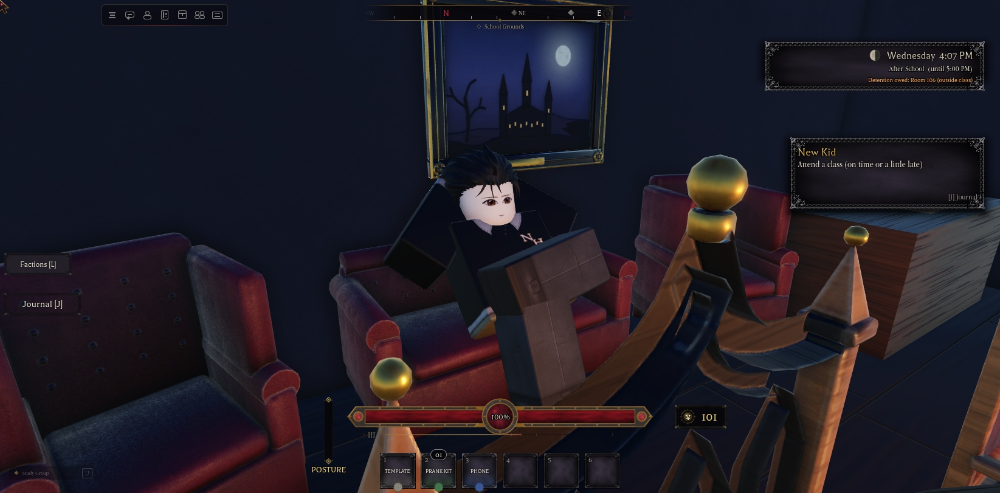
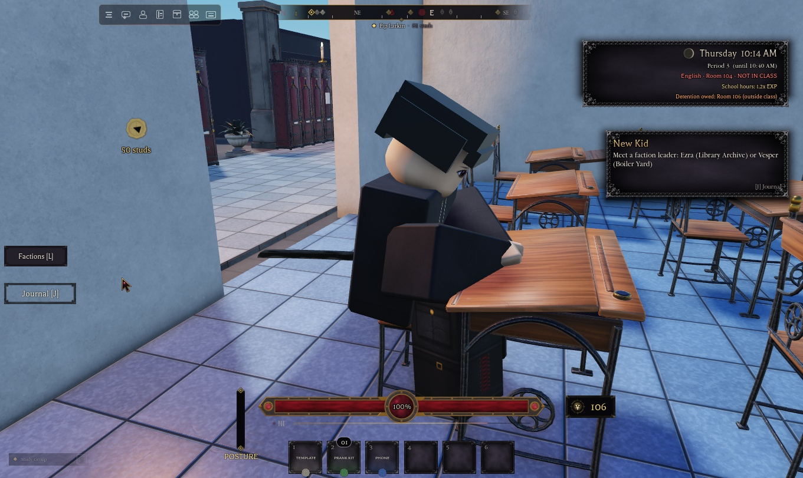

# School Simulation: NH Combat Test

**Status:** the school clock and timetable are built and verified. Attendance, classes, and NPC schedules aren't built yet.

## Clock

The numbers come from the concept doc (School Campus System):

| Setting | Value | Where |
|---|---|---|
| Real time per in-game hour | 5 minutes (so 1 in-game minute = 5 s and 1 day = 2 real hours) | `Config.SchoolSchedule.RealSecondsPerGameHour` |
| Clock mode | **Global**: every server shows the same time, counted from `GlobalEpoch` (2024-01-01 UTC). `Local` mode starts each server at `StartTime` (7:30 AM). | `ClockMode`, `GlobalEpoch`, `StartTime` |
| School hours | 8:00 AM–12:00 PM (20 real minutes) | `SchoolHours` |
| EXP multiplier in school hours | 1.2× | `SchoolHoursExpMultiplier` |
| Day cycle | Monday–Friday repeating. There are no weekends, because the concept wants the 8 AM boost every in-game day. | `DayNames` |
| Lighting | `Lighting.ClockTime` follows the clock | `SyncLighting` |

**Doc inconsistency:** the concept says school hours are "10% of the day", but 8 AM + 4 hours is about 17%. The explicit 8 AM + 4 hours is used here; change `SchoolHours` if 10% was intended.

## Timetable (`Config.SchoolSchedule.Segments`)

| Time | Segment | Kind |
|---|---|---|
| 0:00–6:00 | Night | Night |
| 6:00–7:30 | Morning | Morning |
| 7:30–8:00 | Before School | BeforeSchool |
| 8:00–8:20 | Homeroom | Class |
| 8:20–9:00 | Period 1 | Class |
| 9:00–9:05 | Passing | Passing |
| 9:05–9:45 | Period 2 | Class |
| 9:45–10:00 | Break | Break |
| 10:00–10:40 | Period 3 | Class |
| 10:40–10:45 | Passing | Passing |
| 10:45–11:25 | Period 4 | Class |
| 11:25–12:00 | Lunch | Lunch |
| 12:00–17:00 | After School | AfterSchool |
| 17:00–21:00 | Evening | Evening |
| 21:00–24:00 | Night | Night |

A 40-minute class is about 3 minutes 20 seconds of real time, and a passing period is 25 real seconds. Subjects, teachers, and rooms aren't assigned to periods yet. The concept doc doesn't name any.

## How it works

- **`Services.School.SchoolClock`** (server) owns the time.
  - It publishes `ReplicatedStorage.SchoolClock` with these attributes:
    - `Epoch`: the server time at which in-game day 0, 00:00 began
    - `Period`, `Kind`, `SchoolHours`
  - Clients compute the current time themselves from `Epoch` and `workspace:GetServerTimeNow()`, so the clock sends **no network traffic per tick**.
  - API:
    - `GetState()`
    - `IsSchoolHours()`
    - `GetExpMultiplier()`
    - `SetTime("HH:MM", Day?)`
    - signals: `PeriodChanged(State, OldSegment)`, `SchoolHoursChanged(bool)`
- **`ReplicatedStorage.Functions.SchoolTime`** holds the pure time math that server and client share: parse and format times, find the current segment, and build the state.
- **`StarterPlayerScripts.Controllers.Gui.ClockHud`** is a top-right panel showing:
  - the day and time
  - the current period and when it ends
  - a "School hours: 1.2x EXP" badge during school hours

## Verified (Studio playtest)

- The clock starts at 7:30 AM and advances 1 in-game minute every 5 real seconds.
- At 7:59 → 8:00 the segment becomes Homeroom, school hours turn on, and EXP is 1.2×.
- At 11:59 → 12:00 the segment becomes After School, school hours turn off, and EXP is 1×.
- At 23:59 → 0:00 the day changes from Monday to Tuesday and Lighting.ClockTime is 0.
- `PeriodChanged` fires once per transition.
- The HUD shows "Tuesday 9:20 AM / Period 2 (until 9:45 AM) / School hours: 1.2x EXP" (checked by screenshot).

## Next

1. ~~Classrooms and attendance~~: **done**, see `Attendance-and-Discipline.md`. Subjects and rooms per period are in `Config.Classes`. The HUD shows your current or next class and marks the room door.
2. **NPC schedules** driven by `PeriodChanged`.
3. **Timetable UI** (a full schedule view) and waypoints to the next class.

## NPC daily schedules (1.10.0)
`Services.Features.Schedules`: 14 background students follow `Config.SchoolSchedule` segments and `Config.Classes` rooms.

| Segment | What they do |
|---|---|
| Night, Morning | off campus |
| Before School | walk in from the gate (near the spawn) and mill about the hallway |
| Class | students 1 to 6 sit in that period's room (the 6 chairs nearest the door), the rest leave for "the east wing" |
| Passing | hallway: walk, chat, lean on the wall, or sit on a free place on a hall bench (two per bench, 1.18.4) |
| Break | with their clique at its hangout: a free gathering spot, facing the group (1.21.0, Cliques.md) |
| Lunch | the concession stand: 6 queue at the `NHLunchSpot` markers, the rest stand in an arc and eat |
| After School | athletes to their club (gym, field, pitch), everyone else to their clique's hangout (1.21.0); a third go home from 14:00 |
| Evening | the even-numbered students go home at once, the rest stay at their hangout, everyone gone by 19:00 |

- **Movement:** PathfindingService with agent radius 1, because the 8-stud doorways have props beside them. With no path, a student stays put.
  - **Smooth paths (1.19.0):** like the hall monitor, a student steers at its waypoint every frame and moves on to the next one while still 3.5 studs short of it, so it never brakes mid-walk. Only the last point is walked right up to. In a 12-second Break sample, none of 6,622 walking frames dropped to a stop.
  - **Speed:** students stroll at 6 studs/s.
- **Collisions:** collision group `NHWalkers` doesn't collide with players, other walkers or sports balls.
- **Each model:** `Role = "Ambient"`, `NHScheduled = index`, and `NHActivity` (what they're doing).
- **API:** `Schedules.Pause(on)`; `Schedules.Debug()`; `Schedules.PlanForTests(kind, name?, hour?)` plans a period without moving the clock.
- **Sitting (1.18.4):** `Services.Features.Seats` says where hips go on each seat prop, for the class students here and for the ambient sitters (the sofa, armchair and chair students).
  - **The seat heights:** the seat props are single meshes with CanQuery off, so raycasts can't find their seats. Seats holds each prop's real seat-top height above its base, taken from the model source.

    | Prop | Seat-top height (studs) |
    |---|---|
    | StudentChair | 1.545 |
    | TeacherChair | 1.72 |
    | Armchair | 1.575 |
    | Sofa | 1.525 |
    | HallBench | 1.465 |

    A prop's `SeatHeight` attribute overrides its height. Other seats fall back to a raycast.
  - **The fix:** once the sitting pose plays, the hips are settled onto that height, a little toward the backrest. Before this, every seated NPC sank 1.2 to 1.9 studs into the seat, and the chair sitter's legs went through the floor.
  - **Thighs too (1.46.1):** `Seats.Settle` rests whichever is lower, the hips or the thighs' hip end, on the seat. R6 sitting poses swing the legs forward from the hip, so the thighs used to sink half their thickness into the cushion.
  - **Out of what's behind (1.46.1):** when given the seat prop, `Seats.Unclip` slides the sitter forward 0.1 at a time, up to 1.2. It stops at the first place where the torso, head and arms touch nothing but the seat and the floor, or else at the place with the fewest parts touching. Nearby props have CanQuery off, so they're switched on for the test and back off afterwards. `Schedules` passes the chair, and `AmbientNpcs` uses this instead of its own copy.
  - **Armchairs are too narrow for an R6** (2.7 studs against about 3.6 with the arms), so nobody is seated in them. The Thinker sits in the staff room's armless teacher chair, and the slacker in the middle of the sofa.
  - **Standing up:** students stand up behind a chair (the desk is in front) and in front of a bench.
- **Test note:** moving the clock into a class period marks Studio test players absent, so use `PlanForTests`.

## The timetable (1.12.0)
Click the clock at the top-right (`Controllers.Gui.Timetable`). It shows the whole day:
- **Each segment:** its time, name, and for classes the subject and room.
- **Now:** the current segment is gold with a progress bar, and a line at the top shows "Now" and the next class.
- **Your attendance:** today's status on each class you've had, from `Attendance.Recent`, with the lesson grade.
- **Detention:** any detention you owe.

It ticks every half second while open, and re-reads your attendance when a new segment starts.

## NPCs like players (1.19.0)
Every NPC is built from `ServerScriptService.Services.AI.AI.Rig`. Students, the cast, the hall monitor, the watchers, the lunch lady, the delinquents and the ambient students all clone it.

- **Size:** the rig is now `ScaleTo(0.9)`, the player's StarterCharacter scale: 4.5 studs tall, with the same head, joints and hair attachment. The full-size original is `ServerStorage.NH_Backup.Fixes_1119.Rig_full`. When a height system arrives, scale the rig with it.
- **Idle and walk:** an NPC idles and walks like an unarmed player, using the Default movement pack (`ReplicatedStorage.Assets.Animations.Default.Movement`, Idle `116858893264840` and Walk `113454991107499`).
  - **Before:** NPC profiles carry a Katana, so `AI.AI.Animate` used the Katana pack, a sword stance and a blade walk.
  - **Now:** `AI.AI.Animate` takes Idle and Walk from Default, and Schedules reads the same two ids from the pack.
- **Walk speed matches the clip:**
  - **The clip's pace:** measured on the 0.9 rig (a still copy playing the walk at 1×, foot sweep per step), the Default walk covers about 5.3 studs/s.
  - **The fix:** NPCs play it at speed ÷ 5.3, so their feet keep to the ground. Before it was speed ÷ 10, so the body moved about twice as fast as the feet. Players are unchanged.
  - **Speeds:** students 6, the cast 6, the hall monitor's patrol 7. The monitor's chase (15) and the watchers (6 and 7) are unchanged.
- **Hair:** `Humanoid:AddAccessory` rescales a new accessory by the model's scale on the scaled NPC rig, but not on the player's character. That shrank every NPC hair a second time, so it sat small and high on the head with the forehead and crown bare. `Appearance.wearCatalogHair` now notes the size it meant before `AddAccessory`, then puts it back and re-welds if it changed. Every NPC hair, and the player's, now sits at 0.88× the catalog size.
- **Dress code (`Appearance.DressCode`, NPCs only):**
  - **Who:** models in `Live`, `NHSchedule`, `NHAmbient` or `NHConcession` that aren't players and aren't in the menu scene.
  - **The rule:** where the NPC stands when its look goes on decides it. The factions' turf (Config.Regions kind Turf: the Back Lot, the West Edge) means civilian clothes; anywhere else is the school and its grounds, so school clothes.
  - **Overrides:** scheduled students always wear school clothes. `NHDress = "School" | "Civilian"` forces either.
  - **What counts as school:** `Appearance.SchoolTops` / `SchoolBottoms` list the school items. Anything that breaks the rule is swapped for an everyday item (`SWAP` in Appearance) that suits the body, picked the same way every time for the same NPC. PE kit, cheer and formalwear stay allowed but only appear when an NPC's own look asks for them.
- **Voice lines:** `Controllers.World.Chatter`, client only.
  - **What:** now and then an NPC near you says a line in a small kit bubble: an ink panel, a gold hairline and an italic Garamond line.
  - **Lines fit the speaker:** students, teachers, coaches, the hall monitor, the custodian, the lunch lady, delinquents, and the ambient students' own lines. A few student lines change after dark.
  - **Kept quiet:**
    - at most 2 bubbles at once, with a new one every 7 to 14 s
    - only NPCs within 38 studs, on screen and not behind a wall
    - the same NPC waits 40 s between lines
    - nothing in the menu, a dialogue or cinematic view
    - bubbles sit above the cast's name tags

## Cliques and getting about (1.21.0)
- **Cliques:** every student has a clique (`Config.Cliques.Students`), dresses in its palette and spends Break, and most of after school, at its hangout. See Cliques.md.
- **Standing up from a desk:** a student used to stand up 2.2 studs behind the chair, and where rows are tight (Room 103) that spot is the next row's desk, so they stood up on top of it and got stuck. `Local.StandSpot` now tries eight places around the seat and takes the first one at floor level with room to stand.
- **Ledges:** the gym floor sits a stud above its doorway, and the NPCs couldn't climb it. A student stuck at a step on its path now hops it, twice at most. It never hops on the straight-line fallback (used when no path is found), so it can't jump onto furniture.

## Standing clear of props (1.46.1)

- **Gathering spots:** 24 of the 61 clique gathering spots (`NHCliqueSpot`) put a standing student inside a prop: a study table, the Parlor's sofa and armchairs, chapel pews and the altar, easels, the fountain, the bleachers, a log.
  - `Studio/spots_clear.luau` treats a student's body as a 1.8 × 4.4 × 1.8 box on the floor. It moves each blocked spot to the nearest clear floor (rings of 0.5 to 5 studs) at the same floor height, inside the same region box, at least 2 studs from the clique's other spots (1.6 past 3 studs).
  - The old place is kept as the spot's `NHSpotWas` attribute. Run it again with `DRY = true` to check: all 61 come back clear.
- **Corners:** walking students used to turn toward the next waypoint while still 3.5 studs short of the current one, cutting doorframes and corners. They now cut early only when `Local.LineClear` finds a body-wide line (three rays, 0.9 apart, at waist height) to the next waypoint clear; otherwise they walk to within 1.2.
- **Checking it:** `Studio/tests/npc_audit.luau` (server, in Play) reports every NPC's gap under its lowest body part, or under its torso when it's sitting, and every prop its body passes through, with the no-query props counted.

## Players in the chairs (1.47)

- **Sitting:** `Features.PlayerSeats` gives every `StudentChair` an invisible `Seat` (`NHPlayerSeat`) on the cushion, facing the chair's front (`Seats.Top`), and a "Sit" prompt (hold E, 4.5 studs).
  - Touching the seat does nothing (CanTouch off); jump to stand.
  - The sitter's client (`Controllers.World.PlayerSeat`) plays the students' Sitting pose, measures the hips against the cushion and the backrest, and asks `NHPlayerSeats.Settle(Up, Back)`. The server moves the seat weld by that much, adding up and clamped.
- **Sharing with students:** `Features.Schedules` claims each class chair for the student heading for it (`ChairTaken`). A chair a player sits in is skipped, and a claimed chair refuses a player.
- **The classrooms (Rooms 102–105):**
  - the student desks, chairs, collision desks and `NHPropSpot_Chair` markers moved 1.5 studs toward the door (`Studio/classroom_rows.luau`, room attribute `NHRowShift`);
  - each teacher's chair now stands at the east end of the teacher's desk, facing the class (`Studio/teacher_chairs.luau`, `NHChairWas`). It used to be half under the desk, 1.3 studs from the chalkboard, with no room for a sitter.

