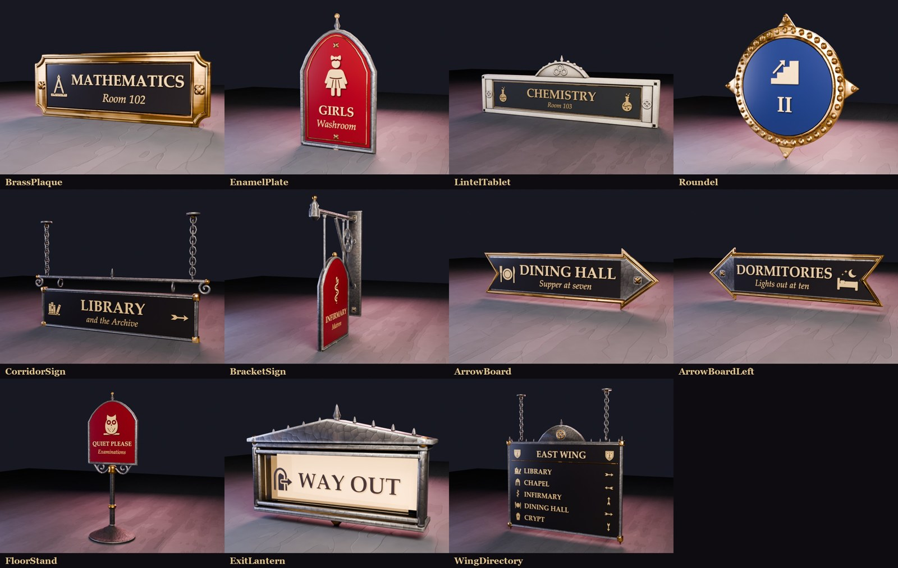
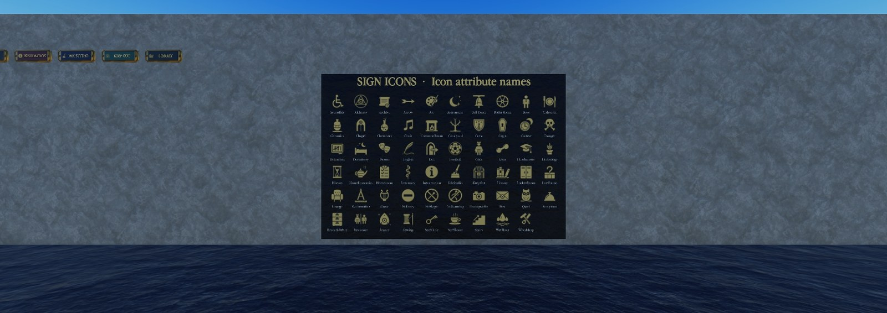

# The signs kit: a guide for the builder

The misc signs kit (props batch 50, `NHBuildKit = "Signs"`) is eleven blank sign bases and 59 icons. You choose what a sign says; nothing new has to be made for a new room, wing or rule. The art, templates and Studio notes are in [School-Props.md](School-Props.md) (Batch 50).

## Setting a sign's icon and words

Every sign in this kit is a blank base. Its icon, words and enamel colour are settings on the sign itself, so one base
makes any sign. Nothing runs in game: the sign keeps what you set.

1. **Place a sign.** Copy a template from `ServerStorage.NHProps` (the `NHBuildKit` is `Signs`) and place it. Wall
   pieces have their pivot on their back face, so the pivot goes on the wall.
2. **Choose what it says.** Select the sign model and set its attributes in Properties:
   - `Preset`: one word that fills in the icon and both lines, for example `Mathematics` (the compass, MATHEMATICS,
     Room 102), `Girls`, `Library`, `WayOut`, `Floor2`. The full list is below.
   - Or set them yourself. Anything you set wins over the preset:
     - `Icon`: an icon name from the icon board (for example `Chemistry`, `Arrow`, `Boys`). `Icon2` is the second icon
       slot on LintelTablet and CorridorSign.
     - `IconRotation`: turns the icon, for the arrow: 0 points right, 90 down, 180 left, 270 up.
     - `Title`: the big line (always in capitals). `Subtitle`: the small italic line. Set it to `-` for none (an empty one takes
       the preset's), and the title grows to fill the space.
     - `Field`: the enamel colour: `Black`, `Crimson`, `InkBlue`, `Verdigris`, `Bone` or `Slate`. Or delete the
       attribute and add a Color3 attribute called `Field` for any colour.
     - `Ink`: the lettering and icon colour: `Gilt`, `Ink`, `Bone` or `Silver` (or a Color3 `Ink`).
     - `Font`: `Garamond` (the game's font, the default), `Merriweather`, `Gothic`, `Script` or `Antique`.
3. **Draw it.** With the sign (or several) selected, run this line in the command bar:

   `require(game.ServerStorage.NHProps.SignKit).Apply()`

   With nothing selected it redraws every sign in Workspace. It prints how many it updated.
4. **Look.** The icon board in the showcase (`workspace.NHPropsShowcase.Signs`, the slate board) shows every icon with
   the name to type.

**Wing directories (the ceiling signs for the wings).** `WingDirectory` hangs from a corridor ceiling (its ceiling
roses are 5.4 above the pivot) and reads from both sides. It has a header and up to five rows:
- `Title` is the header (the wing's name). `Icon` and `Icon2` sit either side of it (the school crest by default).
- `Row1` to `Row5`: one destination each, written the way it reads, with the arrow where it points:
  `Library >`, `< Chapel`, `^ Infirmary` (up the stairs), `v Crypt` (down), or no arrow at all.
- Each row finds its own icon from the name (any preset or icon name: Library, Chapel, Dining Hall, Room names...).
  For any other words, name the icon first: `Crypt: The Old Vaults >`.
- Empty rows are skipped, and the rows spread to fill the board. Set a row to `-` to drop a preset's row.
- Presets: `EastWing`, `WestWing`, `NorthWing`, `SouthWing`, `MainHall` and `StaffWing` fill the header and rows to
  start from; change any row and run Apply again.

**In the Map place:** copy `ServerStorage.NHProps.SignKit` (a ModuleScript) along with the templates, so the command-bar
line works there too.

**Tips**
- The arrow boards come as `ArrowBoard` (pointing right) and `ArrowBoardLeft`. For an arrow icon pointing up or down
  on any sign, use `IconRotation`.
- Floor numbers: a Roundel with `Preset = Floor1`, `Floor2`, `Floor3` or `Ground`, or any `Title` you like (I, II,
  "2nd Floor"...).
- Restrooms: `Boys`, `Girls`, `Men`, `Women` (the same two icons), `Restroom` (both) and `Accessible`.
- To leave out a preset's icon or line, set that attribute to `-`.

## The names

**Icons (the `Icon` and `Icon2` names):** `Accessible`, `Alchemy`, `Archive`, `Arrow`, `Art`, `Astronomy`, `BellTower`, `BoilerRoom`, `Boys`, `Cafeteria`, `Ceramics`, `Chapel`, `Chemistry`, `Choir`, `CommonRoom`, `Courtyard`, `Crest`, `Crypt`, `Curfew`, `Danger`, `Detention`, `Dormitory`, `Drama`, `English`, `Exit`, `Football`, `Girls`, `Gym`, `Headmaster`, `Herbology`, `History`, `HomeEconomics`, `Homeroom`, `Infirmary`, `Information`, `InkStudio`, `KeepOut`, `Library`, `LockerRoom`, `LostFound`, `Lounge`, `Mathematics`, `Music`, `NoEntry`, `NoMagic`, `NoRunning`, `Photography`, `Post`, `Quiet`, `Reception`, `RecordsOffice`, `Restroom`, `Seance`, `Sewing`, `StaffOnly`, `StaffRoom`, `Stairs`, `WetFloor`, `Woodshop`.

**Presets (the `Preset` names):** `Homeroom`, `Mathematics`, `Chemistry`, `English`, `History`, `Detention`, `Herbology`, `HomeEconomics`, `Sewing`, `Photography`, `Woodshop`, `Ceramics`, `Drama`, `Art`, `Music`, `Choir`, `Alchemy`, `Astronomy`, `Seance`, `Gymnasium`, `PE`, `Football`, `Library`, `Archive`, `RecordsOffice`, `Infirmary`, `Headmaster`, `StaffRoom`, `Lounge`, `DiningHall`, `Cafeteria`, `Chapel`, `Dormitories`, `CommonRoom`, `LockerRoom`, `BoilerRoom`, `BellTower`, `Crypt`, `InkStudio`, `Courtyard`, `Reception`, `Office`, `LostFound`, `Post`, `Crest`, `Boys`, `Girls`, `Men`, `Women`, `Restroom`, `Accessible`, `ArrowRight`, `ArrowLeft`, `ArrowUp`, `ArrowDown`, `Stairs`, `Floor1`, `Floor2`, `Floor3`, `Ground`, `WayOut`, `Exit`, `Quiet`, `NoRunning`, `NoMagic`, `NoEntry`, `KeepOut`, `StaffOnly`, `Danger`, `Information`, `Curfew`, `WetFloor`, `EastWing`, `WestWing`, `NorthWing`, `SouthWing`, `MainHall`, `StaffWing`.

