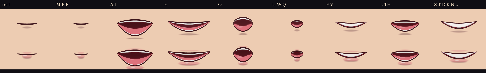
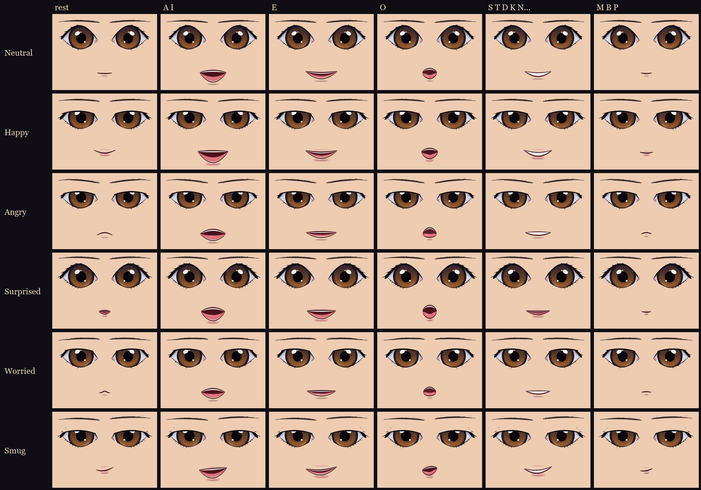

# Talking faces (2.0.0)

Owner: "I want you also to so create some talking facial expressions so the faces are super animated and talk when
they type or speak" (then: "Make the mouth movements more exaggerated").




## When a face talks
- **A player** who sends a chat message (`TextChatService.MessageReceived`, on every client).
- **A student** who says a line: the `NHSay` / `NHSayAt` attributes the server sets for the bubble and the voice
  (`Controllers.World.NpcLook`).
  - Students are found in `workspace.NHSchedule` (NH Combat Test) and `workspace.NHStudents` (the Map).
- **Studio tests:** `NHTestSay` on a character (`"<text>"` or `"<expression>|<text>"`) talks it the same way.

## The mouth shapes (`FaceTalk.Visemes`)
About 14 letters a second; repeated shapes merge.

| Letters | Shape |
|---|---|
| a, i, digits | AI (jaw dropped wide open) |
| e, ee, ea, final y | E (stretched wide, teeth) |
| o | O (big and round) |
| u, w, q, oo, ou, ew | UW (tight pucker) |
| m, b, p | MBP (lips pressed in) |
| f, v | FV (upper teeth on the lip) |
| l, th | L (open, tongue up) |
| other letters, # (a filtered word) | CONS (teeth together, wide) |
| space | rest (short) |
| , ; : | rest 0.22 s |
| . ! ? | rest 0.32 s |
| ... | rest 0.6 s |

"rest" is the expression's resting mouth. For a neutral face it's the face's own mouth.

## The expressions
| | Mouths | Brows | Eyes |
|---|---|---|---|
| neutral | the talking set | still ("?" / "!" lift them at the end) | open |
| happy | wider, corners up | up 5 | soft squint |
| angry | down-turned, tighter | inner ends down 14 | narrowed |
| surprised | 30% bigger openings, rounder | up 16 | open |
| worried | down-turned, wobbly, smaller | inner ends up 12 | open |
| smug | lopsided | one side up 10 | narrowed |

(Brow moves are in texels of the 1024 face; up is negative in `FaceTalkArt.Expr`.)

**Choosing one** (`FaceTalk.ExpressionOf`):
- **A student:**
  - `NHSayMood`, the line's attitude (`StudentBrain`'s `bubble()` sets it for a line-matrix line in NH Combat Test):
    Hostile gives angry, Wary gives worried, Respected or Friendly gives happy.
  - Otherwise `NHMood`: Friendly is happy; Scared, Uneasy, Shy and Wary are worried.
  - Otherwise the words.
- **The words** (whole words; symbols as written):
  - Mostly capitals, "shut up", "get out", "back off" or "hate" give angry.
  - "?!", "wow", "whoa", "omg", "what?", "wait" or "no way" give surprised.
  - ";)", "heh", "told you" or "obviously" give smug.
  - ":(", "sorry", "scared" or "help" give worried.
  - ":)", "lol", "haha", "thanks", "welcome", "hi", "hey" or "!" give happy.
  - "..." (and nothing else) gives worried; anything else is neutral.

## How it's drawn (`Controllers.Character.FaceTalk`, client)
The painted face is 12 strips (`Head.NHFacePlate`, `UI.Appearance`). While a line plays, each strip gets three layers:
- **`NHTalkMouth`:**
  - The mouth band of an atlas: rows `Mouth.Y0` to `Y0 + H` of the 1024 face, the strip's own columns.
  - The face's `NHMouth` is hidden meanwhile; its old transparency is kept in the attribute `NHTalkHid`.
- **`NHTalkLid`:**
  - The eye shape's squint lid: Soft for happy, Narrow for angry and smug.
  - It sits over `NHEyesMain`, tinted to the head's colour like `EyeBlink`'s lids.
- **`NHTalkBrow`:**
  - A copy of `NHBrows` (the original hidden), moved to the expression's brow curve at the strip's middle and turned
    to the curve's slope there.
  - It turns about the brows' row (`FaceTalkArt.BrowY`), so the 12 slices meet as one smooth brow.

Brows and lids ease in and out over 0.15 s. When the line ends, the far face is out of range, or the face is rebuilt,
the layers go and the originals come back.

**Left alone:**
- A sewn or stitched race mouth (`race_stitched`, `race_sewn`): the mouth stays shut, while the brows and eyes move.
- A transformed face (a form mouth, `NHFormFace`, `WolfForm`): its mouth and eyes stay.
- A face with no mouth.

**Cost:**
- Only faces within 70 studs of the camera and on screen are drawn. A line still runs out on time, unseen.
- It runs at 30 Hz, and images change only when the shape changes.
- Every atlas is drawn once (1 px) for 4 s after joining, so a face's first line doesn't flash blank while the GPU
  takes the image.

## The art (`tools/face-talk/`)
- `mock.py`: the talking set, the expressions and the face compositing (also the mockup sheets).
  - It injects grid points into `tools/ui-textures/gen_face.py`'s mouth renderer without changing the shipped mouths.
- `build.py`: the atlases.
  - Mouths: 6 expressions x 9 shapes x 2 lips, less neutral's rest, = 106. Each is a band of rows 712 to 874, six to
    an atlas.
  - Lids: 8 eye shapes x Soft and Narrow, clipped to the eye's own outline (male and female). Each is a band of rows
    401 to 526.
  - It also writes `manifest.json`.
- `gen_art.py`: `ReplicatedStorage.UI.FaceTalkArt` from the manifest and the upload ids (`ids.json`).
- `demo.py`: the talking demo GIF.

**Rebuild:**
```
python tools/ui-textures/gen_eyes.py <eyes> sharp,hooded,fierce,doe,sleepless,cat,gentle,calm base
python tools/ui-textures/gen_lids.py <lids>
python tools/face-talk/build.py <out> <eyes> <lids>
```
Then upload `<out>/atlas/*.png`, put the ids in `ids.json`, and run `gen_art.py`.

## Ideas not done
- Voice chat driving the mouth (an `AudioAnalyzer` on a player's `AudioDeviceInput`).
- An expression picker for players.
- Talking faces for transformed forms.
