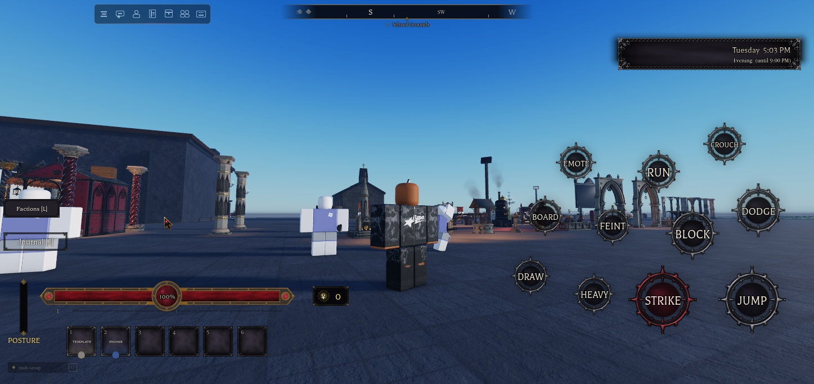
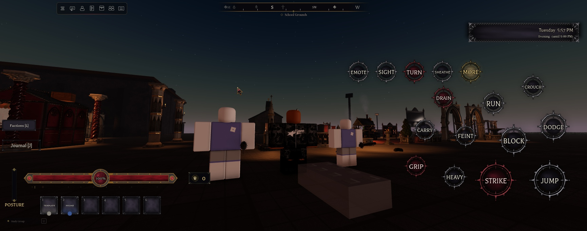
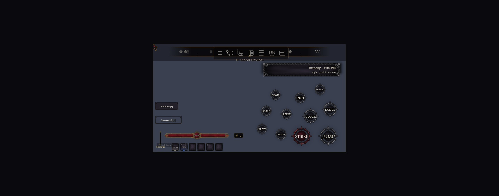
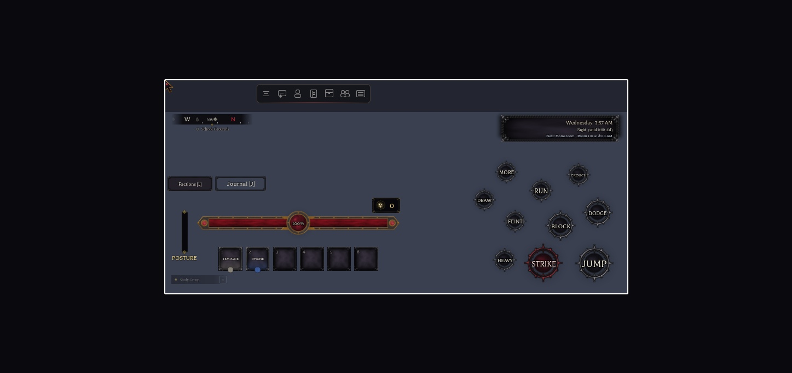
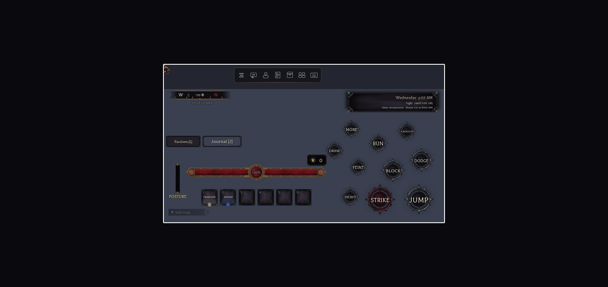
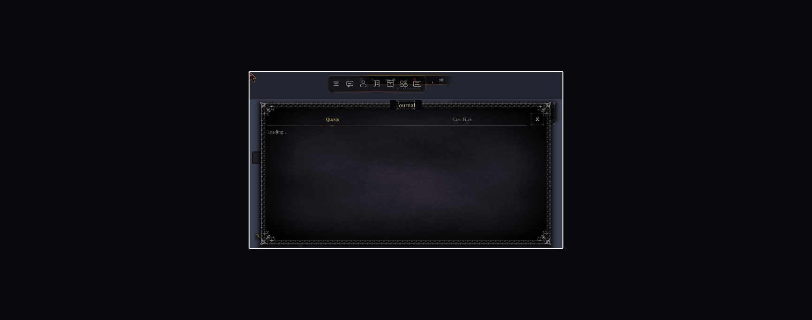
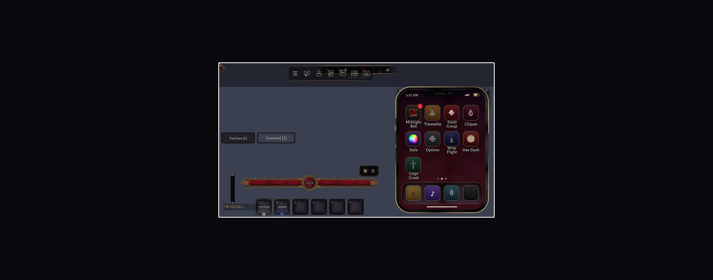

# Touch controls

On phones and tablets (touch-only screens), on-screen buttons do everything the keyboard does in combat, carrying, the skateboard and your race's actions. `StarterPlayerScripts.Controllers.Gui.TouchControls` (1.29.0).

## The buttons

They're kit orbs (the health orb's recipe: `OrbFill` glass, `OrbRing`, a `Glow` shadow and a gold `Glow` when pressed or on), in three arcs around Roblox's jump button. Sizes and distances are in jump-button sizes, so they scale with it: 70 px on phones, 120 px on tablets.

| Arc | On foot | Riding a board |
|---|---|---|
| Inner (1.32) | STRIKE (hold, M1), BLOCK (hold, F), DODGE (Q) | OLLIE, FLIP (kickflip), PUSH (hold) |
| Outer (2.34) | HEAVY (R), FEINT (right click), RUN (tap on, tap off: Shift), CROUCH / SLIDE (hold, Ctrl) | GET OFF |
| Third (3.3) | What you can do now (below) | - |

- **Same code as the keys.** Each button presses its action's current key through `Bind.Keybinds.Virtual`, using `InputController.Press(Name, Down)`. Holds, releases, cooldowns and rebinds all behave exactly as on a keyboard.
- **STRIKE with nothing drawn draws first.** The keyboard's click does nothing until E.
- **CROUCH held + STRIKE = uppercut**, like Ctrl + click (`M1` checks `Keybinds.VirtualDown("LeftControl")`).
- **As a wolf** (`WolfForm`), STRIKE bites (held, it keeps biting) and HEAVY leaps: the keyboard's click and R.
- **The thumbstick steers the board.** Up pushes, down brakes, left and right steer. `Controllers.World.Skateboard` reads the PlayerModule's move vector, so a gamepad stick works too. The jump button ollies while you ride; the humanoid's own jump is off until you get off.
- **Letting go:** a finger that slides off a button still lets go of it. Hiding the buttons lets go of every held key (Block, Crouch, Sprint, M1, M2).

### The third arc

In order of importance, only when they apply:

| Button | Shows | Does |
|---|---|---|
| GRIP | a downed body within 9 studs, or you're carrying one | `Packets.Grip` (B) |
| CARRY / DROP | the same | `Packets.Carry` (V) |
| DRAIN / FEED / SIPHON / EXORCISE | the same, with your race's action | `RaceAction` (N) |
| DRAW / SHEATHE | always (not as a wolf) | the Equip packet; it isn't blocked by a prompt on screen, since prompts are tapped |
| BOARD | no body nearby | `Skateboard.Toggle` (B) |
| TURN | night races (Vampire, Werewolf, Ghoul, Wraith) | `Transform` (T) |
| SIGHT | night races | `NightSight.Toggle` (H) |
| EMOTE | always | the emote menu (`Emotes.ToggleMenu`, Period) |

- **Slots:** the arc takes slots every 16 degrees from 174 degrees, while they stay below the clock panel (`ClockHud.Panel`).
- **MORE:** if more buttons apply than fit, the last slot is MORE. It opens the rest in a line to its left, and tapping one closes the line.

## Hidden

- **Situations:** the main menu, dialogue, lessons, sports (`InSport`, `HasSportBall`, `SportKeys`), while you're downed, carried or gripped, and while dead.
- **Cinematic view:** it hides every gui, so a small gold RETURN orb shows in its top bar instead. It's its own ScreenGui with the attribute `ShowInCinematic` and DisplayOrder 1001, above the letterbox.

## The rest of the screen on touch

- **KitHud** (`Gui.KitHud`):
  - **Size and position:** the buttons publish how much of the right edge they use (Player attribute `NHTouchReserveRight`, px). The health bar, hotbar, Yen plate and posture meter scale to fit left of that and slide left.
  - **Study Group dock:** the HUD sits on top of the dock in the bottom-left corner instead of covering it.
  - **Keyboards:** nothing changes.
- **Skill bar** (`SkillController`): it moves to just left of the arcs at their top. Today it's empty: the Fist has no skills yet.

## Phone and tablet screens (1.30.0)

**Before.** On touch screens every kit screen used a 0.92 minimum scale. On a 375 px tall phone that is a desktop layout: the main menu ran off the bottom, the compass sat on the top bar, the Journal was taller than the screen, and the HUD had to shrink to 0.38 to fit beside the buttons.

**Now:**

| Screen | Phones (touch, shorter side under 600 px) |
|---|---|
| Every kit screen | `Theme.Scale.PhoneTouchMin` 0.62 instead of 0.92 (tablets keep 0.92). 44 px rows stay at about 27 px. |
| Big panels | `Components.ClampPanels` (from `AutoScale`): a direct child panel sized in offset px and over 250 tall is clamped to the screen at the phone scale. Text keeps its size, and the panel's own scrolling lists absorb the rest. The design size is kept in the attribute `NHPhoneDesign`; the attribute `NHNoPanelClamp` on a gui opts out. Off phones, panels get their design size back. |
| Journal, phone, enrollment | clamped this way: the Journal is 620x304 px at 667x375 with its tabs, close button and scrolling body; the phone app is 223x304 px with every app icon showing |
| Main menu | fits at 0.62 |
| Dialogue | `phoneScale` 0.66 (it has a 0.8 floor elsewhere) |
| Clock, quest tracker | `phoneScale` 0.5 |
| Compass | the phone scale. When there's no room in the top strip beside the top bar, it sits under the strip on the left. It re-checks every 2 s, because the top bar is built after it and Roblox's own buttons move it. |
| Left column | compass, then the quest tracker (moved from under the clock: the right side holds the touch buttons), then the Factions and Journal buttons side by side |
| KitHud | fits left of the touch buttons. Only buttons in the bottom 38% of the screen count against it, and the Yen plate moves above the bar's right end. It stands on the Study Group dock and refits when the dock or the buttons change. |
| Touch buttons | the third arc starts at 150 degrees (above the bar) on every touch screen. All the buttons hide while a menu is open: a visible panel 400 design px tall or more, most of the screen, or the phone. The Player attribute `NHTouchMenu` (client) names the one that hid them. |

 

### Kit additions (`ReplicatedStorage.UI.Components`)

| Function | What it does |
|---|---|
| `Components.Viewport()` | the viewport every scale rule uses (Studio previews can override it) |
| `Components.TouchOnly()` | a touch screen with no keyboard (Studio: `NHTouchTest`) |
| `Components.Phone()` | a touch-only screen whose shorter side is under `Theme.Scale.PhoneBelow` (600) |
| `AutoScale(gui, { phoneScale = n })` | this exact scale on phones |
| `Components.ClampPanels(gui, phone, s, vp)` | run by `AutoScale`, also when a child is added |
| `Components.PreviewChanged` | fires when a Studio preview size is set or cleared |

### Previewing a phone in Studio

Studio's window can't be resized to a phone, so:

1. Set the ReplicatedStorage attributes `NHTouchTest = true` and `NHPhonePreview` = `Vector2.new(667, 375)` (or `844, 390`, `1024, 768`). Every kit screen then lays itself out for that size.
2. Run `Studio/tests/phone_preview.luau` (client). It copies every visible gui, at its own scale, into a frame of that size and lists what sticks out.
3. Run `Studio/tests/phone_panel.luau` with a menu open to measure it.

The copy is static: run it again after a change. Elements placed from another gui's real screen position (the EXP strip under the health bar) show in the wrong spot in the copy only.

## Testing in Studio

- **Turn it on:** set the ReplicatedStorage attribute `NHTouchTest = true` before Play to get the touch layout with a mouse. Clicking a button works like tapping it.
- **Stand-in jump button:** a JUMP orb stands in for Roblox's jump button, which a mouse session doesn't have.
- **Action log:** with the flag on, `InputController` writes each action it runs to the Player attribute `NHLastAction` ("Block:Began" and so on), so tests can see it.
- **Clean up:** clear the flag afterwards.

## Not done yet

- **Not tried on a real phone or tablet**, and multi-touch (holding two buttons at once) isn't tested. The layout was checked at 1731x683 and 1447x683 in Studio; phone sizes come from Roblox's jump-button rules.
- ~~**Phone-size UI pass**~~ Done in 1.30.0 (above). Not checked at phone size yet: menus that are built when first opened (the locker, timetable, stats, evolution, students list, identity, admin panel, sports screens) and the region cards. The panel clamp covers the tall ones, but nobody has looked at them. Notched phones (safe-area insets) aren't modelled in the preview either.
- **Not covered by touch buttons:** sports (they hide the buttons; Football has its own touch check), class activities, and the hotbar's number keys (the slots are tapped instead).
