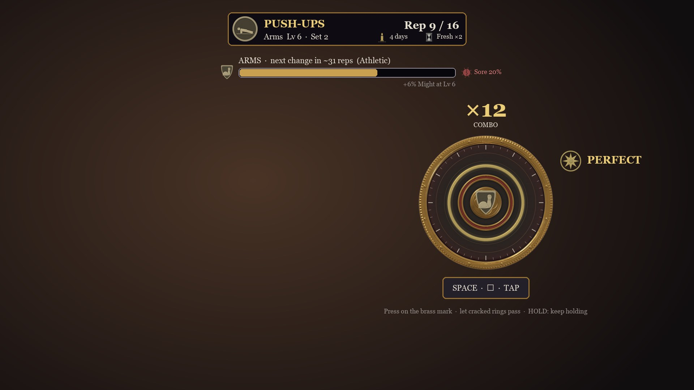
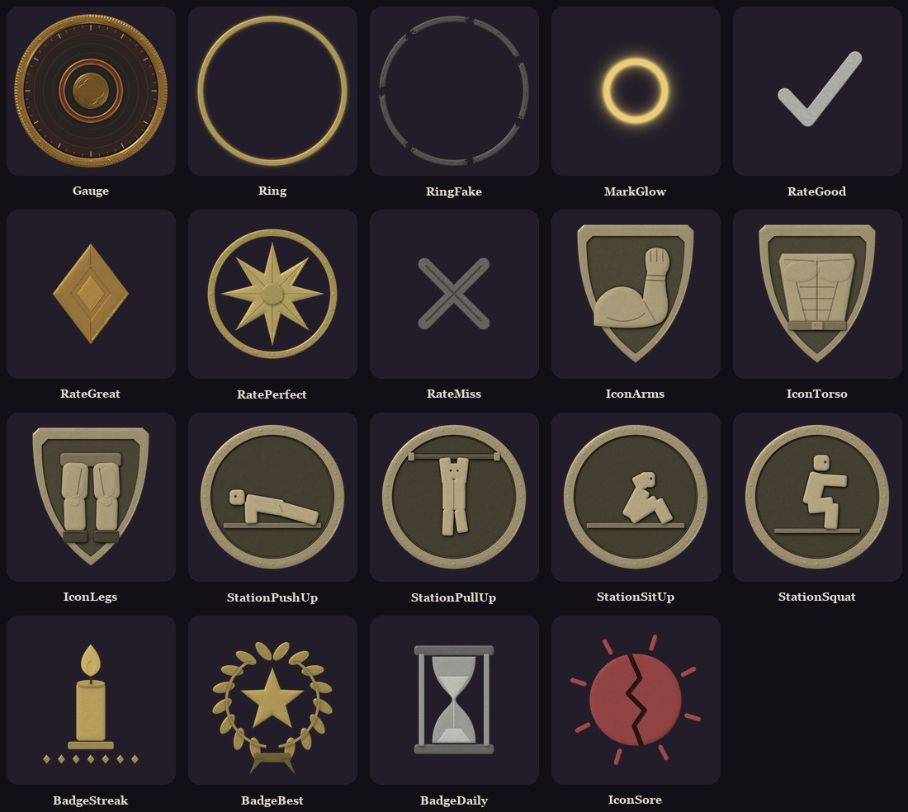
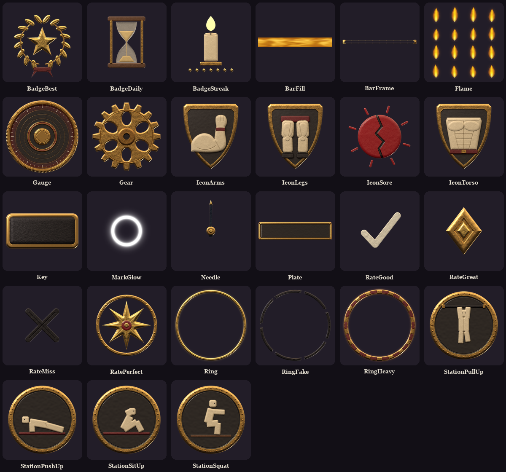
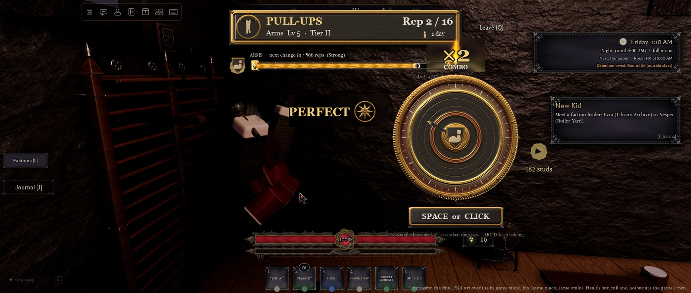
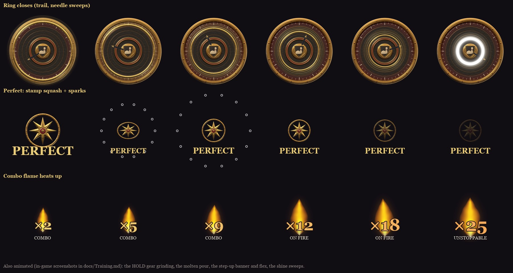
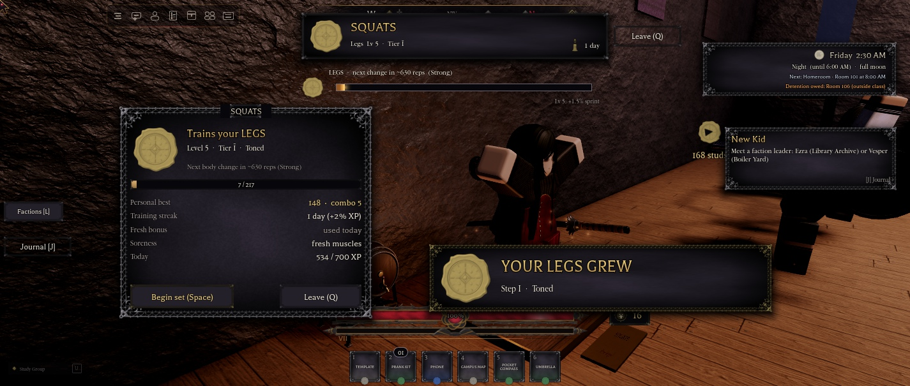

# Training minigames, phase 1: design note (2026-11-11)

For the main session's review, written before the code. Concept: [training-minigames-concept](superpowers/specs/2026-11-11-training-minigames-concept.md). The owner: "Make sure the minigames are fun, easy to understand, and great for player retention (ON THEMED OFC)", and "make sure the UI/icons for it are all original and on theme."

**Scope:** the push-up and pull-up stations (Arms), plus sit-ups (Torso) and squats (Legs) on the same code. One gauge minigame for all four. Live per-area body meshes on the two mesh steps that exist today.

## The HUD

| Where (1920 x 1080 design px) | What |
|---|---|
| top centre | **Set plate:** the station medallion, the exercise, "Arms Lv 6", the rep count, and the streak and Fresh chips |
| under it | **Next change bar:** the area crest, "next change in ~31 reps (Athletic)", the soreness chip, and the stat the level gives |
| right of centre (the camera frames the student on the left) | **The gauge** (380 px). The combo counter is above it, the rating mark pops beside it, and the input prompt is below it. The stamina meter (burnout and tier IV sets) stands to its left, and the HOLD grind bar replaces the prompt during a heavy rep. |
| touch | The whole gauge is the button, plus a 150 px PRESS button in the thumb zone. Leave is at the top right. |

The bottom centre stays clear for the Thornrose health bar and hotbar. Before a set, a kit `Panel` card shows the station, the area level and bar, the personal best, the streak, Fresh and soreness, with **Begin set** and **Leave**. After it, a results card shows the counts, the best combo, XP with each multiplier, and a NEW BEST stamp, with **Again** and **Leave**.

## Icon set: first pass (greyscale; superseded by the PBR set below)

- **Gauge** (colour, 1024): a knurled brass bezel with rivets, an ink-enamel face with a crimson (#600E1A) vignette, chalk ticks, and the **mark** (a raised brass channel with a crimson enamel groove and a gilt hairline).
- **Ring, Fake ring, Mark glow** (greyscale, tinted).
- **Rep marks:** Good (a chalk tick), Great (a brass diamond), Perfect (a ringed eight-point star), Miss (a scratched cross).
- **Area crests** (gothic shields): Arms, Torso, Legs. **Station medallions:** an R6 student doing push-ups, pull-ups, sit-ups or squats.
- **Badges:** Streak (a church candle over seven day pips), Best (a laurel round a star), Daily (an hourglass), and Sore (a cracked disc).
- Same PBR bake as the phone icons and the kit HUD. Nothing is taken from another game.

## The PBR art and the main HUD (added after the owner: "highest quality with PBR textures")

The whole set is re-made in **headless Blender (Cycles)**. Each design becomes real displaced geometry, and each material gets a full PBR shader: brass, gilt, black iron, ink and crimson enamel, crimson and black leather, ivory, wax, chalk, oak, glass and an emissive flame. The lights are the main HUD's: a warm key from the top left, a soft box, a cool fill and a candle rim. Edges are bled and resized premultiplied, so there's no dark fringe.

The frames are new too: a brass 9-slice set plate, a key cap, and an iron bar channel with molten brass. See [Training](Training.md#the-art-all-original-blender-pbr).

**Side by side with the main HUD.** This is a composite: the final art is drawn over the in-game stand-ins at the same place and scale. The health bar, posture rail, hotbar, clock and quest tracker are the game's own, from the same Play frame.

## Animation beats (added after the owner: "animated and cool looking")

- **Each ring:** it closes with a trail of three echoes while the needle sweeps, and the mark flashes in the rating's colour.
- **Perfect:** the stamp lands 1.55× big, squashes, then settles, with 14 sparks and chalk.
- **The combo:** it punches up over a 16-frame flame flipbook that grows hotter. It shakes at ×10.
- **HOLD:** a gear grinds while the bar fills.
- **The bar:** molten brass flows with a hot lip and drips as XP pours in.
- **The step-up:** a banner reveal with embers, the bell, a flex, and an ember and chalk burst in the world.
- **Idle:** shine sweeps, and the streak candle flickers.
- **Reduce Motion** keeps only the fades and colours.

## Rep rules (one button)

- **A ring** shrinks from the bezel onto the mark. Press when it lies on the mark: **Space**, left click or tap on the gauge, or **A** or **R2** on a gamepad.
- **Rating** by how far off the press is: Perfect, Great, Good, or else Miss (windows below).
  - Each good-or-better rep plays the owner's rep animation once, and the idle holds between reps.
  - A press with no ring near counts as a stray press and breaks the combo, so mashing doesn't work.
- **Cracked ring (feint):** it shatters at 75% of its path. Pressing in its window breaks the combo ("Feint!"). Letting it pass keeps the combo.
- **HOLD ring (heavy rep):** thicker, with a crimson edge. Press on the mark as usual, then keep holding while the grind bar fills. Letting go early fails the rep. A heavy rep is worth 2×.
- **Combo:** +1 per rep, and XP × (1 + 0.02 × combo), capped at +50% (combo 25).
- **Feedback per rep:** a sound (the kit's palm-on-wood Stamp, pitched up by rating, plus the desk-bell chime on Perfect), a small camera bump, chalk dust off the hands on Perfect, the rep animation, and the bar moving.
- **Burnout set:** a stamina bar starts at 100. Perfect +4, Great 0, Good −6, Miss or feint −22, stray press −10. The rep gap shrinks 3% per rep (to 0.6 s), with up to 30 reps. It ends when stamina runs out. XP ×1.25.
- **First time:** three skippable cards (the ring and the mark; feints and HOLD; levels, body changes and rotating). Saved as `Training.Tut`.

## Difficulty (by the trained area's level)

| Tier | Levels | Ring travel | Rep gap | Perfect / Great / Good | Reps | Feints | HOLD reps | Burnout | Stamina | Load | XP × |
|---|---|---|---|---|---|---|---|---|---|---|---|
| I | 0-4 | 1.50 s | 1.30 s | ±70 / 130 / 210 ms | 14 | none | none | no | no | none | 1.0 |
| II | 5-9 | 1.30 s | 1.15 s | ±60 / 115 / 185 ms | 16 | 8% | 10% (0.8 s) | no | no | light | 1.15 |
| III | 10-14 | 1.12 s | 1.00 s ±0.12 | ±50 / 100 / 160 ms | 18 | 12% | 15% (1.0 s) | 25% of sets | no | medium | 1.3 |
| IV | 15-19 | 0.95 s | 0.90 s ±0.18 | ±42 / 85 / 140 ms | 20 | 14% | 20% (1.2 s) | 35% | yes: a miss −25, 4 misses end it | heavy | 1.5 |
| V | 20 | 0.90 s | 0.85 s ±0.20 | ±38 / 78 / 130 ms | 22 | 15% | 22% (1.3 s) | 40% | yes | heavy | 1.7 |

- **Sets** last about 20 s, and burnout about 25 s, plus a 3 s count-in.
- **Distraction** from tier III: the candles gutter, so the gauge dims for a moment.
- **The load is visible:** a leather weighted vest (push-ups, pull-ups), a sandbag on the shoulders (squats), and a weighted belt (sit-ups; a plate held on the chest would pass through the arms in the animation). It grows by tier, and is fitted to the student's body type so it doesn't clip.
- **The Trials** (level 20) come later.

## Levels, XP and body changes

- **XP to the next level:** `60 + 12 × L^1.6`. That's about 540 XP to level 5 (the first change, about 13 sets or 8 minutes) and about 2,200 to level 10. Level 20 takes about 11,400 XP, so about 18 days at the daily cap: the concept's "2-3 weeks".
- **Rep XP:** Good 1, Great 2, Perfect 3, × tier, × combo, × heavy or burnout.
- **Set multipliers:** Fresh ×2, streak up to +20%, and soreness down to −50%.
- **Body changes:**
  - Level 5 is step I of the area's path, and level 10 is step II. Steps III and IV (levels 15 and 20) wait for the new meshes, so until then the area stays on step II.
  - The path starts at Average and becomes Conditioned at the first change. Food steering toward Heavy or Lean is phase 2.
  - Only that area's meshes change, live, at the end of the set.
- **Saved builds keep working:** the first time training data loads, each area takes its level and path from the saved build (Muscular gives all three areas Lv 10 Conditioned; Plus gives Lv 10 Heavy). Training never lowers an area below what it wears.

## Retention hooks (chosen and why)

| Hook | Numbers | Why |
|---|---|---|
| **Fresh** (daily first set) | the first completed set of each area each day (UTC): ×2 XP | Three reasons to come back daily, and it rewards rotating |
| **Training streak** | days in a row with a set: +2% XP per day up to +20%; Yen at day 3, 7, 14 and 30 (60 / 150 / 300 / 500), once per streak run | A small, fair daily habit. Yen buys only cosmetics and kit. |
| **Personal bests** | best score and best combo per station, and a NEW BEST stamp | Mastery to chase even after the cap |
| **Milestone moment** | at a mesh step-up: a flex pose, an ember and chalk burst on that area, a Moments banner ("Your arms grew: Athletic"), and the bell | The payoff the whole loop builds to. Others within 80 studs see the burst and the flex. |
| **Soreness** | +14 per set (+16 burnout) to that area, −1 every 15 s, XP × (1 − 0.5 × Sore/100) | Nudges students to rotate areas, gently, with no hard lock |
| **"Next change in ~N reps"** | shown on the start card and during the set | A short visible goal |
| **The Athletes** | +1 clique standing per set at the gym, at most +8 a day | Ties the gym into the social map |
| **Daily cap** | 700 XP per area per day | Fair: nobody grinds 20 levels in one night, and no Robux boosts exist |

**Stat bonuses** (in `Config.Progression.Training`):
- **Arms:** +0.4% damage per level (+8% at 20; one Might point is 1.5%).
- **Torso:** +1 max health and −0.3% posture gain per level (+20 and −6% at 20).
- **Legs:** +0.3% sprint speed per level (+6% at 20).

## Anti-cheat (the server decides everything)

- **Begin:** you must be seated at the station (from its prompt), within 8 studs, and not mid-set. Begins are at least 2 s apart. The server rolls the seed and builds the ring plan: the times, kinds and holds.
- **Submit:** only the press times (and release times for holds) come back.
  - The server rejects presses "in the future" (after its own clock plus 0.6 s), non-monotonic times, gaps under 0.08 s, too many presses, and stale sets.
  - The server rates every press against its own plan, replays stamina, and computes the XP, the caps, the levels and the meshes.
  - It also rejects machine-perfect timing: 10 or more hits with offsets whose SD and mean are both under 4 ms.
- **Nothing** about level, XP, rating, path or body is ever taken from the client. The daily cap bounds what a timing bot could still get.

## Stations (NH Combat Test gym, south-west corner)

- **Pull-ups:** the gym kit's WallBars against the south wall, with an iron chin-up bar with brass collars at the animation's grip height.
- **Push-ups and sit-ups:** crimson leather mats.
- **Squats:** an oak platform with a chalk bowl.
- Each station has a ProximityPrompt "Train" (`NHTrainStation`). They sit next to the ambient gym students, so the corner already looks busy.
