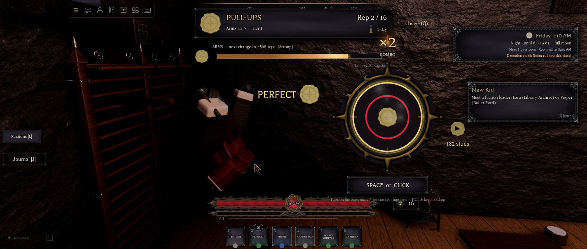
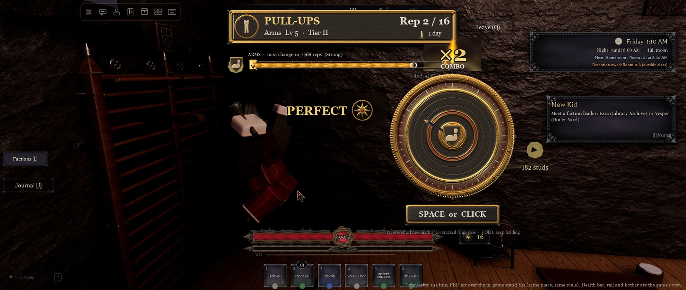
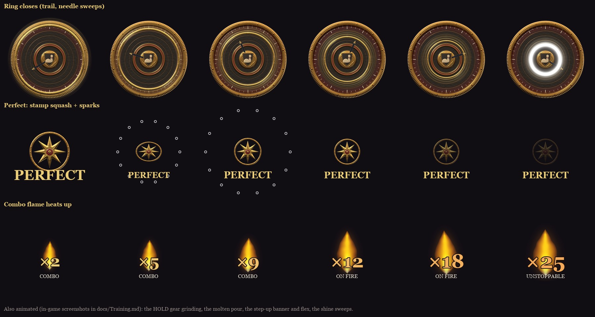
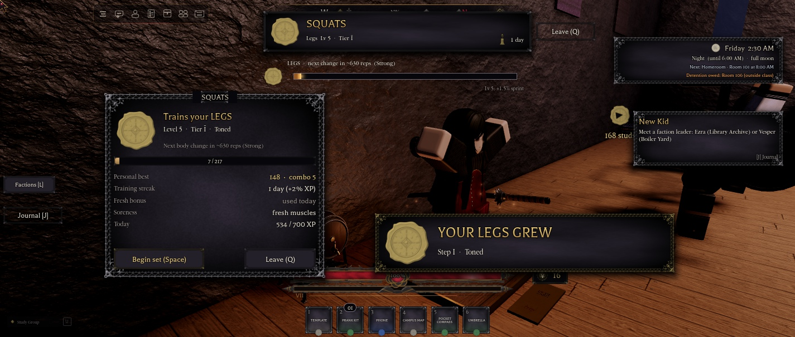
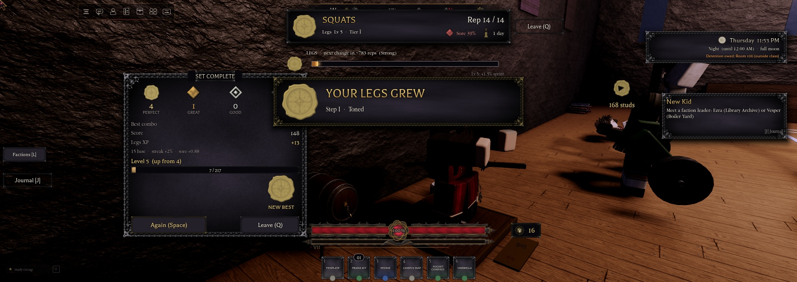
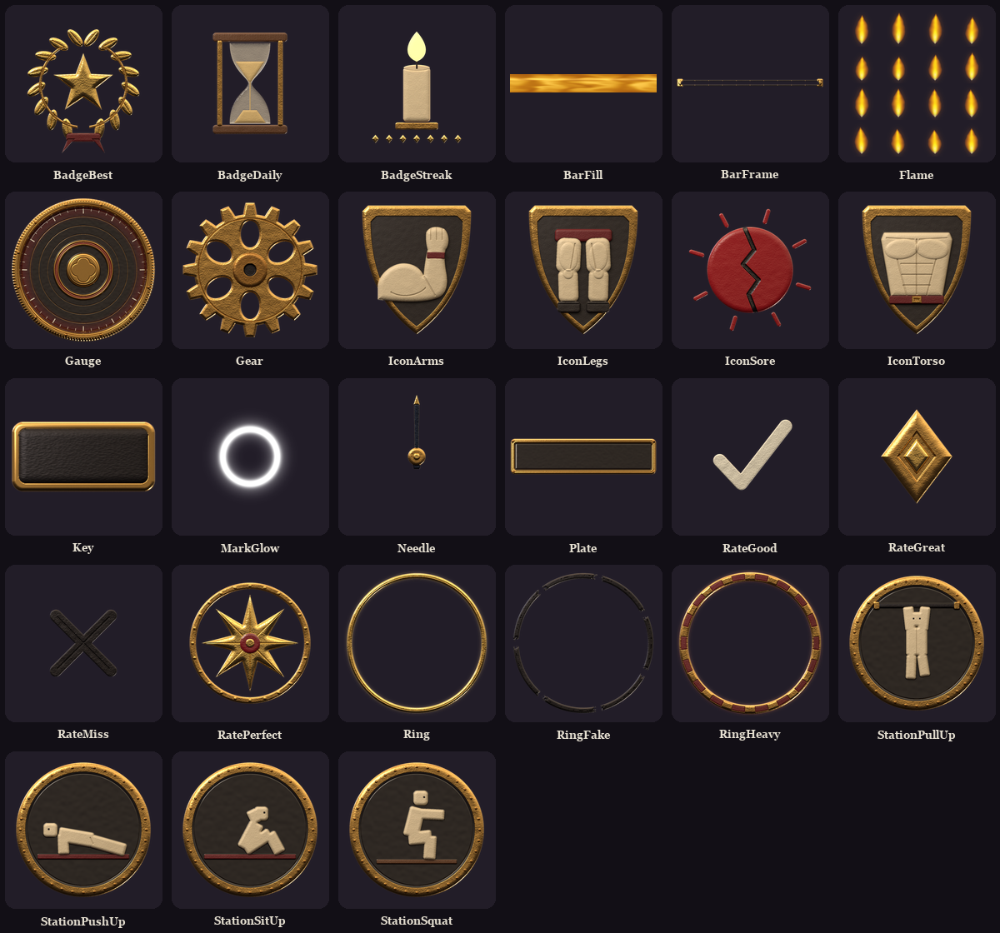
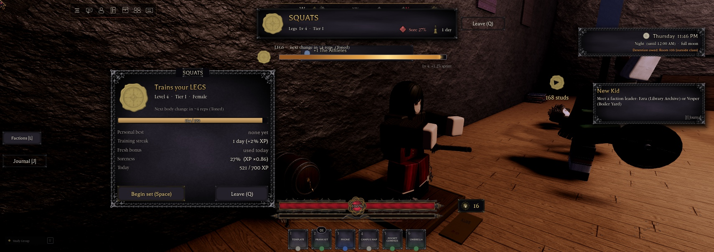
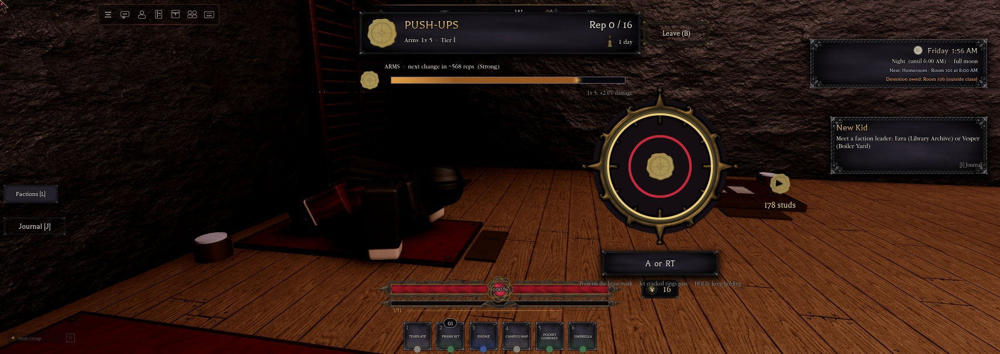
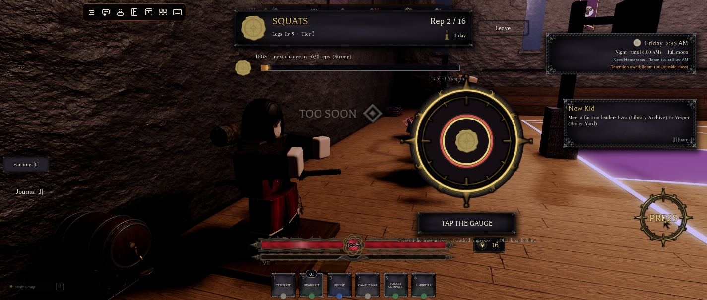

# Training (1.81.0, phase 1)

Students train their **Arms**, **Torso** and **Legs** one at a time at gym stations. When a set steps an area up, that area's body meshes change live: big arms on skinny legs looks like that. The concept is in [training-minigames-concept](superpowers/specs/2026-11-11-training-minigames-concept.md), and the numbers and reasons are in [Training-Design-Note](Training-Design-Note.md).

The owner asked: "Make sure the minigames are fun, easy to understand, and great for player retention (ON THEMED OFC)", "make sure the UI/icons for it are all original and on theme", "the highest quality with PBR textures", and "Make sure its animated and cool looking".

## The stations (NH Combat Test, the gym's south-west corner)

| Station | Area | Where | The owner's animations |
|---|---|---|---|
| Pull-ups | Arms | the gym kit's WallBars on the south wall, with an iron chin-up bar and brass collars at the grip height (floor + 7.8) | idle 134151351487837, rep 115584556914404 |
| Push-ups | Arms | a crimson leather mat | idle 111737875654076, rep 112288220550648 |
| Sit-ups | Torso | a crimson leather mat | 132757288791974 (one looping rep: held on its first frame between reps) |
| Squats | Legs | an oak platform with chalked foot marks, by the west wall | idle 119121474882852, rep 88777267068656 |

- **Building them:** `workspace.NHTraining`. Each station is a Model tagged `NHTrainStation`, with:
  - the attribute `Station`;
  - `FloorY` (and `GripY` for the bar);
  - a `Spot` part, where the root goes, facing the right way;
  - a ProximityPrompt **Train** (E, or X on a pad);
  - a brass floor plaque and a chalk bowl.
- **Next to the ambient gym students:** the corner already looks busy.
- **Sitting:** the prompt seats you, anchored on the Spot. Your client measures where its pose sits and asks the server to rest the body on the mat or hang the hands on the bar (cosmetic, clamped to −4..+1.5 studs).
- **Getting up:** you stand up on Leave (Q, or B on a pad, or the button), on death, on respawn and on being downed.
- **Fights:** a combat-tagged student can't sit down.

## How a set plays

1. **The start card:** the area's level, tier and body, the bar to the next change ("next body change in ~N reps"), your personal best, the streak, Fresh, soreness and today's XP.
   - The first time, three skippable cards teach the ring, feints and HOLD, and rotating.
2. **The count-in:** Begin (Space, A or tap), then a 3-2-1.
3. **The rings:** each ring shrinks from the bezel onto the brass mark.
   - Press on the mark: Space, a click on the gauge, A or RT on a pad, or the gauge or the PRESS button on touch.
   - Each Good, Great or Perfect plays the rep animation once. The idle holds between reps.
4. **The results card:** the counts, the best combo, the score, the XP with each multiplier, the level bar, the streak, and a NEW BEST stamp.
   - **Again** or **Leave**.
   - A body step-up plays its moment.

The rep rules, windows, tiers, XP curve and retention numbers are in [Training-Design-Note](Training-Design-Note.md). They live in `ReplicatedStorage.Config.Training`.

**The load is visible.** From tier II there's a weighted vest (arms), a weighted belt (torso) or a sandbag on the shoulders (legs). Each is fitted to the torso's body type depth (`DEPTH`), so the plates touch the chest and back instead of clipping. The load grows by tier.

## Animation (the owner: "animated and cool looking")

- **The gauge:**
  - The ring closes with a fading trail of three echoes.
  - The needle sweeps as the leading ring closes in, and rests with a slow sway between rings.
  - The mark flashes in the rating's colour.
  - From tier III the candles gutter, and the gauge dims for a moment.
- **A press:**
  - The rating stamp punches in big, squashes and settles, with its word.
  - A Perfect bursts 14 sparks off the mark, plus a chalk puff in the UI and chalk dust off the hands in the world.
  - Each rep plays a sound (the kit's Stamp, pitched by rating, and the desk-bell chime on a Perfect) and gives a small camera bump.
- **The combo:**
  - The number punches up with each rep.
  - A candle flame flipbook (16 frames) burns behind it and grows hotter on long streaks.
  - At ×10 it shakes and reads ON FIRE, and at ×20 UNSTOPPABLE.
- **HOLD reps:** a brass gear grinds round while the grind bar fills. It chimes when the bar is full.
- **Progress:** the next-change bar is molten brass poured into an iron channel. It flows, its hot lip glows, and drips fall when XP pours in.
- **The step-up moment** (in the world, within 80 studs):
  - A big banner reveal: "YOUR ARMS GREW · Step I · Toned", with the area crest stamping in, embers rising and the brass bell.
  - The flex: both arms thrown up and out over the pose, though not on the pull-up bar.
  - An ember and chalk burst with a warm light on that area.
- **Idle:** shine sweeps run across the icons and badges every 4-7 s, and the streak candle flickers.
- **Reduce Motion** (`NHReducedMotion`): no shakes, squash, sweeps, orbit, trails or flex. There are fewer particles, fades only, and the colours and words still change. Shakes follow `NHShakeScale`.

## The art (all original, Blender PBR)

27 pieces, made in three stages:

1. **`art/ui/hud/make_training_pbr.py`** draws each design as a height field plus a material id per pixel.
2. **`blender_training_render.py`** runs in headless Blender (Cycles, GPU). It builds each piece as real displaced geometry, with a full-resolution bump on top.
   - Each material id gets a full PBR shader: brushed and scratched brass with grime in the recesses, gilt, hammered black iron, glossy ink and crimson (#600E1A) enamel, grained crimson and black leather, waxy ivory, chalk, oak, glass, sand, and an emissive flame.
   - The lights match the main HUD bake: a warm key from the top left, a soft box, a cool fill, a candle rim from below, and a warm-ceiling world for the reflections.
3. **`finish_training_ui.py`** finishes the renders:
   - It bleeds the colour under the clear pixels and resizes with premultiplied alpha, so there are no dark fringes.
   - It adds the rings' candle halo.
   - It makes the flame flipbook and the molten fill. Those are pure light, so no lighting is needed.
   - It writes `art/group-upload-training/`.

The design source of the first pass, `make_training_ui.py`, made the greyscale icons and the mockup. Its shapes are reused, and it no longer writes the upload folder.

| Pieces | Size | Use |
|---|---|---|
| TrainGauge | 1024 | the gauge (brass bezel, ink face with a crimson vignette, the mark at r = 190/1024, centre boss) |
| TrainNeedle, TrainRing, TrainRingHeavy, TrainRingFake, TrainMarkGlow | 512 | needle; the ring at r = 470/1024 of its sprite; the HOLD ring in crimson leather; the cracked feint; the mark's glow |
| TrainRateGood / Great / Perfect / Miss | 512 | the rep marks |
| TrainIconArms / Torso / Legs | 512 | the area crests |
| TrainStationPushUp / PullUp / SitUp / Squat | 512 | the station medallions |
| TrainBadgeStreak / Best / Daily, TrainIconSore | 512 | streak, personal best, Fresh, soreness |
| TrainGear | 256 | the HOLD gear |
| TrainPlate (9-slice 64, 64, 704, 128), TrainKey (9-slice 40, 40, 216, 88), TrainBarFrame, TrainBarFill | 768 x 192, 256 x 128, 1200 x 72, 512 x 64 | the set plate, the key cap, the bar's iron channel, the molten brass tile |
| TrainFlame | 1024 | a 4 x 4 flipbook of 256 frames |

**Waiting on the owner:** the group bulk import of `art/group-upload-training` (27 files). After it, read the ids by name into `Config.Training.Art`. Until then, `Controllers.Gui.Training` draws kit stand-ins: the kit's orb ring, seal, pips and knob, stroke rings, a gradient bar, and the subs' candle flame.

## The body (one area at a time)

- **`UI.Appearance`:**
  - A look's **`Areas`** is `"torso|arms|legs"`, three body ids. `""` means Body for all three, so every save from before training keeps its body.
  - `ApplyTo` takes each area's CharacterMeshes from its own body, in the look's gender. A gender switch in the creator keeps each area's build and step: Athletic arms become Toned arms.
  - New: `AreaBodies(look)`, `ParseAreas`, `EncodeAreas`, `AreaNames`, `AreaParts`.
- **`Appearance.SetArea(player, area, path, step)`** is server-only and the only way an area changes. Paths are Average, Conditioned, Heavy and Lean (= Skinny).
  - It never lowers an area already on that path at a higher step.
  - Body follows the torso, so the accessories fit it.
  - It saves through `Data.UpdateState` `SetAppearance` and re-applies the look. It returns `ok, body, changed`.
- **The look guard:** the look-save handler keeps the saved `Areas`, so a client can't send any.
  - `SetBuild` (the admin desk) sets the whole body and clears `Areas`.
  - The creator still offers only gender.
- **Steps:** level 5 is step I and level 10 is step II. Levels 15 and 20 (steps III and IV) wait for new meshes (`Config.Training.MeshStepsBuilt = 2`).
  - An Average area becomes Conditioned at its first change. Food steering toward Heavy or Lean is phase 2.
- **Saved builds:** the first time a student's training loads (`Seeded`), each area takes its level and path from the build it wears. A Conditioned II body gives three Lv 10 Conditioned areas, and Plus gives Lv 10 Heavy.

## Saving and the server

- **`PlayerData.Training`** (action `SetTraining`, `Config.Training.Sanitize`):
  - `Arms / Torso / Legs = { Level, Xp, Path, Sore, SoreAt }`
  - `Fed` (reserved), `LastTrained`
  - `Day`, `Streak`, `StreakBest`, `StreakPaid`
  - `Fresh = { [area] = day }`, `DayXp`, `XpDay`
  - `Best = { [station] = { Score, Combo } }`
  - `Tut`, `Athletes = { Day, N }`, `Seeded`
- **`Services.Features.Training`:** Sit, Stand, Begin, Submit, the award, Effects, State, the loads and the seeding.
- **Remotes** in `ReplicatedStorage.NHTraining`:
  - `Get`, `Begin` and `Submit` (RemoteFunctions);
  - `Leave`, `Tutorial` and `Settle` (RemoteEvents);
  - `Event` (server to client: Enter, Left, State).
- **The step-up moment:** the `NHFx` kind `TrainStep` (FireNear 80).
- **Server-authoritative:**
  - **Begin** needs your seat at the station, within 8 studs, no set running, and begins at least 2 s apart. An abandoned set expires. The server rolls the seed, and both sides build the same plan from `Config.Training.Plan(seed, level)`.
  - **Submit** carries only press and release times.
    - It refuses presses from the future (after the server's own clock plus 0.6 s), out-of-order or faster than 0.08 s apart, too many presses, stale sets, and machine timing (10+ hits whose offsets' SD and mean are both under 4 ms).
    - The server scores the presses against its own plan with `Config.Training.Score`, including stamina, feints and holds.
  - **The award:** the caps, the levels, the meshes, the bests, the streak Yen and the Athletes standing are all worked out on the server.
- **Stat effects** (`Config.Progression.Training`, summed by `Player.Progression.Effects`):
  - Arms: `DamageDealt` +0.4% a level.
  - Torso: `MaxHealth` +1 and `PostureGain` −0.3% a level.
  - Legs: `SprintSpeed` +0.3% a level. It's new: `Progression.Apply` sets `NH_SprintMult`, and `Features.CombatSpeed` multiplies sprint speeds (25 / 40.5) by it.
- **The test bridge:** `NHTestBridge:Invoke("Training", name, "State" | "Get" | "Begin" | "Submit", presses | "Grant", area, xp | "Moment", area | "Look")`.
  - `Grant` runs a fake set through the real award, caps included. `Moment` replays the step-up moment without changing anything.
- **Backups:** `ServerStorage.NH_Backup.Training_pre` holds Appearance, PlayerData, UpdateState, Progression (service and config), CombatSpeed, Admin and TestBridge before 1.81.
- **Sources:** `tools/training/` (`Config_Training.luau`, `Training_server.luau`, `Training_client.luau`).
  - `install.py` installs a file through a private buffer (`ServerStorage.NHTrainInstallBuf_a8765b79`, removed after) and checksums it.

## Play-tested (NH Combat Test, slot 4 "Testy", Female)

| What | Result |
|---|---|
| **All four stations** by a real E press | seated on the Spot, the idle playing, the pose settled on the mat or the bar. The new squat idle and rep ids load. |
| **Sets with real keys** (Space), A on a pad, and simulated clicks on the PRESS button | rated by the server: for example a sit-up set at 4 Perfect, 1 Great, then +11 XP and Level 5; the combo ×2, the stamp and the rep animation. Q leaves. |
| **Rating windows** (server scoring, tier I and IV) | offsets just inside Perfect, Great and Good rated so; just outside Good: Miss plus a stray press; a press on a feint: Feint |
| **Live mesh step-ups** | Arms Lv 5: only the two arm meshes changed (Female arms to Toned arms). Then Torso by a real sit-up set, and Legs by a real squat set, each with its banner. The look saved as `Areas = "toned|toned|toned"`, then each area separately. |
| **Saving across a rejoin** | Arms Lv 5, Path Conditioned, the soreness, today's XP, the Toned arms meshes and the personal best (148, combo 5) all came back after Stop and Play |
| **Forged results** | refused: a Submit with no set ("No set running."); presses on the exact targets ("machine timing"); presses sent before they happened ("a press from the future"); 30 presses 0.02 s apart ("faster than a hand can press") |
| **The caps and multipliers** | the daily cap stopped Arms at 700 ("daily cap reached", +0); Fresh ×2 used once per area; soreness 14% → XP ×0.93, decaying back to fresh muscles; the streak at 1 day, +2%; a set under 4 reps gave no Fresh or best |
| **The Athletes** | "+1 The Athletes" after a counted set |
| **The step-up moment** | the banner, the embers and the flex (both arms up, by the joints' positions and a screenshot) |
| **Gamepad prompts** (`NHGamepadTest`) | "A or RT" and "Leave (B)". B didn't leave at first because the menu's `NHMenuBack` had the same priority; fixed by raising the binding to 3100, not re-tested by a press. |
| **Touch** (`NHTouchTest`) | "TAP THE GAUGE", the PRESS button and a plain Leave; presses by simulated clicks, not a real touch screen |

**Fixed during the test:**
- a `GroupTransparency` error;
- the camera looking into the wall (now 28 degrees round from the side, pulled in when the stands or a wall are in the way, and on the left for sit-ups);
- the card covering the student (the card sits left; the student is right of centre on the card and left of centre in a set);
- the rating stamp under the quest tracker (now left of the gauge);
- the NEW BEST stamp over the numbers;
- the flex not showing (now set after the animator each step, and you step off the exercise pose for it);
- an abandoned set blocking the next.

## Known and not verified

- **The art:** the PBR art in game waits for the import; until then you see stand-ins. `training-hud-pbr.jpg` is a composite.
- **Not tried:**
  - a second player watching (the moment and the flex for others);
  - a burnout set and a tier IV stamina set (only the scoring code ran);
  - a HOLD rep held by a real key (scoring tested; the gear and bar only seen in code);
  - the loads in view (7 vest parts were built at Arms tier II, but not looked at closely on each body type);
  - the gutter flicker;
  - Reduce Motion;
  - a real touch screen;
  - the gamepad B leave after the priority fix.
- **Real-key timing through the test tool drifts** by about 100 ms a press, so long Perfect streaks weren't played by hand. The combo flame and the ×10 shake were seen only in the beats image.
- **Testy** (slot 4) was left with Toned arms, torso and legs, all Lv 5, and Arms at today's cap.
- **The Map place** has none of this.

## Map sync (for the "Port hair, eyes and their UI to the Map place" session)

The Map place needs:
- `Config.Training`, `Features.Training` and `Gui.Training` (`tools/training/`);
- the Appearance patches (Areas, AreaBodies, ApplyTo per area, the look guard, SetBuild clearing Areas, SetArea);
- `PlayerData.Training` and `SetTraining`;
- the `Config.Progression.Training` effects, the Progression `Effects` / `NH_SprintMult` lines and CombatSpeed's sprint line, if the Map has those services;
- the ten body types' meshes (not in the Map yet: see Body-Types);
- stations tagged `NHTrainStation` in its gym (each with `Station`, `FloorY`, `GripY` for the bar, a `Spot` and a Train prompt);
- the art ids once imported.
