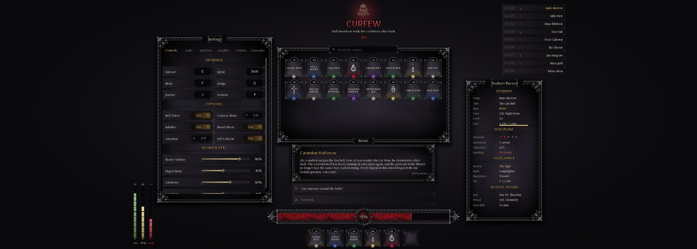
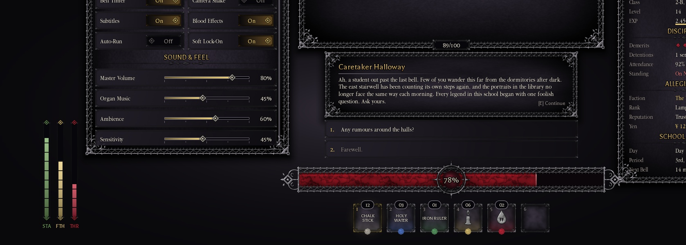
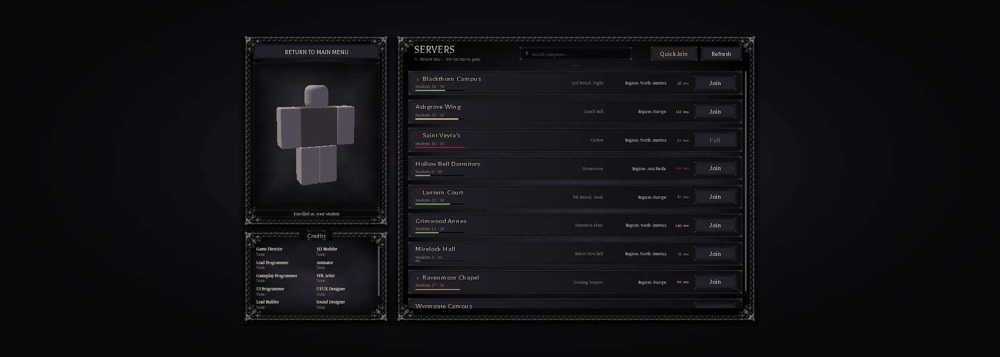

# Nightmare Highschool UI Kit

A gothic UI kit for Nightmare Highschool: a cursed school after dark, built from iron-gate arcades, chalk-smudged slate, wax seals, church candles and a cracked skull-bell. It lives in the **NH Combat Test** place.

| Where | What |
|---|---|
| `ReplicatedStorage.UI.Theme` | Colours, rarity and faction palettes, fonts, sizes, scale rules, texture ids, 9-slice data, tweens |
| `ReplicatedStorage.UI.Components` | Builder functions for every widget (API below) |
| `ReplicatedStorage.UI.ServerDirectory` | Live server list: MemoryStore heartbeat, remotes and client polling |
| `ReplicatedStorage.UI.Preview` | Sample layouts with NH data (`Build`, `BuildServerSelect`) |
| `ServerScriptService.NHServerDirectory` | One-line Script that runs `ServerDirectory.StartServer()` |

**Persistence rule:** all saved player data goes through ProfileService (`ServerScriptService.Services.Player.Data` → `Data.UpdateState`). Never create a separate DataStore.
| `StarterGui.UIKitPreview` | Preview of every HUD/menu component. Saved **disabled**. |
| `StarterGui.ServerSelectPreview` | Preview of the server selection screen. Saved **disabled**. |
| `Tools/ui-textures/*.py` | Python scripts that generate all the texture art (re-run them to tweak it) |





## Viewing the previews

- **Edit mode:** select the ScreenGui in StarterGui and tick `Enabled`. Untick it again when you're done.
- **Live in a Studio playtest:** set the ScreenGui's `LivePreviewInStudio` attribute to `true`, then press Play. Its `PreviewGuard` LocalScript rebuilds it with working callbacks. On the server screen that means your own character in the preview pane and the real server list.
- **Real games:** the guard destroys both GUIs when they spawn, so players never see them.
- **Rebuilding the saved edit-mode preview** after a kit change (Studio command bar): `require(game.ReplicatedStorage.UI:Clone().Preview).Build(game.StarterGui.UIKitPreview)` (use `BuildServerSelect` for the server screen). The `Clone()` gets around `require` caching.

## Art and textures

All art is original and was made for this kit. It's procedurally generated, with **PBR shading baked into each image**. Roblox GUI images can't render live PBR materials, so each sprite was rendered from height, normal, albedo, roughness and metalness maps. The lighting is a GGX/Cook-Torrance key light, a rim light, hemispheric ambient and ambient occlusion. Grime raises roughness and darkens the albedo.

The textures are greyscale, so `ImageColor3` tints them. That's how the faction variants work: Vigil gold and Court red.

- **Ornate panel frame:** 4 corner pieces plus 4 edge strips tiled with `ScaleType.Tile`. The edges repeat a gothic iron-gate arcade instead of stretching.
- **9-slice frames:** `FrameThin` for rows, buttons and plates, and `FrameSlot` (bracket corners) for item slots and server rows.
- **Health bar:** PBR end caps, arcade rails (the panel edge tiles) and a veined fill that tiles horizontally.
- **Other art:**
  - a clock-face orb ring and a glass orb
  - wax-seal rarity gems
  - diamond knobs and pips
  - a divider, a soft glow and a drop shadow
  - icons: candle (Vigil), blood drop (Court / Vampire), quill nib (Human), cross (Priest)

## Conventions

```lua
local Components = require(game.ReplicatedStorage.UI.Components)
local root, api = Components.Toggle({ label = "Subtitles", value = true,
    onChanged = function(v) print(v) end,
    Position = UDim2.fromOffset(20, 20), Parent = someFrame })
```

- Every builder works the same way: `Components.X(opts) -> (root: GuiObject, api: table)`.
- Lower-case opts are component data. PascalCase opts (`Name, Size, Position, AnchorPoint, LayoutOrder, Visible, ZIndex, Parent`) are copied onto the root, with `Parent` set last.
- `api.Root` is the root instance. Interactive parts have `:Set(v, silent?)` and `:Get()`, fire their `onChanged` / `onClick` callback, and mirror their value to the root's `Value` attribute.
- **Sizes are design pixels for a 1920×1080 screen.** Call `Components.AutoScale(screenGui)` once per ScreenGui. It adds a UIScale = min(w/1920, h/1080), clamped to `Theme.Scale.Min`/`Max`, and on touch-only devices it never goes below `Theme.Scale.TouchMin` (0.92). Since every tappable row and button is at least 44 px, tap targets stay at 40 px or more. Use anchors and scale positions for screen placement, since UIScale only scales offsets. Use `Panel{maxSize=}` and the built-in ScrollingFrames on small screens.
- **Z-order:** `ZIndexBehavior.Sibling`. Inside a panel: background 1, ornament 6, `Content` 7.

## Components

**Primitives**

| Builder | Description |
|---|---|
| `Text(props)` | TextLabel with kit defaults |
| `Emboss(label, bottomColor?, stroke?)` | Engraved title look: gradient plus dark stroke |
| `Slice(key, color, props)` | 9-slice image |
| `Image(key, props)` | Image by `Theme.Images` key |
| `new(class, props, children)` | Instance helper |
| `KeyName(key)` | Short display name for a key |
| `Divider{color?, height?}` | Ornamental horizontal rule |
| `SectionHeader{text, color?, height?}` | Gold embossed caps with a divider underneath |

**Panel{title?, accent?, frameColor?, bgColor?, ornament?, ornamentScale?, inset?, shadow?, maxSize?}**
- `accent`: `"Vigil"` | `"Court"`. `ornament`: `"ornate"` (default) | `"thin"` | `"none"`.
- An ornate panel: slate background, PBR iron border, drop shadow and an optional engraved title plaque on the top edge. Put your widgets in `api.Content`.
- api: `Content`, `:SetTitle(t)`, `:SetFrameColor(c)`.

**Button{text, onClick(api), style?, icon?, textSize?, enabled?}**
- `style`: `"default"` | `"gold"` | `"crimson"` | `"ghost"`. Has hover, press-scale and disabled states. Minimum height 44.
- api: `:SetText`, `:SetEnabled`.

**TabBar{tabs, selected?, onChanged(i, name), textSize?}**
- The selected tab is gold with a divider underline.
- api: `:Select(i, silent?)`, `:Get() -> i, name`.

**Toggle{label, value?, onChanged(bool), onText?, offText?}**
- The whole row is the tap target. A sliding diamond knob and a candle-gold glow show when it's on.
- api: `:Set`, `:Get`.

**Slider{label, min?, max?, step?, value?, suffix?, format?(v), onChanged(v), onReleased(v), color?, labelWidth?}**
- Drag with mouse or touch anywhere on the 44 px track area. Snaps to `step`.
- api: `:Set`, `:Get`.

**KeybindRow{label, key, onChanged(newKey)}**
- Click the key plate, then press a key (Esc cancels). Accepts the keyboard, mouse buttons 2 and 3, and gamepad.
- api: `:Set`, `:Get`.

**ItemSlot{item?, size?, key?, selected?, onClick(item, api)}**
- `item = {name, count?, rarity?, icon?, id?}`.
- Shows a count badge, a rarity wax seal, a rarity glow, an icon (or the name), a hotkey and a selected glow.
- Rarities (`Theme.Rarity`): Common, Uncommon, Rare, Epic, Legendary, Cursed.
- api: `:SetItem`, `:SetCount`, `:SetSelected`, `:Clear`.

**ItemGrid{items, slotSize?, gap?, capacity?, used?, showEmpty?, onSelect(item, i), counterOffset?, showCounter?}**
- A scrolling grid of slots with a capacity plaque ("89/100").
- api: `:SetItems`, `:Select(i)`, `:Filter(q)`, `:SetCapacity(used, cap)`, `Slots`.

**SearchBar{placeholder?, text?, onChanged(t), onSubmit(t), grid?}**
- Passing an ItemGrid api as `grid` makes the search filter it automatically.
- api: `:Get`, `:Set`, `:Focus`, `TextBox`.

**StatSheet{title?, accent?, sections, rowHeight?}**
- `sections = {{header, rows = {{label, value, color?}, {label=, value=, bar=0..1}, {label=, pips={filled, total, color, caption}}}}}`.
- api: `:SetValue(label, text, color?)`, `Values`.

**DangerAlert{title?, subtitle?, seconds?, color?, icon?, onExpired()}**
- The cracked skull-bell, a pulsing red glow, an engraved title and a countdown.
- api: `:Start(seconds, onExpired?)`, `:Stop(hide?)`, `:SetText(title?, subtitle?)`.

**PlayerListRow{number?, name, faction?, race?, isLocal?, onClick?}**
- Shows "No. 0456", the faction icon and the name. The local player is gold. It's 30 px tall, or 44 px when `onClick` is set.
- api: `:Set(o)`.

**PlayerList{players, title?, rowGap?}**
- api: `:SetPlayers(list)`, `Rows`.

**DialogueBox{speaker, text, accent?, replies?, bodyHeight?, hint?, typewriter?, onReply(i, rep)}**
- `replies = {{text, onSelect, color?}}`. `typewriter` is characters per second.
- api: `:SetSpeaker`, `:SetText(t, cps?)`, `:SkipTypewriter`, `:SetHint`, `:SetReplies`.

**HealthBar{value?, color?, orb?, orbColor?, frameColor?, label?}**
- The bar's height drives all its parts (design height 64). Recent damage shows as a delayed "ghost" segment, and the % shows in the clock-face orb.
- api: `:Set(v, instant?)`, `:Get`, `:SetColor`.

**Hotbar{slots?, items?, selected?, slotSize?, gap?, onSelect(i, item), bindKeys?}**
- `bindKeys` = number keys 1-9. Pressing the selected slot again deselects it.
- api: `:Select(i?, silent?)`, `:SetItem(i, item)`, `:GetSelected`.

**VerticalMeter{value?, color?, segments?, label?}**
- A thin segmented gauge with diamond caps. Used in the preview for stamina, faith and thirst.
- api: `:Set(v, instant?)`, `:Get`, `:SetColor`.

### Server selection screen

**CharacterPreview{backText?, onBack(), footer?, player?, fallback?, model?, spin?, mirrorPose?, fov?, zoom?, yaw?}**
- A ViewportFrame (with a WorldModel) showing a character.
- **Live:** `api:BindPlayer(player)` follows `player.Character` across respawns.
  - `api:Watch(model)` mirrors any model and re-clones it (0.15 s debounce) when its look changes: parts, accessories, clothing, colours, meshes, textures, BodyColors or SurfaceAppearance.
  - It copies every Motor6D pose each frame, so the preview moves with the real character.
  - The planned character creator works with this as-is: whatever it applies to the character model shows up.
  - `fallback` (for example `StarterPlayer.StarterCharacter`) shows while there's no character.
- api: `:BindPlayer`, `:Watch`, `:Unwatch`, `:SetModel`, `:GetModel`, `:SetFooter`, `:SetSpin`.

**CreditsPanel{title?, entries = {{role, name}}, columns?}**
- A two-column grid of roles and names.

**ColorPicker{value?, onChanged(c), onReleased(c), presets?}**
- A hue/saturation wheel (`Theme.Images.ColorWheel`), a brightness bar, a live swatch, a **HEX** box (`#RRGGBB`, invalid input reverts) and optional preset chips.
- Mouse and touch drag. `onChanged` fires while dragging, `onReleased` on let-go, preset or HEX.
- api: `:Set(color, silent?)`, `:Get()`. The root's `Value` attribute holds the colour.

**SpinReel{entry?, height?, textSize?}**
- A slot-machine window. `api:Spin(entries, final, duration?, onDone?)` rolls through random entries and lands on `final` (Quint ease-out), then flashes in its colour.
- An entry is `{ text, sub?, color? }`. `api:Show(entry)` sets it without animation.
- The result always comes from the server; the reel only animates it.

**ServerRow{name, players, maxPlayers, region?, period?, ping?, faction?, isCurrent?, jobId?, onJoin(server, api)}**
- Shows the campus name, a faction crest, "Students 18 / 30" with a population gauge, the in-game period, the region, the ping and a Join button.
- The button reads **Join**, **Full**, **Here** or **Joining...** to match the server's state.
- api: `:Set(o)`, `:SetJoining(bool)`, `data`, `JoinButton`.

**ServerBrowser{title?, servers?, onJoin, onQuickJoin, onRefresh, searchPlaceholder?, status?}**
- The header has the title, a live-status dot and line, search, Quick Join and Refresh, above a scrolling row list.
- `:UpdateServers(list)` **diffs rows in place** by `jobId`: existing rows update, new ones appear and vanished ones go, so the list doesn't jump.
- api: `:SetServers`, `:UpdateServers`, `:GetRow(key)`, `:Filter(q)`, `:SetStatus(text, live?)`. Set `api.OnJoin` / `OnQuickJoin` / `OnRefresh` to override the opts callbacks at runtime.

### ServerDirectory (the live list)

```lua
-- client, e.g. a lobby screen
local SD = require(game.ReplicatedStorage.UI.ServerDirectory)
local _, browser = Components.ServerBrowser({ Parent = screen })
local stop = SD.Bind(browser)            -- polls every 8 s, wires Join / Quick Join / Refresh
local _, char = Components.CharacterPreview({ player = game.Players.LocalPlayer,
    fallback = game.StarterPlayer.StarterCharacter, Parent = screen })
```

**Server side.** Every server runs `StartServer()` through `ServerScriptService.NHServerDirectory`.
- Every 15 s, and 2 s after anyone joins or leaves, it writes a snapshot to the MemoryStore sorted map `NH_ServerDirectory_v1` with a 45 s TTL.
- Each snapshot holds: jobId, placeId, name, players, maxPlayers, region, period, faction and updated.
- It removes the server's entry on `BindToClose`. Private servers don't advertise themselves.
- It creates `ReplicatedStorage.NHServerDirectory` (`List` and `Join` RemoteFunctions) at runtime.
- `List` is rate-limited per player and cached for 4 s.
- `Join` checks the target and teleports the player there with `TeleportAsync` and `ServerInstanceId`.
- Quick Join picks the fullest server that isn't full, or opens a new one.
- `StartServer({ publish = false, placeIds = {...} })` is for a separate lobby place.

**Where each field comes from:**

| Field | Source |
|---|---|
| Campus name | workspace attribute `CampusName`, or a stable name hashed from the JobId (Blackthorn Campus, Lantern Court, ...) |
| Period | the school clock: `SchoolClock.Epoch` via `Functions.SchoolTime`, e.g. "Period 1, 8:40 AM" |
| Region | workspace attribute `Region`, or set `SD.IpRegionLookupUrl` to an IP-lookup service (off by default: it needs HttpEnabled and calls a third party) |
| Faction | workspace attribute `ControllingFaction` (`"Vigil"` / `"Court"`) |
| Ping | not available. Roblox can't measure ping to another server, so live rows hide that column. |

**Client side.**
- `SD.Fetch() -> (servers, live)`
- `SD.Join(jobId)` and `SD.QuickJoin() -> (ok, msg)`
- `SD.Bind(browserApi, {interval}) -> stop()`

**In Studio**, MemoryStore only works in a published place with Studio API access, and teleports never run. The list then shows just the current server, the status reads "Local only", and Join explains why it can't teleport.

### Helpers for reskinning existing UI

**Decorate(frame, opts)**
- Dresses an existing frame as a kit panel without changing its layout or size. Works with scale sizes and AutomaticSize.
- The art goes in a ZIndex-0 child, `NHDecor`. The frame's own children draw on top.
- opts: `title?, accent?, frameColor?, bgColor?, ornament? ("ornate"|"thin"|"slot"|"none"), ornamentScale?, shadow?, bgTransparency?`
- **Rule:** if the frame has a UIListLayout or UIPadding, move the content into an inner frame. Layouts would also move `NHDecor`.
- **Auto-size:** on an AutomaticSize frame, the art layer is sized in offsets that track the content. A scale-sized child would measure against the frame's *parent* (the whole screen), and the drop shadow is kept from overhanging an auto-sized edge.
- api: `:SetTitle`, `:SetFrameColor`.

**Other helpers**

| Helper | What it does |
|---|---|
| `Plate{text?, autoWidth?, color?, font?, textSize?}` | Engraved plate (HUD chips, counters) |
| `Bar{fraction, color?, caption?, height?}` | Labelled iron progress bar. api: `:Set(f, caption?)`, `:SetColor` |
| `ChoiceRow{index?, text, color?, onClick(index), height?}` | Numbered reply row (dialogue choices, menus) |
| `Toast{title, text?, kind?, color?}` | Notification row. `kind` is Info, Good, Warning or Bad (`Components.ToastColors`). |
| `FadeOut(root, duration?)` | Fades every text, image, frame and stroke in a subtree. Returns the root tween. |

## Reskinned game UI and in-play HUD

Every reskin swaps visuals only. Packets, attributes, instance names and public functions are unchanged.

| Script (`StarterPlayerScripts.Controllers.Gui`) | Now |
|---|---|
| `Dialogue` | A compact ornate box, low on screen, tinted in the speaker's faction colour, with `ChoiceRow` replies and an AutoScale floor of 0.8 |
| `Notifications` | `Toast` rows that fade with `FadeOut` |
| `ClockHud` | An ornate auto-height chip, plus an engraved class-waypoint plate |
| `DownedHud` | An engraved prompt plate above the health bar. It turns red when you're downed or gripped. |
| `FactionsPanel` | An ornate panel with a plaque, bracket-cornered cards, `Bar`s and kit buttons |
| `Activities` | The lesson chalkboard framed in iron ornament over slate-green. The renderers are untouched. Leaving a lesson keeps the core backpack off while KitHud is active. |
| **`KitHud`** (new) | Covered in its own section below. |
| **`PromptUi`** (new) | Covered in its own section below. |

### KitHud
The in-play HUD:
- **Health bar** (Humanoid health) with a % orb. Recent damage shows as a delayed "ghost" segment.
- **Hotbar** from your Backpack tools. Click, tap or press 1-9 to equip. Tools can set `Rarity` and `Count` attributes.
- **Yen** from the profile.
- **Posture meter**, reading a `Posture` attribute on the character or Humanoid, out of `Config.Combat.PostureMax`.
- **DOWNED alert**, driven by `Downed` + `DownedUntil`.

It replaces the core health bar and backpack. The bottom HUD hides during dialogue (`InDialogue`) and lessons, and number keys are ignored then.

### PromptUi
Draws every ProximityPrompt in the NH style:
- Prompts switch to `Style = Custom` on the local client only, so the server's prompts are untouched.
- Each prompt shows an engraved key cap that fills with candle-gold over `HoldDuration`, plus the object and action text.
- Touch and mouse players hold the key cap.
- Opt a prompt out with the `KeepDefaultStyle` attribute.
- The Equip controller's E-to-interact check still works, because PromptShown and PromptHidden still fire.

Left as they are: the `FlashUI`, `RedScreen` and `Vingette` screen effects.

### Settings (menu: M)
- `ReplicatedStorage.UI.Settings` holds the schema, defaults and ranges, server saving (`StartServer`, run by `ServerScriptService.NHSettings`), and client applying.
- Client API: `Load()`, `Get(key)`, `Set(key, value)`, `SetKey(action, keyName) -> ok, message`, `Reset()`, and `Changed` (a BindableEvent).
- Data lives in the player's ProfileService data (`PlayerData.Settings`, action `SetSettings`). The server validates it with `Settings.Sanitize` and rate-limits saves.
- `Controllers.Gui.SettingsMenu` draws the window with kit components.

What each setting changes:

| Setting | Effect |
|---|---|
| Volumes | The client SoundGroups `NH_Master` > `NH_Effects` / `NH_Music`. Ungrouped sounds are routed automatically: looped ones go to Music, the rest to Effects. |
| FieldOfView | `Camera.FieldOfView` |
| CameraShake | The player attribute `NHShakeScale`, which `EmitManager.ShakeCamera` multiplies into its intensity |
| UIScale | `Components.SetUserScale`, which multiplies every kit AutoScale |
| ShowHud / ShowClock | Enables or disables `KitHud` / `ClockHud` |
| Shadows | `Lighting.GlobalShadows`, on the client only |
| Vignette | Enables or disables `Vingette` |
| Keys | `InputController.Rebind(action, key)` |

### Wardrobe: the character creator (key K)
`Controllers.Gui.Wardrobe` draws the window. On the left is a live `CharacterPreview:BindPlayer` with a turn-around button. On the right are five tabs:

| Tab | What you set |
|---|---|
| Look | Look style (Scholar / Chapel / Nightborn) and skin: 6 presets plus a colour wheel / HEX |
| Face | Eye shape (Roblox face, Sharp, Hooded, Fierce, Doe, Sleepless, Cat, Gentle, Calm), eye set (Male / Female), eye colour (7 presets plus wheel / HEX; Nightborn is always crimson), brows (None plus 11 styles, including the thick Bold, Heavy and Bushy; "Match hair" or a custom colour) and mouth (None plus 20 anime mouths, frowns included, "Fuller lips") |
| Hair | Built hairstyle (Neat Crop / Fringe / Long / Bun / None), catalog hair by ID, "Recolour catalog hair", and hair colour (presets plus wheel / HEX) |
| Outfit | "Use my Roblox outfit"; Top: 18 options (the 4 official group shirts plus 14 variants: vests, polos, blazer, cardigan, varsity jacket, PE shirt); Bottoms: 8 options (uniform trousers, jeans, slacks, khakis, shorts, tartan skirt) |
| Lineage | The server-rolled race and variant (spin reel), race and variant odds, 2 trait slots with rerolls |

The window opens by itself on a player's first live join, never in Studio. `Shared.OpenTab(name)` opens it on a given tab.

**`ReplicatedStorage.UI.Appearance` (cosmetic only)**
- **Data:** `{ LookStyle, Skin, SkinHex, Hair, HairColor, HairHex, HairId, TintHair, Eyes, EyeSet, EyeColor, EyeHex, Brows, BrowHex, Mouth, Lips, Uniform, Bottoms, UseAvatar, Created }`.
  - It's saved in ProfileService data (`PlayerData.Appearance`, action `SetAppearance`).
  - A `*Hex` value (`"RRGGBB"`) overrides its preset index. `""` means use the preset.
  - The look is applied after the Roblox avatar loads, on every spawn, and again whenever it changes.
- **UseAvatar = false:** the avatar's Accessory, Shirt, Pants and ShirtGraphic move to `ServerStorage.NHAppearanceStash`. You then wear `NHUniformShirt` and `NHUniformPants`, with skin BodyColors and the built hair. Switching back restores everything exactly.
- **Catalog hair:**
  - `HairId` is any Roblox hair accessory (AssetType HairAccessory). The server checks it with `GetProductInfo`, loads it through `Players:CreateHumanoidModelFromDescription`, caches it, and attaches it as `NHHair`. An ID that doesn't load is never saved.
  - While it's worn, the avatar's own hair is held in `ServerStorage.NHHairStash`.
  - With `TintHair` on, it's recoloured: `SpecialMesh.VertexColor`, or for a MeshPart the texture is cleared and the colour set.
  - The remote `NHAppearance.CheckHair(id) -> ok, name|reason` lets the window validate an ID first.
- **Painted face:** drawn on the skin at full resolution.
  - **How it's drawn:** on a classic (cylinder) head, the face is `head.NHFacePlate`, a Folder of 12 thin invisible strips.
    - Each strip is welded to the head, sits 0.006 studs off the skin and is angled to follow the curve.
    - Each strip has a SurfaceGui showing its 1/12 slice of the 1024 px art (`ImageRectOffset` / `ImageRectSize`).
    - This wraps the head exactly like a decal, but GUI images render at full resolution on every graphics setting. Decals get down-sampled on lower settings, which made the faces look crunchy. This was verified live: every strip measured 0.006 studs above the skin, with no floating.
  - **Other heads:** MeshPart and dynamic heads fall back to plain Decals.
  - **First person:** you don't see your own face, because the Wardrobe disables your own face's SurfaceGuis while Roblox hides your head (`LocalTransparencyModifier`).
  - **Previews:** `CharacterPreview` turns the strips back into Decals inside its ViewportFrame, since ViewportFrames don't draw SurfaceGuis.
  - **Avatar face:** the avatar's own front face decals are hidden, and restored when you go back to "Roblox face".

  | Layer | Content | Order | Tint |
  |---|---|---|---|
  | `NHEyesVeins` | greyscale skin veins (vampire / ghoul forms only) | 1 | the head's real colour, mixed 50/50 with the form's vein colour, so it suits any skin |
  | `NHEyesIris` | greyscale iris | 2 | eye colour (or the form's colour) |
  | `NHEyesMain` | sclera, lids, lashes, pupil, highlights | 3 | none |
  | `NHBrows` | brow hair strokes, fitted to the eye shape | 4 | `BrowHex`, or the hair colour 18% darker |
  | `NHMouth` | mouth (the transformation mouth while transformed) | 4 | none |

  - Brows and mouth show only with painted eyes.
  - All art IDs are in `ReplicatedStorage.UI.EyeArt` (420 textures): 8 shapes × Male/Female × 7 forms of eyes, 11 brow styles × 8 shapes, and 20 mouths × (plain / fuller lips) plus 4 transformation mouths. It's generated by `Tools/ui-textures/gen_eyes.py`, `gen_face.py` and `build_eyeart.py`.
  - **Mouths:** cel-shaded anime, modelled on an open × width mouth grid:
    - a thin wine-coloured outline
    - a two-tone maroon / rose interior
    - a thin tooth crescent, plus a lower tooth sliver when wide open
    - a soft lower-lip shadow
    - "Fuller lips" adds a glossy pink tint
  - **The 20 mouths:**
    - Neutral, Smile, Flat, Smirk, Hint, Grin, Small, Ooh, Open, Talk, Laugh, Shout, Pout
    - frowns: Frown, Scowl, Sulk, Grimace
    - anime extras: Cat, Fang, Shark
  - **No overlaps:** each eye render checks its line groups against each other, and every brow and mouth is checked against every eye variant. A brow is lifted until its lower edge clears the highest lash, wing or crease of every variant of that eye shape by 14 px.
- **Transformation eyes:** when gameplay sets the character attribute `Transformation` to `Vampire`, `Wolf`, `Ghoul` or `Wraith`, the eyes and mouth switch to that form's art and tint, and switch back when it's cleared. Appearance only reads this attribute.
  - Vampire: crimson; a blade-shaped slit pupil with a glowing rim and a dark sigil ring; bloodshot whites; veins.
  - Wolf: a huge amber iris; a ragged feral pupil with a gold rim and starburst; a yellowed sclera.
  - Ghoul: a milky iris; a pinprick pupil; a sunken socket; bloodshot whites; many branching skin veins.
  - Wraith: blank glowing eyes. *Proposed:* vampire is established in the concept doc; wolf and ghoul were requested by the developer; wraith is an extra suggestion.
  - **`TransformationStage = 2`** gives Vampire and Ghoul their second stage: jet-black sclera (art keys `vampire2`, `ghoul2`).
- **Look-style marks (cosmetic, NOT race):** Chapel gets a gold cross pin. Nightborn gets pale skin and crimson eyes. Only the `LookStyle` attribute is set.

**`ReplicatedStorage.Lineage`: race, variant and traits, rolled on the server (players never choose)**
- **Races** (from the concept doc; weights are configurable):
  - Human 50%: Human 90 / Superhuman 10
  - Priest 30%: Priest 85 / Grand Priest 12 / Pope 3
  - Vampire 20%: Vampire 85 / Nobleblood 12 / Royal Vamp 3
- **Traits:** 13 proposals from Common to Legendary, in 2 slots. They're data only (each has an `Effects` table) until the stat system exists.
- **Saving:** in ProfileService data, `PlayerData.Lineage = { Race, SubRace, Tier, Traits, Spins = { Race, Variant, Trait } }`, through the action `SetLineage`. Only `ServerScriptService.NHLineage` writes it.
- **Tier** (concept doc: 3 race tiers by kill count) is worked out on join from `Kills + NPCKills`. The thresholds `Lineage.TierKills = { 0, 25, 100 }` are a proposal. The tier is mirrored as the Player attribute `RaceTier`, so class and tier systems won't need a data migration.
- **New players:** a new profile gets a free first roll and 3 / 3 / 5 rerolls. Spins aren't used up in Studio.
- **Remote:** `NHLineage.Spin(kind, slot?) -> ok, lineage|reason` (RemoteFunction, rate-limited to 1 per second).
- **Attributes:** the server mirrors the read-only Player attributes `Race`, `SubRace`, `RaceTier` and `Traits` (a comma list) for other systems to read.
- `ServerDirectory.LastJoined()` / `FormatLastJoined(rec)` provide the server-select footer. On join, the previous campus is read from `PlayerData.LastJoined`, then this one is written with `SetLastJoined`.

Reserved keys (in `Settings.ReservedKeys`) can't be rebound. **M** opens the menu; O is avoided because Roblox's camera uses I and O for zoom and swallows them.

## Verified

- All modules and scripts compile (checked with `loadstring`).
- Every component was checked in edit-mode screenshots at 0.56× and 1:1.
- An edit-mode functional run covered:
  - toggles, slider step and clamp, tabs, keybinds, search filtering, capacity, hotbar, health, meters, button disable, dialogue replies, danger countdown, stat sheet and player list
  - the character mirror updating on a colour change, accessory add and remove, a clothing-template change, and the pose mirror
  - the server-list diff (row kept, updated, removed, reordered, empty state), snapshot fields, stable names and sorting
- **Not run:** a live playtest. Another session was using Play mode, so MemoryStore publishing, remotes, teleports, touch dragging and AutoScale on a real phone haven't been seen running.

## Not done / next

- The existing dialogue box, panels and HUD aren't switched over to the kit yet. That's for the session that owns those scripts.
- "Last joined" needs saved data (a DataStore). The footer currently shows "Enrolled as <DisplayName>".
- The credits list uses "Name" placeholders.
