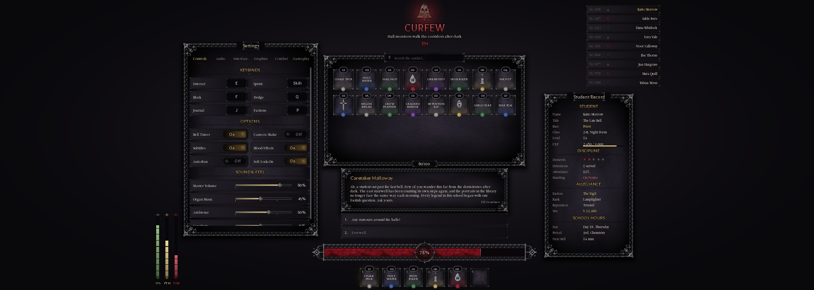
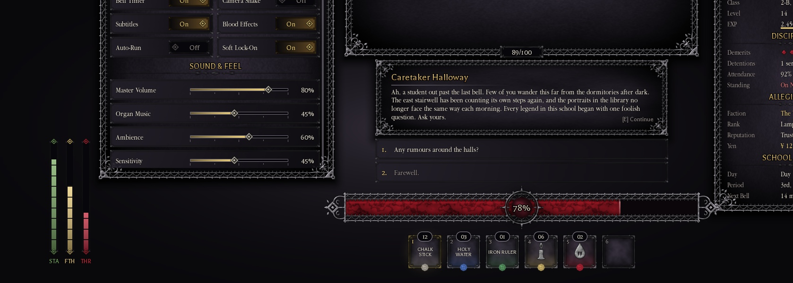
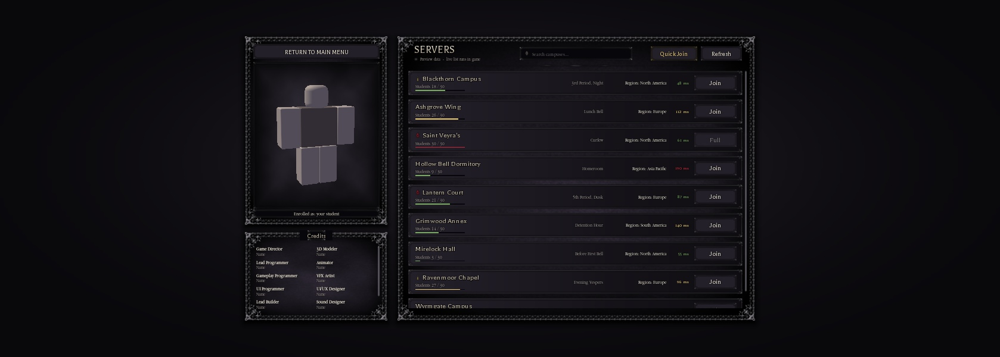
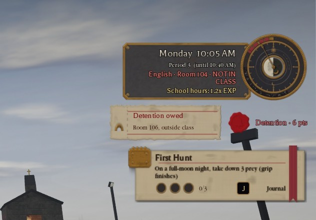
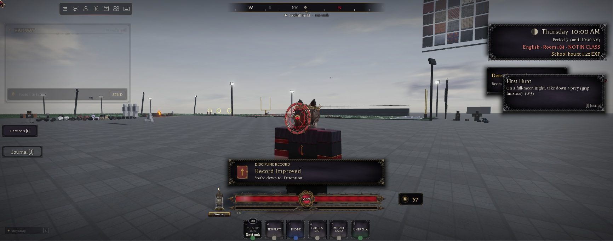
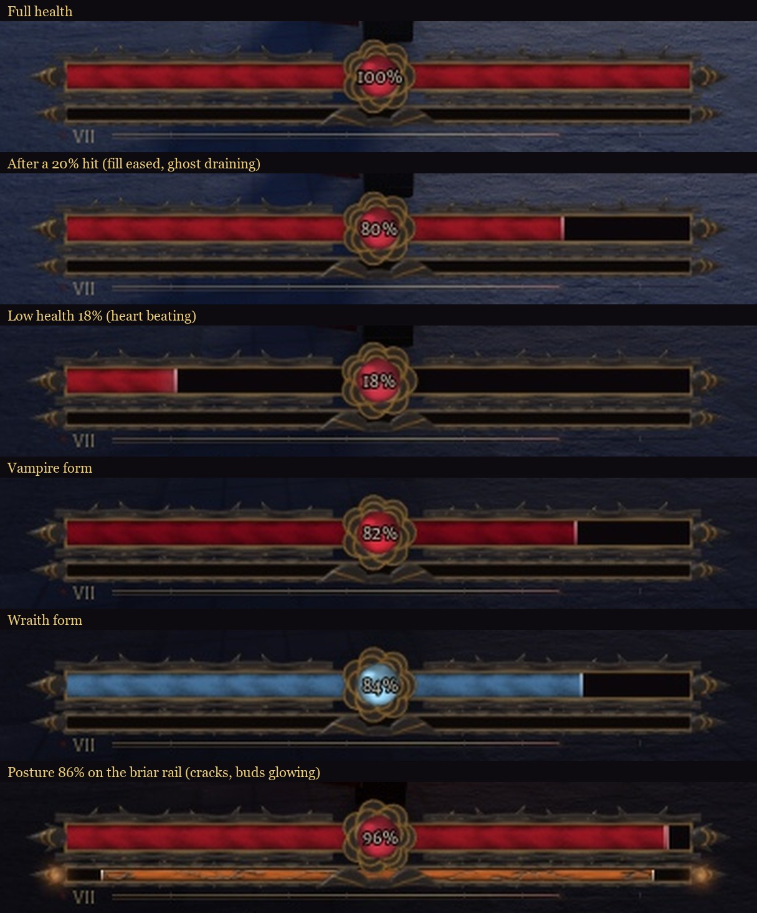
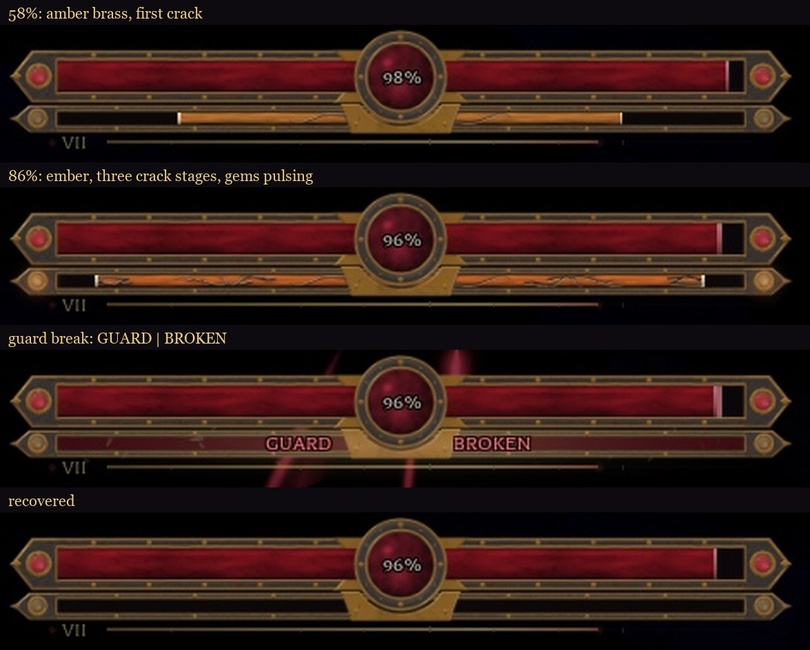

# Nightmare Highschool UI Kit

A gothic UI kit for Nightmare Highschool: a cursed school after dark, built from iron-gate arcades, chalk-smudged slate, wax seals, church candles and a cracked skull-bell. It lives in the **NH Combat Test** place.

| Where | What |
|---|---|
| `ReplicatedStorage.UI.Theme` | Colours, rarity and faction palettes, fonts, sizes, scale rules, texture ids, 9-slice data, tweens |
| `ReplicatedStorage.UI.Components` | Builder functions for every widget (API below) |
| `ReplicatedStorage.UI.ServerDirectory` | Live server list: MemoryStore heartbeat, remotes and client polling |
| `ReplicatedStorage.UI.Preview` | Sample layouts with NH data (`Build`, `BuildServerSelect`) |
| `ServerScriptService.NHServerDirectory` | One-line Script that runs `ServerDirectory.StartServer()` |

**Persistence rule:** all saved player data goes through ProfileService (`ServerScriptService.Services.Player.Data` → `Data.UpdateState`). Never create a separate DataStore.
| `StarterGui.UIKitPreview` | Preview of every HUD/menu component. Saved **disabled**. |
| `StarterGui.ServerSelectPreview` | Preview of the server selection screen. Saved **disabled**. |
| `Tools/ui-textures/*.py` | Python scripts that generate all the texture art (re-run them to tweak it) |





## Viewing the previews

- **Edit mode:** select the ScreenGui in StarterGui and tick `Enabled`. Untick it again when you're done.
- **Live in a Studio playtest:** set the ScreenGui's `LivePreviewInStudio` attribute to `true`, then press Play. Its `PreviewGuard` LocalScript rebuilds it with working callbacks. On the server screen that means your own character in the preview pane and the real server list.
- **Real games:** the guard destroys both GUIs when they spawn, so players never see them.
- **Rebuilding the saved edit-mode preview** after a kit change (Studio command bar): `require(game.ReplicatedStorage.UI:Clone().Preview).Build(game.StarterGui.UIKitPreview)` (use `BuildServerSelect` for the server screen). The `Clone()` gets around `require` caching.

## Art and textures

All art is original and was made for this kit. It's procedurally generated, with **PBR shading baked into each image**. Roblox GUI images can't render live PBR materials, so each sprite was rendered from height, normal, albedo, roughness and metalness maps. The lighting is a GGX/Cook-Torrance key light, a rim light, hemispheric ambient and ambient occlusion. Grime raises roughness and darkens the albedo.

The textures are greyscale, so `ImageColor3` tints them. That's how the faction variants work: Vigil gold and Court red.

- **Ornate panel frame:** 4 corner pieces plus 4 edge strips tiled with `ScaleType.Tile`. The edges repeat a gothic iron-gate arcade instead of stretching.
- **9-slice frames:** `FrameThin` for rows, buttons and plates, and `FrameSlot` (bracket corners) for item slots and server rows.
- **Health bar:** PBR end caps, arcade rails (the panel edge tiles) and a veined fill that tiles horizontally.
  - **1.13.0 HUD bar:** `art/ui/hud/make_health_pbr.py` bakes a one-piece iron frame (2400 x 200, engraved groove), a greyscale fill (768 x 144) and a new orb ring and glass. `KitHud` uses them at 600 x 50 (`Local.SkinHealth`).
- **Other art:**
  - a clock-face orb ring and a glass orb
  - wax-seal rarity gems (`Theme.Images.Seal`: this is the seal's only job; since 1.84.0 everything else that used it has its own icon, see [Icon-Set](Icon-Set.md))
  - diamond knobs and pips
  - a divider, a soft glow and a drop shadow
  - icons: candle (Vigil), blood drop (Court / Vampire), quill nib (Human), cross (Priest)

## Conventions

```lua
local Components = require(game.ReplicatedStorage.UI.Components)
local root, api = Components.Toggle({ label = "Subtitles", value = true,
    onChanged = function(v) print(v) end,
    Position = UDim2.fromOffset(20, 20), Parent = someFrame })
```

- Every builder works the same way: `Components.X(opts) -> (root: GuiObject, api: table)`.
- Lower-case opts are component data. PascalCase opts (`Name, Size, Position, AnchorPoint, LayoutOrder, Visible, ZIndex, Parent`) are copied onto the root, with `Parent` set last.
- `api.Root` is the root instance. Interactive parts have `:Set(v, silent?)` and `:Get()`, fire their `onChanged` / `onClick` callback, and mirror their value to the root's `Value` attribute.
- **Sizes are design pixels for a 1920×1080 screen.** Call `Components.AutoScale(screenGui)` once per ScreenGui. It adds a UIScale = min(w/1920, h/1080), clamped to `Theme.Scale.Min`/`Max`, and on touch-only devices it never goes below `Theme.Scale.TouchMin` (0.92), or `PhoneTouchMin` (0.62) on phones (shorter side under 600 px; see [Touch-Controls](Touch-Controls.md), 1.30.0). On phones, big offset-sized panels are clamped to the screen (`Components.ClampPanels`), and `AutoScale(gui, { phoneScale = n })` sets a screen's exact phone scale. Since every tappable row and button is at least 44 px, tap targets stay at 40 px or more. Use anchors and scale positions for screen placement, since UIScale only scales offsets. Use `Panel{maxSize=}` and the built-in ScrollingFrames on small screens.
- **Z-order:** `ZIndexBehavior.Sibling`. Inside a panel: background 1, ornament 6, `Content` 7.

## Components

**Primitives**

| Builder | Description |
|---|---|
| `Text(props)` | TextLabel with kit defaults |
| `Emboss(label, bottomColor?, stroke?)` | Engraved title look: gradient plus dark stroke |
| `Slice(key, color, props)` | 9-slice image |
| `Image(key, props)` | Image by `Theme.Images` key |
| `new(class, props, children)` | Instance helper |
| `KeyName(key)` | Short display name for a key; controller buttons by the pad in use (Xbox / PlayStation, `PadStyle()`) |
| `PadStyle()` | `"Xbox"` or `"PlayStation"`: the Settings choice, else the connected pad (see Console-Controls.md) |
| `PadText(s)` | Fills `{A}`, `{B}`, `{L1}`... with this pad's names (use a plain `"..."` string, not a backtick one) |
| `PadControls` | The list of controller buttons and what each does |
| `Divider{color?, height?}` | Ornamental horizontal rule |
| `SectionHeader{text, color?, height?}` | Gold embossed caps with a divider underneath |

**Panel{title?, accent?, frameColor?, bgColor?, ornament?, ornamentScale?, inset?, shadow?, maxSize?}**
- `accent`: `"Vigil"` | `"Court"`. `ornament`: `"ornate"` (default) | `"thin"` | `"none"`.
- An ornate panel: slate background, PBR iron border, drop shadow and an optional engraved title plaque on the top edge. Put your widgets in `api.Content`.
- api: `Content`, `:SetTitle(t)`, `:SetFrameColor(c)`.

**Button{text, onClick(api), style?, icon?, textSize?, enabled?}**
- `style`: `"default"` | `"gold"` | `"crimson"` | `"ghost"`. Has hover, press-scale and disabled states. Minimum height 44.
- api: `:SetText`, `:SetEnabled`.

**TabBar{tabs, selected?, onChanged(i, name), textSize?}**
- The selected tab is gold with a divider underline.
- api: `:Select(i, silent?)`, `:Get() -> i, name`.

**Toggle{label, value?, onChanged(bool), onText?, offText?}**
- The whole row is the tap target. A sliding diamond knob and a candle-gold glow show when it's on.
- api: `:Set`, `:Get`.

**Slider{label, min?, max?, step?, value?, suffix?, format?(v), onChanged(v), onReleased(v), color?, labelWidth?}**
- Drag with mouse or touch anywhere on the 44 px track area. Snaps to `step`.
- Controller (1.32.0): while selected, D-pad Left / Right or the left stick step it, repeating while held; `onReleased` runs when you let go.
- api: `:Set`, `:Get`.

**KeybindRow{label, key, onChanged(newKey)}**
- Click the key plate, then press a key (Esc cancels). Accepts the keyboard and mouse buttons 2 and 3. A controller button cancels (1.32.0), unless `allowGamepad` is set.
- api: `:Set`, `:Get`.

**ItemSlot{item?, size?, key?, selected?, onClick(item, api)}**
- `item = {name, count?, rarity?, icon?, id?}`.
- Shows a count badge, a rarity wax seal, a rarity glow, an icon (or the name), a hotkey and a selected glow.
- Rarities (`Theme.Rarity`): Common, Uncommon, Rare, Epic, Legendary, Cursed.
- api: `:SetItem`, `:SetCount`, `:SetSelected`, `:Clear`.

**ItemGrid{items, slotSize?, gap?, capacity?, used?, showEmpty?, onSelect(item, i), counterOffset?, showCounter?}**
- A scrolling grid of slots with a capacity plaque ("89/100").
- api: `:SetItems`, `:Select(i)`, `:Filter(q)`, `:SetCapacity(used, cap)`, `Slots`.

**SearchBar{placeholder?, text?, onChanged(t), onSubmit(t), grid?}**
- Passing an ItemGrid api as `grid` makes the search filter it automatically.
- api: `:Get`, `:Set`, `:Focus`, `TextBox`.

**StatSheet{title?, accent?, sections, rowHeight?}**
- `sections = {{header, rows = {{label, value, color?}, {label=, value=, bar=0..1}, {label=, pips={filled, total, color, caption}}}}}`.
- api: `:SetValue(label, text, color?)`, `Values`.

**DangerAlert{title?, subtitle?, seconds?, color?, icon?, onExpired()}**
- The cracked skull-bell, a pulsing red glow, an engraved title and a countdown.
- api: `:Start(seconds, onExpired?)`, `:Stop(hide?)`, `:SetText(title?, subtitle?)`.

**PlayerListRow{number?, name, faction?, race?, isLocal?, onClick?}**
- Shows "No. 0456", the faction icon and the name. The local player is gold. It's 30 px tall, or 44 px when `onClick` is set.
- api: `:Set(o)`.

**PlayerList{players, title?, rowGap?}**
- api: `:SetPlayers(list)`, `Rows`.

**DialogueBox{speaker, text, accent?, replies?, bodyHeight?, hint?, typewriter?, onReply(i, rep)}**
- `replies = {{text, onSelect, color?}}`. `typewriter` is characters per second.
- api: `:SetSpeaker`, `:SetText(t, cps?)`, `:SkipTypewriter`, `:SetHint`, `:SetReplies`.

**HealthBar{value?, color?, orb?, orbColor?, frameColor?, label?}**
- The bar's height drives all its parts (design height 64). Recent damage shows as a delayed "ghost" segment, and the % shows in the clock-face orb.
- api: `:Set(v, instant?)`, `:Get`, `:SetColor`.

**Hotbar{slots?, items?, selected?, slotSize?, gap?, onSelect(i, item), bindKeys?}**
- `bindKeys` = number keys 1-9. Pressing the selected slot again deselects it.
- api: `:Select(i?, silent?)`, `:SetItem(i, item)`, `:GetSelected`.

**VerticalMeter{value?, color?, segments?, label?}**
- A thin segmented gauge with diamond caps. Used in the preview for stamina, faith and thirst.
- api: `:Set(v, instant?)`, `:Get`, `:SetColor`.

### Server selection screen

**CharacterPreview{backText?, onBack(), footer?, player?, fallback?, model?, spin?, mirrorPose?, fov?, zoom?, yaw?}**
- A ViewportFrame (with a WorldModel) showing a character.
- **Live:** `api:BindPlayer(player)` follows `player.Character` across respawns.
  - `api:Watch(model)` mirrors any model and re-clones it (0.15 s debounce) when its look changes: parts, accessories, clothing, colours, meshes, textures, BodyColors or SurfaceAppearance.
  - It copies every Motor6D pose each frame, so the preview moves with the real character.
  - The planned character creator works with this as-is: whatever it applies to the character model shows up.
  - `fallback` (for example `StarterPlayer.StarterCharacter`) shows while there's no character.
- api: `:BindPlayer`, `:Watch`, `:Unwatch`, `:SetModel`, `:GetModel`, `:SetFooter`, `:SetSpin`.

**CreditsPanel{title?, entries = {{role, name}}, columns?}**
- A two-column grid of roles and names.

**ColorPicker{value?, onChanged(c), onReleased(c), presets?}**
- A hue/saturation wheel (`Theme.Images.ColorWheel`), a brightness bar, a live swatch, a **HEX** box (`#RRGGBB`, invalid input reverts) and optional preset chips.
- Mouse and touch drag. `onChanged` fires while dragging, `onReleased` on let-go, preset or HEX.
- (2.1.3) Touching the wheel while the colour is darker than 30% lifts the brightness to 85%, so a hue picked from black shows. The bar still darkens it.
- api: `:Set(color, silent?)`, `:Get()`. The root's `Value` attribute holds the colour.

**SpinReel{entry?, height?, textSize?}**
- A slot-machine window. `api:Spin(entries, final, duration?, onDone?)` rolls through random entries and lands on `final` (Quint ease-out), then flashes in its colour.
- An entry is `{ text, sub?, color? }`. `api:Show(entry)` sets it without animation.
- The result always comes from the server; the reel only animates it.

**ServerRow{name, players, maxPlayers, region?, period?, ping?, faction?, isCurrent?, jobId?, onJoin(server, api)}**
- Shows the campus name, a faction crest, "Students 18 / 30" with a population gauge, the in-game period, the region, the ping and a Join button.
- The button reads **Join**, **Full**, **Here** or **Joining...** to match the server's state.
- api: `:Set(o)`, `:SetJoining(bool)`, `data`, `JoinButton`.

**ServerBrowser{title?, servers?, onJoin, onQuickJoin, onRefresh, searchPlaceholder?, status?}**
- The header has the title, a live-status dot and line, search, Quick Join and Refresh, above a scrolling row list.
- `:UpdateServers(list)` **diffs rows in place** by `jobId`: existing rows update, new ones appear and vanished ones go, so the list doesn't jump.
- api: `:SetServers`, `:UpdateServers`, `:GetRow(key)`, `:Filter(q)`, `:SetStatus(text, live?)`. Set `api.OnJoin` / `OnQuickJoin` / `OnRefresh` to override the opts callbacks at runtime.

### ServerDirectory (the live list)

```lua
-- client, e.g. a lobby screen
local SD = require(game.ReplicatedStorage.UI.ServerDirectory)
local _, browser = Components.ServerBrowser({ Parent = screen })
local stop = SD.Bind(browser)            -- polls every 8 s, wires Join / Quick Join / Refresh
local _, char = Components.CharacterPreview({ player = game.Players.LocalPlayer,
    fallback = game.StarterPlayer.StarterCharacter, Parent = screen })
```

**Server side.** Every server runs `StartServer()` through `ServerScriptService.NHServerDirectory`.
- Every 15 s, and 2 s after anyone joins or leaves, it writes a snapshot to the MemoryStore sorted map `NH_ServerDirectory_v1` with a 45 s TTL.
- Each snapshot holds: jobId, placeId, name, players, maxPlayers, region, period, faction and updated.
- It removes the server's entry on `BindToClose`. Private servers don't advertise themselves.
- It creates `ReplicatedStorage.NHServerDirectory` (`List` and `Join` RemoteFunctions) at runtime.
- `List` is rate-limited per player and cached for 4 s.
- `Join` checks the target and teleports the player there with `TeleportAsync` and `ServerInstanceId`.
- Quick Join picks the fullest server that isn't full, or opens a new one.
- `StartServer({ publish = false, placeIds = {...} })` is for a separate lobby place.

**Where each field comes from:**

| Field | Source |
|---|---|
| Campus name | workspace attribute `CampusName`, or a stable name hashed from the JobId (Blackthorn Campus, Lantern Court, ...) |
| Period | the school clock: `SchoolClock.Epoch` via `Functions.SchoolTime`, e.g. "Period 1, 8:40 AM" |
| Region | workspace attribute `Region`, or set `SD.IpRegionLookupUrl` to an IP-lookup service (off by default: it needs HttpEnabled and calls a third party) |
| Faction | workspace attribute `ControllingFaction` (`"Vigil"` / `"Court"`) |
| Ping | not available. Roblox can't measure ping to another server, so live rows hide that column. |

**Client side.**
- `SD.Fetch() -> (servers, live)`
- `SD.Join(jobId)` and `SD.QuickJoin() -> (ok, msg)`
- `SD.Bind(browserApi, {interval}) -> stop()`

**In Studio**, MemoryStore only works in a published place with Studio API access, and teleports never run. The list then shows just the current server, the status reads "Local only", and Join explains why it can't teleport.

### Helpers for reskinning existing UI

**Decorate(frame, opts)**
- Dresses an existing frame as a kit panel without changing its layout or size. Works with scale sizes and AutomaticSize.
- The art goes in a ZIndex-0 child, `NHDecor`. The frame's own children draw on top.
- opts: `title?, accent?, frameColor?, bgColor?, ornament? ("ornate"|"thin"|"slot"|"none"), ornamentScale?, shadow?, bgTransparency?`
- **Rule:** if the frame has a UIListLayout or UIPadding, move the content into an inner frame. Layouts would also move `NHDecor`.
- **Auto-size:** on an AutomaticSize frame, the art layer is sized in offsets that track the content. A scale-sized child would measure against the frame's *parent* (the whole screen), and the drop shadow is kept from overhanging an auto-sized edge.
- api: `:SetTitle`, `:SetFrameColor`.

**Other helpers**

| Helper | What it does |
|---|---|
| `Plate{text?, autoWidth?, color?, font?, textSize?}` | Engraved plate (HUD chips, counters) |
| `Bar{fraction, color?, caption?, height?}` | Labelled iron progress bar. api: `:Set(f, caption?)`, `:SetColor` |
| `ChoiceRow{index?, text, color?, onClick(index), height?}` | Numbered reply row (dialogue choices, menus) |
| `Toast{title, text?, kind?, color?}` | Notification row. `kind` is Info, Good, Warning or Bad (`Components.ToastColors`). |
| `FadeOut(root, duration?)` | Fades every text, image, frame and stroke in a subtree. Returns the root tween. |

## Reskinned game UI and in-play HUD

Every reskin swaps visuals only. Packets, attributes, instance names and public functions are unchanged.

| Script (`StarterPlayerScripts.Controllers.Gui`) | Now |
|---|---|
| `Dialogue` | A compact ornate box, low on screen, tinted in the speaker's faction colour, with `ChoiceRow` replies and an AutoScale floor of 0.8 |
| `Notifications` | `Toast` rows that fade with `FadeOut` |
| `Chat` (2.1.0, new) | The NH chat window in place of Roblox's: a thin-frame `Panel`, the "HALLWAY" header, an inked log and a quill bar; see [Chat](Chat.md) |
| `ClockHud` | The Bell Tower cluster (2.36): the timetable Dial with the moon and hand, the time lines on an iron TowerPlate, and the conduct row (wax seal, level, detention slip). Kit fallbacks while an art id is 0. See [The Bell Tower cluster](#the-bell-tower-cluster-236). |
| `DownedHud` | An engraved prompt plate above the health bar. It turns red when you're downed or gripped. |
| `FactionsPanel` | An ornate panel with a plaque, bracket-cornered cards, `Bar`s and kit buttons |
| `Activities` | The lesson chalkboard framed in iron ornament over slate-green. The renderers are untouched. Leaving a lesson keeps the core backpack off while KitHud is active. |
| **`KitHud`** (new) | Covered in its own section below. |
| **`PromptUi`** (new) | Covered in its own section below. |

### KitHud
The in-play HUD:
- **Health bar** (Humanoid health) with a % orb. Recent damage shows as a delayed "ghost" segment. It's 600 x 50 at the top of the bottom HUD (`BAR_W`, `BAR_H`, `BAR_Y`). Since 1.77.0 it's dressed as **Thornrose**: see [Health bar: Thornrose](#health-bar-thornrose) below. The 1.13.0 PBR iron frame (`Local.SkinHealth`) is the fallback if the Thornrose art ids are missing.
- **Hotbar** from your Backpack tools. Click, tap or press 1-9 to equip. Tools can set `Rarity` and `Count` attributes.
- **Yen** from the profile.
- **Posture rail** (1.74.0, "Twin Rail"), reading a `Posture` attribute on the character or Humanoid, out of `Config.Combat.PostureMax`. It replaced the vertical posture meter that stood left of the bar. It only draws posture: nothing in it writes the value. See [Posture rail](#posture-rail) below.

### The Bell Tower cluster (2.36)
R1 of the Bell Tower rebuilt the top-right clock panel (`ClockHud`) and the quest card (`QuestTracker`) with new art. Both were rebuilt in place, not replaced by a new controller, because Timetable, Moments, TouchControls, SchoolFx and GamepadControls depend on their instance names. No rules changed: it reads the same attributes and remotes. The spec is `docs/superpowers/specs/2026-11-20-notoriety-timetable-discipline-ui-design.md`, the plan `docs/superpowers/plans/2026-11-20-belltower-r1-cluster.md`.

**Status (2.36.0): the art is live.** All nine ids in `ReplicatedStorage.Config.BellTowerArt` are filled (group 15981569). If an id is ever set back to 0, that piece falls back to the kit look (below).




- **Art** (`art/ui/hud/make_belltower.py`, staged in `art/group-upload-belltower/`, group 15981569). Ids live in `Config.BellTowerArt`, and `Functions.BellTower.Image(Art, Key)` returns `rbxassetid://<id>`, or nil for 0:

  | Key | File | Size | Used for |
  |---|---|---|---|
  | `Dial` | `BtDial.png` | 640 x 640 | the timetable dial face, drawn at 176 px |
  | `DialHand` | `BtDialHand.png` | 640 x 640 | the hand, rotated by `HandAngle` |
  | `TowerPlate` | `BtTowerPlate.png` | 600 x 200 | the iron plate behind the time lines (9-slice) |
  | `Seal` | `BtSeal.png` | 256 x 256 | the conduct wax seal, greyscale, tinted per level |
  | `SealBroken` | `BtSealBroken.png` | 256 x 256 | the seal while suspended |
  | `Slip` | `BtSlip.png` | 420 x 150 | the detention slip (9-slice) |
  | `LeadCard` | `BtLeadCard.png` | 1000 x 300 | the quest card's parchment (9-slice) |
  | `PipEmpty` | `BtPipEmpty.png` | 96 x 96 | an unfilled objective pip |
  | `PipFang` | `BtPipFang.png` | 96 x 96 | a filled objective pip |

- **9-slice data** (`Art.Slices`: the centre in source pixels, and the `Scale` that draws it at design size):

  | Piece | `Center` | `Scale` |
  |---|---|---|
  | `TowerPlate` | `Rect(60, 60, 540, 140)` | 0.5 |
  | `LeadCard` | `Rect(140, 130, 880, 250)` | 0.47 |
  | `Slip` | `Rect(90, 40, 380, 110)` | 0.68 |

- **Layout** (design px, before the AutoScale):
  - `Panel`: 500 wide, auto height, anchored top-right at (-24, 12), with an 8 px gap between its rows. It spans the whole cluster, including the conduct row.
  - `Dial`: 176 x 176 at the right end of `Head`. The moon sits in its window (35% of the dial) and the hand turns on top.
  - `Plate`: 340 wide, right-anchored, 22 px down, overlapping the dial by 30. Padding is 14 top and bottom, 22 left, 40 right. It grows for the PA line.
  - `Conduct` row: the 66 px `Seal`, the level text at 22 px ("Warning · 3 pts"), and a 300 x 100 `Slip` ("Detention owed" over "Room 106, outside class", or "Trash 2/5" in a session). It is hidden when there's nothing to show.
  - Lead Card (`QuestTracker`): 470 wide, auto height, padding 70 left (clear of the brass clip), 56 right (clear of the ribbon), 16 top and 20 bottom. It follows the clock: `Local.Follow` puts its Y at the bottom of the clock `Panel` plus 12 on desktop. (2.36.1) It moves as soon as the `Panel`'s AbsoluteSize or AbsolutePosition changes (the signals are connected once, found lazily) and when ClockHud is enabled or disabled; with ShowClock off it goes back to Y 200. Phones keep their left-column spot (24, 120).
  - Pips: the foot row shows fang pips for a counted objective of 2 to 6, otherwise the count as text. The `J` key cap and "Journal" sit at the right. (2.36.1) The `Pips` frame is `UDim2.new(1, -130, 1, 0)` (it stops 4 px before the key), and pips are 34 px for a need of up to 4, 26 px for 5 or 6, so six pips plus the count fit.
- **`Functions.BellTower`** (pure: no services, no instances; tested by `tools/belltower-r1/checks/bt_pure.lua`):

  | Member | Returns |
  |---|---|
  | `Image(Art, Key)` | the `rbxassetid://` string, or nil when the id is 0 |
  | `HandAngle(Hour)` | `((Hour / 24) * 360 + 180) % 360`: midnight at the bottom, noon at the top |
  | `Conduct(Attributes, IsClass)` | `{ Visible, Seal, Broken, Text, Slips, Waypoint }`, from `DisciplineLevel`, `DisciplinePoints`, `DetentionsOwed`, `DetentionActive`, `DetentionCollected`, `DetentionTotal` and `Suspended` |
  | `Pips(Have, Need)` | a list of booleans for a need of 2 to 6, else nil |
  | `Tints` | the seal tint per level: Warning, Detention, Probation, Suspension (typed `{ [string]: Color3 }`) |
  | `MIN_TEXT` | 20 |

- **The 20 px floor:** game text in the cluster and on the card is at least `BellTower.MIN_TEXT` (20) design px. The Period, Class and Badge lines, the conduct row's level text and slip lines, the Objective, Timer, `J` key, Journal label and the class marker were raised to it, and (2.36.1) the Detection meter's label.
- **Fallbacks** (while an id is 0):

  | Missing | Drawn instead |
  |---|---|
  | `TowerPlate` | the kit's ornate chip (a Frame with `Kit.Decorate`), 440 wide |
  | `Dial`, `DialHand` | no dial; the moon (30 px) sits beside the time |
  | `Seal` | no seal image is drawn; the level text alone carries the level, tinted by level (`ClockHud` `Local.Img` returns nil for an id of 0) |
  | `SealBroken` | while its id is 0 but `Seal`'s isn't, a suspension shows the plain `Seal`, tinted, not a broken one |
  | `Slip` | a thin frame |
  | `LeadCard` | the kit's ornate panel, a fixed 420 x 176 (a three-line objective plus a timer can overflow it) |
  | `PipEmpty`, `PipFang` | the count as text |

- **Contracts to keep** (other scripts read these):

  | Contract | Read by |
  |---|---|
  | ScreenGui `ClockHud`, whose only direct Frame child is `Panel` | Timetable (`FindFirstChildWhichIsA("Frame")`, click hook, placement), Moments (`BellRim` overlay), TouchControls (Top) |
  | A visible TextLabel whose text contains `In class` | SchoolFx |
  | `ClockHud.Shared.ShowPA(Text, Chime?)` | the `NHBroadcast` hook inside ClockHud |
  | ScreenGui `QuestTracker` with a GuiObject `Tracker`, AnchorPoint.X above 0.5 on desktop | TouchControls |
  | ScreenGui names in hide lists | GamepadControls, TouchControls, `UI.Settings` (ShowClock) |

- **Checked in Studio** (slot 2, restored after every run):
  - `bt_pure`: PASS in the Edit VM.
  - `bt_hud`: PASS for the five states, on the fallbacks and with the art (`active` passed on a re-run; the card follows the cluster on a 0.25 s poll).
  - Contracts in Play (`bt_contracts`): the Timetable hook and a real click on the plate (fallbacks) and the dial (art), the Moments panel, the "In class" line, and the PA line typing above the time and wrapping in full at 20 px. Screenshots with the art: [calm](img/belltower-r1-calm.jpg), [detention owed](img/belltower-r1-owed.jpg), [detention under way](img/belltower-r1-active.jpg), [suspended](img/belltower-r1-suspended.jpg), [the Timetable under the cluster](img/belltower-r1-timetable-art.jpg), [the PA line](img/belltower-r1-pa-art.jpg). On the fallbacks: [the Timetable](img/belltower-r1-timetable.jpg), [the PA line](img/belltower-r1-pa.jpg).
- **Checked in 2.36.1** (Play starts at 12:30, after school, so a run books no Absent):
  - `bt_pure` PASS in the Edit VM. All five `bt_hud` states PASS with the new art-path checks: Plate and Tracker are ImageLabels, and the Seal uses `Seal` (or `SealBroken` when suspended), tinted `Tints[level]`.
  - `bt_contracts` runs the real `UI.Settings` ShowClock handler (`Settings.Apply`, not saved): the cluster hides, the card goes back to Y 200, then follows the cluster again.
  - `bt_pips` PASS: needs 3 to 6 stop before the `J` key. It measures a copy of the live Pips row, because the check runner gets its own module copies and can't drive the live tracker.
  - Phone, in the kit's Studio preview only (`NHTouchTest` and `NHPhonePreview` 844 x 390): the card goes to the left column under the compass, clear of the chat bar and the Factions/Journal buttons ([screenshot](img/belltower-r1-phone-preview.jpg)).
- **Not checked:** a real phone viewport in Studio's device emulator, so the touch buttons (TouchControls isn't built in the preview) and true phone scale aren't checked; two players; filled fang pips on screen; the longest quest title on the card; and the BellRim flash around the new cluster.
- **Backup:** the pre-R1 scripts are in `ServerStorage.NH_Backup.BellTower_pre_20261120` (Studio) and `tools/belltower-r1/pre/`. The live mirror is `tools/belltower-r1/live/`.

### Health bar: Thornrose
The owner asked for "a completely new and cooler and on theme design". Three all-new concepts were mocked up (Vigil, Reliquary, Thornrose: [options](img/health-thornrose-options.jpg)), and the owner picked **Thornrose**: a briar of black iron (`KitHud` `Local.SkinThorn`, over the kit's `HealthBar`).


- **Art** (`art/ui/hud/make_health_thornrose.py`, the same PBR shader; group 15981569):

  | Piece | Size | What | In game |
  |---|---|---|---|
  | `ThornFrame` | 2400 x 300 | two twisted iron vines with brass-tipped thorns, a brass bead round the window, closed rosebud ends | `FramePBR`, 600 x 75 at y -15 (the thorns rise above the bar's box) |
  | `ThornVelvet` | 512 x 96 | greyscale crimson velvet | the kit's `Texture`, tiled 107 x 20, tinted per form |
  | `ThornRose` | 512 x 512 | the iron rose, brass petal edges, a hole for the glass | the orb's `Ring` (72.5 px) |
  | `ThornGlass` | 256 x 256 | greyscale glass heart | the orb's `Glass` (0.6 of the orb), tinted per form |

- **Layout:** the window is x 37.5..562.5, y 15..35 of the bar's 600 x 50 box (`Track` moved there; it's re-applied if the kit lays the bar out again). The bottom thorns are short, and the bar sits at `BAR_Y` 2, so they end just above the posture rail's art (which stays at y 49 of `Bottom`). On phones the Yen plate sits 16 px above the bar (`BAR_Y - 16`), clear of the top thorns.
- **Forms** (`THORN_FORMS`, fill / glass):
  - from the character's `Transformation` attribute: Human (blood crimson), Vampire (near-black wine, a hot crimson heart), Wolf (amber), Ghoul (bone green), Wraith (pale blue);
  - Downed (the Humanoid's `Downed` attribute) is ash.
  - A change crossfades over 0.5 s (`Ui.Health:SetColor`).
- **Animation:**
  - **Hit:** the fill eases down in 0.18 s, while the kit's ghost lags 0.25 s and drains. A hot nick flashes at the cut, the thorns flare red (`ThornFlare`, stronger on hits over 8%), and the rose shudders 3 to 9 degrees and springs back.
  - **Heal:** the fill eases up in 0.45 s and a gold sheen runs along it.
  - **Idle:** a soft sheen drifts along the velvet every 6 to 9 s, and the glass heart breathes on a 4 s cycle (`HeartGlow`).
  - **Low health (under 25%):** the heart beats lub-dub with a 7% swell, once a second, or every 0.7 s under 10%.
  - **Transformation:** the rose turns one petal (360/7 degrees) with a little overshoot.
  - **Downed:** ash colours; no hit effects or beat.
- **Accessibility:**
  - `NHReducedMotion`: no shudder, petal turn, sheens, breathing or swell. Colours still change and the fill still eases.
  - `NHReducedFlash`: no nick or flare, and a softer beat glow.
  - Health is still read by length and the %; the form colours are extra.
- **Code:** `Local.OnHealth(fraction, instant?)`, `Local.ApplyForm(character, humanoid, instant?)`, `Local.ThornSheen(color, time, peak)`. It only reads `Humanoid.Health`, `Transformation` and `Downed`.

### Posture rail
Since 1.77.0 the rail wears Thornrose's briar (`PostureBriar`, 2400 x 96): a twisted-iron band with small brass-tipped thorns, rosebud ends (the warning glows moved onto them, `RAIL_GEM_X` 29) and an iron leaf cradle under the rose. Everything else below is unchanged. The Twin Rail art (`PostureFrame`) is the fallback.

A slim forged rail hung under the health bar, so the two read as one piece (`KitHud` `Local.BuildPosture`, the `PostureRail` frame inside `Bottom`). The owner chose it from three options ([options sheet](img/posture-rail-options.jpg)).


- **Layout:** 600 x 24 design px, the same width and left edge as the health bar, just under its art (`RAIL_Y = BAR_Y + BAR_H - 3`, y 49 of `Bottom`). It lives in `Bottom`, so it scales and moves with the bar on touch screens. The health orb draws over the rail's saddle (`Health.ZIndex = 2`). The health bar sits 8 px higher than before 1.74.0 (`BAR_Y` 2), so the EXP strip fits between the rail and the hotbar.
- **Art** (`art/ui/hud/make_posture_pbr.py`, the health bar's own PBR shader; group 15981569):

  | Piece | Size | What |
  |---|---|---|
  | `PostureFrame` | 2400 x 96 | iron band, brass beads, pointed ends like the health bar's, smoked amber gems, the brass saddle that cradles the orb |
  | `PostureFill` | 512 x 64 | greyscale molten brass, tiled and tinted |
  | `PostureCracks2` | 1024 x 240 | three crack stages for the right half (40 px rows), then the same turned 180 degrees for the left half (Roblox doesn't clip rotated GuiObjects) |
  | `PostureShards` | 512 x 128 | four glass splinters for the shatter |

- **Fill:** spreads outward from the orb in both directions (the saddle hides the middle ±44 px). It's molten brass (`BRASS` 226,168,72) that warms to ember (`EMBER`) from 30% and goes hot near 100%. A gain eases in over 0.16 s with a soft flash; recovery drains linearly, following the server's 0.2 s ticks.
- **Cracks:** three stages at 40%, 65% and 85%, clipped to the filled part, so they spread outward with the fill. They fade back as posture drains.
- **Warning:** from 80% the end gems pulse ember (a 0.9 s cycle).
- **Guard break:** the fill shatters off (14 shards), a short glow flashes, and the rail reads **GUARD | BROKEN** in crimson either side of the orb. It holds while the combat's `Daze` effect is on the character (it's removed when you can move again; 1.5 s if there's none, 4 s at most), then fades.
  - It triggers on the `Daze` child that the combat's "Posture Break" effect adds, which also catches instant breaks. Or it triggers when posture drops from 60% or more straight to 0.
- **Accessibility:** colour isn't the only cue: brightness, cracks, the pulse and the words all change too. Gold on dark and crimson words on a dark channel stay readable for common colour blindness.
  - `NHReducedMotion`: no shards, no pulse (a steady gem glow) and no word punch.
  - `NHReducedFlash`: no gain flash and no break glow.
- **Api** (`Ui.Posture`): `:Set(fraction, instant?)`, `:Get()`, `:Break(daze?)`. The root mirrors `Value` and `Broken` attributes.
- **DOWNED alert**, driven by `Downed` + `DownedUntil`.

It replaces the core health bar and backpack. The bottom HUD hides during dialogue (`InDialogue`) and lessons, and number keys are ignored then.

### Cursor
`Controllers.Gui.Cursor` (1.13.0) replaces the mouse cursor with an animated one:
- **Art:** `art/ui/cursor/make_animated_cursor.py` writes `NHCursorAnim.png`, a 512 x 512 sheet of 64 px frames: idle (rows 0-1), hover (2-3), click (4), busy (5-6). The tip sits at pixel (14, 12).
- **Drawing:** an ImageLabel in the `NHCursor` ScreenGui (DisplayOrder 1000000) follows the mouse, and the system cursor is hidden only while it shows. The ScreenGui's `HiddenBecause` attribute says why it's hidden (menu, locked, touch, gamepad, disabled).
- **Fallback:** the static `MouseIcon` until `PreloadAsync` confirms the sheet.
- **Settings:** `CursorSize` (24-48, player attribute `NHCursorSize`) and `AnimatedCursor` (`NHCursorAnimated`); Reduce Motion holds frame 0.
- **API:** `SetBusy(on, key)` (busy while any key is set), `SetEnabled(on)`, `IsShowing()`, `SetLockReticle(on)` (keeps the system icon hidden while the shift-lock reticle is drawn).

### Shift-lock reticle
`Controllers.Gui.ShiftLockCursor` (1.14.3) draws the shift-lock (Left Alt) reticle and eases the shoulder camera.
- **Art (kit only, nothing uploaded):**
  - `Theme.Images.Knob` tinted `Gold`, holding a `Pip` tinted `Crimson` (the gem);
  - four `Pip`s in `Gold` circling at 22 degrees a second;
  - a `Glow` in `Crimson` behind.
- **Layout:** the `NHShiftLock` ScreenGui (DisplayOrder 999999, IgnoreGuiInset) holds a `Reticle` frame that sits on the locked mouse position. Its size is `NHCursorSize` × 1.5 (48 px at the default 32).
- **Motion:**
  - **On:** it grows 0.6 → 1 with an overshoot over 0.24 s, the pips sweep in, and one Knob pulse rings out over 0.45 s.
  - **Held:** it breathes on a 2.6 s cycle.
  - **Off:** it fades over 0.2 s, easing at both ends so it never pops.
- **Settings:**
  - `NHCursorAnimated` false or `NHReducedMotion`: no circling, breathing or pulse.
  - Reduce Motion also drops the grow and sweep, so it only fades.
  - `NHReducedFlash`: no glow flash.
- **System icon:** while the reticle shows, `Cursor.SetLockReticle(true)` keeps the system icon hidden. The decision is made just after the camera locks the mouse, so the system icon never flashes.
- **Fallback:** if the art hasn't loaded, the old static icon (`CursorImage` = `rbxassetid://77010980240373`) is the shift-lock cursor.
- **Camera ease:** Roblox's PlayerModule snaps its 1.75-stud offset, and its CameraModule returns `{}`, so it can't be reached from outside. A render step at `Camera + 1` slides the camera by (eased offset minus Roblox's offset): 0.32 s on, 0.26 s off, a sine S-curve.
  - It only touches the Custom camera with a Humanoid subject, outside vehicle seats and first person.
  - A raycast keeps the slide 0.3 studs off walls.
  - "Locked" is read from `Mouse.Icon` (the PlayerModule applies `CursorImage` while locked).
- **API:** `Shoulder()` (the current offset in studs), `IsLocked()`.

### PromptUi
Draws every ProximityPrompt in the NH style:
- Prompts switch to `Style = Custom` on the local client only, so the server's prompts are untouched.
- Each prompt shows an engraved key cap that fills with candle-gold over `HoldDuration`, plus the object and action text.
- Touch and mouse players hold the key cap.
- Opt a prompt out with the `KeepDefaultStyle` attribute.
- The Equip controller's E-to-interact check still works, because PromptShown and PromptHidden still fire.

Left as they are: the `FlashUI`, `RedScreen` and `Vingette` screen effects.

### Settings (menu: M)
- `ReplicatedStorage.UI.Settings` holds the schema, defaults and ranges, server saving (`StartServer`, run by `ServerScriptService.NHSettings`), and client applying.
- Client API: `Load()`, `Get(key)`, `Set(key, value)`, `SetKey(action, keyName) -> ok, message`, `Reset()`, and `Changed` (a BindableEvent).
- Data lives in the player's ProfileService data (`PlayerData.Settings`, action `SetSettings`). The server validates it with `Settings.Sanitize` and rate-limits saves.
- `Controllers.Gui.SettingsMenu` draws the window with kit components.

What each setting changes:

| Setting | Effect |
|---|---|
| Volumes | The client SoundGroups `NH_Master` > `NH_Effects` / `NH_Music`. Ungrouped sounds are routed automatically: looped ones go to Music, the rest to Effects. |
| FieldOfView | `Camera.FieldOfView` |
| CameraShake | The player attribute `NHShakeScale`, which `EmitManager.ShakeCamera` multiplies into its intensity |
| UIScale | `Components.SetUserScale`, which multiplies every kit AutoScale |
| ShowHud / ShowClock | Enables or disables `KitHud` / `ClockHud` |
| Shadows | `Lighting.GlobalShadows`, on the client only |
| Vignette | Enables or disables `Vingette` |
| Keys | `InputController.Rebind(action, key)` |

### Wardrobe: the character creator (key K)
`Controllers.Gui.Wardrobe` draws the window. On the left is a live `CharacterPreview:BindPlayer` with a turn-around button. On the right are five tabs:

| Tab | What you set |
|---|---|
| Look | Look style (Scholar / Chapel / Nightborn) and skin: since 2.1.3 only your race's tones as swatches (12 natural tones; Vampire, Ghoul and Wraith have their own palettes), no colour wheel (docs/Hair-Skin-Options-Loading.md) |
| Face | Eye shape (Roblox face, Sharp, Hooded, Fierce, Doe, Sleepless, Cat, Gentle, Calm), eye set (Male / Female), eye colour (7 presets plus wheel / HEX; Nightborn is always crimson), brows (None plus 11 styles, including the thick Bold, Heavy and Bushy; "Match hair" or a custom colour) and mouth (None plus 20 anime mouths, frowns included, "Fuller lips") |
| Hair | None (bald) or a hair from the barber's book (the box hairstyles were removed in 2.1.3), catalog hair by ID, "Recolour catalog hair" (turned on by picking a hair colour, 2.1.3), and hair colour (presets plus wheel / HEX). Hair is fitted for the player's 0.9-scale head (1.8 × 0.9 × 0.9) and scaled by the head it goes on (`Appearance.HeadScale`, 1.18.4). The NPC rig's head is full size, so NPC hair used to sit too small: the head showed through and fringes sat on the face. Players are unchanged (×1). Since 1.19.0 the NPC rig is the player's size, and `wearCatalogHair` undoes the rescale `AddAccessory` applies on scaled NPC rigs, so NPC hair matches a player's exactly. NPC clothing follows a dress code (`Appearance.DressCode`; see School-Simulation). |
| Outfit | "Use my Roblox outfit"; Top: 24 options (the 4 official group shirts, 14 uniform variants, 6 civilian); Bottoms: 13 options (uniform trousers, jeans, slacks, khakis, shorts, skirts, civilian) |
| Lineage | The server-rolled race and variant (spin reel), race and variant odds, 2 trait slots with rerolls |

The window opens by itself on a player's first live join, never in Studio. `Shared.OpenTab(name)` opens it on a given tab.

**`ReplicatedStorage.UI.Appearance` (cosmetic only)**
- **Data:** `{ LookStyle, Skin, SkinHex, Hair, HairColor, HairHex, HairId, TintHair, Eyes, EyeSet, EyeColor, EyeHex, Brows, BrowHex, Mouth, Lips, Uniform, Bottoms, UseAvatar, Created }`.
  - It's saved in ProfileService data (`PlayerData.Appearance`, action `SetAppearance`).
  - A `*Hex` value (`"RRGGBB"`) overrides its preset index. `""` means use the preset.
  - The look is applied after the Roblox avatar loads, on every spawn, and again whenever it changes.
- **UseAvatar = false:** the avatar's Accessory, Shirt, Pants and ShirtGraphic move to `ServerStorage.NHAppearanceStash`. You then wear `NHUniformShirt` and `NHUniformPants`, with skin BodyColors and the built hair. Switching back restores everything exactly.
- **Catalog hair:**
  - `HairId` is any Roblox hair accessory (AssetType HairAccessory). The server checks it with `GetProductInfo`, loads it through `Players:CreateHumanoidModelFromDescription`, caches it, and attaches it as `NHHair`. An ID that doesn't load is never saved.
  - While it's worn, the avatar's own hair is held in `ServerStorage.NHHairStash`.
  - With `TintHair` on, it's recoloured: `SpecialMesh.VertexColor`, or for a MeshPart the texture is cleared and the colour set.
  - The remote `NHAppearance.CheckHair(id) -> ok, name|reason` lets the window validate an ID first.
- **Painted face:** drawn on the skin at full resolution.
  - **How it's drawn:** on a classic (cylinder) head, the face is `head.NHFacePlate`, a Folder of 12 thin invisible strips.
    - Each strip is welded to the head, sits 0.006 studs off the skin and is angled to follow the curve.
    - Each strip has a SurfaceGui showing its 1/12 slice of the 1024 px art (`ImageRectOffset` / `ImageRectSize`).
    - This wraps the head exactly like a decal, but GUI images render at full resolution on every graphics setting. Decals get down-sampled on lower settings, which made the faces look crunchy. This was verified live: every strip measured 0.006 studs above the skin, with no floating.
  - **Other heads:** MeshPart and dynamic heads fall back to plain Decals.
  - **First person:** you don't see your own face, because the Wardrobe disables your own face's SurfaceGuis while Roblox hides your head (`LocalTransparencyModifier`).
  - **Previews:** `CharacterPreview` turns the strips back into Decals inside its ViewportFrame, since ViewportFrames don't draw SurfaceGuis.
  - **Avatar face:** the avatar's own front face decals are hidden, and restored when you go back to "Roblox face".

  | Layer | Content | Order | Tint |
  |---|---|---|---|
  | `NHEyesVeins` | greyscale skin veins (vampire / ghoul forms only) | 1 | the head's real colour, mixed 50/50 with the form's vein colour, so it suits any skin |
  | `NHEyesIris` | greyscale iris | 2 | eye colour (or the form's colour) |
  | `NHEyesMain` | sclera, lids, lashes, pupil, highlights | 3 | none |
  | `NHBrows` | brow hair strokes, fitted to the eye shape | 4 | `BrowHex`, or the hair colour 18% darker |
  | `NHMouth` | mouth (the transformation mouth while transformed) | 4 | none |

  - Brows and mouth show only with painted eyes.
  - All art IDs are in `ReplicatedStorage.UI.EyeArt` (420 textures): 8 shapes × Male/Female × 7 forms of eyes, 11 brow styles × 8 shapes, and 20 mouths × (plain / fuller lips) plus 4 transformation mouths. It's generated by `Tools/ui-textures/gen_eyes.py`, `gen_face.py` and `build_eyeart.py`.
  - **Mouths:** cel-shaded anime, modelled on an open × width mouth grid:
    - a thin wine-coloured outline
    - a two-tone maroon / rose interior
    - a thin tooth crescent, plus a lower tooth sliver when wide open
    - a soft lower-lip shadow
    - "Fuller lips" adds a glossy pink tint
  - **The 20 mouths:**
    - Neutral, Smile, Flat, Smirk, Hint, Grin, Small, Ooh, Open, Talk, Laugh, Shout, Pout
    - frowns: Frown, Scowl, Sulk, Grimace
    - anime extras: Cat, Fang, Shark
  - **No overlaps:** each eye render checks its line groups against each other, and every brow and mouth is checked against every eye variant. A brow is lifted until its lower edge clears the highest lash, wing or crease of every variant of that eye shape by 14 px.
- **Transformation eyes:** when gameplay sets the character attribute `Transformation` to `Vampire`, `Wolf`, `Ghoul` or `Wraith`, the eyes and mouth switch to that form's art and tint, and switch back when it's cleared. Appearance only reads this attribute.
  - Vampire: crimson; a blade-shaped slit pupil with a glowing rim and a dark sigil ring; bloodshot whites; veins.
  - Wolf: a huge amber iris; a ragged feral pupil with a gold rim and starburst; a yellowed sclera.
  - Ghoul: a milky iris; a pinprick pupil; a sunken socket; bloodshot whites; many branching skin veins.
  - Wraith: blank glowing eyes. *Proposed:* vampire is established in the concept doc; wolf and ghoul were requested by the developer; wraith is an extra suggestion.
  - **`TransformationStage = 2`** gives Vampire and Ghoul their second stage: jet-black sclera (art keys `vampire2`, `ghoul2`).
  - **Transformation outfits** (`Appearance.FormOutfit(form, data)`, 1.13.0): in a school top (and not avatar mode) the form's `UniformOutfit` (a shirt only, so your own bottoms stay); on the female body its `FemaleOutfit`; otherwise `Outfit`. Uniform versions exist for Vampire, Wolf/Werewolf, Ghoul and Wraith; female versions for Vampire and Wraith. While transformed, the character wears the chosen shirt + pants. `Priest` is a clothing-only form. In "Use my Roblox outfit" mode only the clothes swap; accessories stay (the stash runs in clothes-only mode). Changing the attribute re-runs `ApplyTo`.
- **Look-style marks (cosmetic, NOT race):** Chapel gets a gold cross pin. Nightborn gets pale skin and crimson eyes. Only the `LookStyle` attribute is set.

**`ReplicatedStorage.Lineage`: race, variant and traits, rolled on the server (players never choose)**
> Since Races 1.0 the race roster, passives and the Bloodline tab are documented in [Races-and-Bloodlines.md](Races-and-Bloodlines.md). The Wardrobe no longer has a Lineage tab.
- **Races** (from the concept doc; weights are configurable):
  - Human 50%: Human 90 / Superhuman 10
  - Priest 30%: Priest 85 / Grand Priest 12 / Pope 3
  - Vampire 20%: Vampire 85 / Nobleblood 12 / Royal Vamp 3
- **Traits:** 13 proposals from Common to Legendary, in 2 slots. They're data only (each has an `Effects` table) until the stat system exists.
- **Saving:** in ProfileService data, `PlayerData.Lineage = { Race, SubRace, Tier, Traits, Spins = { Race, Variant, Trait } }`, through the action `SetLineage`. Only `ServerScriptService.NHLineage` writes it.
- **Tier** (concept doc: 3 race tiers by kill count) is worked out on join from `Kills + NPCKills`. The thresholds `Lineage.TierKills = { 0, 25, 100 }` are a proposal. The tier is mirrored as the Player attribute `RaceTier`, so class and tier systems won't need a data migration.
- **New players:** a new profile gets a free first roll and 3 / 3 / 5 rerolls. Spins aren't used up in Studio.
- **Remote:** `NHLineage.Spin(kind, slot?) -> ok, lineage|reason` (RemoteFunction, rate-limited to 1 per second).
- **Attributes:** the server mirrors the read-only Player attributes `Race`, `SubRace`, `RaceTier` and `Traits` (a comma list) for other systems to read.
- `ServerDirectory.LastJoined()` / `FormatLastJoined(rec)` provide the server-select footer. On join, the previous campus is read from `PlayerData.LastJoined`, then this one is written with `SetLastJoined`.

Reserved keys (in `Settings.ReservedKeys`) can't be rebound. **M** opens the menu; O is avoided because Roblox's camera uses I and O for zoom and swallows them.

## Verified

- All modules and scripts compile (checked with `loadstring`).
- Every component was checked in edit-mode screenshots at 0.56× and 1:1.
- An edit-mode functional run covered:
  - toggles, slider step and clamp, tabs, keybinds, search filtering, capacity, hotbar, health, meters, button disable, dialogue replies, danger countdown, stat sheet and player list
  - the character mirror updating on a colour change, accessory add and remove, a clothing-template change, and the pose mirror
  - the server-list diff (row kept, updated, removed, reordered, empty state), snapshot fields, stable names and sorting
- **Not run:** a live playtest. Another session was using Play mode, so MemoryStore publishing, remotes, teleports, touch dragging and AutoScale on a real phone haven't been seen running.

## Not done / next

- The existing dialogue box, panels and HUD aren't switched over to the kit yet. That's for the session that owns those scripts.
- "Last joined" needs saved data (a DataStore). The footer currently shows "Enrolled as <DisplayName>".
- The credits list uses "Name" placeholders.
