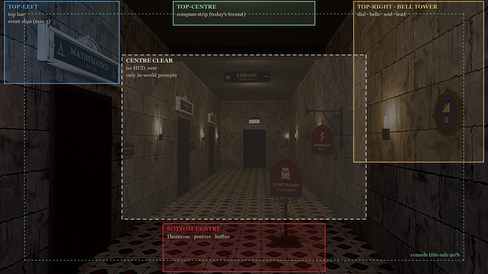
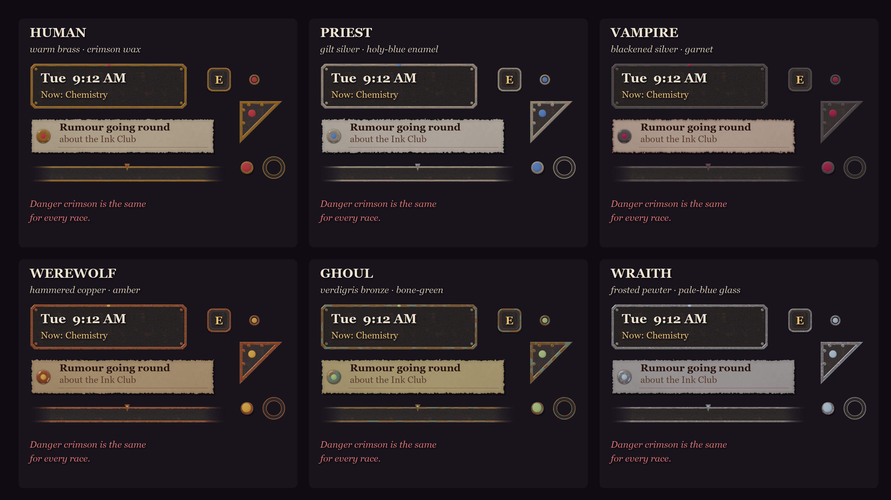
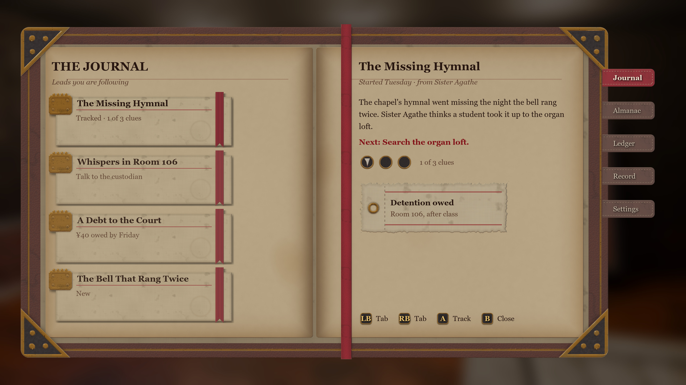
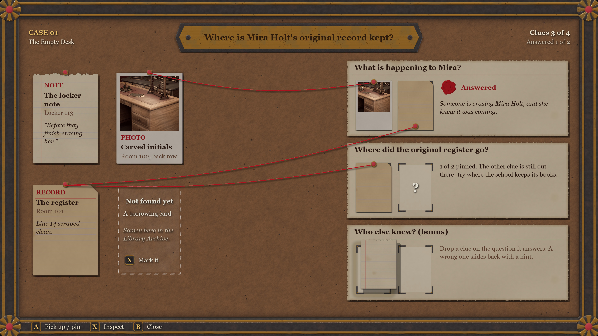
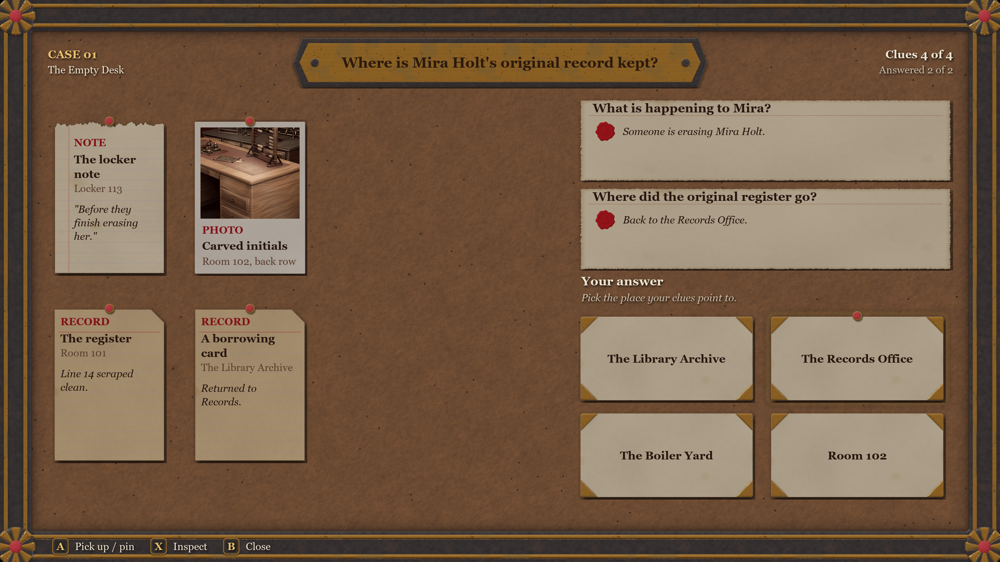
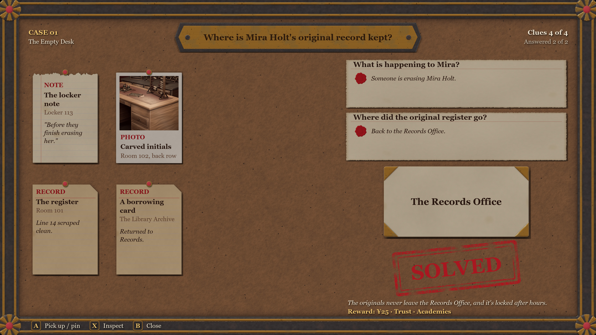
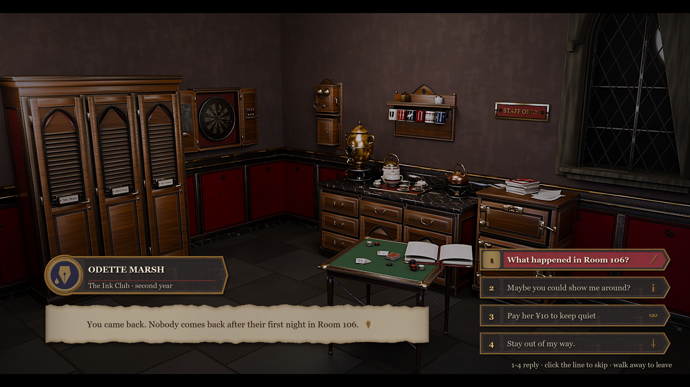

# Quiet Corners: the whole-screen UI, the Evidence Wall and dialogue (design)

**Status:** QC1–QC5 built lean in 2.38.0 (plan `docs/superpowers/plans/2026-11-22-quiet-corners-ui.md`); the Bell Tower trims and fold wait for the hook, now that R2 is merged. Originally: concept. The owner chose the direction in chat on 2026-11-21 (the choices are listed below). This written
spec is waiting for the owner's review. No game code has been written, and Studio wasn't touched.
**Mockups:** `docs/superpowers/mockups/2026-11-21-quietcorners/` (`overview.jpg` holds every state). They're made by
`art/ui/hud/make_quietcorners_mockups.py`, which also runs the text fit check (§9).
**Concept art (baked):**
- `art/ui/hud/make_quietcorners.py` writes to `out/quietcorners/`: race trims, slips, prompts, the compass strip, the
  book and the skip ring.
- `art/ui/hud/make_evidence_wall.py` writes to `out/evidence/`.
- `art/ui/hud/make_dialogue_ui.py` writes to `out/dialogue/`.

All three use the Thornrose and Bell Tower GGX shader (`make_health_pbr.py`).

**Owner's decisions (2026-11-21):**

| Question | Choice |
|---|---|
| Overall layout | **Quiet Corners**: keep the corner anchors players know; the centre stays clear |
| Idle behaviour | **Player's choice**: a `HudMode` setting, Always / Ghost / Vanish, default Ghost |
| Notifications | **Paper slips, top-left**, at most 3; danger goes to the Bell Tower |
| Combat | **Combat focus** |
| Menus | **The open book** (full screen) |
| Prompts | **On the object** |
| Materials | **Blackened iron** base, with the accent chosen by **race** (my pick when offered race or gender) |
| Compass | **Keep today's strip format** (`Gui.Compass`); new art only |
| Investigation | **Redesign:** "way cooler and way easier to understand", as the **Evidence Wall** |
| Dialogue | **Completely new art**, and a **clique crest made for this card** in place of the old wax seal ("I'm tired of seeing it") |
| Text | **No text clips through any UI or overlaps** (now a build check, §9) |

---

## 1. Screen zones

Design px at 1920 x 1080 (the kit's `AutoScale` turns them into real pixels).



| Zone | PC | Phone (landscape) | Console |
|---|---|---|---|
| **Top-left** | top bar (Menu, Chat, Students), then event slips under it | top bar (Menu, Chat, Journal), slips (at most 2) | as PC |
| **Top-centre** | the compass strip, with its readout under it | the compass strip at the phone scale | as PC |
| **Top-right** | the Bell Tower: dial, bell rail, conduct seal, lead card (R1 layout) | the Bell Tower at 0.5 (dial 140); the lead card folds to its title | as PC |
| **Bottom-centre** | Thornrose, the posture briar, the EXP strip, the hotbar | left of the touch arcs (`NHTouchReserveRight`, today's rule) | as PC; the D-pad steps the hotbar |
| **Bottom-right** | empty | touch arcs | empty |
| **Centre clear** (x 480..1440, y 216..864) | **no HUD, ever.** Only in-world prompts, which sit on their object | the same, scaled | the same |

- **Console:** everything sits inside the 90% title-safe area (5% each side), which is the dashed line in the mockup.
- **Phone:** the zones are in `00-zones-phone.jpg`. The compass (347 pt) fits between the top bar (215 pt) and the
  Bell Tower plate (from 606 pt) on an 844 x 390 phone. On a narrower phone it drops under the top bar, as
  `Gui.Compass` already does.

## 2. What shows when

A new client module, `Controllers.Gui.HudState`, owns one state and an idle timer. Each HUD cluster asks it for its
target transparency; nothing else changes how a cluster draws. The state is published as the Player attribute
`NHHudState`.

| State | Entered by | Top-left | Compass | Bell Tower | Bottom (vitals) | Slips |
|---|---|---|---|---|---|---|
| **Exploring, active** | movement plus anything changing | full | full | full | full | show |
| **Exploring, calm** (6 s with no change) | the idle timer | by `HudMode` | by `HudMode` | by `HudMode` | by `HudMode` | show (they wake) |
| **Combat** | a hit dealt or taken, Block, a posture change; it ends 4 s after the last hit | 35% | 35%, no readout | **folded**: the dial and bells only, status lines under them | full | **queued**; one stub reads "2 waiting". Danger still shows |
| **Seamless cut** | `CineUI` (tutorial spec §2.1) | 0 over 0.4 s | 0 | 0 | 0 | queued |
| **Dialogue** | `InDialogue` | 0 | 0 | 0 (Danger still shows) | 0 | queued |
| **Lessons** | the lesson screen (today) | as today | 0 | ghost | 0 | queued |
| **Menu (the book or the Evidence Wall)** | a book view opens | 0 | 0 | 0 | 0 | queued; they show when it closes |

**`HudMode`** (Settings > Display; saved in `PlayerData.Settings.HudMode`):
- **Always:** calm changes nothing.
- **Ghost** (the default): calm fades each cluster to 35% over 0.6 s.
- **Vanish:** calm fades everything except the dial (90%) and a 4 px crimson health thread at the bottom.

**Waking:**
- Anything that changes in a cluster (time, posture, a new Bell, an item) wakes only that cluster to full for 4 s.
- Hovering a cluster wakes it.
- Holding Tab or View for 0.3 s wakes everything.
- Low health (under 25%) keeps the vitals at full.

**Cooperating with seamless cuts:**
- The tutorial's `CineUI` keeps its 0.4 s fade.
- `HudState` treats the cut as its own state, so a cluster that wakes during a cut stays hidden.
- On exit, everything returns to the calm level. It doesn't flash to full.

## 3. Notifications and prompts

Each tier has one home. Nothing ever stacks in the centre.

| Tier | Examples | Where | Breaks through combat / cuts / menus | Sound |
|---|---|---|---|---|
| **1 Danger** | a Bell rises, Downed, Summons, the Tolling | the Bell Tower status lines, or the kit's `DangerAlert` | yes / yes / yes | the toll |
| **2 Action** | an interaction in reach | in-world prompt on the object | n/a | none |
| **3 Event** | a quest step, a clue found, a text, Yen, a rumour | a paper slip, top-left, 4 s, max 3 (2 on phones), newest on top | queued / queued / queued | a paper rustle |
| **4 Ambient** | a period change, the moon | the dial only (its hand and window) | - | none |

**Slips:**
- **Art:** `Slip<Race>`, 400 x 80. The pin carries the race's gem.
- **Text:** the title at 22 px bold and the detail at 20 px, both live.
- **Clicking or tapping a slip** opens what it's about: a text opens the Texts app, a clue opens the Evidence Wall,
  and a quest step opens the Journal.
- **Overflow:** queued slips collapse into one stub, *"N waiting"*.

**Prompts (`PromptUi`, re-arted):**
- **The nearest prompt** gets a `PromptCap<Race>` key-cap (56) with the key name, and a `PromptTag<Race>` (320 x 64)
  that unrolls beside it: the action at 22 px bold, the object at 20 px.
- **The others** show only a `PromptPip<Race>` (26).
- **Holding** fills the cap with `PromptCapFill`, tinted candle-gold, over `HoldDuration`.
- **Touch** shows TAP on the cap.
- **Gamepad** names come from `Components.KeyName`.
- **Today's opt-out** (`KeepDefaultStyle`) and the PromptShown / PromptHidden events don't change.

## 4. Art direction: Bloodline trims

- **Base:** every frame is **blackened iron** (the `Iron` maps, tint 0.22 / 0.21 / 0.24).
- **The accent** (beads, bezels, rivets, pins, gems and paper) follows the local player's **Lineage race** (the
  `Race` attribute, not the transient `Transformation`).
- **Each race is its own bake, not a tint,** so the metal keeps its specular colour.

| Race | Trim metal | Gem / glass | Paper |
|---|---|---|---|
| Human | warm brass (today's house look) | crimson wax red | cream parchment |
| Priest | gilt silver, with patches of gold leaf | holy-blue enamel | ivory vellum |
| Vampire | blackened silver | garnet | parchment with an oxblood edge |
| Werewolf | hammered copper (dimpled height) | amber resin | tea-stained paper |
| Ghoul | bronze with verdigris patches | bone-green glass | grave-yellow paper |
| Wraith | frosted pewter (frost speckle) | pale-blue glass | ash-grey vellum |



- **Danger crimson is house-wide.** Bell states, warnings, the thread on the Evidence Wall and the ribbon in the book
  are the same for every race, so danger reads the same for everyone.
- **Shader:** the shared GGX/Cook-Torrance bake. A warm key, a cool fill and a candle rim, plus a reflected
  environment, AO and a filmic roll-off.
- **Paper albedo** is procedural (no tiled motifs on big sheets), over the `Paper` fibre normals.
- **Production resolution:** 2x design size, at most 2048 a side.
- **Full-screen pieces** (`Book`, `Wall`) are concept bakes. For upload they split into 9-slices and tiles so
  each image stays at or under 2048 and stays sharp:
  - **The book:** `BookBoard` (9-slice), `BookPage` (9-slice), `BookGutter`, and `BookCorner<Race>`.
  - **The wall:** `WallFrame` (9-slice), `Cork` (the 512 tile already baked), and the corner rosettes.

## 5. The compass (today's strip, new art)

`Gui.Compass` keeps everything it does today:
- the slim strip across the top centre, with faded ends;
- N/E/S/W in the title font, N in crimson;
- ticks every 15 degrees;
- place icons within range;
- the tracked objective in gold, pinned at the edge when it's behind you;
- the readout under the strip, which falls back to the region name.

Only the art changes:

| Piece | Size | What |
|---|---|---|
| `CompassStrip<Race>` | 1200 x 112 | an iron channel with trim beads top and bottom, its ends fading out (design 560 x 52) |
| `CompassLubber<Race>` | 96 x 120 | the centre pointer: trim metal with the race's gem, hung over the top bead |
| `CompassTicks` | 600 x 48 | greyscale engraved ticks, tileable (30 degrees), scrolled with `ImageRectOffset` |

- **The rules don't change.** Intercardinals are now 20 px (they were 15), and letters never draw within 16 px of a
  place icon or the objective.

## 6. Menus: the open book



**Layout:**
- **The book:** 1660 x 943, over the world, blurred and dimmed to 42%.
- **The left page** is the index, or the list.
- **The right page** is the detail.
- **Leather tabs** hang off the right board: Journal, Almanac, Ledger, Record, Settings. The Evidence Wall opens from
  the Journal, or from a clue slip.

**Text:** titles 32 to 34 px, body 22, notes 20. It's ink colours on paper, with crimson only for "next" and danger.

**Controls:**

| Input | Change tab | Close |
|---|---|---|
| Keyboard and mouse | click a tab | Esc |
| Gamepad | LB / RB | B |
| Touch | tap a tab | the X on the board |

**Other rules:**
- The page footer always shows the hints for the input in use (`Components.InputKind`).
- **Phones:** the spread clamps to the screen (`ClampPanels`). On screens under 600 pt tall the book shows **one page
  at a time** (the index first, then a slide to the detail), so text never shrinks below the phone floor.
- **Reduce Motion:** tabs cut instead of turning the page.

## 7. The Evidence Wall (investigation, redesigned)

**Why:** today's Case Files tab asks you to tap two clues and press Connect, without knowing what you're aiming for.
The new wall always tells you **what you're trying to answer**, splits it into **small questions**, and lets you
**drop each clue on the question it answers**.



### 7.1 Layout (full screen, menu state)
- **The frame:** an iron-framed cork board with brass trim and rosettes (`Wall`).
- **The plate** (`CasePlate<Race>`, 800 x 100, at the top) engraves **the case's big question** at 28 px. It never
  scrolls away.
- **Top-left:** the case number and name. **Top-right:** progress (*Clues 3 of 4 · Answered 1 of 2*).
- **The left of the board** holds **clue cards** (220 x 300), pinned with race tacks. Each card's **kind shows in its
  shape and in a word**:

  | Kind | Card |
  |---|---|
  | **Photo** | photo card; the photo is live (a ViewportFrame snapshot or an image) |
  | **Note** | torn notebook page |
  | **Record** | index card |
  | **Object** | manila evidence tag |

  Each card shows the kind, the clue's name, where you found it and a short quote.
- **Clues you haven't found** show as a **chalk outline**: *Not found yet*, the clue's name, a hint of where it is,
  and **X Mark it**, which pins it on the compass.
- **The right of the board** holds **question sheets**, one per link. Each has the question, two **pin slots**, and its
  state:
  - **empty:** *"Drop a clue on the question it answers"*;
  - **half pinned:** a hint;
  - **answered:** a crimson wax seal and the insight, typed in.
- **Crimson thread** runs from each clue card to every slot it's pinned in. A clue can sit in more than one question.
- **The frame's foot** carries the control hints.

### 7.2 Playing it
1. **Pick up** a clue: drag it, press A, or tap it. Every slot it could go in glows.
2. **Drop it** on a question's slot.
3. **When both slots** of a question hold clues, the client sends the pair with the question's id.
   - **Right:** the thread draws in, the seal stamps, and the insight types out. This is today's `LinkHit`.
   - **Wrong:** both cards slide back to the left and shake (today's `LinkMiss`). After two misses on the same
     question, its hint line appears.
4. **When `Needs` questions are answered,** the right side turns into **Your answer**: the deduction options as
   `AnswerCard`s (4 for The Empty Desk). Pick one:
   - **Right:** the card centres, and a **SOLVED** stamp slams beside it. Then the `Solved` line, the reward, and what's
     next.
   - **Wrong:** the cards shake and today's `Wrong` text shows.

| Answer | Solved |
|---|---|
|  |  |

**Inspect (X or right click)** lifts a card under the `Lens<Race>` magnifier and shows its full text at 22 px.

### 7.3 Data (small, additive)
- **`Config.Cases[...].Questions`** (new, public): `{ Id = "Erased", Ask = "What is happening to Mira?", Hint = "..." }`,
  one per link.
  - The `Id` matches the link `Id` in `ServerStorage.QuestSecrets`.
  - Which clues belong in it stays secret, on the server.
- **The remote:** `Investigation` gets the question id with the pair. The server checks the pair against **that** link
  only, so a right pair in the wrong question is a miss.
  - The current `Connect(a, b)` stays working until the wall replaces the Journal tab.
- **Nothing is saved differently.** Insights are today's link ids; pinned-but-unanswered slots are client-only.

### 7.4 The Empty Desk's questions (proposal)

| Link | Ask | Hint |
|---|---|---|
| Erased | What is happening to Mira? | "Her desk and the register both lost something." |
| Originals | Where did the original register go? | "Try where the school keeps its books." |
| Warned (bonus) | Who else knew? | "Someone told you exactly where to look." |

### 7.5 Phone and console
- **Phone:**
  - The plate stays at the top.
  - The clues become a horizontal tray along the bottom, and the questions stack in the middle as a scrolling list.
  - To pin, **tap a clue, then tap a slot**. No drag is needed.
- **Console:** the D-pad moves between cards and slots. A picks up and pins, X inspects, and B puts a card back or
  closes the wall.

### 7.6 Accessibility
- **Kind:** shown by shape and word.
- **State:** shown by a seal and words (Answered, 1 of 2 pinned), not only colour.
- **Reduce Motion:** the thread appears without drawing in, the shake becomes a 0.2 s red outline, and the stamp
  fades in.
- **Reduce Flash:** no glow pulse on the slots.

## 8. Dialogue (all-new art)



The talk-cinematic camera, its thin bars and its blur (1.35.1) stay. The on-screen part is new:

| Piece | Size | What |
|---|---|---|
| `CallingCard<Race>` | 1040 x 240 | the speaker's card, lower-left: blackened iron, trim bead, a crimson rule, a socket for the crest |
| `Crest<Clique>` | 512 | the speaker's clique crest, **replacing the wax seal**: a cameo with a beaded metal rim, a guilloche-engraved enamel dome in the clique's colour, and a raised emblem, all fully baked (not tinted). Ink Club: a nib and an ink drop on indigo. Vigil: a lantern, silver on midnight. Crimson Court: a chalice with a blood drop on oxblood. Athletes: a laurel and star, copper on green. Delinquents: a broken padlock, steel on rust. Pack: a paw, bone on black. Ordinary: a key, pewter on slate. Chapel Choir: a haloed cross, gold on ivory. **Unaffiliated** (`CrestUnaffiliated`, owner decision 2026-11-22): the one crest with no enamel. Its engine-turned field is left bare and oxidised (no colour was ever poured), and the emblem is a blank, unmarked heater shield in polished iron-pewter with a raised border: "no arms". It is the only all-metal crest, so it can't be mistaken for a clique. **Rule:** any NPC or staff member without a clique (teachers, the custodian, townsfolk, a new student who hasn't joined one) shows `CrestUnaffiliated`; it is never `Theme.Images.Seal`, which the owner has retired from new UI, and never left empty. All 9 crests animate (below). |
| `Ribbon` | 2048 x 280 | a torn, burnt-edged parchment ribbon across the lower third (a 9-slice in game); the line is inked on it |
| `ReplyTab<Race>` / `ReplyTabOn<Race>` | 1000 x 128 | the replies, stacked bottom-right: an iron tab with a key-cap socket; the selected one has crimson velvet |
| `ToneKind` / `ToneSly` / `ToneThreat` / `ToneAsk` | 96 | tone marks in relief: candle, mask, dagger, quill |
| `Nib` | 96 | a quill nib that bobs at the end of a line when it has finished typing |

**Card and line:**
- **The card:** the name at 24 px bold caps; the clique and year at 20 px.
- **The line:** 24 px ink, typed at the existing `typewriter` rate. Clicking the ribbon skips the typing.

**Replies:**
- Each reply is 22 px, with its number in the socket. The tone mark is new: it tells you what kind of answer it is
  before you pick it.
- The kit's `DialogueBox` reply data gains an optional `tone`.
- **Controls:**

  | Input | Choose a reply | Leave |
  |---|---|---|
  | Keyboard | 1-4 | walk away |
  | Gamepad | D-pad, then A | B |
  | Touch | tap a tab | - |

**Crest animation** (owner requirement 2026-11-22; all 9 crests). The crest is the one moving thing on the card, and
it moves the way metal does: it catches the light, then rests. Nothing spins, bounces or loops constantly.

- **Art:** `CrestFlip<Clique>.png`, 1024 x 1024, a 4 x 4 flipbook of 256 px frames (row by row). Frame 0 is the crest
  at rest (the same art as `Crest<Clique>.png`); frames 1-15 are one light-catch that fades in from frame 0 and back
  out to it, so the loop never pops (checked: the frame 15 to frame 0 step is as small as the frame 0 to 1 step).
  Played by stepping `ImageRectOffset` (`ImageRectSize` 256 x 256). No `AnimatedImage` or UI particles (both beta).
- **The light-catch, per crest** (one second at 15 fps):

  | Crest | What catches the light |
  |---|---|
  | Ink Club | a glint runs down the nib to its tip, then the ink drop glimmers wet |
  | Vigil | the lantern flame gutters up and settles; its warm glow fills the window, and a soft sheen crosses the lantern |
  | Crimson Court | the blood drop flashes, then the light pours down the chalice |
  | Athletes | the laurel lights leaf by leaf, bottom to top, then the star |
  | Delinquents | a hard glint slides along the crack and over the shackle |
  | Pack | moonlight crosses the four toes one by one, then settles on the pad |
  | Ordinary | the light runs the key from bow to teeth |
  | Chapel Choir | a light travels once round the halo, then down the cross |
  | Unaffiliated | one slow, wide sheen crosses the blank shield like a mirror, and the rim with it |

- **Idle timing:** after the entrance, hold frame 0 for a random 5-8 s, play frames 1-15 at 15 fps, return to frame
  0, repeat. An idle catch never plays while a line is typing; it waits for the typing to finish, so it never
  competes with the text (the entrance's one catch is the only exception).
- **Entrance** (when the card appears): the card fades in over 0.18 s with a 12 px slide from the left. At 0.12 s the
  crest drops into the socket: from 118 % size and fully transparent to 100 % and opaque in 0.2 s (Cubic Out), then
  presses to 96 % and back in 0.12 s (Sine InOut), as if seated, then plays one light-catch straight away. The name
  and clique fade in from 0.2 s.
- **Reduce Motion** (`NHReducedMotion`): frame 0 only. The crest appears with the card in a single 0.2 s fade; no
  press, no light-catch, no idle loop.
- **Preview:** `11-crests-idle.mp4` / `.gif` (all 9 idling, staggered) and `12-dialogue-crest-entrance.mp4` / `.gif`
  (a no-clique custodian's card arriving), in this mockup folder. `10b-dialogue-unaffiliated.jpg` is the full screen.
- **Client playback** (sketch for the dialogue card controller; not installed):

  ```lua
  local TweenService = game:GetService("TweenService")
  local Players = game:GetService("Players")
  local FRAME, COLS, FRAMES, FPS = 256, 4, 16, 15

  local function setFrame(img: ImageLabel, i: number)
      img.ImageRectSize = Vector2.new(FRAME, FRAME)
      img.ImageRectOffset = Vector2.new((i % COLS) * FRAME, (i // COLS) * FRAME)
  end

  -- crest: ImageLabel in the card socket, Image = Config.DialogueArt.CrestFlip[clique or "Unaffiliated"]
  -- isTyping: () -> boolean, from the typewriter
  local function playCrest(crest: ImageLabel, isTyping: () -> boolean): () -> ()
      local alive = true
      setFrame(crest, 0)
      if Players.LocalPlayer:GetAttribute("NHReducedMotion") == true then
          crest.ImageTransparency = 1
          TweenService:Create(crest, TweenInfo.new(0.2), { ImageTransparency = 0 }):Play()
          return function() alive = false end
      end
      local function catch()
          for i = 1, FRAMES - 1 do
              if not alive then return end
              setFrame(crest, i)
              task.wait(1 / FPS)
          end
          setFrame(crest, 0)
      end
      task.spawn(function()
          local size = crest.Size
          crest.Size = UDim2.new(size.X.Scale * 1.18, size.X.Offset * 1.18, size.Y.Scale * 1.18, size.Y.Offset * 1.18)
          crest.ImageTransparency = 1
          task.wait(0.12)
          local drop = TweenService:Create(crest, TweenInfo.new(0.2, Enum.EasingStyle.Cubic, Enum.EasingDirection.Out),
              { Size = size, ImageTransparency = 0 })
          drop:Play(); drop.Completed:Wait()
          local press = TweenService:Create(crest, TweenInfo.new(0.06, Enum.EasingStyle.Sine, Enum.EasingDirection.InOut,
              0, true), { Size = UDim2.new(size.X.Scale * 0.96, size.X.Offset * 0.96, size.Y.Scale * 0.96, size.Y.Offset * 0.96) })
          press:Play(); press.Completed:Wait()
          catch()
          while alive do
              task.wait(5 + math.random() * 3)
              while alive and isTyping() do task.wait(0.25) end
              if alive then catch() end
          end
      end)
      return function() alive = false end   -- call when the card closes
  end
  ```

  The crest's `AnchorPoint` is 0.5, 0.5 so the drop and press scale about the socket's centre.

**Layout rules:**
- The ribbon's text box is set by its torn edges, and the card overlaps only the ribbon's top margin. Both are fit
  checked.
- **Phones:** the card and ribbon span the bottom (the ribbon at 0.66 scale, as dialogue today), and the replies stack
  above the ribbon on the right, left of the touch arcs. The touch buttons are hidden in dialogue already.

## 9. Text fit (the owner's rule: nothing clips or overlaps)

`make_quietcorners_mockups.py` runs a fit check on every screen, and the build **fails** if:
- any text is under **20 design px**;
- any text leaves the **content box measured from its art** (for example, the LeadCard's title band is 150..880 x
  30..92 of its 1000 x 300 art; the Slip's text box ends above its ruled line);
- **two texts overlap**;
- a text **partly overlaps a UI piece it doesn't sit on**.

**The same check goes into the game's HUD fit check** (Bell Tower polish), using each element's `AbsolutePosition` /
`AbsoluteSize` and `TextBounds`, at 1920 x 1080, 1366 x 768, 844 x 390 and 667 x 375.

**Contrast:** text on every tint of every race passes WCAG 3:1 (4.5:1 for body text), checked with
`Color3:GetContrastRatio` in the same test.

## 10. Accessibility

| Setting | Effect |
|---|---|
| **Reduce Motion** (`NHReducedMotion`) | no slides, swings, shakes, page turns, typing or nib bob. The HUD fades still happen, but as 0.2 s cross-fades. |
| **Reduce Flash** (`NHReducedFlash`) | no glows, no flashes, no UI Particles |
| **Contrast** | §9. Gold and amber on iron, ink on paper. Danger is also shown by words and shapes (bell states, seals, "NAMED"). |
| **Text size** | at least 20 design px everywhere, and the phone floor (`PhoneTouchMin` 0.62) still applies. |
| **`HudMode`** | lets players who need the HUD on all the time keep it there (Always). |

## 11. Platform features

| Feature | Status | Use |
|---|---|---|
| **UIShadow** | live | text shadows on gold, amber and bone text over the world (the mockups draw this shadow); an inset shadow on pressed reply tabs and slots; a knockout shadow under the compass glass; gradient glows for slot highlights instead of images |
| **`Color3` contrast methods** | live | the fit test (§9) |
| **Input Action Manager** | live | every new binding: J Journal, the wall's A / X / B, reply 1-4, the Tab / View peek, `HudMode` |
| **Performance Simulator** | live | a pass at Q1 with the book and the wall open |
| **UI Particles** (`ParticleEmitter2D`) | Studio beta | a puff of chalk dust when a clue pins, ink flecks on the SOLVED stamp, paper dust when a slip lands. **Everything looks complete without them.** |

## 12. Piece list (sizes, in the style of the Bell Tower spec §6)

| Set | Piece | Size | Tinted in game |
|---|---|---|---|
| Quiet Corners | `Slip<Race>` | 800 x 160 | no |
| | `PromptCap<Race>`, `PromptCapFill` | 256 | the fill (candle-gold) |
| | `PromptTag<Race>` | 640 x 128 | no |
| | `PromptPip<Race>` | 96 | no |
| | `PlateTrim<Race>` (9-slice, centre 120..1080 x 120..280) | 1200 x 400 | no |
| | `SkipRing<Race>`, `SkipRingFill` | 256 | the fill |
| | `CompassStrip<Race>` | 1200 x 112 | no |
| | `CompassLubber<Race>` | 96 x 120 | no |
| | `CompassTicks` | 600 x 48 | yes (bone) |
| | `Book` (concept; it splits for upload, §4), `BookCorner<Race>` | 2048 x 1164, 320 | no |
| | `BookTab`, `BookTabOn` | 400 x 160 | no |
| Evidence Wall | `Wall` (concept; it splits for upload), `Cork` (tile) | 2048 x 1152, 512 | no |
| | `CasePlate<Race>` | 1600 x 200 | no |
| | `CardPhoto` / `CardNote` / `CardRecord` / `CardObject` | 440 x 600 | no |
| | `CardMissing` | 440 x 600 | yes (chalk) |
| | `Slot` | 440 x 600 | no |
| | `QuestionSheet` | 1440 x 560 | no |
| | `Tack<Race>` | 96 | no |
| | `Thread` | 512 x 24 | yes (crimson) |
| | `AnswerCard<Race>` | 720 x 360 | no |
| | `Lens<Race>` | 640 | no |
| | `StampInk` | 640 x 240 | yes (crimson) |
| Dialogue | `CallingCard<Race>` | 1040 x 240 | no |
| | `Crest<Clique>` (9: the 8 cliques and `CrestUnaffiliated`) | 512 | no |
| | `CrestFlip<Clique>` (9 flipbooks, 4 x 4 frames of 256) | 1024 | no |
| | `Ribbon` (9-slice, centre 240..1808) | 2048 x 280 | no |
| | `ReplyTab<Race>`, `ReplyTabOn<Race>` | 1000 x 128 | no |
| | `Tone*`, `Nib` | 96 | no |

**Upload and wiring:**
- The ids go in `Config.QuietCornersArt`, `Config.EvidenceArt` and `Config.DialogueArt`, keyed `[piece][race]` (the
  pattern of `Config.BellTowerArt`).
- **If an id is missing,** the Human trim draws instead, and if that's missing too, today's kit art draws. Nothing
  breaks before upload.
- **Count:** 6 races x 13 per-race pieces (78 images), plus about 43 shared (including the 9 crests and 9 crest flipbooks).

## 13. Releases (each one playable and tested before the next)

| Release | Builds | Acceptance |
|---|---|---|
| **QC1 · State and slips** | `HudState`, the `HudMode` setting, the slips top-left, combat focus, the cut / dialogue / menu states | each state in §2 shows and hides the right clusters; a seamless cut hides everything and returns to calm, not full; queued slips appear after combat; the fit test passes at the four sizes |
| **QC2 · Trims and prompts** | art upload; race trims on the Bell Tower plate, slips, prompts, compass strip; the `PromptUi` re-art | each race shows its own trim; the nearest prompt shows a cap and tag, the others a pip; hold fill works on mouse, touch and pad |
| **QC3 · Dialogue** | the calling card, the ribbon, reply tabs, tone marks; the `DialogueBox` `tone` field | every existing NPC conversation reads with no clipping (fit test over the dialogue lines in `Social.Dialogue`); keys, pad and touch |
| **QC4 · The book** | the Journal, Almanac (Bell Tower R4), Ledger, Record and Settings as book tabs | each tab's numbers match its source; one-page mode on phones |
| **QC5 · The Evidence Wall** | the wall, `Config.Cases.Questions`, the question id on the remote | The Empty Desk can be solved by dropping clues; a right pair in the wrong question is a miss; a missing clue's Mark it sets the compass; a two-player run (two cases in progress, one server) |

**Order:**
- These come **after** the planned strafe walk imports and NPC gestures.
- QC1 and QC2 fold into the **Bell Tower polish** (they use the live UIShadow and contrast features).
- QC3 to QC5 follow.
- **Testing:** single-player Studio runs, plus the fit test through the test bridge.
- **Studio:** coordinate with the session that holds NH Combat Test at the time ("Studio released").

## 14. Limits and open questions
- **Race trims cost uploads:** 78 per-race images. If that's too many, Human, Vampire and Priest could ship first and
  the rest fall back to Human.
- **The photo on Photo clues** needs a picture per clue: a ViewportFrame snapshot of the clue object, or a baked image
  per clue. **Recommendation:** baked images, since ViewportFrames are costly on phones.
- **The crests could replace the wax-seal avatars in the phone's Texts app too** (`TextAvatar`), so the seal stops appearing there as well. That's a small follow-up once they're uploaded.
- **Tone marks** need a tone on every reply in `Social.Dialogue`. Replies without one show no mark.
- **Gender** was offered as a basis for the trims and not used: body type isn't a gameplay identity, so the UI doesn't
  change with it.
