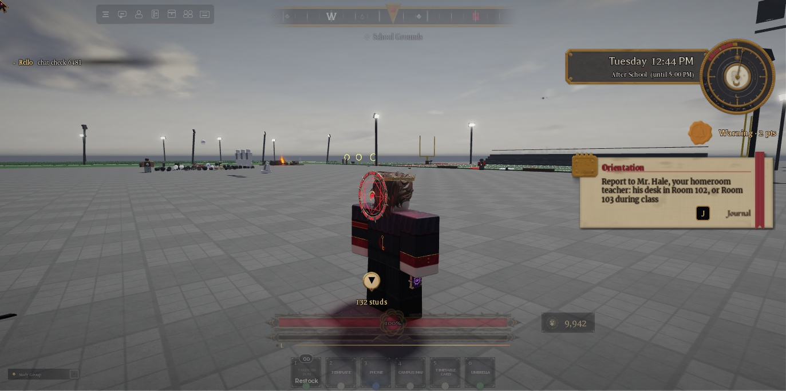
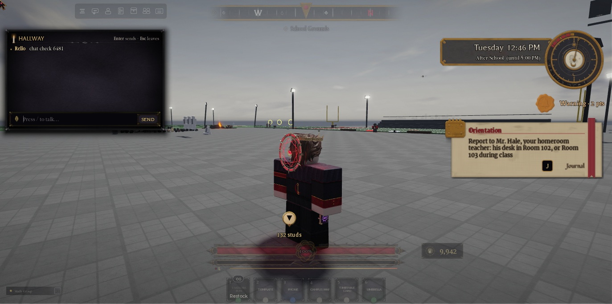
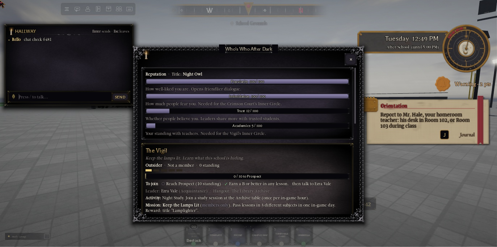

# Chat and Factions UI: report (2026-11-25)

> **Saved:** the owner saved NH Combat Test on 2026-11-25, with this work installed. Any "place not saved" below was true when it was written.

Branch `chat-factions-ui`. Spec: `docs/superpowers/specs/2026-11-25-chat-factions-ui-design.md`.
Plan: `docs/superpowers/plans/2026-11-25-chat-factions-ui.md`.

**Place not saved.** Everything is installed in NH Combat Test (Studio) only.

## Install

Installed with `install_inplace`; no PARSE FAIL, MISSING or CHANGED SINCE lines.
Backup: `ServerStorage.NH_Backup.ChatFactionsUI_pre_20261125`.

| Module | Size |
|---|---|
| `ReplicatedStorage.UI.Motion` (new) | 11568 bytes |
| `StarterPlayer.StarterPlayerScripts.Controllers.Gui.Chat` | 28281 bytes |
| `StarterPlayer.StarterPlayerScripts.Controllers.Gui.FactionsPanel` | 18187 bytes |
| `StarterPlayer.StarterPlayerScripts.Controllers.Gui.QuestJournal` | 43564 bytes |

## Final round

Studio: NH Combat Test, Play round on studio a6945a86-d556-46f2-87fa-476b87c8c2dc (Studio was restarted mid-day; the
earlier id b9e911b4-... closed). Every check passed.

| Check | Output |
|---|---|
| cine (before) | `PASS CineState=nil Seen=nil Origin=nil` |
| `buttons_play` | `PASS buttons_play` |
| `factions_play` | `PASS factions_play` |
| `motion_play` | `PASS motion_play` |
| `chat_play` | `PASS chat_play` |
| cine (after restore) | `PASS CineState=nil Seen=nil Origin=nil` |
| `motion_edit` (Edit, after Play stopped) | `PASS motion_edit` |

Restore: `restored` (slot 2 from the pre-round snapshot). Play stopped.

## Final fix round

- Reduce Motion is read every loop step: candles and glints always register and rest (built size and colour, glint
  at A) while it is on, so the saved setting arriving after start-up stills them; they resume when it is turned off.
- Rise keeps its stagger under Open: Open's fade (one Heartbeat after Open) hides the sections still waiting again.
- A Close drops the panel's pending Rise and SmokeIn fade-ins. Close is the true reverse of Open (scale to 0.985,
  drop 10 px, fade, 0.2 s, then hide).
- Rumours are italic and dim. `factions_play` catches the unequip inside the hook, so the real title isn't touched.
- New module sizes: `UI.Motion` 14134 bytes, `FactionsPanel` 18219 bytes, `QuestJournal` 43600 bytes (comment only).

| Check | Output |
|---|---|
| `motion_edit` (Edit, before Play) | `PASS motion_edit` |
| cine (before) | `PASS CineState=nil Seen=nil Origin=nil` |
| `motion_play` | `PASS motion_play` |
| `factions_play` | `PASS factions_play` |
| `chat_play` | `PASS chat_play` |
| `buttons_play` | `PASS buttons_play` |
| cine (after restore) | `PASS CineState=nil Seen=nil Origin=nil` |
| `motion_edit` (Edit, after Play stopped) | `PASS motion_edit` |

Restore: `restored`. Play stopped. The equipped title after the round: "Night Owl" (unchanged; not re-equipped).

## Screenshots

- Quiet chat, after about 13 s idle: only the line "Rello  chat check 6481" with a soft dark band behind it. No frame,
  header or bar. No left-edge Factions or Journal buttons.
  
- Awake chat, after `Chat.Focus()`: iron frame, gold HALLWAY header with the candle, the line, and the "Press / to talk..."
  bar with SEND.
  
- Factions panel, about 3 s after `FactionsPanel.Toggle(true)`: "Who's Who After Dark" plaque, x close, candle top-left,
  Reputation with "Title: Night Owl" and four bars (Popularity 100, Intimidation 100, Trust 12, Academics 5), The Vigil
  card in its gold wash, Outsider with 1 of 5 pips lit.
  

## Deviations from the plan

All decided by the controller.

- Candle art lives in `Theme.SubGames` (`CandleBody` / `CandleFlame`), not `Theme.Images`. Both candles are same-size
  overlay squares with the flame anchored at its wick tip (208/256), per Theme.luau's anchor note.
- `Motion.Candle` flickers size and brightness (`ImageColor3`), not `ImageTransparency`, so panel fades own transparency
  (the flame used to pop lit during a close).
- `Motion.Open`, `Close` and `Rise` record fade bases first and hide with zero-length tweens. `Open` starts its fade one
  Heartbeat later (overlapping Open and Rise used to leave sections invisible, and Open's fade used to be lost).
- `Motion.Fill` and `SmokeIn` cache their built targets. `Motion.Pips` sets the exact colour when a pip's tween completes.
- The chat's quiet vignette is sized to the line block (it used to be window-sized and sat below a single line).
- The left-edge Factions and Journal buttons are hidden (owner request, Task 4).
- The checks compare float properties with tolerances.
- Approximate timing: the quiet-chat screenshot was taken after about 13 s idle; the brief said 12 s. The chat goes
  quiet at 10 s and the fade takes 0.6 s, so both are past the settled quiet state.

## Testing side effects

- Before the final fix round, `factions_play`'s unequip step cleared the equipped title (it was put back each round,
  "Night Owl", confirmed). Since the final fix round the unequip is caught by the hook too, so the real title isn't touched.
- One Play round was cut short when the Studio MCP link died (a stale admin StudioMCP held the hub port). Slot 2 was
  unchanged and was restored from the pre-round snapshot.

## For the owner

- How the look feels in motion, including whether the open-panel animation feels right.
- The candle's speed and size. It is small: about 17 px in the chat header and about 20 px on the panel.
- Whether the quiet chat's dark band reads over bright scenes.
